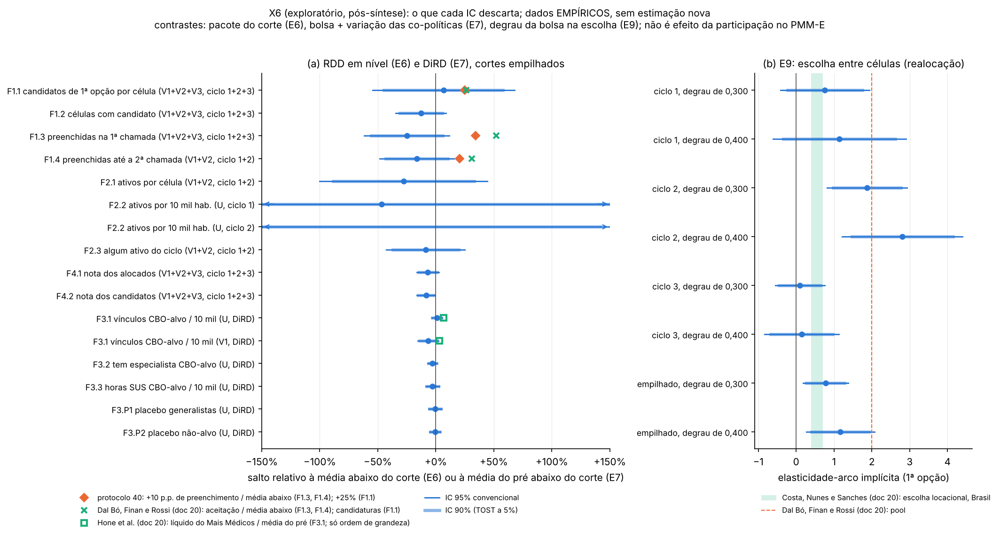

# 46 — Resultados exploratórios pós-síntese (X1–X6)

## X6 — Poder e o que se descarta

> **Protocolo:** [`45_protocolo_exploratorio_pos_sintese.md`](45_protocolo_exploratorio_pos_sintese.md), §3 X6,
> congelado em 19/10/2026. 
> **Estatuto:** exploratório e pós-resultado (`estatuto = EXPLORATORIO_POS_SINTESE`). Não muda o protocolo 40, os
> resultados E3–E9 nem o Holm das primárias. 
> **Script:** `scripts/rdd_bolsa/20_poder_descartes.py`. Nenhuma estimação nova: só aritmética sobre o EP, o IC e as
> médias já publicados no E6, E7, E8 e E9. 
> **Saídas:** `output/rdd_bolsa/X6_poder_descartes.csv`, `output/rdd_bolsa/X6_resumo.json` (natureza dos dados:
> **EMPIRICO**; entradas com SHA-256) e `output/rdd_bolsa/X6_figuras/X6_descartes.png`. 
> **Testes:** `tests/test_x6_poder.py`. Todo número desta seção está entre marcadores `<!-- X6:... -->`, gerados
> só a partir das saídas do X6 por `python3 scripts/rdd_bolsa/20_poder_descartes.py --atualizar-doc`; o teste
> confere os blocos e que a prosa fora deles só tem parâmetros.

### X6.1 Pergunta e definições

A síntese (doc 44) relata IC, mas não uma tabela de poder comparável entre outcomes. Para cada linha principal do
E6 (P1 e F0–F4, cada corte e empilhado, ciclos empilhados onde definidos, mais o Poisson local de F1.1), do E7
(DiRD da família F3) e do E9 (coeficiente da bolsa, por ciclo e empilhado), o X6 calcula:

- **MDE de 80%:** o menor salto que o desenho detecta com 80% de poder num teste bicaudal a 5%, 2,8 × EP (a
  convenção do E5). Na razão de chances, é a exponencial de 2,8 × EP do log;
- **o que o IC 95% convencional descarta**, em termos absolutos e relativos à média abaixo do corte na janela. Nas
  linhas empilhadas, a base é a média das médias abaixo de cada grupo ponderada pelos mesmos pesos que definem o
  estimando empilhado. No E7, a base é a média do pré abaixo do corte, como no doc 44;
- **equivalência:** a menor margem simétrica δ tal que o IC 90% fica dentro de [−δ, +δ]; para toda margem maior que
  δ, o TOST a 5% declara o efeito equivalente a zero;
- **comparação** com as referências do protocolo 40 (+10 p.p. de preenchimento, +25% de candidaturas) e com
  magnitudes da literatura lidas do doc 20 da seção 03;
- **se o IC honesto é informativo:** se, com o M do protocolo, ele exclui a referência, uma magnitude da literatura
  aplicável, ou fica dentro de ±100% da base.

**Contraste.** E6: pacote do corte (bolsa anunciada e outras regras federais nos mesmos cortes). E7: bolsa mais a
variação das co-políticas. E9: degrau da bolsa na repartição da 1ª opção entre células, não no total de
candidatos. Nenhum é efeito da participação no PMM-E nem do Agora Tem Especialistas.

**Como ler.** "Descartar" quer dizer que o limite do IC fica do outro lado da magnitude, sob o IC convencional e a
aproximação local linear. Um IC que descarta +10 p.p. porque a estimativa pontual é negativa não equivale a um
desenho com poder contra +10 p.p.: a coluna do MDE separa as duas coisas.

### X6.2 Poder e descartes nas linhas que a síntese lê

Linhas empilhadas (cortes e ciclos) e o E9. A tabela completa, com cada corte e cada ciclo, está no CSV.

<!-- X6:tabela_poder:inicio -->
| Outcome | Pop. | Ciclo | Contraste | Salto | EP | MDE 80% | IC 95% | Média abaixo | IC 95% relativo | MDE relativo | δ TOST (abs.; rel.) | IC honesto informativo? |
|---|---|---|---|---|---|---|---|---|---|---|---|---|
| F1.1 candidatos de 1ª opção por célula | V1+V2+V3 | 1+2+3 | pacote (nível) | +0,063 | 0,293 | 0,819 | [−0,511; +0,636] | 0,940 | [−54 %; +68 %] | 87 % | 0,544; 58 % | não |
| F1.2 células com candidato | V1+V2+V3 | 1+2+3 | pacote (nível) | −7,0 p.p. | 6,1 p.p. | 17,0 p.p. | [−18,9 p.p.; +4,9 p.p.] | 54,9 p.p. | [−34 %; +9 %] | 31 % | 17,0 p.p.; 31 % | não |
| F1.3 preenchidas na 1ª chamada | V1+V2+V3 | 1+2+3 | pacote (nível) | −7,3 p.p. | 5,4 p.p. | 15,2 p.p. | [−17,9 p.p.; +3,4 p.p.] | 29,0 p.p. | [−62 %; +12 %] | 52 % | 16,2 p.p.; 56 % | não |
| F1.4 preenchidas até a 2ª chamada | V1+V2 | 1+2 | pacote (nível) | −8,0 p.p. | 8,0 p.p. | 22,3 p.p. | [−23,6 p.p.; +7,6 p.p.] | 48,9 p.p. | [−48 %; +15 %] | 46 % | 21,1 p.p.; 43 % | não |
| F2.1 ativos por célula | V1+V2 | 1+2 | pacote (nível) | −0,136 | 0,181 | 0,507 | [−0,491; +0,218] | 0,490 | [−100 %; +45 %] | 103 % | 0,434; 89 % | não |
| F2.2 ativos por 10 mil hab. | U | 1 | pacote (nível) | −0,008 | 0,030 | 0,085 | [−0,068; +0,051] | 0,018 | [−385 %; +291 %] | 483 % | 0,058; 330 % | não |
| F2.2 ativos por 10 mil hab. | U | 2 | pacote (nível) | −0,079 | 0,082 | 0,229 | [−0,239; +0,081] | 0,039 | [−610 %; +207 %] | 584 % | 0,214; 545 % | não |
| F2.3 algum ativo do ciclo | V1+V2 | 1+2 | pacote (nível) | −5,2 p.p. | 10,1 p.p. | 28,3 p.p. | [−25,0 p.p.; +14,7 p.p.] | 58,6 p.p. | [−43 %; +25 %] | 48 % | 21,8 p.p.; 37 % | não |
| F4.1 nota dos alocados | V1+V2+V3 | 1+2+3 | pacote (nível) | −0,40 | 0,28 | 0,78 | [−0,94; +0,15] | 5,72 | [−16 %; +3 %] | 14 % | 0,85; 15 % | não |
| F4.2 nota dos candidatos | V1+V2+V3 | 1+2+3 | pacote (nível) | −0,45 | 0,21 | 0,60 | [−0,87; −0,03] | 5,38 | [−16 %; −1 %] | 11 % | 0,81; 15 % | não |
| P1 índice atração-presença | V1+V2+V3 | 1+2+3 | pacote (nível) | −0,13 DP | 0,16 DP | 0,45 DP | [−0,44 DP; +0,19 DP] | — | — | — | 0,39 DP; — | — |
| F3.1 vínculos CBO-alvo / 10 mil | U | pós | DiRD | +0,083 | 0,200 | 0,561 | [−0,309; +0,476] | 8,622 | [−4 %; +6 %] | 7 % | 0,413; 5 % | não |
| F3.1 vínculos CBO-alvo / 10 mil | V1 | pós | DiRD | −1,234 | 0,854 | 2,391 | [−2,907; +0,439] | 18,749 | [−16 %; +2 %] | 13 % | 2,638; 14 % | não |
| F3.2 tem especialista CBO-alvo | U | pós | DiRD | −2,5 p.p. | 1,8 p.p. | 4,9 p.p. | [−5,9 p.p.; +1,0 p.p.] | 84,9 p.p. | [−7 %; +1 %] | 6 % | 5,4 p.p.; 6 % | não |
| F3.3 horas SUS CBO-alvo / 10 mil | U | pós | DiRD | −2,04 | 2,22 | 6,21 | [−6,38; +2,31] | 72,13 | [−9 %; +3 %] | 9 % | 5,68; 8 % | não |
| F3.P1 placebo generalistas | U | pós | DiRD | −0,088 | 0,562 | 1,575 | [−1,190; +1,014] | 19,347 | [−6 %; +5 %] | 8 % | 1,013; 5 % | não |
| F3.P2 placebo não-alvo | U | pós | DiRD | −0,059 | 0,217 | 0,609 | [−0,485; +0,367] | 9,053 | [−5 %; +4 %] | 7 % | 0,417; 5 % | não |
| E9 escolha da 1ª opção (RC por +R$ 5 mil) | candidatos de 1ª opção | 1 | degrau na escolha | 1,39 | — | 1,85 | [0,90; 2,13] | 1,137 p.p. (prob. base) | [−20 %; +95 %] (Δ prob.) | 82 % (Δ prob.) | RC em [0,50; 1,99]; 86 % (Δ prob.) | — (sem IC honesto) |
| E9 escolha da 1ª opção (RC por +R$ 5 mil) | candidatos de 1ª opção | 2 | degrau na escolha | 1,95 | — | 1,48 | [1,48; 2,57] | 0,539 p.p. (prob. base) | [+40 %; +143 %] (Δ prob.) | 74 % (Δ prob.) | RC em [0,41; 2,45]; 135 % (Δ prob.) | — (sem IC honesto) |
| E9 escolha da 1ª opção (RC por +R$ 5 mil) | candidatos de 1ª opção | 3 | degrau na escolha | 1,05 | — | 1,56 | [0,77; 1,43] | 0,527 p.p. (prob. base) | [−27 %; +37 %] (Δ prob.) | 46 % (Δ prob.) | RC em [0,73; 1,36]; 32 % (Δ prob.) | — (sem IC honesto) |
| E9 escolha da 1ª opção (RC por +R$ 5 mil) | candidatos de 1ª opção | empilhado | degrau na escolha | 1,39 | — | 1,36 | [1,12; 1,73] | 0,586 p.p. (prob. base) | [+9 %; +68 %] (Δ prob.) | 42 % (Δ prob.) | RC em [0,60; 1,67]; 63 % (Δ prob.) | — (sem IC honesto) |
<!-- X6:tabela_poder:fim -->

### X6.3 Referências do protocolo

<!-- X6:referencias_protocolo:inicio -->
| Outcome | Pop. | Ciclo | Corte | Escala | EP | MDE 80% | IC 95% (sup.) | δ TOST | Referência | IC exclui? | MDE < ref.? | TOST dentro? | IC honesto exclui? |
|---|---|---|---|---|---|---|---|---|---|---|---|---|---|
| F1.3 | V1+V2+V3 | 1+2+3 | empilhado | p.p. | 5,4 p.p. | 15,2 p.p. | +3,4 p.p. | 16,2 p.p. | +10 p.p. | sim | não | não | não |
| F1.3 | V1 | 1 | empilhado | p.p. | 11,5 p.p. | 32,3 p.p. | +14,0 p.p. | 27,6 p.p. | +10 p.p. | não | não | não | não |
| F1.3 | V2 | 2 | empilhado | p.p. | 9,9 p.p. | 27,7 p.p. | +14,1 p.p. | 21,7 p.p. | +10 p.p. | não | não | não | não |
| F1.3 | V3 | 3 | empilhado | p.p. | 6,4 p.p. | 17,9 p.p. | +4,7 p.p. | 18,3 p.p. | +10 p.p. | sim | não | não | não |
| F1.4 | V1+V2 | 1+2 | empilhado | p.p. | 8,0 p.p. | 22,3 p.p. | +7,6 p.p. | 21,1 p.p. | +10 p.p. | sim | não | não | não |
| F1.4 | V1 | 1 | empilhado | p.p. | 11,6 p.p. | 32,4 p.p. | +14,4 p.p. | 27,3 p.p. | +10 p.p. | não | não | não | não |
| F1.4 | V2 | 2 | empilhado | p.p. | 9,8 p.p. | 27,4 p.p. | +11,4 p.p. | 23,9 p.p. | +10 p.p. | não | não | não | não |
| F1.1 | V1+V2+V3 | 1+2+3 | empilhado | relativa (linear / média abaixo) | 31 % | 87 % | +68 % | 58 % | +25 % | não | não | não | não |
| F1.1 | V1 | 1 | empilhado | relativa (linear / média abaixo) | 66 % | 185 % | +136 % | 115 % | +25 % | não | não | não | não |
| F1.1 | V2 | 2 | empilhado | relativa (linear / média abaixo) | 48 % | 135 % | +82 % | 92 % | +25 % | não | não | não | não |
| F1.1 | V3 | 3 | empilhado | relativa (linear / média abaixo) | 39 % | 108 % | +99 % | 87 % | +25 % | não | não | não | não |
| F1.1 | V1 | 1 | 0,300 | relativa (Poisson) | 0,596 | 431 % | +61 % | 434 % | +25 % | não | não | não | — |
| F1.1 | V1 | 1 | 0,400 | relativa (Poisson) | 0,720 | 651 % | +718 % | 552 % | +25 % | não | não | não | — |
| F1.1 | V2 | 2 | 0,300 | relativa (Poisson) | 0,380 | 190 % | +0 % | 292 % | +25 % | sim | não | não | — |
| F1.1 | V2 | 2 | 0,400 | relativa (Poisson) | 0,372 | 184 % | +105 % | 87 % | +25 % | não | não | não | — |
| F1.1 | V3 | 3 | 0,300 | relativa (Poisson) | 0,323 | 147 % | +9 % | 193 % | +25 % | sim | não | não | — |
| F1.1 | V3 | 3 | 0,400 | relativa (Poisson) | 0,336 | 156 % | +82 % | 84 % | +25 % | não | não | não | — |
<!-- X6:referencias_protocolo:fim -->

### X6.4 Magnitudes da literatura

A comparação é de ordem de grandeza. Outcome, população e degrau diferem (doc 44, §6): a aceitação de Dal Bó, Finan
e Rossi é de servidores públicos sorteados para um salário maior; o número de Bobba et al. é uma estimativa não
significativa; o líquido de Hone et al. é do Mais Médicos inteiro, sobre generalistas. A elasticidade do E9 é da
repartição da 1ª opção entre células, calculada como a variação relativa média da probabilidade sobre o degrau
relativo da bolsa em cada corte.

<!-- X6:literatura:inicio -->
| Outcome | Pop. | Ciclo / corte | Estimativa [IC 95%] | MDE 80% | Magnitude da literatura (doc 20) | IC 95% | MDE < magnitude? | IC honesto |
|---|---|---|---|---|---|---|---|---|
| F1.1 | V1+V2+V3 | 1+2+3 / empilhado | +7 % [−54 %; +68 %] | 87 % | Dal Bó, Finan & Rossi (2013): +26 % | não descarta | não | não descarta |
| F1.3 | V1+V2+V3 | 1+2+3 / empilhado | −7,3 p.p. [−17,9 p.p.; +3,4 p.p.] | 15,2 p.p. | Dal Bó, Finan & Rossi (2013): +15,1 p.p. | descarta (IC abaixo) | não | não descarta |
| F1.3 | V1+V2+V3 | 1+2+3 / empilhado | −7,3 p.p. [−17,9 p.p.; +3,4 p.p.] | 15,2 p.p. | Bobba et al. (NBER 2021, rev. 2026): +6,3 p.p. | descarta (IC abaixo) | não | não descarta |
| F1.4 | V1+V2 | 1+2 / empilhado | −8,0 p.p. [−23,6 p.p.; +7,6 p.p.] | 22,3 p.p. | Dal Bó, Finan & Rossi (2013): +15,1 p.p. | descarta (IC abaixo) | não | não descarta |
| F1.4 | V1+V2 | 1+2 / empilhado | −8,0 p.p. [−23,6 p.p.; +7,6 p.p.] | 22,3 p.p. | Bobba et al. (NBER 2021, rev. 2026): +6,3 p.p. | não descarta | não | não descarta |
| F1.1 (Poisson) | V1 | 1 / 0,300 | −50 % [−84 %; +61 %] | 431 % | Dal Bó, Finan & Rossi (2013): +26 % | não descarta | não | — |
| F1.1 (Poisson) | V1 | 1 / 0,400 | +100 % [−51 %; +718 %] | 651 % | Dal Bó, Finan & Rossi (2013): +26 % | não descarta | não | — |
| F1.1 (Poisson) | V2 | 2 / 0,300 | −52 % [−77 %; +0 %] | 190 % | Dal Bó, Finan & Rossi (2013): +26 % | descarta (IC abaixo) | não | — |
| F1.1 (Poisson) | V2 | 2 / 0,400 | −1 % [−52 %; +105 %] | 184 % | Dal Bó, Finan & Rossi (2013): +26 % | não descarta | não | — |
| F1.1 (Poisson) | V3 | 3 / 0,300 | −42 % [−69 %; +9 %] | 147 % | Dal Bó, Finan & Rossi (2013): +26 % | descarta (IC abaixo) | não | — |
| F1.1 (Poisson) | V3 | 3 / 0,400 | −6 % [−51 %; +82 %] | 156 % | Dal Bó, Finan & Rossi (2013): +26 % | não descarta | não | — |
| F3.1 | U | pós / empilhado | +0,083 [−0,309; +0,476] | 0,561 | Hone et al. (2020): +0,570 | descarta (IC abaixo) | sim | não descarta |
| F3.1 | V1 | pós / empilhado | −1,234 [−2,907; +0,439] | 2,391 | Hone et al. (2020): +0,570 | descarta (IC abaixo) | não | não descarta |
| E9 elasticidade implícita | candidatos de 1a opcao | ciclo 1, degrau de 0,300 | +0,76 [−0,41; +1,93] | 1,67 | Dal Bó, Finan & Rossi (2013): ≈ 2,00 | descarta (IC abaixo) | sim | — |
| E9 elasticidade implícita | candidatos de 1a opcao | ciclo 1, degrau de 0,300 | +0,76 [−0,41; +1,93] | 1,67 | Costa, Nunes & Sanches (2024): 0,40 a 0,70 | não descarta | não | — |
| E9 elasticidade implícita | candidatos de 1a opcao | ciclo 1, degrau de 0,400 | +1,14 [−0,62; +2,90] | 2,51 | Dal Bó, Finan & Rossi (2013): ≈ 2,00 | não descarta | não | — |
| E9 elasticidade implícita | candidatos de 1a opcao | ciclo 1, degrau de 0,400 | +1,14 [−0,62; +2,90] | 2,51 | Costa, Nunes & Sanches (2024): 0,40 a 0,70 | não descarta | não | — |
| E9 elasticidade implícita | candidatos de 1a opcao | ciclo 2, degrau de 0,300 | +1,87 [+0,81; +2,93] | 1,51 | Dal Bó, Finan & Rossi (2013): ≈ 2,00 | não descarta | sim | — |
| E9 elasticidade implícita | candidatos de 1a opcao | ciclo 2, degrau de 0,300 | +1,87 [+0,81; +2,93] | 1,51 | Costa, Nunes & Sanches (2024): 0,40 a 0,70 | descarta (IC acima) | não | — |
| E9 elasticidade implícita | candidatos de 1a opcao | ciclo 2, degrau de 0,400 | +2,81 [+1,22; +4,40] | 2,27 | Dal Bó, Finan & Rossi (2013): ≈ 2,00 | não descarta | não | — |
| E9 elasticidade implícita | candidatos de 1a opcao | ciclo 2, degrau de 0,400 | +2,81 [+1,22; +4,40] | 2,27 | Costa, Nunes & Sanches (2024): 0,40 a 0,70 | descarta (IC acima) | não | — |
| E9 elasticidade implícita | candidatos de 1a opcao | ciclo 3, degrau de 0,300 | +0,10 [−0,55; +0,75] | 0,93 | Dal Bó, Finan & Rossi (2013): ≈ 2,00 | descarta (IC abaixo) | sim | — |
| E9 elasticidade implícita | candidatos de 1a opcao | ciclo 3, degrau de 0,300 | +0,10 [−0,55; +0,75] | 0,93 | Costa, Nunes & Sanches (2024): 0,40 a 0,70 | não descarta | não | — |
| E9 elasticidade implícita | candidatos de 1a opcao | ciclo 3, degrau de 0,400 | +0,15 [−0,83; +1,12] | 1,39 | Dal Bó, Finan & Rossi (2013): ≈ 2,00 | descarta (IC abaixo) | sim | — |
| E9 elasticidade implícita | candidatos de 1a opcao | ciclo 3, degrau de 0,400 | +0,15 [−0,83; +1,12] | 1,39 | Costa, Nunes & Sanches (2024): 0,40 a 0,70 | não descarta | não | — |
| E9 elasticidade implícita | candidatos de 1a opcao | empilhado, degrau de 0,300 | +0,78 [+0,18; +1,38] | 0,86 | Dal Bó, Finan & Rossi (2013): ≈ 2,00 | descarta (IC abaixo) | sim | — |
| E9 elasticidade implícita | candidatos de 1a opcao | empilhado, degrau de 0,300 | +0,78 [+0,18; +1,38] | 0,86 | Costa, Nunes & Sanches (2024): 0,40 a 0,70 | não descarta | não | — |
| E9 elasticidade implícita | candidatos de 1a opcao | empilhado, degrau de 0,400 | +1,17 [+0,27; +2,07] | 1,28 | Dal Bó, Finan & Rossi (2013): ≈ 2,00 | não descarta | sim | — |
| E9 elasticidade implícita | candidatos de 1a opcao | empilhado, degrau de 0,400 | +1,17 [+0,27; +2,07] | 1,28 | Costa, Nunes & Sanches (2024): 0,40 a 0,70 | não descarta | não | — |

Trechos copiados do doc 20 (o número de cada linha sai deste texto): Dal Bó, Finan & Rossi (2013): "aceitação +15,1 p.p."; Bobba et al. (NBER 2021, rev. 2026): "preenchimento (0,063, EP 0,048)"; Dal Bó, Finan & Rossi (2013): "candidaturas +26%"; Hone et al. (2020): "+15,1 médicos do programa por 100 mil habitantes, mas líquido de só +5,7"; Dal Bó, Finan & Rossi (2013): "elasticidade ≈ 2;"; Costa, Nunes & Sanches (2024): "elasticidade 0,4–0,7".
<!-- X6:literatura:fim -->

### X6.5 Contagens

<!-- X6:contagens:inicio -->
- Linhas no CSV: 202 (E6: 156; E7: 18; E9: 28).
- Linhas com referência do protocolo (F1.1, F1.3 e F1.4, por ciclo, por corte e empilhadas, mais o Poisson local de F1.1): 39. O IC 95% convencional exclui a referência em 11; o MDE de 80% fica abaixo dela em 0; o TOST declara equivalência dentro de ± a referência em 0; o IC honesto a exclui em 0.
- IC honesto: existe em 168 linhas. É informativo (critério na coluna `ic_honesto_criterios`) em 7, não informativo em 149 e não avaliável em 12 (índice P1: sem referência nem base). Entre as 60 linhas de fração com IC honesto, 56 cobrem todo salto logicamente possível ([−100 p.p.; +100 p.p.]).
- Bases relativas indisponíveis: 0.
<!-- X6:contagens:fim -->

### X6.6 Leitura

<!-- X6:leitura:inicio -->
- **Preenchimento na 1ª chamada (F1.3), ciclos e cortes empilhados:** MDE de 80% = 15,2 p.p., acima da referência do protocolo. O IC 95% convencional vai até +3,4 p.p. e exclui a referência, mas porque a estimativa pontual é negativa (−7,3 p.p.), não porque o desenho tenha poder de 80% contra ela. A equivalência a 5% só vale com margem de ±16,2 p.p. ou mais. A aceitação de Dal Bó, Finan e Rossi (+15,1 p.p.) fica acima do limite superior do IC 95% (descartada sob o IC convencional).
- **Por ciclo**, o MDE de F1.3 vai de 17,9 p.p. a 32,3 p.p.; 0 de 3 ciclos isolados têm poder de 80% contra a referência de preenchimento.
- **Candidaturas (F1.1), linear empilhado relativo à média abaixo:** MDE de 87 %; IC 95% relativo [−54 %; +68 %]. No Poisson local por ciclo e corte, o MDE relativo vai de 147 % a 651 %; 0 de 6 linhas têm poder de 80% contra a referência de candidaturas.
- **P1 (índice):** MDE de 0,45 DP; equivalência a 5% só com margem de ±0,39 DP ou mais.
- **P2 (F3.1 por DiRD em U, empilhado):** MDE de 0,561 vínculo por 10 mil hab., 6,5 % da média do pré abaixo do corte (8,622); IC 95% relativo [−3,6 %; +5,5 %]; IC honesto informativo: não.
- **Menor MDE relativo** entre as linhas empilhadas da tabela de X6.2: F3.2 tem especialista CBO-alvo (U, DiRD), 5,8 % da base.
- **E9 (escolha):** a menor razão de chances detectável com 80% de poder é 1,48 no ciclo 2 (estimada 1,95) e 1,36 no empilhado (estimada 1,39). A elasticidade-arco implícita do ciclo 2 vai de 1,87 a 2,81 conforme o degrau do corte, contra 0,4 a 0,7 em Costa, Nunes e Sanches. 0 de 8 linhas de elasticidade têm MDE abaixo do limite inferior dessa faixa.
<!-- X6:leitura:fim -->

O que o X6 acrescenta à síntese, para as propostas A, B e C do doc 44 (§7):

<!-- X6:acrescenta:inicio -->
- **Proposta C (quanto e em que margem):** em 0 de 39 linhas com referência do protocolo o MDE de 80% fica abaixo da referência. Os nulos de preenchimento e candidaturas não são efeito zero: o desenho entre municípios não tem poder contra as magnitudes do protocolo, e o que se descarta vem do sinal das estimativas pontuais, sob o IC convencional.
- **IC honesto:** informativo em 7 de 156 linhas avaliáveis; a precisão relatada depende da aproximação local linear.
- **Propostas A e B:** a elasticidade implícita da escolha fica acima da faixa de Costa, Nunes e Sanches em 2 de 8 linhas, abaixo em 0 e a contém nas demais; nenhum ciclo tem MDE abaixo dessa faixa, de modo que um nulo da escolha também não descarta elasticidades da ordem da literatura brasileira.
<!-- X6:acrescenta:fim -->

