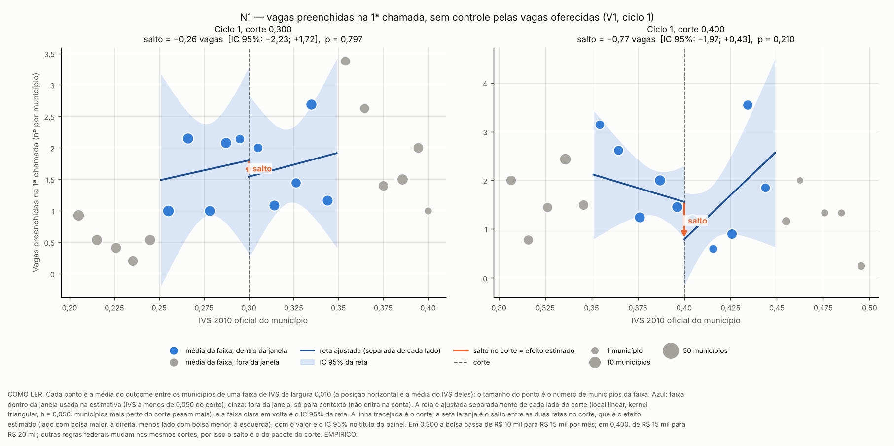
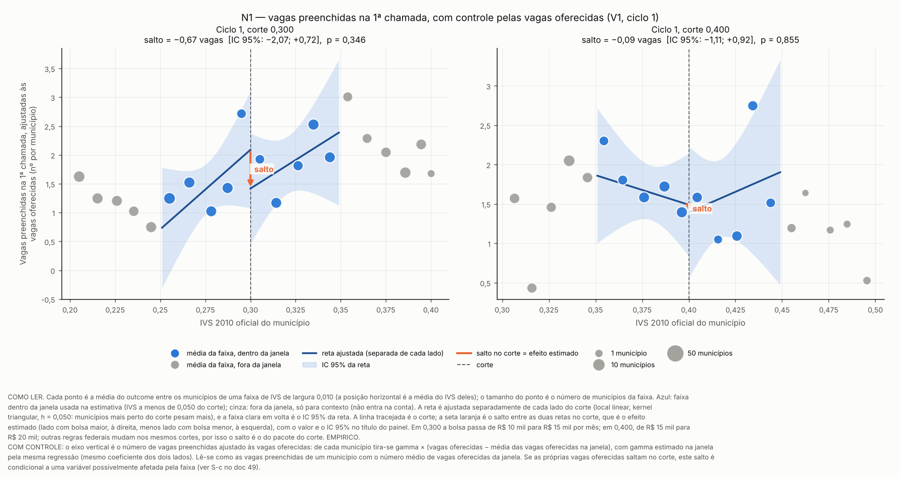
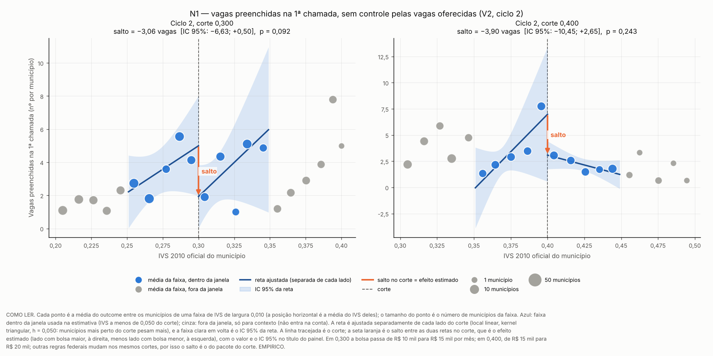
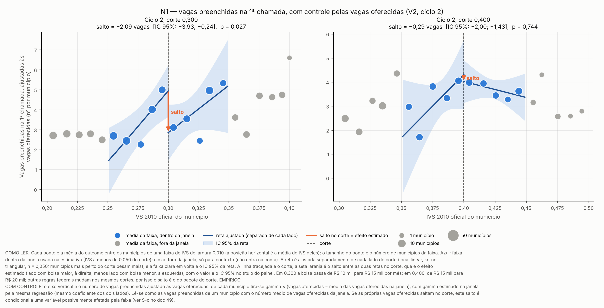
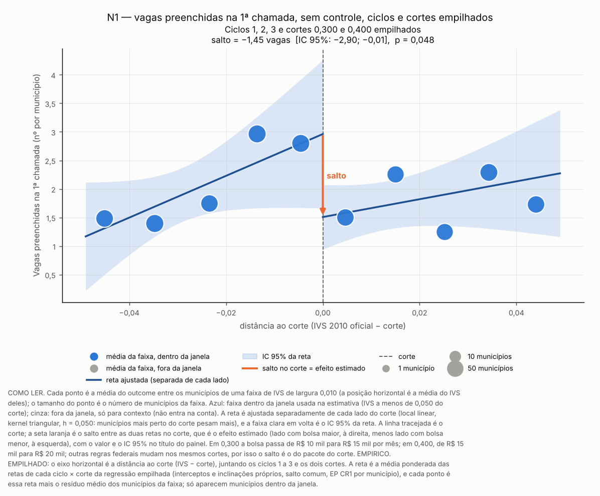
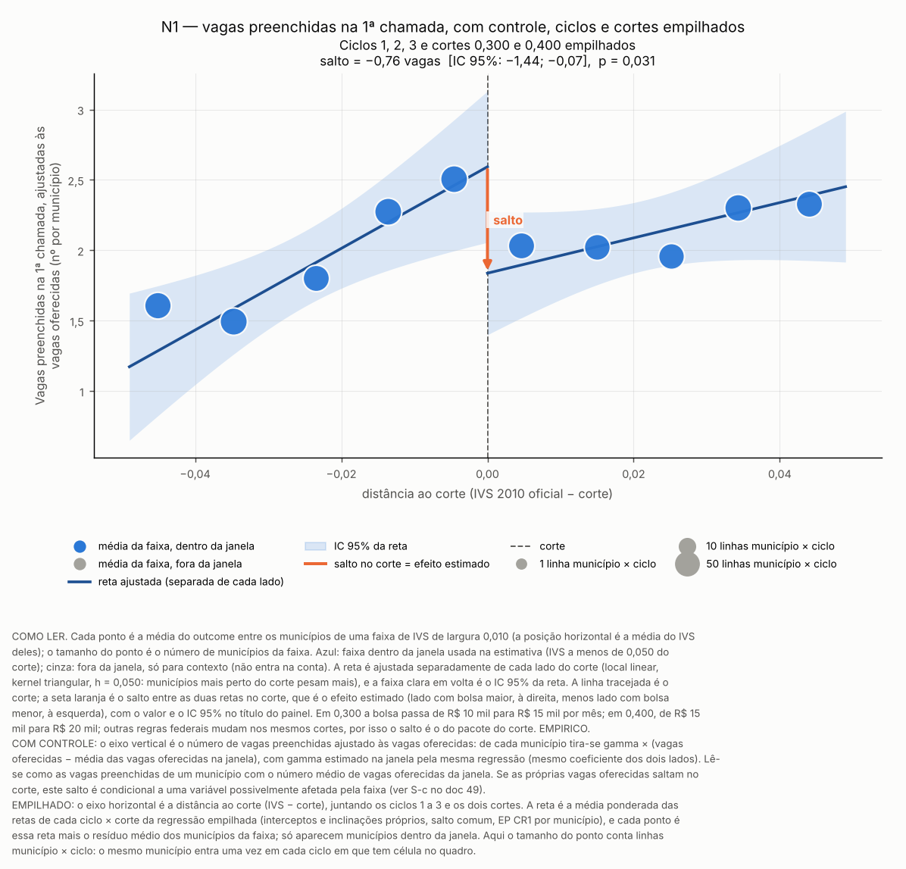
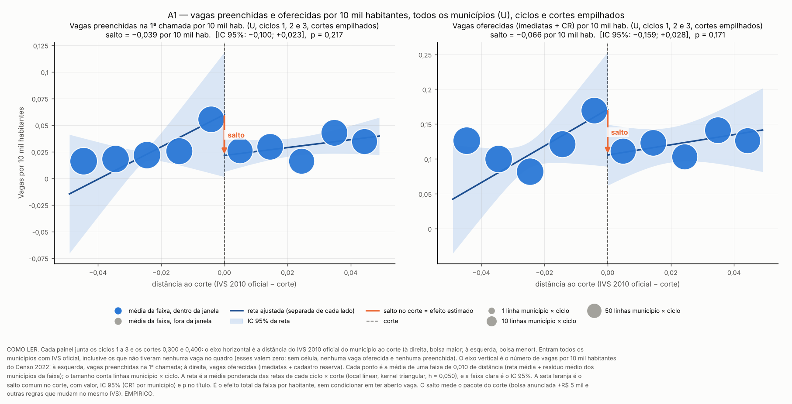
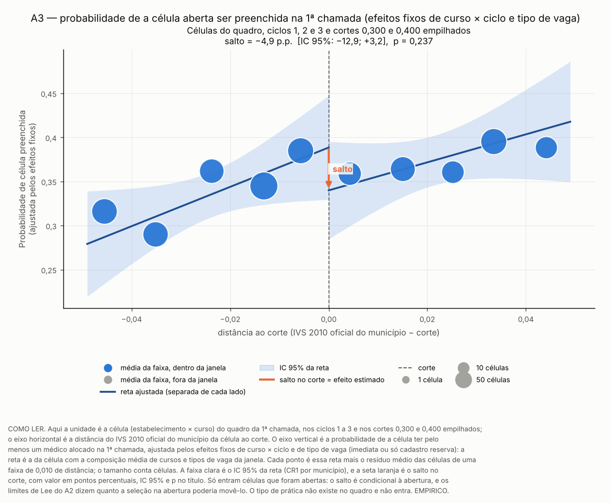

# Resultados da família N: número de vagas preenchidas, com e sem controle pelas vagas oferecidas

> **Data:** 19/10/2026. 
> **Protocolo:** [`48_protocolo_contagem_vagas_preenchidas.md`](48_protocolo_contagem_vagas_preenchidas.md),
> congelado antes de estimar (SHA-256 em `protocolo` de `N_resumo.json`). 
> **Estatuto:** pós-resultado. A fração de células preenchidas (F1.3) já tinha
> sido vista em todos os ciclos; as contagens N1–N4 por lado de corte, não.
> Toda linha de `N_estimativas.csv` tem `estatuto = PROTOCOLO_48_POS_RESULTADO`
> e `natureza_dos_dados = EMPIRICO`. Nada aqui altera o protocolo 40, o Holm
> das primárias P1 e P2 nem os docs 41 a 46. 
> **Script:** `scripts/rdd_bolsa/23_estimar_contagem_vagas.py` (estimadores de
> `scripts/rdd_bolsa/rdd_lib.py`). 
> **Saídas:** `output/rdd_bolsa/N_estimativas.csv` (uma linha por
> especificação), `N_resumo.json` (entradas com SHA-256, verificação do
> cadastro reserva, decisões, desvios, validações) e `N_figuras/`. 
> **Testes:** `tests/test_contagem_vagas.py`. 
> **Diagnóstico fora do protocolo:** por que a contagem sobe com o IVS dentro da janela e cai no corte, por corte, está em [`49b_diagnostico_contagem_porte.md`](49b_diagnostico_contagem_porte.md); ele não muda nenhuma conclusão deste documento. 
> **Números:** nenhum número de resultado é digitado aqui. As tabelas e as
> frases de leitura ficam entre marcadores `<!-- N:... -->` e são regravadas
> das saídas por `23_estimar_contagem_vagas.py --atualizar-doc`; o teste
> confere que o conteúdo é idêntico ao gerado e que a prosa só tem parâmetros
> do protocolo.

## 1. O que muda e o que o contraste identifica

A diretriz do autor troca a variável de efeito: em vez da fração de células
preenchidas, o **número de vagas preenchidas na 1ª chamada** por município
(N1, `n_alocados_ch1`), controlando pelo **número de vagas oferecidas** no
quadro da 1ª chamada. N2 a N4 são secundárias: células com alocado na 1ª
chamada, células com alocado até a 2ª chamada (ciclos 1 e 2) e especialistas
ativos do ciclo no retrato de 09/10/2026 (ciclos 1 e 2).

O contraste é o mesmo do E6: o **pacote do corte**. Em 0,300 a bolsa anunciada
sobe de R$ 10 mil para R$ 15 mil por mês e, em 0,400, de R$ 15 mil para
R$ 20 mil, mas outras regras federais mudam nos mesmos cortes
([`auditorias/18`](../auditorias/18_politicas_nos_mesmos_cortes_ivs.md)).
Nenhuma linha deste documento é efeito da participação no PMM-E nem do Agora
Tem Especialistas. O salto é o lado com bolsa maior (IVS acima do corte) menos
o lado com bolsa menor; o próprio corte fica no lado de baixo.

**Controlar pelas vagas oferecidas muda a pergunta.** Numa RDD o controle não
é necessário para identificar; só reduz variância se for pré-determinado
(Calonico, Cattaneo, Farrell e Titiunik, 2019). As vagas oferecidas são
definidas pelo gestor e pela SGTES antes de os candidatos escolherem e podem
responder ao corte. Quando a faixa ficou conhecida muda por ciclo (correção
do protocolo 48, [§8](48_protocolo_contagem_vagas_preenchidas.md)):
no ciclo 1 a adesão dos gestores precedeu o anúncio da faixa, e a oferta só
pode ter respondido às outras regras do pacote do corte ou à montagem do
quadro; no ciclo 3 a grade já era pública; no ciclo 2 não há etapa de
gestores arquivada. Por isso o documento relata as duas leituras:

- **sem controle (S-b):** efeito total da faixa sobre o número de vagas
  preenchidas, que inclui a resposta da oferta;
- **com controle (S-a):** vagas preenchidas *dadas* as vagas oferecidas. Só é
  causal se o salto das vagas oferecidas, havendo, não carregar seleção.

E a decomposição exata entre as duas (seção 5).

## 2. Verificação: um alocado da 1ª chamada pode ocupar vaga de cadastro reserva?

O protocolo pede que a forma do controle seja escolhida antes de estimar. A
verificação usa só contagens globais por ciclo nos quadros e resultados da
tarefa B (nada por lado de corte, faixa ou IVS) e o texto dos editais. Ela é
gravada em `verificacao_cadastro_reserva` de `N_resumo.json` antes de qualquer
estimativa.

<!-- N:verificacao_cr:inicio -->
| Ciclo | Células no quadro | Células só de cadastro reserva | Alocados na 1ª chamada | Alocados em células só de CR | Células com mais alocados que vagas imediatas | Células com mais alocados que imediatas + CR | Municípios com N1 > vagas imediatas |
|---|---|---|---|---|---|---|---|
| 1 | 1295 | 782 | 468 | 211 | 185 | 15 | 80 |
| 2 | 1547 | 532 | 1057 | 0 | 0 | 0 | 0 |
| 3 | 2293 | 1599 | 704 | 131 | 121 | 0 | 63 |
<!-- N:verificacao_cr:fim -->

Os editais dos ciclos 1 e 3 preveem que o candidato escolha município em
cadastro reserva e que vagas imediatas não ocupadas sejam remanejadas para
municípios em cadastro reserva com lista de espera:

<!-- N:editais_cr:inicio -->
| Edital | Item | Trecho |
|---|---|---|
| Edital de Chamamento Publico SGTES/MS no 3/2025 (DOU), ciclo 1 | 4.1.3.3 | “O candidato poderá escolher, dentre suas opções, município com vaga para preenchimento imediato e município que esteja em cadastro de reserva.” |
| Edital de Chamamento Publico SGTES/MS no 3/2025 (DOU), ciclo 1 | 4.1.3.4 | “Considera-se em cadastro de reserva o município que, na oferta inicial, não tinha vaga imediata, mas que poderá recebê-la por remanejamento” |
| Edital de Chamamento Publico SGTES/MS no 3/2025 (DOU), ciclo 1 | 5.7 | “as vagas remanescentes poderão ser redistribuídas para municípios com cadastro de reserva e que tenham candidatos na lista de espera” |
| Edital SGTES/MS no 28/2026, ciclo 3 | 4.1.3.4 | “A disponibilização de vaga para esses municípios poderá ocorrer por remanejamento de vagas não ocupadas” |
| Edital SGTES/MS no 28/2026, ciclo 3 | 5.7 | “as vagas remanescentes poderão ser redistribuídas para municípios com cadastro de reserva e que tenham candidatos na lista de espera” |
<!-- N:editais_cr:fim -->

<!-- N:decisao_controle:inicio -->
Resposta: **sim**. Controle principal das vagas oferecidas: **`vagas_imediatas_mais_cr`**; sensibilidade: `vagas_imediatas`.
<!-- N:decisao_controle:fim -->

Notas da verificação:

- no ciclo 2 nenhum alocado da 1ª chamada caiu em célula só de cadastro
  reserva; a cópia do edital desse ciclo no repositório é só a página do
  chamamento, sem o texto. A regra vale para todos os ciclos, e "só vagas
  imediatas" é a sensibilidade (`controle_forma_alternativa` de S-a);
  - *correção de 26/10/2026* ([auditoria 36](../auditorias/36_auditoria_dados_H1.md);
    [adendo 48b, §7](48b_adendo_H1_vagas_imediatas.md)): o zero do ciclo 2
    vale só para o quadro de 19/03/2026, usado aqui, que foi refeito
    **depois** do resultado preliminar e converteu em imediatas vagas de
    reserva onde houve alocado. Pelo quadro de 13/02/2026, vigente na
    inscrição, 442 dos 1.057 alocados do ciclo 2 (42%) estavam em células só
    de reserva (`output/auditoria_H1/a36_resumo.json`). Não se pode ler a
    linha do ciclo 2 da tabela acima como "a reserva não podia ser / não foi
    preenchida na 1ª chamada";
- no ciclo 1, N1 conta as confirmações de local na alocação sub judice, e
  algumas células têm mais confirmações que vagas imediatas mais cadastro
  reserva; os dados não foram alterados;
- no ciclo 1, N2 segue a definição do E3 (confirmação ou homologação), e por
  isso pode contar célula sem confirmação;
- para N2 e N3 o controle é o número de células do quadro, como manda o
  protocolo.

## 3. Resultado principal (S-a, ciclos e cortes empilhados) e Holm

Local linear com kernel triangular e h = 0,050; ciclos e cortes empilhados com
intercepto e inclinações por ciclo × corte (que contêm o efeito fixo de ciclo)
e salto comum; EP CR1 por município. O controle entra linear, com o mesmo
coeficiente dos dois lados do corte, dentro da mesma regressão ponderada
(CCFT 2019), um coeficiente por ciclo × corte. "Média abaixo" é a média simples
do outcome nos municípios da janela do lado de baixo; "MDE" é 2,8 × EP. O IC
honesto segue a regra do E6 (seção 7). O Holm junta as quatro linhas.

<!-- N:principal_holm:inicio -->
| Outcome | População | n abaixo / acima | Média abaixo | Salto (S-a) | IC 95% (CR1) | IC honesto | p | p Holm | Salto / média abaixo | MDE |
|---|---|---|---|---|---|---|---|---|---|---|
| N1 | V1+V2+V3 | 267 / 265 | 2,16 | −0,76 | [−1,44; −0,07] | [−79,58; +78,07] | 0,031 | 0,124 | −35,1 % | 0,98 |
| N2 | V1+V2+V3 | 267 / 265 | 1,51 | −0,31 | [−0,66; +0,04] | [−48,44; +47,82] | 0,078 | 0,235 | −20,6 % | 0,50 |
| N3 | V1+V2 | 169 / 151 | 2,31 | −0,35 | [−0,87; +0,17] | [−20,40; +19,70] | 0,188 | 0,376 | −15,2 % | 0,75 |
| N4 | V1+V2 | 169 / 151 | 2,43 | −0,21 | [−1,34; +0,92] | [−46,54; +46,12] | 0,717 | 0,717 | −8,6 % | 1,61 |
<!-- N:principal_holm:fim -->

As mesmas amostras, sem controle (S-b, efeito total da faixa):

<!-- N:principal_sem_controle:inicio -->
| Outcome | População | Média abaixo | Salto (S-b) | IC 95% (CR1) | IC honesto | p | Salto / média abaixo | MDE |
|---|---|---|---|---|---|---|---|---|
| N1 | V1+V2+V3 | 2,16 | −1,45 | [−2,90; −0,01] | [−117,09; +114,18] | 0,048 | −67,4 % | 2,06 |
| N2 | V1+V2+V3 | 1,51 | −0,84 | [−1,67; −0,01] | [−83,07; +81,39] | 0,048 | −55,4 % | 1,19 |
| N3 | V1+V2 | 2,31 | −1,33 | [−2,77; +0,11] | [−56,84; +54,18] | 0,071 | −57,5 % | 2,06 |
| N4 | V1+V2 | 2,43 | −1,64 | [−4,16; +0,87] | [−61,63; +58,35] | 0,201 | −67,7 % | 3,60 |
<!-- N:principal_sem_controle:fim -->

Leitura, por regra fixa no script:

<!-- N:leitura_principal:inicio -->
- **N1** (V1+V2+V3): com controle (S-a), salto negativo (menos no lado de bolsa maior); o IC 95% convencional exclui zero; depois do Holm, não rejeita zero; o IC honesto da regra do E6 contém zero, e o POS_RESULTADO também contém zero. Sem controle (S-b), salto negativo (menos no lado de bolsa maior), IC 95% convencional que exclui zero.
- **N2** (V1+V2+V3): com controle (S-a), salto negativo (menos no lado de bolsa maior); o IC 95% convencional contém zero; depois do Holm, não rejeita zero; o IC honesto da regra do E6 contém zero, e o POS_RESULTADO também contém zero. Sem controle (S-b), salto negativo (menos no lado de bolsa maior), IC 95% convencional que exclui zero.
- **N3** (V1+V2): com controle (S-a), salto negativo (menos no lado de bolsa maior); o IC 95% convencional contém zero; depois do Holm, não rejeita zero; o IC honesto da regra do E6 contém zero, e o POS_RESULTADO também contém zero. Sem controle (S-b), salto negativo (menos no lado de bolsa maior), IC 95% convencional que contém zero.
- **N4** (V1+V2): com controle (S-a), salto negativo (menos no lado de bolsa maior); o IC 95% convencional contém zero; depois do Holm, não rejeita zero; o IC honesto da regra do E6 contém zero, e o POS_RESULTADO também contém zero. Sem controle (S-b), salto negativo (menos no lado de bolsa maior), IC 95% convencional que contém zero.
<!-- N:leitura_principal:fim -->

**Sensibilidade ao coeficiente do controle (auditoria 20, fora do protocolo).**
O protocolo não diz se, com ciclos e cortes empilhados, o controle tem um
coeficiente por ciclo × corte ou um só. A linha principal usa um por grupo
(decisão registrada em `N_resumo.json`). A tabela abaixo refaz as quatro linhas
do Holm com um só coeficiente, e o Wald testa, na linha principal, se os
coeficientes por grupo são iguais. A variante não substitui a linha principal
nem o Holm do protocolo: escolher a especificação depois de ver o resultado
seria seleção retrospectiva. Ela mostra até onde a conclusão do Holm depende
dessa escolha.

<!-- N:coef_unico:inicio -->
| Outcome | População | Salto (S-a, coef. por grupo) | p Holm (protocolo) | Salto (coef. único) | IC 95% (CR1) | p | p Holm (só nesta variante) | Wald: coeficientes iguais entre grupos, p |
|---|---|---|---|---|---|---|---|---|
| N1 | V1+V2+V3 | −0,76 | 0,124 | −1,03 | [−1,79; −0,28] | 0,007 | 0,029 | 0,000 |
| N2 | V1+V2+V3 | −0,31 | 0,235 | −0,44 | [−0,81; −0,08] | 0,017 | 0,052 | 0,000 |
| N3 | V1+V2 | −0,35 | 0,376 | −0,45 | [−1,04; +0,13] | 0,130 | 0,260 | 0,000 |
| N4 | V1+V2 | −0,21 | 0,717 | −0,39 | [−1,57; +0,79] | 0,519 | 0,519 | 0,000 |
<!-- N:coef_unico:fim -->

<!-- N:leitura_coef_unico:inicio -->
Linhas que rejeitam zero depois do Holm: no protocolo (coeficiente por grupo), **nenhuma**; com coeficiente único, **N1**. O Wald rejeita a igualdade dos coeficientes entre os grupos (p < 0,05) em **N1, N2, N3, N4** das quatro linhas.
<!-- N:leitura_coef_unico:fim -->

Quando o Wald rejeita a igualdade, o coeficiente único impõe uma restrição que
os dados não sustentam. A taxa de preenchimento por vaga oferecida muda de um
ciclo para outro, e a linha com coeficiente por grupo é a defensável. Mesmo
assim, o "nenhuma linha rejeita zero" do Holm não é robusto a essa escolha, e
o sinal negativo se mantém nas duas formas.

O sinal das estimativas é o oposto do que a hipótese da bolsa previa: há menos
vagas preenchidas do lado de bolsa maior. Isso não é evidência de que a bolsa
reduz o preenchimento, por quatro motivos.

- (i) Na especificação do protocolo, nenhuma das quatro linhas rejeita zero
  depois do Holm. Essa conclusão depende do coeficiente do controle por grupo
  (tabela acima); o sinal negativo de N1 com controle não muda.
- (ii) O IC honesto contém zero, mas aqui informa pouco. A regra de bolso do E6
  ajusta uma quártica num suporte largo, e numa contagem com poucos municípios
  de muitas vagas isso dá um M enorme (seção 7). O IC sai muitas vezes mais
  largo que a média do outcome, e não é ele que sustenta a leitura.
- (iii) O contraste é o pacote do corte, não o degrau de R$ 5 mil isolado.
- (iv) No ciclo 2, um corte placebo na média do IVS do segmento entre 0,300 e
  0,400 acusa salto sem controle e fica no limiar com controle (seção 9). Esse
  corte falso usa os mesmos municípios que formam o lado de cima da janela do
  corte de 0,300 no ciclo 2. Ali a forma do outcome não é linear, e a reta local
  desse lado não a capta. Por isso o salto em 0,300 no ciclo 2, a linha por
  ciclo com o sinal mais forte, e a parte do empilhado que vem dele não devem
  ser lidos como descontinuidade no corte.

A leitura defensável é a mesma do E6: não há efeito positivo detectável do
degrau de R$ 5 mil sobre o número de vagas preenchidas. A precisão relatada
(MDE) diz qual efeito ainda passaria despercebido.

## 4. As vagas oferecidas saltam no corte? (S-c)

A especificação S-c usa a própria oferta como outcome. Ela decide se o controle
é um "mau controle". VIC são as vagas imediatas mais o cadastro reserva (forma
principal), VI só as imediatas e NC o número de células.

<!-- N:veredito_sc:inicio -->
Vagas oferecidas na forma principal (`vagas_imediatas_mais_cr`) em V, linhas principais por ciclo × corte e empilhadas: **1 de 12** com p < 0,05 no IC convencional (V1 0,400); linha empilhada principal (ciclos e cortes): p = 0,438. Regra fixada no código: o controle é tratado como possivelmente afetado se alguma dessas linhas tiver p < 0,05 → **sim**.
<!-- N:veredito_sc:fim -->

<!-- N:sc_oferta:inicio -->
| Oferta | População | Corte | n abaixo / acima | Média abaixo | Salto | IC 95% | IC honesto | p | Salto / média abaixo |
|---|---|---|---|---|---|---|---|---|---|
| VIC `vagas_imediatas_mais_cr` | V1 | 0,300 | 61 / 53 | 7,48 | +2,10 | [−4,78; +8,99] | [−215,30; +219,51] | 0,549 | +28,1 % |
| VIC `vagas_imediatas_mais_cr` | V1 | 0,400 | 53 / 41 | 6,00 | −2,91 | [−5,22; −0,60] | [−89,55; +83,73] | 0,014 | −48,5 % |
| VIC `vagas_imediatas_mais_cr` | V1 | empilhado | 114 / 94 | 6,79 | −0,64 | [−4,11; +2,82] | [−167,05; +165,76] | 0,715 | −9,5 % |
| VIC `vagas_imediatas_mais_cr` | V2 | 0,300 | 82 / 61 | 10,09 | −2,56 | [−10,06; +4,95] | [−65,51; +60,39] | 0,504 | −25,4 % |
| VIC `vagas_imediatas_mais_cr` | V2 | 0,400 | 53 / 53 | 8,08 | −8,39 | [−22,81; +6,03] | [−192,37; +175,59] | 0,254 | −103,9 % |
| VIC `vagas_imediatas_mais_cr` | V2 | empilhado | 135 / 114 | 9,30 | −5,24 | [−13,01; +2,54] | [−199,72; +189,25] | 0,187 | −56,3 % |
| VIC `vagas_imediatas_mais_cr` | V3 | 0,300 | 102 / 82 | 11,63 | +1,86 | [−10,27; +13,98] | [−232,18; +235,89] | 0,764 | +16,0 % |
| VIC `vagas_imediatas_mais_cr` | V3 | 0,400 | 97 / 118 | 7,07 | −1,50 | [−5,44; +2,44] | [−93,60; +90,60] | 0,456 | −21,2 % |
| VIC `vagas_imediatas_mais_cr` | V3 | empilhado | 199 / 200 | 9,41 | −0,07 | [−5,70; +5,56] | [−214,88; +214,75] | 0,982 | −0,7 % |
| VIC `vagas_imediatas_mais_cr` | V1+V2+V3 | 0,300 | 145 / 120 | 10,08 | +0,39 | [−6,69; +7,46] | [−246,83; +247,60] | 0,914 | +3,9 % |
| VIC `vagas_imediatas_mais_cr` | V1+V2+V3 | 0,400 | 122 / 145 | 7,05 | −3,59 | [−8,94; +1,77] | [−177,73; +170,55] | 0,189 | −50,9 % |
| VIC `vagas_imediatas_mais_cr` | V1+V2+V3 | empilhado | 267 / 265 | 8,71 | −1,73 | [−6,12; +2,65] | [−220,44; +216,97] | 0,438 | −19,9 % |
| VI `vagas_imediatas` | V1 | 0,300 | 61 / 53 | 2,97 | −0,76 | [−3,93; +2,41] | [−67,64; +66,12] | 0,640 | −25,5 % |
| VI `vagas_imediatas` | V1 | 0,400 | 53 / 41 | 2,53 | −2,41 | [−3,75; −1,07] | [−72,01; +67,19] | 0,000 | −95,3 % |
| VI `vagas_imediatas` | V1 | empilhado | 114 / 94 | 2,76 | −1,66 | [−3,30; −0,02] | [−93,57; +90,25] | 0,047 | −60,1 % |
| VI `vagas_imediatas` | V2 | 0,300 | 82 / 61 | 6,44 | −4,12 | [−9,25; +1,02] | [−56,64; +48,41] | 0,116 | −63,9 % |
| VI `vagas_imediatas` | V2 | 0,400 | 53 / 53 | 5,51 | −5,86 | [−14,62; +2,90] | [−117,42; +105,71] | 0,190 | −106,3 % |
| VI `vagas_imediatas` | V2 | empilhado | 135 / 114 | 6,07 | −4,91 | [−9,79; −0,04] | [−122,92; +113,09] | 0,048 | −80,9 % |
| VI `vagas_imediatas` | V3 | 0,300 | 102 / 82 | 3,15 | +0,15 | [−3,07; +3,38] | [−185,06; +185,37] | 0,926 | +4,8 % |
| VI `vagas_imediatas` | V3 | 0,400 | 97 / 118 | 1,47 | −0,11 | [−1,15; +0,93] | [−54,39; +54,17] | 0,833 | −7,6 % |
| VI `vagas_imediatas` | V3 | empilhado | 199 / 200 | 2,33 | +0,00 | [−1,50; +1,50] | [−172,58; +172,58] | 0,999 | +0,0 % |
| VI `vagas_imediatas` | V1+V2+V3 | 0,300 | 145 / 120 | 4,20 | −1,52 | [−4,36; +1,32] | [−200,66; +197,63] | 0,295 | −36,1 % |
| VI `vagas_imediatas` | V1+V2+V3 | 0,400 | 122 / 145 | 2,80 | −2,11 | [−4,54; +0,32] | [−106,96; +102,74] | 0,089 | −75,4 % |
| VI `vagas_imediatas` | V1+V2+V3 | empilhado | 267 / 265 | 3,57 | −1,83 | [−3,69; +0,02] | [−178,74; +175,07] | 0,052 | −51,4 % |
| NC `n_celulas` | V1 | 0,300 | 61 / 53 | 4,72 | +0,83 | [−3,69; +5,36] | [−132,67; +134,34] | 0,718 | +17,6 % |
| NC `n_celulas` | V1 | 0,400 | 53 / 41 | 4,66 | −1,39 | [−3,21; +0,42] | [−77,73; +74,94] | 0,133 | −29,9 % |
| NC `n_celulas` | V1 | empilhado | 114 / 94 | 4,69 | −0,39 | [−2,70; +1,93] | [−102,53; +101,76] | 0,743 | −8,2 % |
| NC `n_celulas` | V2 | 0,300 | 82 / 61 | 4,71 | −1,67 | [−5,09; +1,75] | [−19,92; +16,59] | 0,340 | −35,4 % |
| NC `n_celulas` | V2 | 0,400 | 53 / 53 | 4,02 | −2,80 | [−8,02; +2,42] | [−69,29; +63,69] | 0,294 | −69,6 % |
| NC `n_celulas` | V2 | empilhado | 135 / 114 | 4,44 | −2,19 | [−5,21; +0,84] | [−72,61; +68,24] | 0,157 | −49,3 % |
| NC `n_celulas` | V3 | 0,300 | 102 / 82 | 4,96 | −0,07 | [−4,56; +4,42] | [−123,92; +123,78] | 0,976 | −1,4 % |
| NC `n_celulas` | V3 | 0,400 | 97 / 118 | 3,22 | −1,04 | [−2,74; +0,66] | [−38,49; +36,40] | 0,229 | −32,4 % |
| NC `n_celulas` | V3 | empilhado | 199 / 200 | 4,11 | −0,63 | [−2,77; +1,52] | [−115,08; +113,83] | 0,567 | −15,3 % |
| NC `n_celulas` | V1+V2+V3 | 0,300 | 145 / 120 | 4,82 | −0,42 | [−3,48; +2,63] | [−132,37; +131,52] | 0,785 | −8,8 % |
| NC `n_celulas` | V1+V2+V3 | 0,400 | 122 / 145 | 3,80 | −1,57 | [−3,66; +0,52] | [−86,48; +83,34] | 0,141 | −41,3 % |
| NC `n_celulas` | V1+V2+V3 | empilhado | 267 / 265 | 4,36 | −1,04 | [−2,85; +0,78] | [−117,86; +115,79] | 0,263 | −23,8 % |
<!-- N:sc_oferta:fim -->

Em U, com zero fora do quadro (oferta total do município, incluindo a decisão
de ter ou não célula):

<!-- N:sc_oferta_U:inicio -->
| Oferta | Ciclo | Corte | n abaixo / acima | Média abaixo | Salto | IC 95% | p |
|---|---|---|---|---|---|---|---|
| VIC `vagas_imediatas_mais_cr_c1` | 1 | 0,300 | 859 / 654 | 0,531 | +0,05 | [−0,48; +0,58] | 0,856 |
| VIC `vagas_imediatas_mais_cr_c1` | 1 | 0,400 | 587 / 603 | 0,542 | −0,52 | [−0,95; −0,09] | 0,017 |
| VIC `vagas_imediatas_mais_cr_c1` | 1 | empilhado | 1446 / 1257 | 0,535 | −0,20 | [−0,55; +0,15] | 0,265 |
| VIC `vagas_imediatas_mais_cr_c2` | 2 | 0,300 | 859 / 654 | 0,963 | −0,26 | [−1,10; +0,58] | 0,539 |
| VIC `vagas_imediatas_mais_cr_c2` | 2 | 0,400 | 587 / 603 | 0,729 | −0,83 | [−2,40; +0,74] | 0,300 |
| VIC `vagas_imediatas_mais_cr_c2` | 2 | empilhado | 1446 / 1257 | 0,868 | −0,51 | [−1,35; +0,32] | 0,229 |
| VIC `vagas_imediatas_mais_cr_c3` | 3 | 0,300 | 859 / 654 | 1,381 | −0,35 | [−2,03; +1,34] | 0,688 |
| VIC `vagas_imediatas_mais_cr_c3` | 3 | 0,400 | 587 / 603 | 1,169 | −0,33 | [−1,30; +0,64] | 0,506 |
| VIC `vagas_imediatas_mais_cr_c3` | 3 | empilhado | 1446 / 1257 | 1,295 | −0,34 | [−1,37; +0,70] | 0,523 |
| VIC `vagas_imediatas_mais_cr` | 1+2+3 | 0,300 | 859 / 654 | 0,958 | −0,19 | [−1,04; +0,67] | 0,669 |
| VIC `vagas_imediatas_mais_cr` | 1+2+3 | 0,400 | 587 / 603 | 0,813 | −0,56 | [−1,42; +0,30] | 0,200 |
| VIC `vagas_imediatas_mais_cr` | 1+2+3 | empilhado | 1446 / 1257 | 0,899 | −0,35 | [−0,96; +0,26] | 0,260 |
| VI `vagas_imediatas_c1` | 1 | 0,300 | 859 / 654 | 0,211 | −0,07 | [−0,29; +0,14] | 0,501 |
| VI `vagas_imediatas_c1` | 1 | 0,400 | 587 / 603 | 0,228 | −0,32 | [−0,54; −0,11] | 0,003 |
| VI `vagas_imediatas_c1` | 1 | empilhado | 1446 / 1257 | 0,218 | −0,18 | [−0,34; −0,03] | 0,019 |
| VI `vagas_imediatas_c2` | 2 | 0,300 | 859 / 654 | 0,615 | −0,40 | [−0,94; +0,14] | 0,143 |
| VI `vagas_imediatas_c2` | 2 | 0,400 | 587 / 603 | 0,497 | −0,58 | [−1,59; +0,43] | 0,262 |
| VI `vagas_imediatas_c2` | 2 | empilhado | 1446 / 1257 | 0,567 | −0,48 | [−1,02; +0,06] | 0,079 |
| VI `vagas_imediatas_c3` | 3 | 0,300 | 859 / 654 | 0,374 | −0,11 | [−0,54; +0,32] | 0,620 |
| VI `vagas_imediatas_c3` | 3 | 0,400 | 587 / 603 | 0,244 | −0,03 | [−0,27; +0,22] | 0,838 |
| VI `vagas_imediatas_c3` | 3 | empilhado | 1446 / 1257 | 0,321 | −0,07 | [−0,34; +0,19] | 0,592 |
| VI `vagas_imediatas` | 1+2+3 | 0,300 | 859 / 654 | 0,400 | −0,20 | [−0,52; +0,13] | 0,234 |
| VI `vagas_imediatas` | 1+2+3 | 0,400 | 587 / 603 | 0,323 | −0,31 | [−0,72; +0,10] | 0,135 |
| VI `vagas_imediatas` | 1+2+3 | empilhado | 1446 / 1257 | 0,369 | −0,25 | [−0,50; +0,01] | 0,058 |
| NC `n_celulas_c1` | 1 | 0,300 | 859 / 654 | 0,335 | −0,00 | [−0,36; +0,36] | 0,998 |
| NC `n_celulas_c1` | 1 | 0,400 | 587 / 603 | 0,421 | −0,33 | [−0,66; +0,00] | 0,051 |
| NC `n_celulas_c1` | 1 | empilhado | 1446 / 1257 | 0,370 | −0,14 | [−0,39; +0,11] | 0,259 |
| NC `n_celulas_c2` | 2 | 0,300 | 859 / 654 | 0,449 | −0,16 | [−0,57; +0,24] | 0,424 |
| NC `n_celulas_c2` | 2 | 0,400 | 587 / 603 | 0,363 | −0,27 | [−0,88; +0,33] | 0,380 |
| NC `n_celulas_c2` | 2 | empilhado | 1446 / 1257 | 0,414 | −0,21 | [−0,56; +0,14] | 0,235 |
| NC `n_celulas_c3` | 3 | 0,300 | 859 / 654 | 0,589 | −0,25 | [−0,90; +0,40] | 0,455 |
| NC `n_celulas_c3` | 3 | 0,400 | 587 / 603 | 0,532 | −0,22 | [−0,65; +0,21] | 0,309 |
| NC `n_celulas_c3` | 3 | empilhado | 1446 / 1257 | 0,566 | −0,24 | [−0,65; +0,17] | 0,258 |
| NC `n_celulas` | 1+2+3 | 0,300 | 859 / 654 | 0,458 | −0,14 | [−0,53; +0,26] | 0,493 |
| NC `n_celulas` | 1+2+3 | 0,400 | 587 / 603 | 0,438 | −0,27 | [−0,65; +0,11] | 0,159 |
| NC `n_celulas` | 1+2+3 | empilhado | 1446 / 1257 | 0,450 | −0,20 | [−0,47; +0,08] | 0,163 |
<!-- N:sc_oferta_U:fim -->

**Consequência para a leitura de S-a.** Pela regra acima, as vagas oferecidas
são tratadas como possivelmente afetadas pela faixa. A rejeição está
concentrada no ciclo 1 em 0,400 (e, nas vagas imediatas, também em empilhados
dos ciclos 1 e 2); na linha empilhada principal, a oferta não salta de forma
detectável. Ainda assim, a estimativa com controle (S-a) é **condicional a uma
variável que pode ter respondido à faixa**: se a faixa mudou a oferta, comparar
municípios com as mesmas vagas oferecidas pode comparar municípios
diferentes, e S-a deixa de ter leitura causal limpa. S-b (efeito total) não
tem esse problema. A decomposição da seção 5 mostra quanto do total passa pela
oferta.

## 5. Decomposição: total = via oferta + preenchimento dado as vagas

Com a mesma amostra e os mesmos pesos, a identidade de Frisch–Waugh–Lovell dá,
exatamente, salto sem controle = salto com controle + soma, sobre os grupos, de
(coeficiente do controle × salto do controle). O script calcula as três partes
em cada amostra e para se a identidade não fechar (resíduo máximo em
`validacoes.decomposicao`). A parte "via oferta" é uma soma algébrica, sem EP
próprio; a incerteza dela está nas linhas S-b e S-c.

<!-- N:decomposicao_N1:inicio -->
| População | Corte | Total (S-b) | = via oferta | + preenchimento dado as vagas (S-a) | IC 95% do total | IC 95% de S-a |
|---|---|---|---|---|---|---|
| V1 | 0,300 | −0,26 | +0,41 | −0,67 | [−2,23; +1,72] | [−2,07; +0,72] |
| V1 | 0,400 | −0,77 | −0,67 | −0,09 | [−1,97; +0,43] | [−1,11; +0,92] |
| V1 | empilhado | −0,54 | −0,18 | −0,36 | [−1,65; +0,57] | [−1,21; +0,49] |
| V2 | 0,300 | −3,06 | −0,98 | −2,09 | [−6,63; +0,50] | [−3,93; −0,24] |
| V2 | 0,400 | −3,90 | −3,61 | −0,29 | [−10,45; +2,65] | [−2,00; +1,43] |
| V2 | empilhado | −3,45 | −2,18 | −1,27 | [−7,02; +0,12] | [−2,55; +0,01] |
| V3 | 0,300 | −1,01 | +0,31 | −1,33 | [−3,61; +1,58] | [−3,14; +0,48] |
| V3 | 0,400 | −0,36 | −0,27 | −0,09 | [−1,33; +0,61] | [−0,80; +0,62] |
| V3 | empilhado | −0,64 | −0,02 | −0,62 | [−1,88; +0,60] | [−1,49; +0,25] |
| V1+V2+V3 | 0,300 | −1,56 | −0,11 | −1,45 | [−3,73; +0,61] | [−2,67; −0,22] |
| V1+V2+V3 | 0,400 | −1,36 | −1,22 | −0,14 | [−3,30; +0,57] | [−0,82; +0,54] |
| V1+V2+V3 | empilhado | −1,45 | −0,70 | −0,76 | [−2,90; −0,01] | [−1,44; −0,07] |
<!-- N:decomposicao_N1:fim -->

## 6. Por ciclo, por corte e empilhamentos (S-a e S-b, N1 a N4)

Ciclos 1 e 2 separados são secundárias do protocolo; o ciclo 3 e os
empilhamentos parciais completam a grade. N3 e N4 não existem no ciclo 3:

<!-- N:nao_definidos:inicio -->
| Outcome | População | Motivo |
|---|---|---|
| N3 | V3 | outcome nao definido no ciclo 3: F1.4 não definido para V3 (protocolo: V1 e V2) |
| N4 | V3 | outcome nao definido no ciclo 3: F2 não construído para o ciclo 3 (protocolo §3 e §5; ciclo 3 congelado) |
<!-- N:nao_definidos:fim -->

<!-- N:por_ciclo:inicio -->
| Outcome | Esp. | População | Corte | n abaixo / acima | Média abaixo | Salto | IC 95% | IC honesto | p | Salto / média | MDE |
|---|---|---|---|---|---|---|---|---|---|---|---|
| N1 | S-a | V1 | 0,300 | 61 / 53 | 1,61 | −0,67 | [−2,07; +0,72] | [−26,90; +25,55] | 0,346 | −41,9 % | 2,00 |
| N1 | S-b | V1 | 0,300 | 61 / 53 | 1,61 | −0,26 | [−2,23; +1,72] | [−68,63; +68,12] | 0,797 | −16,1 % | 2,82 |
| N1 | S-a | V1 | 0,400 | 53 / 41 | 1,94 | −0,09 | [−1,11; +0,92] | [−5,45; +5,26] | 0,855 | −4,9 % | 1,45 |
| N1 | S-b | V1 | 0,400 | 53 / 41 | 1,94 | −0,77 | [−1,97; +0,43] | [−17,04; +15,50] | 0,210 | −39,6 % | 1,72 |
| N1 | S-a | V1 | empilhado | 114 / 94 | 1,76 | −0,36 | [−1,21; +0,49] | [−20,56; +19,84] | 0,405 | −20,5 % | 1,21 |
| N1 | S-b | V1 | empilhado | 114 / 94 | 1,76 | −0,54 | [−1,65; +0,57] | [−53,03; +51,95] | 0,342 | −30,5 % | 1,59 |
| N1 | S-a | V2 | 0,300 | 82 / 61 | 3,45 | −2,09 | [−3,93; −0,24] | [−54,71; +50,54] | 0,027 | −60,5 % | 2,64 |
| N1 | S-b | V2 | 0,300 | 82 / 61 | 3,45 | −3,06 | [−6,63; +0,50] | [−43,91; +37,78] | 0,092 | −88,8 % | 5,10 |
| N1 | S-a | V2 | 0,400 | 53 / 53 | 3,70 | −0,29 | [−2,00; +1,43] | [−27,09; +26,52] | 0,744 | −7,7 % | 2,45 |
| N1 | S-b | V2 | 0,400 | 53 / 53 | 3,70 | −3,90 | [−10,45; +2,65] | [−60,69; +52,89] | 0,243 | −105,5 % | 9,36 |
| N1 | S-a | V2 | empilhado | 135 / 114 | 3,55 | −1,27 | [−2,55; +0,01] | [−49,82; +47,28] | 0,051 | −35,8 % | 1,83 |
| N1 | S-b | V2 | empilhado | 135 / 114 | 3,55 | −3,45 | [−7,02; +0,12] | [−62,26; +55,37] | 0,058 | −97,2 % | 5,10 |
| N1 | S-a | V3 | 0,300 | 102 / 82 | 1,84 | −1,33 | [−3,14; +0,48] | [−84,14; +81,49] | 0,151 | −72,0 % | 2,59 |
| N1 | S-b | V3 | 0,300 | 102 / 82 | 1,84 | −1,01 | [−3,61; +1,58] | [−122,29; +120,26] | 0,443 | −55,1 % | 3,70 |
| N1 | S-a | V3 | 0,400 | 97 / 118 | 1,01 | −0,09 | [−0,80; +0,62] | [−48,91; +48,73] | 0,798 | −9,2 % | 1,01 |
| N1 | S-b | V3 | 0,400 | 97 / 118 | 1,01 | −0,36 | [−1,33; +0,61] | [−45,82; +45,09] | 0,462 | −36,1 % | 1,39 |
| N1 | S-a | V3 | empilhado | 199 / 200 | 1,44 | −0,62 | [−1,49; +0,25] | [−77,82; +76,57] | 0,164 | −43,2 % | 1,25 |
| N1 | S-b | V3 | empilhado | 199 / 200 | 1,44 | −0,64 | [−1,88; +0,60] | [−113,48; +112,19] | 0,309 | −44,7 % | 1,77 |
| N1 | S-a | V1+V2+V3 | 0,300 | 145 / 120 | 2,32 | −1,45 | [−2,67; −0,22] | [−90,23; +87,34] | 0,021 | −62,3 % | 1,75 |
| N1 | S-b | V1+V2+V3 | 0,300 | 145 / 120 | 2,32 | −1,56 | [−3,73; +0,61] | [−131,77; +128,66] | 0,160 | −67,1 % | 3,10 |
| N1 | S-a | V1+V2+V3 | 0,400 | 122 / 145 | 1,96 | −0,14 | [−0,82; +0,54] | [−47,07; +46,79] | 0,682 | −7,3 % | 0,97 |
| N1 | S-b | V1+V2+V3 | 0,400 | 122 / 145 | 1,96 | −1,36 | [−3,30; +0,57] | [−53,37; +50,64] | 0,167 | −69,7 % | 2,76 |
| N1 | S-a | V1+V2+V3 | empilhado | 267 / 265 | 2,16 | −0,76 | [−1,44; −0,07] | [−79,58; +78,07] | 0,031 | −35,1 % | 0,98 |
| N1 | S-b | V1+V2+V3 | empilhado | 267 / 265 | 2,16 | −1,45 | [−2,90; −0,01] | [−117,09; +114,18] | 0,048 | −67,4 % | 2,06 |
| N2 | S-a | V1 | 0,300 | 61 / 53 | 1,23 | −0,34 | [−1,50; +0,83] | [−31,42; +30,74] | 0,570 | −27,5 % | 1,67 |
| N2 | S-b | V1 | 0,300 | 61 / 53 | 1,23 | −0,10 | [−1,98; +1,79] | [−69,33; +69,14] | 0,919 | −7,9 % | 2,69 |
| N2 | S-a | V1 | 0,400 | 53 / 41 | 1,75 | −0,08 | [−0,95; +0,78] | [−9,00; +8,83] | 0,847 | −4,8 % | 1,23 |
| N2 | S-b | V1 | 0,400 | 53 / 41 | 1,75 | −0,54 | [−1,64; +0,56] | [−18,00; +16,91] | 0,334 | −30,9 % | 1,57 |
| N2 | S-a | V1 | empilhado | 114 / 94 | 1,47 | −0,20 | [−0,91; +0,51] | [−24,11; +23,71] | 0,579 | −13,6 % | 1,01 |
| N2 | S-b | V1 | empilhado | 114 / 94 | 1,47 | −0,34 | [−1,39; +0,70] | [−53,48; +52,80] | 0,522 | −23,2 % | 1,49 |
| N2 | S-a | V2 | 0,300 | 82 / 61 | 2,29 | −0,98 | [−1,91; −0,05] | [−38,28; +36,33] | 0,040 | −42,6 % | 1,33 |
| N2 | S-b | V2 | 0,300 | 82 / 61 | 2,29 | −1,98 | [−3,96; +0,01] | [−33,51; +29,56] | 0,051 | −86,2 % | 2,84 |
| N2 | S-a | V2 | 0,400 | 53 / 53 | 2,30 | +0,24 | [−0,70; +1,18] | [−7,22; +7,70] | 0,617 | +10,4 % | 1,34 |
| N2 | S-b | V2 | 0,400 | 53 / 53 | 2,30 | −1,48 | [−4,79; +1,83] | [−36,44; +33,48] | 0,380 | −64,4 % | 4,73 |
| N2 | S-a | V2 | empilhado | 135 / 114 | 2,30 | −0,42 | [−1,10; +0,25] | [−34,96; +34,12] | 0,222 | −18,4 % | 0,97 |
| N2 | S-b | V2 | empilhado | 135 / 114 | 2,30 | −1,75 | [−3,60; +0,10] | [−38,39; +34,89] | 0,064 | −76,2 % | 2,65 |
| N2 | S-a | V3 | 0,300 | 102 / 82 | 1,27 | −0,52 | [−1,46; +0,42] | [−51,08; +50,03] | 0,276 | −41,0 % | 1,34 |
| N2 | S-b | V3 | 0,300 | 102 / 82 | 1,27 | −0,54 | [−2,19; +1,11] | [−86,82; +85,74] | 0,519 | −42,6 % | 2,36 |
| N2 | S-a | V3 | 0,400 | 97 / 118 | 0,72 | −0,12 | [−0,53; +0,28] | [−36,16; +35,91] | 0,549 | −17,1 % | 0,58 |
| N2 | S-b | V3 | 0,400 | 97 / 118 | 0,72 | −0,48 | [−1,13; +0,17] | [−36,70; +35,75] | 0,150 | −66,0 % | 0,93 |
| N2 | S-a | V3 | empilhado | 199 / 200 | 1,01 | −0,29 | [−0,76; +0,17] | [−47,43; +46,84] | 0,212 | −29,3 % | 0,66 |
| N2 | S-b | V3 | empilhado | 199 / 200 | 1,01 | −0,50 | [−1,30; +0,29] | [−80,83; +79,82] | 0,213 | −50,2 % | 1,14 |
| N2 | S-a | V1+V2+V3 | 0,300 | 145 / 120 | 1,60 | −0,64 | [−1,23; −0,05] | [−54,81; +53,53] | 0,034 | −39,8 % | 0,84 |
| N2 | S-b | V1+V2+V3 | 0,300 | 145 / 120 | 1,60 | −0,94 | [−2,27; +0,39] | [−93,54; +91,66] | 0,166 | −58,6 % | 1,90 |
| N2 | S-a | V1+V2+V3 | 0,400 | 122 / 145 | 1,40 | −0,02 | [−0,40; +0,36] | [−34,65; +34,61] | 0,908 | −1,6 % | 0,54 |
| N2 | S-b | V1+V2+V3 | 0,400 | 122 / 145 | 1,40 | −0,75 | [−1,79; +0,29] | [−35,90; +34,40] | 0,157 | −53,4 % | 1,48 |
| N2 | S-a | V1+V2+V3 | empilhado | 267 / 265 | 1,51 | −0,31 | [−0,66; +0,04] | [−48,44; +47,82] | 0,078 | −20,6 % | 0,50 |
| N2 | S-b | V1+V2+V3 | empilhado | 267 / 265 | 1,51 | −0,84 | [−1,67; −0,01] | [−83,07; +81,39] | 0,048 | −55,4 % | 1,19 |
| N3 | S-a | V3 | 0,300 | — / — | — | — | [—; —] | [—; —] | — | — | — |
| N3 | S-a | V3 | 0,400 | — / — | — | — | [—; —] | [—; —] | — | — | — |
| N3 | S-a | V3 | empilhado | — / — | — | — | [—; —] | [—; —] | — | — | — |
| N3 | S-a | V1 | 0,300 | 61 / 53 | 1,48 | −0,41 | [−1,58; +0,76] | [−13,93; +13,11] | 0,492 | −27,9 % | 1,68 |
| N3 | S-b | V1 | 0,300 | 61 / 53 | 1,48 | −0,11 | [−2,28; +2,07] | [−61,71; +61,49] | 0,922 | −7,4 % | 3,11 |
| N3 | S-a | V1 | 0,400 | 53 / 41 | 2,13 | −0,29 | [−1,17; +0,59] | [−11,60; +11,02] | 0,515 | −13,7 % | 1,26 |
| N3 | S-b | V1 | 0,400 | 53 / 41 | 2,13 | −0,83 | [−2,00; +0,34] | [−21,50; +19,84] | 0,163 | −39,0 % | 1,67 |
| N3 | S-a | V1 | empilhado | 114 / 94 | 1,78 | −0,35 | [−1,06; +0,37] | [−14,76; +14,07] | 0,343 | −19,5 % | 1,02 |
| N3 | S-b | V1 | empilhado | 114 / 94 | 1,78 | −0,51 | [−1,68; +0,67] | [−47,66; +46,65] | 0,401 | −28,4 % | 1,68 |
| N3 | S-a | V2 | 0,300 | 82 / 61 | 2,77 | −1,00 | [−1,97; −0,04] | [−22,21; +20,20] | 0,041 | −36,3 % | 1,38 |
| N3 | S-b | V2 | 0,300 | 82 / 61 | 2,77 | −2,20 | [−4,59; +0,18] | [−19,30; +14,90] | 0,071 | −79,5 % | 3,41 |
| N3 | S-a | V2 | 0,400 | 53 / 53 | 2,75 | +0,42 | [−0,52; +1,37] | [−9,73; +10,57] | 0,379 | +15,4 % | 1,35 |
| N3 | S-b | V2 | 0,400 | 53 / 53 | 2,75 | −1,66 | [−5,62; +2,30] | [−53,19; +49,87] | 0,411 | −60,3 % | 5,65 |
| N3 | S-a | V2 | empilhado | 135 / 114 | 2,76 | −0,35 | [−1,05; +0,34] | [−19,94; +19,24] | 0,320 | −12,8 % | 1,00 |
| N3 | S-b | V2 | empilhado | 135 / 114 | 2,76 | −1,95 | [−4,17; +0,27] | [−56,46; +52,55] | 0,085 | −70,7 % | 3,17 |
| N3 | S-a | V1+V2 | 0,300 | 100 / 80 | 2,22 | −0,77 | [−1,52; −0,02] | [−24,12; +22,58] | 0,043 | −34,9 % | 1,07 |
| N3 | S-b | V1+V2 | 0,300 | 100 / 80 | 2,22 | −1,39 | [−3,25; +0,47] | [−54,45; +51,67] | 0,143 | −62,8 % | 2,66 |
| N3 | S-a | V1+V2 | 0,400 | 69 / 71 | 2,44 | +0,08 | [−0,62; +0,78] | [−12,14; +12,31] | 0,815 | +3,4 % | 1,00 |
| N3 | S-b | V1+V2 | 0,400 | 69 / 71 | 2,44 | −1,27 | [−3,48; +0,95] | [−48,61; +46,07] | 0,262 | −51,9 % | 3,17 |
| N3 | S-a | V1+V2 | empilhado | 169 / 151 | 2,31 | −0,35 | [−0,87; +0,17] | [−20,40; +19,70] | 0,188 | −15,2 % | 0,75 |
| N3 | S-b | V1+V2 | empilhado | 169 / 151 | 2,31 | −1,33 | [−2,77; +0,11] | [−56,84; +54,18] | 0,071 | −57,5 % | 2,06 |
| N4 | S-a | V3 | 0,300 | — / — | — | — | [—; —] | [—; —] | — | — | — |
| N4 | S-a | V3 | 0,400 | — / — | — | — | [—; —] | [—; —] | — | — | — |
| N4 | S-a | V3 | empilhado | — / — | — | — | [—; —] | [—; —] | — | — | — |
| N4 | S-a | V1 | 0,300 | 61 / 53 | 1,33 | +1,07 | [−1,96; +4,10] | [−22,22; +24,35] | 0,490 | +80,3 % | 4,33 |
| N4 | S-b | V1 | 0,300 | 61 / 53 | 1,33 | +1,49 | [−2,04; +5,03] | [−44,20; +47,18] | 0,408 | +112,4 % | 5,05 |
| N4 | S-a | V1 | 0,400 | 53 / 41 | 2,11 | +0,39 | [−1,85; +2,63] | [−11,29; +12,07] | 0,733 | +18,5 % | 3,20 |
| N4 | S-b | V1 | 0,400 | 53 / 41 | 2,11 | −0,60 | [−3,00; +1,79] | [−40,49; +39,28] | 0,621 | −28,6 % | 3,43 |
| N4 | S-a | V1 | empilhado | 114 / 94 | 1,69 | +0,70 | [−1,14; +2,54] | [−16,78; +18,18] | 0,455 | +41,5 % | 2,63 |
| N4 | S-b | V1 | empilhado | 114 / 94 | 1,69 | +0,34 | [−1,73; +2,42] | [−51,30; +51,99] | 0,746 | +20,3 % | 2,97 |
| N4 | S-a | V2 | 0,300 | 82 / 61 | 2,66 | −1,51 | [−3,52; +0,49] | [−21,13; +18,10] | 0,139 | −57,0 % | 2,86 |
| N4 | S-b | V2 | 0,300 | 82 / 61 | 2,66 | −2,45 | [−6,16; +1,25] | [−9,80; +4,89] | 0,195 | −92,3 % | 5,30 |
| N4 | S-a | V2 | 0,400 | 53 / 53 | 3,64 | −0,14 | [−1,73; +1,45] | [−41,32; +41,04] | 0,866 | −3,8 % | 2,27 |
| N4 | S-b | V2 | 0,400 | 53 / 53 | 3,64 | −3,95 | [−10,78; +2,87] | [−61,25; +53,34] | 0,256 | −108,6 % | 9,75 |
| N4 | S-a | V2 | empilhado | 135 / 114 | 3,04 | −0,89 | [−2,20; +0,42] | [−45,59; +43,81] | 0,183 | −29,2 % | 1,87 |
| N4 | S-b | V2 | empilhado | 135 / 114 | 3,04 | −3,14 | [−6,86; +0,57] | [−62,37; +56,08] | 0,097 | −103,2 % | 5,31 |
| N4 | S-a | V1+V2 | 0,300 | 100 / 80 | 2,09 | −0,52 | [−2,26; +1,23] | [−22,03; +21,00] | 0,561 | −24,7 % | 2,49 |
| N4 | S-b | V1+V2 | 0,300 | 100 / 80 | 2,09 | −0,93 | [−3,78; +1,93] | [−39,94; +38,09] | 0,524 | −44,3 % | 4,08 |
| N4 | S-a | V1+V2 | 0,400 | 69 / 71 | 2,88 | +0,11 | [−1,31; +1,53] | [−39,25; +39,47] | 0,878 | +3,9 % | 2,03 |
| N4 | S-b | V1+V2 | 0,400 | 69 / 71 | 2,88 | −2,37 | [−6,52; +1,79] | [−54,33; +49,60] | 0,264 | −82,3 % | 5,94 |
| N4 | S-a | V1+V2 | empilhado | 169 / 151 | 2,43 | −0,21 | [−1,34; +0,92] | [−46,54; +46,12] | 0,717 | −8,6 % | 1,61 |
| N4 | S-b | V1+V2 | empilhado | 169 / 151 | 2,43 | −1,64 | [−4,16; +0,87] | [−61,63; +58,35] | 0,201 | −67,7 % | 3,60 |
<!-- N:por_ciclo:fim -->

## 7. Robustez de N1 (empilhados)

Para cada empilhamento de N1: sensibilidade de h (0,030 e 0,080), controle na
forma alternativa (só imediatas), S-d (Poisson local com log das vagas
oferecidas como covariável, elasticidade livre, e como offset, isto é, taxa
por vaga), S-e (fração das vagas oferecidas que foi preenchida, ponderada
pelas vagas: probabilidade no nível da vaga), S-f (inclinação do controle
diferente de cada lado; o salto é o do município com a média de vagas da
janela), S-g (IC honesto) e S-j (donut sem os municípios a menos de 0,002 do
corte).

**IC honesto com controle.** Seguindo a regra do E6 (Armstrong e Kolesár, classe
de Taylor; M pela regra de bolso, quártica por lado com suporte até o ponto
médio entre os cortes; M × 0,5, 1 e 2; e a variante POS_RESULTADO do E6, com o
lado interno até o outro corte), o IC honesto de S-a é calculado sobre o
outcome residualizado na janela, y − gamma × (vagas − média das vagas na
janela), com gamma estimado por S-a e tratado como fixo. O salto local linear
desse outcome é idêntico ao de S-a (conferido em todas as amostras). Como no
E6, o lado interno de cada corte tem só 0,050 de IVS até o ponto médio, a
quártica fica mal determinada e o M explode; por isso o IC honesto do
protocolo é muito largo, e o POS_RESULTADO, mais estreito, ainda contém zero.

<!-- N:robustez_N1:inicio -->
| População | Esp. | Variante | h | Salto | IC 95% | p | Salto / média | nota curta |
|---|---|---|---|---|---|---|---|---|
| V1 | S-a | principal | 0,050 | −0,36 | [−1,21; +0,49] | 0,405 | −20,5 % | M = 41347,7 |
| V1 | S-b | principal | 0,050 | −0,54 | [−1,65; +0,57] | 0,342 | −30,5 % | M = 109403,1 |
| V1 | S-a | h=0.030 | 0,030 | −0,27 | [−1,34; +0,79] | 0,617 | −16,7 % |  |
| V1 | S-b | h=0.030 | 0,030 | −0,17 | [−1,48; +1,13] | 0,794 | −10,7 % |  |
| V1 | S-a | h=0.080 | 0,080 | −0,23 | [−0,92; +0,46] | 0,518 | −14,8 % |  |
| V1 | S-b | h=0.080 | 0,080 | −0,60 | [−1,50; +0,30] | 0,189 | −39,4 % |  |
| V1 | S-a | controle_forma_alternativa | 0,050 | +0,09 | [−0,85; +1,03] | 0,852 | +5,1 % |  |
| V1 | S-a | controle_coeficiente_unico | 0,050 | −0,41 | [−1,26; +0,44] | 0,349 | −23,1 % |  |
| V1 | S-d | log_controle_covariavel | 0,050 | −0,273 (log) | [−0,908; +0,361] | 0,399 | — |  |
| V1 | S-d | log_controle_offset | 0,050 | −0,216 (log) | [−0,874; +0,442] | 0,520 | — |  |
| V1 | S-e | fracao_ponderada_pelo_controle | 0,050 | −5,6 p.p. | [−22,9; +11,8] | 0,530 | −20,0 % |  |
| V1 | S-f | controle_com_inclinacao_por_lado | 0,050 | −0,29 | [−1,17; +0,58] | 0,510 | −16,7 % |  |
| V1 | S-g | S-a: ic_honesto_M_x0.5 | 0,050 | −0,36 | [−10,82; +10,10] | 1,000 | — | M = 20673,9 |
| V1 | S-g | S-a: ic_honesto_M_x1 | 0,050 | −0,36 | [−20,56; +19,84] | 1,000 | — | M = 41347,7 |
| V1 | S-g | S-a: ic_honesto_M_x2 | 0,050 | −0,36 | [−40,05; +39,32] | 1,000 | — | M = 82695,5 |
| V1 | S-g | S-a: ic_honesto_pos_resultado | 0,050 | −0,36 | [−6,42; +5,69] | 1,000 | — | M = 11330,6 |
| V1 | S-g | S-b: ic_honesto_M_x0.5 | 0,050 | −0,54 | [−27,25; +26,17] | 1,000 | — | M = 54701,5 |
| V1 | S-g | S-b: ic_honesto_M_x1 | 0,050 | −0,54 | [−53,03; +51,95] | 1,000 | — | M = 109403,1 |
| V1 | S-g | S-b: ic_honesto_M_x2 | 0,050 | −0,54 | [−104,58; +103,51] | 1,000 | — | M = 218806,2 |
| V1 | S-g | S-b: ic_honesto_pos_resultado | 0,050 | −0,54 | [−10,87; +9,80] | 1,000 | — | M = 19949,0 |
| V1 | S-j | donut (S-a) | 0,050 | −0,47 | [−1,41; +0,47] | 0,329 | −26,5 % |  |
| V1 | S-j | donut (S-b) | 0,050 | −0,59 | [−1,84; +0,67] | 0,359 | −33,1 % |  |
| V1 | S-h | empilhado | 0,050 | — | [—; —] | — | — | NAO_EXECUTADO |
| V2 | S-a | principal | 0,050 | −1,27 | [−2,55; +0,01] | 0,051 | −35,8 % | M = 108168,7 |
| V2 | S-b | principal | 0,050 | −3,45 | [−7,02; +0,12] | 0,058 | −97,2 % | M = 127157,4 |
| V2 | S-a | h=0.030 | 0,030 | −1,32 | [−2,89; +0,24] | 0,097 | −28,0 % |  |
| V2 | S-b | h=0.030 | 0,030 | −2,77 | [−6,65; +1,10] | 0,161 | −58,7 % |  |
| V2 | S-a | h=0.080 | 0,080 | −0,54 | [−1,69; +0,60] | 0,351 | −16,6 % |  |
| V2 | S-b | h=0.080 | 0,080 | −2,35 | [−5,31; +0,61] | 0,120 | −71,4 % |  |
| V2 | S-a | controle_forma_alternativa | 0,050 | −0,16 | [−1,17; +0,86] | 0,764 | −4,4 % |  |
| V2 | S-a | controle_coeficiente_unico | 0,050 | −1,33 | [−2,62; −0,03] | 0,045 | −37,4 % |  |
| V2 | S-d | log_controle_covariavel | 0,050 | −0,425 (log) | [−0,816; −0,033] | 0,034 | — |  |
| V2 | S-d | log_controle_offset | 0,050 | −0,305 (log) | [−0,707; +0,097] | 0,137 | — |  |
| V2 | S-e | fracao_ponderada_pelo_controle | 0,050 | −12,9 p.p. | [−30,6; +4,9] | 0,157 | −33,1 % |  |
| V2 | S-f | controle_com_inclinacao_por_lado | 0,050 | −1,14 | [−2,58; +0,30] | 0,121 | −32,2 % |  |
| V2 | S-g | S-a: ic_honesto_M_x0.5 | 0,050 | −1,27 | [−26,07; +23,53] | 1,000 | — | M = 54084,4 |
| V2 | S-g | S-a: ic_honesto_M_x1 | 0,050 | −1,27 | [−49,82; +47,28] | 1,000 | — | M = 108168,7 |
| V2 | S-g | S-a: ic_honesto_M_x2 | 0,050 | −1,27 | [−97,30; +94,76] | 1,000 | — | M = 216337,5 |
| V2 | S-g | S-a: ic_honesto_pos_resultado | 0,050 | −1,27 | [−9,71; +7,17] | 1,000 | — | M = 16812,3 |
| V2 | S-g | S-b: ic_honesto_M_x0.5 | 0,050 | −3,45 | [−34,35; +27,46] | 1,000 | — | M = 63578,7 |
| V2 | S-g | S-b: ic_honesto_M_x1 | 0,050 | −3,45 | [−62,26; +55,37] | 1,000 | — | M = 127157,4 |
| V2 | S-g | S-b: ic_honesto_M_x2 | 0,050 | −3,45 | [−118,08; +111,19] | 1,000 | — | M = 254314,9 |
| V2 | S-g | S-b: ic_honesto_pos_resultado | 0,050 | −3,45 | [−18,57; +11,68] | 1,000 | — | M = 27636,5 |
| V2 | S-j | donut (S-a) | 0,050 | −0,88 | [−2,41; +0,66] | 0,262 | −25,1 % |  |
| V2 | S-j | donut (S-b) | 0,050 | −3,81 | [−8,57; +0,94] | 0,116 | −108,9 % |  |
| V2 | S-h | empilhado | 0,050 | — | [—; —] | — | — | NAO_EXECUTADO |
| V3 | S-a | principal | 0,050 | −0,62 | [−1,49; +0,25] | 0,164 | −43,2 % | M = 176439,7 |
| V3 | S-b | principal | 0,050 | −0,64 | [−1,88; +0,60] | 0,309 | −44,7 % | M = 257979,4 |
| V3 | S-a | h=0.030 | 0,030 | −0,68 | [−1,58; +0,22] | 0,141 | −39,2 % |  |
| V3 | S-b | h=0.030 | 0,030 | −0,60 | [−1,86; +0,65] | 0,348 | −34,8 % |  |
| V3 | S-a | h=0.080 | 0,080 | −0,55 | [−1,37; +0,28] | 0,193 | −39,8 % |  |
| V3 | S-b | h=0.080 | 0,080 | −0,41 | [−1,61; +0,80] | 0,507 | −29,7 % |  |
| V3 | S-a | controle_forma_alternativa | 0,050 | −0,64 | [−1,24; −0,04] | 0,038 | −44,4 % |  |
| V3 | S-a | controle_coeficiente_unico | 0,050 | −0,63 | [−1,51; +0,24] | 0,158 | −43,9 % |  |
| V3 | S-d | log_controle_covariavel | 0,050 | −0,436 (log) | [−1,101; +0,229] | 0,199 | — |  |
| V3 | S-d | log_controle_offset | 0,050 | −0,480 (log) | [−1,123; +0,164] | 0,144 | — |  |
| V3 | S-e | fracao_ponderada_pelo_controle | 0,050 | −7,4 p.p. | [−17,4; +2,5] | 0,144 | −58,0 % |  |
| V3 | S-f | controle_com_inclinacao_por_lado | 0,050 | −0,58 | [−1,37; +0,20] | 0,146 | −40,6 % |  |
| V3 | S-g | S-a: ic_honesto_M_x0.5 | 0,050 | −0,62 | [−39,59; +38,34] | 1,000 | — | M = 88219,9 |
| V3 | S-g | S-a: ic_honesto_M_x1 | 0,050 | −0,62 | [−77,82; +76,57] | 1,000 | — | M = 176439,7 |
| V3 | S-g | S-a: ic_honesto_M_x2 | 0,050 | −0,62 | [−154,28; +153,04] | 1,000 | — | M = 352879,4 |
| V3 | S-g | S-a: ic_honesto_pos_resultado | 0,050 | −0,62 | [−3,01; +1,77] | 0,990 | — | M = 3817,2 |
| V3 | S-g | S-b: ic_honesto_M_x0.5 | 0,050 | −0,64 | [−57,58; +56,29] | 1,000 | — | M = 128989,7 |
| V3 | S-g | S-b: ic_honesto_M_x1 | 0,050 | −0,64 | [−113,48; +112,19] | 1,000 | — | M = 257979,4 |
| V3 | S-g | S-b: ic_honesto_M_x2 | 0,050 | −0,64 | [−225,27; +223,99] | 1,000 | — | M = 515958,7 |
| V3 | S-g | S-b: ic_honesto_pos_resultado | 0,050 | −0,64 | [−11,55; +10,26] | 1,000 | — | M = 22772,0 |
| V3 | S-j | donut (S-a) | 0,050 | −0,60 | [−1,59; +0,39] | 0,237 | −41,4 % |  |
| V3 | S-j | donut (S-b) | 0,050 | −0,86 | [−2,33; +0,60] | 0,249 | −59,5 % |  |
| V3 | S-h | empilhado | 0,050 | — | [—; —] | — | — | NAO_EXECUTADO |
| V1+V2+V3 | S-a | principal | 0,050 | −0,76 | [−1,44; −0,07] | 0,031 | −35,1 % | M = 176421,8 |
| V1+V2+V3 | S-b | principal | 0,050 | −1,45 | [−2,90; −0,01] | 0,048 | −67,4 % | M = 257979,4 |
| V1+V2+V3 | S-a | h=0.030 | 0,030 | −0,78 | [−1,57; +0,00] | 0,051 | −30,9 % |  |
| V1+V2+V3 | S-b | h=0.030 | 0,030 | −1,15 | [−2,65; +0,35] | 0,132 | −45,4 % |  |
| V1+V2+V3 | S-a | h=0.080 | 0,080 | −0,47 | [−1,08; +0,14] | 0,128 | −23,8 % |  |
| V1+V2+V3 | S-b | h=0.080 | 0,080 | −1,02 | [−2,27; +0,23] | 0,111 | −51,2 % |  |
| V1+V2+V3 | S-a | controle_forma_alternativa | 0,050 | −0,34 | [−0,83; +0,16] | 0,180 | −15,6 % |  |
| V1+V2+V3 | S-a | controle_coeficiente_unico | 0,050 | −1,03 | [−1,79; −0,28] | 0,007 | −47,9 % |  |
| V1+V2+V3 | S-d | log_controle_covariavel | 0,050 | −0,402 (log) | [−0,745; −0,059] | 0,022 | — |  |
| V1+V2+V3 | S-d | log_controle_offset | 0,050 | −0,346 (log) | [−0,704; +0,011] | 0,057 | — |  |
| V1+V2+V3 | S-e | fracao_ponderada_pelo_controle | 0,050 | −8,7 p.p. | [−18,1; +0,6] | 0,067 | −35,7 % |  |
| V1+V2+V3 | S-f | controle_com_inclinacao_por_lado | 0,050 | −0,68 | [−1,37; +0,01] | 0,053 | −31,6 % |  |
| V1+V2+V3 | S-g | S-a: ic_honesto_M_x0.5 | 0,050 | −0,76 | [−40,46; +38,94] | 1,000 | — | M = 88210,9 |
| V1+V2+V3 | S-g | S-a: ic_honesto_M_x1 | 0,050 | −0,76 | [−79,58; +78,07] | 1,000 | — | M = 176421,8 |
| V1+V2+V3 | S-g | S-a: ic_honesto_M_x2 | 0,050 | −0,76 | [−157,83; +156,32] | 1,000 | — | M = 352843,6 |
| V1+V2+V3 | S-g | S-a: ic_honesto_pos_resultado | 0,050 | −0,76 | [−8,81; +7,30] | 1,000 | — | M = 16857,3 |
| V1+V2+V3 | S-g | S-b: ic_honesto_M_x0.5 | 0,050 | −1,45 | [−59,88; +56,97] | 1,000 | — | M = 128989,7 |
| V1+V2+V3 | S-g | S-b: ic_honesto_M_x1 | 0,050 | −1,45 | [−117,09; +114,18] | 1,000 | — | M = 257979,4 |
| V1+V2+V3 | S-g | S-b: ic_honesto_M_x2 | 0,050 | −1,45 | [−231,52; +228,61] | 1,000 | — | M = 515958,7 |
| V1+V2+V3 | S-g | S-b: ic_honesto_pos_resultado | 0,050 | −1,45 | [−14,92; +12,02] | 1,000 | — | M = 27636,5 |
| V1+V2+V3 | S-j | donut (S-a) | 0,050 | −0,65 | [−1,43; +0,14] | 0,105 | −30,2 % |  |
| V1+V2+V3 | S-j | donut (S-b) | 0,050 | −1,63 | [−3,43; +0,18] | 0,078 | −75,8 % |  |
| V1+V2+V3 | S-h | empilhado | 0,050 | — | [—; —] | — | — | NAO_EXECUTADO |
<!-- N:robustez_N1:fim -->

S-d e S-e por ciclo e corte:

<!-- N:sd_se_N1:inicio -->
| População | Corte | Esp. | Variante | Salto | IC 95% | Efeito relativo (Poisson) | p |
|---|---|---|---|---|---|---|---|
| V1 | 0,300 | S-d | log_controle_covariavel | −0,506 (log) | [−1,376; +0,364] | −39,7 % | 0,254 |
| V1 | 0,300 | S-d | log_controle_offset | −0,534 (log) | [−1,427; +0,360] | −41,3 % | 0,242 |
| V1 | 0,300 | S-e | fracao_ponderada_pelo_controle | −12,5 p.p. | [−34,4; +9,4] | — | 0,263 |
| V1 | 0,400 | S-d | log_controle_covariavel | −0,015 (log) | [−0,835; +0,806] | −1,5 % | 0,972 |
| V1 | 0,400 | S-d | log_controle_offset | +0,113 (log) | [−0,697; +0,923] | +11,9 % | 0,785 |
| V1 | 0,400 | S-e | fracao_ponderada_pelo_controle | +3,6 p.p. | [−22,9; +30,1] | — | 0,789 |
| V2 | 0,300 | S-d | log_controle_covariavel | −0,768 (log) | [−1,367; −0,168] | −53,6 % | 0,012 |
| V2 | 0,300 | S-d | log_controle_offset | −0,768 (log) | [−1,366; −0,170] | −53,6 % | 0,012 |
| V2 | 0,300 | S-e | fracao_ponderada_pelo_controle | −27,8 p.p. | [−49,0; −6,7] | — | 0,010 |
| V2 | 0,400 | S-d | log_controle_covariavel | −0,052 (log) | [−0,522; +0,418] | −5,1 % | 0,828 |
| V2 | 0,400 | S-d | log_controle_offset | +0,144 (log) | [−0,296; +0,584] | +15,5 % | 0,522 |
| V2 | 0,400 | S-e | fracao_ponderada_pelo_controle | +9,5 p.p. | [−15,8; +34,8] | — | 0,462 |
| V3 | 0,300 | S-d | log_controle_covariavel | −0,674 (log) | [−1,623; +0,276] | −49,0 % | 0,164 |
| V3 | 0,300 | S-d | log_controle_offset | −0,704 (log) | [−1,622; +0,213] | −50,6 % | 0,132 |
| V3 | 0,300 | S-e | fracao_ponderada_pelo_controle | −10,7 p.p. | [−24,1; +2,6] | — | 0,115 |
| V3 | 0,400 | S-d | log_controle_covariavel | −0,073 (log) | [−0,939; +0,793] | −7,0 % | 0,869 |
| V3 | 0,400 | S-d | log_controle_offset | −0,138 (log) | [−0,965; +0,689] | −12,9 % | 0,743 |
| V3 | 0,400 | S-e | fracao_ponderada_pelo_controle | −1,9 p.p. | [−15,6; +11,8] | — | 0,784 |
| V1+V2+V3 | 0,300 | S-d | log_controle_covariavel | −0,690 (log) | [−1,198; −0,183] | −49,9 % | 0,008 |
| V1+V2+V3 | 0,300 | S-d | log_controle_offset | −0,706 (log) | [−1,220; −0,192] | −50,6 % | 0,007 |
| V1+V2+V3 | 0,300 | S-e | fracao_ponderada_pelo_controle | −16,0 p.p. | [−27,9; −4,1] | — | 0,008 |
| V1+V2+V3 | 0,400 | S-d | log_controle_covariavel | −0,051 (log) | [−0,458; +0,356] | −5,0 % | 0,807 |
| V1+V2+V3 | 0,400 | S-d | log_controle_offset | +0,064 (log) | [−0,333; +0,462] | +6,6 % | 0,751 |
| V1+V2+V3 | 0,400 | S-e | fracao_ponderada_pelo_controle | +2,5 p.p. | [−9,9; +15,0] | — | 0,689 |
<!-- N:sd_se_N1:fim -->

## 8. Local randomization (S-h)

Janela escolhida só por balanço de covariáveis, pela regra do E5 (gravada pelo
E6 em `E6_lr_selecao_janela.csv`), com p de Fisher. Com controle, o ajuste de
Rosenbaum (2002): resíduo da regressão do outcome nas vagas oferecidas dentro
da janela, sem o tratamento, que é válido sob o nulo exato. Onde nenhuma
janela passou no balanço, a linha sai NAO_EXECUTADO com o motivo.

<!-- N:sh_N1:inicio -->
| População | Corte | Variante | Janela (±) | n abaixo / acima | Diferença de médias | p de Fisher | status |
|---|---|---|---|---|---|---|---|
| V1 | 0,300 | sem_controle | 0,020 | 20 / 19 | −0,68 | 0,408 | EXECUTADO |
| V1 | 0,300 | residuo_rosenbaum | 0,020 | 20 / 19 | −0,41 | 0,458 | EXECUTADO |
| V1 | 0,400 | sem_controle | 0,007 | 10 / 9 | −0,38 | 0,595 | EXECUTADO |
| V1 | 0,400 | residuo_rosenbaum | 0,007 | 10 / 9 | +0,01 | 0,986 | EXECUTADO |
| V1 | empilhado | empilhado | — | — / — | — | — | NAO_EXECUTADO |
| V2 | 0,300 | sem_controle | — | — / — | — | — | NAO_EXECUTADO |
| V2 | 0,300 | residuo_rosenbaum | — | — / — | — | — | NAO_EXECUTADO |
| V2 | 0,400 | sem_controle | 0,006 | 7 / 11 | −1,10 | 0,530 | EXECUTADO |
| V2 | 0,400 | residuo_rosenbaum | 0,006 | 7 / 11 | −0,45 | 0,636 | EXECUTADO |
| V2 | empilhado | empilhado | — | — / — | — | — | NAO_EXECUTADO |
| V3 | 0,300 | sem_controle | 0,002 | 2 / 3 | +0,67 | 0,402 | EXECUTADO |
| V3 | 0,300 | residuo_rosenbaum | 0,002 | 2 / 3 | +0,29 | 0,605 | EXECUTADO |
| V3 | 0,400 | sem_controle | — | — / — | — | — | NAO_EXECUTADO |
| V3 | 0,400 | residuo_rosenbaum | — | — / — | — | — | NAO_EXECUTADO |
| V3 | empilhado | empilhado | — | — / — | — | — | NAO_EXECUTADO |
| V1+V2+V3 | 0,300 | empilhado | — | — / — | — | — | NAO_EXECUTADO |
| V1+V2+V3 | 0,400 | empilhado | — | — / — | — | — | NAO_EXECUTADO |
| V1+V2+V3 | empilhado | empilhado | — | — / — | — | — | NAO_EXECUTADO |
<!-- N:sh_N1:fim -->

## 9. Cortes placebo (S-i)

Dois desenhos, ambos só com os municípios do mesmo segmento de bolsa do corte
falso (a janela nunca atravessa 0,300 nem 0,400):

- corte falso na média do IVS de cada segmento (abaixo de 0,300, entre 0,300 e
  0,400, acima de 0,400);
- a grade do E9 (0,190 a 0,510, de 0,010 em 0,010, a mais de 0,010 dos
  cortes), com p por posto = (1 + nº de cortes falsos com abs(t) ≥ abs(t
  real)) / (1 + nº de cortes falsos).

<!-- N:si_medias_N1:inicio -->
| População | Corte falso | Variante | n abaixo / acima | Salto | IC 95% | p |
|---|---|---|---|---|---|---|
| V1 | 0,231 | media_do_segmento_abaixo_de_0,300 (S-a) | 56 / 63 | −0,58 | [−1,19; +0,02] | 0,059 |
| V1 | 0,231 | media_do_segmento_abaixo_de_0,300 (S-b) | 56 / 63 | −0,50 | [−1,12; +0,11] | 0,109 |
| V1 | 0,353 | media_do_segmento_entre_0,300_e_0,400 (S-a) | 57 / 49 | +0,46 | [−1,19; +2,11] | 0,584 |
| V1 | 0,353 | media_do_segmento_entre_0,300_e_0,400 (S-b) | 57 / 49 | +0,53 | [−1,40; +2,46] | 0,589 |
| V1 | 0,496 | media_do_segmento_acima_de_0,400 (S-a) | 19 / 16 | −0,45 | [−1,95; +1,04] | 0,553 |
| V1 | 0,496 | media_do_segmento_acima_de_0,400 (S-b) | 19 / 16 | +0,08 | [−1,38; +1,54] | 0,913 |
| V2 | 0,231 | media_do_segmento_abaixo_de_0,300 (S-a) | 73 / 77 | −0,07 | [−1,21; +1,08] | 0,911 |
| V2 | 0,231 | media_do_segmento_abaixo_de_0,300 (S-b) | 73 / 77 | −0,71 | [−2,56; +1,13] | 0,448 |
| V2 | 0,348 | media_do_segmento_entre_0,300_e_0,400 (S-a) | 59 / 52 | −1,64 | [−3,30; +0,02] | 0,052 |
| V2 | 0,348 | media_do_segmento_entre_0,300_e_0,400 (S-b) | 59 / 52 | −5,64 | [−9,92; −1,37] | 0,010 |
| V2 | 0,502 | media_do_segmento_acima_de_0,400 (S-a) | 19 / 24 | +0,25 | [−1,26; +1,75] | 0,749 |
| V2 | 0,502 | media_do_segmento_acima_de_0,400 (S-b) | 19 / 24 | +0,05 | [−1,50; +1,59] | 0,952 |
| V3 | 0,228 | media_do_segmento_abaixo_de_0,300 (S-a) | 87 / 98 | −0,37 | [−1,08; +0,33] | 0,301 |
| V3 | 0,228 | media_do_segmento_abaixo_de_0,300 (S-b) | 87 / 98 | −0,88 | [−1,79; +0,03] | 0,058 |
| V3 | 0,353 | media_do_segmento_entre_0,300_e_0,400 (S-a) | 82 / 90 | −0,67 | [−1,97; +0,63] | 0,310 |
| V3 | 0,353 | media_do_segmento_entre_0,300_e_0,400 (S-b) | 82 / 90 | −0,32 | [−2,14; +1,50] | 0,732 |
| V3 | 0,487 | media_do_segmento_acima_de_0,400 (S-a) | 77 / 67 | +0,09 | [−0,36; +0,54] | 0,691 |
| V3 | 0,487 | media_do_segmento_acima_de_0,400 (S-b) | 77 / 67 | +0,17 | [−0,34; +0,68] | 0,513 |
<!-- N:si_medias_N1:fim -->

<!-- N:si_grade_N1:inicio -->
| Ciclo | Esp. | Corte real | Cortes falsos | Fração com abs(t) > 1,96 | máx abs(t) falso | t real | p por posto |
|---|---|---|---|---|---|---|---|
| 1 | S-a | 0,300 | 27 | 0,037 | 2,19 | −0,94 | 0,429 |
| 1 | S-a | 0,400 | 27 | 0,037 | 2,19 | −0,18 | 0,857 |
| 1 | S-b | 0,300 | 27 | 0,074 | 2,16 | −0,26 | 0,893 |
| 1 | S-b | 0,400 | 27 | 0,074 | 2,16 | −1,25 | 0,429 |
| 2 | S-a | 0,300 | 27 | 0,000 | 1,80 | −2,22 | 0,036 |
| 2 | S-a | 0,400 | 27 | 0,000 | 1,80 | −0,33 | 0,571 |
| 2 | S-b | 0,300 | 27 | 0,037 | 2,49 | −1,68 | 0,107 |
| 2 | S-b | 0,400 | 27 | 0,037 | 2,49 | −1,17 | 0,214 |
| 3 | S-a | 0,300 | 27 | 0,037 | 3,17 | −1,44 | 0,214 |
| 3 | S-a | 0,400 | 27 | 0,037 | 3,17 | −0,26 | 0,821 |
| 3 | S-b | 0,300 | 27 | 0,037 | 2,90 | −0,77 | 0,500 |
| 3 | S-b | 0,400 | 27 | 0,037 | 2,90 | −0,74 | 0,536 |
<!-- N:si_grade_N1:fim -->

## 10. População secundária U: efeito total, com zero fora do quadro

Todos os municípios com IVS 2010 oficial. N1 a N3 valem zero fora do quadro
(sem célula, sem alocado: zero estrutural do protocolo); N4 são os ativos do
ciclo na relação nominal, também fora do quadro. Só S-b, sem controle.

<!-- N:u_total:inicio -->
| Outcome | Ciclo | Corte | n abaixo / acima | Média abaixo | Salto | IC 95% | p |
|---|---|---|---|---|---|---|---|
| N1 | 1 | 0,300 | 859 / 654 | 0,114 | −0,04 | [−0,18; +0,11] | 0,617 |
| N1 | 1 | 0,400 | 587 / 603 | 0,175 | −0,15 | [−0,31; +0,01] | 0,067 |
| N1 | 1 | empilhado | 1446 / 1257 | 0,139 | −0,09 | [−0,19; +0,02] | 0,115 |
| N1 | 2 | 0,300 | 859 / 654 | 0,329 | −0,30 | [−0,67; +0,08] | 0,119 |
| N1 | 2 | 0,400 | 587 / 603 | 0,334 | −0,38 | [−1,13; +0,36] | 0,315 |
| N1 | 2 | empilhado | 1446 / 1257 | 0,331 | −0,34 | [−0,73; +0,05] | 0,091 |
| N1 | 3 | 0,300 | 859 / 654 | 0,219 | −0,21 | [−0,55; +0,13] | 0,228 |
| N1 | 3 | 0,400 | 587 / 603 | 0,167 | −0,07 | [−0,30; +0,15] | 0,516 |
| N1 | 3 | empilhado | 1446 / 1257 | 0,198 | −0,15 | [−0,37; +0,06] | 0,171 |
| N1 | 1+2+3 | 0,300 | 859 / 654 | 0,221 | −0,18 | [−0,42; +0,06] | 0,135 |
| N1 | 1+2+3 | 0,400 | 587 / 603 | 0,225 | −0,20 | [−0,52; +0,12] | 0,214 |
| N1 | 1+2+3 | empilhado | 1446 / 1257 | 0,223 | −0,19 | [−0,38; +0,00] | 0,053 |
| N2 | 1 | 0,300 | 859 / 654 | 0,087 | −0,02 | [−0,16; +0,12] | 0,750 |
| N2 | 1 | 0,400 | 587 / 603 | 0,158 | −0,12 | [−0,27; +0,02] | 0,103 |
| N2 | 1 | empilhado | 1446 / 1257 | 0,116 | −0,07 | [−0,17; +0,03] | 0,199 |
| N2 | 2 | 0,300 | 859 / 654 | 0,219 | −0,19 | [−0,41; +0,03] | 0,087 |
| N2 | 2 | 0,400 | 587 / 603 | 0,208 | −0,14 | [−0,53; +0,24] | 0,468 |
| N2 | 2 | empilhado | 1446 / 1257 | 0,214 | −0,17 | [−0,38; +0,04] | 0,110 |
| N2 | 3 | 0,300 | 859 / 654 | 0,151 | −0,12 | [−0,34; +0,10] | 0,270 |
| N2 | 3 | 0,400 | 587 / 603 | 0,119 | −0,10 | [−0,25; +0,05] | 0,196 |
| N2 | 3 | empilhado | 1446 / 1257 | 0,138 | −0,11 | [−0,25; +0,03] | 0,114 |
| N2 | 1+2+3 | 0,300 | 859 / 654 | 0,153 | −0,11 | [−0,27; +0,04] | 0,153 |
| N2 | 1+2+3 | 0,400 | 587 / 603 | 0,162 | −0,12 | [−0,31; +0,06] | 0,199 |
| N2 | 1+2+3 | empilhado | 1446 / 1257 | 0,156 | −0,12 | [−0,24; +0,00] | 0,055 |
| N3 | 1 | 0,300 | 859 / 654 | 0,105 | −0,03 | [−0,19; +0,14] | 0,738 |
| N3 | 1 | 0,400 | 587 / 603 | 0,193 | −0,17 | [−0,33; +0,00] | 0,053 |
| N3 | 1 | empilhado | 1446 / 1257 | 0,140 | −0,09 | [−0,21; +0,03] | 0,142 |
| N3 | 2 | 0,300 | 859 / 654 | 0,264 | −0,21 | [−0,47; +0,05] | 0,108 |
| N3 | 2 | 0,400 | 587 / 603 | 0,249 | −0,16 | [−0,61; +0,29] | 0,491 |
| N3 | 2 | empilhado | 1446 / 1257 | 0,258 | −0,19 | [−0,44; +0,06] | 0,131 |
| N3 | 1+2 | 0,300 | 859 / 654 | 0,185 | −0,12 | [−0,30; +0,06] | 0,195 |
| N3 | 1+2 | 0,400 | 587 / 603 | 0,221 | −0,16 | [−0,43; +0,11] | 0,239 |
| N3 | 1+2 | empilhado | 1446 / 1257 | 0,199 | −0,14 | [−0,30; +0,02] | 0,082 |
| N4 | 1 | 0,300 | 859 / 654 | 0,102 | +0,04 | [−0,21; +0,29] | 0,774 |
| N4 | 1 | 0,400 | 587 / 603 | 0,193 | −0,16 | [−0,43; +0,11] | 0,240 |
| N4 | 1 | empilhado | 1446 / 1257 | 0,139 | −0,05 | [−0,23; +0,13] | 0,593 |
| N4 | 2 | 0,300 | 859 / 654 | 0,254 | −0,24 | [−0,62; +0,13] | 0,205 |
| N4 | 2 | 0,400 | 587 / 603 | 0,330 | −0,40 | [−1,17; +0,38] | 0,315 |
| N4 | 2 | empilhado | 1446 / 1257 | 0,285 | −0,31 | [−0,71; +0,09] | 0,128 |
| N4 | 1+2 | 0,300 | 859 / 654 | 0,178 | −0,10 | [−0,36; +0,16] | 0,438 |
| N4 | 1+2 | 0,400 | 587 / 603 | 0,261 | −0,28 | [−0,76; +0,20] | 0,251 |
| N4 | 1+2 | empilhado | 1446 / 1257 | 0,212 | −0,18 | [−0,43; +0,07] | 0,166 |
<!-- N:u_total:fim -->

## 11. Figuras: como ler

Seis figuras de N1, sem e com controle, nos ciclos 1 e 2 (um painel por corte)
e com ciclos e cortes empilhados. Cada figura traz a legenda na própria imagem:

- **cada ponto** é a média de N1 entre os municípios de uma faixa de IVS de
  largura 0,010 (posição horizontal = média do IVS deles); o **tamanho** do
  ponto cresce com o número de municípios da faixa (escala na legenda);
- **azul** = faixa dentro da janela usada na estimativa (IVS a menos de 0,050
  do corte); **cinza** = fora da janela, só para contexto;
- a **reta** é ajustada separadamente de cada lado do corte (local linear,
  kernel triangular, h = 0,050), e a **faixa clara** é o IC 95% da reta;
- a **linha tracejada** é o corte, e a **seta laranja** é o salto entre as
  duas retas no corte: o efeito estimado, com valor, IC 95% e p no título do
  painel (os mesmos de `N_estimativas.csv`, conferidos pelo teste);
- **com controle**, o eixo vertical é N1 ajustado às vagas oferecidas:
  N1 − gamma × (vagas oferecidas − média das vagas oferecidas na janela), com
  gamma da mesma regressão. Lê-se como as vagas preenchidas de um município
  com o número médio de vagas oferecidas da janela; a reta é a de S-a;
- **empilhado**: o eixo horizontal é a distância ao corte; a reta é a média
  ponderada das retas de cada ciclo × corte da regressão empilhada (o salto é
  o comum), e cada ponto é essa reta mais o resíduo médio dos municípios da
  faixa. Só aparecem municípios dentro da janela, e o tamanho do ponto conta
  linhas município × ciclo.

<!-- N:figuras:inicio -->
| Figura | População | Painel | Salto no título | IC 95% |
|---|---|---|---|---|
| `N1_sem_controle_ciclo1.png` | V1 | S-b, corte 0,300 | −0,26 | [−2,23; +1,72] |
| `N1_sem_controle_ciclo1.png` | V1 | S-b, corte 0,400 | −0,77 | [−1,97; +0,43] |
| `N1_sem_controle_ciclo2.png` | V2 | S-b, corte 0,300 | −3,06 | [−6,63; +0,50] |
| `N1_sem_controle_ciclo2.png` | V2 | S-b, corte 0,400 | −3,90 | [−10,45; +2,65] |
| `N1_sem_controle_empilhado.png` | V1+V2+V3 | S-b, corte empilhado | −1,45 | [−2,90; −0,01] |
| `N1_com_controle_ciclo1.png` | V1 | S-a, corte 0,300 | −0,67 | [−2,07; +0,72] |
| `N1_com_controle_ciclo1.png` | V1 | S-a, corte 0,400 | −0,09 | [−1,11; +0,92] |
| `N1_com_controle_ciclo2.png` | V2 | S-a, corte 0,300 | −2,09 | [−3,93; −0,24] |
| `N1_com_controle_ciclo2.png` | V2 | S-a, corte 0,400 | −0,29 | [−2,00; +1,43] |
| `N1_com_controle_empilhado.png` | V1+V2+V3 | S-a, corte empilhado | −0,76 | [−1,44; −0,07] |
<!-- N:figuras:fim -->

## 12. O que se pode e o que não se pode afirmar

Pode-se afirmar, como descrição com a precisão relatada:

- trocar a fração pelo número de vagas preenchidas, com ou sem controle pelas
  vagas oferecidas, não faz aparecer efeito positivo do degrau de R$ 5 mil;
- as estimativas pontuais empilhadas são negativas, mas nenhuma sobrevive ao
  Holm na especificação do protocolo. A conclusão do Holm depende do
  coeficiente do controle por grupo (seção 3). O IC honesto contém zero, mas
  aqui é pouco informativo;
- o controle pelas vagas oferecidas não é inócuo: a oferta salta em parte das
  amostras, e a estimativa com controle é condicional a ela.

Não se pode afirmar:

- que a bolsa reduz o preenchimento. O pacote do corte inclui outras regras, o
  Holm do protocolo não descarta zero e o placebo do ciclo 2 põe em dúvida a
  reta local em 0,300 nesse ciclo;
- que o salto com controle mede o "preenchimento por vaga" causal, se a oferta
  respondeu à faixa;
- nada sobre participação no PMM-E, o Agora Tem Especialistas ou retenção
  individual.

## 13. Decisões e desvios

Estão em `decisoes` e `desvios` de `N_resumo.json`, com data e motivo:

- forma do controle, centrado e com coeficiente por grupo no empilhado;
- residualização do IC honesto;
- Poisson empilhado implementado com o algoritmo da rdd_lib;
- leitura de "janela mínima do E5" e de "médias de cada lado";
- N3 e N4 ausentes no ciclo 3;
- edital do ciclo 2 não examinado;
- correções da auditoria 20
  ([`auditorias/20`](../auditorias/20_auditoria_contagem_vagas_N.md)): a
  variante de coeficiente único (fora do protocolo) e as linhas NAO_EXECUTADO
  de S-h empilhado e de S-i com ciclos empilhados.

## 14. Validações

<!-- N:validacoes:inicio -->
| Conferência | Resultado |
|---|---|
| S-e de N2 e N3 reproduz o F1.3 e o F1.4 ponderados por células do E6 | 21 linhas; max abs dif = 1.1102230246251565e-16 |
| salto de y residualizado = salto de S-a (FWL), em todas as amostras | True |
| decomposição total = oferta + preenchimento fecha | 42 amostras; max abs resíduo = 1.673106098110111e-13 |
| Poisson local daqui = rdd_lib (um corte, offset) | True |
| linhas em N_estimativas.csv | 2221 |
| linhas EXECUTADO / SEM_ESTIMATIVA / NAO_EXECUTADO | 2171 / 0 / 50 |
| municípios com vagas oferecidas ausentes (saem da linha, nunca viram zero) | 0 |
| municípios do quadro sem IVS 2010 oficial (fora da RDD) | 1 |
<!-- N:validacoes:fim -->

## 15. Adendo §7 — abertura de vagas como seleção

> **Protocolo:** [`48_protocolo_contagem_vagas_preenchidas.md`](48_protocolo_contagem_vagas_preenchidas.md),
> §7 (congelado antes de estimar) e a correção do §8. 
> **Estatuto:** pós-resultado. Toda linha de `NA_estimativas.csv` tem
> `estatuto = PROTOCOLO_48_ADENDO_7_POS_RESULTADO` e
> `natureza_dos_dados = EMPIRICO`. Nada aqui muda as linhas S-a a S-j nem o
> Holm do §3; o adendo não define Holm próprio. 
> **Script:** `scripts/rdd_bolsa/24_abertura_vagas_selecao.py`. 
> **Saídas:** `output/rdd_bolsa/NA_estimativas.csv`, `NA_resumo.json` e
> `NA_figuras/`. 
> **Testes:** `tests/test_abertura_vagas.py`. 
> **Números:** nenhum número de resultado é digitado aqui. Os blocos entre
> marcadores `<!-- NA:... -->` são regravados das saídas por
> `24_abertura_vagas_selecao.py --atualizar-doc`, e o teste confere que são
> idênticos aos gerados.

**Por que.** As vagas oferecidas e as preenchidas andam juntas e acompanham o
porte do município, e a abertura de vagas é decisão do gestor e da SGTES, que
pode responder ao corte. Se a abertura responde ao corte, comparar só os
municípios (ou as células) que abriram vagas compara grupos selecionados. As
quatro análises atacam isso de lados diferentes:

- **A1** não condiciona na abertura: todos os municípios com IVS oficial, com
  zero onde não houve célula no quadro (sem célula, nenhuma vaga oferecida e
  nenhuma preenchida: é zero verdadeiro, não imputação), por 10 mil habitantes
  do Censo 2022;
- **A2** pergunta quanto a seleção na abertura poderia mover o salto no
  preenchimento (limites de Lee);
- **A3** mede o preenchimento condicional à abertura, célula a célula, com
  efeitos fixos de curso × ciclo e de tipo de vaga;
- **A4** pergunta se os saltos em contagens vêm de diferenças de porte e de
  capacidade instalada que já existiam antes do programa.

**Ciclo 1 à parte.** No ciclo 1, a adesão dos gestores precedeu o anúncio da
faixa da bolsa (protocolo 48, §8). Ali a oferta não pode ter respondido à
faixa em si, só às outras regras do pacote do corte ou à montagem do quadro,
e condicionar nas vagas oferecidas é mais defensável que nos outros ciclos. A
leitura conjunta relata o ciclo 1 separadamente.

**Monotonicidade (suposição dos limites de Lee).** No corte, a abertura muda
num só sentido: toda vaga que existiria do lado com menos vagas por habitante
também existiria do lado com mais, e todo município que abriria célula do lado
de menor abertura também abriria do outro. Sob essa suposição, aparar do lado
de maior abertura a fração de vagas (ou de municípios) "a mais" deixa só as
"sempre abertas", comparáveis dos dois lados. Os limites não valem se a faixa
fizer alguns gestores abrirem mais vagas e outros menos.

### Atributos das células e lacunas

<!-- NA:atributos:inicio -->
| Atributo da célula | Situação | Coluna ou motivo |
|---|---|---|
| curso | existe | cod_curso |
| tipo de vaga | existe | com_vagas_imediatas (1 = tem vaga imediata; 0 = so cadastro reserva; igual a situacao_vagas) |
| regiao | existe | regiao (nao pedida pelo §7) |
| tipo de pratica | **ausente** | efeito fixo de tipo de pratica nao executado: o quadro da 1a chamada (outcomes_V_celula.parquet) nao tem atributo de tipo de pratica (ele so existe na relacao nominal de ativos, depois da alocacao); lacuna registrada, nada imputado (protocolo 48, §7, A3) |
| estabelecimentos hospitalares (A4) | **ausente** | numero de estabelecimentos hospitalares no CNES pre nao executado: o painel nacional do a09 (painel_municipio_cbo_mes.parquet) e municipio x grupo de CBO x mes e nao traz estabelecimentos; lacuna registrada, nada imputado (protocolo 48, §7, A4) |
<!-- NA:atributos:fim -->

### A1 — efeito total por habitante

Local linear, kernel triangular, h = 0,050, CR1 por município nos empilhados;
a robustez é o Poisson local das contagens com offset log(população), cujo
salto se lê como efeito relativo.

<!-- NA:a1:inicio -->
| Outcome | Variante | Ciclo | Corte | n abaixo / acima | Média abaixo | Salto | IC 95% | p | Salto / média abaixo | Efeito relativo (Poisson) |
|---|---|---|---|---|---|---|---|---|---|---|
| A1_PREENCH_10K | principal | 1 | 0,300 | 859 / 654 | 0,011 | −0,011 | [−0,024; +0,002] | 0,090 | −104,8 % | — |
| A1_PREENCH_10K | poisson_offset_log_populacao | 1 | 0,300 | 859 / 654 | — | +0,774 (log) | [−0,929; +2,477] | 0,373 | — | +116,9 % |
| A1_OFERT_10K | principal | 1 | 0,300 | 859 / 654 | 0,067 | +0,000 | [−0,057; +0,057] | 0,991 | +0,5 % | — |
| A1_OFERT_10K | poisson_offset_log_populacao | 1 | 0,300 | 859 / 654 | — | +1,234 (log) | [−0,427; +2,895] | 0,145 | — | +243,6 % |
| A1_PREENCH_10K | principal | 1 | 0,400 | 587 / 603 | 0,022 | −0,016 | [−0,055; +0,023] | 0,417 | −72,6 % | — |
| A1_PREENCH_10K | poisson_offset_log_populacao | 1 | 0,400 | 587 / 603 | — | −0,914 (log) | [−2,268; +0,441] | 0,186 | — | −59,9 % |
| A1_OFERT_10K | principal | 1 | 0,400 | 587 / 603 | 0,093 | −0,135 | [−0,284; +0,014] | 0,076 | −145,2 % | — |
| A1_OFERT_10K | poisson_offset_log_populacao | 1 | 0,400 | 587 / 603 | — | −1,043 (log) | [−2,045; −0,040] | 0,041 | — | −64,7 % |
| A1_PREENCH_10K | principal | 1 | empilhado | 1446 / 1257 | 0,015 | −0,013 | [−0,032; +0,005] | 0,160 | −86,8 % | — |
| A1_PREENCH_10K | poisson_offset_log_populacao | 1 | empilhado | 1446 / 1257 | — | −0,073 (log) | [−1,183; +1,037] | 0,898 | — | −7,0 % |
| A1_OFERT_10K | principal | 1 | empilhado | 1446 / 1257 | 0,077 | −0,059 | [−0,132; +0,014] | 0,113 | −76,2 % | — |
| A1_OFERT_10K | poisson_offset_log_populacao | 1 | empilhado | 1446 / 1257 | — | +0,228 (log) | [−0,894; +1,350] | 0,690 | — | +25,6 % |
| A1_PREENCH_10K | principal | 2 | 0,300 | 859 / 654 | 0,026 | −0,033 | [−0,058; −0,008] | 0,009 | −129,4 % | — |
| A1_PREENCH_10K | poisson_offset_log_populacao | 2 | 0,300 | 859 / 654 | — | +0,112 (log) | [−1,339; +1,564] | 0,879 | — | +11,9 % |
| A1_OFERT_10K | principal | 2 | 0,300 | 859 / 654 | 0,097 | +0,005 | [−0,091; +0,101] | 0,918 | +5,2 % | — |
| A1_OFERT_10K | poisson_offset_log_populacao | 2 | 0,300 | 859 / 654 | — | +0,797 (log) | [−0,575; +2,168] | 0,255 | — | +121,8 % |
| A1_PREENCH_10K | principal | 2 | 0,400 | 587 / 603 | 0,077 | −0,142 | [−0,508; +0,224] | 0,446 | −184,0 % | — |
| A1_PREENCH_10K | poisson_offset_log_populacao | 2 | 0,400 | 587 / 603 | — | −0,670 (log) | [−1,930; +0,590] | 0,297 | — | −48,8 % |
| A1_OFERT_10K | principal | 2 | 0,400 | 587 / 603 | 0,121 | −0,183 | [−0,562; +0,195] | 0,342 | −151,4 % | — |
| A1_OFERT_10K | poisson_offset_log_populacao | 2 | 0,400 | 587 / 603 | — | −0,775 (log) | [−2,108; +0,557] | 0,254 | — | −53,9 % |
| A1_PREENCH_10K | principal | 2 | empilhado | 1446 / 1257 | 0,047 | −0,081 | [−0,242; +0,080] | 0,323 | −173,6 % | — |
| A1_PREENCH_10K | poisson_offset_log_populacao | 2 | empilhado | 1446 / 1257 | — | −0,285 (log) | [−1,280; +0,710] | 0,575 | — | −24,8 % |
| A1_OFERT_10K | principal | 2 | empilhado | 1446 / 1257 | 0,107 | −0,078 | [−0,252; +0,097] | 0,384 | −72,7 % | — |
| A1_OFERT_10K | poisson_offset_log_populacao | 2 | empilhado | 1446 / 1257 | — | +0,167 (log) | [−0,921; +1,254] | 0,764 | — | +18,1 % |
| A1_PREENCH_10K | principal | 3 | 0,300 | 859 / 654 | 0,012 | −0,003 | [−0,019; +0,012] | 0,664 | −27,2 % | — |
| A1_PREENCH_10K | poisson_offset_log_populacao | 3 | 0,300 | 859 / 654 | — | +0,214 (log) | [−1,250; +1,678] | 0,775 | — | +23,8 % |
| A1_OFERT_10K | principal | 3 | 0,300 | 859 / 654 | 0,126 | −0,014 | [−0,102; +0,074] | 0,756 | −11,0 % | — |
| A1_OFERT_10K | poisson_offset_log_populacao | 3 | 0,300 | 859 / 654 | — | +0,884 (log) | [−0,297; +2,065] | 0,142 | — | +142,1 % |
| A1_PREENCH_10K | principal | 3 | 0,400 | 587 / 603 | 0,028 | −0,044 | [−0,114; +0,027] | 0,222 | −155,1 % | — |
| A1_PREENCH_10K | poisson_offset_log_populacao | 3 | 0,400 | 587 / 603 | — | −0,146 (log) | [−1,191; +0,899] | 0,784 | — | −13,6 % |
| A1_OFERT_10K | principal | 3 | 0,400 | 587 / 603 | 0,240 | −0,119 | [−0,380; +0,141] | 0,370 | −49,8 % | — |
| A1_OFERT_10K | poisson_offset_log_populacao | 3 | 0,400 | 587 / 603 | — | +0,031 (log) | [−0,655; +0,717] | 0,930 | — | +3,1 % |
| A1_PREENCH_10K | principal | 3 | empilhado | 1446 / 1257 | 0,019 | −0,021 | [−0,053; +0,011] | 0,197 | −112,1 % | — |
| A1_PREENCH_10K | poisson_offset_log_populacao | 3 | empilhado | 1446 / 1257 | — | +0,079 (log) | [−0,918; +1,076] | 0,876 | — | +8,2 % |
| A1_OFERT_10K | principal | 3 | empilhado | 1446 / 1257 | 0,172 | −0,060 | [−0,184; +0,064] | 0,344 | −34,8 % | — |
| A1_OFERT_10K | poisson_offset_log_populacao | 3 | empilhado | 1446 / 1257 | — | +0,587 (log) | [−0,226; +1,401] | 0,157 | — | +79,9 % |
| A1_PREENCH_10K | principal | 1+2+3 | 0,300 | 859 / 654 | 0,016 | −0,016 | [−0,029; −0,003] | 0,014 | −98,1 % | — |
| A1_PREENCH_10K | poisson_offset_log_populacao | 1+2+3 | 0,300 | 859 / 654 | — | +0,257 (log) | [−1,033; +1,548] | 0,696 | — | +29,4 % |
| A1_OFERT_10K | principal | 1+2+3 | 0,300 | 859 / 654 | 0,097 | −0,003 | [−0,066; +0,060] | 0,930 | −2,9 % | — |
| A1_OFERT_10K | poisson_offset_log_populacao | 1+2+3 | 0,300 | 859 / 654 | — | +0,911 (log) | [−0,249; +2,072] | 0,124 | — | +148,8 % |
| A1_PREENCH_10K | principal | 1+2+3 | 0,400 | 587 / 603 | 0,043 | −0,068 | [−0,206; +0,071] | 0,339 | −158,2 % | — |
| A1_PREENCH_10K | poisson_offset_log_populacao | 1+2+3 | 0,400 | 587 / 603 | — | −0,580 (log) | [−1,457; +0,297] | 0,195 | — | −44,0 % |
| A1_OFERT_10K | principal | 1+2+3 | 0,400 | 587 / 603 | 0,151 | −0,146 | [−0,343; +0,051] | 0,147 | −96,5 % | — |
| A1_OFERT_10K | poisson_offset_log_populacao | 1+2+3 | 0,400 | 587 / 603 | — | −0,419 (log) | [−1,117; +0,279] | 0,240 | — | −34,2 % |
| A1_PREENCH_10K | principal | 1+2+3 | empilhado | 1446 / 1257 | 0,027 | −0,039 | [−0,100; +0,023] | 0,217 | −142,8 % | — |
| A1_PREENCH_10K | poisson_offset_log_populacao | 1+2+3 | empilhado | 1446 / 1257 | — | −0,132 (log) | [−0,947; +0,683] | 0,751 | — | −12,4 % |
| A1_OFERT_10K | principal | 1+2+3 | empilhado | 1446 / 1257 | 0,119 | −0,066 | [−0,159; +0,028] | 0,171 | −55,2 % | — |
| A1_OFERT_10K | poisson_offset_log_populacao | 1+2+3 | empilhado | 1446 / 1257 | — | +0,405 (log) | [−0,395; +1,206] | 0,321 | — | +50,0 % |
<!-- NA:a1:fim -->

### A2 — limites de Lee para a abertura

Na margem intensiva, a taxa de seleção de cada lado é o número de vagas
oferecidas por 10 mil habitantes no corte (intercepto local linear de cada
lado); a fração aparada é p = (s maior − s menor) / s maior, no lado com mais
vagas por habitante; o outcome é a vaga preenchida, com as vagas preenchidas
de cada célula limitadas às vagas que ela oferecia. Com f a taxa de
preenchimento do lado aparado, a taxa das vagas "sempre abertas" fica entre
o maior valor entre zero e (f − p) / (1 − p) e o menor valor entre um e
f / (1 − p), e o salto fica entre esses
valores menos (ou, se o lado aparado é o de baixo, o lado de cima menos) a taxa
do outro lado. Na margem extensiva, a seleção é ter pelo menos uma vaga no
quadro e o outcome é a fração das vagas oferecidas que foi preenchida, com o
aparo de Lee pelo topo e pela base; municípios com a mesma fração (muitos
zeros e uns) perdem a mesma parte do peso quando estão na fronteira do aparo,
sem depender da ordem das linhas ([auditoria do adendo](../auditorias/22_auditoria_abertura_vagas_NA.md));
como o aparo usa a reta local, ali os
limites podem não conter o salto sem aparo (fica anotado na linha). O IC é o de Imbens e Manski, com o erro
padrão de cada limite tirado de um bootstrap de municípios com semente fixa
(contagem de reamostras na tabela de validações). "Salto ingênuo" é a
diferença entre os lados sem aparo.

A taxa de seleção principal é a média municipal de vagas por habitante, a
mesma medida do A1, como o adendo pede. A variante com seleção ponderada pela
população (fora do adendo) é a que mede a fração da massa de vagas, coerente
com a taxa de preenchimento ponderada pelas vagas; as duas só coincidem se a
intensidade de abertura não depender do porte do município. A variante
ponderada é instável perto do corte (intercepto negativo e muitas reamostras
inválidas em algumas linhas) e não substitui a principal.

<!-- NA:a2:inicio -->
| Margem | Variante | Ciclo | Corte | Seleção abaixo / acima | p aparado (lado) | Preench. abaixo / acima | Salto ingênuo [IC 95%] | Limites de Lee | IC Imbens–Manski | Reamostras válidas |
|---|---|---|---|---|---|---|---|---|---|---|
| intensiva (vaga) | principal | 1 | 0,300 | 0,044 / 0,045 por 10 mil | 0,8 % (acima) | 34,2 / 19,9 % | −14,3 p.p. [−35,0; +6,4] | [−14,9; −14,1] | [−53,2; +24,0] | 987 / 999 |
| intensiva (vaga) | seleção ponderada pela população (fora do adendo) | 1 | 0,300 | −0,003 / 0,086 por 10 mil | — | 34,2 / 19,9 % | −14,3 p.p. [−35,0; +6,4] | [—; —] | [—; —] | 500 / 999 |
| extensiva (abertura) | principal | 1 | 0,300 | 0,061 / 0,049 (prob.) | 20,2 % (abaixo) | — | −16,1 p.p. [−48,6; +16,3] | [−26,1; +12,7] | [−64,9; +44,9] | 997 / 999 |
| intensiva (vaga) | principal | 1 | 0,400 | 0,184 / 0,049 por 10 mil | 73,4 % (abaixo) | 30,6 / 30,9 % | +0,3 p.p. [−25,1; +25,7] | [−69,1; +30,9] | [−107,2; +52,4] | 947 / 999 |
| intensiva (vaga) | seleção ponderada pela população (fora do adendo) | 1 | 0,400 | 0,209 / 0,066 por 10 mil | 68,2 % (abaixo) | 30,6 / 30,9 % | +0,3 p.p. [−25,1; +25,7] | [−65,4; +30,9] | [−109,1; +51,6] | 944 / 999 |
| extensiva (abertura) | principal | 1 | 0,400 | 0,131 / 0,078 (prob.) | 40,7 % (abaixo) | — | −3,3 p.p. [−30,1; +23,6] | [−18,7; +15,3] | [−47,5; +40,8] | 999 / 999 |
| intensiva (vaga) | principal | 1 | empilhado | 0,105 / 0,046 por 10 mil | 56,4 % (abaixo) | 31,8 / 23,8 % | −8,0 p.p. [−24,5; +8,5] | [−49,1; +23,8] | [−87,1; +43,0] | 990 / 999 |
| intensiva (vaga) | seleção ponderada pela população (fora do adendo) | 1 | empilhado | 0,053 / 0,076 por 10 mil | 30,2 % (acima) | 31,5 / 23,5 % | −8,0 p.p. [−24,5; +8,5] | [−31,5; +2,1] | [−59,8; +37,4] | 975 / 999 |
| extensiva (abertura) | principal | 1 | empilhado | 0,092 / 0,061 (prob.) | 33,1 % (abaixo) | — | −9,1 p.p. [−29,8; +11,7] | [−23,2; +15,5] | [−48,5; +36,4] | 999 / 999 |
| intensiva (vaga) | principal | 2 | 0,300 | 0,069 / 0,074 por 10 mil | 6,8 % (acima) | 55,8 / 28,0 % | −27,8 p.p. [−49,0; −6,7] | [−33,1; −25,8] | [−60,4; +20,2] | 989 / 999 |
| intensiva (vaga) | seleção ponderada pela população (fora do adendo) | 2 | 0,300 | 0,037 / 0,142 por 10 mil | 73,8 % (acima) | 55,8 / 28,0 % | −27,8 p.p. [−49,0; −6,7] | [−55,8; +44,2] | [−74,8; +93,2] | 837 / 999 |
| extensiva (abertura) | principal | 2 | 0,300 | 0,093 / 0,091 (prob.) | 1,5 % (abaixo) | — | −19,3 p.p. [−47,4; +8,8] | [−20,0; −17,6] | [−50,0; +22,0] | 999 / 999 |
| intensiva (vaga) | principal | 2 | 0,400 | 0,311 / 0,127 por 10 mil | 59,0 % (abaixo) | 55,5 / 65,0 % | +9,5 p.p. [−15,8; +34,8] | [−35,0; +65,0] | [−68,0; +101,7] | 999 / 999 |
| intensiva (vaga) | seleção ponderada pela população (fora do adendo) | 2 | 0,400 | 0,404 / 0,203 por 10 mil | 49,6 % (abaixo) | 55,5 / 65,0 % | +9,5 p.p. [−15,8; +34,8] | [−35,0; +53,4] | [−64,7; +94,8] | 999 / 999 |
| extensiva (abertura) | principal | 2 | 0,400 | 0,101 / 0,105 (prob.) | 3,7 % (acima) | — | +13,1 p.p. [−13,2; +39,5] | [+11,3; +12,2] | [−18,2; +46,8] | 999 / 999 |
| intensiva (vaga) | principal | 2 | empilhado | 0,174 / 0,096 por 10 mil | 44,6 % (abaixo) | 54,5 / 41,7 % | −12,9 p.p. [−30,6; +4,9] | [−56,7; +23,7] | [−85,2; +61,5] | 999 / 999 |
| intensiva (vaga) | seleção ponderada pela população (fora do adendo) | 2 | empilhado | 0,135 / 0,153 por 10 mil | 11,6 % (acima) | 52,6 / 39,7 % | −12,9 p.p. [−30,6; +4,9] | [−20,7; −7,7] | [−51,1; +32,0] | 996 / 999 |
| extensiva (abertura) | principal | 2 | empilhado | 0,096 / 0,097 (prob.) | 0,9 % (acima) | — | −4,4 p.p. [−24,0; +15,2] | [−4,9; −4,3] | [−27,8; +24,0] | 999 / 999 |
| intensiva (vaga) | principal | 3 | 0,300 | 0,113 / 0,099 por 10 mil | 12,3 % (abaixo) | 21,4 / 10,6 % | −10,7 p.p. [−24,1; +2,6] | [−13,7; +0,3] | [−36,6; +19,2] | 998 / 999 |
| intensiva (vaga) | seleção ponderada pela população (fora do adendo) | 3 | 0,300 | 0,127 / 0,336 por 10 mil | 62,1 % (acima) | 21,4 / 10,6 % | −10,7 p.p. [−24,1; +2,6] | [−21,4; +6,7] | [−35,0; +51,7] | 975 / 999 |
| extensiva (abertura) | principal | 3 | 0,300 | 0,142 / 0,099 (prob.) | 30,0 % (abaixo) | — | −2,4 p.p. [−17,1; +12,4] | [−8,6; +8,5] | [−31,6; +19,6] | 999 / 999 |
| intensiva (vaga) | principal | 3 | 0,400 | 0,391 / 0,272 por 10 mil | 30,5 % (abaixo) | 18,4 / 16,5 % | −1,9 p.p. [−15,6; +11,8] | [−10,0; +16,5] | [−32,5; +31,2] | 999 / 999 |
| intensiva (vaga) | seleção ponderada pela população (fora do adendo) | 3 | 0,400 | 0,405 / 0,420 por 10 mil | 3,5 % (acima) | 18,4 / 16,5 % | −1,9 p.p. [−15,6; +11,8] | [−4,9; −1,3] | [−23,3; +16,4] | 999 / 999 |
| extensiva (abertura) | principal | 3 | 0,400 | 0,217 / 0,221 (prob.) | 1,8 % (acima) | — | −12,3 p.p. [−27,5; +2,9] | [−12,5; −12,2] | [−28,8; +7,1] | 999 / 999 |
| intensiva (vaga) | principal | 3 | empilhado | 0,234 / 0,174 por 10 mil | 25,6 % (abaixo) | 20,2 / 12,8 % | −7,4 p.p. [−17,4; +2,5] | [−14,4; +12,8] | [−31,4; +27,1] | 999 / 999 |
| intensiva (vaga) | seleção ponderada pela população (fora do adendo) | 3 | empilhado | 0,202 / 0,356 por 10 mil | 43,1 % (acima) | 20,1 / 12,7 % | −7,4 p.p. [−17,4; +2,5] | [−20,1; +2,2] | [−30,0; +21,1] | 999 / 999 |
| extensiva (abertura) | principal | 3 | empilhado | 0,175 / 0,153 (prob.) | 12,7 % (abaixo) | — | −8,1 p.p. [−18,9; +2,8] | [−10,5; +2,9] | [−21,7; +14,6] | 999 / 999 |
| intensiva (vaga) | principal | 1+2+3 | 0,300 | 0,076 / 0,073 por 10 mil | 3,8 % (abaixo) | 36,5 / 20,3 % | −16,3 p.p. [−28,1; −4,5] | [−17,7; −13,8] | [−44,7; +15,2] | 998 / 999 |
| intensiva (vaga) | seleção ponderada pela população (fora do adendo) | 1+2+3 | 0,300 | 0,054 / 0,188 por 10 mil | 71,3 % (acima) | 36,5 / 20,3 % | −16,3 p.p. [−28,1; −4,5] | [−36,5; +34,1] | [−50,0; +85,1] | 943 / 999 |
| extensiva (abertura) | principal | 1+2+3 | 0,300 | 0,099 / 0,080 (prob.) | 19,1 % (abaixo) | — | −11,2 p.p. [−26,2; +3,8] | [−17,9; +7,1] | [−36,0; +25,1] | 999 / 999 |
| intensiva (vaga) | principal | 1+2+3 | 0,400 | 0,295 / 0,149 por 10 mil | 49,4 % (abaixo) | 34,9 / 36,8 % | +1,9 p.p. [−10,4; +14,3] | [−32,1; +36,8] | [−68,5; +54,5] | 999 / 999 |
| intensiva (vaga) | seleção ponderada pela população (fora do adendo) | 1+2+3 | 0,400 | 0,339 / 0,230 por 10 mil | 32,3 % (abaixo) | 34,9 / 36,8 % | +1,9 p.p. [−10,4; +14,3] | [−14,7; +33,0] | [−41,3; +56,1] | 999 / 999 |
| extensiva (abertura) | principal | 1+2+3 | 0,400 | 0,150 / 0,135 (prob.) | 10,1 % (abaixo) | — | −3,7 p.p. [−17,1; +9,7] | [−6,7; +4,0] | [−20,8; +18,9] | 999 / 999 |
| intensiva (vaga) | principal | 1+2+3 | empilhado | 0,171 / 0,105 por 10 mil | 38,3 % (abaixo) | 35,4 / 26,3 % | −9,1 p.p. [−18,4; +0,1] | [−31,2; +26,3] | [−60,9; +47,3] | 999 / 999 |
| intensiva (vaga) | seleção ponderada pela população (fora do adendo) | 1+2+3 | empilhado | 0,130 / 0,195 por 10 mil | 33,2 % (acima) | 34,6 / 25,5 % | −9,1 p.p. [−18,4; +0,1] | [−34,6; +3,5] | [−52,0; +31,2] | 999 / 999 |
| extensiva (abertura) | principal | 1+2+3 | empilhado | 0,121 / 0,104 (prob.) | 14,2 % (abaixo) | — | −7,2 p.p. [−17,2; +2,8] | [−11,8; +5,2] | [−23,2; +18,6] | 999 / 999 |
<!-- NA:a2:fim -->

### A3 — unidade = célula aberta

Só as células do quadro, isto é, condicional à abertura. A variante sem tipo
de vaga existe porque o tipo de vaga (imediata ou só cadastro reserva) também
é decisão de quem monta o quadro; a sem efeitos fixos mostra quanto eles
mudam o salto.

<!-- NA:a3:inicio -->
| Outcome | Variante | População | Corte | Células | Municípios abaixo / acima | Média abaixo | Salto | IC 95% (CR1) | p |
|---|---|---|---|---|---|---|---|---|---|
| A3_PREENCHIDA | principal | V1 (celulas) | 0,300 | 503 | 61 / 53 | 26,0 % | +0,9 p.p. | [−23,5; +25,3] | 0,942 |
| A3_ALOC_POR_VAGA | principal | V1 (celulas) | 0,300 | 503 | 61 / 53 | 0,25 | +0,01 | [−0,25; +0,28] | 0,935 |
| A3_CAND_1A_OPCAO | principal | V1 (celulas) | 0,300 | 503 | 61 / 53 | 0,81 | −0,26 | [−1,36; +0,84] | 0,641 |
| A3_TEM_CAND_1A_OPCAO | principal | V1 (celulas) | 0,300 | 503 | 61 / 53 | 36,5 % | −10,6 p.p. | [−31,6; +10,5] | 0,325 |
| A3_PREENCHIDA | principal | V1 (celulas) | 0,400 | 386 | 53 / 41 | 37,2 % | −12,4 p.p. | [−37,5; +12,6] | 0,330 |
| A3_ALOC_POR_VAGA | principal | V1 (celulas) | 0,400 | 386 | 53 / 41 | 0,37 | −0,07 | [−0,33; +0,18] | 0,575 |
| A3_CAND_1A_OPCAO | principal | V1 (celulas) | 0,400 | 386 | 53 / 41 | 0,79 | +0,43 | [−1,10; +1,96] | 0,581 |
| A3_TEM_CAND_1A_OPCAO | principal | V1 (celulas) | 0,400 | 386 | 53 / 41 | 38,5 % | −6,5 p.p. | [−32,4; +19,4] | 0,623 |
| A3_PREENCHIDA | principal | V1 (celulas) | empilhado | 889 | 114 / 94 | 31,2 % | −3,3 p.p. | [−20,9; +14,2] | 0,712 |
| A3_PREENCHIDA | so_curso_x_ciclo | V1 (celulas) | empilhado | 889 | 114 / 94 | 31,2 % | −3,4 p.p. | [−21,1; +14,3] | 0,709 |
| A3_PREENCHIDA | sem_efeitos_fixos | V1 (celulas) | empilhado | 889 | 114 / 94 | 31,2 % | −6,7 p.p. | [−24,9; +11,5] | 0,469 |
| A3_ALOC_POR_VAGA | principal | V1 (celulas) | empilhado | 889 | 114 / 94 | 0,31 | −0,01 | [−0,20; +0,18] | 0,915 |
| A3_ALOC_POR_VAGA | so_curso_x_ciclo | V1 (celulas) | empilhado | 889 | 114 / 94 | 0,31 | −0,01 | [−0,20; +0,18] | 0,931 |
| A3_ALOC_POR_VAGA | sem_efeitos_fixos | V1 (celulas) | empilhado | 889 | 114 / 94 | 0,31 | −0,04 | [−0,23; +0,16] | 0,696 |
| A3_CAND_1A_OPCAO | principal | V1 (celulas) | empilhado | 889 | 114 / 94 | 0,80 | +0,09 | [−0,83; +1,01] | 0,846 |
| A3_CAND_1A_OPCAO | so_curso_x_ciclo | V1 (celulas) | empilhado | 889 | 114 / 94 | 0,80 | +0,07 | [−0,87; +1,01] | 0,888 |
| A3_CAND_1A_OPCAO | sem_efeitos_fixos | V1 (celulas) | empilhado | 889 | 114 / 94 | 0,80 | −0,03 | [−0,99; +0,94] | 0,958 |
| A3_TEM_CAND_1A_OPCAO | principal | V1 (celulas) | empilhado | 889 | 114 / 94 | 37,4 % | −6,5 p.p. | [−22,7; +9,7] | 0,432 |
| A3_TEM_CAND_1A_OPCAO | so_curso_x_ciclo | V1 (celulas) | empilhado | 889 | 114 / 94 | 37,4 % | −7,0 p.p. | [−23,3; +9,4] | 0,404 |
| A3_TEM_CAND_1A_OPCAO | sem_efeitos_fixos | V1 (celulas) | empilhado | 889 | 114 / 94 | 37,4 % | −11,2 p.p. | [−28,4; +5,9] | 0,199 |
| A3_PREENCHIDA | principal | V2 (celulas) | 0,300 | 647 | 82 / 61 | 48,7 % | −10,2 p.p. | [−23,4; +2,9] | 0,128 |
| A3_ALOC_POR_VAGA | principal | V2 (celulas) | 0,300 | 647 | 82 / 61 | 0,42 | −0,13 | [−0,27; +0,01] | 0,075 |
| A3_CAND_1A_OPCAO | principal | V2 (celulas) | 0,300 | 647 | 82 / 61 | 1,31 | −0,97 | [−2,21; +0,27] | 0,127 |
| A3_TEM_CAND_1A_OPCAO | principal | V2 (celulas) | 0,300 | 647 | 82 / 61 | 52,3 % | −12,4 p.p. | [−39,0; +14,2] | 0,361 |
| A3_PREENCHIDA | principal | V2 (celulas) | 0,400 | 332 | 53 / 53 | 57,3 % | +2,2 p.p. | [−24,7; +29,2] | 0,870 |
| A3_ALOC_POR_VAGA | principal | V2 (celulas) | 0,400 | 332 | 53 / 53 | 0,52 | +0,04 | [−0,21; +0,28] | 0,769 |
| A3_CAND_1A_OPCAO | principal | V2 (celulas) | 0,400 | 332 | 53 / 53 | 1,84 | −0,54 | [−2,10; +1,01] | 0,494 |
| A3_TEM_CAND_1A_OPCAO | principal | V2 (celulas) | 0,400 | 332 | 53 / 53 | 63,4 % | −5,5 p.p. | [−38,3; +27,3] | 0,742 |
| A3_PREENCHIDA | principal | V2 (celulas) | empilhado | 979 | 135 / 114 | 51,8 % | −4,6 p.p. | [−17,8; +8,6] | 0,493 |
| A3_PREENCHIDA | so_curso_x_ciclo | V2 (celulas) | empilhado | 979 | 135 / 114 | 51,8 % | −14,8 p.p. | [−30,5; +0,9] | 0,064 |
| A3_PREENCHIDA | sem_efeitos_fixos | V2 (celulas) | empilhado | 979 | 135 / 114 | 51,8 % | −13,4 p.p. | [−29,6; +2,7] | 0,103 |
| A3_ALOC_POR_VAGA | principal | V2 (celulas) | empilhado | 979 | 135 / 114 | 0,46 | −0,05 | [−0,18; +0,07] | 0,412 |
| A3_ALOC_POR_VAGA | so_curso_x_ciclo | V2 (celulas) | empilhado | 979 | 135 / 114 | 0,46 | −0,14 | [−0,30; +0,02] | 0,077 |
| A3_ALOC_POR_VAGA | sem_efeitos_fixos | V2 (celulas) | empilhado | 979 | 135 / 114 | 0,46 | −0,13 | [−0,29; +0,04] | 0,129 |
| A3_CAND_1A_OPCAO | principal | V2 (celulas) | empilhado | 979 | 135 / 114 | 1,50 | −0,81 | [−1,82; +0,19] | 0,111 |
| A3_CAND_1A_OPCAO | so_curso_x_ciclo | V2 (celulas) | empilhado | 979 | 135 / 114 | 1,50 | −0,93 | [−1,95; +0,09] | 0,073 |
| A3_CAND_1A_OPCAO | sem_efeitos_fixos | V2 (celulas) | empilhado | 979 | 135 / 114 | 1,50 | −0,65 | [−1,59; +0,29] | 0,178 |
| A3_TEM_CAND_1A_OPCAO | principal | V2 (celulas) | empilhado | 979 | 135 / 114 | 56,3 % | −11,3 p.p. | [−32,1; +9,4] | 0,284 |
| A3_TEM_CAND_1A_OPCAO | so_curso_x_ciclo | V2 (celulas) | empilhado | 979 | 135 / 114 | 56,3 % | −17,2 p.p. | [−38,0; +3,6] | 0,106 |
| A3_TEM_CAND_1A_OPCAO | sem_efeitos_fixos | V2 (celulas) | empilhado | 979 | 135 / 114 | 56,3 % | −14,6 p.p. | [−34,4; +5,2] | 0,148 |
| A3_PREENCHIDA | principal | V3 (celulas) | 0,300 | 965 | 102 / 82 | 25,7 % | −7,1 p.p. | [−18,6; +4,3] | 0,223 |
| A3_ALOC_POR_VAGA | principal | V3 (celulas) | 0,300 | 965 | 102 / 82 | 0,17 | −0,09 | [−0,18; −0,00] | 0,048 |
| A3_CAND_1A_OPCAO | principal | V3 (celulas) | 0,300 | 965 | 102 / 82 | 1,31 | −0,64 | [−1,47; +0,19] | 0,133 |
| A3_TEM_CAND_1A_OPCAO | principal | V3 (celulas) | 0,300 | 965 | 102 / 82 | 52,0 % | −4,3 p.p. | [−25,3; +16,6] | 0,684 |
| A3_PREENCHIDA | principal | V3 (celulas) | 0,400 | 525 | 97 / 118 | 22,4 % | −4,3 p.p. | [−12,8; +4,2] | 0,317 |
| A3_ALOC_POR_VAGA | principal | V3 (celulas) | 0,400 | 525 | 97 / 118 | 0,17 | −0,08 | [−0,15; +0,00] | 0,056 |
| A3_CAND_1A_OPCAO | principal | V3 (celulas) | 0,400 | 525 | 97 / 118 | 1,24 | −0,30 | [−1,34; +0,74] | 0,573 |
| A3_TEM_CAND_1A_OPCAO | principal | V3 (celulas) | 0,400 | 525 | 97 / 118 | 49,0 % | +0,6 p.p. | [−16,2; +17,4] | 0,942 |
| A3_PREENCHIDA | principal | V3 (celulas) | empilhado | 1490 | 199 / 200 | 24,4 % | −6,0 p.p. | [−13,8; +1,9] | 0,136 |
| A3_PREENCHIDA | so_curso_x_ciclo | V3 (celulas) | empilhado | 1490 | 199 / 200 | 24,4 % | −6,2 p.p. | [−18,3; +6,0] | 0,320 |
| A3_PREENCHIDA | sem_efeitos_fixos | V3 (celulas) | empilhado | 1490 | 199 / 200 | 24,4 % | −9,7 p.p. | [−22,2; +2,8] | 0,129 |
| A3_ALOC_POR_VAGA | principal | V3 (celulas) | empilhado | 1490 | 199 / 200 | 0,17 | −0,09 | [−0,15; −0,02] | 0,009 |
| A3_ALOC_POR_VAGA | so_curso_x_ciclo | V3 (celulas) | empilhado | 1490 | 199 / 200 | 0,17 | −0,09 | [−0,18; +0,00] | 0,051 |
| A3_ALOC_POR_VAGA | sem_efeitos_fixos | V3 (celulas) | empilhado | 1490 | 199 / 200 | 0,17 | −0,11 | [−0,20; −0,02] | 0,019 |
| A3_CAND_1A_OPCAO | principal | V3 (celulas) | empilhado | 1490 | 199 / 200 | 1,28 | −0,48 | [−1,13; +0,18] | 0,155 |
| A3_CAND_1A_OPCAO | so_curso_x_ciclo | V3 (celulas) | empilhado | 1490 | 199 / 200 | 1,28 | −0,48 | [−1,13; +0,18] | 0,153 |
| A3_CAND_1A_OPCAO | sem_efeitos_fixos | V3 (celulas) | empilhado | 1490 | 199 / 200 | 1,28 | −0,46 | [−1,16; +0,25] | 0,203 |
| A3_TEM_CAND_1A_OPCAO | principal | V3 (celulas) | empilhado | 1490 | 199 / 200 | 50,9 % | −2,3 p.p. | [−16,7; +12,0] | 0,749 |
| A3_TEM_CAND_1A_OPCAO | so_curso_x_ciclo | V3 (celulas) | empilhado | 1490 | 199 / 200 | 50,9 % | −2,4 p.p. | [−16,8; +12,1] | 0,749 |
| A3_TEM_CAND_1A_OPCAO | sem_efeitos_fixos | V3 (celulas) | empilhado | 1490 | 199 / 200 | 50,9 % | −2,5 p.p. | [−18,1; +13,2] | 0,757 |
| A3_PREENCHIDA | principal | V1+V2+V3 (celulas) | 0,300 | 2115 | 145 / 120 | 33,3 % | −8,4 p.p. | [−18,5; +1,7] | 0,104 |
| A3_ALOC_POR_VAGA | principal | V1+V2+V3 (celulas) | 0,300 | 2115 | 145 / 120 | 0,27 | −0,10 | [−0,20; −0,00] | 0,042 |
| A3_CAND_1A_OPCAO | principal | V1+V2+V3 (celulas) | 0,300 | 2115 | 145 / 120 | 1,19 | −0,69 | [−1,43; +0,04] | 0,063 |
| A3_TEM_CAND_1A_OPCAO | principal | V1+V2+V3 (celulas) | 0,300 | 2115 | 145 / 120 | 48,3 % | −10,8 p.p. | [−28,2; +6,7] | 0,227 |
| A3_PREENCHIDA | principal | V1+V2+V3 (celulas) | 0,400 | 1243 | 122 / 145 | 36,8 % | −1,3 p.p. | [−14,0; +11,3] | 0,838 |
| A3_ALOC_POR_VAGA | principal | V1+V2+V3 (celulas) | 0,400 | 1243 | 122 / 145 | 0,33 | −0,01 | [−0,14; +0,12] | 0,859 |
| A3_CAND_1A_OPCAO | principal | V1+V2+V3 (celulas) | 0,400 | 1243 | 122 / 145 | 1,26 | −0,14 | [−1,11; +0,82] | 0,770 |
| A3_TEM_CAND_1A_OPCAO | principal | V1+V2+V3 (celulas) | 0,400 | 1243 | 122 / 145 | 49,6 % | −2,7 p.p. | [−19,7; +14,3] | 0,756 |
| A3_PREENCHIDA | principal | V1+V2+V3 (celulas) | empilhado | 3358 | 267 / 265 | 34,7 % | −4,9 p.p. | [−12,9; +3,2] | 0,237 |
| A3_PREENCHIDA | so_curso_x_ciclo | V1+V2+V3 (celulas) | empilhado | 3358 | 267 / 265 | 34,7 % | −8,2 p.p. | [−17,4; +1,0] | 0,080 |
| A3_PREENCHIDA | sem_efeitos_fixos | V1+V2+V3 (celulas) | empilhado | 3358 | 267 / 265 | 34,7 % | −10,1 p.p. | [−19,4; −0,8] | 0,033 |
| A3_ALOC_POR_VAGA | principal | V1+V2+V3 (celulas) | empilhado | 3358 | 267 / 265 | 0,29 | −0,06 | [−0,14; +0,02] | 0,147 |
| A3_ALOC_POR_VAGA | so_curso_x_ciclo | V1+V2+V3 (celulas) | empilhado | 3358 | 267 / 265 | 0,29 | −0,09 | [−0,17; +0,00] | 0,058 |
| A3_ALOC_POR_VAGA | sem_efeitos_fixos | V1+V2+V3 (celulas) | empilhado | 3358 | 267 / 265 | 0,29 | −0,10 | [−0,19; −0,01] | 0,031 |
| A3_CAND_1A_OPCAO | principal | V1+V2+V3 (celulas) | empilhado | 3358 | 267 / 265 | 1,21 | −0,46 | [−1,06; +0,15] | 0,138 |
| A3_CAND_1A_OPCAO | so_curso_x_ciclo | V1+V2+V3 (celulas) | empilhado | 3358 | 267 / 265 | 1,21 | −0,49 | [−1,09; +0,11] | 0,111 |
| A3_CAND_1A_OPCAO | sem_efeitos_fixos | V1+V2+V3 (celulas) | empilhado | 3358 | 267 / 265 | 1,21 | −0,41 | [−1,00; +0,17] | 0,166 |
| A3_TEM_CAND_1A_OPCAO | principal | V1+V2+V3 (celulas) | empilhado | 3358 | 267 / 265 | 48,8 % | −7,1 p.p. | [−19,6; +5,4] | 0,268 |
| A3_TEM_CAND_1A_OPCAO | so_curso_x_ciclo | V1+V2+V3 (celulas) | empilhado | 3358 | 267 / 265 | 48,8 % | −8,1 p.p. | [−20,7; +4,5] | 0,208 |
| A3_TEM_CAND_1A_OPCAO | sem_efeitos_fixos | V1+V2+V3 (celulas) | empilhado | 3358 | 267 / 265 | 48,8 % | −8,3 p.p. | [−20,6; +4,0] | 0,184 |
<!-- NA:a3:fim -->

Ponte com o E9 (escolha da 1ª opção entre células do mesmo curso e ciclo,
lida de `E9_resumo.json`): atratividade da célula e preenchimento, lado a
lado.

<!-- NA:a3_ponte_e9:inicio -->
| Ciclo | E9: razão de chances da 1ª opção por +R$ 5 mil (p) | E9: variação média da probabilidade, p.p. [IC 95%] | A3: célula com candidato de 1ª opção, salto [IC 95%] | A3: célula preenchida, salto [IC 95%] |
|---|---|---|---|---|
| 1 | 1,39 (0,137) | +0,43 [−0,23; +1,08] | −6,5 p.p. [−22,7; +9,7] | −3,3 p.p. [−20,9; +14,2] |
| 2 | 1,95 (0,000) | +0,49 [+0,22; +0,77] | −11,3 p.p. [−32,1; +9,4] | −4,6 p.p. [−17,8; +8,6] |
| 3 | 1,05 (0,761) | +0,03 [−0,14; +0,20] | −2,3 p.p. [−16,7; +12,0] | −6,0 p.p. [−13,8; +1,9] |
| 1+2+3 | 1,39 (0,003) | +0,22 [+0,05; +0,40] | −7,1 p.p. [−19,6; +5,4] | −4,9 p.p. [−12,9; +3,2] |
<!-- NA:a3_ponte_e9:fim -->

### A4 — covariáveis pré-determinadas

S-b (N1 sem controle das vagas oferecidas) e A1 com o log da população de
2022 e os estoques do CNES pré-programa (`202406`–`202506`) de especialistas
das CBO-alvo e de generalistas, em nível nas contagens e por 10 mil
habitantes no A1. Primeiro, as próprias covariáveis como outcome (balanço);
depois, as linhas com e sem covariáveis na mesma amostra. Diferenças nascidas
da resposta à faixa não são retiradas por covariáveis pré-determinadas.

<!-- NA:a4_balanco:inicio -->
| Covariável | População | Ciclo | Corte | n abaixo / acima | Média abaixo | Salto | IC 95% | p |
|---|---|---|---|---|---|---|---|---|
| log_pop22 | U | - | 0,300 | 859 / 654 | 9,38 | +0,07 | [−0,23; +0,37] | 0,636 |
| estoque_alvo_pre | U | - | 0,300 | 859 / 654 | 114,20 | −163,45 | [−368,84; +41,93] | 0,119 |
| estoque_gen_pre | U | - | 0,300 | 859 / 654 | 138,48 | −153,58 | [−362,83; +55,68] | 0,150 |
| estoque_alvo_pre_10k | U | - | 0,300 | 859 / 654 | 7,36 | −1,07 | [−2,42; +0,28] | 0,119 |
| estoque_gen_pre_10k | U | - | 0,300 | 859 / 654 | 18,04 | −1,05 | [−3,47; +1,36] | 0,392 |
| log_pop22 | U | - | 0,400 | 587 / 603 | 9,38 | +0,04 | [−0,23; +0,31] | 0,768 |
| estoque_alvo_pre | U | - | 0,400 | 587 / 603 | 29,00 | −7,75 | [−29,35; +13,86] | 0,482 |
| estoque_gen_pre | U | - | 0,400 | 587 / 603 | 44,57 | −12,98 | [−40,13; +14,17] | 0,349 |
| estoque_alvo_pre_10k | U | - | 0,400 | 587 / 603 | 4,60 | +0,38 | [−1,10; +1,87] | 0,614 |
| estoque_gen_pre_10k | U | - | 0,400 | 587 / 603 | 12,62 | −0,50 | [−1,94; +0,94] | 0,497 |
| log_pop22 | U | - | empilhado | 1446 / 1257 | 9,38 | +0,06 | [−0,15; +0,26] | 0,577 |
| estoque_alvo_pre | U | - | empilhado | 1446 / 1257 | 79,61 | −95,25 | [−211,12; +20,61] | 0,107 |
| estoque_gen_pre | U | - | empilhado | 1446 / 1257 | 100,35 | −92,00 | [−210,23; +26,24] | 0,127 |
| estoque_alvo_pre_10k | U | - | empilhado | 1446 / 1257 | 6,24 | −0,43 | [−1,43; +0,56] | 0,393 |
| estoque_gen_pre_10k | U | - | empilhado | 1446 / 1257 | 15,84 | −0,81 | [−2,31; +0,68] | 0,288 |
| log_pop22 | V1 | 1 | empilhado | 114 / 94 | 11,39 | −0,18 | [−0,87; +0,50] | 0,600 |
| estoque_alvo_pre | V1 | 1 | empilhado | 114 / 94 | 375,29 | −393,63 | [−1038,38; +251,12] | 0,231 |
| estoque_gen_pre | V1 | 1 | empilhado | 114 / 94 | 457,72 | −375,50 | [−1043,89; +292,90] | 0,271 |
| log_pop22 | V2 | 2 | empilhado | 135 / 114 | 11,40 | −0,04 | [−0,72; +0,65] | 0,916 |
| estoque_alvo_pre | V2 | 2 | empilhado | 135 / 114 | 623,65 | −907,81 | [−2085,86; +270,25] | 0,131 |
| estoque_gen_pre | V2 | 2 | empilhado | 135 / 114 | 704,66 | −882,23 | [−2080,94; +316,48] | 0,149 |
| log_pop22 | V3 | 3 | empilhado | 199 / 200 | 10,97 | +0,04 | [−0,51; +0,60] | 0,877 |
| estoque_alvo_pre | V3 | 3 | empilhado | 199 / 200 | 334,11 | −233,01 | [−526,55; +60,52] | 0,120 |
| estoque_gen_pre | V3 | 3 | empilhado | 199 / 200 | 389,10 | −237,73 | [−544,18; +68,72] | 0,128 |
| log_pop22 | V1+V2+V3 | 1+2+3 | empilhado | 267 / 265 | 11,21 | −0,03 | [−0,54; +0,48] | 0,905 |
| estoque_alvo_pre | V1+V2+V3 | 1+2+3 | empilhado | 267 / 265 | 431,84 | −469,82 | [−992,83; +53,20] | 0,078 |
| estoque_gen_pre | V1+V2+V3 | 1+2+3 | empilhado | 267 / 265 | 501,65 | −460,39 | [−999,40; +78,62] | 0,094 |
<!-- NA:a4_balanco:fim -->

<!-- NA:a4:inicio -->
| Outcome | Variante | População | Ciclo | n abaixo / acima | Salto | IC 95% | p | Salto / média abaixo |
|---|---|---|---|---|---|---|---|---|
| N1 | sem_covariaveis_mesma_amostra | V1 | 1 | 114 / 94 | −0,54 | [−1,65; +0,57] | 0,342 | −30,5 % |
| N1 | com_covariaveis | V1 | 1 | 114 / 94 | −0,75 | [−1,81; +0,31] | 0,168 | −42,5 % |
| N1 | com_covariaveis_coeficiente_unico | V1 | 1 | 114 / 94 | −0,62 | [−1,68; +0,44] | 0,251 | −35,2 % |
| N1 | sem_covariaveis_mesma_amostra | V2 | 2 | 135 / 114 | −3,45 | [−7,02; +0,12] | 0,058 | −97,2 % |
| N1 | com_covariaveis | V2 | 2 | 135 / 114 | −2,39 | [−4,72; −0,07] | 0,044 | −67,5 % |
| N1 | com_covariaveis_coeficiente_unico | V2 | 2 | 135 / 114 | −3,68 | [−7,20; −0,16] | 0,040 | −103,8 % |
| N1 | sem_covariaveis_mesma_amostra | V3 | 3 | 199 / 200 | −0,64 | [−1,88; +0,60] | 0,309 | −44,7 % |
| N1 | com_covariaveis | V3 | 3 | 199 / 200 | −0,23 | [−1,25; +0,78] | 0,652 | −16,3 % |
| N1 | com_covariaveis_coeficiente_unico | V3 | 3 | 199 / 200 | −0,39 | [−1,39; +0,62] | 0,451 | −26,8 % |
| N1 | sem_covariaveis_mesma_amostra | V1+V2+V3 | 1+2+3 | 267 / 265 | −1,45 | [−2,90; −0,01] | 0,048 | −67,4 % |
| N1 | com_covariaveis | V1+V2+V3 | 1+2+3 | 267 / 265 | −0,98 | [−2,00; +0,03] | 0,057 | −45,6 % |
| N1 | com_covariaveis_coeficiente_unico | V1+V2+V3 | 1+2+3 | 267 / 265 | −1,39 | [−2,69; −0,08] | 0,037 | −64,3 % |
| A1_PREENCH_10K | sem_covariaveis_mesma_amostra | U | 1 | 1446 / 1257 | −0,013 | [−0,032; +0,005] | 0,160 | −86,8 % |
| A1_PREENCH_10K | com_covariaveis | U | 1 | 1446 / 1257 | −0,016 | [−0,032; +0,001] | 0,064 | −102,8 % |
| A1_PREENCH_10K | com_covariaveis_coeficiente_unico | U | 1 | 1446 / 1257 | −0,014 | [−0,032; +0,005] | 0,154 | −88,4 % |
| A1_OFERT_10K | sem_covariaveis_mesma_amostra | U | 1 | 1446 / 1257 | −0,059 | [−0,132; +0,014] | 0,113 | −76,2 % |
| A1_OFERT_10K | com_covariaveis | U | 1 | 1446 / 1257 | −0,068 | [−0,138; +0,002] | 0,057 | −87,7 % |
| A1_OFERT_10K | com_covariaveis_coeficiente_unico | U | 1 | 1446 / 1257 | −0,059 | [−0,129; +0,010] | 0,095 | −76,6 % |
| A1_PREENCH_10K | sem_covariaveis_mesma_amostra | U | 2 | 1446 / 1257 | −0,081 | [−0,242; +0,080] | 0,323 | −173,6 % |
| A1_PREENCH_10K | com_covariaveis | U | 2 | 1446 / 1257 | −0,097 | [−0,263; +0,068] | 0,250 | −208,2 % |
| A1_PREENCH_10K | com_covariaveis_coeficiente_unico | U | 2 | 1446 / 1257 | −0,075 | [−0,219; +0,068] | 0,305 | −160,7 % |
| A1_OFERT_10K | sem_covariaveis_mesma_amostra | U | 2 | 1446 / 1257 | −0,078 | [−0,252; +0,097] | 0,384 | −72,7 % |
| A1_OFERT_10K | com_covariaveis | U | 2 | 1446 / 1257 | −0,093 | [−0,269; +0,083] | 0,301 | −87,0 % |
| A1_OFERT_10K | com_covariaveis_coeficiente_unico | U | 2 | 1446 / 1257 | −0,072 | [−0,229; +0,085] | 0,369 | −67,4 % |
| A1_PREENCH_10K | sem_covariaveis_mesma_amostra | U | 3 | 1446 / 1257 | −0,021 | [−0,053; +0,011] | 0,197 | −112,1 % |
| A1_PREENCH_10K | com_covariaveis | U | 3 | 1446 / 1257 | −0,024 | [−0,055; +0,007] | 0,124 | −129,4 % |
| A1_PREENCH_10K | com_covariaveis_coeficiente_unico | U | 3 | 1446 / 1257 | −0,020 | [−0,051; +0,010] | 0,188 | −108,4 % |
| A1_OFERT_10K | sem_covariaveis_mesma_amostra | U | 3 | 1446 / 1257 | −0,060 | [−0,184; +0,064] | 0,344 | −34,8 % |
| A1_OFERT_10K | com_covariaveis | U | 3 | 1446 / 1257 | −0,069 | [−0,189; +0,050] | 0,257 | −40,2 % |
| A1_OFERT_10K | com_covariaveis_coeficiente_unico | U | 3 | 1446 / 1257 | −0,058 | [−0,176; +0,061] | 0,339 | −33,5 % |
| A1_PREENCH_10K | sem_covariaveis_mesma_amostra | U | 1+2+3 | 1446 / 1257 | −0,039 | [−0,100; +0,023] | 0,217 | −142,8 % |
| A1_PREENCH_10K | com_covariaveis | U | 1+2+3 | 1446 / 1257 | −0,046 | [−0,107; +0,015] | 0,141 | −169,9 % |
| A1_PREENCH_10K | com_covariaveis_coeficiente_unico | U | 1+2+3 | 1446 / 1257 | −0,036 | [−0,091; +0,018] | 0,189 | −134,8 % |
| A1_OFERT_10K | sem_covariaveis_mesma_amostra | U | 1+2+3 | 1446 / 1257 | −0,066 | [−0,159; +0,028] | 0,171 | −55,2 % |
| A1_OFERT_10K | com_covariaveis | U | 1+2+3 | 1446 / 1257 | −0,077 | [−0,163; +0,009] | 0,080 | −64,6 % |
| A1_OFERT_10K | com_covariaveis_coeficiente_unico | U | 1+2+3 | 1446 / 1257 | −0,063 | [−0,147; +0,021] | 0,139 | −53,0 % |
<!-- NA:a4:fim -->

### Leitura conjunta

Gerada por regra fixa no script, a partir das linhas empilhadas (todos os
ciclos e o ciclo 1):

<!-- NA:leitura_conjunta:inicio -->
**Todos os ciclos empilhados** (corte empilhado):
- A1, vagas preenchidas por 10 mil habitantes: salto negativo (−0,039; IC 95% [−0,100; +0,023]), que contém zero; vagas oferecidas por 10 mil habitantes: salto negativo (−0,066; IC 95% [−0,159; +0,028]), que contém zero.
- A2, margem intensiva — vagas: aparando 38,3 % do lado abaixo (o de maior abertura), o salto no preenchimento fica entre −31,2 e +26,3 p.p., intervalo que contém zero; o IC de Imbens–Manski [−60,9; +47,3] contém zero.
- A2, margem extensiva — municípios: aparando 14,2 % do lado abaixo (o de maior abertura), o salto no preenchimento fica entre −11,8 e +5,2 p.p., intervalo que contém zero; o IC de Imbens–Manski [−23,2; +18,6] contém zero.
- A3, probabilidade de a célula aberta ser preenchida (efeitos fixos): salto negativo (−4,9 p.p.; IC 95% [−12,9; +3,2]), que contém zero.
- A4, N1 sem controle das vagas: sem covariáveis: salto negativo (−1,45; IC 95% [−2,90; −0,01]), que exclui zero; com covariáveis pré-determinadas: salto negativo (−0,98; IC 95% [−2,00; +0,03]), que contém zero; vagas preenchidas por 10 mil hab. com covariáveis: salto negativo (−0,046; IC 95% [−0,107; +0,015]), que contém zero.
- **Leitura conjunta (todos os ciclos empilhados):** nenhuma leitura por habitante (A1), nas vagas ou nos municípios sempre abertos (A2), por célula aberta (A3) ou com covariáveis pré-determinadas (A4) distingue de zero, com a precisão relatada, um efeito do pacote do corte sobre o preenchimento, nem sobre a abertura por habitante; isso é falta de evidência, não prova de efeito nulo; entre as linhas empilhadas desta leitura, só N1 em contagem por município sem covariáveis (S-b) exclui zero (−1,45 vagas por município); com o log da população e os estoques do CNES pré-programa o salto passa a −0,98 e o IC passa a conter zero, e por habitante (A1) o salto não exclui zero. Isso é compatível com diferenças pré-existentes de porte ou de capacidade instalada entre os lados do corte, mas não as demonstra nem mostra que o efeito sobre o preenchimento seja zero; com um só coeficiente para as covariáveis (fora do adendo) o salto, −1,39, ainda exclui zero: a leitura depende da especificação das covariáveis; por corte isolado (não empilhado), excluem zero: A1, vagas preenchidas por 10 mil hab. no corte 0,300 (−0,016; IC 95% [−0,029; −0,003]) (leitura por corte, sem correção por comparações múltiplas). É descrição com a precisão relatada, do pacote do corte, e não efeito da participação no PMM-E.

**Ciclo 1** (corte empilhado):
- A1, vagas preenchidas por 10 mil habitantes: salto negativo (−0,013; IC 95% [−0,032; +0,005]), que contém zero; vagas oferecidas por 10 mil habitantes: salto negativo (−0,059; IC 95% [−0,132; +0,014]), que contém zero.
- A2, margem intensiva — vagas: aparando 56,4 % do lado abaixo (o de maior abertura), o salto no preenchimento fica entre −49,1 e +23,8 p.p., intervalo que contém zero; o IC de Imbens–Manski [−87,1; +43,0] contém zero.
- A2, margem extensiva — municípios: aparando 33,1 % do lado abaixo (o de maior abertura), o salto no preenchimento fica entre −23,2 e +15,5 p.p., intervalo que contém zero; o IC de Imbens–Manski [−48,5; +36,4] contém zero.
- A3, probabilidade de a célula aberta ser preenchida (efeitos fixos): salto negativo (−3,3 p.p.; IC 95% [−20,9; +14,2]), que contém zero.
- A4, N1 sem controle das vagas: sem covariáveis: salto negativo (−0,54; IC 95% [−1,65; +0,57]), que contém zero; com covariáveis pré-determinadas: salto negativo (−0,75; IC 95% [−1,81; +0,31]), que contém zero; vagas preenchidas por 10 mil hab. com covariáveis: salto negativo (−0,016; IC 95% [−0,032; +0,001]), que contém zero.
- No ciclo 1 a oferta não pode ter respondido à faixa em si (protocolo 48, §8), e condicionar nas vagas oferecidas é mais defensável: S-a do doc 49 (N1 dado as vagas), vagas por município: salto negativo (−0,36; IC 95% [−1,21; +0,49]), que contém zero.
- **Leitura conjunta (ciclo 1):** nenhuma leitura por habitante (A1), nas vagas ou nos municípios sempre abertos (A2), por célula aberta (A3) ou com covariáveis pré-determinadas (A4) distingue de zero, com a precisão relatada, um efeito do pacote do corte sobre o preenchimento, nem sobre a abertura por habitante; isso é falta de evidência, não prova de efeito nulo. É descrição com a precisão relatada, do pacote do corte, e não efeito da participação no PMM-E.
<!-- NA:leitura_conjunta:fim -->

O que estas análises **não** dizem: nada sobre participação no PMM-E, o Agora
Tem Especialistas ou retenção individual; o salto é o do pacote do corte; os
limites de Lee dependem da monotonicidade; e um intervalo que contém zero é
falta de evidência com a precisão relatada, não ausência de efeito.

### Figuras e validações do adendo

<!-- NA:figuras:inicio -->
| Figura | Outcome | População | Salto no título | IC 95% | p |
|---|---|---|---|---|---|
| `NA_A1_por_10k_empilhado.png` | A1_PREENCH_10K | U | −0,039 | [−0,100; +0,023] | 0,217 |
| `NA_A1_por_10k_empilhado.png` | A1_OFERT_10K | U | −0,066 | [−0,159; +0,028] | 0,171 |
| `NA_A3_celula_preenchida_empilhado.png` | A3_PREENCHIDA | V1+V2+V3 (celulas) | −4,9 | [−12,9; +3,2] | 0,237 |
<!-- NA:figuras:fim -->

<!-- NA:validacoes:inicio -->
| Conferência | Resultado |
|---|---|
| linhas em NA_estimativas.csv | 690 |
| EXECUTADO / SEM_ESTIMATIVA / NAO_EXECUTADO | 681 / 0 / 9 |
| MQP rápido do bootstrap = rdd_lib (salto, interceptos, pesos omega), todas as amostras do A2 | True |
| Lee extensivo daqui = rdd_lib.limites_lee_rd (cortes únicos) | 6 amostras |
| Poisson local daqui = rdd_lib (um corte, offset) | True |
| soma das células = município (vagas e alocados), V1–V3 | True |
| população de U = Censo 2022 do a06 | True |
| bootstrap: reamostras, semente, municípios reamostrados | 999, [20261018, 48, 7], 5565 |
| células de município sem IVS oficial (fora da RDD) | 1 |
| municípios sem estoque CNES completo (fora do A4) | estoque_alvo_pre: 0; estoque_gen_pre: 0 |
<!-- NA:validacoes:fim -->
