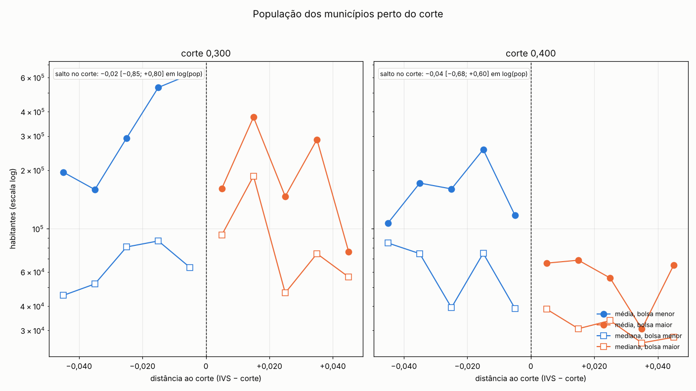
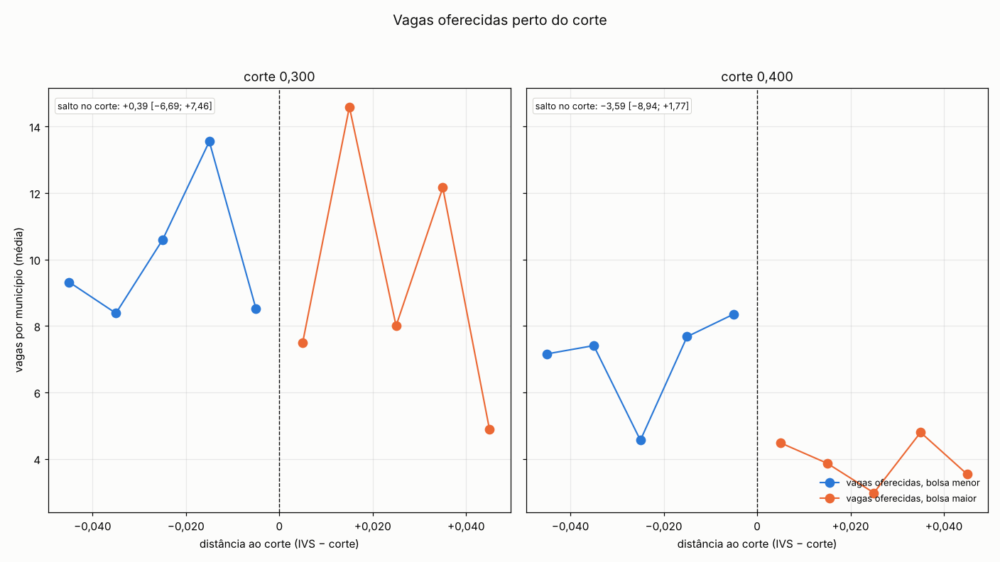
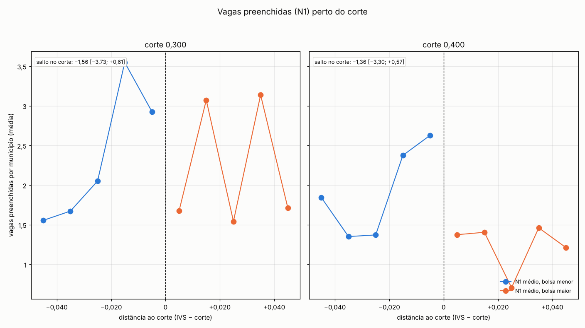
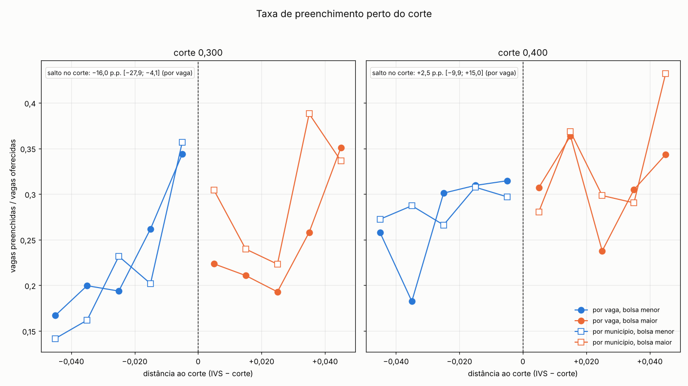
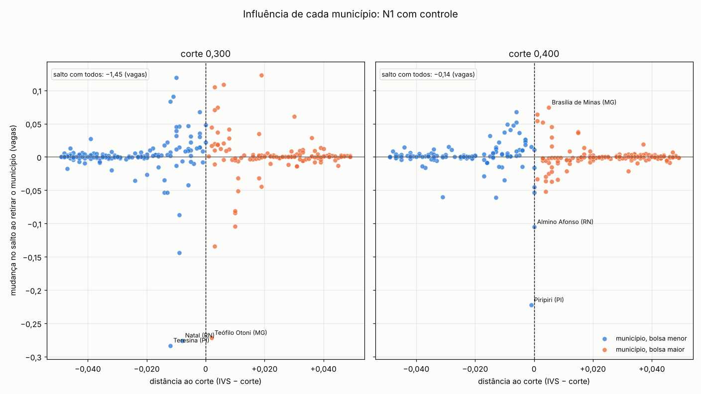
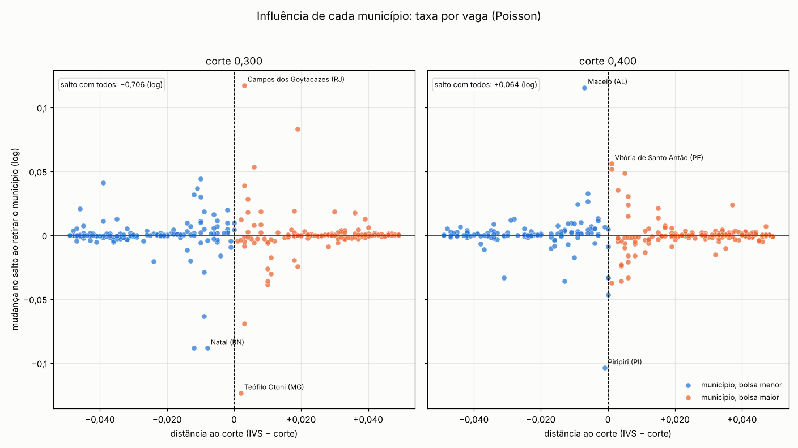
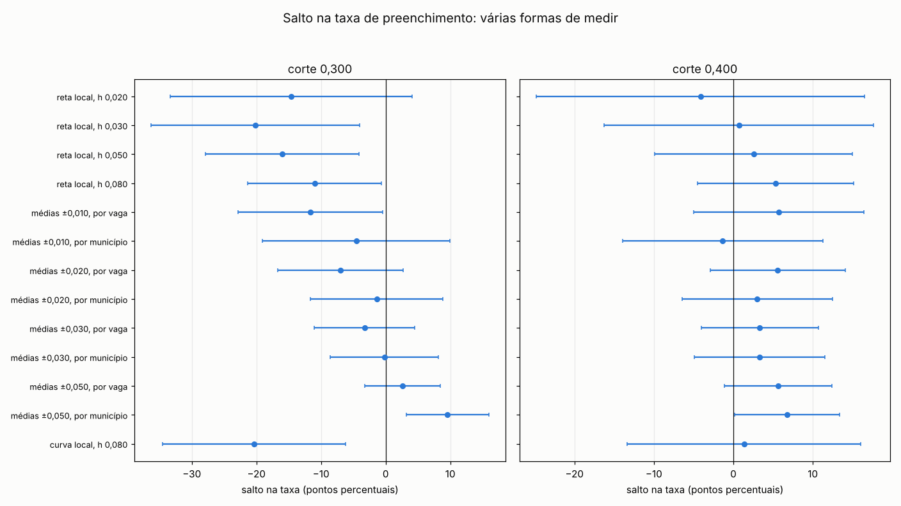
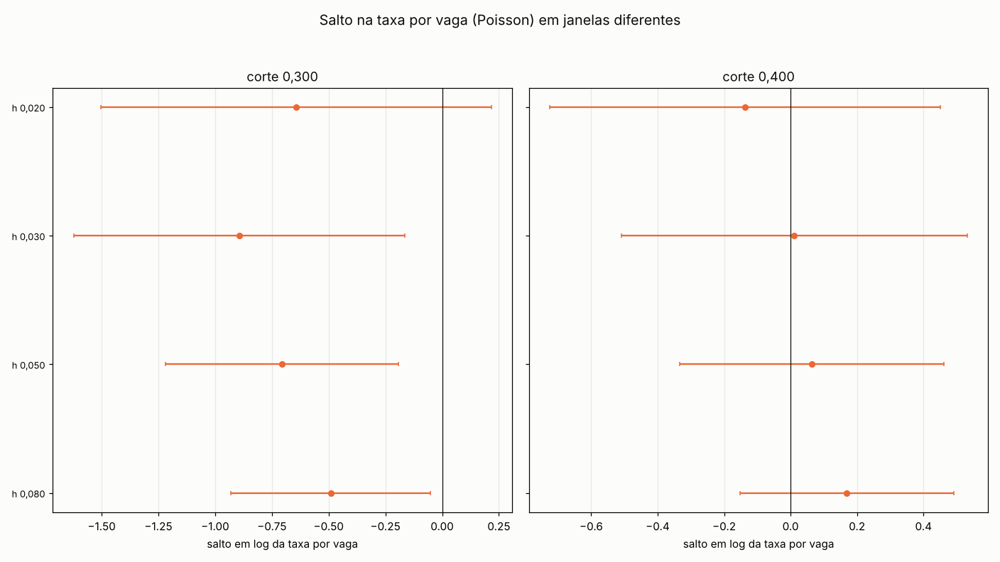
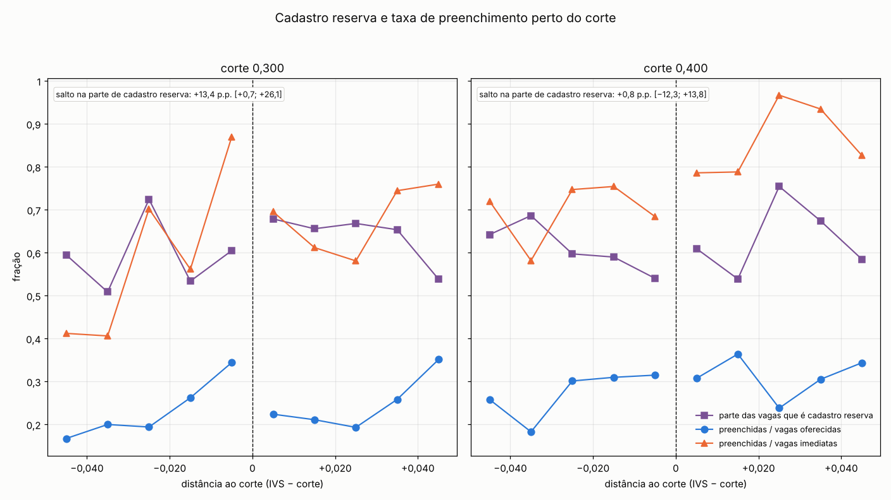
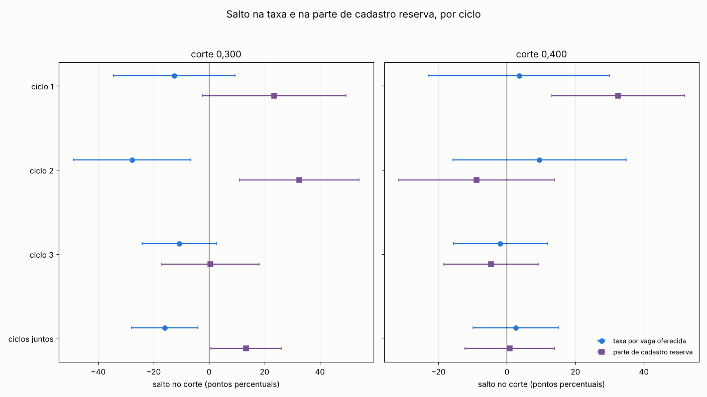

# 49b. Diagnóstico: porte, oferta e taxa na contagem de vagas preenchidas (família N)

> **Data:** 21/10/2026. 
> **Estatuto:** `DIAGNOSTICO_FORA_PROTOCOLO_48`. Diagnóstico **fora do protocolo 48**: não substitui a especificação principal (S-a,
> ciclos e cortes empilhados), não muda o Holm do protocolo 48 nem as conclusões do
> [doc 49](49_resultados_contagem_vagas_preenchidas.md). Nenhuma variante daqui vira especificação principal. 
> **Script:** `scripts/rdd_bolsa/23b_diagnostico_contagem_porte.py` (estimadores de `rdd_lib.py` e do script 23). 
> **Saídas:** `output/rdd_bolsa/ND_estimativas.csv` (toda linha com `estatuto = DIAGNOSTICO_FORA_PROTOCOLO_48` e
> `natureza_dos_dados = EMPIRICO`), `ND_resumo.json` (entradas com SHA-256, lista fixa de diagnósticos, adendos,
> validações) e `ND_figuras/`. 
> **Testes:** `tests/test_diagnostico_contagem_porte.py`. 
> **Números:** este documento é gerado inteiro pelo script a partir das saídas; o teste confere que ele é idêntico
> ao gerado e que cada número tem origem em `output/`.

## 1. A pergunta

Na figura de N1 do doc 49 (vagas preenchidas na 1ª chamada, com controle pelas vagas oferecidas, ciclos e cortes
empilhados) aparecem dois padrões:

- **(a)** dentro da janela, a contagem **sobe** com o IVS, sobretudo à esquerda do corte, quando a intuição diria
  que municípios mais vulneráveis atraem menos;
- **(b)** no corte, a contagem **cai** do lado de bolsa maior.

O contraste é o **pacote do corte**: em 0,300 e 0,400 sobe a bolsa anunciada, mas outras regras federais mudam
nos mesmos cortes ([auditoria 18](../auditorias/18_politicas_nos_mesmos_cortes_ivs.md)). Nada aqui é efeito da
participação no PMM-E, do Agora Tem Especialistas ou do degrau de R$ 5 mil isolado. O IVS é o de 2010, fixo
antes do programa: um desequilíbrio de porte entre os lados não é manipulação, é composição de uma amostra finita
perto do corte.

## 2. Conjunto fixo de diagnósticos (listado antes de rodar)

Gravado em `diagnosticos` de `ND_resumo.json`. Todos são relatados abaixo, qualquer que seja o resultado.

- **D1, decomposicao contagem = oferta x taxa:**
  - saltos local linear (h = 0,050, triangular, CR1 por municipio) em log(pop 2022), vagas imediatas, vagas oferecidas (imediatas + CR), n de celulas, N1 sem controle, N1 com o controle do protocolo, taxa ponderada com as vagas oferecidas e taxa ponderada com as vagas imediatas
  - decomposicao log-aditiva log(N1) = log(vagas oferecidas) + log(taxa) nos municipios com N1 > 0, com o numero de linhas fora por lado e a identidade conferida
  - por corte (ciclos juntos); apendice por ciclo; empilhado so como comparacao
- **D2, de onde vem a inclinacao:**
  - medias por faixa de 0,010 da distancia ao corte (populacao media e mediana, vagas, N1, taxa ponderada e media simples), por corte e no empilhado de comparacao
  - inclinacao de cada lado (por 0,010 de IVS) de N1 sem e com o controle do protocolo, cada uma sem e com log(pop) como covariavel
  - influencia por municipio: leave-one-out do salto de N1 com controle (S-a) e do Poisson com offset (S-d), todos os municipios da janela; os 10 mais influentes por corte (co_ibge, nome, populacao, vagas, lado, distancia)
  - sensibilidade retirando os k = 1, 3, 5 municipios mais populosos da janela, abaixo, acima e dos dois lados, em N1 com e sem controle, no Poisson com offset e na taxa ponderada
- **D3, forma da estimativa da taxa:**
  - Poisson local com offset log(vagas oferecidas), h em 0,020; 0,030; 0,050; 0,080
  - local linear da taxa ponderada (vagas oferecidas e vagas imediatas), mesmas janelas
  - diferenca de medias (local constante, kernel uniforme, intercepto por ciclo) em +-0,010, +-0,020 e +-0,030, ponderada por vagas e sem peso, com as vagas oferecidas e com as imediatas
  - local quadratico (curvatura propria de cada lado) com h = 0,080 da taxa ponderada e de N1 com e sem controle
  - banda otima com vies corrigido estilo rdrobust, se a rdd_lib tiver
- **D4, porte como covariavel:**
  - N1 sem controle; com log(pop); com log(pop) + vagas imediatas; com o controle do protocolo 48 (vagas oferecidas, referencia)
  - contagem por vaga oferecida (N1 / vagas, sem peso) como outcome
  - por corte; apendice por ciclo; empilhado so como comparacao
- **D5, empilhamento:**
  - peso efetivo omega (Cattaneo, Keele, Titiunik e Vazquez-Bare 2016) e contribuicao omega x salto de cada ciclo x corte no salto empilhado, para N1 sem e com controle, com a identidade salto empilhado = soma das contribuicoes conferida
  - o mesmo dentro de cada corte (pesos dos ciclos)
  - empilhado comparado com os cortes isolados (N1 sem e com controle, Poisson com offset, taxa)

**Amostras.** POR_CORTE (principal deste diagnóstico): um corte por vez, ciclos 1–3 juntos com intercepto e
inclinações por ciclo e salto comum, EP CR1 por município, h = 0,050, kernel triangular (a mesma especificação do
script 23). APENDICE_POR_CICLO: ciclo × corte, EP HC1. EMPILHADO_COMPARACAO: ciclos e cortes empilhados, a amostra
da figura do doc 49, **só como comparação**.

**O que já tinha sido visto antes de fixar a lista** (`exposicao_previa`):

- Pistas do pedido (conta descritiva no chat, fora de output/): populacao media e vagas imediatas nas faixas -0,015, -0,005 e +0,005; taxa bruta alocados/vagas maior acima do corte em media simples; N1 por corte com e sem controle (doc 49); Poisson com offset empilhado negativo; atracao (f1_1) e fracao preenchida (f1_3) sem salto no E6.
- Ja publicados no doc 49 antes deste diagnostico: S-a, S-b, S-c, S-d e S-e por corte e empilhados; decomposicao total = oferta + preenchimento; A4 (log pop e estoques CNES).
- Exploracao feita ao preparar este script, antes de fixar a lista (registrada aqui por transparencia): medias por faixa de populacao, vagas, N1 e taxa ponderada por corte; saltos por corte em log(pop), vagas e taxa ponderada; Poisson com offset por corte com h de 0,020 a 0,080; leave-one-out de S-a e do Poisson por corte; taxas medias simples e ponderadas com vagas oferecidas e imediatas nas janelas +-0,010 a +-0,050.

**Adendos datados** (diagnósticos acrescentados depois de rodar):

- **AD1 (21/10/2026).** D3 ganha a diferenca de medias na janela inteira (|x| < 0,050), ponderada e sem peso, com as vagas oferecidas e com as imediatas. Por quê: a taxa bruta das pistas (maior acima do corte em media simples) e uma media da janela inteira com as vagas imediatas no denominador; sem esta linha, o conflito com o Poisson com offset nao pode ser reconciliado com os numeros gravados. O que já tinha sido visto: a exploracao registrada em exposicao_previa (medias simples e ponderadas com os dois denominadores nas janelas +-0,010 a +-0,050) ja tinha mostrado que a media simples com as vagas imediatas, na janela inteira, e maior acima do corte.

## 3. Resposta curta

**(a) A subida dentro da janela.** A contagem acompanha quantas vagas o município abre e o tamanho dele, e perto do corte, do lado de bolsa menor, há municípios maiores ou com mais vagas. No corte 0,300, a faixa colada ao corte (distância de −0,010 a 0) tem população média de 623 mil, contra mediana de 63 mil (maior município: 355030 São Paulo (SP)); na faixa mais distante (−0,050 a −0,040), média de 196 mil. Nesse lado a taxa por vaga também sobe, de 16,7 % para 34,4 %. No corte 0,400, o que sobe à esquerda são as vagas imediatas (de 2,6 para 3,8 por município) e as oferecidas (de 7,2 para 8,4), com a taxa por vaga entre 25,8 % e 31,5 %. Pôr log(pop) como covariável quase não muda a inclinação à esquerda de N1 com controle (+0,39 → +0,37 vaga por 0,010 em 0,300; +0,20 → +0,20 em 0,400): o que pesa são poucas cidades grandes e as vagas que elas abrem e preenchem, não o porte medido em log. A reta local de cada lado projeta essa subida até o corte. Força da evidência: **descritiva** (seção 5), não um teste.

**(b) A queda no corte.** Tem causas diferentes em cada corte, e o empilhado mistura as duas. No corte 0,300, o desbalanceamento de porte **não** explica o salto: log(pop) (−0,02, IC 95% [−0,85; +0,80]) e as vagas oferecidas (+0,39, IC 95% [−6,69; +7,46]) não saltam, e tirar os 1, 3 ou 5 municípios mais populosos de um lado ou dos dois deixa o salto com controle entre −1,78 e −1,49 (com todos, −1,45). O que cai é a taxa de preenchimento por vaga oferecida (−16,0 p.p., IC 95% [−27,9; −4,1]; Poisson com offset −0,706), estável a retirar qualquer município (a maior mudança é de 0,45 EP), a retirar os maiores (entre −20,2 e −16,4 p.p.), com IC que exclui zero nas janelas h = 0,030, 0,050, 0,080 e no local quadrático (−20,4 p.p.). Mas o salto depende de como a taxa é medida: com as vagas imediatas no denominador o IC contém zero (−19,2 p.p., IC 95% [−43,1; +4,7]); comparando só os municípios a até 0,010 do corte, ele é −11,6 p.p. contando cada vaga igual (IC 95% [−22,8; −0,4]) e −4,6 p.p. contando cada município igual (IC 95% [−19,1; +10,0]). Parte do salto local linear vem da subida da taxa à esquerda, que a reta projeta até o corte. No corte 0,400, o porte e a oferta **explicam a maior parte** da queda: sem controle ela é −1,36 (IC 95% [−3,30; +0,57]), acompanha menos vagas oferecidas acima do corte (−3,59, IC 95% [−8,94; +1,77]), passa a −0,33 sem os três municípios mais populosos logo abaixo do corte, quase some com controle (−0,14, IC 95% [−0,82; +0,54]), e a taxa não salta (+2,5 p.p., IC 95% [−9,9; +15,0]).
Força da evidência sobre a queda da taxa em 0,300: **forte** no local linear ponderado
(p = 0,008), sem correção por comparações múltiplas e dependente da medida da taxa (seção 6); a hipótese de
porte em 0,400 tem apoio **descritivo**, e lá nem a queda sem controle (p = 0,167) nem a taxa
(p = 0,689) se distinguem de zero.

**O conflito entre o Poisson com offset e a taxa bruta** (seção 7) se desfaz quando se separam quatro coisas que a
taxa bruta das pistas junta: o denominador (vagas imediatas, nas pistas; imediatas + cadastro reserva, no Poisson),
o peso (cada município pesa igual na média simples; cada vaga pesa igual no Poisson), a janela (média da janela
inteira, nas pistas; reta local avaliada no corte, no Poisson) e o empilhamento dos cortes (o sinal negativo do
Poisson empilhado, −0,346, vem de 0,300).

**Empilhar os cortes** (seção 8) junta um corte em que a taxa por vaga cai e outro em que a oferta cai: o salto
com controle empilhado (−0,76) é uma média ponderada dos dois e não descreve bem nenhum deles. Não é
manipulação: o IVS é o de 2010, fixo antes do programa.

## 4. D1 — contagem = oferta × taxa

Saltos local linear por corte (POR_CORTE). "Média abaixo → acima" é a média simples do outcome nas linhas usadas
de cada lado (nas taxas, a média ponderada pelas vagas, isto é, soma de N1 / soma de vagas). Taxas em %.

| Variável | 0,300: média abaixo → acima | 0,300: salto [IC 95%] | 0,300: p | 0,400: média abaixo → acima | 0,400: salto [IC 95%] | 0,400: p |
|---|---|---|---|---|---|---|
| log(pop 2022) | 11,33 → 11,31 | −0,02 [−0,85; +0,80] | 0,956 | 11,06 → 10,43 | −0,04 [−0,68; +0,60] | 0,907 |
| vagas imediatas | 4,20 → 3,44 | −1,52 [−4,36; +1,32] | 0,295 | 2,80 → 1,46 | −2,11 [−4,54; +0,32] | 0,089 |
| vagas oferecidas (imediatas + CR) | 10,08 → 9,82 | +0,39 [−6,69; +7,46] | 0,914 | 7,05 → 3,93 | −3,59 [−8,94; +1,77] | 0,189 |
| nº de células | 4,82 → 4,77 | −0,42 [−3,48; +2,63] | 0,785 | 3,80 → 2,22 | −1,57 [−3,66; +0,52] | 0,141 |
| N1 (sem controle) | 2,32 → 2,33 | −1,56 [−3,73; +0,61] | 0,160 | 1,96 → 1,23 | −1,36 [−3,30; +0,57] | 0,167 |
| N1 (com o controle do protocolo 48) | 2,32 → 2,33 | −1,45 [−2,67; −0,22] | 0,021 | 1,96 → 1,23 | −0,14 [−0,82; +0,54] | 0,682 |
| taxa N1 / vagas oferecidas (ponderada) | 23,05 → 23,75 | −15,99 [−27,90; −4,09] | 0,008 | 27,72 → 31,33 | +2,55 [−9,92; +15,02] | 0,689 |
| taxa N1 / vagas imediatas (ponderada) | 53,98 → 65,04 | −19,21 [−43,08; +4,66] | 0,115 | 68,01 → 76,77 | +1,02 [−26,03; +28,08] | 0,941 |

Empilhado (só comparação):

| Variável | empilhado: média abaixo → acima | empilhado: salto [IC 95%] | empilhado: p |
|---|---|---|---|
| log(pop 2022) | 11,21 → 10,85 | −0,03 [−0,54; +0,48] | 0,905 |
| vagas imediatas | 3,57 → 2,41 | −1,83 [−3,69; +0,02] | 0,052 |
| vagas oferecidas (imediatas + CR) | 8,71 → 6,76 | −1,73 [−6,12; +2,65] | 0,438 |
| nº de células | 4,36 → 3,45 | −1,04 [−2,85; +0,78] | 0,263 |
| N1 (sem controle) | 2,16 → 1,76 | −1,45 [−2,90; −0,01] | 0,048 |
| N1 (com o controle do protocolo 48) | 2,16 → 1,76 | −0,76 [−1,44; −0,07] | 0,031 |
| taxa N1 / vagas oferecidas (ponderada) | 24,76 → 26,04 | −8,73 [−18,06; +0,60] | 0,067 |
| taxa N1 / vagas imediatas (ponderada) | 58,97 → 68,73 | −10,44 [−28,37; +7,49] | 0,254 |

**Decomposição log-aditiva** nos municípios com N1 > 0. Na mesma amostra e com os mesmos pesos, o salto em
log(N1) é exatamente a soma dos saltos em log(vagas oferecidas) e em log(taxa). Os municípios com N1 = 0 ficam
de fora (contados por lado, nunca viram zero).

| Corte | municípios usados abaixo / acima | linhas fora (N1 = 0) abaixo / acima | salto em log(N1) | = salto em log(vagas oferecidas) | + salto em log(taxa) | resíduo |
|---|---|---|---|---|---|---|
| 0,300 | 80 / 73 | 118 / 83 | −0,370 [−0,977; +0,238] | +0,130 [−0,705; +0,964] | −0,499 [−1,089; +0,091] | 8.9e-16 |
| 0,400 | 75 / 76 | 89 / 107 | −0,221 [−0,646; +0,203] | −0,225 [−0,769; +0,319] | +0,004 [−0,370; +0,378] | -1.8e-15 |

Leitura por corte:

- **Corte 0,300.** N1 sem controle: salto negativo (−1,56; IC 95% [−3,73; +0,61], contém zero). Vagas oferecidas: positivo (+0,39; IC 95% [−6,69; +7,46], contém zero); vagas imediatas: negativo (−1,52; IC 95% [−4,36; +1,32], contém zero); log(pop): negativo (−0,02; IC 95% [−0,85; +0,80], contém zero). Taxa ponderada por vagas oferecidas: −16,0 p.p. (IC 95% [−27,9; −4,1], exclui zero); com as vagas imediatas: −19,2 p.p. (IC 95% [−43,1; +4,7], contém zero). Na decomposição em log (municípios com N1 > 0), o salto de log(vagas oferecidas) é +0,130 e o de log(taxa) é −0,499. N1 com log(pop): negativo (−1,50; IC 95% [−3,32; +0,31], contém zero); com log(pop) + vagas imediatas: negativo (−0,72; IC 95% [−1,55; +0,10], contém zero).
- **Corte 0,400.** N1 sem controle: salto negativo (−1,36; IC 95% [−3,30; +0,57], contém zero). Vagas oferecidas: negativo (−3,59; IC 95% [−8,94; +1,77], contém zero); vagas imediatas: negativo (−2,11; IC 95% [−4,54; +0,32], contém zero); log(pop): negativo (−0,04; IC 95% [−0,68; +0,60], contém zero). Taxa ponderada por vagas oferecidas: +2,5 p.p. (IC 95% [−9,9; +15,0], contém zero); com as vagas imediatas: +1,0 p.p. (IC 95% [−26,0; +28,1], contém zero). Na decomposição em log (municípios com N1 > 0), o salto de log(vagas oferecidas) é −0,225 e o de log(taxa) é +0,004. N1 com log(pop): negativo (−1,49; IC 95% [−3,51; +0,53], contém zero); com log(pop) + vagas imediatas: positivo (+0,01; IC 95% [−0,55; +0,56], contém zero).

## 5. D2 — de onde vem a inclinação

### Médias por faixa de 0,010 da distância ao corte

Corte 0,300 (ciclos juntos; uma linha por município × ciclo):

| Distância ao corte | lado | linhas | pop. média (mil) | pop. mediana (mil) | vagas imediatas | vagas oferecidas | N1 | taxa ponderada (%) | taxa média simples (%) | maior município |
|---|---|---|---|---|---|---|---|---|---|---|
| (−0,050; −0,040] | abaixo | 54 | 196 | 45 | 3,8 | 9,3 | 1,56 | 16,7 | 14,2 | 410690 Curitiba (PR) (1774 mil) |
| (−0,040; −0,030] | abaixo | 58 | 159 | 52 | 4,1 | 8,4 | 1,67 | 20,0 | 16,2 | 500270 Campo Grande (MS) (898 mil) |
| (−0,030; −0,020] | abaixo | 39 | 293 | 81 | 2,9 | 10,6 | 2,05 | 19,4 | 23,2 | 310620 Belo Horizonte (MG) (2316 mil) |
| (−0,020; −0,010] | abaixo | 53 | 533 | 87 | 6,3 | 13,5 | 3,55 | 26,2 | 20,2 | 330455 Rio de Janeiro (RJ) (6211 mil) |
| (−0,010; 0] | abaixo | 41 | 623 | 63 | 3,4 | 8,5 | 2,93 | 34,4 | 35,7 | 355030 São Paulo (SP) (11452 mil) |
| [0; +0,010) | acima | 34 | 161 | 93 | 2,4 | 7,5 | 1,68 | 22,4 | 30,4 | 353440 Osasco (SP) (729 mil) |
| [+0,010; +0,020) | acima | 41 | 375 | 187 | 5,0 | 14,6 | 3,07 | 21,1 | 24,0 | 261160 Recife (PE) (1489 mil) |
| [+0,020; +0,030) | acima | 35 | 147 | 47 | 2,7 | 8,0 | 1,54 | 19,3 | 22,3 | 320500 Serra (ES) (521 mil) |
| [+0,030; +0,040) | acima | 51 | 288 | 75 | 4,2 | 12,2 | 3,14 | 25,8 | 38,8 | 230440 Fortaleza (CE) (2429 mil) |
| [+0,040; +0,050) | acima | 35 | 76 | 56 | 2,3 | 4,9 | 1,71 | 35,1 | 33,6 | 230765 Maracanaú (CE) (235 mil) |

Corte 0,400:

| Distância ao corte | lado | linhas | pop. média (mil) | pop. mediana (mil) | vagas imediatas | vagas oferecidas | N1 | taxa ponderada (%) | taxa média simples (%) | maior município |
|---|---|---|---|---|---|---|---|---|---|---|
| (−0,050; −0,040] | abaixo | 32 | 107 | 85 | 2,6 | 7,2 | 1,84 | 25,8 | 27,2 | 260960 Olinda (PE) (350 mil) |
| (−0,040; −0,030] | abaixo | 37 | 172 | 75 | 2,3 | 7,4 | 1,35 | 18,2 | 28,7 | 330170 Duque de Caxias (RJ) (808 mil) |
| (−0,030; −0,020] | abaixo | 43 | 160 | 39 | 1,8 | 4,6 | 1,37 | 30,1 | 26,6 | 211130 São Luís (MA) (1038 mil) |
| (−0,020; −0,010] | abaixo | 40 | 256 | 75 | 3,1 | 7,7 | 2,38 | 30,9 | 30,8 | 130260 Manaus (AM) (2064 mil) |
| (−0,010; 0] | abaixo | 51 | 117 | 39 | 3,8 | 8,4 | 2,63 | 31,5 | 29,7 | 270430 Maceió (AL) (958 mil) |
| [0; +0,010) | acima | 48 | 67 | 39 | 1,8 | 4,5 | 1,38 | 30,7 | 28,0 | 150553 Parauapebas (PA) (268 mil) |
| [+0,010; +0,020) | acima | 37 | 69 | 31 | 1,8 | 3,9 | 1,41 | 36,4 | 36,8 | 260790 Jaboatão dos Guararapes (PE) (644 mil) |
| [+0,020; +0,030) | acima | 41 | 56 | 34 | 0,7 | 3,0 | 0,71 | 23,8 | 29,8 | 230370 Caucaia (CE) (356 mil) |
| [+0,030; +0,040) | acima | 39 | 31 | 26 | 1,6 | 4,8 | 1,46 | 30,5 | 29,0 | 260110 Araripina (PE) (85 mil) |
| [+0,040; +0,050) | acima | 47 | 65 | 28 | 1,5 | 3,5 | 1,21 | 34,3 | 43,2 | 150420 Marabá (PA) (267 mil) |

Empilhado (só comparação; faixas da distância ao corte, os dois cortes misturados):

| Distância ao corte | lado | linhas | pop. média (mil) | pop. mediana (mil) | vagas imediatas | vagas oferecidas | N1 | taxa ponderada (%) | taxa média simples (%) | maior município |
|---|---|---|---|---|---|---|---|---|---|---|
| (−0,050; −0,040] | abaixo | 86 | 163 | 56 | 3,3 | 8,5 | 1,66 | 19,5 | 19,0 | 410690 Curitiba (PR) (1774 mil) |
| (−0,040; −0,030] | abaixo | 95 | 164 | 56 | 3,4 | 8,0 | 1,55 | 19,3 | 21,1 | 500270 Campo Grande (MS) (898 mil) |
| (−0,030; −0,020] | abaixo | 82 | 223 | 42 | 2,4 | 7,4 | 1,70 | 22,8 | 25,0 | 310620 Belo Horizonte (MG) (2316 mil) |
| (−0,020; −0,010] | abaixo | 93 | 414 | 87 | 5,0 | 11,0 | 3,04 | 27,6 | 24,7 | 330455 Rio de Janeiro (RJ) (6211 mil) |
| (−0,010; 0] | abaixo | 92 | 343 | 50 | 3,6 | 8,4 | 2,76 | 32,8 | 32,4 | 355030 São Paulo (SP) (11452 mil) |
| [0; +0,010) | acima | 82 | 106 | 59 | 2,0 | 5,7 | 1,50 | 26,2 | 29,0 | 353440 Osasco (SP) (729 mil) |
| [+0,010; +0,020) | acima | 78 | 230 | 48 | 3,5 | 9,5 | 2,28 | 24,0 | 30,1 | 261160 Recife (PE) (1489 mil) |
| [+0,020; +0,030) | acima | 76 | 98 | 40 | 1,6 | 5,3 | 1,09 | 20,6 | 26,4 | 320500 Serra (ES) (521 mil) |
| [+0,030; +0,040) | acima | 90 | 176 | 40 | 3,1 | 9,0 | 2,41 | 26,9 | 34,6 | 230440 Fortaleza (CE) (2429 mil) |
| [+0,040; +0,050) | acima | 82 | 70 | 46 | 1,8 | 4,1 | 1,43 | 34,7 | 39,1 | 150420 Marabá (PA) (267 mil) |

- **Corte 0,300.** Na faixa mais distante à esquerda (distância de −0,050 a −0,040), N1 médio = 1,56, população média = 196 mil e vagas oferecidas = 9,3; na faixa colada ao corte (−0,010 a 0), N1 médio = 2,93, população média = 623 mil (mediana 63 mil; maior município: 355030 São Paulo (SP)) e vagas oferecidas = 8,5. A inclinação de N1 com controle à esquerda é +0,39 vaga por 0,010 de IVS sem log(pop) e +0,37 com log(pop); sem controle, +0,34 e +0,23.
- **Corte 0,400.** Na faixa mais distante à esquerda (distância de −0,050 a −0,040), N1 médio = 1,84, população média = 107 mil e vagas oferecidas = 7,2; na faixa colada ao corte (−0,010 a 0), N1 médio = 2,63, população média = 117 mil (mediana 39 mil; maior município: 270430 Maceió (AL)) e vagas oferecidas = 8,4. A inclinação de N1 com controle à esquerda é +0,20 vaga por 0,010 de IVS sem log(pop) e +0,20 com log(pop); sem controle, +0,39 e +0,55.

### Inclinação de cada lado, com e sem log(pop)

Inclinação em vagas preenchidas por 0,010 de IVS; com ciclos juntos, é a média das retas dos ciclos ponderada pela
participação de cada ciclo no peso de kernel.

| Corte | N1 | log(pop) como covariável | inclinação abaixo (vagas por 0,010) | inclinação acima (vagas por 0,010) | salto [IC 95%] |
|---|---|---|---|---|---|
| 0,300 | sem controle | não | +0,34 (EP 0,28) | +0,35 (EP 0,28) | −1,56 [−3,73; +0,61] |
| 0,300 | sem controle | sim | +0,23 (EP 0,23) | +0,44 (EP 0,23) | −1,50 [−3,32; +0,31] |
| 0,300 | com o controle do protocolo 48 | não | +0,39 (EP 0,14) | +0,27 (EP 0,15) | −1,45 [−2,67; −0,22] |
| 0,300 | com o controle do protocolo 48 | sim | +0,37 (EP 0,14) | +0,29 (EP 0,15) | −1,43 [−2,65; −0,21] |
| 0,400 | sem controle | não | +0,39 (EP 0,31) | −0,04 (EP 0,09) | −1,36 [−3,30; +0,57] |
| 0,400 | sem controle | sim | +0,55 (EP 0,36) | +0,11 (EP 0,15) | −1,49 [−3,51; +0,53] |
| 0,400 | com o controle do protocolo 48 | não | +0,20 (EP 0,13) | +0,00 (EP 0,08) | −0,14 [−0,82; +0,54] |
| 0,400 | com o controle do protocolo 48 | sim | +0,20 (EP 0,13) | −0,01 (EP 0,08) | −0,09 [−0,77; +0,60] |

Empilhado (só comparação):

| Corte | N1 | log(pop) como covariável | inclinação abaixo (vagas por 0,010) | inclinação acima (vagas por 0,010) | salto [IC 95%] |
|---|---|---|---|---|---|
| empilhado | sem controle | não | +0,37 (EP 0,21) | +0,16 (EP 0,15) | −1,45 [−2,90; −0,01] |
| empilhado | sem controle | sim | +0,39 (EP 0,21) | +0,28 (EP 0,14) | −1,50 [−2,87; −0,13] |
| empilhado | com o controle do protocolo 48 | não | +0,29 (EP 0,10) | +0,13 (EP 0,09) | −0,76 [−1,44; −0,07] |
| empilhado | com o controle do protocolo 48 | sim | +0,28 (EP 0,09) | +0,13 (EP 0,09) | −0,72 [−1,41; −0,03] |

### Influência por município (leave-one-out)

Cada município da janela sai com todas as suas linhas de ciclo; Δ salto = salto com todos − salto sem ele.
Municípios na janela: 265 no corte 0,300 e
267 no corte 0,400. Todos estão em `ND_estimativas.csv`
(`tipo_linha = influencia`); abaixo, os 10 mais influentes.

N1 com controle (S-a), corte 0,300:

| Posto | co_ibge | Município | pop. (mil) | vagas oferecidas (soma dos ciclos) | N1 (soma dos ciclos) | lado | distância | Δ salto | Δ salto / EP |
|---|---|---|---|---|---|---|---|---|---|
| 1 | 221100 | Teresina (PI) | 866 | 150 | 61 | abaixo | −0,012 | −0,28 | −0,45 |
| 2 | 240810 | Natal (RN) | 751 | 75 | 42 | abaixo | −0,008 | −0,28 | −0,44 |
| 3 | 316860 | Teófilo Otoni (MG) | 137 | 80 | 9 | acima | +0,002 | −0,27 | −0,43 |
| 4 | 251080 | Patos (PB) | 103 | 25 | 18 | abaixo | −0,009 | −0,14 | −0,23 |
| 5 | 311730 | Conceição das Alagoas (MG) | 28 | 22 | 1 | acima | +0,003 | −0,13 | −0,21 |
| 6 | 261160 | Recife (PE) | 1489 | 107 | 44 | acima | +0,019 | +0,12 | +0,20 |
| 7 | 330455 | Rio de Janeiro (RJ) | 6211 | 72 | 6 | abaixo | −0,010 | +0,12 | +0,19 |
| 8 | 230420 | Crato (CE) | 131 | 12 | 8 | acima | +0,006 | +0,11 | +0,17 |
| 9 | 330100 | Campos dos Goytacazes (RJ) | 484 | 65 | 19 | acima | +0,003 | +0,11 | +0,17 |
| 10 | 260410 | Caruaru (PE) | 378 | 60 | 3 | acima | +0,010 | −0,10 | −0,17 |

N1 com controle (S-a), corte 0,400:

| Posto | co_ibge | Município | pop. (mil) | vagas oferecidas (soma dos ciclos) | N1 (soma dos ciclos) | lado | distância | Δ salto | Δ salto / EP |
|---|---|---|---|---|---|---|---|---|---|
| 1 | 220840 | Piripiri (PI) | 66 | 32 | 21 | abaixo | −0,001 | −0,22 | −0,64 |
| 2 | 240060 | Almino Afonso (RN) | 5 | 12 | 10 | abaixo | 0 | −0,11 | −0,30 |
| 3 | 310860 | Brasília de Minas (MG) | 32 | 16 | 10 | acima | +0,005 | +0,07 | +0,21 |
| 4 | 310090 | Águas Formosas (MG) | 18 | 20 | 2 | abaixo | −0,006 | +0,07 | +0,19 |
| 5 | 261640 | Vitória de Santo Antão (PE) | 134 | 13 | 6 | acima | +0,001 | +0,06 | +0,18 |
| 6 | 130260 | Manaus (AM) | 2064 | 56 | 24 | abaixo | −0,013 | −0,06 | −0,18 |
| 7 | 330170 | Duque de Caxias (RJ) | 808 | 42 | 1 | abaixo | −0,031 | −0,06 | −0,17 |
| 8 | 231130 | Quixadá (CE) | 84 | 8 | 5 | acima | +0,001 | +0,05 | +0,16 |
| 9 | 160060 | Santana (AP) | 108 | 11 | 7 | abaixo | 0 | −0,05 | −0,15 |
| 10 | 150680 | Santarém (PA) | 332 | 21 | 1 | abaixo | −0,006 | +0,05 | +0,15 |

Poisson com offset, corte 0,300:

| Posto | co_ibge | Município | pop. (mil) | vagas oferecidas (soma dos ciclos) | N1 (soma dos ciclos) | lado | distância | Δ salto | Δ salto / EP |
|---|---|---|---|---|---|---|---|---|---|
| 1 | 316860 | Teófilo Otoni (MG) | 137 | 80 | 9 | acima | +0,002 | −0,123 | −0,47 |
| 2 | 330100 | Campos dos Goytacazes (RJ) | 484 | 65 | 19 | acima | +0,003 | +0,117 | +0,45 |
| 3 | 240810 | Natal (RN) | 751 | 75 | 42 | abaixo | −0,008 | −0,088 | −0,34 |
| 4 | 221100 | Teresina (PI) | 866 | 150 | 61 | abaixo | −0,012 | −0,088 | −0,34 |
| 5 | 261160 | Recife (PE) | 1489 | 107 | 44 | acima | +0,019 | +0,083 | +0,32 |
| 6 | 311730 | Conceição das Alagoas (MG) | 28 | 22 | 1 | acima | +0,003 | −0,069 | −0,26 |
| 7 | 251080 | Patos (PB) | 103 | 25 | 18 | abaixo | −0,009 | −0,064 | −0,24 |
| 8 | 230420 | Crato (CE) | 131 | 12 | 8 | acima | +0,006 | +0,054 | +0,20 |
| 9 | 330455 | Rio de Janeiro (RJ) | 6211 | 72 | 6 | abaixo | −0,010 | +0,044 | +0,17 |
| 10 | 140010 | Boa Vista (RR) | 413 | 97 | 30 | abaixo | −0,039 | +0,041 | +0,16 |

Poisson com offset, corte 0,400:

| Posto | co_ibge | Município | pop. (mil) | vagas oferecidas (soma dos ciclos) | N1 (soma dos ciclos) | lado | distância | Δ salto | Δ salto / EP |
|---|---|---|---|---|---|---|---|---|---|
| 1 | 270430 | Maceió (AL) | 958 | 191 | 66 | abaixo | −0,007 | +0,116 | +0,57 |
| 2 | 220840 | Piripiri (PI) | 66 | 32 | 21 | abaixo | −0,001 | −0,104 | −0,51 |
| 3 | 261640 | Vitória de Santo Antão (PE) | 134 | 13 | 6 | acima | +0,001 | +0,056 | +0,28 |
| 4 | 231130 | Quixadá (CE) | 84 | 8 | 5 | acima | +0,001 | +0,052 | +0,25 |
| 5 | 310860 | Brasília de Minas (MG) | 32 | 16 | 10 | acima | +0,005 | +0,049 | +0,24 |
| 6 | 240060 | Almino Afonso (RN) | 5 | 12 | 10 | abaixo | 0 | −0,047 | −0,23 |
| 7 | 313250 | Itamarandiba (MG) | 33 | 16 | 5 | acima | +0,001 | −0,037 | −0,18 |
| 8 | 292810 | Santa Maria da Vitória (BA) | 39 | 11 | 0 | acima | +0,004 | −0,036 | −0,18 |
| 9 | 130260 | Manaus (AM) | 2064 | 56 | 24 | abaixo | −0,013 | −0,036 | −0,18 |
| 10 | 230540 | Icó (CE) | 63 | 14 | 7 | acima | +0,003 | +0,035 | +0,17 |

### Sem os municípios mais populosos da janela

Salto retirando os k mais populosos da janela abaixo do corte, acima, ou dos dois lados. Taxa em p.p.; Poisson em
log; `*` = IC 95% que exclui zero.

Corte 0,300:

| Outcome | todos | k=1 abaixo | k=1 acima | k=1 ambos | k=3 abaixo | k=3 acima | k=3 ambos | k=5 abaixo | k=5 acima | k=5 ambos |
|---|---|---|---|---|---|---|---|---|---|---|
| N1 (com o controle do protocolo 48) | −1,45 | −1,49* | −1,51* | −1,56* | −1,59* | −1,62* | −1,78* | −1,56* | −1,53* | −1,66* |
| N1 (sem controle) | −1,56 | −1,62 | −1,44 | −1,50 | −1,44 | −1,77 | −1,66 | −1,45 | −1,87 | −1,75 |
| N1 Poisson com offset | −0,706 | −0,724* | −0,724* | −0,743* | −0,781* | −0,810* | −0,879* | −0,763* | −0,788* | −0,846* |
| taxa N1 / vagas oferecidas (ponderada) | −16,0 | −16,4* | −16,4* | −16,9* | −18,6* | −17,6* | −20,2* | −18,7* | −17,5* | −20,2* |

- abaixo do corte 0,300, os 5 mais populosos: 355030 São Paulo (SP), 330455 Rio de Janeiro (RJ), 530010 Brasília (DF), 310620 Belo Horizonte (MG), 410690 Curitiba (PR).
- acima do corte 0,300, os 5 mais populosos: 230440 Fortaleza (CE), 261160 Recife (PE), 150140 Belém (PA), 351880 Guarulhos (SP), 330490 São Gonçalo (RJ).

Corte 0,400:

| Outcome | todos | k=1 abaixo | k=1 acima | k=1 ambos | k=3 abaixo | k=3 acima | k=3 ambos | k=5 abaixo | k=5 acima | k=5 ambos |
|---|---|---|---|---|---|---|---|---|---|---|
| N1 (com o controle do protocolo 48) | −0,14 | −0,08 | −0,18 | −0,12 | −0,12 | −0,16 | −0,14 | −0,02 | −0,15 | +0,00 |
| N1 (sem controle) | −1,36 | −1,22 | −1,41 | −1,27 | −0,33 | −1,43 | −0,41 | −0,33 | −1,42 | −0,40 |
| N1 Poisson com offset | +0,064 | +0,100 | +0,043 | +0,079 | −0,021 | +0,073 | −0,012 | +0,004 | +0,078 | +0,019 |
| taxa N1 / vagas oferecidas (ponderada) | +2,5 | +3,7 | +1,8 | +3,0 | +0,2 | +2,7 | +0,4 | +0,8 | +2,9 | +1,2 |

- abaixo do corte 0,400, os 5 mais populosos: 130260 Manaus (AM), 211130 São Luís (MA), 270430 Maceió (AL), 330170 Duque de Caxias (RJ), 330350 Nova Iguaçu (RJ).
- acima do corte 0,400, os 5 mais populosos: 260790 Jaboatão dos Guararapes (PE), 230370 Caucaia (CE), 150553 Parauapebas (PA), 150420 Marabá (PA), 211120 São José de Ribamar (MA).

Leitura:

- **Corte 0,300.** O município mais influente no salto com controle é Teresina (PI) (Δ = −0,28 vaga, −0,45 EP); nenhum muda o salto em mais de 0,45 EP. No Poisson com offset, o mais influente é Teófilo Otoni (MG) (Δ = −0,123 em log). Retirando os k = 1, 3, 5 municípios mais populosos (abaixo, acima, dos dois lados), o salto com controle fica entre −1,78 e −1,49 (9 de 9 com IC que exclui zero); o Poisson com offset, entre −0,879 e −0,724 (9 de 9); a taxa ponderada, entre −20,2 e −16,4 p.p. (9 de 9).
- **Corte 0,400.** O município mais influente no salto com controle é Piripiri (PI) (Δ = −0,22 vaga, −0,64 EP); nenhum muda o salto em mais de 0,64 EP. No Poisson com offset, o mais influente é Maceió (AL) (Δ = +0,116 em log). Retirando os k = 1, 3, 5 municípios mais populosos (abaixo, acima, dos dois lados), o salto com controle fica entre −0,18 e +0,00 (0 de 9 com IC que exclui zero); o Poisson com offset, entre −0,021 e +0,100 (0 de 9); a taxa ponderada, entre +0,2 e +3,7 p.p. (0 de 9).

## 6. D3 — forma da estimativa da taxa

Corte 0,300:

| Estimador | Janela / variante | Outcome | municípios abaixo / acima | média abaixo → acima | salto [IC 95%] | p |
|---|---|---|---|---|---|---|
| poisson offset | h=0,020 | N1 (log da taxa) | 54 / 47 | — | −0,644 [−1,504; +0,216] | 0,142 |
| taxa ponderada local linear | h=0,020 | N1 / vagas oferecidas | 54 / 47 | 28,9 → 21,5 | −14,6 [−33,4; +4,1] | 0,127 |
| taxa ponderada local linear | h=0,020 | N1 / vagas imediatas | 34 / 32 | 64,1 → 61,8 | −26,2 [−68,5; +16,1] | 0,224 |
| poisson offset | h=0,030 | N1 (log da taxa) | 79 / 70 | — | −0,894 [−1,623; −0,164] | 0,016 |
| taxa ponderada local linear | h=0,030 | N1 / vagas oferecidas | 79 / 70 | 26,2 → 20,9 | −20,1 [−36,3; −4,0] | 0,014 |
| taxa ponderada local linear | h=0,030 | N1 / vagas imediatas | 53 / 47 | 64,6 → 59,8 | −13,9 [−49,9; +22,1] | 0,449 |
| poisson offset | h=0,050 | N1 (log da taxa) | 145 / 120 | — | −0,706 [−1,220; −0,192] | 0,007 |
| taxa ponderada local linear | h=0,050 | N1 / vagas oferecidas | 145 / 120 | 23,0 → 23,8 | −16,0 [−27,9; −4,1] | 0,008 |
| taxa ponderada local linear | h=0,050 | N1 / vagas imediatas | 98 / 79 | 54,0 → 65,0 | −19,2 [−43,1; +4,7] | 0,115 |
| poisson offset | h=0,080 | N1 (log da taxa) | 230 / 190 | — | −0,491 [−0,930; −0,052] | 0,028 |
| taxa ponderada local linear | h=0,080 | N1 / vagas oferecidas | 230 / 190 | 21,3 → 24,1 | −11,0 [−21,4; −0,6] | 0,038 |
| taxa ponderada local linear | h=0,080 | N1 / vagas imediatas | 151 / 132 | 52,5 → 65,4 | −11,7 [−33,8; +10,5] | 0,302 |
| local constante | janela 0,010 ponderada | N1 / vagas oferecidas | 33 / 28 | 27,7 → 16,2 | −11,6 [−22,8; −0,4] | 0,042 |
| local constante | janela 0,010 sem peso | N1 / vagas oferecidas | 33 / 28 | 32,9 → 30,0 | −4,6 [−19,1; +10,0] | 0,539 |
| local constante | janela 0,010 ponderada | N1 / vagas imediatas | 19 / 18 | 76,3 → 66,7 | −10,1 [−33,8; +13,7] | 0,406 |
| local constante | janela 0,010 sem peso | N1 / vagas imediatas | 19 / 18 | 75,0 → 80,3 | +4,4 [−32,3; +41,2] | 0,813 |
| local constante | janela 0,020 ponderada | N1 / vagas oferecidas | 59 / 49 | 29,0 → 21,4 | −7,0 [−16,7; +2,7] | 0,157 |
| local constante | janela 0,020 sem peso | N1 / vagas oferecidas | 59 / 49 | 26,2 → 26,2 | −1,4 [−11,6; +8,9] | 0,795 |
| local constante | janela 0,020 ponderada | N1 / vagas imediatas | 39 / 33 | 65,7 → 61,6 | −4,8 [−24,4; +14,8] | 0,632 |
| local constante | janela 0,020 sem peso | N1 / vagas imediatas | 39 / 33 | 61,5 → 68,8 | +6,4 [−16,8; +29,6] | 0,590 |
| local constante | janela 0,030 ponderada | N1 / vagas oferecidas | 82 / 73 | 26,0 → 21,2 | −3,3 [−11,1; +4,5] | 0,411 |
| local constante | janela 0,030 sem peso | N1 / vagas oferecidas | 82 / 73 | 25,3 → 25,2 | −0,2 [−8,6; +8,1] | 0,962 |
| local constante | janela 0,030 ponderada | N1 / vagas imediatas | 56 / 49 | 63,5 → 64,0 | −0,7 [−19,4; +18,1] | 0,944 |
| local constante | janela 0,030 sem peso | N1 / vagas imediatas | 56 / 49 | 61,6 → 64,9 | +3,2 [−16,6; +22,9] | 0,754 |
| local constante adendo AD1 | janela 0,050 ponderada | N1 / vagas oferecidas | 145 / 123 | 23,0 → 24,0 | +2,6 [−3,2; +8,4] | 0,384 |
| local constante adendo AD1 | janela 0,050 sem peso | N1 / vagas oferecidas | 145 / 123 | 21,0 → 30,4 | +9,6 [+3,2; +15,9] | 0,003 |
| local constante adendo AD1 | janela 0,050 ponderada | N1 / vagas imediatas | 98 / 81 | 54,0 → 65,1 | +11,1 [−3,4; +25,6] | 0,133 |
| local constante adendo AD1 | janela 0,050 sem peso | N1 / vagas imediatas | 98 / 81 | 55,3 → 70,2 | +14,1 [−0,5; +28,6] | 0,058 |
| local quadratico taxa ponderada | h=0,080 | N1 / vagas oferecidas | 230 / 190 | 21,3 → 24,1 | −20,4 [−34,6; −6,2] | 0,005 |
| local quadratico taxa ponderada | h=0,080 | N1 / vagas imediatas | 151 / 132 | 52,5 → 65,4 | −26,8 [−55,8; +2,2] | 0,070 |
| local quadratico sem controle | h=0,080 | N1 | 230 / 190 | 1,88 → 2,09 | −1,62 [−3,99; +0,75] | 0,180 |
| local quadratico controle protocolo 48 | h=0,080 | N1 | 230 / 190 | 1,88 → 2,09 | −1,73 [−3,09; −0,37] | 0,013 |
| rdrobust_h_otimo | nao_executado | — | — | — | — | NAO_EXECUTADO |

Corte 0,400:

| Estimador | Janela / variante | Outcome | municípios abaixo / acima | média abaixo → acima | salto [IC 95%] | p |
|---|---|---|---|---|---|---|
| poisson offset | h=0,020 | N1 (log da taxa) | 52 / 53 | — | −0,137 [−0,724; +0,451] | 0,648 |
| taxa ponderada local linear | h=0,020 | N1 / vagas oferecidas | 52 / 53 | 31,2 → 33,0 | −4,1 [−24,8; +16,5] | 0,694 |
| taxa ponderada local linear | h=0,020 | N1 / vagas imediatas | 36 / 28 | 69,9 → 74,7 | +3,4 [−39,9; +46,8] | 0,878 |
| poisson offset | h=0,030 | N1 (log da taxa) | 77 / 81 | — | +0,011 [−0,509; +0,532] | 0,966 |
| taxa ponderada local linear | h=0,030 | N1 / vagas oferecidas | 77 / 81 | 31,0 → 30,6 | +0,7 [−16,2; +17,7] | 0,935 |
| taxa ponderada local linear | h=0,030 | N1 / vagas imediatas | 50 / 42 | 70,1 → 73,3 | +4,8 [−31,6; +41,3] | 0,795 |
| poisson offset | h=0,050 | N1 (log da taxa) | 122 / 145 | — | +0,064 [−0,333; +0,462] | 0,751 |
| taxa ponderada local linear | h=0,050 | N1 / vagas oferecidas | 122 / 145 | 27,7 → 31,3 | +2,5 [−9,9; +15,0] | 0,689 |
| taxa ponderada local linear | h=0,050 | N1 / vagas imediatas | 88 / 76 | 68,0 → 76,8 | +1,0 [−26,0; +28,1] | 0,941 |
| poisson offset | h=0,080 | N1 (log da taxa) | 196 / 191 | — | +0,170 [−0,152; +0,491] | 0,301 |
| taxa ponderada local linear | h=0,080 | N1 / vagas oferecidas | 196 / 191 | 27,0 → 30,4 | +5,3 [−4,5; +15,2] | 0,287 |
| taxa ponderada local linear | h=0,080 | N1 / vagas imediatas | 136 / 97 | 67,9 → 76,1 | +4,3 [−18,3; +27,0] | 0,709 |
| local constante | janela 0,010 ponderada | N1 / vagas oferecidas | 31 / 28 | 32,0 → 30,7 | +5,7 [−5,0; +16,4] | 0,294 |
| local constante | janela 0,010 sem peso | N1 / vagas oferecidas | 31 / 28 | 30,5 → 28,0 | −1,3 [−13,9; +11,2] | 0,835 |
| local constante | janela 0,010 ponderada | N1 / vagas imediatas | 19 / 16 | 68,3 → 72,6 | +3,7 [−23,0; +30,3] | 0,788 |
| local constante | janela 0,010 sem peso | N1 / vagas imediatas | 19 / 16 | 82,9 → 84,1 | +12,7 [−34,4; +59,7] | 0,598 |
| local constante | janela 0,020 ponderada | N1 / vagas oferecidas | 55 / 58 | 30,6 → 32,3 | +5,6 [−2,9; +14,1] | 0,197 |
| local constante | janela 0,020 sem peso | N1 / vagas oferecidas | 55 / 58 | 28,8 → 31,1 | +3,0 [−6,4; +12,4] | 0,532 |
| local constante | janela 0,020 ponderada | N1 / vagas imediatas | 37 / 29 | 69,3 → 74,0 | +2,7 [−15,5; +21,0] | 0,770 |
| local constante | janela 0,020 sem peso | N1 / vagas imediatas | 37 / 29 | 83,0 → 82,0 | +3,0 [−27,8; +33,8] | 0,848 |
| local constante | janela 0,030 ponderada | N1 / vagas oferecidas | 79 / 82 | 31,0 → 30,8 | +3,3 [−4,0; +10,7] | 0,375 |
| local constante | janela 0,030 sem peso | N1 / vagas oferecidas | 79 / 82 | 29,3 → 31,7 | +3,3 [−4,9; +11,5] | 0,431 |
| local constante | janela 0,030 ponderada | N1 / vagas imediatas | 52 / 43 | 70,0 → 73,5 | +3,1 [−12,6; +18,9] | 0,695 |
| local constante | janela 0,030 sem peso | N1 / vagas imediatas | 52 / 43 | 80,3 → 79,4 | +1,6 [−22,8; +26,0] | 0,899 |
| local constante adendo AD1 | janela 0,050 ponderada | N1 / vagas oferecidas | 125 / 146 | 27,9 → 31,4 | +5,6 [−1,1; +12,4] | 0,103 |
| local constante adendo AD1 | janela 0,050 sem peso | N1 / vagas oferecidas | 125 / 146 | 28,7 → 33,5 | +6,8 [+0,2; +13,4] | 0,045 |
| local constante adendo AD1 | janela 0,050 ponderada | N1 / vagas imediatas | 90 / 77 | 68,0 → 76,8 | +8,8 [−6,0; +23,6] | 0,245 |
| local constante adendo AD1 | janela 0,050 sem peso | N1 / vagas imediatas | 90 / 77 | 72,3 → 89,4 | +19,4 [−1,2; +39,9] | 0,064 |
| local quadratico taxa ponderada | h=0,080 | N1 / vagas oferecidas | 196 / 191 | 27,0 → 30,4 | +1,3 [−13,4; +16,0] | 0,858 |
| local quadratico taxa ponderada | h=0,080 | N1 / vagas imediatas | 136 / 97 | 67,9 → 76,1 | −0,2 [−32,4; +31,9] | 0,989 |
| local quadratico sem controle | h=0,080 | N1 | 196 / 191 | 2,11 → 1,15 | −1,50 [−3,59; +0,59] | 0,160 |
| local quadratico controle protocolo 48 | h=0,080 | N1 | 196 / 191 | 2,11 → 1,15 | −0,22 [−1,00; +0,57] | 0,592 |
| rdrobust_h_otimo | nao_executado | — | — | — | — | NAO_EXECUTADO |

Empilhado (só comparação):

| Estimador | Janela / variante | Outcome | municípios abaixo / acima | média abaixo → acima | salto [IC 95%] | p |
|---|---|---|---|---|---|---|
| poisson offset | h=0,020 | N1 (log da taxa) | 106 / 100 | — | −0,347 [−0,850; +0,157] | 0,177 |
| taxa ponderada local linear | h=0,020 | N1 / vagas oferecidas | 106 / 100 | 29,8 → 24,9 | −9,3 [−23,4; +4,7] | 0,193 |
| taxa ponderada local linear | h=0,020 | N1 / vagas imediatas | 70 / 60 | 66,4 → 66,2 | −9,2 [−40,2; +21,8] | 0,560 |
| poisson offset | h=0,030 | N1 (log da taxa) | 156 / 151 | — | −0,421 [−0,885; +0,043] | 0,075 |
| taxa ponderada local linear | h=0,030 | N1 / vagas oferecidas | 156 / 151 | 28,1 → 23,8 | −10,9 [−23,2; +1,3] | 0,081 |
| taxa ponderada local linear | h=0,030 | N1 / vagas imediatas | 103 / 89 | 66,8 → 64,2 | −4,2 [−30,0; +21,6] | 0,750 |
| poisson offset | h=0,050 | N1 (log da taxa) | 267 / 265 | — | −0,346 [−0,704; +0,011] | 0,057 |
| taxa ponderada local linear | h=0,050 | N1 / vagas oferecidas | 267 / 265 | 24,8 → 26,0 | −8,7 [−18,1; +0,6] | 0,067 |
| taxa ponderada local linear | h=0,050 | N1 / vagas imediatas | 186 / 155 | 59,0 → 68,7 | −10,4 [−28,4; +7,5] | 0,254 |
| poisson offset | h=0,080 | N1 (log da taxa) | 426 / 381 | — | −0,211 [−0,524; +0,103] | 0,187 |
| taxa ponderada local linear | h=0,080 | N1 / vagas oferecidas | 426 / 381 | 23,8 → 25,9 | −5,1 [−13,1; +2,9] | 0,213 |
| taxa ponderada local linear | h=0,080 | N1 / vagas imediatas | 287 / 229 | 59,1 → 68,5 | −5,3 [−21,6; +11,0] | 0,525 |
| local constante | janela 0,010 ponderada | N1 / vagas oferecidas | 64 / 56 | 29,7 → 20,8 | −5,2 [−14,0; +3,6] | 0,244 |
| local constante | janela 0,010 sem peso | N1 / vagas oferecidas | 64 / 56 | 31,7 → 29,0 | −2,9 [−12,5; +6,6] | 0,549 |
| local constante | janela 0,010 ponderada | N1 / vagas imediatas | 38 / 34 | 72,0 → 69,3 | −3,8 [−21,4; +13,9] | 0,675 |
| local constante | janela 0,010 sem peso | N1 / vagas imediatas | 38 / 34 | 79,2 → 82,1 | +8,4 [−21,1; +38,0] | 0,575 |
| local constante | janela 0,020 ponderada | N1 / vagas oferecidas | 114 / 107 | 29,7 → 24,7 | −2,8 [−10,1; +4,4] | 0,444 |
| local constante | janela 0,020 sem peso | N1 / vagas oferecidas | 114 / 107 | 27,4 → 28,9 | +0,9 [−6,1; +7,8] | 0,806 |
| local constante | janela 0,020 ponderada | N1 / vagas imediatas | 76 / 62 | 67,1 → 65,9 | −2,1 [−16,3; +12,1] | 0,769 |
| local constante | janela 0,020 sem peso | N1 / vagas imediatas | 76 / 62 | 72,5 → 75,3 | +4,7 [−14,4; +23,9] | 0,628 |
| local constante | janela 0,030 ponderada | N1 / vagas oferecidas | 161 / 155 | 27,9 → 23,7 | −1,3 [−7,2; +4,7] | 0,675 |
| local constante | janela 0,030 sem peso | N1 / vagas oferecidas | 161 / 155 | 27,3 → 28,6 | +1,6 [−4,3; +7,4] | 0,597 |
| local constante | janela 0,030 ponderada | N1 / vagas imediatas | 108 / 92 | 66,1 → 66,8 | +0,6 [−13,0; +14,2] | 0,933 |
| local constante | janela 0,030 sem peso | N1 / vagas imediatas | 108 / 92 | 70,9 → 71,6 | +2,4 [−13,1; +17,9] | 0,760 |
| local constante adendo AD1 | janela 0,050 ponderada | N1 / vagas oferecidas | 270 / 269 | 24,9 → 26,2 | +3,6 [−0,9; +8,1] | 0,118 |
| local constante adendo AD1 | janela 0,050 sem peso | N1 / vagas oferecidas | 270 / 269 | 24,5 → 32,0 | +8,2 [+3,6; +12,8] | 0,000 |
| local constante adendo AD1 | janela 0,050 ponderada | N1 / vagas imediatas | 188 / 158 | 59,1 → 68,8 | +10,3 [−0,5; +21,2] | 0,062 |
| local constante adendo AD1 | janela 0,050 sem peso | N1 / vagas imediatas | 188 / 158 | 63,5 → 79,0 | +16,6 [+4,2; +28,9] | 0,008 |
| local quadratico taxa ponderada | h=0,080 | N1 / vagas oferecidas | 426 / 381 | 23,8 → 25,9 | −11,4 [−22,4; −0,4] | 0,041 |
| local quadratico taxa ponderada | h=0,080 | N1 / vagas imediatas | 287 / 229 | 59,1 → 68,5 | −14,5 [−36,5; +7,4] | 0,194 |
| local quadratico sem controle | h=0,080 | N1 | 426 / 381 | 1,99 → 1,65 | −1,56 [−3,14; +0,03] | 0,054 |
| local quadratico controle protocolo 48 | h=0,080 | N1 | 426 / 381 | 1,99 → 1,65 | −0,92 [−1,69; −0,15] | 0,019 |
| rdrobust_h_otimo | nao_executado | — | — | — | — | NAO_EXECUTADO |

- **Corte 0,300.** Das 13 estimativas da taxa (local linear ponderado, local constante ponderado e sem peso, local quadrático, com as vagas oferecidas no denominador), 11 são negativas e 2 positivas; com IC que exclui zero: 6. O Poisson com offset vai de −0,894 a −0,491 entre h = 0,020 e h = 0,080 (3 de 4 com IC que exclui zero).
- **Corte 0,400.** Das 13 estimativas da taxa (local linear ponderado, local constante ponderado e sem peso, local quadrático, com as vagas oferecidas no denominador), 2 são negativas e 11 positivas; com IC que exclui zero: 1. O Poisson com offset vai de −0,137 a +0,170 entre h = 0,020 e h = 0,080 (0 de 4 com IC que exclui zero).

## 7. Por que o Poisson com offset é negativo se a taxa bruta é maior acima do corte

- **Corte 0,300.** Média simples de N1 / vagas imediatas na janela inteira: 55,3 % abaixo e 70,2 % acima (diferença com intercepto por ciclo: +14,1 p.p., IC 95% [−0,5; +28,6]). Trocando para a taxa no nível da vaga com as vagas oferecidas (imediatas + CR), na mesma janela: 23,0 % e 24,0 % (+2,6 p.p.). Só em ±0,010: 27,7 % e 16,2 % (−11,6 p.p., IC 95% [−22,8; −0,4]). O Poisson com offset (reta local, h = 0,050): −0,706 em log (IC 95% [−1,220; −0,192]).
- **Corte 0,400.** Média simples de N1 / vagas imediatas na janela inteira: 72,3 % abaixo e 89,4 % acima (diferença com intercepto por ciclo: +19,4 p.p., IC 95% [−1,2; +39,9]). Trocando para a taxa no nível da vaga com as vagas oferecidas (imediatas + CR), na mesma janela: 27,9 % e 31,4 % (+5,6 p.p.). Só em ±0,010: 32,0 % e 30,7 % (+5,7 p.p., IC 95% [−5,0; +16,4]). O Poisson com offset (reta local, h = 0,050): +0,064 em log (IC 95% [−0,333; +0,462]).

O Poisson com offset log(vagas oferecidas) estima a taxa **no nível da vaga** (cada vaga pesa igual, então os
municípios com muitas vagas, e muitas delas de cadastro reserva, dominam) e a avalia **no corte**, pela reta local
de cada lado. A taxa bruta das pistas é outra quantidade: média simples entre municípios (o município com uma vaga
imediata preenchida pesa o mesmo que uma capital), com as vagas imediatas no denominador (sem o cadastro reserva,
que quase não é preenchido na 1ª chamada) e na janela inteira, nas pistas com os dois cortes juntos. Por corte, a
média simples é maior acima nos dois cortes (tabela acima); o que muda o sinal em 0,300 é passar a contar cada vaga
igual, com o cadastro reserva no denominador, e olhar só perto do corte. As duas medidas não precisam ter o mesmo
sinal, e não têm.

## 8. D5 — o que o empilhamento faz

Peso efetivo omega de cada ciclo × corte no salto empilhado e contribuição omega × salto do grupo; a soma das
contribuições é exatamente o salto empilhado (resíduo máximo em `validacoes`).

N1 sem controle:

| Ciclo × corte | peso omega | salto só do grupo [IC 95%] | contribuição (omega × salto) |
|---|---|---|---|
| ciclo 1, corte 0,300 | 0,102 | −0,26 [−2,23; +1,72] | −0,03 |
| ciclo 1, corte 0,400 | 0,123 | −0,77 [−1,97; +0,43] | −0,09 |
| ciclo 2, corte 0,300 | 0,161 | −3,06 [−6,63; +0,50] | −0,49 |
| ciclo 2, corte 0,400 | 0,137 | −3,90 [−10,45; +2,65] | −0,53 |
| ciclo 3, corte 0,300 | 0,204 | −1,01 [−3,61; +1,58] | −0,21 |
| ciclo 3, corte 0,400 | 0,274 | −0,36 [−1,33; +0,61] | −0,10 |
| **soma = salto empilhado** | 1,000 | −1,45 [−2,90; −0,01] | −1,45 |

N1 com o controle do protocolo 48:

| Ciclo × corte | peso omega | salto só do grupo [IC 95%] | contribuição (omega × salto) |
|---|---|---|---|
| ciclo 1, corte 0,300 | 0,102 | −0,67 [−2,07; +0,72] | −0,07 |
| ciclo 1, corte 0,400 | 0,120 | −0,09 [−1,11; +0,92] | −0,01 |
| ciclo 2, corte 0,300 | 0,162 | −2,09 [−3,93; −0,24] | −0,34 |
| ciclo 2, corte 0,400 | 0,134 | −0,29 [−2,00; +1,43] | −0,04 |
| ciclo 3, corte 0,300 | 0,206 | −1,33 [−3,14; +0,48] | −0,27 |
| ciclo 3, corte 0,400 | 0,276 | −0,09 [−0,80; +0,62] | −0,03 |
| **soma = salto empilhado** | 1,000 | −0,76 [−1,44; −0,07] | −0,76 |

Empilhado contra cortes isolados:

| Outcome | empilhado [IC 95%] | 0,300: soma dos pesos | 0,300: contribuição | 0,300 isolado [IC 95%] | 0,400: soma dos pesos | 0,400: contribuição | 0,400 isolado [IC 95%] |
|---|---|---|---|---|---|---|---|
| N1 sem controle | −1,45 [−2,90; −0,01] | 0,466 | −0,73 | −1,56 [−3,73; +0,61] | 0,534 | −0,73 | −1,36 [−3,30; +0,57] |
| N1 com o controle do protocolo 48 | −0,76 [−1,44; −0,07] | 0,470 | −0,68 | −1,45 [−2,67; −0,22] | 0,530 | −0,08 | −0,14 [−0,82; +0,54] |
| N1 Poisson com offset (log) | −0,346 [−0,704; +0,011] | — | — | −0,706 [−1,220; −0,192] | — | — | +0,064 [−0,333; +0,462] |
| taxa N1 / vagas oferecidas (ponderada) | −8,7 [−18,1; +0,6] | — | — | −16,0 [−27,9; −4,1] | — | — | +2,5 [−9,9; +15,0] |

- **N1 sem controle**: salto empilhado −1,45; o corte 0,300 tem peso 0,47 e contribui −0,73; o corte 0,400 tem peso 0,53 e contribui −0,73. A maior contribuição isolada é a do grupo ciclo 2, corte 0,400 (−0,53, salto só do grupo −3,90).
- **N1 com o controle do protocolo 48**: salto empilhado −0,76; o corte 0,300 tem peso 0,47 e contribui −0,68; o corte 0,400 tem peso 0,53 e contribui −0,08. A maior contribuição isolada é a do grupo ciclo 2, corte 0,300 (−0,34, salto só do grupo −2,09).

## 9. D4 — porte como covariável

Por corte:

| Especificação | 0,300: salto [IC 95%] | 0,300: p | 0,400: salto [IC 95%] | 0,400: p |
|---|---|---|---|---|
| N1, sem controle | −1,56 [−3,73; +0,61] | 0,160 | −1,36 [−3,30; +0,57] | 0,167 |
| N1, com log(pop) | −1,50 [−3,32; +0,31] | 0,104 | −1,49 [−3,51; +0,53] | 0,148 |
| N1, com log(pop) + vagas imediatas | −0,72 [−1,55; +0,10] | 0,087 | +0,01 [−0,55; +0,56] | 0,982 |
| N1, com o controle do protocolo 48 | −1,45 [−2,67; −0,22] | 0,021 | −0,14 [−0,82; +0,54] | 0,682 |
| N1 / vagas oferecidas, sem peso | −11,0 [−26,1; +4,1] | 0,154 | −3,1 [−16,6; +10,4] | 0,649 |

Empilhado (só comparação):

| Especificação | empilhado: salto [IC 95%] | empilhado: p |
|---|---|---|
| N1, sem controle | −1,45 [−2,90; −0,01] | 0,048 |
| N1, com log(pop) | −1,50 [−2,87; −0,13] | 0,032 |
| N1, com log(pop) + vagas imediatas | −0,34 [−0,83; +0,15] | 0,173 |
| N1, com o controle do protocolo 48 | −0,76 [−1,44; −0,07] | 0,031 |
| N1 / vagas oferecidas, sem peso | −6,8 [−16,8; +3,2] | 0,184 |

## 10. Como evitar confusão

**Gráficos.**

- Mostrar **os cortes separados**, um painel por corte. Empilhar 0,300 e 0,400 junta um corte em que a taxa cai e
  outro em que a oferta cai, e a figura empilhada sugere um padrão único que nenhum dos dois tem.
- Mostrar **a taxa junto da contagem** (e, de preferência, as vagas oferecidas e a população por faixa), como em
  `ND_faixas_*.png`. Uma contagem sozinha mistura porte, oferta e preenchimento.
- Escrever no eixo horizontal que ele é **a distância ao corte (IVS − corte), não o IVS**. No empilhado, o mesmo
  ponto do eixo reúne municípios logo abaixo de 0,300 e logo abaixo de 0,400.
- Dar o número de municípios por faixa no texto ou numa tabela (não numa escala de tamanho dentro da figura) e
  assinalar quando uma faixa tem um município muito grande (média longe da mediana).
- Na figura com controle, dizer que o eixo vertical é N1 ajustado às vagas oferecidas, com um coeficiente por
  ciclo × corte, e não N1 observado.

**Interpretação.**

- Não ler a contagem de vagas preenchidas como **atração**. A atração dos candidatos (candidatos de 1ª opção por
  célula, F1.1 do E6) e a fração de células preenchidas (F1.3) não saltam em nenhum corte; a contagem sobe e desce
  com o porte e com as vagas abertas.
- A subida dentro da janela não diz que municípios mais vulneráveis atraem mais: diz que, perto destes cortes, os
  municípios com IVS logo abaixo incluem grandes capitais.
- O salto é do **pacote do corte**, não da bolsa sozinha; com controle, é condicional a vagas oferecidas que podem
  ter respondido ao pacote (doc 49, seção 4).
- Nada aqui muda o Holm do protocolo 48: lá nenhuma das quatro linhas rejeita zero, e este diagnóstico não
  escolhe outra especificação.
- Resultado com IC que contém zero é falta de evidência com a precisão relatada, não ausência de efeito; resultado
  que exclui zero numa linha diagnóstica, sem correção por comparações múltiplas, não é descoberta.

## 11. Apêndice — por ciclo (ciclo × corte, EP HC1)

Saltos; taxa em p.p.; `*` = IC 95% que exclui zero.

| Ciclo | Corte | n abaixo / acima | log(pop) | vagas oferecidas | N1 sem controle | N1 com controle | taxa ponderada (p.p.) | N1 com log(pop) + vagas imediatas |
|---|---|---|---|---|---|---|---|---|
| 1 | 0,300 | 61 / 53 | +0,04 | +2,10 | −0,26 | −0,67 | −12,5 | −0,01 |
| 1 | 0,400 | 53 / 41 | −0,37 | −2,91* | −0,77 | −0,09 | +3,6 | +0,24 |
| 2 | 0,300 | 82 / 61 | −0,39 | −2,56 | −3,06 | −2,09* | −27,8* | −0,53 |
| 2 | 0,400 | 53 / 53 | +0,38 | −8,39 | −3,90 | −0,29 | +9,5 | +0,40 |
| 3 | 0,300 | 102 / 82 | +0,23 | +1,86 | −1,01 | −1,33 | −10,7 | −1,22 |
| 3 | 0,400 | 97 / 118 | −0,10 | −1,50 | −0,36 | −0,09 | −1,9 | −0,27 |

## 12. Figuras

Todas em 16:9, com um painel por corte (0,300 à esquerda, 0,400 à direita). A imagem traz só o gráfico; o "Como ler" fica abaixo de cada uma e também em `como_ler` de cada figura em `ND_resumo.json`. As figuras do adendo AD2 ficam na seção 14.

**Como ler:** Cada ponto é o tamanho típico dos municípios num trecho de distância ao corte. Perto do corte, do lado de bolsa menor, a média fica muito acima da mediana: ali há poucas cidades muito grandes.

*Detalhe técnico:* Média e mediana da população do Censo 2022 por faixa de 0,010 da distância ao corte, linhas município × ciclo da janela (|distância| < 0,050), ciclos 1–3 juntos; eixo vertical em escala log. A anotação traz o salto local linear em log(pop) (POR_CORTE).

**Como ler:** Cada ponto é o número médio de vagas oferecidas por município num trecho de distância ao corte. Mostra se um lado do corte simplesmente abriu mais vagas.

*Detalhe técnico:* Média das vagas oferecidas (imediatas + cadastro reserva, forma do controle do protocolo 48) e das vagas imediatas por faixa; anotação = salto local linear nas vagas oferecidas.

**Como ler:** Cada ponto é o número médio de vagas preenchidas por município num trecho de distância ao corte. Ele sobe e desce junto com o tamanho das cidades e com as vagas abertas, por isso não mede atração.

*Detalhe técnico:* Média de N1 por faixa (linhas município × ciclo); anotação = salto local linear de N1 sem controle (POR_CORTE, h = 0,050, kernel triangular, CR1 por município).

**Como ler:** Cada ponto é a parte das vagas oferecidas que foi preenchida num trecho de distância ao corte. Círculos contam cada vaga igual; quadrados contam cada município igual.

*Detalhe técnico:* Taxa ponderada = soma de N1 / soma das vagas oferecidas na faixa; média simples = média das razões municipais. Anotação = salto local linear da taxa ponderada (peso = kernel × vagas).

**Como ler:** Cada ponto é um município: a altura mostra quanto o salto no corte muda se ele for retirado. Pontos perto de zero, sem nenhum isolado, querem dizer que o salto não depende de uma cidade só.

*Detalhe técnico:* Leave-one-out por município (todas as linhas de ciclo saem juntas) do salto de N1 com o controle do protocolo 48, POR_CORTE; nome dos três mais influentes.

**Como ler:** O mesmo que a figura anterior, para a taxa de preenchimento por vaga. Pontos perto de zero querem dizer que nenhuma cidade sozinha decide o resultado.

*Detalhe técnico:* Leave-one-out do Poisson local com offset log(vagas oferecidas), POR_CORTE; salto em log.

**Como ler:** Cada linha é uma forma diferente de medir o salto na taxa de preenchimento no corte, com seu intervalo de confiança. Se as linhas mudam de lado do zero conforme a forma, o salto não é nítido.

*Detalhe técnico:* Saltos da taxa N1 / vagas oferecidas em p.p.: local linear ponderado com h de 0,020 a 0,080, local constante em ±0,010, ±0,020, ±0,030 e ±0,050 (adendo AD1), ponderado e sem peso, e local quadrático com h = 0,080; IC 95% CR1 por município.

**Como ler:** Cada linha mede o salto na taxa de preenchimento por vaga usando um trecho mais estreito ou mais largo em volta do corte. Resultados que mudam muito com o trecho pedem cautela.

*Detalhe técnico:* Poisson local com offset log(vagas oferecidas), h = 0,020; 0,030; 0,050; 0,080; salto em log com IC 95% CR1 por município.

## 13. Validações e integridade

| Conferência | Resultado |
|---|---|
| saltos por corte e empilhados de S-a, S-b, S-d (offset) e S-e reproduzem `N_estimativas.csv` | 12 linhas; max abs dif = 9.7e-17 |
| decomposição log-aditiva fecha | 9 amostras; max abs resíduo = 6.0e-15 |
| salto empilhado = soma omega × salto do grupo | 6 identidades; max abs resíduo = 1.9e-14 |
| adendo AD2: salto da taxa com ciclos juntos = soma omega × salto do ciclo | 4 identidades; max abs resíduo = 4.9e-16 |
| linhas em `ND_estimativas.csv` | 1553 |
| EXECUTADO / SEM_ESTIMATIVA / NAO_EXECUTADO | 1550 / 0 / 3 |
| linhas município × ciclo sem vaga imediata (taxa com vagas imediatas ausente, nunca zero) | 655 |
| linhas município × ciclo com N1 = 0 (fora da decomposição em log, nunca zero) | 836 |
| municípios do quadro sem IVS 2010 oficial (fora da RDD) | 1 |

Nada imputado ou simulado; a running variable é o IVS 2010 oficial do Ipea (a08), conferido contra as saídas da
tarefa B; o arquivo local de IVS da auditoria 16 não é lido; `data/` é só lido.

## 14. Adendo: a queda da taxa em 0,300

> **Adendo de 21/10/2026** (`adendo = AD2` em `ND_estimativas.csv`;
> `adendo_2026_10_21` em `ND_resumo.json`). Fora do protocolo 48; nada aqui vira especificação principal. 
> **Pergunta:** por que a taxa de preenchimento por vaga oferecida cai no corte 0,300, onde o porte nao explica a queda. 
> **O que já tinha sido visto:** antes deste adendo ja estavam gravados e lidos: o salto de -16 p.p. da taxa ponderada pelas vagas oferecidas no local linear (D1, corte 0,300) e a dependencia da medida (com as vagas imediatas no denominador, e com cada municipio pesando igual em +-0,010, o IC contem zero; D3). 
> **Especificação:** a do ND: local linear, h = 0,050, kernel triangular, CR1 por municipio, ciclos juntos com intercepto e inclinacao por ciclo; por corte (0,300 e 0,400, este como contraste).

**Conjunto fixo, listado antes de rodar** (todos relatados):

- **A1, cadastro reserva:** saltos na fracao de vagas de cadastro reserva sobre as vagas oferecidas (peso = vagas oferecidas), no n de vagas de CR e no n de vagas imediatas; taxa de preenchimento separada: alocados em vaga imediata / vagas imediatas e alocados em CR / vagas de CR, se a base distinguir; se nao distinguir, a ausencia e o motivo.
- **A2, decomposicao da diferenca entre as taxas:** no corte 0,300, quanto do salto vem de trocar o denominador (imediatas -> imediatas + CR) e quanto de trocar o peso (municipio -> vaga), mesma janela e especificacao, um elemento por vez, nas duas ordens; a restricao a municipios com vaga imediata (exigida pelo denominador de imediatas) e relatada como passo proprio.
- **A3, por ciclo:** taxa ponderada pelas vagas oferecidas, taxa so com vagas imediatas e fracao de CR, ciclo x corte, EP HC1; peso efetivo omega e contribuicao de cada ciclo no salto da taxa com os ciclos juntos.
- **A4, influencia no nivel da vaga:** os 5 municipios com mais vagas oferecidas (soma dos ciclos) na janela de 0,300, com vagas imediatas, CR, alocados, lado e nome, e o salto da taxa ponderada sem cada um deles.

### Resposta curta

**Qual suspeito se sustenta: ciclo 2, que responde por cerca de metade do salto; nenhum suspeito explica a queda inteira.** (1) **Cadastro reserva:** a parte das vagas que é cadastro reserva sobe no corte 0,300 (+13,4 [+0,7; +26,1] p.p., exclui zero) e não em 0,400 (+0,8 [−12,3; +13,8] p.p.). Mas, se a queda fosse só efeito de mais vagas de reserva no denominador, ela sumiria ao contar só as vagas imediatas, e não some: −19,2 [−43,1; +4,7] p.p. Nas células puras, a taxa das células só de vagas imediatas também é menor acima (−16,5 [−37,0; +4,1] p.p.) e a das células só de reserva quase não muda (−5,4 [−12,4; +1,7] p.p.); os dois IC contêm zero. O cadastro reserva coincide com a queda, mas não a explica sozinho. (2) **Ciclo 2:** é o ciclo com a maior queda (−27,8 [−49,0; −6,7] p.p.) e responde por 51 % do salto com os ciclos juntos (−8,1 de −16,0 p.p.); o ciclo 3 contribui −6,0 e o ciclo 1, −1,9. No ciclo 2, a parte de cadastro reserva sobe no corte (+32,5 [+10,9; +54,1] p.p.), e nenhuma vaga de célula só de reserva foi preenchida na 1ª chamada desse ciclo (0 alocados): ali, mais reserva no denominador baixa a taxa por vaga oferecida, e contando só as vagas imediatas a queda do ciclo 2 fica em −12,9 [−45,1; +19,3] p.p. Nos ciclos juntos isso não basta, porque no ciclo 3 a taxa só com vagas imediatas também cai (−40,5 [−82,9; +1,8] p.p., IC largo). (3) **Peso das cidades grandes:** tirar qualquer um dos 5 municípios com mais vagas oferecidas muda o salto em no máximo 2,5 p.p. Trocar o peso de vaga para município leva o salto a −11,0 [−26,1; +4,1] p.p.; só a combinação das duas trocas (vagas imediatas no denominador e cada município pesando igual) o leva a −2,4 [−37,4; +32,6] p.p. A decomposição não é aditiva: a ordem das trocas muda quanto cabe a cada uma (tabela de passos). **Força da evidência:** a queda da taxa por vaga oferecida em 0,300 é estatisticamente nítida na medida principal (p = 0,008), mas não há um único suspeito que a explique; é uma linha diagnóstica, sem correção por comparações múltiplas, e descreve o pacote do corte, não a bolsa sozinha.

### A1 — cadastro reserva

| Variável | 0,300: média abaixo → acima | 0,300: salto [IC 95%] | 0,300: p | 0,400: média abaixo → acima | 0,400: salto [IC 95%] | 0,400: p |
|---|---|---|---|---|---|---|
| parte das vagas que é cadastro reserva (%) | 58,3 → 64,9 | +13,4 [+0,7; +26,1] | 0,039 | 60,3 → 62,8 | +0,8 [−12,3; +13,8] | 0,906 |
| vagas de cadastro reserva | 5,9 → 6,4 | +1,91 [−3,11; +6,93] | 0,457 | 4,3 → 2,5 | −1,48 [−4,57; +1,62] | 0,349 |
| vagas imediatas | 4,2 → 3,4 | −1,52 [−4,36; +1,32] | 0,295 | 2,8 → 1,5 | −2,11 [−4,54; +0,32] | 0,089 |
| taxa nas células só de vagas imediatas (%) | 47,0 → 56,3 | −16,5 [−37,0; +4,1] (103 / 76 fora) | 0,116 | 57,2 → 63,5 | −2,1 [−22,8; +18,6] (73 / 106 fora) | 0,843 |
| taxa nas células só de cadastro reserva (%) | 5,7 → 5,4 | −5,4 [−12,4; +1,7] (46 / 44 fora) | 0,136 | 7,1 → 11,5 | +2,2 [−5,1; +9,4] (51 / 56 fora) | 0,555 |

A taxa separada por tipo de vaga só existe em parte: a base nao registra em que tipo de vaga (imediata ou cadastro reserva) cada alocado entrou; so e possivel separar nas celulas puras: celula so com vagas imediatas (todo alocado ocupa vaga imediata ou entrou acima delas) e celula so de cadastro reserva (todo alocado ocupa vaga de CR). As celulas mistas (imediatas e CR na mesma celula) ficam fora das duas taxas separadas, contadas, nunca divididas por suposicao.
Células por tipo (todos os municípios do quadro):

| Ciclo / tipo de célula | células | vagas imediatas | vagas de CR | alocados na 1ª chamada |
|---|---|---|---|---|
| ciclo 1 / mista | 10 | 10 | 11 | 4 |
| ciclo 1 / só CR | 782 | 0 | 1134 | 211 |
| ciclo 1 / só imediatas | 503 | 668 | 0 | 253 |
| ciclo 2 / mista | 1 | 3 | 1 | 1 |
| ciclo 2 / só CR | 532 | 0 | 1052 | 0 |
| ciclo 2 / só imediatas | 1014 | 1833 | 0 | 1056 |
| ciclo 3 / mista | 245 | 250 | 450 | 178 |
| ciclo 3 / só CR | 1599 | 0 | 3549 | 131 |
| ciclo 3 / só imediatas | 449 | 882 | 0 | 395 |

### A2 — denominador, peso e amostra, um elemento por vez

| Denominador | cada um pesa igual | municípios | 0,300: n abaixo / acima | 0,300: salto [IC 95%] (p.p.) | 0,300: p | 0,400: salto [IC 95%] (p.p.) |
|---|---|---|---|---|---|---|
| imediatas + CR | vaga | todos | 145 / 120 | −16,0 [−27,9; −4,1] | 0,008 | +2,5 [−9,9; +15,0] |
| imediatas + CR | vaga | só com vaga imediata | 98 / 79 | −16,9 [−30,7; −3,0] | 0,017 | +1,1 [−16,2; +18,4] |
| imediatas | vaga | só com vaga imediata | 98 / 79 | −19,2 [−43,1; +4,7] | 0,115 | +1,0 [−26,0; +28,1] |
| imediatas + CR | município | todos | 145 / 120 | −11,0 [−26,1; +4,1] | 0,154 | −3,1 [−16,6; +10,4] |
| imediatas + CR | município | só com vaga imediata | 98 / 79 | −15,4 [−33,6; +2,9] | 0,099 | −5,4 [−26,2; +15,3] |
| imediatas | município | só com vaga imediata | 98 / 79 | −2,4 [−37,4; +32,6] | 0,893 | +3,7 [−40,7; +48,2] |

Passos, no corte 0,300, do salto principal (imediatas + CR, peso por vaga, todos os municípios) até a taxa só com vagas
imediatas e cada município pesando igual:

| Ordem | passo | o que muda | salto antes (p.p.) | salto depois (p.p.) | mudança (p.p.) |
|---|---|---|---|---|---|
| denominador antes do peso | 1 | amostra (so com vaga imediata) | −16,0 | −16,9 | −0,9 |
| denominador antes do peso | 2 | denominador (imediatas + CR -> imediatas) | −16,9 | −19,2 | −2,3 |
| denominador antes do peso | 3 | peso (vaga -> municipio) | −19,2 | −2,4 | +16,8 |
| peso antes do denominador | 1 | peso (vaga -> municipio) | −16,0 | −11,0 | +5,0 |
| peso antes do denominador | 2 | amostra (so com vaga imediata) | −11,0 | −15,4 | −4,4 |
| peso antes do denominador | 3 | denominador (imediatas + CR -> imediatas) | −15,4 | −2,4 | +13,0 |

### A3 — por ciclo

Saltos ciclo × corte (EP HC1); `*` = IC 95% que exclui zero. O peso omega e a contribuição referem-se ao salto da
taxa por vaga oferecida com os ciclos juntos (a soma das contribuições é o salto com os ciclos juntos).

| Ciclo | Corte | taxa por vaga oferecida (p.p.) | taxa só imediatas (p.p.) | parte de CR (p.p.) | peso omega no salto com ciclos juntos | contribuição (p.p.) |
|---|---|---|---|---|---|---|
| 1 | 0,300 | −12,5 | +7,7 | +23,5 | 0,153 | −1,9 |
| 1 | 0,400 | +3,6 | +52,3 | +32,5* | 0,181 | +0,7 |
| 2 | 0,300 | −27,8* | −12,9 | +32,5* | 0,291 | −8,1 |
| 2 | 0,400 | +9,5 | +3,5 | −8,9 | 0,303 | +2,9 |
| 3 | 0,300 | −10,7 | −40,5 | +0,5 | 0,555 | −6,0 |
| 3 | 0,400 | −1,9 | −25,9 | −4,6 | 0,516 | −1,0 |

### A4 — os 5 municípios com mais vagas oferecidas na janela de 0,300

Salto da taxa ponderada com todos: −16,0 [−27,9; −4,1] p.p.

| Posto | co_ibge | Município | vagas oferecidas | imediatas | CR | alocados | lado | distância | salto sem ele (p.p.) | Δ (p.p.) |
|---|---|---|---|---|---|---|---|---|---|---|
| 1 | 230440 | Fortaleza (CE) | 250 | 62 | 188 | 57 | acima | +0,030 | −16,4 [−28,3; −4,6] | +0,4 |
| 2 | 221100 | Teresina (PI) | 150 | 74 | 76 | 61 | abaixo | −0,012 | −13,5 [−25,4; −1,6] | −2,5 |
| 3 | 310620 | Belo Horizonte (MG) | 134 | 20 | 114 | 17 | abaixo | −0,024 | −15,9 [−27,7; −4,2] | −0,1 |
| 4 | 110020 | Porto Velho (RO) | 112 | 37 | 75 | 16 | acima | +0,022 | −16,0 [−27,9; −4,0] | +0,0 |
| 5 | 231290 | Sobral (CE) | 108 | 79 | 29 | 36 | abaixo | −0,014 | −16,0 [−28,4; −3,7] | +0,0 |

### Figuras do adendo

**Como ler:** Cada linha acompanha, trecho a trecho, a parte das vagas que é cadastro reserva e as duas formas de medir o preenchimento. Mostra se a taxa cai no corte junto com mais vagas de cadastro reserva.

*Detalhe técnico:* Adendo AD2. Por faixa de 0,010 da distância ao corte, ciclos juntos: fração de cadastro reserva (soma de CR / soma das vagas oferecidas), taxa por vaga oferecida (soma de N1 / soma das vagas oferecidas) e taxa só com vagas imediatas (soma de N1 / soma das vagas imediatas). Anotação = salto local linear da fração de CR (peso = vagas oferecidas, CR1).

**Como ler:** Cada ponto é o salto no corte em um ciclo, com seu intervalo de confiança. Mostra de que ciclo vem a queda da taxa.

*Detalhe técnico:* Adendo AD2. Saltos local linear por ciclo × corte (EP HC1) da taxa ponderada pelas vagas oferecidas e da fração de CR, em p.p.; a última linha é o salto com os ciclos juntos (CR1).
