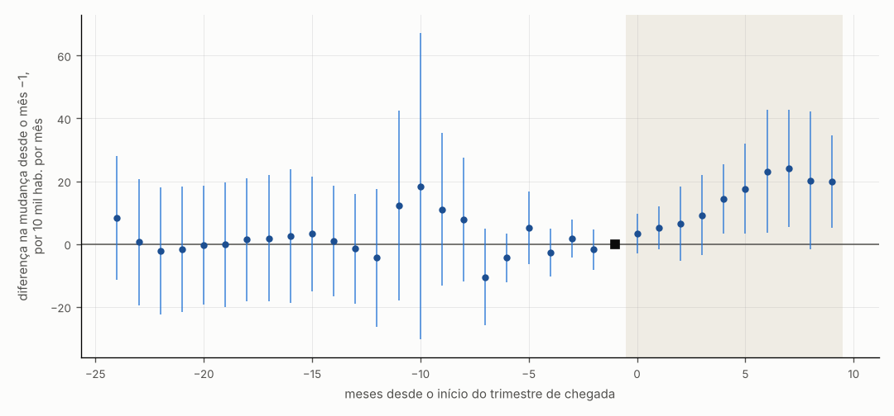
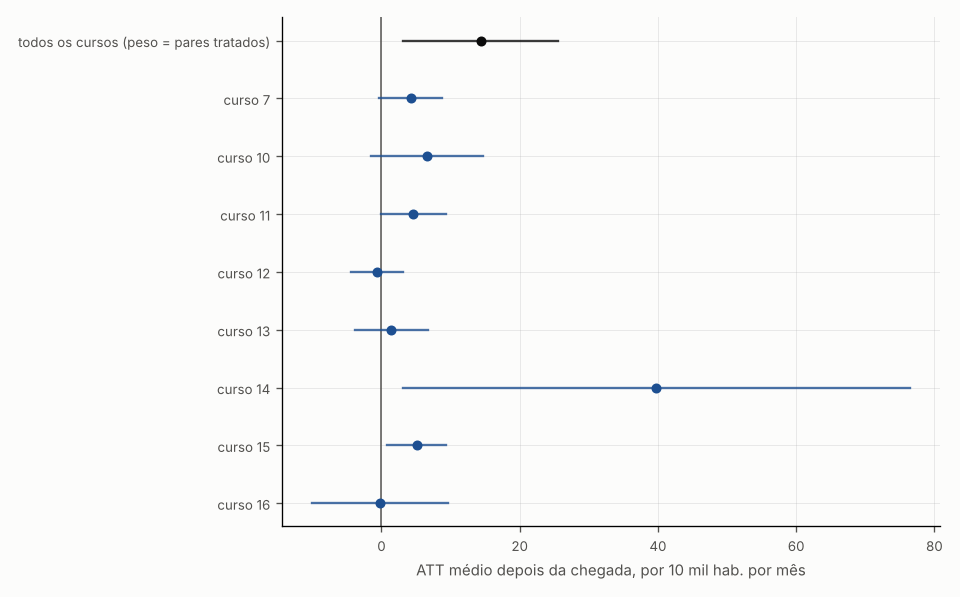
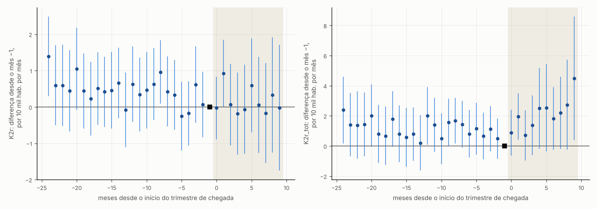
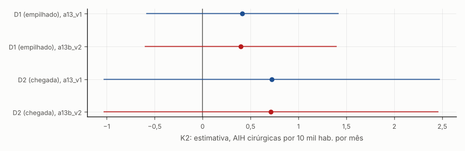
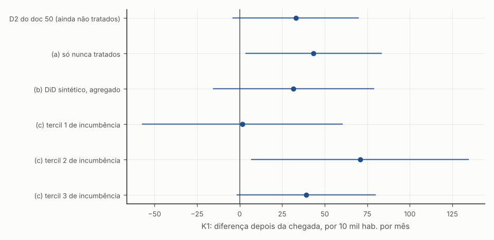
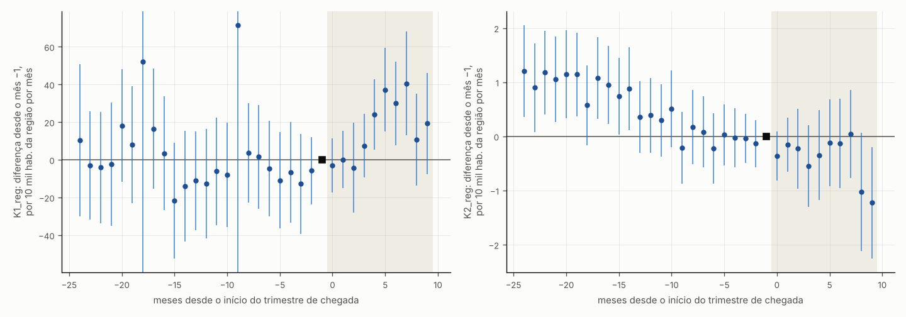

# 57c — Resultados do P3: extensões da produção especializada (adendo §12 do protocolo 47)

> **Gerado por** `scripts/rdd_bolsa/27_producao_extensoes.py` em 2026-10-23. Não editar à mão: o script regrava o arquivo inteiro a partir das saídas `output/rdd_bolsa/K_X_*`, e o teste `tests/test_producao_extensoes.py` confere que o arquivo é igual ao gerado.<br>
> **Protocolo:** `docs/06_execucao/47_protocolo_producao_especializada.md`, adendo §12 (12.1–12.5).<br>
> **Estatuto:** `PROTOCOLO_47_ADENDO_12_POS_RESULTADO`, natureza `EMPIRICO`. Os resultados D1 e D2 do doc 50 já tinham sido vistos quando o adendo foi escrito; nada aqui muda o Holm de K1–K3.<br>
> **Nome do doc:** o adendo pede os resultados no "doc 57, seção P3"; o doc 57 é a síntese da onda 5. Para evitar conflito, a seção P3 fica neste doc 57c (desvio registrado na seção 9).

## 1. O que se mede e o que não se mede

- **D2, 12.2, 12.3 e 12.5** medem o **ATT da chegada do especialista sob tendências paralelas**: a chegada depende da escolha do candidato e não há fonte de exogeneidade validada. Onde o pré não é plano, a diferença é só uma associação.
- **D1** (12.1 e 12.4) mede, no máximo, o incentivo marginal de R$ 5 mil dentro do pacote de regras dos cortes 0,300 e 0,400 (auditoria 18), não a participação no PMM-E.
- **12.4** mede o uso de internação pelos residentes (acesso), não a oferta local.
- **12.5** separa expansão líquida de deslocamento: produção que sobe no município e cai nos vizinhos da região de saúde é deslocamento; subida nos vizinhos é atendimento de referência.
- Produção não é saúde nem espera: a fila não é pública e continua fora.

## 2. Amostras e dados

| Item | Valor |
|---|---|
| 12.2: pares município × curso (cursos específicos, ciclos 1–2, em U) | 1017 |
| 12.2: pares com chegada até 2026-05 | 298 |
| 12.2: pares com 1ª chegada depois de 2026-05 (ainda não tratados no horizonte) | 33 |
| 12.2: pares da lista nominal sem célula do curso nos ciclos 1–2 (fora) | 24 |
| D2 municipal (12.1, 12.3, 12.4, 12.5): municípios da amostra | 598 |
| D2 municipal: tratados até 2026-05 / sem chegada no horizonte | 295 / 303 |
| 12.3a e 12.3b: chegadas depois de 2026-05 retiradas (célula não ficou vazia) | 20 |
| 12.3b: unidades sem série completa de K1 (fora do DiD sintético) | 0 |
| 12.3c: tratados com fração de incumbência / sem (fora dos tercis) | 285 / 10 |
| 12.5: municípios da amostra sozinhos na região de saúde (sem outcome) | 2 |
| 12.5: municípios da amostra sem região de saúde na tabela do TabNet | 1 |
| 12.2: curso 7: pares / tratados até 2026-05 | 208 / 46 |
| 12.2: curso 10: pares / tratados até 2026-05 | 144 / 15 |
| 12.2: curso 11: pares / tratados até 2026-05 | 226 / 64 |
| 12.2: curso 12: pares / tratados até 2026-05 | 52 / 15 |
| 12.2: curso 13: pares / tratados até 2026-05 | 35 / 8 |
| 12.2: curso 14: pares / tratados até 2026-05 | 186 / 76 |
| 12.2: curso 15: pares / tratados até 2026-05 | 120 / 58 |
| 12.2: curso 16: pares / tratados até 2026-05 | 46 / 16 |

Ausências: nenhum mês posterior a 2026-07 é lido; as séries terminam em 2026-05 (adendo §10.1). Célula ausente na fonte fica ausente e não vira zero; no 12.5, basta um município da região sem dado no mês para o outcome regional daquele mês ficar ausente.

## 3. 12.2 — Produção da especialidade que chegou (município × curso)

Outcome: quantidade aprovada no SIA (a17) nas formas de organização típicas do curso (mapa do G4), executada pelas CBO do curso, por 10 mil habitantes. Controles: pares do mesmo curso que ofereceram célula e ainda não tinham recebido especialista. Inferência com cluster no município.

| Linha | Tratados / não tratados no horizonte | Coortes | ATT médio do pós | IC 95% | p | MDE (2,8 × EP) | Média do pré dos tratados | Pré: p do Wald | Pré: p sup-t |
|---|---|---|---|---|---|---|---|---|---|
| todos os cursos (peso = pares tratados) | 298 / 719 | 29 | +14,34 | [+3,08; +25,60] | 0,013 | 16,08 | 86,21 | 0,040 (não plano) | 0,595 |
| curso 7 | 46 / 162 | 4 | +4,20 | [−0,30; +8,71] | 0,068 | 6,44 | 25,20 | 0,000 (não plano) | 0,283 |
| curso 10 | 15 / 129 | 4 | +6,63 | [−1,48; +14,75] | 0,109 | 11,60 | 16,83 | 0,000 (não plano) | 0,478 |
| curso 11 | 64 / 162 | 4 | +4,61 | [−0,12; +9,33] | 0,056 | 6,75 | 19,29 | 0,268 (compatível com plano) | 0,592 |
| curso 12 | 15 / 37 | 4 | −0,64 | [−4,41; +3,14] | 0,740 | 5,39 | 101,24 | 0,315 (compatível com plano) | 0,602 |
| curso 13 | 8 / 27 | 2 | +1,43 | [−3,83; +6,69] | 0,594 | 7,51 | 16,48 | 0,000 (não plano) | 0,730 |
| curso 14 | 76 / 110 | 4 | +39,79 | [+3,09; +76,48] | 0,034 | 52,42 | 247,36 | 0,003 (não plano) | 0,632 |
| curso 15 | 58 / 62 | 4 | +5,08 | [+0,82; +9,35] | 0,019 | 6,09 | 17,90 | 0,930 (compatível com plano) | 0,974 |
| curso 16 | 16 / 30 | 3 | −0,21 | [−10,07; +9,66] | 0,967 | 14,09 | 97,32 | 0,000 (não plano) | 0,441 |



**Como ler.** Cada ponto compara, mês a mês desde a chegada, a produção típica da especialidade nos pares município × curso que receberam o especialista com a dos pares que ofereceram a vaga e ainda não tinham recebido; à esquerda do zero os pontos deveriam ficar perto de zero.



**Como ler.** Cada linha é um curso: o ponto é a diferença média depois da chegada e o traço é o intervalo de 95%; traço que cruza a linha vertical do zero não distingue a diferença de zero.

## 4. 12.4 — Internações dos residentes

K2r: AIH do grupo 04 (cirúrgico) de residentes; K2r_tot: todas as AIH de residentes (grupos 02–05). Mesmas janelas de K2 (pré 2024-06 a 2025-06, pós 2025-10 a 2026-05).

### 4.1 D2 (chegada)

| Linha | Tratados / não tratados no horizonte | Coortes | ATT médio do pós | IC 95% | p | MDE (2,8 × EP) | Média do pré dos tratados | Pré: p do Wald | Pré: p sup-t |
|---|---|---|---|---|---|---|---|---|---|
| K2r (D2) | 295 / 303 | 4 | +0,15 | [−0,74; +1,04] | 0,742 | 1,28 | 27,85 | 0,260 (compatível com plano) | 0,165 |
| K2r_tot (D2) | 295 / 303 | 4 | +2,12 | [+0,30; +3,94] | 0,023 | 2,61 | 63,84 | 0,477 (compatível com plano) | 0,289 |

### 4.2 D1 (DiRD nos cortes, população U)

| Outcome | Variante | Corte | Salto na mudança (DiRD) | IC 95% | p | n abaixo / acima | MDE | Relativo à média do pré abaixo |
|---|---|---|---|---|---|---|---|---|
| K2r | principal | 0,300 | −0,01 | [−1,44; +1,42] | 0,986 | 859 / 654 | 2,04 | −0,0 % |
| K2r | principal | 0,400 | −0,82 | [−2,21; +0,57] | 0,250 | 587 / 603 | 1,99 | −2,9 % |
| K2r | principal | empilhado | −0,37 | [−1,37; +0,64] | 0,477 | 1446 / 1257 | 1,44 | −1,2 % |
| K2r | media_completa | 0,300 | −0,01 | [−1,44; +1,42] | 0,986 | 859 / 654 | 2,04 | −0,0 % |
| K2r | media_completa | 0,400 | −0,82 | [−2,21; +0,57] | 0,250 | 587 / 603 | 1,99 | −2,9 % |
| K2r | media_completa | empilhado | −0,37 | [−1,37; +0,64] | 0,477 | 1446 / 1257 | 1,44 | −1,2 % |
| K2r | pos_ate_202607 | 0,300 | +0,17 | [−1,27; +1,61] | 0,814 | 859 / 654 | 2,05 | +0,5 % |
| K2r | pos_ate_202607 | 0,400 | −0,96 | [−2,32; +0,40] | 0,165 | 587 / 603 | 1,94 | −3,4 % |
| K2r | pos_ate_202607 | empilhado | −0,32 | [−1,33; +0,68] | 0,527 | 1446 / 1257 | 1,43 | −1,0 % |
| K2r | sem_uf_mes_atipico | 0,300 | −0,01 | [−1,44; +1,42] | 0,986 | 859 / 654 | 2,04 | −0,0 % |
| K2r | sem_uf_mes_atipico | 0,400 | −0,82 | [−2,21; +0,57] | 0,250 | 587 / 603 | 1,99 | −2,9 % |
| K2r | sem_uf_mes_atipico | empilhado | −0,37 | [−1,37; +0,64] | 0,477 | 1446 / 1257 | 1,44 | −1,2 % |
| K2r_tot | principal | 0,300 | −1,19 | [−3,63; +1,26] | 0,341 | 859 / 654 | 3,49 | −1,6 % |
| K2r_tot | principal | 0,400 | −1,85 | [−4,25; +0,54] | 0,129 | 587 / 603 | 3,42 | −2,9 % |
| K2r_tot | principal | empilhado | −1,48 | [−3,21; +0,25] | 0,093 | 1446 / 1257 | 2,47 | −2,1 % |
| K2r_tot | media_completa | 0,300 | −1,19 | [−3,63; +1,26] | 0,341 | 859 / 654 | 3,49 | −1,6 % |
| K2r_tot | media_completa | 0,400 | −1,85 | [−4,25; +0,54] | 0,129 | 587 / 603 | 3,42 | −2,9 % |
| K2r_tot | media_completa | empilhado | −1,48 | [−3,21; +0,25] | 0,093 | 1446 / 1257 | 2,47 | −2,1 % |
| K2r_tot | pos_ate_202607 | 0,300 | −1,15 | [−3,61; +1,30] | 0,357 | 859 / 654 | 3,51 | −1,5 % |
| K2r_tot | pos_ate_202607 | 0,400 | −2,27 | [−4,72; +0,18] | 0,069 | 587 / 603 | 3,50 | −3,5 % |
| K2r_tot | pos_ate_202607 | empilhado | −1,64 | [−3,39; +0,10] | 0,065 | 1446 / 1257 | 2,50 | −2,3 % |
| K2r_tot | sem_uf_mes_atipico | 0,300 | −1,19 | [−3,63; +1,26] | 0,341 | 859 / 654 | 3,49 | −1,6 % |
| K2r_tot | sem_uf_mes_atipico | 0,400 | −1,85 | [−4,25; +0,54] | 0,129 | 587 / 603 | 3,42 | −2,9 % |
| K2r_tot | sem_uf_mes_atipico | empilhado | −1,48 | [−3,21; +0,25] | 0,093 | 1446 / 1257 | 2,47 | −2,1 % |



**Como ler.** Mês a mês desde a chegada, a diferença nas internações de residentes (cirúrgicas à esquerda, todas à direita) entre municípios que receberam o especialista e os comparáveis; mede uso pelos moradores, não oferta local.

## 5. 12.1 — Revisão da fonte (sensibilidade)

A safra v1 (a13) continua a principal. A v2 (a13b) foi extraída depois da revisão do DATASUS nos meses 202509, 202510, 202511, 202512, 202601, 202602, 202603, 202604, 202605, 202606, 202607. A linha v1 abaixo foi recalculada por este script e conferida contra o doc 50.

### 5.1 D2

| Linha | Tratados / não tratados no horizonte | Coortes | ATT médio do pós | IC 95% | p | MDE (2,8 × EP) | Média do pré dos tratados | Pré: p do Wald | Pré: p sup-t |
|---|---|---|---|---|---|---|---|---|---|
| K2, a13_v1 (D2) | 295 / 303 | 4 | +0,72 | [−1,03; +2,47] | 0,418 | 2,50 | 37,43 | 0,028 (não plano) | 0,029 |
| K2, a13b_v2 (D2) | 295 / 303 | 4 | +0,71 | [−1,03; +2,45] | 0,422 | 2,49 | 37,43 | 0,027 (não plano) | 0,028 |

### 5.2 D1 (v1 e v2)

| Outcome | Variante | Corte | Salto na mudança (DiRD) | IC 95% | p | n abaixo / acima | MDE | Relativo à média do pré abaixo |
|---|---|---|---|---|---|---|---|---|
| K2 | principal | 0,300 | +0,42 | [−0,64; +1,48] | 0,441 | 859 / 654 | 1,52 | +3,5 % |
| K2 | principal | 0,400 | +0,41 | [−1,41; +2,24] | 0,659 | 587 / 603 | 2,61 | +4,4 % |
| K2 | principal | empilhado | +0,42 | [−0,58; +1,41] | 0,415 | 1446 / 1257 | 1,43 | +3,8 % |
| K2 | media_completa | 0,300 | +0,42 | [−0,64; +1,48] | 0,441 | 859 / 654 | 1,52 | +3,5 % |
| K2 | media_completa | 0,400 | +0,41 | [−1,41; +2,24] | 0,659 | 587 / 603 | 2,61 | +4,4 % |
| K2 | media_completa | empilhado | +0,42 | [−0,58; +1,41] | 0,415 | 1446 / 1257 | 1,43 | +3,8 % |
| K2 | pos_ate_202607 | 0,300 | +0,59 | [−0,55; +1,74] | 0,311 | 859 / 654 | 1,64 | +5,0 % |
| K2 | pos_ate_202607 | 0,400 | +0,12 | [−1,80; +2,03] | 0,905 | 587 / 603 | 2,74 | +1,3 % |
| K2 | pos_ate_202607 | empilhado | +0,38 | [−0,67; +1,44] | 0,477 | 1446 / 1257 | 1,51 | +3,5 % |
| K2 | sem_uf_mes_atipico | 0,300 | +0,42 | [−0,64; +1,48] | 0,441 | 859 / 654 | 1,52 | +3,5 % |
| K2 | sem_uf_mes_atipico | 0,400 | +0,41 | [−1,41; +2,24] | 0,659 | 587 / 603 | 2,61 | +4,4 % |
| K2 | sem_uf_mes_atipico | empilhado | +0,42 | [−0,58; +1,41] | 0,415 | 1446 / 1257 | 1,43 | +3,8 % |

| Outcome | Variante | Corte | Salto na mudança (DiRD) | IC 95% | p | n abaixo / acima | MDE | Relativo à média do pré abaixo |
|---|---|---|---|---|---|---|---|---|
| K2 | principal | 0,300 | +0,38 | [−0,67; +1,43] | 0,480 | 859 / 654 | 1,50 | +3,2 % |
| K2 | principal | 0,400 | +0,42 | [−1,40; +2,25] | 0,649 | 587 / 603 | 2,61 | +4,6 % |
| K2 | principal | empilhado | +0,40 | [−0,60; +1,39] | 0,432 | 1446 / 1257 | 1,42 | +3,7 % |
| K2 | media_completa | 0,300 | +0,38 | [−0,67; +1,43] | 0,480 | 859 / 654 | 1,50 | +3,2 % |
| K2 | media_completa | 0,400 | +0,42 | [−1,40; +2,25] | 0,649 | 587 / 603 | 2,61 | +4,6 % |
| K2 | media_completa | empilhado | +0,40 | [−0,60; +1,39] | 0,432 | 1446 / 1257 | 1,42 | +3,7 % |
| K2 | pos_ate_202607 | 0,300 | +0,42 | [−0,71; +1,56] | 0,463 | 859 / 654 | 1,62 | +3,6 % |
| K2 | pos_ate_202607 | 0,400 | +0,12 | [−1,76; +1,99] | 0,902 | 587 / 603 | 2,68 | +1,3 % |
| K2 | pos_ate_202607 | empilhado | +0,29 | [−0,75; +1,33] | 0,584 | 1446 / 1257 | 1,48 | +2,7 % |
| K2 | sem_uf_mes_atipico | 0,300 | +0,38 | [−0,67; +1,43] | 0,480 | 859 / 654 | 1,50 | +3,2 % |
| K2 | sem_uf_mes_atipico | 0,400 | +0,42 | [−1,40; +2,25] | 0,649 | 587 / 603 | 2,61 | +4,6 % |
| K2 | sem_uf_mes_atipico | empilhado | +0,40 | [−0,60; +1,39] | 0,432 | 1446 / 1257 | 1,42 | +3,7 % |

K1 com a safra v2 do SIA: sem revisao na fonte: o a12b compara 14250618 celulas municipio x mes x subgrupo x conjunto e nenhuma difere da v1; K1 com a v2 seria identico ao do doc 50



**Como ler.** Cada par de pontos é a mesma estimativa de K2 com a versão antiga (v1) e a revisada (v2) do SIH; pontos próximos indicam que a revisão da fonte não muda a conclusão.

## 6. 12.3 — Controles alternativos e heterogeneidade (K1)

### 6.1 (a) Só controles cujas células ficaram vazias

| Linha | Tratados / não tratados no horizonte | Coortes | ATT médio do pós | IC 95% | p | MDE (2,8 × EP) | Média do pré dos tratados | Pré: p do Wald | Pré: p sup-t |
|---|---|---|---|---|---|---|---|---|---|
| D2 do doc 50 (controles ainda não tratados, recalculado) | 295 / 303 | 4 | +32,97 | [−3,82; +69,75] | 0,079 | 52,55 | 694,06 | 0,538 (compatível com plano) | 0,326 |
| (a) controles só nunca tratados (células que ficaram vazias) | 295 / 283 | 4 | +43,42 | [+3,63; +83,21] | 0,032 | 56,85 | 694,06 | 0,597 (compatível com plano) | 0,367 |

### 6.2 (b) Diferenças em diferenças sintéticas, por coorte

| Recorte | Tratados | Controles (nunca tratados) | ATT (DiD sintético) | IC 95% (bootstrap) | p |
|---|---|---|---|---|---|
| b_sdid_coorte_202507 | 130 | 283 | +71,91 | [−9,00; +152,82] | 0,082 |
| b_sdid_coorte_202510 | 34 | 283 | +18,55 | [−107,70; +144,81] | 0,773 |
| b_sdid_coorte_202601 | 47 | 283 | −78,88 | [−197,60; +39,83] | 0,193 |
| b_sdid_coorte_202604 | 84 | 283 | +36,24 | [+4,45; +68,02] | 0,025 |
| b_sdid_agregado | 295 | 283 | +31,58 | [−15,41; +78,56] | 0,188 |

### 6.3 (c) Fração dos chegados que já tinham vínculo no município antes do início

Tercis pela distribuição entre os municípios tratados (cortes: 0,000 e 0,513); a condição é anterior ao início de cada médico (X1, regra D1).

| Linha | Tratados / não tratados no horizonte | Coortes | ATT médio do pós | IC 95% | p | MDE (2,8 × EP) | Média do pré dos tratados | Pré: p do Wald | Pré: p sup-t |
|---|---|---|---|---|---|---|---|---|---|
| (c) tercil 1 | 122 / 303 | 4 | +1,60 | [−56,96; +60,16] | 0,957 | 83,66 | 588,39 | 0,664 (compatível com plano) | 0,399 |
| (c) tercil 2 | 68 / 303 | 4 | +70,71 | [+6,98; +134,44] | 0,030 | 91,04 | 711,95 | 0,193 (compatível com plano) | 0,561 |
| (c) tercil 3 | 95 / 303 | 4 | +39,10 | [−1,40; +79,59] | 0,058 | 57,85 | 828,64 | 0,276 (compatível com plano) | 0,199 |

Diferença tercil 3 − tercil 1: +37,50 (IC 95% [−26,02; +101,02]; p = 0,247).



**Como ler.** Cada linha é uma forma diferente de comparar os municípios que receberam especialista com os que não receberam, para a produção K1; se as linhas concordam, o resultado não depende da escolha do grupo de comparação.

## 7. 12.5 — Transbordamento para os outros municípios da região de saúde

| Linha | Tratados / não tratados no horizonte | Coortes | ATT médio do pós | IC 95% | p | MDE (2,8 × EP) | Média do pré dos tratados | Pré: p do Wald | Pré: p sup-t |
|---|---|---|---|---|---|---|---|---|---|
| K1_reg | 295 / 303 | 4 | +16,23 | [+0,81; +31,66] | 0,039 | 22,04 | 372,72 | 0,005 (não plano) | 0,745 |
| K2_reg | 295 / 303 | 4 | −0,41 | [−1,03; +0,21] | 0,198 | 0,89 | 15,87 | 0,004 (não plano) | 0,025 |



**Como ler.** Mês a mês desde a chegada, a diferença na produção dos outros municípios da mesma região de saúde; abaixo de zero sugere que a produção mudou de lugar, acima sugere atendimento de referência.

## 8. Teste múltiplo (BKY dentro do adendo) e leitura

| Item | Outcome | Desenho | Recorte | Corte | Estimativa | IC 95% | p | q (BKY) |
|---|---|---|---|---|---|---|---|---|
| 12.2 | K_esp | D2 | todos_os_cursos | — | +14,34 | [+3,08; +25,60] | 0,013 | 0,101 |
| 12.4 | K2r | D1 | — | empilhado | −0,37 | [−1,37; +0,64] | 0,477 | 0,375 |
| 12.4 | K2r | D2 | — | — | +0,15 | [−0,74; +1,04] | 0,742 | 0,464 |
| 12.4 | K2r_tot | D1 | — | empilhado | −1,48 | [−3,21; +0,25] | 0,093 | 0,133 |
| 12.4 | K2r_tot | D2 | — | — | +2,12 | [+0,30; +3,94] | 0,023 | 0,101 |
| 12.3 | K1 | D2 | c_tercil_3_menos_1 | — | +37,50 | [−26,02; +101,02] | 0,247 | 0,230 |
| 12.5 | K1_reg | D2 | — | — | +16,23 | [+0,81; +31,66] | 0,039 | 0,101 |
| 12.5 | K2_reg | D2 | — | — | −0,41 | [−1,03; +0,21] | 0,198 | 0,230 |

12.2, produção típica da especialidade no par que recebeu o especialista (ATT agregado): +14,34 (IC 95% [+3,08; +25,60]; o intervalo acima de zero); o pré não é plano, então é só uma associação; 12.4, internações cirúrgicas de residentes (D2): +0,15 (IC 95% [−0,74; +1,04]; o intervalo inclui zero); 12.4, internações cirúrgicas de residentes (D1, empilhado): −0,37 (IC 95% [−1,37; +0,64]; o intervalo inclui zero); 12.4, todas as internações de residentes (D2): +2,12 (IC 95% [+0,30; +3,94]; o intervalo acima de zero); 12.4, todas as internações de residentes (D1, empilhado): −1,48 (IC 95% [−3,21; +0,25]; o intervalo inclui zero); 12.5, produção K1 nos outros municípios da região: +16,23 (IC 95% [+0,81; +31,66]; o intervalo acima de zero); o pré não é plano, então é só uma associação; 12.5, cirurgias K2 nos outros municípios da região: −0,41 (IC 95% [−1,03; +0,21]; o intervalo inclui zero); o pré não é plano, então é só uma associação. Expansão líquida contra deslocamento (K1 no município, D2 do doc 50: o intervalo inclui zero; K1 nos outros municípios da região: o intervalo acima de zero): a produção sobe também nos vizinhos: o padrão é compatível com atendimento de referência, não com deslocamento. Depois do BKY do adendo, 0 de 8 linhas têm q < 0,05. Tudo isso é ATT sob tendências paralelas (ou, no D1, o incentivo marginal dentro do pacote dos cortes), relatado depois de vistos os resultados do doc 50.

### 8.1 Itens não executados

| Item | Outcome | Motivo |
|---|---|---|
| 12.1 | K1 | sem revisao na fonte: o a12b compara 14250618 celulas municipio x mes x subgrupo x conjunto e nenhuma difere da v1; K1 com a v2 seria identico ao do doc 50 |

## 9. Desvios e esclarecimentos

| Data | Tipo | Item | Descrição |
|---|---|---|---|
| 2026-10-23 | desvio | local do resultado | o adendo §12 pede os resultados no 'doc 57, secao P3'; o doc 57 e a sintese da onda 5 (doc 51, §5). Os resultados ficam em docs/06_execucao/57c_resultados_P3_extensoes.md, gerado inteiro pelo script. |
| 2026-10-23 | esclarecimento | 12.2: peso da agregacao | 'media dos ATT entre cursos, com peso pelo numero de pares' foi lido como o theta(e) agregado sobre todas as celulas curso x coorte com peso = numero de pares tratados (o ATT dos pares tratados), fixado antes de estimar; os ATT por curso sao relatados a parte. |
| 2026-10-23 | esclarecimento | 12.2: cursos 10 e 11 | os dois cursos tem o mesmo conjunto de CBO e as mesmas formas tipicas: o outcome de um par (m, 10) e igual ao de (m, 11). Os pares ficam separados (tratamento por curso), e o cluster no municipio absorve a correlacao. |
| 2026-10-23 | esclarecimento | 12.2: celulas e chegadas | par = municipio x curso com celula do curso no quadro dos ciclos 1 ou 2 (outcomes_V_celula) e em U; chegada = menor dt_inicio_atividade da lista nominal no curso e municipio; especialista da lista num par sem celula do curso fica fora (contado). Chegada depois de 202605 = ainda nao tratado no horizonte, como no D2. |
| 2026-10-23 | esclarecimento | 12.3a no nivel do municipio | 'so municipios com celula do mesmo curso e ciclo que ficou vazia' foi implementado no municipio como D2 de K1 com controles = nunca tratados (nenhum especialista da lista nominal, celulas vazias); os municipios com 1a chegada depois de 202605 saem (a celula nao ficou vazia). O pareamento por curso e o 12.2. |
| 2026-10-23 | esclarecimento | 12.3b: DiD sintetico | algoritmo do pacote synthdid (Frank-Wolfe com intercepto, zeta_omega = (N1 T1)^(1/4) x DP das primeiras diferencas dos controles no pre, zeta_lambda = 1e-6 x esse DP, esparsificacao em max/4); por coorte trimestral, pre = 202201 ate o mes antes da coorte, pos = coorte ate 202605; controles = nunca tratados; so unidades com a serie completa de K1. Agregado = media das coortes com peso pelo numero de tratados. EP: bootstrap de municipios com reposicao (B = 200, semente fixa), sorteio conjunto para todas as coortes, pesos reestimados a partir dos originais e zetas fixos (como no pacote); sorteio sem tratado de alguma coorte ou com menos de 2 controles e refeito. |
| 2026-10-23 | esclarecimento | 12.3c: fracao e tercis | fracao = media de b_mesmo_mun_ultimo_pre (vinculo no municipio do posto na ultima competencia antes do inicio) dos medicos ligados na X1, regra D1, ciclos 1 e 2; tercis pelos quantis 1/3 e 2/3 entre os municipios tratados da amostra D2 com fracao (tercil 1: <= q1; 2: (q1, q2]; 3: > q2). Cada tercil usa como controles os nunca tratados e os ainda nao tratados de qualquer tercil; diferenca tercil 3 - tercil 1 com os mesmos pesos do bootstrap. A composicao da fracao inclui chegadas posteriores a 1a (limite: a condicao e pre-tratamento para cada medico, nao para o municipio). |
| 2026-10-23 | esclarecimento | 12.4: D1 | K2r e K2r_tot em D1 como K2: DiRD local linear triangular h = 0,050, populacao U, cortes 0,300, 0,400 e empilhado; variantes media completa, pos ate 202607 e sem UF-mes atipico (alerta do a15). V1, IC honesto e Poisson do D1 nao foram repetidos. |
| 2026-10-23 | esclarecimento | 12.4: meses com falta em outra UF | o a15 sinaliza meses em que outra UF de internacao esta sem arquivo ou atipica (residentes internados la podem faltar); o valor nao e alterado, como no a15, e os meses sinalizados vao no resumo. |
| 2026-10-23 | esclarecimento | 12.5: regiao de saude | CIR da tabela do TabNet (br_regsaud.cnv, o mesmo leitor do P5); so municipios de U entram no numerador e no denominador; municipio sozinho na regiao ou sem CIR fica sem outcome (contado); outros municipios tratados da mesma regiao continuam no somatorio (limite). |
| 2026-10-23 | esclarecimento | BKY do adendo | BKY entre as linhas principais novas: 12.2 agregado; K2r e K2r_tot em D1 (U, empilhado) e em D2; 12.3c (tercil 3 - tercil 1); K1_reg e K2_reg. 12.1 e 12.3a/b sao sensibilidades de estimativas ja relatadas e ficam fora. |
| 2026-10-23 | esclarecimento | 12.1: K1 | o adendo manda reestimar K1 so se a safra v2 do SIA tiver revisao; o a12b relata zero celulas diferentes, entao K1 nao foi reestimado (linha NAO_EXECUTADO com o motivo). |

## 10. Entradas

| Arquivo | Papel | SHA-256 (12 primeiros) |
|---|---|---|
| docs/06_execucao/47_protocolo_producao_especializada.md | protocolo congelado (adendo §12) | e6b16cb0a4a4 |
| output/aquisicao/sia_forma_curso/painel_sia_municipio_mes_forma_curso.parquet | 12.2: SIA por forma x curso | 370a49fe3ba0 |
| output/aquisicao/sia_forma_curso/manifesto_sia_forma_curso.json | manifesto do a17 (SHA-256 do painel) | 1f828132838f |
| output/aquisicao/sia_forma_curso/sia_forma_curso_formas_por_consulta.csv | 12.2: formas presentes por consulta (zero de forma omitida) | 4b0caf1fa0cd |
| output/aquisicao/sia_forma_curso/sia_forma_curso_formas_tipicas.csv | 12.2: formas tipicas (conferencia com o G4) | 9d989b3a951b |
| output/aquisicao/sia_forma_curso/sia_forma_curso_cursos.csv | 12.2: conjunto de CBO por curso | 2d365106faef |
| output/rdd_bolsa/G4_resumo.json | 12.2: cursos da classe ESPECIFICO | 9b576aaeed90 |
| output/rdd_bolsa/G4_mapa_especialidade_procedimento.csv | 12.2: formas tipicas por curso | 7b7e9a468587 |
| output/rdd_bolsa/outcomes/outcomes_V_celula.parquet | 12.2: celulas por curso nos ciclos 1-2 | 34e33decb274 |
| data/pmm_especialistas_nominal.csv | chegada por municipio (D2) e por municipio x curso (12.2) | 136f3ca3656e |
| output/aquisicao/sih_residencia/painel_sih_residencia_municipio_mes_grupo.parquet | 12.4: SIH por residencia | 49cda43c0b35 |
| output/aquisicao/sih_residencia/manifesto_sih_residencia.json | manifesto do a15 | 42a09193d449 |
| output/aquisicao/sih_v2/painel_sih_municipio_mes_grupo.parquet | 12.1: SIH safra v2 | 33874d3d0388 |
| output/aquisicao/sih_v2/manifesto_sih.json | manifesto da safra v2 do SIH | 77be48f0f561 |
| output/aquisicao/sih_v2/comparacao_v2_v1_resumo.json | 12.1: meses revisados do SIH | 60b5c1e1a930 |
| output/aquisicao/sia_v2/comparacao_v2_v1_resumo.json | 12.1: revisao do SIA (celulas diferentes) | 7e1a48cdc567 |
| output/aquisicao/sia/painel_sia_municipio_mes_subgrupo_cbo.parquet | K1 (12.3) e K1_reg (12.5) | 2f0c8353deb5 |
| output/aquisicao/sia/manifesto_sia.json | manifesto do a12 | aa31915d31d2 |
| output/aquisicao/sih/painel_sih_municipio_mes_grupo.parquet | K2 v1 (12.1) e K2_reg (12.5) | 3428600a1118 |
| output/aquisicao/sih/manifesto_sih.json | manifesto do a13 | 9d2648760c23 |
| data/raw/aquisicao/territorio/datasus_tabnet_br_regsaud.cnv | 12.5: regiao de saude (CIR) | df0f635ae830 |
| output/rdd_bolsa/X1_medicos.parquet | 12.3c: vinculo no municipio antes do inicio | b4d73a6ae6ad |
| output/aquisicao/a08_ivs_2010_oficial_municipio.csv | universo U e running variable do D1 (IVS 2010 oficial) | 0632a7a313e1 |
| output/aquisicao/populacao_censo2022_municipios.csv | denominador por 10 mil hab. | b51fc6cf27a4 |
| output/rdd_bolsa/outcomes/outcomes_V_municipio.parquet | amostra do D2 (celulas nos ciclos 1-2) | 36ced6f6a4c4 |
| output/rdd_bolsa/K_D1_estimativas.csv | conferencia: K2 v1 em D1 | 6d89726c7ad8 |
| output/rdd_bolsa/K_D2_estimativas.csv | conferencia: K1 e K2 v1 em D2 | c3b62441a234 |

## 11. Reprodução

```bash
python3 scripts/rdd_bolsa/27_producao_extensoes.py
python3 -m pytest tests/test_producao_extensoes.py
```
