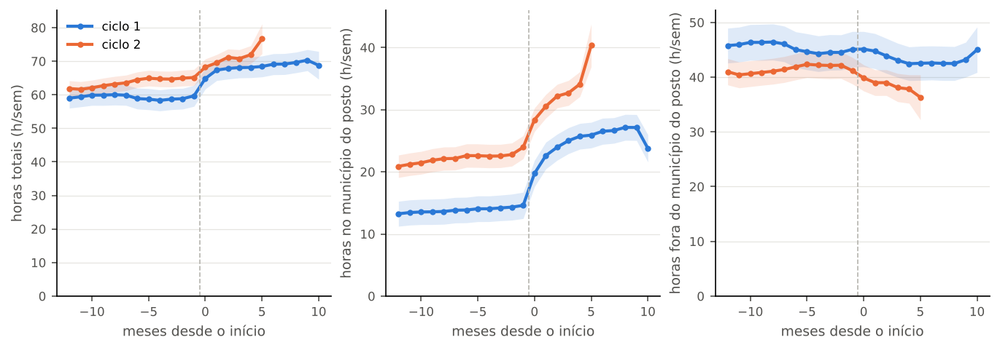
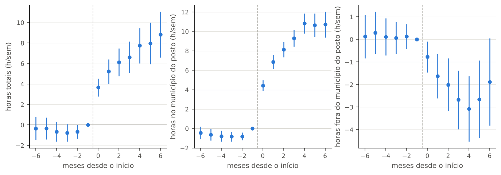
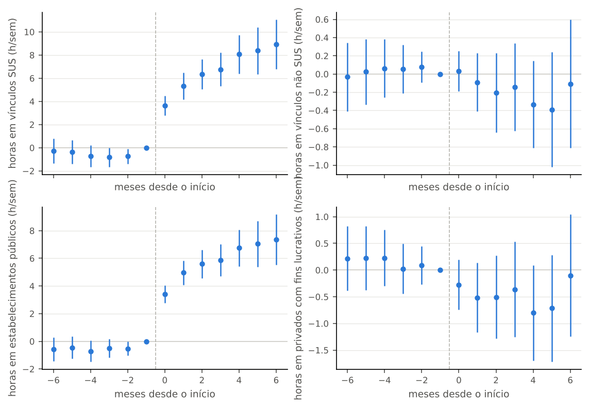
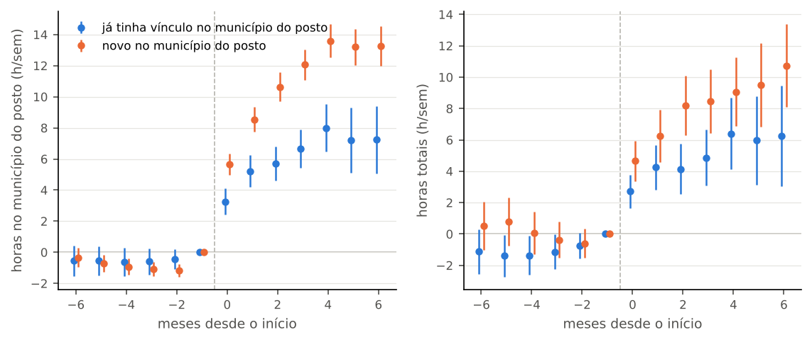
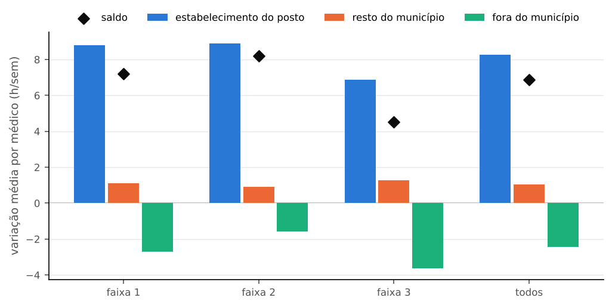

# 57d. Resultados do P4: o programa cria oferta nova ou só passa a pagar quem já estava lá?

> **Data:** 2026-10-23. 
> **Protocolo:** [`54_protocolo_P4_oferta_substituicao.md`](54_protocolo_P4_oferta_substituicao.md), congelado em 19/10/2026 antes de abrir o painel a16 por tempo de evento. 
> **Script:** `scripts/rdd_bolsa/28_trajetoria_medicos.py` (gera este documento inteiro). 
> **Saídas:** `output/rdd_bolsa/P4_estimativas.csv`, `P4_resumo.json` e `P4_figuras/`. 
> **Testes:** `tests/test_trajetoria_medicos.py`. 
> **Estatuto:** `EXPLORATORIO_P4`; toda linha tem `natureza_dos_dados = EMPIRICO`. Nada aqui tem fonte de exogeneidade validada.

Este documento é gerado pelo script a partir de `output/`; não edite à mão. O teste confere que ele é igual ao que o script gera.

## 1. O que se pergunta e o que o contraste identifica

O P4 acompanha, mês a mês, as horas e os vínculos **cadastrados** no CNES de cada médico do PMM-E ligado na X1, antes e depois do início no programa. A pergunta é se o médico soma horas, troca privado por SUS, muda de município ou só passa a ser registrado no posto onde já estava.

- **Contraste:** entrada no PMM-E, comparando médicos que começam em meses diferentes (T4.1b e T4.1c). Mede associação sob tendências paralelas; não é o efeito da bolsa nem do PMM-E sobre o município.
- **Resultado exploratório.** Nenhuma fonte de exogeneidade foi validada para a data de entrada; os números descrevem o que está associado à entrada, não provam efeito.
- **Vínculo não é presença.** Horas cadastradas não são horas trabalhadas, e permanecer no cadastro não é retenção individual.
- **Heterogeneidade só por condição pré-tratamento:** a origem (X1 b) e a faixa da lista.
- **T4.2 e T4.3 são descritivos.**

## 2. Amostra

A chave longitudinal é o código do profissional no CNES (`id_prof`, a16). Um médico com mais de um registro nas listas fica com um só: o da lista de ativos de 11/09/2026, depois o início mais antigo. O ciclo 3 entra só como controle ainda não iniciado; o efeito sobre ele segue o plano prospectivo.

| Regra | Registros ligados | Médicos (id_prof) | Registros descartados (deduplicação) | Tratados (ciclos 1 e 2) | Ciclo 3 (só controles) | Ciclos 1–2 sem X1 b | Médico-mês com hora ausente |
|---|---|---|---|---|---|---|---|
| D1 (principal) | 1.876 | 1.865 | 11 | 1.397 | 468 | 0 | 0 |
| literal (sensibilidade) | 1.901 | 1.887 | 14 | 1.419 | 468 | 0 | 0 |

Meses sem vínculo médico cadastrado entre os tratados (regra D1). Contam como zero vínculos e zero horas, porque a competência foi lida; nenhuma competência falta na fonte.

| e | -6 | -5 | -4 | -3 | -2 | -1 | 0 | 1 | 2 | 3 | 4 | 5 | 6 |
|---|---|---|---|---|---|---|---|---|---|---|---|---|---|
| médicos | 1.397 | 1.397 | 1.397 | 1.397 | 1.397 | 1.397 | 1.397 | 1.396 | 1.394 | 1.222 | 1.206 | 785 | 493 |
| sem vínculo médico cadastrado | 42 | 40 | 42 | 40 | 40 | 37 | 31 | 20 | 11 | 8 | 5 | 3 | 1 |

## 3. Origem: novos e já presentes (descritivo)

Regra D1 (principal). IC de Wilson. Faixas da lista: faixa 1 = IVS 2010 acima de 0,400; faixa 2 = acima de 0,300 até 0,400; faixa 3 = até 0,300. A diferença entre faixas é descritiva: a faixa anda com o IVS, o porte e a oferta prévia do município.

| Grupo | Médicos com X1 b | Já no município (X1 b) | Novos (1 − X1 b) | No município no mês −1 (painel mensal) | Sem vínculo médico no mês −1 |
|---|---|---|---|---|---|
| ciclos 1 e 2 | 1.397 | 51,0% [48,4%; 53,7%] | 49,0% [46,3%; 51,6%] | 54,5% [51,9%; 57,1%] | 2,6% |
| 1 | 495 | 42,6% [38,3%; 47,0%] | 57,4% [53,0%; 61,7%] | 42,4% [38,1%; 46,8%] | 2,8% |
| 2 | 902 | 55,7% [52,4%; 58,9%] | 44,3% [41,1%; 47,6%] | 61,1% [57,9%; 64,2%] | 2,5% |
| faixa 1 | 305 | 18,7% [14,7%; 23,4%] | 81,3% [76,6%; 85,3%] | 22,3% [18,0%; 27,3%] | 2,3% |
| faixa 2 | 666 | 58,1% [54,3%; 61,8%] | 41,9% [38,2%; 45,7%] | 61,1% [57,4%; 64,7%] | 2,4% |
| faixa 3 | 426 | 63,1% [58,5%; 67,6%] | 36,9% [32,4%; 41,5%] | 67,1% [62,5%; 71,4%] | 3,3% |

## 4. Médias por tempo de evento (T4.1a, descritivo)

Amostra completa, regra D1. Todas as janelas, a subamostra balanceada e a regra literal estão no CSV.

| Ciclo | Outcome | e = −6 | e = −1 | e = 0 | e = +3 | e = +6 |
|---|---|---|---|---|---|---|
| 1 | horas totais | 58,9 (n = 495) | 59,7 (n = 495) | 64,9 (n = 495) | 68,1 (n = 495) | 69,1 (n = 493) |
| 1 | horas no município do posto | 13,9 (n = 495) | 14,6 (n = 495) | 19,7 (n = 495) | 25,0 (n = 495) | 26,5 (n = 493) |
| 1 | horas fora do município do posto | 45,0 (n = 495) | 45,1 (n = 495) | 45,1 (n = 495) | 43,1 (n = 495) | 42,6 (n = 493) |
| 1 | número de vínculos | 4,47 (n = 495) | 4,60 (n = 495) | 4,88 (n = 495) | 5,14 (n = 495) | 5,22 (n = 493) |
| 1 | tem vínculo médico cadastrado no mês | 0,96 (n = 495) | 0,97 (n = 495) | 0,98 (n = 495) | 0,99 (n = 495) | 1,00 (n = 493) |
| 2 | horas totais | 64,5 (n = 902) | 65,1 (n = 902) | 68,2 (n = 902) | 70,8 (n = 727) | — (n = 0) |
| 2 | horas no município do posto | 22,6 (n = 902) | 24,0 (n = 902) | 28,4 (n = 902) | 32,7 (n = 727) | — (n = 0) |
| 2 | horas fora do município do posto | 41,9 (n = 902) | 41,2 (n = 902) | 39,9 (n = 902) | 38,1 (n = 727) | — (n = 0) |
| 2 | número de vínculos | 4,57 (n = 902) | 4,86 (n = 902) | 5,11 (n = 902) | 5,35 (n = 727) | — (n = 0) |
| 2 | tem vínculo médico cadastrado no mês | 0,97 (n = 902) | 0,97 (n = 902) | 0,98 (n = 902) | 0,99 (n = 727) | — (n = 0) |

## 5. Entrada no PMM-E e horas do médico (T4.1b)

Callaway–Sant'Anna no nível do médico, janela principal, regra D1. θ(e) em horas semanais cadastradas (ou unidades do outcome); IC 95% do bootstrap multiplicador por médico; q de BKY dentro do T4.1b.

| Outcome | θ(0) [IC 95%] | θ(+6) [IC 95%] | q BKY de θ(+6) | média de θ(0..+6) [IC 95%] | p do pré (Wald) |
|---|---|---|---|---|---|
| horas totais | +3,7 [+2,8; +4,5] | +8,8 [+6,6; +11,1] | 0,001 | +6,6 [+5,4; +7,8] | 0,310 |
| horas em vínculos SUS | +3,6 [+2,8; +4,5] | +8,9 [+6,8; +11,1] | 0,001 | +6,8 [+5,6; +8,0] | 0,170 |
| horas em vínculos não SUS | +0,0 [-0,2; +0,3] | -0,1 [-0,8; +0,6] | 0,116 | -0,2 [-0,5; +0,2] | 0,865 |
| horas ambulatoriais | +2,4 [+1,9; +3,0] | +6,5 [+5,0; +8,0] | 0,001 | +4,7 [+3,9; +5,5] | 0,124 |
| horas hospitalares | +1,2 [+0,7; +1,7] | +2,3 [+1,0; +3,5] | 0,001 | +1,8 [+1,1; +2,6] | 0,214 |
| número de vínculos | +0,20 [+0,16; +0,25] | +0,28 [+0,14; +0,43] | 0,001 | +0,34 [+0,27; +0,42] | **0,003 (rejeita)** |
| número de estabelecimentos | +0,19 [+0,15; +0,23] | +0,25 [+0,12; +0,38] | 0,001 | +0,30 [+0,23; +0,37] | **0,003 (rejeita)** |
| número de municípios | +0,14 [+0,11; +0,17] | +0,31 [+0,23; +0,40] | 0,001 | +0,27 [+0,22; +0,31] | **< 0,001 (rejeita)** |
| horas no estabelecimento do posto | +4,3 [+3,8; +4,8] | +10,0 [+9,0; +11,0] | 0,001 | +8,2 [+7,6; +8,8] | **< 0,001 (rejeita)** |
| horas no município do posto | +4,4 [+3,9; +5,0] | +10,7 [+9,4; +12,0] | 0,001 | +8,7 [+7,9; +9,5] | **0,001 (rejeita)** |
| horas fora do município do posto | -0,8 [-1,5; -0,1] | -1,9 [-3,8; +0,1] | 0,012 | -2,1 [-3,2; -1,0] | 0,927 |
| horas em estabelecimentos públicos | +3,4 [+2,8; +4,1] | +7,4 [+5,5; +9,2] | 0,001 | +5,9 [+4,9; +6,9] | 0,127 |
| horas em privados com fins lucrativos | -0,3 [-0,7; +0,2] | -0,1 [-1,2; +1,0] | 0,130 | -0,5 [-1,1; +0,2] | 0,692 |
| horas em privados sem fins lucrativos | +0,5 [+0,1; +0,9] | +1,7 [+0,6; +2,7] | 0,001 | +1,3 [+0,7; +1,9] | 0,498 |

**Atenção.** Onde o p do pré está em negrito, o teste conjunto dos pré rejeita zero: nesses outcomes as coortes já diferiam antes do início e a leitura de θ(e) como associada à entrada é menos confiável.

## 6. Por origem (T4.1c)

Mesma especificação, separando quem já tinha vínculo no município do posto antes do início (X1 b = 1) de quem não tinha. Os controles são todos os médicos ainda não iniciados.

| Outcome | já no município: média θ(0..+6) | p do pré | novos: média θ(0..+6) | p do pré |
|---|---|---|---|---|
| horas totais | +4,9 [+3,3; +6,5] | 0,377 | +8,1 [+6,5; +9,7] | 0,169 |
| horas em vínculos SUS | +4,9 [+3,3; +6,5] | 0,325 | +8,5 [+6,9; +10,1] | 0,126 |
| horas em vínculos não SUS | +0,0 [-0,5; +0,6] | 0,517 | -0,3 [-0,8; +0,1] | 0,903 |
| horas no estabelecimento do posto | +6,1 [+5,2; +7,0] | 0,114 | +10,0 [+9,3; +10,7] | **< 0,001 (rejeita)** |
| horas no município do posto | +6,2 [+5,0; +7,4] | 0,799 | +11,0 [+10,2; +11,8] | **< 0,001 (rejeita)** |
| horas fora do município do posto | -1,2 [-2,4; -0,1] | 0,527 | -2,9 [-4,4; -1,4] | 0,216 |
| número de vínculos | +0,19 [+0,10; +0,29] | **0,041 (rejeita)** | +0,48 [+0,38; +0,58] | **0,010 (rejeita)** |
| número de municípios | -0,07 [-0,12; -0,02] | 0,448 | +0,58 [+0,52; +0,64] | **< 0,001 (rejeita)** |

**Atenção.** O p do pré em negrito rejeita zero (p < 0,05); vale a mesma ressalva do T4.1b.

## 7. Teste múltiplo (BKY)

| Regra | Especificação | Linhas no BKY | p < 0,05 | q <= 0,05 | q <= 0,10 |
|---|---|---|---|---|---|
| D1 (principal) | T4.1b | 98 | 83 | 91 | 95 |
| D1 (principal) | T4.1c | 196 | 161 | 173 | 180 |
| literal (sensibilidade) | T4.1b | 98 | 83 | 88 | 92 |
| literal (sensibilidade) | T4.1c | 196 | 159 | 172 | 181 |

Os q de BKY corrigem o número de testes, não a falha de pré-tendência: linhas de outcomes cujo teste dos pré rejeita zero entram nas contagens acima e não devem ser lidas como confirmadas.

## 8. Quem mudou de município (T4.2, descritivo)

Médicos novos no município do posto (X1 b = 0) com vínculo médico em outro município no mês antes do início. Pré = média dos meses −6 a −1; pós = média dos meses 0 a +6 disponíveis. A variação da CBO no município de origem é em horas totais do município (CNES nacional, a09): a média por par pesa mais os municípios grandes e inclui a tendência local, sem grupo de comparação. Pares com CBO sem série própria no a09 ficam fora dessas três linhas (contagens no resumo).

| Quantidade | Medida | n | Valor [IC 95%] |
|---|---|---|---|
| horas do médico nos municípios de origem, pré | media por medico | 647 | +57,0 [+54,3; +59,6] |
| horas do médico nos municípios de origem, pós | media por medico | 647 | +52,9 [+50,3; +55,5] |
| variação das horas do médico na origem (pós − pré) | media por medico | 647 | -4,1 [-5,4; -2,7] |
| fração com horas na origem em algum mês de 0 a +6 (critério frouxo) | fracao | 647 | 98,6% [97,4%; 99,3%] |
| variação das horas da mesma CBO no município de origem (a09) | media por par | 1.428 | +209,4 [+155,4; +263,4] |
| a mesma variação sem as horas do próprio médico | media por par | 1.428 | +209,4 [+155,4; +263,4] |
| variação das horas do médico nesses pares (conferência) | media por par | 1.428 | +0,1 [-0,3; +0,4] |

## 9. Contabilidade líquida (T4.3, descritivo)

Variação entre a média dos meses −6 a −1 e a dos meses 0 a +6 disponíveis, em horas semanais cadastradas, somada sobre os médicos. Saldo = Δ município do posto + Δ fora (= Δ horas totais). Sem grupo de comparação e sem contraste no corte.

Amostra completa, por faixa, origem e ciclo:

| Grupo | Médicos | ΣΔ estab. do posto | ΣΔ resto do município | ΣΔ município do posto | ΣΔ fora | Σ saldo | saldo médio por médico [IC 95%] | fração do ganho compensada fora [IC] |
|---|---|---|---|---|---|---|---|---|
| ciclos 1 e 2 | 1.397 | 11.538 | 1.477 | 13.015 | -3.422 | 9.594 | +6,9 [+5,9; +7,9] | 26,3% [17,4%; 35,4%] |
| 1 | 495 | 4.385 | 584 | 4.969 | -585 | 4.384 | +8,9 [+7,3; +10,4] | 11,8% [-0,3%; 24,2%] |
| 2 | 902 | 7.153 | 894 | 8.047 | -2.837 | 5.210 | +5,8 [+4,4; +7,1] | 35,3% [23,2%; 48,3%] |
| faixa 1 | 305 | 2.684 | 338 | 3.022 | -821 | 2.201 | +7,2 [+5,0; +9,5] | 27,2% [7,2%; 48,2%] |
| faixa 2 | 666 | 5.928 | 598 | 6.526 | -1.057 | 5.469 | +8,2 [+6,8; +9,6] | 16,2% [5,7%; 27,5%] |
| faixa 3 | 426 | 2.927 | 541 | 3.467 | -1.543 | 1.924 | +4,5 [+2,6; +6,4] | 44,5% [25,9%; 65,7%] |
| já tinha vínculo no município do posto | 713 | 4.600 | 531 | 5.131 | -864 | 4.267 | +6,0 [+4,6; +7,3] | 16,8% [4,9%; 29,8%] |
| novo no município do posto | 684 | 6.938 | 946 | 7.884 | -2.558 | 5.326 | +7,8 [+6,3; +9,3] | 32,4% [20,1%; 45,2%] |

Por curso (amostra completa):

| Grupo | Médicos | ΣΔ estab. do posto | ΣΔ resto do município | ΣΔ município do posto | ΣΔ fora | Σ saldo | saldo médio por médico [IC 95%] | fração do ganho compensada fora [IC] |
|---|---|---|---|---|---|---|---|---|
| 01 Anestesiologia | 373 | 2.782 | 271 | 3.053 | -680 | 2.374 | +6,4 [+4,4; +8,4] | 22,3% [3,8%; 42,4%] |
| 02 Cirurgia Geral | 155 | 1.086 | 192 | 1.278 | -445 | 833 | +5,4 [+2,2; +8,5] | 34,8% [2,4%; 71,8%] |
| 03 Cirurgia Oncológica / Cancerologia Cirúrgica | 33 | 167 | -5 | 161 | -78 | 83 | +2,5 [-4,3; +9,3] | 48,5% [-51,7%; 332,2%] |
| 04 Coloproctologia | 20 | 102 | -18 | 84 | -32 | 52 | +2,6 [-4,1; +9,3] | 38,2% [-301,1%; 449,0%] |
| 05 Cirurgia do Aparelho Digestivo | 44 | 428 | 81 | 510 | 155 | 664 | +15,1 [+9,9; +20,3] | -30,4% [-69,7%; -5,6%] |
| 06 Ginecologia e Obstetrícia | 47 | 357 | 4 | 361 | -136 | 225 | +4,8 [+1,2; +8,4] | 37,6% [3,1%; 80,9%] |
| 07 Endoscopia / Coloproctologia / Gastroenterologia | 76 | 673 | 132 | 806 | -346 | 459 | +6,0 [+2,2; +9,9] | 43,0% [11,0%; 78,9%] |
| 08 Ginecologia e Obstetrícia | 177 | 1.745 | 191 | 1.936 | -373 | 1.563 | +8,8 [+6,1; +11,5] | 19,2% [-0,6%; 40,8%] |
| 09 Cardiologia | 42 | 430 | 48 | 478 | -94 | 385 | +9,2 [+3,6; +14,7] | 19,6% [-18,4%; 59,4%] |
| 10 Endoscopia / Gastroenterologia | 21 | 197 | 68 | 264 | 27 | 291 | +13,9 [+9,4; +18,4] | -10,2% [-30,8%; 9,4%] |
| 11 Endoscopia / Gastroenterologia | 98 | 896 | 10 | 906 | -527 | 379 | +3,9 [-0,4; +8,2] | 58,1% [20,2%; 106,6%] |
| 12 Oncologia Clínica / Cancerologia Clínica | 22 | 107 | 63 | 169 | -112 | 58 | +2,6 [-5,2; +10,4] | 66,0% [15,6%; 220,3%] |
| 13 Radioterapia | 8 | 3 | -7 | -4 | -12 | -15 | -1,9 [-8,3; +4,5] | — |
| 14 Radiologia e Diagnóstico por Imagem / Mastologia | 143 | 1.627 | 161 | 1.788 | -352 | 1.436 | +10,0 [+7,2; +12,9] | 19,7% [1,9%; 39,8%] |
| 15 Otorrinolaringologia | 114 | 854 | 255 | 1.108 | -224 | 885 | +7,8 [+3,5; +12,0] | 20,2% [-15,6%; 62,8%] |
| 16 Anatomopatologia / Patologia | 24 | 85 | 31 | 117 | -194 | -78 | -3,2 [-12,7; +6,2] | 166,5% [-1.057,5%; 1.413,6%] |

Subamostra balanceada (início entre 202412 e 202602):

| Grupo | Médicos | ΣΔ estab. do posto | ΣΔ resto do município | ΣΔ município do posto | ΣΔ fora | Σ saldo | saldo médio por médico [IC 95%] | fração do ganho compensada fora [IC] |
|---|---|---|---|---|---|---|---|---|
| ciclos 1 e 2 | 493 | 4.385 | 570 | 4.955 | -580 | 4.375 | +8,9 [+7,3; +10,4] | 11,7% [-0,2%; 24,1%] |
| faixa 1 | 133 | 1.392 | 163 | 1.555 | -278 | 1.278 | +9,6 [+6,3; +12,9] | 17,8% [-6,6%; 43,2%] |
| faixa 2 | 256 | 2.173 | 187 | 2.360 | -51 | 2.309 | +9,0 [+7,0; +11,1] | 2,2% [-14,5%; 19,4%] |
| faixa 3 | 104 | 820 | 220 | 1.040 | -252 | 788 | +7,6 [+4,5; +10,7] | 24,2% [1,8%; 49,4%] |
| já tinha vínculo no município do posto | 210 | 1.374 | 235 | 1.609 | -123 | 1.486 | +7,1 [+4,7; +9,5] | 7,6% [-12,3%; 28,7%] |
| novo no município do posto | 283 | 3.011 | 336 | 3.347 | -457 | 2.889 | +10,2 [+8,2; +12,2] | 13,7% [-1,4%; 29,1%] |

## 10. Sensibilidades

| Outcome | D1, janela principal | literal, janela principal | D1, janela longa (média θ(0..+10)) | p do pré, janela longa |
|---|---|---|---|---|
| horas totais | +6,6 [+5,4; +7,8] | +6,1 [+4,9; +7,3] | +7,5 [+5,8; +9,3] | 0,504 |
| horas no município do posto | +8,7 [+7,9; +9,5] | +8,0 [+7,2; +8,7] | +9,8 [+8,8; +10,7] | **0,007 (rejeita)** |
| horas fora do município do posto | -2,1 [-3,2; -1,0] | -1,9 [-2,9; -0,9] | -2,2 [-3,8; -0,7] | 0,735 |
| horas em vínculos SUS | +6,8 [+5,6; +8,0] | +6,2 [+5,1; +7,4] | +7,7 [+6,1; +9,4] | 0,478 |
| horas em vínculos não SUS | -0,2 [-0,5; +0,2] | -0,1 [-0,5; +0,2] | -0,2 [-0,8; +0,3] | 0,421 |

p do pré em negrito rejeita zero (p < 0,05).

## 11. Figuras

### T4.1a: médias por tempo de evento, ciclos 1 e 2, amostra completa, regra D1

**Como ler.** Cada linha mostra, mês a mês em torno do início no programa, a média das horas cadastradas pelos médicos de um ciclo. O mês 0 é o do início; a faixa clara é o intervalo de 95%.

### T4.1b: θ(e) das horas totais, no município do posto e fora dele, regra D1

**Como ler.** Cada ponto compara a variação das horas de quem já começou com a de quem ainda vai começar, a cada mês desde o início; o mês −1 é a referência e vale zero. Pontos antes do mês 0 perto de zero dão mais confiança na comparação.

**Atenção.** Pontos antes do mês 0 longe de zero indicam falha de pré-tendência; os p do teste conjunto dos pré estão nas seções 5 e 6, e nos outcomes em que ele rejeita a leitura é menos confiável.

### T4.1b: θ(e) das horas SUS, não SUS, públicas e privadas com fins, regra D1

**Como ler.** Mesma leitura da figura anterior, para horas em vínculos SUS e não SUS e em estabelecimentos públicos e privados com fins lucrativos.

### T4.1c: θ(e) das horas no município do posto e totais, por origem, regra D1

**Como ler.** A mesma comparação, separando quem já tinha vínculo no município do posto antes de começar (azul) de quem chegou de fora ou sem vínculo (laranja).

**Atenção.** Pontos antes do mês 0 longe de zero indicam falha de pré-tendência; os p do teste conjunto dos pré estão nas seções 5 e 6, e nos outcomes em que ele rejeita a leitura é menos confiável.

### T4.3: componentes da contabilidade líquida por faixa e no total, regra D1

**Como ler.** Barras: variação média, por médico, das horas cadastradas no estabelecimento do posto, no resto do município do posto e fora dele, entre os seis meses antes e os sete a partir do início; o losango é o saldo. Não há grupo de comparação.

## 12. Leitura

- **Origem (descritivo).** Na regra D1, 51,0% [48,4%; 53,7%] dos 1.397 médicos dos ciclos 1 e 2 com X1 b já tinham vínculo médico cadastrado no município do posto na última competência pré-início; 49,0% eram novos no município. 0 médicos não têm X1 b e ficam fora do T4.1c.
- **Horas totais (T4.1b).** A média de θ(0..+6) das horas totais cadastradas é +6,6 h/sem [+5,4; +7,8]; o IC 95% exclui zero. O teste conjunto dos pré tem p = 0,310.
- **Falha de pré-tendência (T4.1b).** O teste conjunto dos pré rejeita zero (p < 0,05) em: número de vínculos (p = 0,003); número de estabelecimentos (p = 0,003); número de municípios (p < 0,001); horas no estabelecimento do posto (p < 0,001); horas no município do posto (p = 0,001). Nesses outcomes a comparação entre coortes é menos confiável. No T4.1c, por origem, rejeita em: número de vínculos, já tinha vínculo no município do posto (p = 0,041); número de vínculos, novo no município do posto (p = 0,010); número de estabelecimentos, já tinha vínculo no município do posto (p = 0,034); número de estabelecimentos, novo no município do posto (p = 0,013); número de municípios, novo no município do posto (p < 0,001); horas no estabelecimento do posto, novo no município do posto (p < 0,001); horas no município do posto, novo no município do posto (p < 0,001).
- **Onde estão as horas (T4.1b).** No município do posto: +8,7 h/sem [+7,9; +9,5] (o IC 95% exclui zero; **o teste dos pré rejeita zero (p = 0,001): leitura menos confiável**); fora dele: -2,1 h/sem [-3,2; -1,0] (o IC 95% exclui zero; teste dos pré sem rejeição (p = 0,927)). Como horas totais = município do posto + fora, o saldo associado à entrada é a soma das duas.
- **Contabilidade pré × pós (T4.3, sem grupo de comparação).** O saldo médio por médico é +6,9 h/sem [+5,9; +7,9]; a fração do ganho no município do posto compensada por perda fora dele é 26,3% [17,4%; 35,4%]. Essa conta inclui qualquer tendência comum a todos os médicos; o T4.1b a desconta usando quem ainda não começou.
- **Teste múltiplo.** Das 294 linhas da regra D1 no BKY (T4.1b e T4.1c), 264 têm q <= 0,05; essa conta inclui outcomes cujo teste dos pré rejeita zero (acima).
- **O que o contraste identifica.** No máximo a associação entre entrar no PMM-E e as horas cadastradas do próprio médico, sob tendências paralelas entre médicos que entram em meses diferentes. Não é o efeito da bolsa, nem do PMM-E sobre a oferta do município (que exige o teste município–mês), nem retenção individual: vínculo cadastrado não é presença.

## 13. Decisões e desvios

- **Um registro por médico** (2026-10-23). Na X1 um mesmo id_prof pode estar ligado a mais de um registro das listas (o médico aparece na lista de agosto com outro estabelecimento, ou em dois cursos ou ciclos). O protocolo fala em médico × mês; fica o registro da lista de ativos de 11/09/2026, depois o início mais antigo, depois o menor id_medico. Regra fixada antes de abrir os dados por tempo de evento; contagens no resumo.
- **Ciclo 3** (2026-10-23). Pelo §3, os médicos do ciclo 3 são controles ainda não iniciados até 202608. Eles não entram como coorte tratada (o início do ciclo 3 é 202608 ou 202609): outcomes do ciclo 3 depois do início seguem o plano prospectivo do CLAUDE.md. O T4.1a, o T4.2 e o T4.3 são só dos ciclos 1 e 2.
- **Mínimo de controles por célula** (2026-10-23). ATT(g, t) só é estimado com pelo menos 30 controles; em 202608 os únicos ainda não iniciados são os poucos médicos com início em 202609, e essas células ficam sem estimativa (nota no CSV). Fixado antes de abrir os dados.
- **Inferência do T4.1b** (2026-10-23). Bootstrap multiplicador com pesos de Mammen, B = 9999, semente 20261019, unidade = médico; EP = intervalo interquartil / (z_0,75 − z_0,25), como no D2 (script 22); a função de influência de θ(e) inclui a estimação dos pesos de coorte. Teste dos pré: Wald conjunto de θ(e) = 0 para e <= −2 com a covariância das funções de influência.
- **Controles do T4.1c** (2026-10-23). O §3 separa os tratados pela origem. Os controles continuam sendo todos os médicos ainda não iniciados, de qualquer origem, porque a X1 só calcula a origem dos ciclos 1 e 2.
- **BKY** (2026-10-23). Família = θ(e) para e de 0 a +6, janela principal, os 14 outcomes do §2, uma família no T4.1b e outra no T4.1c, por regra de ligação. Os pré, a média do pós, a janela longa e os outcomes complementares ficam fora.
- **Natureza jurídica** (2026-10-23). Público = natureza jurídica 1xxx (administração pública); privado com fins = 2xxx (entidades empresariais); sem fins = 3xxx. Pessoa física (4xxx) e outras ficam num outcome complementar, para que as partes somem as horas totais.
- **Sinal da contabilidade líquida (T4.3)** (2026-10-23). O §3 escreve 'Δ horas no município do posto − Δ horas fora dele'; o doc 51 diz 'ganho no destino menos perda na origem'. Como a perda fora é −Δ fora, o saldo relatado é Δ município do posto + Δ fora (= Δ horas totais), com as duas parcelas também relatadas.
- **Janelas do pré e do pós no T4.2 e no T4.3** (2026-10-23). O protocolo diz 'entre o pré e o pós' sem fixar meses. Pré = média dos meses −6 a −1; pós = média dos meses 0 a +6 disponíveis até 202608 (a janela principal).
- **Mudança de município e CBO no T4.2** (2026-10-23). Mudou = novo no município pela X1 b com vínculo médico em outro município no mês −1 do painel mensal. A série do CNES nacional é a da CBO do vínculo na origem; CBO sem série própria no a09 fica ausente, com motivo.
- **Cache privado do a16** (2026-10-23). O cache privado (`output/aquisicao/cnes_profissional/cache_privado/`) não existe neste ambiente e não é necessário: o P4 usa os painéis e as chaves pseudônimas versionados e lê as listas nominais só em memória, sem gravar nome, CPF, CNS ou CRM.
- **Local do resultado** (2026-10-23). O protocolo indica docs/06_execucao/57d_resultados_P4_trajetoria.md; seguido.

## 14. Limitações

- Só vínculos com CBO médica; outras ocupações do mesmo médico ficam fora.
- Médicos não ligados na X1 não estão no painel; a ligação falha para uma parte (taxas na X1).
- O retrato de ativos exclui quem saiu antes de 11/09/2026; a lista de agosto recupera só parte.
- Quem entra no PMM-E e quando não é aleatório: tendências paralelas entre coortes podem falhar.
- A origem usa a última de seis competências esparsas (X1 b); o painel mensal dá outra leitura, relatada ao lado.
- Migração cadastral (o mesmo trabalho registrado em outro estabelecimento ou município) não se distingue de mudança real com dados de cadastro.
