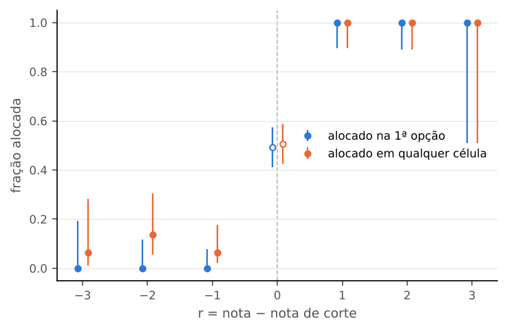
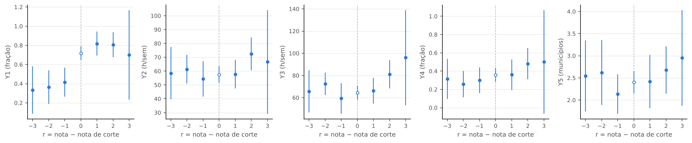
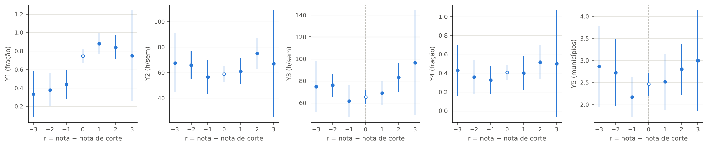
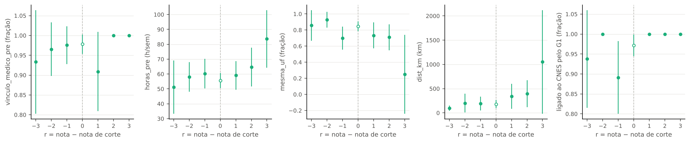

# 57f. Resultados do P6: alocado por pouco contra não alocado por pouco

> **Data:** 2026-10-23. 
> **Protocolo:** [`56_protocolo_P6_mecanismo_alocacao.md`](56_protocolo_P6_mecanismo_alocacao.md), congelado em 19/10/2026 antes de ligar os candidatos ao painel CNES e de abrir outcomes. 
> **Scripts:** `scripts/rdd_bolsa/30_mecanismo_alocacao.py` (amostra e passo 0) e `scripts/rdd_bolsa/31_rd_mecanismo.py` (estimação; gera este documento inteiro). 
> **Saídas:** `output/rdd_bolsa/P6_amostra.parquet`, `P6_celulas.csv`, `P6_cobertura_mensal.csv`, `P6_passo0_resumo.json`, `P6_estimativas.csv`, `P6_resumo.json` e `P6_figuras/`. 
> **Testes:** `tests/test_mecanismo_alocacao.py`. 
> **Estatuto:** `EXPLORATORIO_P6`; toda linha tem `natureza_dos_dados = EMPIRICO`.

Este documento é gerado pelo script a partir de `output/`; não edite à mão. O teste confere que ele é igual ao que o script gera.

## 1. O que se pergunta e o que o contraste identifica

Perto da nota de corte de cada célula, quem passou por um ou dois pontos foi alocado e quem ficou um ou dois pontos abaixo não foi. Comparar os dois grupos mede o efeito de **ser alocado** sobre a trajetória cadastrada do médico no CNES.

- **Não é o efeito da bolsa.** O contraste é ser alocado na 1ª opção do PMM-E, para candidatos de ampla concorrência perto do corte; a bolsa é a mesma para todos os alocados da mesma célula.
- **Vínculo cadastrado não é presença nem retenção.** Os outcomes são cadastros no CNES (vínculo, horas cadastradas, municípios).
- **Resultado exploratório.** O desempate no corte é regra fixa (UF, idade), não sorteio; a nota é inteira. O principal exclui os empatados (r = 0).

## 2. Passo 0: cache privado, ligação e cobertura

O cache privado do a16 e o dicionário do G1 não existiam neste ambiente e foram refeitos pelos próprios scripts, com os mesmos ZIPs do CNES (SHA-256 igual ao do a09 e ao do manifesto do a16). Os caminhos estão no `.gitignore`; nada com código do profissional, nome ou CPF sai do cache. Antes de usar o cache:

- a ligação da X1 refeita do cache reproduz `X1_medicos.parquet` em 100%, e o painel médico × mês do a16 refeito é idêntico ao versionado (53.136 linhas);
- a ligação dos candidatos pela regra do G1, refeita do cache, é idêntica a `G1_candidatos_origem.parquet` nas duas regras e nos três ciclos (G1 (CPF + nome), principal: 5.573 ligados de 5.776; só nome (R5, sensibilidade): 5.305 ligados de 5.776);
- o painel dos candidatos, montado em memória, tem horas e municípios iguais aos da agregação do a16 (160.542 candidato-mês conferidos).

Cobertura mensal no universo do P6 (sem quebra por r): fração dos ligados com vínculo médico cadastrado em cada competência de 202406 a 202608. Detalhe em `P6_cobertura_mensal.csv`.

| Regra | Ciclo | Ligados no universo | Com vínculo médico: menor fração mensal | maior fração mensal |
|---|---|---|---|---|
| G1 (CPF + nome), principal | 1 | 15 | 93,3% | 100,0% |
| G1 (CPF + nome), principal | 2 | 293 | 94,9% | 97,6% |
| só nome (R5, sensibilidade) | 1 | 14 | 92,9% | 100,0% |
| só nome (R5, sensibilidade) | 2 | 285 | 94,7% | 97,5% |

## 3. Amostra

Células dos ciclos 1 e 2 (1ª chamada) por motivo de exclusão. A unidade do corte é a célula × ampla concorrência (adendo de 23/10/2026, seção 11).

| Motivo | Ciclo 1 | Ciclo 2 |
|---|---|---|
| capacidade efetiva diferente das vagas imediatas do quadro (item 5.7) | 202 | 0 |
| corte entre candidatos de 2ª opção | 8 | 21 |
| corte não efetivo: a nota de corte é a maior nota de ampla concorrência de 1ª opção | 102 | 291 |
| elegivel | 6 | 56 |
| sem corte ativo (nenhum proponente recusado) | 155 | 360 |
| sem vaga efetiva | 103 | 240 |

Todas as 62 células elegíveis têm vaga reservada; os inscritos em reserva ficam fora porque o corte das vagas reservadas não é reconstruído.

| Etapa | Ciclo 1 | Ciclo 2 |
|---|---|---|
| candidatos da 1ª chamada | 993 | 2.179 |
| sem pontuação (sem pré-requisito) | 114 | 0 |
| 1ª opção fora das células elegíveis | 863 | 1.870 |
| inscritos em reserva (ER, PCD) na célula elegível | 0 | 5 |
| sub judice na célula elegível | 0 | 0 |
| no universo do P6 (ampla concorrência, célula elegível) | 16 | 304 |

Universo do P6 (regra principal): 320 candidatos em 62 células. Candidatos, ligação ao CNES e células por valor de r:

| Regra | r | Candidatos | Ligados | Taxa de ligação | Células |
|---|---|---|---|---|---|
| G1 (CPF + nome), principal | -4 | 9 | 8 | 88,9% | 3 |
| G1 (CPF + nome), principal | -3 | 16 | 15 | 93,8% | 5 |
| G1 (CPF + nome), principal | -2 | 29 | 29 | 100,0% | 11 |
| G1 (CPF + nome), principal | -1 | 46 | 41 | 89,1% | 24 |
| G1 (CPF + nome), principal | 0 | 142 | 138 | 97,2% | 62 |
| G1 (CPF + nome), principal | 1 | 33 | 33 | 100,0% | 29 |
| G1 (CPF + nome), principal | 2 | 31 | 31 | 100,0% | 29 |
| G1 (CPF + nome), principal | 3 | 4 | 4 | 100,0% | 4 |
| G1 (CPF + nome), principal | 4 | 9 | 9 | 100,0% | 9 |
| G1 (CPF + nome), principal | 5 | 1 | 0 | 0,0% | 1 |
| só nome (R5, sensibilidade) | -4 | 9 | 8 | 88,9% | 3 |
| só nome (R5, sensibilidade) | -3 | 16 | 15 | 93,8% | 5 |
| só nome (R5, sensibilidade) | -2 | 29 | 28 | 96,6% | 11 |
| só nome (R5, sensibilidade) | -1 | 46 | 41 | 89,1% | 24 |
| só nome (R5, sensibilidade) | 0 | 142 | 133 | 93,7% | 62 |
| só nome (R5, sensibilidade) | 1 | 33 | 32 | 97,0% | 29 |
| só nome (R5, sensibilidade) | 2 | 31 | 30 | 96,8% | 29 |
| só nome (R5, sensibilidade) | 3 | 4 | 3 | 75,0% | 4 |
| só nome (R5, sensibilidade) | 4 | 9 | 9 | 100,0% | 9 |
| só nome (R5, sensibilidade) | 5 | 1 | 0 | 0,0% | 1 |

Janela principal do R1 (r ∈ {−2, −1, +1, +2}, ligados, regra principal): 64 acima e 70 abaixo, em 56 células, das quais 27 têm os dois lados e identificam o efeito (30 acima e 68 abaixo). Nas tabelas, as colunas Acima e Abaixo contam só essas células.

## 4. Primeiro estágio

P(D = 1 | r) entre todos os candidatos do universo (ligados ou não):

| r | Candidatos | P(D = 1 | r): alocado na 1ª opção | P(D' = 1 | r): alocado no PMM-E |
|---|---|---|---|
| -4 | 9 | 0,0% | 11,1% |
| -3 | 16 | 0,0% | 6,2% |
| -2 | 29 | 0,0% | 13,8% |
| -1 | 46 | 0,0% | 6,5% |
| 0 | 142 | 49,3% | 50,7% |
| 1 | 33 | 100,0% | 100,0% |
| 2 | 31 | 100,0% | 100,0% |
| 3 | 4 | 100,0% | 100,0% |
| 4 | 9 | 100,0% | 100,0% |
| 5 | 1 | 100,0% | 100,0% |

Salto na janela do R1, com efeito fixo de célula:

| Amostra | Tratamento | Salto (R1) | IC 95% | F | Acima | Abaixo | Células com os dois lados |
|---|---|---|---|---|---|---|---|
| todos | D (1ª opção) | +1,000 | — | — | 32 | 73 | 28 |
| todos | D' (qualquer célula) | +0,926 | [+0,858; +0,994] | 709,1 | 32 | 73 | 28 |
| ligados | D (1ª opção) | +1,000 | — | — | 30 | 68 | 27 |
| ligados | D' (qualquer célula) | +0,918 | [+0,844; +0,992] | 595,8 | 30 | 68 | 27 |

Quando a alocação na janela é determinística (todos acima alocados, ninguém abaixo), o EP é zero e o F não se define; o T6.3 não roda neste protocolo de qualquer forma (seção 8).

## 5. Balanço de covariáveis pré-determinadas

R1 aplicado às covariáveis de antes do programa (candidatos ligados) e à taxa de ligação ao CNES (todos os candidatos da janela). p por permutação dentro da célula.

| Covariável | Diferença acima − abaixo (R1) | IC 95% | p (permutação) | n | Células com os dois lados |
|---|---|---|---|---|---|
| vínculo médico na competência de referência (G1) | -0,033 | [-0,111; +0,045] | 0,602 | 134 | 27 |
| horas totais no CNES, média de 202406 a 202506 | +2,7 | [-9,5; +14,8] | 0,683 | 134 | 27 |
| origem na mesma UF da 1ª opção | -0,030 | [-0,228; +0,168] | 0,803 | 129 | 26 |
| distância origem–1ª opção (km) | +328,9 | [-25,0; +682,9] | 0,052 | 129 | 26 |
| ligado ao CNES, G1 (CPF + nome), principal (acima 100,0%, abaixo 93,3%) | +0,091 | [-0,009; +0,192] | 0,093 | 139 | 28 |
| ligado ao CNES, só nome (R5, sensibilidade) (acima 96,9%, abaixo 92,0%) | +0,080 | [-0,054; +0,214] | 0,223 | 139 | 28 |

## 6. Efeito de ser alocado (R1, principal)

Diferença entre r ∈ {+1, +2} e r ∈ {−1, −2}, com efeito fixo de célula; candidatos ligados, regra principal. p por permutação dentro da célula (999, semente 20261019); IC 95% com EP agrupado por célula. q de BKY e p de Holm na família de 10 testes desta tabela.

| Outcome | Medida | Efeito (R1) | IC 95% | p (permutação) | q BKY | p Holm | Acima | Abaixo |
|---|---|---|---|---|---|---|---|---|
| Y1: tem vínculo cadastrado no município da 1ª opção | último mês (202608) | +0,420 | [+0,215; +0,624] | 0,001 | 0,006 | 0,010 | 30 | 68 |
| Y1: tem vínculo cadastrado no município da 1ª opção | média dos meses de seguimento | +0,405 | [+0,210; +0,600] | 0,001 | 0,006 | 0,010 | 30 | 68 |
| Y2: horas SUS semanais totais | último mês (202608) | +8,6 | [-6,6; +23,7] | 0,293 | 0,224 | 0,855 | 30 | 68 |
| Y2: horas SUS semanais totais | média dos meses de seguimento | +10,5 | [-4,4; +25,3] | 0,191 | 0,224 | 0,764 | 30 | 68 |
| Y3: horas totais | último mês (202608) | +13,2 | [-3,1; +29,5] | 0,113 | 0,191 | 0,678 | 30 | 68 |
| Y3: horas totais | média dos meses de seguimento | +15,5 | [+0,6; +30,4] | 0,048 | 0,147 | 0,384 | 30 | 68 |
| Y4: tem vínculo fora do município de origem pré-programa | último mês (202608) | +0,202 | [-0,053; +0,457] | 0,124 | 0,191 | 0,678 | 28 | 64 |
| Y4: tem vínculo fora do município de origem pré-programa | média dos meses de seguimento | +0,207 | [-0,036; +0,450] | 0,073 | 0,171 | 0,511 | 28 | 64 |
| Y5: número de municípios com vínculo | último mês (202608) | +0,446 | [-0,371; +1,264] | 0,299 | 0,224 | 0,855 | 30 | 68 |
| Y5: número de municípios com vínculo | média dos meses de seguimento | +0,432 | [-0,350; +1,215] | 0,285 | 0,224 | 0,855 | 30 | 68 |

## 7. Robustez e sensibilidades (R2–R5)

Efeito e IC 95%. R2 = Wald (efeito para os que obedecem); R3 = tendência linear em r de cada lado, r ∈ [−3, +3] sem 0; R4 = inclui os empatados, com indicador do desempate; R5 = ligação só por nome.

| Outcome (média do seguimento) | R1 | R2 (Wald) | R3 (tendência) | R4 (com empatados) | R5 (só nome) |
|---|---|---|---|---|---|
| Y1 | +0,405 [+0,210; +0,600] | +0,405 [+0,210; +0,600] | +0,454 [+0,104; +0,803] | +0,310 [+0,178; +0,443] | +0,404 [+0,207; +0,600] |
| Y2 | +10,5 [-4,4; +25,3] | +10,5 [-4,4; +25,3] | +5,0 [-24,4; +34,4] | +9,6 [+0,7; +18,5] | +9,5 [-5,6; +24,5] |
| Y3 | +15,5 [+0,6; +30,4] | +15,5 [+0,6; +30,4] | +0,6 [-27,5; +28,8] | +10,3 [+0,9; +19,7] | +14,7 [-0,2; +29,7] |
| Y4 | +0,207 [-0,036; +0,450] | +0,207 [-0,036; +0,450] | +0,021 [-0,486; +0,528] | +0,208 [+0,070; +0,345] | +0,199 [-0,069; +0,466] |
| Y5 | +0,432 [-0,350; +1,215] | +0,432 [-0,350; +1,215] | +0,349 [-1,611; +2,310] | +0,437 [-0,069; +0,943] | +0,424 [-0,386; +1,234] |

| Outcome (202608) | R1 | R2 (Wald) | R3 (tendência) | R4 (com empatados) | R5 (só nome) |
|---|---|---|---|---|---|
| Y1 | +0,420 [+0,215; +0,624] | +0,420 [+0,215; +0,624] | +0,418 [+0,004; +0,831] | +0,344 [+0,204; +0,484] | +0,414 [+0,213; +0,616] |
| Y2 | +8,6 [-6,6; +23,7] | +8,6 [-6,6; +23,7] | +12,8 [-17,6; +43,1] | +10,4 [+1,2; +19,5] | +8,4 [-6,8; +23,7] |
| Y3 | +13,2 [-3,1; +29,5] | +13,2 [-3,1; +29,5] | +8,0 [-23,9; +40,0] | +11,1 [+1,3; +20,8] | +13,5 [-2,4; +29,4] |
| Y4 | +0,202 [-0,053; +0,457] | +0,202 [-0,053; +0,457] | +0,068 [-0,445; +0,580] | +0,206 [+0,067; +0,345] | +0,185 [-0,092; +0,462] |
| Y5 | +0,446 [-0,371; +1,264] | +0,446 [-0,371; +1,264] | +0,479 [-1,696; +2,655] | +0,496 [-0,013; +1,006] | +0,444 [-0,398; +1,287] |

## 8. O que não foi executado

- **R6 (escore de propensão do mecanismo).** O escore de propensão do mecanismo (Abdulkadiroğlu et al., 2017) pressupõe desempate por sorteio ou um escore contínuo com banda; aqui a nota é inteira e o desempate é regra fixa (UF, idade), e com até duas opções e a prioridade da 1ª opção o escore local da 1ª opção vale 0 abaixo, 1 acima e é indefinido no empate: coincide com o R1 e não é uma forma de cálculo distinta e estável (§4: 'se a forma de calcular for estável').
- **T6.3 (variação do mecanismo como instrumento no município).** O §4 diz que o T6.3 não roda neste protocolo; só entra depois, se o primeiro estágio do R1 for forte (F > 10) e houver células suficientes.
- **Homologação** como primeiro estágio (doc 51, T6.2) não está no protocolo 56 e não foi calculada.

## 9. Figuras

### Primeiro estágio: alocação por r (regra principal, todos os candidatos)

**Como ler.** Cada ponto é a fração de candidatos alocados na 1ª opção (azul) e em qualquer célula (laranja) para cada distância r da nota de corte. À direita do zero, a nota passou do corte; r = 0 são os empatados, decididos por regra fixa.

### Outcomes Y1–Y5, média do seguimento, por r (regra principal)

**Como ler.** Média de cada outcome nos meses de seguimento, por r, entre os candidatos ligados ao CNES. Um degrau entre r = −1 e r = +1 sugere efeito de ser alocado; barras são IC de 95% sem efeito fixo de célula.

### Outcomes Y1–Y5 em 202608, por r (regra principal)

**Como ler.** Mesma leitura, com o valor de cada outcome no último mês, 202608.

### Balanço: covariáveis pré e taxa de ligação, por r (regra principal)

**Como ler.** Covariáveis de antes do programa e taxa de ligação ao CNES, por r. Sem diferença entre os dois lados do corte, a comparação dos outcomes é mais crível.

## 10. Leitura

- **Amostra pequena.** A janela do R1 tem 64 candidatos ligados logo acima do corte e 70 logo abaixo; o efeito vem só das 27 células com os dois lados, com 30 acima e 68 abaixo. Os intervalos são largos: média do seguimento, Y1 [+0,210; +0,600]; Y2 [-4,4; +25,3]; Y3 [+0,6; +30,4]; Y4 [-0,036; +0,450]; Y5 [-0,350; +1,215].
- **Primeiro estágio.** Na janela do R1, ser aprovado por pouco muda a alocação na 1ª opção em +1,000 (fração): a regra é cumprida, porque o corte vem da própria alocação publicada. Por isso o R2 (Wald) repete o R1.
- **Outcomes.** Na família do R1 (Y1–Y5 × último mês e média, 10 testes), 3 têm p de permutação < 0,05, 2 rejeitam zero depois do Holm e 2 têm q de BKY ≤ 0,05.
- **Balanço.** Nenhuma covariável pré nem a taxa de ligação tem diferença com p < 0,05 entre os lados. Desequilíbrios declarados mesmo sem p < 0,05: a distância origem–1ª opção difere em +329 km [-25; +683] (p = 0,052), com os de cima vindo de mais longe; e a taxa de ligação ao CNES difere em +0,091 [-0,009; +0,192] (p = 0,093; acima 100,0%, abaixo 93,3%). A ligação diferencial pode enviesar os outcomes, que só existem para os ligados.
- **Y1 é quase mecânico.** Ser alocado num posto cria um vínculo cadastrado no município da 1ª opção; o salto em Y1 mostra que a alocação aparece no CNES, não que o médico fique ou trabalhe lá.
- **O que o contraste identifica.** O efeito de SER ALOCADO na 1ª opção do PMM-E, para candidatos de ampla concorrência perto da nota de corte de células com corte efetivo, sobre a trajetória cadastrada no CNES. Não é o efeito da bolsa, nem o do PMM-E sobre a oferta do município, nem retenção: vínculo cadastrado não é presença.
- **Validade externa.** As células elegíveis são as poucas com mais de uma vaga e corte abaixo da maior nota (todas com vaga reservada), quase todas do ciclo 2; o resultado não se estende às células de uma vaga.

## 11. Decisões e desvios

- **Unidade do corte: célula × ampla concorrência (§1 do protocolo)** (2026-10-23). A modalidade está no dado (indicador de inscrição em reserva e tipo de vaga publicada, do G2). O corte da célula é o do G2: a nota do último admitido em vaga de ampla concorrência (inclusive remanescente de cota). Entram os candidatos de ampla concorrência; os inscritos em reserva (ER, PCD) ficam fora e são contados, porque o corte das vagas reservadas não é reconstruído. A regra foi fixada antes de ler qualquer outcome, depois de ver só as contagens de candidatos por r no G2 (todas as células elegíveis têm vaga reservada; sem esta leitura do §1 não sobraria nenhum candidato com r > 0).
- **Corte efetivo (§2)** (2026-10-23). Célula elegível: capacidade efetiva igual às vagas imediatas do quadro, corte ativo, corte entre candidatos de 1ª opção e nota de corte abaixo da maior nota de ampla concorrência entre os que puseram a célula em 1º lugar. Motivos de exclusão por célula em P6_celulas.csv.
- **Passo 0: painel em memória em vez de reconsolidar o a16** (2026-10-23). O cache privado do a16 e o dicionário do G1 não existiam neste ambiente e foram refeitos pelos próprios scripts (mesmos ZIPs do a09, SHA-256 conferido). As chaves dos candidatos foram gravadas só no cache privado (chaves_extra_P6.parquet). Consolidar o a16 com --chaves-extra renumeraria o id_prof das saídas versionadas que o P4 usa; o painel dos candidatos foi montado em memória, do mesmo cache, e conferido contra agregar_medico_mes do a16. O cache refeito reproduz o painel versionado do a16 e a ligação versionada do G1.
- **Y4 e o município de origem** (2026-10-23). Origem = todos os municípios com vínculo médico do candidato na competência de referência do ciclo (G1: 202506 no ciclo 1, 202510 no ciclo 2). Y4 = algum vínculo num município fora desse conjunto; candidato ligado sem vínculo na referência fica com Y4 ausente (motivo no resumo).
- **D, D' e desempate** (2026-10-23). D = alocado na 1ª opção no resultado publicado da 1ª chamada (alvo do G2); D' = alocado em qualquer célula. Ganhou o desempate (r = 0, R4) = admitido na 1ª opção pela reconstrução principal do G2, que usa a classificação publicada como desempate.
- **Distância só na regra principal** (2026-10-23). A distância origem–1ª opção vem de G1_distancias_opcoes.parquet, que só tem a regra principal; na regra só por nome (R5) ela fica ausente.
- **Família do BKY e do Holm** (2026-10-23). O §5 pede BKY entre Y1 e Y5 no R1 e o §3 pede cada outcome no último mês e em média no seguimento. A família é a dos 10 testes do R1 (Y1–Y5 × duas medidas), regra principal; o Holm, pedido no relato, usa a mesma família. Fixado antes de abrir os outcomes.
- **Inferência do R1 e do R2** (2026-10-23). O p principal do R1 é o da permutação dentro da célula (999, semente 20261019; estatística = o próprio coeficiente com efeito fixo). O IC usa EP agrupado por célula (CR1, graus de liberdade sem os efeitos fixos). O R2 usa o mesmo p (Anderson–Rubin) e EP agrupado da VI com efeito fixo.
- **R4** (2026-10-23). Tratamento = r > 0 ou (r = 0 e ganhou o desempate), com indicador de r = 0 e efeito fixo de célula, r ∈ [−2, +2]; EP agrupado, sem permutação (o desempate não é sorteio).
- **R6 não executado** (2026-10-23). o escore de propensão do mecanismo (Abdulkadiroğlu et al., 2017) pressupõe desempate por sorteio ou um escore contínuo com banda; aqui a nota é inteira e o desempate é regra fixa (UF, idade), e com até duas opções e a prioridade da 1ª opção o escore local da 1ª opção vale 0 abaixo, 1 acima e é indefinido no empate: coincide com o R1 e não é uma forma de cálculo distinta e estável (§4: 'se a forma de calcular for estável').

## 12. Limitações

- Poucas células têm corte efetivo: com uma vaga, o corte é a maior nota e ninguém fica acima dele.
- O desempate no corte é regra fixa (UF de residência ou nascimento, idade); os candidatos logo acima e logo abaixo diferem em um ou dois pontos de barema, não por sorteio.
- Candidatos não ligados ao CNES ficam fora dos outcomes; a diferença da taxa de ligação entre os lados está na seção 5.
- Ser alocado na 1ª opção não impede quem ficou abaixo de ser alocado na 2ª opção (D' na seção 4).
- O seguimento é curto (ciclo 2: 202604–202608) e só vai até 202608.
- Cadastro no CNES não é trabalho efetivo; mudança cadastral não se distingue de mudança real.
