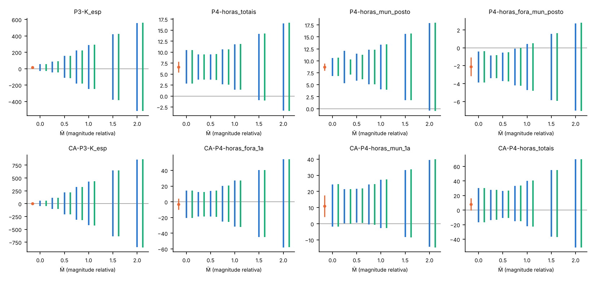
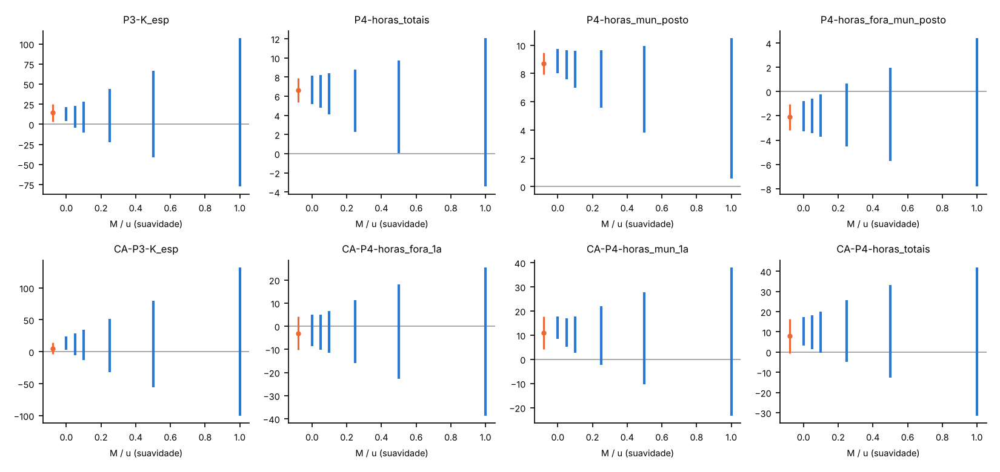
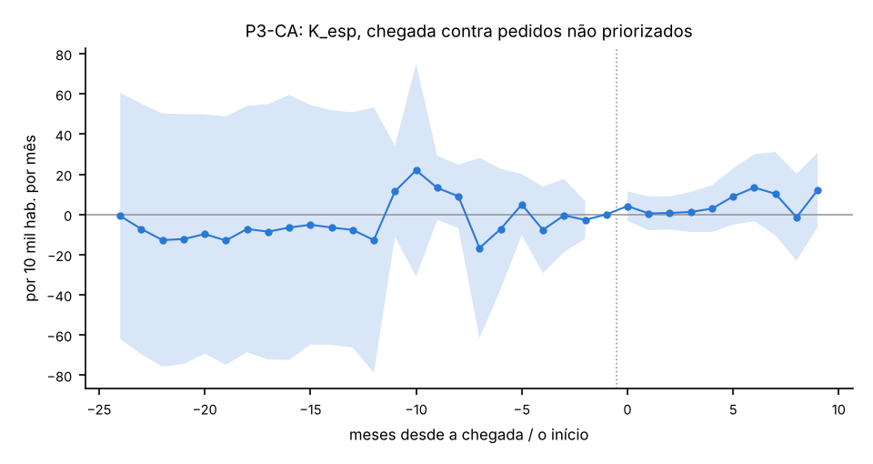
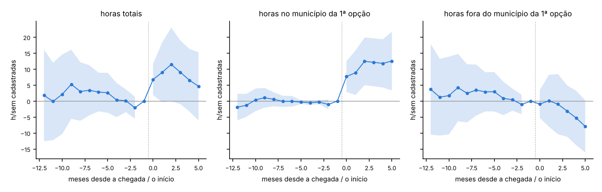

# 57h. Resultados do protocolo 59: sensibilidade de Rambachan–Roth e comparação alternativa do P3/P4

> **Data:** 2026-10-25.<br>
> **Protocolo:** [`59_protocolo_P3P4_sensibilidade_comparacao.md`](59_protocolo_P3P4_sensibilidade_comparacao.md), congelado e commitado sozinho antes de qualquer estimativa nova.<br>
> **Scripts:** `scripts/rdd_bolsa/35_comparacao_alternativa_P3P4.py` (parte B) e `scripts/rdd_bolsa/34_sensibilidade_honestdid.py` (parte A; gera este documento inteiro a partir de `output/`).<br>
> **Saídas:** `output/rdd_bolsa/H_*` e `CA_*`; toda linha tem `natureza_dos_dados = EMPIRICO`.<br>
> **Testes:** `tests/test_honestdid.py` e `tests/test_comparacao_alternativa_P3P4.py`.<br>
> **Estatuto:** `PROTOCOLO_59_POS_RESULTADO`. A parte A é `SENSIBILIDADE`: não muda nenhuma estimativa. Nada aqui tem fonte de exogeneidade validada.

Este documento é gerado pelo script 34; não edite à mão.

## 1. Resposta curta

**Parte A (sensibilidade).** produção típica da especialidade no par (12.2): média do pós +14,34; ruptura de Δ^RM em M̄ = 0 (IC já inclui zero) pelo teste condicional e 0 (IC já inclui zero) pelo híbrido (Δ^SD: M/u = 0,02); horas totais: média do pós +6,60; ruptura de Δ^RM em M̄ = 1,30 pelo teste condicional e 1,29 pelo híbrido (Δ^SD: M/u = 0,50); horas no município do posto: média do pós +8,70; ruptura de Δ^RM em M̄ = 1,90 pelo teste condicional e 1,89 pelo híbrido (Δ^SD: M/u = 1,16); horas fora do município do posto: média do pós −2,10; ruptura de Δ^RM em M̄ = 0,78 pelo teste condicional e 0,76 pelo híbrido (Δ^SD: M/u = 0,13). Com M̄ = 1 (violações do pós do tamanho das do pré), o IC robusto da média do pós exclui zero em: H-P4-horas_totais, H-P4-horas_mun_posto (condicional); H-P4-horas_totais, H-P4-horas_mun_posto (híbrido). **Parte B (comparação alternativa).** P3-CA produção típica do curso (SIA, formas típicas do G4, CBO do curso): +5,29 [−3,98; +14,56], p = 0,264, p Holm = 0,527, pré p = 0,009 (não passa); P4-CA horas totais: +7,91 [−0,63; +16,45], p = 0,054, p Holm = 0,162, pré p = 0,837 (passa); P4-CA horas no município da 1ª opção: +10,92 [+4,15; +17,68], p = 0,004, p Holm = 0,016, pré p = 0,297 (passa); P4-CA horas fora do município da 1ª opção: −3,01 [−10,14; +4,12], p = 0,412, p Holm = 0,527, pré p = 0,200 (passa). Primárias que rejeitam zero depois do Holm com pré que passa: 1 de 4 (P4-CA horas_mun_1a). Com a exigência adicional do §6 do protocolo (ruptura de Δ^RM ≥ 1 na média do pós): nenhuma. As horas no município da 1ª opção são em parte mecânicas (ser alocado cria o vínculo cadastrado no município da vaga, como o Y1 do P6), e vínculo cadastrado não é presença. Nada aqui é efeito da bolsa nem da participação no PMM-E.

## 2. Parte A: sensibilidade de Rambachan–Roth

Como ler: "ruptura M̄ = x" quer dizer que o IC robusto exclui zero enquanto a variação do viés entre meses consecutivos do pós não passa de x vezes a maior variação vista no pré (M̄ = 1: do mesmo tamanho). Ruptura 0 = o IC já inclui zero sem nenhuma violação além da do pré. Δ^SD: limite M na segunda diferença do viés, em múltiplos de u (EP analítico de θ(0)). A sensibilidade não transforma associação em efeito.

Método: Δ^RM pelo teste condicional de Andrews, Roth e Pakes (congelado no protocolo) e, nas linhas principais e do CA, também pelo híbrido condicional–LF (adendo datado do protocolo 59; padrão do pacote HonestDiD); Δ^SD pelo FLCI. Implementação própria em scipy (`honestdid_lib.py`), validada em casos sintéticos. Σ = covariância analítica das funções de influência; o IC "analítico" da tabela é a referência com essa Σ e pode diferir um pouco do IC bootstrap dos docs 57c e 57d.

Por que o IC de Δ^RM pode ser largo já em M̄ = 0: em M̄ = 0 os passos do pós são forçados a zero, então a largura não vem de repartir o desvio em passos mensais. Ela vem do teste de ARP, que é do tipo sup-t sobre muitos momentos (um por diferença mensal do pós: 10 no P3, 6 a 7 no P4): válido, mas pouco potente para a média do pós quando os θ(e) mensais são ruidosos (nas horas totais do P4, o IC em M̄ = 0 tem cerca de 3 vezes a largura do convencional; auditoria 30, A1). O híbrido não muda isso nestes dados (as duas colunas quase coincidem). Por isso a ruptura 0 do P3 reflete em parte essa perda de potência; a fragilidade do P3 se sustenta pelo FLCI de Δ^SD (M/u = 0,02), que não depende desse teste e é a leitura mais informativa quando o Δ^RM sai largo.

### 2.1 P3 (doc 57c)

| Outcome | Leitura | e pré / pós | Média do pós | IC 95% (analítico) | Δ^RM(1), condicional | Δ^RM(1), híbrido | Ruptura M̄, média (cond.) | Ruptura M̄, média (híbr.) | Ruptura M̄, θ(0) (cond.) | Ruptura M̄, θ(0) (híbr.) | Ruptura M/u, Δ^SD (média) | Maior |2ª dif.| do pré / u |
|---|---|---|---|---|---|---|---|---|---|---|---|---|
| produção típica da especialidade no par (12.2) | principal | -12..-2 / 0..9 | +14,34 | [+3,57; +25,11] | [−246,68; +288,65] | [−248,91; +291,00] | 0 (IC já inclui zero) | 0 (IC já inclui zero) | 0 (IC já inclui zero) | 0 (IC já inclui zero) | 0,02 | 7,83 |
| internações cirúrgicas de residentes (12.4, D2) | secundária | -12..-2 / 0..9 | +0,15 | [−0,75; +1,05] | [−8,94; +9,27] | não calculado | 0 (IC já inclui zero) | — | 0 (IC já inclui zero) | — | 0 (IC já inclui zero) | 3,10 |
| todas as internações de residentes (12.4, D2) | secundária | -12..-2 / 0..9 | +2,12 | [+0,33; +3,91] | [−10,96; +15,05] | não calculado | 0 (IC já inclui zero) | — | 0 (IC já inclui zero) | — | 0,02 | 2,64 |
| K1 nos outros municípios da região (12.5) | secundária | -12..-2 / 0..9 | +16,23 | [+1,11; +31,36] | [−1.027,16; +1.059,59] | não calculado | 0 (IC já inclui zero) | — | 0 (IC já inclui zero) | — | 0,02 | 20,15 |
| K2 nos outros municípios da região (12.5) | secundária | -12..-2 / 0..9 | −0,41 | [−1,03; +0,21] | [−6,68; +5,90] | não calculado | 0 (IC já inclui zero) | — | 0 (IC já inclui zero) | — | 0 (IC já inclui zero) | 4,63 |

### 2.2 P4 (doc 57d, T4.1b, regra D1)

| Outcome | Leitura | e pré / pós | Média do pós | IC 95% (analítico) | Δ^RM(1), condicional | Δ^RM(1), híbrido | Ruptura M̄, média (cond.) | Ruptura M̄, média (híbr.) | Ruptura M̄, θ(0) (cond.) | Ruptura M̄, θ(0) (híbr.) | Ruptura M/u, Δ^SD (média) | Maior |2ª dif.| do pré / u |
|---|---|---|---|---|---|---|---|---|---|---|---|---|
| horas totais | principal | -6..-2 / 0..6 | +6,60 | [+5,34; +7,86] | [+1,48; +11,77] | [+1,41; +11,84] | 1,30 | 1,29 | 2,80 | 2,77 | 0,50 | 1,29 |
| horas em vínculos SUS | secundária | -6..-2 / 0..6 | +6,78 | [+5,56; +8,00] | [+1,39; +12,17] | não calculado | 1,27 | — | 2,64 | — | 0,54 | 1,58 |
| horas em vínculos não SUS | secundária | -6..-2 / 0..6 | −0,18 | [−0,55; +0,19] | [−1,20; +0,69] | não calculado | 0 (IC já inclui zero) | — | 0 (IC já inclui zero) | — | 0 (IC já inclui zero) | 0,86 |
| horas ambulatoriais | secundária | -6..-2 / 0..6 | +4,68 | [+3,85; +5,50] | [+1,66; +7,69] | não calculado | 1,60 | — | 3,24 | — | 0,52 | 1,69 |
| horas hospitalares | secundária | -6..-2 / 0..6 | +1,82 | [+1,07; +2,56] | [−0,56; +4,30] | não calculado | 0 (IC já inclui zero) | — | 1,78 | — | 0,27 | 2,07 |
| número de vínculos | secundária | -6..-2 / 0..6 | +0,34 | [+0,26; +0,42] | [−0,02; +0,70] | não calculado | 0,93 | — | 2,21 | — | 0,38 | 2,11 |
| número de estabelecimentos | secundária | -6..-2 / 0..6 | +0,30 | [+0,23; +0,37] | [−0,03; +0,63] | não calculado | 0,91 | — | 2,25 | — | 0,34 | 1,81 |
| número de municípios | secundária | -6..-2 / 0..6 | +0,27 | [+0,22; +0,31] | [+0,03; +0,50] | não calculado | 1,16 | — | 2,34 | — | 0,53 | 2,59 |
| horas no estabelecimento do posto | secundária | -6..-2 / 0..6 | +8,16 | [+7,55; +8,77] | [+4,34; +11,96] | não calculado | 2,19 | — | ≥ 4,00 | — | 1,43 | 3,18 |
| horas no município do posto | principal | -6..-2 / 0..6 | +8,70 | [+7,94; +9,46] | [+4,04; +13,40] | [+4,00; +13,44] | 1,90 | 1,89 | 3,81 | 3,79 | 1,16 | 2,65 |
| horas fora do município do posto | principal | -6..-2 / 0..6 | −2,10 | [−3,15; −1,05] | [−4,72; +0,45] | [−4,78; +0,51] | 0,78 | 0,76 | 0 (IC já inclui zero) | 0 (IC já inclui zero) | 0,13 | 1,01 |
| horas em estabelecimentos públicos | secundária | -6..-2 / 0..6 | +5,86 | [+4,87; +6,85] | [+1,92; +9,86] | não calculado | 1,52 | — | 3,45 | — | 0,66 | 1,66 |
| horas em privados com fins lucrativos | secundária | -6..-2 / 0..6 | −0,47 | [−1,13; +0,20] | [−2,28; +1,32] | não calculado | 0 (IC já inclui zero) | — | 0 (IC já inclui zero) | — | 0 (IC já inclui zero) | 1,13 |
| horas em privados sem fins lucrativos | secundária | -6..-2 / 0..6 | +1,26 | [+0,66; +1,87] | [−0,78; +3,42] | não calculado | 0 (IC já inclui zero) | — | 0 (IC já inclui zero) | — | 0,13 | 0,96 |

### 2.3 Comparação alternativa (parte B)

| Outcome | Leitura | e pré / pós | Média do pós | IC 95% (analítico) | Δ^RM(1), condicional | Δ^RM(1), híbrido | Ruptura M̄, média (cond.) | Ruptura M̄, média (híbr.) | Ruptura M̄, θ(0) (cond.) | Ruptura M̄, θ(0) (híbr.) | Ruptura M/u, Δ^SD (média) | Maior |2ª dif.| do pré / u |
|---|---|---|---|---|---|---|---|---|---|---|---|---|
| produção típica do curso (SIA, formas típicas do G4, CBO do curso) | secundária | -12..-2 / 0..9 | +5,29 | [−3,96; +14,53] | [−421,22; +432,26] | [−424,43; +435,48] | 0 (IC já inclui zero) | 0 (IC já inclui zero) | 0 (IC já inclui zero) | 0 (IC já inclui zero) | 0,02 | 9,31 |
| horas totais | secundária | -12..-2 / 0..5 | +7,91 | [−0,63; +16,45] | [−22,08; +40,32] | [−22,50; +40,76] | 0 (IC já inclui zero) | 0 (IC já inclui zero) | 0 (IC já inclui zero) | 0 (IC já inclui zero) | 0,08 | 2,16 |
| horas no município da 1ª opção | secundária | -12..-2 / 0..5 | +10,92 | [+4,15; +17,68] | [−2,55; +27,20] | [−2,76; +27,48] | 0 (IC já inclui zero) | 0 (IC já inclui zero) | 1,48 | 1,44 | 0,17 | 0,71 |
| horas fora do município da 1ª opção | secundária | -12..-2 / 0..5 | −3,01 | [−10,14; +4,12] | [−31,68; +26,97] | [−31,90; +27,11] | 0 (IC já inclui zero) | 0 (IC já inclui zero) | 0 (IC já inclui zero) | 0 (IC já inclui zero) | 0 (IC já inclui zero) | 1,93 |

### 2.4 Grades das linhas principais (média do pós)

**produção típica da especialidade no par (12.2)** (`H-P3-K_esp`), Δ^RM, teste condicional (congelado):

| M̄ | IC robusto 95% | Exclui zero | Conjunto identificado em β̂ |
|---|---|---|---|
| 0,00 | [−27,08; +56,33] | não | [+14,34; +14,34] |
| 0,25 | [−46,40; +88,25] | não | [−10,83; +39,50] |
| 0,50 | [−113,02; +154,97] | não | [−35,99; +64,67] |
| 0,75 | [−179,83; +221,79] | não | [−61,16; +89,83] |
| 1,00 | [−246,68; +288,65] | não | [−86,32; +115,00] |
| 1,50 | [−380,42; +422,40] | não | [−136,65; +165,33] |
| 2,00 | [−514,18; +556,16] | não | [−186,98; +215,66] |

Δ^RM, híbrido condicional–LF (adendo):

| M̄ | IC robusto 95% | Exclui zero | Conjunto identificado em β̂ |
|---|---|---|---|
| 0,00 | [−27,14; +56,41] | não | [+14,34; +14,34] |
| 0,25 | [−47,49; +89,64] | não | [−10,83; +39,50] |
| 0,50 | [−114,70; +156,78] | não | [−35,99; +64,67] |
| 0,75 | [−181,84; +223,93] | não | [−61,16; +89,83] |
| 1,00 | [−248,91; +291,00] | não | [−86,32; +115,00] |
| 1,50 | [−383,22; +425,31] | não | [−136,65; +165,33] |
| 2,00 | [−517,68; +559,78] | não | [−186,98; +215,66] |

Δ^SD:

| M/u | IC robusto 95% | Exclui zero | Conjunto identificado em β̂ |
|---|---|---|---|
| 0,00 | [+4,05; +21,20] | sim | vazio |
| 0,05 | [−4,32; +23,13] | não | vazio |
| 0,10 | [−10,12; +27,93] | não | vazio |
| 0,25 | [−22,20; +43,85] | não | vazio |
| 0,50 | [−40,82; +66,82] | não | vazio |
| 1,00 | [−77,51; +106,90] | não | vazio |

**horas totais** (`H-P4-horas_totais`), Δ^RM, teste condicional (congelado):

| M̄ | IC robusto 95% | Exclui zero | Conjunto identificado em β̂ |
|---|---|---|---|
| 0,00 | [+2,81; +10,43] | sim | [+6,60; +6,60] |
| 0,25 | [+3,72; +9,49] | sim | [+5,94; +7,27] |
| 0,50 | [+3,74; +9,50] | sim | [+5,28; +7,93] |
| 0,75 | [+2,64; +10,61] | sim | [+4,62; +8,59] |
| 1,00 | [+1,48; +11,77] | sim | [+3,95; +9,25] |
| 1,50 | [−0,90; +14,15] | não | [+2,63; +10,58] |
| 2,00 | [−3,31; +16,56] | não | [+1,30; +11,91] |

Δ^RM, híbrido condicional–LF (adendo):

| M̄ | IC robusto 95% | Exclui zero | Conjunto identificado em β̂ |
|---|---|---|---|
| 0,00 | [+2,80; +10,44] | sim | [+6,60; +6,60] |
| 0,25 | [+3,72; +9,49] | sim | [+5,94; +7,27] |
| 0,50 | [+3,70; +9,54] | sim | [+5,28; +7,93] |
| 0,75 | [+2,58; +10,67] | sim | [+4,62; +8,59] |
| 1,00 | [+1,41; +11,84] | sim | [+3,95; +9,25] |
| 1,50 | [−0,99; +14,24] | não | [+2,63; +10,58] |
| 2,00 | [−3,42; +16,67] | não | [+1,30; +11,91] |

Δ^SD:

| M/u | IC robusto 95% | Exclui zero | Conjunto identificado em β̂ |
|---|---|---|---|
| 0,00 | [+5,15; +8,14] | sim | vazio |
| 0,05 | [+4,76; +8,22] | sim | vazio |
| 0,10 | [+4,12; +8,40] | sim | vazio |
| 0,25 | [+2,26; +8,75] | sim | vazio |
| 0,50 | [+0,04; +9,71] | sim | vazio |
| 1,00 | [−3,44; +12,03] | não | vazio |

**horas no município do posto** (`H-P4-horas_mun_posto`), Δ^RM, teste condicional (congelado):

| M̄ | IC robusto 95% | Exclui zero | Conjunto identificado em β̂ |
|---|---|---|---|
| 0,00 | [+6,83; +10,62] | sim | [+8,70; +8,70] |
| 0,25 | [+5,29; +12,10] | sim | [+7,91; +9,50] |
| 0,50 | [+5,85; +11,53] | sim | [+7,11; +10,30] |
| 0,75 | [+5,13; +12,30] | sim | [+6,31; +11,09] |
| 1,00 | [+4,04; +13,40] | sim | [+5,52; +11,89] |
| 1,50 | [+1,82; +15,62] | sim | [+3,92; +13,48] |
| 2,00 | [−0,42; +17,87] | não | [+2,33; +15,07] |

Δ^RM, híbrido condicional–LF (adendo):

| M̄ | IC robusto 95% | Exclui zero | Conjunto identificado em β̂ |
|---|---|---|---|
| 0,00 | [+6,83; +10,63] | sim | [+8,70; +8,70] |
| 0,25 | [+7,16; +10,29] | sim | [+7,91; +9,50] |
| 0,50 | [+6,17; +11,27] | sim | [+7,11; +10,30] |
| 0,75 | [+5,10; +12,34] | sim | [+6,31; +11,09] |
| 1,00 | [+4,00; +13,44] | sim | [+5,52; +11,89] |
| 1,50 | [+1,76; +15,68] | sim | [+3,92; +13,48] |
| 2,00 | [−0,50; +17,94] | não | [+2,33; +15,07] |

Δ^SD:

| M/u | IC robusto 95% | Exclui zero | Conjunto identificado em β̂ |
|---|---|---|---|
| 0,00 | [+8,02; +9,72] | sim | vazio |
| 0,05 | [+7,60; +9,65] | sim | vazio |
| 0,10 | [+7,01; +9,61] | sim | vazio |
| 0,25 | [+5,58; +9,63] | sim | vazio |
| 0,50 | [+3,80; +9,96] | sim | vazio |
| 1,00 | [+0,55; +10,48] | sim | vazio |

**horas fora do município do posto** (`H-P4-horas_fora_mun_posto`), Δ^RM, teste condicional (congelado):

| M̄ | IC robusto 95% | Exclui zero | Conjunto identificado em β̂ |
|---|---|---|---|
| 0,00 | [−3,87; −0,39] | sim | [−2,10; −2,10] |
| 0,25 | [−3,37; −0,85] | sim | [−2,28; −1,92] |
| 0,50 | [−3,73; −0,53] | sim | [−2,46; −1,74] |
| 0,75 | [−4,20; −0,07] | sim | [−2,64; −1,56] |
| 1,00 | [−4,72; +0,45] | não | [−2,82; −1,38] |
| 1,50 | [−5,85; +1,58] | não | [−3,18; −1,02] |
| 2,00 | [−7,01; +2,74] | não | [−3,54; −0,65] |

Δ^RM, híbrido condicional–LF (adendo):

| M̄ | IC robusto 95% | Exclui zero | Conjunto identificado em β̂ |
|---|---|---|---|
| 0,00 | [−3,88; −0,38] | sim | [−2,10; −2,10] |
| 0,25 | [−3,40; −0,82] | sim | [−2,28; −1,92] |
| 0,50 | [−3,77; −0,49] | sim | [−2,46; −1,74] |
| 0,75 | [−4,24; −0,03] | sim | [−2,64; −1,56] |
| 1,00 | [−4,78; +0,51] | não | [−2,82; −1,38] |
| 1,50 | [−5,92; +1,64] | não | [−3,18; −1,02] |
| 2,00 | [−7,07; +2,79] | não | [−3,54; −0,65] |

Δ^SD:

| M/u | IC robusto 95% | Exclui zero | Conjunto identificado em β̂ |
|---|---|---|---|
| 0,00 | [−3,29; −0,79] | sim | vazio |
| 0,05 | [−3,43; −0,59] | sim | vazio |
| 0,10 | [−3,71; −0,24] | sim | vazio |
| 0,25 | [−4,53; +0,66] | não | vazio |
| 0,50 | [−5,71; +1,94] | não | vazio |
| 1,00 | [−7,83; +4,38] | não | vazio |



**Como ler.** Cada painel é um outcome principal; os traços são o IC robusto de 95% da média do pós para cada M̄ (azul: teste condicional congelado; verde: híbrido do adendo), e o ponto laranja à esquerda é a estimativa original. Traço que cruza o zero: a conclusão não aguenta aquela violação.



**Como ler.** Mesma leitura, com o limite na curvatura do viés (M em múltiplos de u).

## 3. Parte B: grupo de comparação alternativo

### 3.1 P3-CA: chegada contra pares que pediram o curso no ciclo 3 e não foram priorizados

O contraste é a priorização entre quem pediu, sob tendências paralelas entre os grupos; não é efeito da participação no PMM-E nem da bolsa. Nenhum outcome do ciclo 3 é lido (série até 202605).

| Especificação | Cursos | Cursos fora (tratados / controles) | Tratados | Controles | Municípios |
|---|---|---|---|---|---|
| P3-CA | 10, 11, 12, 13, 14 | 7: 46/0; 15: 58/0; 16: 16/0 | 178 | 761 | 660 |
| P3-CA-S1 | 7, 10, 11, 12, 13, 14, 15, 16 | — | 298 | 1120 | 772 |
| P3-CA-S2-curso10 | 10 | — | 15 | 112 | 127 |
| P3-CA-S2-curso11 | 11 | — | 64 | 99 | 163 |
| P3-CA-S2-curso12 | 12 | — | 15 | 31 | 46 |
| P3-CA-S2-curso13 | 13 | — | 8 | 14 | 22 |
| P3-CA-S2-curso14 | 14 | — | 76 | 505 | 581 |

| Linha | Outcome | Média do pós | IC 95% | p | Multiplicidade | MDE | Pré: p | Pré | Ressalva |
|---|---|---|---|---|---|---|---|---|---|
| P3-CA | produção típica do curso (SIA, formas típicas do G4, CBO do curso) | +5,29 | [−3,98; +14,56] | 0,264 | Holm 0,527 | 13,24 | 0,009 | **não passa** | θ médio do pré (pré inteiro) de sinal oposto e ≥ metade do ATT; |
| P3-CA-S1 | produção típica do curso (SIA, formas típicas do G4, CBO do curso) | +3,84 | [−2,77; +10,44] | 0,255 | — | 9,44 | 0,019 | **não passa** |  |
| P3-CA-S2-curso7 | K_esp | — | — | — | — | — | — | — | SEM_ESTIMATIVA |
| P3-CA-S2-curso10 | produção típica do curso (SIA, formas típicas do G4, CBO do curso) | +7,10 | [−0,99; +15,19] | 0,086 | — | 11,56 | < 0,001 | **não passa** |  |
| P3-CA-S2-curso11 | produção típica do curso (SIA, formas típicas do G4, CBO do curso) | +3,67 | [−1,03; +8,37] | 0,126 | — | 6,72 | 0,248 | passa |  |
| P3-CA-S2-curso12 | produção típica do curso (SIA, formas típicas do G4, CBO do curso) | +2,58 | [−2,08; +7,25] | 0,278 | — | 6,66 | < 0,001 | **não passa** | θ médio do pré (pré inteiro) de mesmo sinal e ≥ metade do ATT; θ médio do pré (−13 a −2) de mesmo sinal e ≥ metade do ATT; |
| P3-CA-S2-curso13 | produção típica do curso (SIA, formas típicas do G4, CBO do curso) | +0,91 | [−5,31; +7,13] | 0,775 | — | 8,89 | < 0,001 | **não passa** | θ médio do pré (pré inteiro) de mesmo sinal e ≥ metade do ATT; |
| P3-CA-S2-curso14 | produção típica do curso (SIA, formas típicas do G4, CBO do curso) | +6,70 | [−11,45; +24,84] | 0,469 | — | 25,92 | < 0,001 | **não passa** | θ médio do pré (pré inteiro) de sinal oposto e ≥ metade do ATT; |
| P3-CA-S2-curso15 | K_esp | — | — | — | — | — | — | — | SEM_ESTIMATIVA |
| P3-CA-S2-curso16 | K_esp | — | — | — | — | — | — | — | SEM_ESTIMATIVA |



**Como ler.** Cada ponto compara, mês a mês desde a chegada, a produção típica do curso nos pares que receberam o especialista com a dos pares que pediram o curso no ciclo 3 e não foram priorizados; à esquerda do zero os pontos deveriam ficar perto de zero.

### 3.2 P4-CA: alocado contra não alocado perto da nota de corte

O contraste é ser alocado na 1ª opção perto do corte, em diferenças (mês do evento − mês de referência), sob tendências paralelas locais; não é efeito da bolsa. Horas são cadastradas, não trabalhadas.

| Especificação | Candidatos | Alocados | Não alocados | Células | Por ciclo |
|---|---|---|---|---|---|
| P4-CA | 98 | 30 | 68 | 27 | ciclo 1: 2, ciclo 2: 96 |
| P4-CA-Sb | 129 | 36 | 93 | 30 | ciclo 1: 2, ciclo 2: 127 |
| P4-CA-Sc | 270 | 108 | 162 | 46 | ciclo 1: 10, ciclo 2: 260 |
| P4-CA-Sd | 96 | 29 | 67 | 27 | ciclo 1: 2, ciclo 2: 94 |

| Linha | Outcome | Média do pós | IC 95% | p | Multiplicidade | MDE | Pré: p | Pré | Ressalva |
|---|---|---|---|---|---|---|---|---|---|
| P4-CA | horas totais | +7,91 | [−0,63; +16,45] | 0,054 | Holm 0,162 | 12,20 | 0,837 | passa |  |
| P4-CA | horas no município da 1ª opção | +10,92 | [+4,15; +17,68] | 0,004 | Holm 0,016 | 9,66 | 0,297 | passa |  |
| P4-CA | horas fora do município da 1ª opção | −3,01 | [−10,14; +4,12] | 0,412 | Holm 0,527 | 10,19 | 0,200 | passa |  |
| P4-CA | horas SUS | +9,13 | [+1,13; +17,13] | 0,018 | BKY q 0,009 | 11,43 | 0,597 | passa |  |
| P4-CA | número de municípios com vínculo | +0,31 | [+0,09; +0,53] | 0,004 | BKY q 0,007 | 0,31 | 0,549 | passa |  |
| P4-CA | tem vínculo no município da 1ª opção (quase mecânico) | +0,44 | [+0,24; +0,64] | 0,001 | BKY q 0,005 | 0,29 | 1,000 | passa |  |
| P4-CA | número de vínculos | +0,54 | [+0,19; +0,88] | 0,006 | BKY q 0,007 | 0,49 | 0,749 | passa | θ médio do pré (−6 a −2) de mesmo sinal e ≥ metade do efeito médio do pós |
| P4-CA-Sb | horas totais | +7,38 | [−0,19; +14,94] | 0,078 | — | 10,81 | 0,436 | passa |  |
| P4-CA-Sb | horas no município da 1ª opção | +10,01 | [+3,97; +16,05] | 0,002 | — | 8,63 | 0,259 | passa |  |
| P4-CA-Sb | horas fora do município da 1ª opção | −2,63 | [−8,86; +3,59] | 0,483 | — | 8,89 | 0,100 | passa |  |
| P4-CA-Sc | horas totais | +7,82 | [+1,74; +13,91] | 0,003 | — | 8,70 | 0,597 | passa |  |
| P4-CA-Sc | horas no município da 1ª opção | +9,40 | [+4,90; +13,90] | 0,001 | — | 6,43 | 0,410 | passa |  |
| P4-CA-Sc | horas fora do município da 1ª opção | −1,58 | [−6,27; +3,12] | 0,527 | — | 6,71 | 0,617 | passa | θ médio do pré (−6 a −2) de mesmo sinal e ≥ metade do efeito médio do pós |
| P4-CA-Sd | horas totais | +8,04 | [−0,78; +16,86] | 0,074 | — | 12,60 | 0,878 | passa |  |
| P4-CA-Sd | horas no município da 1ª opção | +10,48 | [+3,81; +17,15] | 0,011 | — | 9,53 | 0,328 | passa |  |
| P4-CA-Sd | horas fora do município da 1ª opção | −2,44 | [−9,87; +4,99] | 0,514 | — | 10,61 | 0,217 | passa |  |



**Como ler.** Cada ponto é a diferença, entre quem passou e quem não passou por 1 ou 2 pontos, na variação das horas cadastradas desde o mês anterior ao início do ciclo; à esquerda do zero os pontos deveriam ficar perto de zero.

Conferências do painel refeito do cache privado: reproduz o a16 e o G1 versionados e as médias de seguimento e as horas pré de `P6_amostra.parquet` (diferenças por coluna: todas 0).

## 4. Desvios e decisões

- **híbrido condicional–LF (parte A)** (2026-10-25). o teste condicional puro congelado no §2.4 fica muito conservador quando outro momento está perto de ativo (caso sintético em tests/test_honestdid.py; IC em M̄ = 0 mais largo que em M̄ = 0,25 na primeira linha real). O condicional continua em todas as linhas; o híbrido de ARP (padrão do HonestDiD) é acrescentado nas linhas principais e no CA. Adendo datado no protocolo 59.
- **covariância** (2026-10-25). Σ analítica das funções de influência; o EP analítico recalculado bate com a coluna ep_analitico do K_X_estudo_evento.csv (diferença ≤ 1e−6) e os θ(e) com o versionado (≤ 1e−8).

## 5. Limitações

- Parte A: Σ é a covariância analítica; o teste condicional puro pode ser menos potente que o híbrido do pacote; a janela do pré do P3 é −12..−2 (custo da união de poliedros), não a do Wald do doc 57c (−24..−2).
- P3-CA: a priorização da SGTES não é sorteio (doc 57e); o pedido do ciclo 3 é decisão do gestor em 2026, depois do início dos ciclos 1–2; cursos sem controle ficam fora.
- P4-CA: poucas células com os dois lados; desequilíbrio de distância e ligação do P6; vínculo cadastrado não é presença; t₀ comum por ciclo ignora diferenças de início dentro do ciclo. Com 27 células e 11 coeficientes do pré, o p qui-quadrado do Wald (coluna p_qui2 de CA_estimativas.csv) pode divergir do p por permutação, que é a regra do protocolo; os dois estão gravados.

## 6. Entradas

| Arquivo | Papel | SHA-256 (12) |
|---|---|---|
| docs/06_execucao/59_protocolo_P3P4_sensibilidade_comparacao.md | protocolo congelado | 5a2ceafd8451 |
| output/rdd_bolsa/K_X_estudo_evento.csv | conferência dos θ(e) do P3 (doc 57c) | 2944844b85e5 |
| output/rdd_bolsa/P4_estimativas.csv | conferência dos θ(e) do P4 (doc 57d) | 93f3e35bb21b |
| output/rdd_bolsa/CA_estimativas.csv | primárias da parte B | f962551b1961 |
| output/rdd_bolsa/CA_estudo_evento.csv | θ(e) da parte B | 1837cd6356cf |
| output/rdd_bolsa/CA_covariancia.csv | covariância da parte B | 3f9559711dfc |
| output/aquisicao/sia_forma_curso/painel_sia_municipio_mes_forma_curso.parquet | K_esp (a17) | 370a49fe3ba0 |
| output/aquisicao/sih_residencia/painel_sih_residencia_municipio_mes_grupo.parquet | K2r, K2r_tot (a15) | 49cda43c0b35 |
| output/aquisicao/sia/painel_sia_municipio_mes_subgrupo_cbo.parquet | K1_reg (a12) | 2f0c8353deb5 |
| output/aquisicao/sih/painel_sih_municipio_mes_grupo.parquet | K2_reg (a13) | 3428600a1118 |
| output/aquisicao/cnes_profissional/painel_vinculo_mes.parquet | P4 (a16) | 1760fbc496da |
| output/aquisicao/a08_ivs_2010_oficial_municipio.csv | universo U | 0632a7a313e1 |
| docs/06_execucao/59_protocolo_P3P4_sensibilidade_comparacao.md | protocolo congelado | 5a2ceafd8451 |
| output/aquisicao/sia_forma_curso/painel_sia_municipio_mes_forma_curso.parquet | K_esp: SIA por forma × curso (a17) | 370a49fe3ba0 |
| output/rdd_bolsa/outcomes/outcomes_V_celula.parquet | células dos ciclos 1–2 (pares do 12.2) | 34e33decb274 |
| output/rdd_bolsa/G4_resumo.json | cursos ESPECÍFICO do G4 | 9b576aaeed90 |
| output/rdd_bolsa/G4_mapa_especialidade_procedimento.csv | formas típicas | 7b7e9a468587 |
| output/aquisicao/a08_ivs_2010_oficial_municipio.csv | universo U (IVS 2010 oficial) | 0632a7a313e1 |
| output/aquisicao/populacao_censo2022_municipios.csv | população 2022 | b51fc6cf27a4 |
| data/raw/pmm_e/2026_ciclo3_adesao_gestores_resultado_final.xlsx | adesão do ciclo 3 (pedido e priorização) | 0c07d4c972d1 |
| data/pmm_especialistas_nominal.csv | chegadas e t₀ (só município, curso, data de início) | 136f3ca3656e |
| output/rdd_bolsa/P6_amostra.parquet | universo do P6: r, D, célula, ligação (pseudônimo) | 4a9ffdd4a9ff |
| output/aquisicao/cnes_profissional/a16_manifesto_cnes_profissional.json | manifesto do a16 (conferência do cache privado) | 1f12702d8b49 |
| output/rdd_bolsa/G1_candidatos_origem.parquet | ligação do G1 (conferência) | 6be4393a9ec3 |

## 7. Reprodução

```bash
python3 scripts/rdd_bolsa/35_comparacao_alternativa_P3P4.py --etapa estimar   # cache privado
python3 scripts/rdd_bolsa/34_sensibilidade_honestdid.py --etapa estimar
python3 -m pytest tests/test_honestdid.py tests/test_comparacao_alternativa_P3P4.py
```
