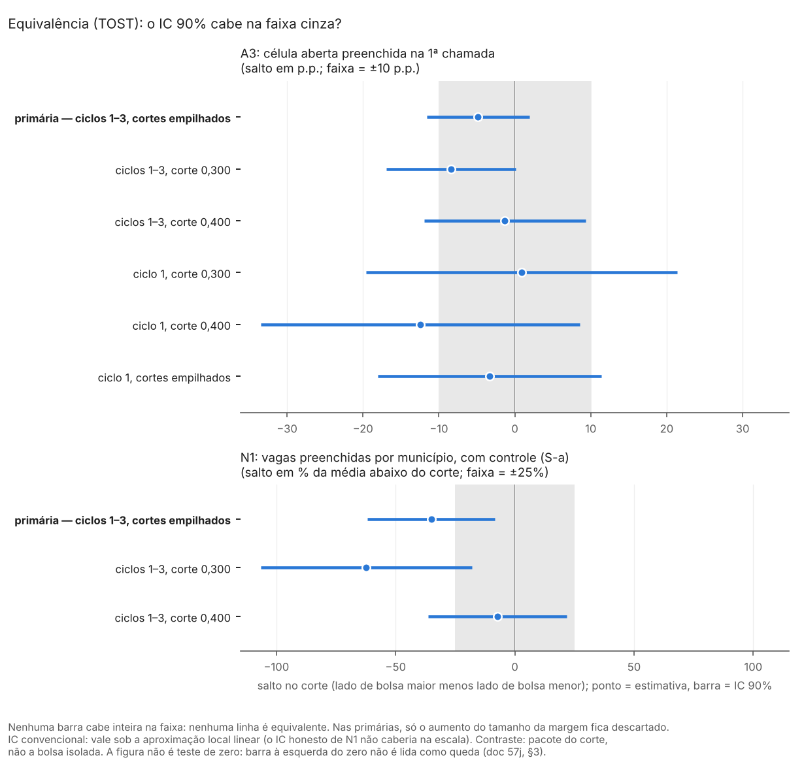

# 57j. Resultados do protocolo 60, parte A: equivalência no preenchimento (H1)

> **Gerado por** `scripts/rdd_bolsa/36_equivalencia_H1.py --atualizar-doc` a partir de `output/rdd_bolsa/EQ_*`; não editar à mão (o teste `tests/test_equivalencia_H1.py` confere que este arquivo é igual ao gerado).<br>
> **Protocolo:** [`60_protocolo_equivalencia_e_oferta_local.md`](60_protocolo_equivalencia_e_oferta_local.md), parte A, congelado em 26/10/2026 (commit `f47624f`) antes de calcular; estatuto `PROTOCOLO_60_POS_RESULTADO`.<br>
> **O que já tinha sido visto:** as estimativas pontuais e os IC 95% de A3 e N1 (docs 49 e 57). Pelos IC publicados, o resultado era previsível em boa parte; este bloco só faz o teste formal de equivalência com margens fixadas antes.<br>
> **Saídas:** `output/rdd_bolsa/EQ_estimativas.csv`, `EQ_resumo.json` e `EQ_figuras/EQ_tost_ic90.png`; toda linha tem `natureza_dos_dados = EMPIRICO`. Nada é reestimado e nenhuma saída anterior é regravada.

## 1. O que se testa

**Pergunta (H1).** Os dados permitem dizer que o salto no corte de IVS (0,300 e 0,400, lado de bolsa maior menos lado de bolsa menor) está dentro de uma margem pequena, nos dois sentidos? Ou só que não houve um aumento grande?

**Por que um teste novo.** Um IC 95% que contém zero não quer dizer "não mudou nada": quer dizer só que zero é compatível com os dados, como também podem ser valores grandes. O teste de equivalência (TOST, dois testes unilaterais) inverte a pergunta: a hipótese nula é "o salto é grande" e só se rejeita se os dados descartarem um salto grande.

**Margens** (protocolo 60, a partir das referências de magnitude do protocolo 40, §1 e §7):

| Outcome | O que mede | Margem de equivalência |
|---|---|---|
| A3 | probabilidade de a célula aberta ser preenchida na 1ª chamada (unidade: célula do quadro) | ±10 p.p. |
| N1 | vagas preenchidas na 1ª chamada por município, com controle linear das vagas oferecidas (S-a) | ±25% da média abaixo do corte na mesma amostra |

O protocolo 40, §7, dá duas referências: +10 p.p. de preenchimento e +25% de candidaturas. O protocolo 60 aplica os 25% às vagas preenchidas (N1); a margem de N1 é, portanto, escolha do protocolo 60, não uma referência que o protocolo 40 tenha dado para esse outcome.

**Os dois testes, a 5% cada:**
- **teste do aumento** — H0: o salto é +margem ou mais. Rejeitar quer dizer "não houve aumento do tamanho da margem ou mais";
- **teste da queda** — H0: o salto é −margem ou menos. Rejeitar quer dizer "não houve queda do tamanho da margem ou mais".

Rejeitar os dois equivale a o IC 90% inteiro ficar dentro da margem. A **margem mínima de equivalência** é o menor m tal que o IC 90% fica em [−m; +m]: diz o que os dados conseguem afirmar (descritiva).

**Linhas.** Primárias, com Holm entre as duas: A3 empilhado (ciclos 1–3, cortes empilhados) e N1 empilhado. Secundárias, sem ajuste: A3 por corte nos ciclos 1–3 e A3 no ciclo 1 (por corte e empilhado), que são as outras cinco linhas de preenchimento do doc 57, §4.2; N1 por corte. No ciclo 1, a faixa saiu depois do pedido dos gestores (doc 57, §4.2).

**Contas.** Com a estimativa τ̂ e o EP gravados pelo bloco (CR1 por município), p do aumento = Φ((τ̂ − m)/EP) e p da queda = Φ((−m − τ̂)/EP), pela normal, como o bloco calcula o p. O Holm é aplicado, entre as duas primárias, ao p de cada teste e ao p do TOST (o maior dos dois); as duas formas dão a mesma decisão de equivalência (conferido no script).

**IC honesto.** Onde o bloco gravou o IC honesto (Armstrong–Kolesár, regra do E6; só em N1), o TOST é refeito com o viés máximo B gravado: p do aumento = Φ((τ̂ − m + B)/EP) e p da queda = Φ((−m − τ̂ + B)/EP), e o IC 90% correspondente é τ̂ ∓ (B + 1,645·EP). A3 não tem IC honesto gravado.

**Leitura pré-registrada** (protocolo 60):

| Resultado do TOST | O que se pode dizer |
|---|---|
| os dois testes rejeitam | o salto está dentro de ±margem: "não mudou além de X", para o pacote do corte e sob a aproximação local linear |
| só o teste do aumento rejeita | "não houve aumento de X ou mais", mas uma queda de X não fica descartada |
| nenhum rejeita | inconclusivo |

O caso "só o teste da queda rejeita", que o protocolo não lista, é lido como o espelho: "não houve queda de X ou mais", mas um aumento de X não fica descartado.

**Conferência dos insumos.** Antes de calcular, o script confere que os valores lidos de `NA_estimativas.csv` e `N_estimativas.csv` reproduzem os números citados no doc 57 (as seis linhas de preenchimento de A3 do §4.2 e a linha de N1 do §4.1, onde o §4.2 não a traz), que o IC 95% e o p gravados são τ̂ ± 1,96·EP pela normal e que o IC honesto gravado se reconstrói do viés máximo e do EP. Se algo não conferir, o script para.

## 2. Tabela

Salto = lado de bolsa maior menos lado de bolsa menor. A3 em p.p.; N1 em vagas por município. "Aumento < margem?" é o teste do aumento (H0: salto ≥ +margem); "Queda < margem?" é o teste da queda (H0: salto ≤ −margem); "rejeita" é a 5%, com o p de Holm nas primárias e o p sem ajuste nas secundárias. Margem mínima = menor m com o IC 90% dentro de [−m; +m].

### 2.1 Primárias

<!-- EQ:primarias:inicio -->
| Outcome | Amostra | Média abaixo | Salto | EP | Margem | IC 90% | Aumento < margem? p (p Holm) | Queda < margem? p (p Holm) | Margem mínima | Leitura |
|---|---|---|---|---|---|---|---|---|---|---|
| A3 | ciclos 1–3, cortes empilhados | 34,7% | −4,9 p.p. | 4,1 | ±10 p.p. | [−11,6; +1,9] | < 0,001 (< 0,001) — rejeita | 0,105 (0,211) — não rejeita | 11,6 p.p. | só o aumento |
| N1 | ciclos 1–3, cortes empilhados | 2,16 | −0,76 | 0,35 | ±0,54 (25% de 2,16) | [−1,33; −0,18] | < 0,001 (< 0,001) — rejeita | 0,732 (0,732) — não rejeita | 1,33 (62% da média) | só o aumento |
<!-- EQ:primarias:fim -->

### 2.2 Secundárias

<!-- EQ:secundarias:inicio -->
| Outcome | Amostra | Média abaixo | Salto | EP | Margem | IC 90% | Aumento < margem? p (p Holm) | Queda < margem? p (p Holm) | Margem mínima | Leitura |
|---|---|---|---|---|---|---|---|---|---|---|
| A3 | ciclos 1–3, corte 0,300 | 33,3% | −8,4 p.p. | 5,2 | ±10 p.p. | [−16,9; +0,1] | < 0,001 — rejeita | 0,378 — não rejeita | 16,9 p.p. | só o aumento |
| A3 | ciclos 1–3, corte 0,400 | 36,8% | −1,3 p.p. | 6,5 | ±10 p.p. | [−11,9; +9,3] | 0,040 — rejeita | 0,089 — não rejeita | 11,9 p.p. | só o aumento |
| A3 | ciclo 1, corte 0,300 | 26,0% | +0,9 p.p. | 12,5 | ±10 p.p. | [−19,6; +21,4] | 0,233 — não rejeita | 0,190 — não rejeita | 21,4 p.p. | inconclusivo |
| A3 | ciclo 1, corte 0,400 | 37,2% | −12,4 p.p. | 12,8 | ±10 p.p. | [−33,5; +8,6] | 0,040 — rejeita | 0,576 — não rejeita | 33,5 p.p. | só o aumento |
| A3 | ciclo 1, cortes empilhados | 31,2% | −3,3 p.p. | 9,0 | ±10 p.p. | [−18,0; +11,4] | 0,069 — não rejeita | 0,227 — não rejeita | 18,0 p.p. | inconclusivo |
| N1 | ciclos 1–3, corte 0,300 | 2,32 | −1,45 | 0,63 | ±0,58 (25% de 2,32) | [−2,48; −0,42] | < 0,001 — rejeita | 0,917 — não rejeita | 2,48 (107% da média) | só o aumento |
| N1 | ciclos 1–3, corte 0,400 | 1,96 | −0,14 | 0,35 | ±0,49 (25% de 1,96) | [−0,71; +0,43] | 0,034 — rejeita | 0,159 — não rejeita | 0,71 (36% da média) | só o aumento |
<!-- EQ:secundarias:fim -->

### 2.3 TOST com o IC honesto (N1)

O bloco gravou quatro variantes do IC honesto de N1; a do protocolo 48 é a regra do E6 (a que vai na linha principal de `N_estimativas.csv`). As outras ficam como registro; a de suporte pós-resultado é POS_RESULTADO no bloco de origem.

<!-- EQ:honesto:inicio -->
| Amostra | IC honesto | Salto | EP | Viés máximo (B) | Margem | IC 90% (τ̂ ∓ (B + 1,645·EP)) | p aumento | p queda | Margem mínima | Leitura |
|---|---|---|---|---|---|---|---|---|---|---|
| ciclos 1–3, cortes empilhados | M da regra do E6 (o do bloco) | −0,76 | 0,35 | 78,25 | ±0,54 (25% de 2,16) | [−79,58; +78,07] | 1,000 | 1,000 | 79,58 (3.691% da média) | inconclusivo |
| ciclos 1–3, cortes empilhados | M × 0,5 | −0,76 | 0,35 | 39,13 | ±0,54 (25% de 2,16) | [−40,46; +38,94] | 1,000 | 1,000 | 40,46 (1.876% da média) | inconclusivo |
| ciclos 1–3, cortes empilhados | M × 2 | −0,76 | 0,35 | 156,50 | ±0,54 (25% de 2,16) | [−157,83; +156,32] | 1,000 | 1,000 | 157,83 (7.320% da média) | inconclusivo |
| ciclos 1–3, cortes empilhados | suporte pós-resultado | −0,76 | 0,35 | 7,48 | ±0,54 (25% de 2,16) | [−8,81; +7,30] | 1,000 | 1,000 | 8,81 (408% da média) | inconclusivo |
| ciclos 1–3, corte 0,300 | M da regra do E6 (o do bloco) | −1,45 | 0,63 | 87,76 | ±0,58 (25% de 2,32) | [−90,23; +87,34] | 1,000 | 1,000 | 90,23 (3.885% da média) | inconclusivo |
| ciclos 1–3, corte 0,300 | M × 0,5 | −1,45 | 0,63 | 43,88 | ±0,58 (25% de 2,32) | [−46,36; +43,46] | 1,000 | 1,000 | 46,36 (1.996% da média) | inconclusivo |
| ciclos 1–3, corte 0,300 | M × 2 | −1,45 | 0,63 | 175,52 | ±0,58 (25% de 2,32) | [−177,99; +175,10] | 1,000 | 1,000 | 177,99 (7.664% da média) | inconclusivo |
| ciclos 1–3, corte 0,300 | suporte pós-resultado | −1,45 | 0,63 | 6,65 | ±0,58 (25% de 2,32) | [−9,13; +6,23] | 1,000 | 1,000 | 9,13 (393% da média) | inconclusivo |
| ciclos 1–3, corte 0,400 | M da regra do E6 (o do bloco) | −0,14 | 0,35 | 46,36 | ±0,49 (25% de 1,96) | [−47,07; +46,79] | 1,000 | 1,000 | 47,07 (2.407% da média) | inconclusivo |
| ciclos 1–3, corte 0,400 | M × 0,5 | −0,14 | 0,35 | 23,18 | ±0,49 (25% de 1,96) | [−23,89; +23,61] | 1,000 | 1,000 | 23,89 (1.222% da média) | inconclusivo |
| ciclos 1–3, corte 0,400 | M × 2 | −0,14 | 0,35 | 92,71 | ±0,49 (25% de 1,96) | [−93,43; +93,14] | 1,000 | 1,000 | 93,43 (4.777% da média) | inconclusivo |
| ciclos 1–3, corte 0,400 | suporte pós-resultado | −0,14 | 0,35 | 6,70 | ±0,49 (25% de 1,96) | [−7,42; +7,13] | 1,000 | 1,000 | 7,42 (379% da média) | inconclusivo |
<!-- EQ:honesto:fim -->

<!-- EQ:conferencia:inicio -->
Resultado da conferência: 41 de 41 números do doc 57 reproduzidos na casa decimal publicada; IC 95% e p gravados iguais a τ̂ ± 1,96·EP pela normal e IC honesto gravado reconstruído do viés máximo e do EP (diferença ≤ 1e−6).
<!-- EQ:conferencia:fim -->

## 3. Leitura em linguagem simples

Pela leitura pré-registrada do protocolo 60.

<!-- EQ:leitura:inicio -->
**Primárias (Holm entre as duas).**

- **A3, preenchimento da célula aberta (ciclos 1–3, cortes empilhados):** salto −4,9 p.p., IC 90% [−11,6; +1,9], margem ±10 p.p., margem mínima de equivalência 11,6 p.p. — **leitura:** só o teste do aumento rejeita; não houve aumento de 10 p.p. ou mais (no IC convencional, sob a aproximação local linear e para o pacote do corte), mas uma queda de 10 p.p. não fica descartada.
- **N1, vagas preenchidas por município com controle das vagas oferecidas (ciclos 1–3, cortes empilhados):** salto −0,76 vaga por município, IC 90% [−1,33; −0,18], margem ±25% da média (0,54 vaga por município), margem mínima de equivalência 1,33 (62% da média) — **leitura:** só o teste do aumento rejeita; não houve aumento de 25% da média (0,54 vaga por município) ou mais (no IC convencional, sob a aproximação local linear e para o pacote do corte), mas uma queda de 25% da média (0,54 vaga por município) não fica descartada.
  - A estimativa pontual de N1 (−0,76, −35% da média) fica abaixo de −25%, e o IC 90% fica inteiro abaixo de zero (sem ajuste, o teste de zero do bloco dá p = 0,031). Isso não é lido como queda, por quatro motivos. (i) No teste de zero pré-registrado, N1 não rejeita depois do Holm da família N1–N4 (p de Holm 0,124); essa conclusão depende do coeficiente do controle por grupo, e com coeficiente único N1 rejeitaria (doc 49, §3). (ii) O IC honesto contém zero. (iii) O sinal vem em boa parte do corte de 0,300 no ciclo 2: ali o corte placebo do segmento acusa salto sem controle e fica no limiar com controle, e a reta local não capta a forma do outcome (doc 49, §3 e §9). (iv) É o pacote do corte. O teste da queda não rejeita: uma queda de 25% da média ou mais não fica descartada, mas também não fica demonstrada.

**Secundárias (sem ajuste).**

- **A3, ciclos 1–3, corte 0,300:** salto −8,4 p.p., IC 90% [−16,9; +0,1], margem ±10 p.p., margem mínima de equivalência 16,9 p.p. — **leitura:** só o teste do aumento rejeita; não houve aumento de 10 p.p. ou mais (no IC convencional, sob a aproximação local linear e para o pacote do corte), mas uma queda de 10 p.p. não fica descartada.
- **A3, ciclos 1–3, corte 0,400:** salto −1,3 p.p., IC 90% [−11,9; +9,3], margem ±10 p.p., margem mínima de equivalência 11,9 p.p. — **leitura:** só o teste do aumento rejeita; não houve aumento de 10 p.p. ou mais (no IC convencional, sob a aproximação local linear e para o pacote do corte), mas uma queda de 10 p.p. não fica descartada.
- **A3, ciclo 1, corte 0,300:** salto +0,9 p.p., IC 90% [−19,6; +21,4], margem ±10 p.p., margem mínima de equivalência 21,4 p.p. — **leitura:** nenhum teste rejeita; inconclusivo.
- **A3, ciclo 1, corte 0,400:** salto −12,4 p.p., IC 90% [−33,5; +8,6], margem ±10 p.p., margem mínima de equivalência 33,5 p.p. — **leitura:** só o teste do aumento rejeita; não houve aumento de 10 p.p. ou mais (no IC convencional, sob a aproximação local linear e para o pacote do corte), mas uma queda de 10 p.p. não fica descartada.
- **A3, ciclo 1, cortes empilhados:** salto −3,3 p.p., IC 90% [−18,0; +11,4], margem ±10 p.p., margem mínima de equivalência 18,0 p.p. — **leitura:** nenhum teste rejeita; inconclusivo.
- **N1, ciclos 1–3, corte 0,300:** salto −1,45 vaga por município, IC 90% [−2,48; −0,42], margem ±25% da média (0,58 vaga por município), margem mínima de equivalência 2,48 (107% da média) — **leitura:** só o teste do aumento rejeita; não houve aumento de 25% da média (0,58 vaga por município) ou mais (no IC convencional, sob a aproximação local linear e para o pacote do corte), mas uma queda de 25% da média (0,58 vaga por município) não fica descartada.
- **N1, ciclos 1–3, corte 0,400:** salto −0,14 vaga por município, IC 90% [−0,71; +0,43], margem ±25% da média (0,49 vaga por município), margem mínima de equivalência 0,71 (36% da média) — **leitura:** só o teste do aumento rejeita; não houve aumento de 25% da média (0,49 vaga por município) ou mais (no IC convencional, sob a aproximação local linear e para o pacote do corte), mas uma queda de 25% da média (0,49 vaga por município) não fica descartada.

**IC honesto (N1).** Com o viés máximo da regra do E6 gravado pelo bloco, nenhum dos dois testes rejeita em nenhuma das 3 linhas de N1: o viés máximo (B ≥ 46,4 vagas por município) já é maior que a margem, e nenhum IC honesto cabe nela. O doc 49 (§3, motivo ii) já registrava que esse IC é largo demais para informar. Ele não muda a leitura do IC convencional, mas mostra que ela vale sob a aproximação local linear. A3 não tem IC honesto gravado (o bloco não o calculou).

**Em uma frase.** Nenhuma linha mostra equivalência. Nas duas primárias, no IC convencional e sob a aproximação local linear, os dados descartam um aumento do tamanho das margens (+10 p.p. no preenchimento da célula; +25% da média nas vagas preenchidas; margens do protocolo 60): não houve aumento desse tamanho ou mais. Com o IC honesto de N1, nem isso se sustenta. E os dados não permitem dizer que "não mudou nada", porque uma queda do mesmo tamanho não fica descartada. É o pacote do corte, não a bolsa isolada, e nada aqui diz que a bolsa "funciona" ou "não funciona".
<!-- EQ:leitura:fim -->

## 4. Figura



**Como ler.**
- Cada linha é uma amostra. O ponto é o salto estimado no corte; a barra azul é o IC 90%.
- A faixa cinza é a margem de equivalência: ±10 p.p. em A3 (painel de cima) e ±25% da média abaixo do corte em N1 (painel de baixo; ali o salto e o IC estão divididos pela média abaixo do corte da mesma amostra, para que a faixa seja a mesma em todas as linhas).
- **Barra inteira dentro da faixa:** equivalência. Não mudou além da margem, para o pacote do corte e sob a aproximação local linear.
- **Barra que passa da faixa só do lado esquerdo:** não houve aumento do tamanho da margem ou mais (no IC convencional, sob a aproximação local linear e para o pacote do corte), mas uma queda desse tamanho não fica descartada.
- **Barra que passa da faixa só do lado direito:** o espelho: não houve queda do tamanho da margem ou mais, mas um aumento desse tamanho não fica descartado.
- **Barra que passa dos dois lados:** inconclusivo.
- **Barra inteira à esquerda do zero:** a figura não é teste de zero, e a barra é de 90%. Para N1, a seção 3 diz por que esse sinal não é lido como queda.
- A barra é o IC 90% (não o de 95% dos docs 49 e 57) porque cada um dos dois testes é a 5% num só sentido.
- As linhas em negrito são as primárias. A figura usa o IC convencional; o IC honesto de N1 é tão largo que não caberia na escala (tabela 2.3).

## 5. Limites

- **Pacote do corte.** Em 0,300 e 0,400 mudam também outras regras federais (auditoria 18). O salto mede o pacote: a bolsa anunciada maior e as outras regras juntas. Não é o efeito isolado dos R$ 5 mil nem da participação no PMM-E.
- **Aproximação local linear.** O IC convencional supõe que a reta local capta a forma do outcome perto do corte. O IC honesto, onde existe (N1), não permite afirmar equivalência nem descartar aumento: com o M da regra do E6, o viés máximo é muitas vezes a margem. A conclusão "não houve aumento de X ou mais" vale sob a aproximação local linear.
- **Pós-resultado.** As margens foram fixadas depois de ver as estimativas e os IC 95% (docs 49 e 57); o resultado era em boa parte previsível pelos IC publicados. O teste é formal, mas não é confirmatório.
- **Seleção.** A3 é condicional à célula aberta, e a abertura de vagas pode responder ao corte (doc 49, §15); N1 controla as vagas oferecidas, que são decididas antes do preenchimento.
- **Primeira chamada.** Preenchimento na 1ª chamada não é presença do médico, permanência nem oferta líquida local.
- **Linguagem.** Nenhum resultado aqui diz que a bolsa "funciona" ou "não funciona". "Não houve aumento de X ou mais" só vale onde o teste do aumento rejeita; equivalência só onde os dois testes rejeitam.

## 6. Proveniência e reprodução

<!-- EQ:proveniencia:inicio -->
| Arquivo | Papel | SHA-256 |
|---|---|---|
| `docs/06_execucao/60_protocolo_equivalencia_e_oferta_local.md` | protocolo congelado (parte A) | `4c7cb1d096805a01…` |
| `docs/06_execucao/40_protocolo_multioutcome_rdd_bolsa.md` | referências de magnitude (§7) | `85f11f309e033516…` |
| `output/rdd_bolsa/NA_estimativas.csv` | A3 (script 24, adendo §7 do protocolo 48) | `9f737d4c2a2850dd…` |
| `output/rdd_bolsa/N_estimativas.csv` | N1 S-a e IC honesto (script 23) | `3490d69c568ed13e…` |
| `docs/06_execucao/57_sintese_perguntas_reformuladas.md` | conferência dos números citados (§4.1 e §4.2) | `7597de65704e52e0…` |

Protocolo: SHA-256 do texto atual `4c7cb1d096805a01…`; do texto congelado (commit `f47624f`) `4c7cb1d096805a01…`.
<!-- EQ:proveniencia:fim -->

```
python3 scripts/rdd_bolsa/36_equivalencia_H1.py --atualizar-doc
python3 -m unittest tests/test_equivalencia_H1.py
```
