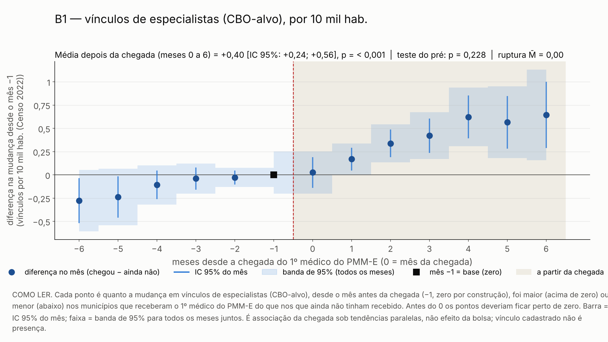
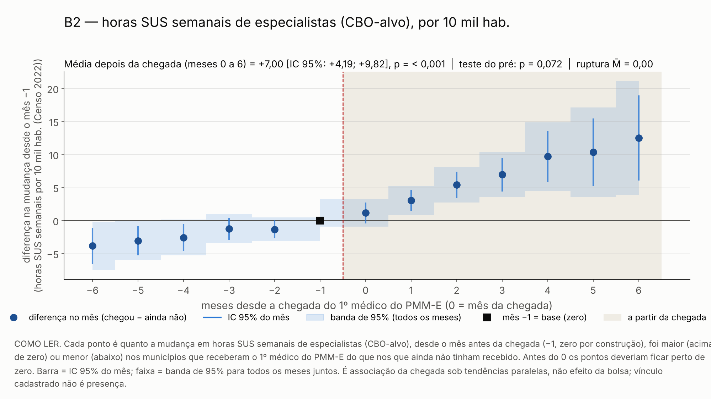
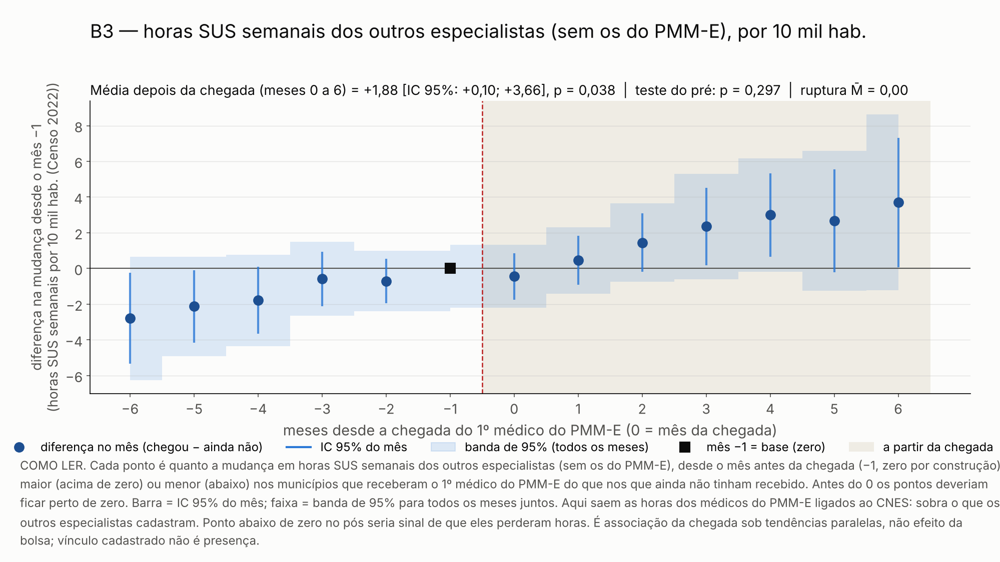

# 57k. Resultados do protocolo 60, parte B: oferta local de especialistas depois da chegada (H4)

> **Data:** 2026-10-26.<br>
> **Protocolo:** [`60_protocolo_equivalencia_e_oferta_local.md`](60_protocolo_equivalencia_e_oferta_local.md), parte B, congelado antes de qualquer conta.<br>
> **Script:** `scripts/rdd_bolsa/37_oferta_local_chegada.py`.<br>
> **Saídas:** `output/rdd_bolsa/OL_estimativas.csv`, `OL_ligacao_municipio.csv`, `OL_resumo.json` e `OL_figuras/`; toda linha tem `natureza_dos_dados = EMPIRICO`.<br>
> **Testes:** `tests/test_oferta_local_chegada.py`.<br>
> **Estatuto:** `PROTOCOLO_60_POS_RESULTADO`. ATT sob tendências paralelas da chegada; nada aqui tem fonte de exogeneidade validada.

Os blocos entre marcadores `<!-- OL:... -->` são gerados pelo script 37 a partir de `output/`
(`python3 scripts/rdd_bolsa/37_oferta_local_chegada.py --atualizar-doc`). Não edite esses blocos à mão.

## 1. O que se mede

**Pergunta.** Quando o 1º especialista do PMM-E começa no município, a oferta cadastrada de especialistas do
município sobe? E a dos outros especialistas, que não são do programa, cai?

- **Unidade:** município × mês, de 2024-06 a 2026-08. Nenhum mês ≥ 2026-09 é lido.
- **Tratamento:** o mês em que o 1º médico do PMM-E (lista nominal, ciclos 1 e 2) começa no município.
- **Comparação:** municípios que ofereceram célula em algum ciclo e ainda não tinham recebido médico do programa
  naquele mês (os do ciclo 3 entram até o início do ciclo 3).
- **Estimador:** Callaway–Sant'Anna, com o mês antes da chegada como base, de 6 meses antes a 6 meses depois;
  bootstrap de Mammen por município.
- **Outcomes**, por 10 mil habitantes (Censo 2022), no CNES nacional (a09), com as CBO-alvo dos cursos do PMM-E:

| Id | O que é | Papel |
|---|---|---|
| B1 | vínculos de especialistas nas CBO-alvo (o F3.1 do E7) | primária (Holm com B2) |
| B2 | horas SUS semanais nas CBO-alvo (o F3.3 do E7) | primária (Holm com B1) |
| B3 | B2 sem as horas SUS, em CBO-alvo, dos médicos do PMM-E ligados ao CNES em estabelecimento do município: os **outros** especialistas | secundária (BKY); teste de deslocamento |
| B4 | horas totais (SUS e não SUS) nas CBO-alvo | secundária (BKY) |
| B5 | vínculos de generalistas (placebo) | secundária (BKY) |

- **Diagnósticos:** teste conjunto do pré (Wald) e sensibilidade de Rambachan–Roth (Δ^RM) na média do pós, com
  o teste condicional e o híbrido.

O contraste é a **chegada** do médico ao município. Não é o efeito da bolsa, nem do incentivo marginal de
R$ 5 mil, nem da participação no PMM-E como política.

## 2. Amostra e coortes

<!-- OL:amostra:inicio -->
| Item | Valor |
|---|---|
| municípios de U com célula em algum ciclo (1 a 3) | 1039 |
| fora: tratados da lista nominal sem célula nos ciclos 1 ou 2 | 2 |
| amostra (municípios) | 1037 |
| tratados (1º médico dos ciclos 1 e 2 até 202608) | 315 |
| controles que saem no início registrado na lista de ativos (ciclo 3 ou fora da lista nominal) | 80 |
| nunca tratados no horizonte | 642 |
| controles que saem em 2025-09 | 1 |
| controles que saem em 2026-08 | 79 |
<!-- OL:amostra:fim -->

<!-- OL:coortes:inicio -->
| Coorte (mês da chegada) | Municípios |
|---|---|
| 2025-09 | 130 |
| 2025-10 | 4 |
| 2025-11 | 29 |
| 2025-12 | 1 |
| 2026-01 | 1 |
| 2026-03 | 46 |
| 2026-04 | 84 |
| 2026-06 | 20 |
<!-- OL:coortes:fim -->

## 3. Portões de coerência (antes de abrir resultados)

Os dois portões rodam antes de qualquer outcome por tempo de evento; se um deles falha, o script para sem gravar.

1. **Coortes:** as chegadas reproduzem as coortes do D2 (protocolo 47), com as mesmas datas e contagens.
2. **Definições:** B1 e B2 reproduzem o F3.1 e o F3.3 do E7 num mês do pré, município a município.

<!-- OL:portoes:inicio -->
| Portão | Conferência | Resultado |
|---|---|---|
| 1. coortes do D2 | coortes d2 refeitas iguais ao resumo | sim |
| 1. coortes do D2 | coortes deste bloco iguais ao d2 | sim |
| 1. coortes do D2 | mesmos municipios e meses de chegada | sim |
| 1. coortes do D2 | n tratados igual | sim |
| 1. coortes do D2 | fora da amostra igual | sim |
| 2. definições (202506) | B1 = F3.1 do E7: diferença máxima 0.0e+00 por 10 mil, ausentes iguais (0), total 417042 | sim |
| 2. definições (202506) | B2 = F3.3 do E7: diferença máxima 0.0e+00 por 10 mil, ausentes iguais (4), total 2719662 | sim |

| Coorte trimestral do D2 | D2 (municípios / especialistas) | Este bloco |
|---|---|---|
| 2025-07 | 130 / 894 | 130 / 894 |
| 2025-10 | 34 / 197 | 34 / 197 |
| 2026-01 | 47 / 150 | 47 / 150 |
| 2026-04 | 104 / 226 | 104 / 226 |
<!-- OL:portoes:fim -->

## 4. Leitura simples

<!-- OL:leitura:inicio -->
Depois que o 1º médico do PMM-E começou no município, em média nos meses 0 a 6: os vínculos de especialistas nas CBO-alvo (B1) ficaram maiores do que nos comparáveis, mas a ruptura M̄ fica abaixo de 1 (p de Holm = < 0,001); as horas SUS desses especialistas (B2) ficaram maiores do que nos comparáveis, mas a ruptura M̄ fica abaixo de 1 (p de Holm = < 0,001); as horas SUS dos outros especialistas, sem os do PMM-E (B3) ficaram maiores do que nos comparáveis, mas a ruptura M̄ fica abaixo de 1 (q BKY = 0,040); as horas totais, SUS e não SUS (B4) ficaram maiores do que nos comparáveis, mas a ruptura M̄ fica abaixo de 1 (q BKY = 0,001); os vínculos de generalistas, o placebo (B5) não se distinguem das dos comparáveis (q BKY = 0,128). Pela leitura pré-registrada, não dá para falar em aumento da oferta cadastrada local: nenhuma primária sobe com pré que passa e ruptura M̄ ≥ 1. B3 fica acima do comparável, o contrário de um deslocamento. Em B2 (condicional: M̄ = 0,5); B2 (hibrido: M̄ = 0,5), o IC robusto exclui zero em algum M̄ > 0 da grade, embora inclua zero em M̄ = 0: o teste de Andrews, Roth e Pakes não é monotônico em M̄ (doc 57h). A ruptura fica 0, como a biblioteca do protocolo 59 a define; em M̄ = 1 o IC inclui zero em todos eles. Tudo é ATT sob tendências paralelas da chegada, não efeito da bolsa nem da participação no programa; vínculo cadastrado não é presença.
<!-- OL:leitura:fim -->

Leitura pré-registrada (protocolo 60, parte B):

| Se | Leitura |
|---|---|
| B1 ou B2 sobe, com pré que passa e ruptura M̄ ≥ 1 | associação da chegada com mais oferta cadastrada local |
| B3 cai | sinal de deslocamento dos outros especialistas |
| B3 não se distingue de zero e B2 sobe | o ganho vem dos médicos do programa, sem deslocamento detectável |

Como as regras foram aplicadas: "sobe" quer dizer ATT médio do pós positivo com p de Holm < 0,05 (B1 e B2);
"pré que passa", p do Wald do pré ≥ 0,05; "ruptura M̄ ≥ 1", ponto de ruptura de Δ^RM ≥ 1 no teste condicional
**e** no híbrido. "B3 cai" quer dizer ATT negativo com q BKY < 0,05.

## 5. Tabelas

### 5.1 ATT médio do pós, pré e sensibilidade

Unidades: B1 e B5 em vínculos por 10 mil hab.; B2 e B3 em horas SUS semanais por 10 mil hab.; B4 em horas
semanais por 10 mil hab. "Ruptura M̄ = x": o IC robusto exclui zero enquanto a variação do viés entre meses
consecutivos do pós não passa de x vezes a maior variação vista no pré.

<!-- OL:principal:inicio -->
| Id | Outcome | Papel | ATT médio do pós (e = 0..6) | IC 95% (bootstrap) | p | p Holm / q BKY | Pré: Wald (gl), p | Ruptura M̄ (cond. / híbr.) |
|---|---|---|---|---|---|---|---|---|
| B1 | vínculos nas CBO-alvo | primaria | +0,40 | [+0,24; +0,56] | < 0,001 | < 0,001 (Holm) | 6,9 (5), 0,228 | 0,00 / 0,00 |
| B2 | horas SUS semanais nas CBO-alvo | primaria | +7,00 | [+4,19; +9,82] | < 0,001 | < 0,001 (Holm) | 10,1 (5), 0,072 | 0,00 / 0,00 |
| B3 | horas SUS semanais nas CBO-alvo sem as dos médicos do PMM-E ligados (os outros especialistas) | secundaria | +1,88 | [+0,10; +3,66] | 0,038 | 0,040 (BKY) | 6,1 (5), 0,297 | 0,00 / 0,00 |
| B4 | horas totais (SUS e não SUS; ambulatorial, hospitalar e outras) nas CBO-alvo | secundaria | +7,27 | [+4,47; +10,06] | < 0,001 | 0,001 (BKY) | 8,8 (5), 0,117 | 0,61 / 0,60 |
| B5 | placebo: vínculos de generalistas (225125, 225142, 225170) | secundaria (placebo) | −0,13 | [−0,39; +0,13] | 0,339 | 0,128 (BKY) | 1,9 (5), 0,859 | 0,00 / 0,00 |
<!-- OL:principal:fim -->

### 5.2 Rambachan–Roth (Δ^RM), IC robusto de 95% da média do pós

<!-- OL:rr:inicio -->
| Id | Método | M̄ = 0,0 | M̄ = 0,5 | M̄ = 1,0 | M̄ = 1,5 | M̄ = 2,0 |
|---|---|---|---|---|---|---|
| B1 | condicional | [−0,20; +1,02] | [−0,10; +0,93] | [−0,55; +1,38] | [−1,02; +1,85] | [−1,49; +2,32] |
| B1 | hibrido | [−0,20; +1,02] | [−0,10; +0,93] | [−0,56; +1,40] | [−1,03; +1,87] | [−1,50; +2,34] |
| B2 | condicional | [−0,25; +14,54] | [+0,74; +13,02] | [−4,09; +17,59] | [−9,12; +22,60] | [−14,23; +27,70] |
| B2 | hibrido | [−0,22; +14,40] | [+0,63; +13,12] | [−4,24; +17,74] | [−9,27; +22,75] | [−14,36; +27,83] |
| B3 | condicional | [−3,08; +6,39] | [−3,54; +6,87] | [−8,16; +11,43] | [−12,87; +16,14] | [−17,62; +20,88] |
| B3 | hibrido | [−3,11; +6,40] | [−3,63; +6,95] | [−8,27; +11,55] | [−13,06; +16,32] | [−17,83; +21,08] |
| B4 | condicional | [+0,62; +14,07] | [+1,05; +13,15] | [−3,73; +17,86] | [−8,73; +22,84] | [−13,80; +27,91] |
| B4 | hibrido | [+0,58; +14,11] | [+0,95; +13,24] | [−3,88; +18,01] | [−8,89; +23,00] | [−13,94; +28,05] |
| B5 | condicional | [−0,56; +0,35] | [−0,55; +0,33] | [−0,83; +0,63] | [−1,16; +0,96] | [−1,49; +1,29] |
| B5 | hibrido | [−0,57; +0,35] | [−0,55; +0,34] | [−0,84; +0,65] | [−1,17; +0,97] | [−1,50; +1,31] |
<!-- OL:rr:fim -->

### 5.3 Estudo de evento, θ(e) e IC 95% (bootstrap)

<!-- OL:evento:inicio -->
| e | B1 | B2 | B3 | B4 | B5 |
|---|---|---|---|---|---|
| -6 | −0,28 [−0,52; −0,04] | −3,84 [−6,57; −1,11] | −2,80 [−5,34; −0,25] | −3,60 [−6,40; −0,80] | −0,07 [−0,40; +0,26] |
| -5 | −0,24 [−0,46; −0,02] | −3,09 [−5,28; −0,89] | −2,13 [−4,17; −0,09] | −2,56 [−4,88; −0,24] | −0,01 [−0,32; +0,29] |
| -4 | −0,11 [−0,26; +0,05] | −2,58 [−4,59; −0,56] | −1,79 [−3,67; +0,10] | −2,01 [−4,04; +0,02] | −0,00 [−0,25; +0,25] |
| -3 | −0,04 [−0,16; +0,08] | −1,25 [−2,90; +0,40] | −0,58 [−2,10; +0,94] | −0,73 [−2,37; +0,91] | +0,05 [−0,13; +0,24] |
| -2 | −0,03 [−0,10; +0,05] | −1,35 [−2,70; +0,01] | −0,70 [−1,94; +0,53] | −1,09 [−2,38; +0,20] | +0,05 [−0,07; +0,16] |
| -1 | 0 (base) | 0 (base) | 0 (base) | 0 (base) | 0 (base) |
| 0 | +0,02 [−0,14; +0,19] | +1,13 [−0,43; +2,70] | −0,44 [−1,74; +0,86] | +1,51 [−0,14; +3,15] | −0,08 [−0,23; +0,07] |
| 1 | +0,17 [+0,05; +0,29] | +3,03 [+1,41; +4,66] | +0,45 [−0,92; +1,82] | +3,15 [+1,52; +4,79] | −0,07 [−0,25; +0,11] |
| 2 | +0,34 [+0,19; +0,49] | +5,40 [+3,40; +7,40] | +1,45 [−0,17; +3,08] | +5,76 [+3,72; +7,79] | −0,06 [−0,30; +0,19] |
| 3 | +0,42 [+0,24; +0,61] | +6,94 [+4,40; +9,48] | +2,35 [+0,18; +4,52] | +7,11 [+4,58; +9,65] | −0,15 [−0,44; +0,15] |
| 4 | +0,62 [+0,39; +0,85] | +9,69 [+5,81; +13,56] | +3,00 [+0,66; +5,33] | +10,23 [+6,37; +14,09] | −0,04 [−0,40; +0,32] |
| 5 | +0,56 [+0,28; +0,85] | +10,34 [+5,25; +15,42] | +2,67 [−0,21; +5,54] | +10,55 [+5,38; +15,71] | −0,22 [−0,65; +0,21] |
| 6 | +0,64 [+0,29; +1,00] | +12,49 [+6,05; +18,93] | +3,70 [+0,08; +7,32] | +12,55 [+6,20; +18,91] | −0,28 [−0,77; +0,22] |
<!-- OL:evento:fim -->

### 5.4 Ligação dos médicos do PMM-E ao CNES (B3)

Só as horas dos médicos ligados ao CNES (a16, regra D1 da X1) são subtraídas. Médico não ligado não é
subtraído nem imputado: na proporção dos não ligados, o B3 superestima as horas dos outros especialistas.
Por município: `output/rdd_bolsa/OL_ligacao_municipio.csv`.

<!-- OL:ligacao:inicio -->
| Item | Valor |
|---|---|
| municípios tratados | 315 |
| tratados sem registro da X1 dos ciclos 1-2 com posto no município | 0 |
| registros da X1 (ciclos 1-2) com posto nos tratados / não ligados | 1479 / 84 (5,7%) |
| municípios com algum não ligado / com todos não ligados | 53 / 10 |
| fração de não ligados por município: média / mediana / p90 / máx. | 6,7% / 0,0% / 20,0% / 100,0% |
| parcela das horas SUS das CBO-alvo subtraída, agregada: pré (e = −6..−1) / pós (e = 0..6) | 2,7% / 3,2% |
| parcela subtraída por município, pré: média / mediana / p90 / máx. | 6,7% / 2,9% / 18,2% / 100,0% |
| parcela subtraída por município, pós: média / mediana / p90 / máx. | 10,0% / 5,7% / 23,7% / 100,0% |
| vínculos ligados SUS em CBO-alvo com hora em branco (B3 ausente no mês) | 0 |
<!-- OL:ligacao:fim -->

## 6. Figuras

<!-- OL:figuras:inicio -->
**B1.** 

Como ler: Cada ponto é quanto a mudança em vínculos de especialistas (CBO-alvo), desde o mês antes da chegada (−1, zero por construção), foi maior (acima de zero) ou menor (abaixo) nos municípios que receberam o 1º médico do PMM-E do que nos que ainda não tinham recebido. Antes do 0 os pontos deveriam ficar perto de zero. Barra = IC 95% do mês; faixa = banda de 95% para todos os meses juntos. É associação da chegada sob tendências paralelas, não efeito da bolsa; vínculo cadastrado não é presença.

**B2.** 

Como ler: Cada ponto é quanto a mudança em horas SUS semanais de especialistas (CBO-alvo), desde o mês antes da chegada (−1, zero por construção), foi maior (acima de zero) ou menor (abaixo) nos municípios que receberam o 1º médico do PMM-E do que nos que ainda não tinham recebido. Antes do 0 os pontos deveriam ficar perto de zero. Barra = IC 95% do mês; faixa = banda de 95% para todos os meses juntos. É associação da chegada sob tendências paralelas, não efeito da bolsa; vínculo cadastrado não é presença.

**B3.** 

Como ler: Cada ponto é quanto a mudança em horas SUS semanais dos outros especialistas (sem os do PMM-E), desde o mês antes da chegada (−1, zero por construção), foi maior (acima de zero) ou menor (abaixo) nos municípios que receberam o 1º médico do PMM-E do que nos que ainda não tinham recebido. Antes do 0 os pontos deveriam ficar perto de zero. Barra = IC 95% do mês; faixa = banda de 95% para todos os meses juntos. Aqui saem as horas dos médicos do PMM-E ligados ao CNES: sobra o que os outros especialistas cadastram. Ponto abaixo de zero no pós seria sinal de que eles perderam horas. É associação da chegada sob tendências paralelas, não efeito da bolsa; vínculo cadastrado não é presença.
<!-- OL:figuras:fim -->

## 7. Limites

- **Vínculo cadastrado não é presença.** O CNES registra vínculo e carga horária declarada; não mede se o
  médico está no município nem quanto atende.
- **ATT sob tendências paralelas da chegada, não efeito da bolsa.** O contraste compara municípios que
  receberam o 1º médico do PMM-E com os que ainda não tinham recebido. Não identifica o incentivo marginal de
  R$ 5 mil nem a participação no programa como política.
- **Seleção da chegada.** Quem escolhe o município é o candidato, e as vagas abertas dependem do pedido do
  município. Os municípios que recebem médico mais cedo podem diferir dos outros por motivos que também mudam
  a oferta. O teste do pré e a sensibilidade de Rambachan–Roth medem parte desse risco, não o eliminam.
- **Lista nominal como retrato.** A lista traz quem estava ativo em 12/08/2026. Quem saiu antes some, e o
  município pode contar como ainda não tratado.
- **B3 e a ligação.** O B3 só tira os médicos ligados. Na proporção dos não ligados (seção 5.4), ele
  superestima os outros especialistas e fica mais perto de B2.
- **Composição do pós.** O mês 6 depois da chegada só existe para as coortes que chegaram até 2026-02, e o
  mês 4 para as que chegaram até 2026-04; a média do pós mistura coortes diferentes em cada mês.

## 8. Desvios e esclarecimentos datados

Nenhum desvio mudou o protocolo. Os esclarecimentos abaixo foram fixados antes de abrir os resultados por tempo
de evento.

<!-- OL:desvios:inicio -->
| Data | Tipo | Item | Descrição |
|---|---|---|---|
| 2026-10-26 | esclarecimento | coorte mensal | o protocolo 60 fixa o mês de início do 1º médico como tratamento; o D2 agrupava as chegadas em trimestres. Aqui g = mês da chegada (base g − 1 = mês anterior à chegada). O portão de coortes leva as chegadas mensais ao trimestre pela regra do D2 e confere datas e contagens. |
| 2026-10-26 | esclarecimento | amostra | U (IVS oficial a08 e população 2022 > 0) com célula em algum ciclo (1 a 3). Município da lista nominal sem célula nos ciclos 1 ou 2 (fora da amostra do D2) não é coorte do D2 nem pode ser controle, porque recebeu médico: fica fora e é contado no resumo. |
| 2026-10-26 | esclarecimento | ciclo 3 nos controles | a lista de ativos de 11/09/2026 (só ciclo, co_ibge e dt_inicio_atividade lidos) mostra o início do ciclo 3 em 202608 (e 202609). O município sem chegada dos ciclos 1 e 2 na lista nominal deixa de ser controle a partir do 1º início registrado na lista de ativos, de qualquer ciclo, e não forma coorte (protocolo: controles 'inclusive o ciclo 3 antes do início'). |
| 2026-10-26 | esclarecimento | B3: quem é subtraído | subtraem-se, em todos os meses, as horas SUS (ambulatorial + hospitalar, TP_SUS_NAO_SUS = 'S') em CBO-alvo dos médicos do PMM-E ligados ao CNES pela regra D1 da X1 (ciclos 1 a 3), nos vínculos em estabelecimento do próprio município da unidade. O conjunto de pessoas é fixo: subtrair só depois do início criaria uma queda mecânica igual às horas que o médico já tinha no município antes de entrar no programa (45-51% já estavam lá, X1). Médico não ligado não é subtraído (nada é imputado); vínculo ligado com hora em branco deixa B3 ausente naquele mês. |
| 2026-10-26 | esclarecimento | B4 | coluna horas_totais do a09: ambulatorial + hospitalar + outras, todos os vínculos (SUS e não SUS) das CBO-alvo; ausente se algum vínculo tem campo de hora em branco. |
| 2026-10-26 | esclarecimento | regras de leitura | 'sobe' = ATT médio do pós > 0 com p de Holm < 0,05 (B1, B2); 'pré passa' = p do Wald do pré >= 0,05; 'ruptura >= 1' = ponto de ruptura de Δ^RM >= 1 no teste condicional e no híbrido. 'B3 cai' = ATT < 0 com q BKY < 0,05; 'B3 não se distingue de zero' = q BKY >= 0,05. |
| 2026-10-26 | esclarecimento | Rambachan-Roth | β = θ(e) de e = −6..−2 (5 do pré) e 0..6 (7 do pós); Σ = covariância analítica das funções de influência (IF'IF/N²), como no protocolo 59; alvo = média do pós. Ruptura por bisseção em M̄ ∈ [0; 4], tolerância 0,01. |
<!-- OL:desvios:fim -->

## 9. Reprodução

```bash
python3 scripts/rdd_bolsa/37_oferta_local_chegada.py
python3 scripts/rdd_bolsa/37_oferta_local_chegada.py --atualizar-doc
python3 -m pytest tests/test_oferta_local_chegada.py
```
