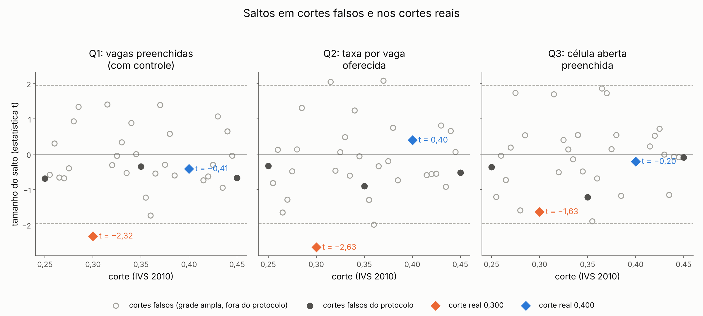
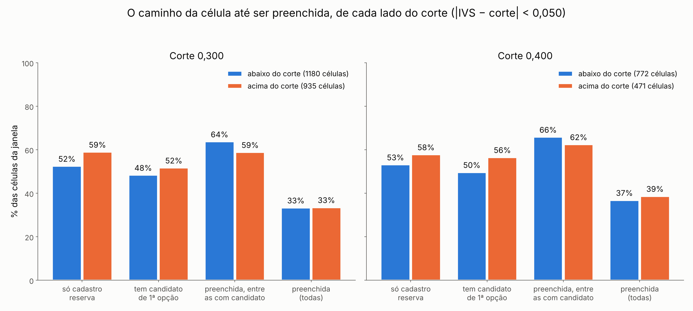

# 57l. Por que o preenchimento cai no corte 0,300? (diagnóstico, protocolo 61)

> **Data:** 26/10/2026. 
> **Protocolo:** [`61_protocolo_diagnostico_queda_0300.md`](61_protocolo_diagnostico_queda_0300.md), congelado antes de
> qualquer conta (SHA-256 em `protocolo` de `DQ_resumo.json`). 
> **Estatuto:** `DIAGNOSTICO_61_POS_RESULTADO`. Diagnóstico **descritivo e pós-resultado**: nada aqui vira especificação principal nem
> muda o Holm ou a leitura dos protocolos 40 e 48. Toda linha de `DQ_estimativas.csv` tem
> `natureza_dos_dados = EMPIRICO`. 
> **Contraste:** o **pacote do corte** — em 0,300 a bolsa anunciada sobe de R$ 10 mil para R$ 15 mil, mas outras regras
> federais mudam no mesmo corte ([auditoria 18](../auditorias/18_politicas_nos_mesmos_cortes_ivs.md)). Nada aqui é
> efeito da bolsa sozinha, da participação no PMM-E ou do Agora Tem Especialistas. 
> **Script:** `scripts/rdd_bolsa/38_diagnostico_queda_0300.py`. **Saídas:** `output/rdd_bolsa/DQ_estimativas.csv`,
> `DQ_resumo.json`, `DQ_figuras/`. **Testes:** `tests/test_diagnostico_queda_0300.py`. 
> **Números:** nenhum é digitado. Os blocos entre marcadores `<!-- DQ:... -->` são regravados das saídas por
> `38_diagnostico_queda_0300.py --atualizar-doc`; o teste confere que o documento é idêntico ao gerado.

## 1. Resposta curta

<!-- DQ:resposta_curta:inicio -->
**O que cai.** Em 0,300, com os ciclos 1–3 juntos, o lado de bolsa maior tem −1,45 vaga preenchida por município, dadas as vagas oferecidas (Q1, IC 95% [−2,67; −0,22]); a taxa por vaga oferecida é −16,0 p.p. (Q2, IC [−27,9; −4,1]); a chance de uma célula aberta ser preenchida é −8,4 p.p. (Q3, IC [−18,5; +1,7], que contém zero). Em 0,400 nada disso aparece (Q1 −0,14, Q2 +2,5 p.p., Q3 −1,3 p.p.).

**Acaso.** A regra pré-registrada dá apoio ao acaso (p por posto = Q1 0,250, Q2 0,250, Q3 0,250), mas esse teste não podia dar outra coisa: a grade do protocolo deixa só 3 cortes falsos, e o menor p possível é 0,250. Numa grade maior, fora do protocolo (31 cortes falsos), a queda de Q1 e de Q2 fica entre as maiores (p por posto Q1 0,031, Q2 0,031), e a de Q3 não se destaca (p por posto Q3 0,188). Comparando só os municípios a até 0,010 do corte (randomização local), p = Q1 0,017, Q2 0,018, Q3 0,086; a até 0,020, p = Q1 0,154, Q2 0,218, Q3 0,781. Acaso não fica descartado nem confirmado.

**Sem a reta.** Nas células da janela inteira (|IVS − corte| < 0,050), sem reta nem efeitos fixos, a fração preenchida é 33,3% abaixo e 33,5% acima de 0,300 (figura do funil): a queda aparece quando a reta de cada lado é levada até o corte, e depende de poucos municípios perto dele (doc 49b, §6).

**O que acompanha a queda (descritivo).** Acima de 0,300, a parte das células que são só de cadastro reserva é +15,4 p.p. maior (IC [+2,1; +28,6]) e as células são de cursos que preenchem 4,5 p.p. menos fora da janela (índice de curso −4,5 p.p., IC [−7,1; −2,0]); em 0,400, +11,3 p.p. e +0,5 p.p.; o excesso de células só de CR aparece também em 0,400, onde não há queda, e por isso não explica sozinho a queda em 0,300. No funil, a chance de a célula ter um candidato de 1ª opção muda −10,8 p.p. (IC [−28,2; +6,7]), e a de ser preenchida quando tem esse candidato muda +0,8 p.p. (IC [−7,1; +8,6]). No ciclo 2, a queda da taxa vai de −27,8 p.p. para −12,9 p.p. sem as células só de CR, que nesse ciclo não foram preenchidas na 1ª chamada. Igualar um fator entre os lados reduz a queda em 0,300 pela metade ou mais em: D-b composição (Q2); D-b sem as células só de CR (Q3); D-c funil (Q1, Q3); D-d concorrência (Q2, Q3).

**O que não explica.** Médicos por perto (D-e): nenhuma medida salta no corte e igualá-las não reduz a queda pela metade. Outras políticas (D-g) não têm teste causal; no balanço pré, salta só vínculos SUS pré por 10 mil hab. (U), e a única regra federal da auditoria 18 que muda em 0,300 e não em 0,400 é o acréscimo de 20% no teto de emendas e de parcelas de custeio da APS e da MAC.

**Leitura pré-registrada.** Pela regra do §3, a explicação principal é acaso mais poucos municípios, e as demais viram descrição; mas, como o teste de acaso não podia reprovar, essa leitura vale como 'acaso não descartado', não como 'acaso demonstrado'.

**Para dizer na banca.** "Em 0,300 o preenchimento estimado no corte cai, mas os dados só descrevem a queda. No corte, o lado de cima tinha mais células de cursos que preenchem pouco em qualquer lugar e mais células do mesmo curso na mesma UF; menos células desse lado tiveram candidato de 1ª opção (estimativa imprecisa); e no ciclo 2, em que vaga de reserva não podia ser preenchida na 1ª chamada, mais células desse lado eram só de reserva. Igualando esses fatores entre os lados, a queda diminui pela metade ou mais em parte das medidas, nenhum fator nas três. A queda aparece quando a reta de cada lado é levada até o corte (nas médias da janela, 33% das células preenchidas abaixo e 33% acima), e acaso não está descartado. Nada disso mostra que a bolsa reduz o preenchimento: o corte junta a bolsa com outras regras."
<!-- DQ:resposta_curta:fim -->

## 2. O que se quer explicar (reprodução de Q1–Q3)

Antes de qualquer teste, o script refaz Q1, Q2 e Q3 com as especificações e as entradas dos protocolos 48 (§3, §7) e do ND, e para se não baterem com `N_estimativas.csv`, `NA_estimativas.csv` e `ND_estimativas.csv`. Local linear, kernel triangular, h = 0,050, uma reta de cada lado por ciclo, salto comum, CR1 por município.

<!-- DQ:reproducao:inicio -->
| Corte | Q | Definição | municípios abaixo / acima | Salto | IC 95% | p | Alvo (N/NA/ND) | maior diferença (salto e EP) |
|---|---|---|---|---|---|---|---|---|
| 0,300 | Q1 | N1 com o controle das vagas oferecidas (S-a) | 145 / 120 | −1,45 | [−2,67; −0,22] | 0,021 | −1,45 | 0,0e+00 |
| 0,300 | Q2 | taxa N1 / vagas oferecidas | 145 / 120 | −16,0 p.p. | [−27,9; −4,1] | 0,008 | −16,0 p.p. | 5,6e−17 |
| 0,300 | Q3 | A3: celula aberta preenchida | 145 / 120 | −8,4 p.p. | [−18,5; +1,7] | 0,104 | −8,4 p.p. | 6,9e−17 |
| 0,400 | Q1 | N1 com o controle das vagas oferecidas (S-a) | 122 / 145 | −0,14 | [−0,82; +0,54] | 0,682 | −0,14 | 0,0e+00 |
| 0,400 | Q2 | taxa N1 / vagas oferecidas | 122 / 145 | +2,5 p.p. | [−9,9; +15,0] | 0,689 | +2,5 p.p. | 5,6e−17 |
| 0,400 | Q3 | A3: celula aberta preenchida | 122 / 145 | −1,3 p.p. | [−14,0; +11,3] | 0,838 | −1,3 p.p. | 4,3e−17 |

Conferência: 10 comparações, maior diferença 6,9e−17 (tolerância 1e−9).
<!-- DQ:reproducao:fim -->

## 3. D-a — acaso

**Teste do protocolo.** Cortes placebo de 0,250 a 0,450, passo 0,005, sem os pontos a menos de h = 0,050 dos cortes reais, com a mesma especificação de Q1, Q2 e Q3; posição do salto real entre os placebos (p por posto) e fração com |t| > 1,96. Apoio se p por posto > 0,10.

<!-- DQ:da_placebos:inicio -->
| Q | Corte real | t do salto real | cortes falsos | p por posto | menor p possível | cortes falsos com |t| > 1,96 |
|---|---|---|---|---|---|---|
| Q1 | 0,300 | −2,32 | 3 | 0,250 | 0,250 | 0,0% |
| Q1 | 0,400 | −0,41 | 3 | 0,750 | 0,250 | 0,0% |
| Q2 | 0,300 | −2,63 | 3 | 0,250 | 0,250 | 0,0% |
| Q2 | 0,400 | +0,40 | 3 | 0,750 | 0,250 | 0,0% |
| Q3 | 0,300 | −1,63 | 3 | 0,250 | 0,250 | 0,0% |
| Q3 | 0,400 | −0,20 | 3 | 0,750 | 0,250 | 0,0% |

| Q | Corte falso | Salto | t | municípios abaixo / acima |
|---|---|---|---|---|
| Q1 | 0,250 | −0,32 | −0,69 | 146 / 143 |
| Q1 | 0,350 | −0,19 | −0,34 | 123 / 117 |
| Q1 | 0,450 | −0,21 | −0,67 | 146 / 85 |
| Q2 | 0,250 | −2,0 p.p. | −0,33 | 146 / 143 |
| Q2 | 0,350 | −5,8 p.p. | −0,90 | 123 / 117 |
| Q2 | 0,450 | −4,8 p.p. | −0,52 | 146 / 85 |
| Q3 | 0,250 | −2,2 p.p. | −0,36 | 146 / 143 |
| Q3 | 0,350 | −7,9 p.p. | −1,21 | 123 / 117 |
| Q3 | 0,450 | −0,9 p.p. | −0,09 | 146 / 85 |
<!-- DQ:da_placebos:fim -->

<!-- DQ:da_ressalva:inicio -->
**Ressalva (desvio datado, 26/10/2026).** A regra de exclusão deixa só 3 cortes placebo (0,250, 0,350, 0,450). Com 3 placebos o menor p por posto possível é 0,250, maior que 0,10: o critério de apoio é cumprido por construção e não informa se o salto se destaca. O protocolo não muda; a leitura literal é relatada e, ao lado dela, uma grade complementar **fora do protocolo** (rótulo `COMPLEMENTAR_FORA_DO_PROTOCOLO_61`): mesmos cortes de 0,250 a 0,450 a mais de 0,010 dos cortes reais, usando só as observações do mesmo segmento de bolsa do corte falso, como o S-i do protocolo 48 (a janela nunca atravessa 0,300 nem 0,400). Nessa grade, cortes falsos vizinhos compartilham quase todos os municípios e, perto dos cortes reais, a janela fica truncada de um lado, enquanto o salto real usa a janela inteira: o p por posto dela é indicativo, não um teste (nota da auditoria 33).
<!-- DQ:da_ressalva:fim -->

<!-- DQ:da_complementar:inicio -->
| Q | Corte real | t do salto real | cortes falsos | p por posto | menor p possível | cortes falsos com |t| > 1,96 |
|---|---|---|---|---|---|---|
| Q1 | 0,300 | −2,32 | 31 | 0,031 | 0,031 | 0,0% |
| Q1 | 0,400 | −0,41 | 31 | 0,688 | 0,031 | 0,0% |
| Q2 | 0,300 | −2,63 | 31 | 0,031 | 0,031 | 9,7% |
| Q2 | 0,400 | +0,40 | 31 | 0,750 | 0,031 | 9,7% |
| Q3 | 0,300 | −1,63 | 31 | 0,188 | 0,031 | 0,0% |
| Q3 | 0,400 | −0,20 | 31 | 0,719 | 0,031 | 0,0% |
<!-- DQ:da_complementar:fim -->

**Randomização local (Fisher).** Janelas ±0,010 e ±0,020, 999 permutações, semente 20261026. O lado do corte é sorteado entre os municípios da janela (todas as linhas de ciclo do município andam juntas); a estatística é o coeficiente do lado de cima numa regressão com intercepto por ciclo (Q1: e vagas oferecidas por ciclo; Q2: peso = vagas oferecidas; Q3: efeitos fixos de curso × ciclo e tipo de vaga).

<!-- DQ:da_fisher:inicio -->
| Q | Corte | Janela | municípios abaixo / acima | Diferença ajustada | p de Fisher | q BKY (D-a) |
|---|---|---|---|---|---|---|
| Q1 | 0,300 | ±0,010 | 27 / 28 | −1,62 | 0,017 | 0,122 |
| Q1 | 0,300 | ±0,020 | 54 / 49 | −0,82 | 0,154 | 0,531 |
| Q1 | 0,400 | ±0,010 | 29 / 28 | +0,04 | 0,922 | 1,000 |
| Q1 | 0,400 | ±0,020 | 52 / 58 | +0,06 | 0,824 | 1,000 |
| Q2 | 0,300 | ±0,010 | 27 / 28 | −18,0 p.p. | 0,018 | 0,122 |
| Q2 | 0,300 | ±0,020 | 54 / 49 | −6,8 p.p. | 0,218 | 0,646 |
| Q2 | 0,400 | ±0,010 | 29 / 28 | +6,2 p.p. | 0,406 | 0,866 |
| Q2 | 0,400 | ±0,020 | 52 / 58 | +5,2 p.p. | 0,331 | 0,859 |
| Q3 | 0,300 | ±0,010 | 27 / 28 | −11,6 p.p. | 0,086 | 0,402 |
| Q3 | 0,300 | ±0,020 | 54 / 49 | −1,2 p.p. | 0,781 | 1,000 |
| Q3 | 0,400 | ±0,010 | 29 / 28 | +0,2 p.p. | 0,979 | 1,000 |
| Q3 | 0,400 | ±0,020 | 52 / 58 | +0,7 p.p. | 0,905 | 1,000 |
<!-- DQ:da_fisher:fim -->

## 4. D-b — composição das vagas

**(i) A composição salta no corte?** Unidade célula (sem efeitos fixos) ou município × ciclo, ciclos 1–3 juntos. Os índices de curso, de tipo e de gestão são o preenchimento médio da categoria no mesmo ciclo entre as células fora das janelas dos dois cortes (|IVS − corte| ≥ 0,050): um salto negativo quer dizer que, acima do corte, as células são de categorias que preenchem menos em qualquer lugar. O tipo do estabelecimento vem do cardápio de gestores do ciclo 3 (única fonte arquivada; CNES fora dele fica ausente, contado em `n_fora`); a gestão, do quadro da 1ª chamada.

<!-- DQ:db_composicao:inicio -->
| Corte | Medida | municípios abaixo / acima | Média abaixo | Salto | IC 95% | p | q BKY |
|---|---|---|---|---|---|---|---|
| 0,300 | célula só de CR | 145 / 120 | 52,5 p.p. | +15,4 p.p. | [+2,1; +28,6] | 0,023 | 0,142 |
| 0,300 | índice de curso | 145 / 120 | 26,7 p.p. | −4,5 p.p. | [−7,1; −2,0] | < 0,001 | 0,010 |
| 0,300 | índice de tipo do estabelecimento | 141 / 111 | 25,2 p.p. | −0,8 p.p. | [−2,2; +0,6] | 0,263 | 0,673 |
| 0,300 | índice de gestão | 145 / 120 | 25,2 p.p. | −0,6 p.p. | [−1,4; +0,3] | 0,185 | 0,589 |
| 0,300 | gestão estadual | 145 / 120 | 27,4 p.p. | −28,5 p.p. | [−57,8; +0,8] | 0,057 | 0,301 |
| 0,300 | hospital geral | 141 / 111 | 75,0 p.p. | +11,5 p.p. | [−5,7; +28,7] | 0,190 | 0,589 |
| 0,300 | parte das vagas em CR (municípios) | 145 / 120 | 58,3 p.p. | +13,4 p.p. | [+0,7; +26,1] | 0,039 | 0,207 |
| 0,300 | parte das células só de CR (municípios) | 145 / 120 | 52,5 p.p. | +15,4 p.p. | [+2,0; +28,7] | 0,024 | 0,142 |
| 0,300 | vagas imediatas por célula (municípios) | 145 / 120 | 0,87 | −0,16 | [−0,46; +0,14] | 0,298 | 0,763 |
| 0,400 | célula só de CR | 122 / 145 | 53,1 p.p. | +11,3 p.p. | [−1,5; +24,1] | 0,083 | 0,357 |
| 0,400 | índice de curso | 122 / 145 | 26,0 p.p. | +0,5 p.p. | [−3,4; +4,3] | 0,812 | 1,000 |
| 0,400 | índice de tipo do estabelecimento | 118 / 136 | 25,0 p.p. | −1,0 p.p. | [−3,0; +1,0] | 0,340 | 0,848 |
| 0,400 | índice de gestão | 122 / 145 | 24,8 p.p. | +0,1 p.p. | [−0,5; +0,6] | 0,825 | 1,000 |
| 0,400 | gestão estadual | 122 / 145 | 43,4 p.p. | +8,2 p.p. | [−17,1; +33,5] | 0,527 | 1,000 |
| 0,400 | hospital geral | 118 / 136 | 65,1 p.p. | +4,0 p.p. | [−20,5; +28,4] | 0,749 | 1,000 |
| 0,400 | parte das vagas em CR (municípios) | 122 / 145 | 60,3 p.p. | +0,8 p.p. | [−12,3; +13,8] | 0,906 | 1,000 |
| 0,400 | parte das células só de CR (municípios) | 122 / 145 | 53,1 p.p. | +11,3 p.p. | [−1,6; +24,2] | 0,085 | 0,357 |
| 0,400 | vagas imediatas por célula (municípios) | 122 / 145 | 0,74 | −0,20 | [−0,42; +0,02] | 0,071 | 0,345 |
<!-- DQ:db_composicao:fim -->

Por ciclo (`*` = IC 95% que exclui zero):

<!-- DQ:db_ciclos:inicio -->
| Medida | 0,300, ciclo 1 | 0,300, ciclo 2 | 0,300, ciclo 3 | 0,400, ciclo 1 | 0,400, ciclo 2 | 0,400, ciclo 3 |
|---|---|---|---|---|---|---|
| célula só de CR | +17,9 p.p. | +28,4 p.p.* | +5,6 p.p. | +32,8 p.p.* | +0,3 p.p. | +6,0 p.p. |
| índice de curso | −9,7 p.p.* | −5,0 p.p. | −1,7 p.p. | +1,6 p.p. | −0,4 p.p. | +0,4 p.p. |
| gestão estadual | −31,1 p.p. | −29,7 p.p.* | −26,4 p.p. | +18,8 p.p. | −3,7 p.p. | +10,3 p.p. |
| parte das vagas em CR (municípios) | +23,5 p.p. | +32,5 p.p.* | +0,5 p.p. | +32,5 p.p.* | −8,9 p.p. | −4,6 p.p. |
| vagas imediatas por célula (municípios) | −0,23 | −0,46 | +0,07 | −0,51* | −0,42 | +0,16 |
<!-- DQ:db_ciclos:fim -->

**(ii) Q3 com e sem a composição** e **(iii) Q2 sem as células só de CR.** Mesma amostra nas três linhas de Q3 (células com tipo e gestão definidos). O indicador de célula só de CR é o complemento do tipo de vaga, que Q3 já fixa.

<!-- DQ:db_q3:inicio -->
| Corte | Especificação | municípios abaixo / acima | Salto | IC 95% | p |
|---|---|---|---|---|---|
| 0,300 | sem efeitos fixos | 141 / 111 | −14,4 p.p. | [−26,8; −1,9] | 0,024 |
| 0,300 | Q3 (curso × ciclo, tipo de vaga) | 141 / 111 | −7,3 p.p. | [−17,3; +2,6] | 0,150 |
| 0,300 | Q3 + tipo e gestão do estabelecimento | 141 / 111 | −6,3 p.p. | [−16,5; +4,0] | 0,231 |
| 0,300 | (iii) Q2 sem as células só de CR | 98 / 79 | −11,0 p.p. | [−27,6; +5,6] | 0,192 |
| 0,400 | sem efeitos fixos | 118 / 136 | −0,8 p.p. | [−13,5; +11,9] | 0,904 |
| 0,400 | Q3 (curso × ciclo, tipo de vaga) | 118 / 136 | +0,3 p.p. | [−12,7; +13,3] | 0,965 |
| 0,400 | Q3 + tipo e gestão do estabelecimento | 118 / 136 | −0,5 p.p. | [−12,9; +11,8] | 0,935 |
| 0,400 | (iii) Q2 sem as células só de CR | 88 / 76 | −5,0 p.p. | [−24,3; +14,4] | 0,615 |
<!-- DQ:db_q3:fim -->

<!-- DQ:db_q3_leitura:inicio -->
**Leitura do teste (ii) como o protocolo o escreve** (acréscimo da auditoria 33). Em 0,300, do salto sem efeitos fixos (−14,4 p.p.) ao salto com curso × ciclo, tipo de vaga, tipo e gestão do estabelecimento (−6,3 p.p.) sobram 44%: o salto cai pela metade ou mais. A maior parte da redução já vem de curso × ciclo e tipo de vaga (−7,3 p.p.), que o Q3 original fixa; por isso a tabela da §10 compara a composição com o Q3 original (sobram 86%). As duas leituras são descritivas, e o D-b já está entre as explicações que reduzem a queda pela metade (§11); a leitura pré-registrada não muda.
<!-- DQ:db_q3_leitura:fim -->

## 5. D-c — funil

Q3 se decompõe em ter candidato de 1ª opção e ser preenchida dado esse candidato (e, sem ele, por candidatos de 2ª opção). Os saltos condicionais comparam subamostras escolhidas depois do anúncio: são descritivos.

<!-- DQ:dc_funil:inicio -->
| Corte | Parte | municípios abaixo / acima | Média abaixo | Salto (espec. de Q3) | IC 95% | p | Salto sem efeitos fixos |
|---|---|---|---|---|---|---|---|
| 0,300 | P(candidato de 1ª opção) | 145 / 120 | 48,3% | −10,8 p.p. | [−28,2; +6,7] | 0,227 | −14,2 p.p. |
| 0,300 | P(preenchida | candidato de 1ª opção) | 102 / 75 | 63,7% | +0,8 p.p. | [−7,1; +8,6] | 0,844 | −7,1 p.p. |
| 0,300 | P(preenchida | sem candidato de 1ª opção) | 121 / 104 | 4,9% | −5,1 p.p. | [−10,2; −0,1] | 0,047 | −6,4 p.p. |
| 0,300 | P(preenchida) = Q3 | 145 / 120 | 33,3% | −8,4 p.p. | [−18,5; +1,7] | 0,104 | −16,1 p.p. |
| 0,400 | P(candidato de 1ª opção) | 122 / 145 | 49,6% | −2,7 p.p. | [−19,7; +14,3] | 0,756 | −0,4 p.p. |
| 0,400 | P(preenchida | candidato de 1ª opção) | 80 / 102 | 65,8% | +3,6 p.p. | [−4,6; +11,9] | 0,389 | −4,9 p.p. |
| 0,400 | P(preenchida | sem candidato de 1ª opção) | 101 / 95 | 8,2% | +1,4 p.p. | [−6,7; +9,4] | 0,740 | +3,2 p.p. |
| 0,400 | P(preenchida) = Q3 | 122 / 145 | 36,8% | −1,3 p.p. | [−14,0; +11,3] | 0,838 | −2,1 p.p. |
<!-- DQ:dc_funil:fim -->

Decomposição aproximada nos limites de cada lado (sem efeitos fixos, porque efeitos fixos não dão nível; as quatro regressões usam amostras diferentes, daí o resíduo). Regra do script, não do protocolo (que diz só "a queda se concentra numa das partes"): concentra se a maior contribuição, em módulo, for ao menos 2/3 da soma dos módulos. O histórico do Git não mostra quando ela foi fixada. Em 0,300 a maior parte leva 54% da soma dos módulos; qualquer limiar acima disso dá a mesma leitura (nota da auditoria 33).

<!-- DQ:dc_decomposicao:inicio -->
| Corte | Parte | Contribuição | nível abaixo → acima | Salto de P(preenchida), sem efeitos fixos |
|---|---|---|---|---|
| 0,300 | menos células com candidato de 1ª opção | −7,8 p.p. | 59,2% → 45,0% | −16,1 p.p. |
| 0,300 | preencher menos, tendo o candidato | −3,2 p.p. | 64,5% → 57,5% | −16,1 p.p. |
| 0,300 | preencher menos sem candidato de 1ª opção (por 2ª opção) | −3,5 p.p. | 9,8% → 3,3% | −16,1 p.p. |
| 0,300 | resíduo (amostras diferentes) | −1,6 p.p. | — | −16,1 p.p. |
| 0,400 | menos células com candidato de 1ª opção | −0,2 p.p. | 59,1% → 58,7% | −2,1 p.p. |
| 0,400 | preencher menos, tendo o candidato | −2,9 p.p. | 66,1% → 61,2% | −2,1 p.p. |
| 0,400 | preencher menos sem candidato de 1ª opção (por 2ª opção) | +1,3 p.p. | 6,6% → 9,8% | −2,1 p.p. |
| 0,400 | resíduo (amostras diferentes) | −0,3 p.p. | — | −2,1 p.p. |
<!-- DQ:dc_decomposicao:fim -->

**Motivo de não alocação.** Entre as células com candidato de 1ª opção e não preenchidas, o motivo onde a base distingue (ordem: sem vaga imediata; alocação desconsiderada pela gestão, só ciclo 1; candidato alocado em outra célula; todos os candidatos inelegíveis, só ciclo 1; outro). Os saltos somam exatamente o salto de P(preenchida | candidato) com o sinal trocado.

<!-- DQ:dc_motivos:inicio -->
| Corte | Motivo (células com candidato de 1ª opção e não preenchidas) | células abaixo / acima | Salto | IC 95% | p |
|---|---|---|---|---|---|
| 0,300 | sem vaga imediata (célula só de CR) | 193 / 195 | +1,3 p.p. | [−5,8; +8,5] | 0,713 |
| 0,300 | alocação desconsiderada pela gestão (ciclo 1) | 6 / 1 | +0,7 p.p. | [−1,9; +3,3] | 0,605 |
| 0,300 | candidato alocado em outra célula | 0 / 0 | +0,0 p.p. | — | — |
| 0,300 | todos os candidatos inelegíveis (ciclo 1) | 8 / 2 | −2,7 p.p. | [−5,6; +0,2] | 0,072 |
| 0,300 | outro (a base não distingue) | 0 / 1 | −0,2 p.p. | [−0,5; +0,2] | 0,350 |
| 0,300 | soma (= salto de P(preenchida | candidato), sinal trocado) | — | −0,8 p.p. | resíduo 5,3e−15 | — |
| 0,400 | sem vaga imediata (célula só de CR) | 121 / 93 | −1,9 p.p. | [−8,7; +4,8] | 0,575 |
| 0,400 | alocação desconsiderada pela gestão (ciclo 1) | 4 / 3 | −0,7 p.p. | [−2,4; +0,9] | 0,379 |
| 0,400 | candidato alocado em outra célula | 0 / 0 | +0,0 p.p. | — | — |
| 0,400 | todos os candidatos inelegíveis (ciclo 1) | 6 / 4 | −1,0 p.p. | [−3,9; +1,9] | 0,510 |
| 0,400 | outro (a base não distingue) | 0 / 0 | +0,0 p.p. | — | — |
| 0,400 | soma (= salto de P(preenchida | candidato), sinal trocado) | — | −3,6 p.p. | resíduo −3,2e−15 | — |
<!-- DQ:dc_motivos:fim -->

<!-- DQ:dc_ausencias:inicio -->
O que a base **não** distingue (registrado, nada suposto):

- **nota insuficiente contra a 2a opcao:** nao distinguivel: a base nao registra o motivo da rejeicao por celula; no mecanismo reconstruido pelo G2 quem pos a celula em 1a opcao tem prioridade sobre quem a pos em 2a, entao esse motivo nao e esperado numa celula com vaga imediata
- **desclassificacao ciclos 2 e 3:** nao distinguivel: as listas de escolhas dos ciclos 2 e 3 trazem so os classificados; a aba 'Desclassificados' do resultado do ciclo 2 tem so curso, CPF mascarado e nome, sem as opcoes de celula (cabecalho conferido)
- **desistencia ou nao homologacao:** nao distinguivel na 1a chamada dos ciclos 2 e 3
- células em que a contagem de 1ª opção das escolhas difere do quadro: 0.
<!-- DQ:dc_ausencias:fim -->

## 6. D-d — concorrência

Para cada célula: células do mesmo curso e ciclo na mesma região de saúde (CIR) e na mesma UF, quantas delas têm bolsa igual ou maior, e a bolsa média delas (exposições do script 32, protocolo 58). Célula sem concorrente tem bolsa média ausente (contada), nunca zero.

<!-- DQ:dd_medidas:inicio -->
| Corte | Unidade | Medida | municípios abaixo / acima | Média abaixo | Salto | IC 95% | p | q BKY |
|---|---|---|---|---|---|---|---|---|
| 0,300 | célula | concorrentes na CIR | 144 / 120 | 1,69 | −0,36 | [−2,07; +1,34] | 0,676 | 0,832 |
| 0,300 | célula | concorrentes na UF | 144 / 120 | 11,24 | +10,64 | [+3,50; +17,78] | 0,003 | 0,020 |
| 0,300 | célula | na CIR com bolsa ≥ | 144 / 120 | 1,69 | −0,94 | [−2,54; +0,65] | 0,246 | 0,577 |
| 0,300 | célula | na UF com bolsa ≥ | 144 / 120 | 11,24 | −0,90 | [−5,73; +3,92] | 0,713 | 0,832 |
| 0,300 | célula | bolsa média das concorrentes na CIR (R$ mil) | 103 / 90 | 11,09 | +2,93 | [+1,56; +4,29] | < 0,001 | 0,001 |
| 0,300 | célula | bolsa média das concorrentes na UF (R$ mil) | 143 / 120 | 12,44 | +0,19 | [−1,38; +1,75] | 0,816 | 0,909 |
| 0,400 | célula | concorrentes na CIR | 122 / 145 | 2,07 | −0,40 | [−1,75; +0,96] | 0,566 | 0,788 |
| 0,400 | célula | concorrentes na UF | 122 / 145 | 13,29 | +6,43 | [−2,36; +15,22] | 0,152 | 0,378 |
| 0,400 | célula | na CIR com bolsa ≥ | 122 / 145 | 1,84 | −1,11 | [−2,00; −0,22] | 0,015 | 0,052 |
| 0,400 | célula | na UF com bolsa ≥ | 122 / 145 | 9,37 | −2,26 | [−5,37; +0,84] | 0,152 | 0,378 |
| 0,400 | célula | bolsa média das concorrentes na CIR (R$ mil) | 102 / 118 | 15,94 | +0,55 | [−0,98; +2,07] | 0,481 | 0,788 |
| 0,400 | célula | bolsa média das concorrentes na UF (R$ mil) | 122 / 145 | 15,16 | +0,46 | [−0,96; +1,88] | 0,525 | 0,788 |
<!-- DQ:dd_medidas:fim -->

## 7. D-e — médicos por perto

Balanço pré-determinado: vínculos CNES pré (202406–202506) das CBO do curso na região de saúde por 10 mil hab. (lógica do P5); distância do município da célula à origem mais próxima entre os candidatos do mesmo curso e ciclo (G1, regra principal; o conjunto de candidatos se forma depois do anúncio); nível REGIC.

<!-- DQ:de_balanco:inicio -->
| Corte | Unidade | Medida | municípios abaixo / acima | Média abaixo | Salto | IC 95% | p | q BKY |
|---|---|---|---|---|---|---|---|---|
| 0,300 | célula | vínculos pré do curso na CIR por 10 mil hab. | 127 / 106 | 2,56 | −0,33 | [−1,44; +0,78] | 0,556 | 1,000 |
| 0,300 | célula | distância à origem (km) | 145 / 120 | 143,5 | +17,8 | [−68,5; +104,1] | 0,685 | 1,000 |
| 0,300 | célula | nível REGIC | 145 / 120 | 2,42 | −0,08 | [−0,79; +0,64] | 0,830 | 1,000 |
| 0,300 | município × ciclo | nível REGIC | 145 / 120 | 3,07 | −0,29 | [−1,08; +0,50] | 0,477 | 1,000 |
| 0,300 | município × ciclo | vínculos pré das CBO-alvo na CIR por 10 mil hab. | 144 / 120 | 20,57 | −0,14 | [−6,02; +5,74] | 0,962 | 1,000 |
| 0,300 | município (U) | nível REGIC | 859 / 654 | — | −0,14 | [−0,44; +0,15] | 0,334 | 1,000 |
| 0,400 | célula | vínculos pré do curso na CIR por 10 mil hab. | 108 / 107 | 1,52 | +0,35 | [−0,54; +1,24] | 0,441 | 1,000 |
| 0,400 | célula | distância à origem (km) | 122 / 145 | 117,1 | +4,5 | [−70,0; +79,1] | 0,905 | 1,000 |
| 0,400 | célula | nível REGIC | 122 / 145 | 2,86 | +0,59 | [−0,12; +1,30] | 0,104 | 1,000 |
| 0,400 | município × ciclo | nível REGIC | 122 / 145 | 3,23 | +0,22 | [−0,37; +0,80] | 0,471 | 1,000 |
| 0,400 | município × ciclo | vínculos pré das CBO-alvo na CIR por 10 mil hab. | 122 / 145 | 12,36 | +3,92 | [−1,00; +8,84] | 0,118 | 1,000 |
| 0,400 | município (U) | nível REGIC | 587 / 603 | — | +0,05 | [−0,20; +0,30] | 0,700 | 1,000 |
<!-- DQ:de_balanco:fim -->

<!-- DQ:de_origem:inicio -->
A origem dos candidatos vem do G1 já gravado, que a mediu no CNES da competência de referência de cada ciclo (ciclo 1: 202506, ciclo 2: 202510, ciclo 3: 202602), não na janela pré 202406–202506 das outras medidas; nenhuma é posterior a 202609. Esta nota é da auditoria 33.
<!-- DQ:de_origem:fim -->

## 8. D-f — ciclo 2 e cadastro reserva

<!-- DQ:df_tabela:inicio -->
| Corte | Linha | municípios abaixo / acima | Salto | IC 95% | p | células só de CR / células na janela (abaixo / acima) |
|---|---|---|---|---|---|---|
| 0,300 | Q2, ciclo 2: todas as células | 82 / 61 | −27,8 p.p. | [−49,0; −6,7] | 0,010 | — |
| 0,300 | Q2, ciclo 2: sem as células só de CR | 69 / 52 | −12,9 p.p. | [−45,1; +19,3] | 0,432 | — |
| 0,300 | Q2, ciclo 2: só vagas imediatas (N1 / vagas imediatas) | 69 / 52 | −12,9 p.p. | [−45,1; +19,3] | 0,433 | — |
| 0,300 | células só de CR por município, ciclo 2 | 82 / 61 | +0,58 | [−1,09; +2,24] | 0,497 | 129 de 386 / 86 de 261 |
| 0,400 | Q2, ciclo 2: todas as células | 53 / 53 | +9,5 p.p. | [−15,8; +34,8] | 0,462 | — |
| 0,400 | Q2, ciclo 2: sem as células só de CR | 51 / 50 | +3,5 p.p. | [−20,8; +27,8] | 0,777 | — |
| 0,400 | Q2, ciclo 2: só vagas imediatas (N1 / vagas imediatas) | 51 / 50 | +3,5 p.p. | [−20,8; +27,8] | 0,777 | — |
| 0,400 | células só de CR por município, ciclo 2 | 53 / 53 | −0,60 | [−2,58; +1,38] | 0,553 | 59 de 213 / 16 de 119 |
<!-- DQ:df_tabela:fim -->

<!-- DQ:df_edital:inicio -->
**A regra do ciclo 2 sobre o cadastro reserva na 1ª chamada.** O texto do Edital nº 3/2026 não está arquivado em `data/raw/`: a cópia (`data/raw/aquisicao/ivs_regra/edital_sgtes_01_2026_ciclo2.html`) é só a página do Chamamento SGTES/MS nº 1/2026, que lista o edital como anexo (sim) e tem 0 menções a cadastro reserva ou remanejamento; nenhum outro arquivo de `data/raw/` é o texto do edital. Não há item do edital a citar. A regra arquivada mais próxima é a observação do quadro de vagas original do ciclo 2 (`data/raw/aquisicao/vagas/2026_ciclo2_chamada1_vagas_e_servicos_original.xlsx`, aba `Quadro-Vagas`, linha 13): “Obs. (*) O cadastro reserva corresponde aos municípios que não possuem vagas para preenchimento imediato, mas que, em caso de desocupações, poderão ter vagas ofertadas em chamadas futuras enquanto durar a vigência do edital.”. Ela diz que o cadastro reserva não tem vaga imediata e só recebe vaga “em chamadas futuras”, o que bate com os dados: nenhuma célula só de CR do ciclo 2 foi preenchida na 1ª chamada (doc 49, §2). Nos ciclos 1 e 3, os editais preveem remanejamento para o cadastro reserva (doc 49, §2, itens 4.1.3.4 e 5.7).
<!-- DQ:df_edital:fim -->

## 9. D-g — outras políticas em 0,300

Sem teste causal possível. Placebo de balanço com dados pré (202406–202506) e a lista da auditoria 18.

<!-- DQ:dg_balanco:inicio -->
| Corte | Unidade | Medida | municípios abaixo / acima | Média abaixo | Salto | IC 95% | p | q BKY |
|---|---|---|---|---|---|---|---|---|
| 0,300 | município × ciclo | generalistas pré por 10 mil hab. | 145 / 120 | 19,39 | −0,28 | [−3,58; +3,03] | 0,870 | 1,000 |
| 0,300 | município (U) | generalistas pré por 10 mil hab. | 859 / 654 | — | −1,05 | [−3,47; +1,36] | 0,392 | 1,000 |
| 0,300 | município × ciclo | vínculos SUS pré por 10 mil hab. | 145 / 120 | 55,8 | −6,8 | [−21,6; +7,9] | 0,364 | 1,000 |
| 0,300 | município (U) | vínculos SUS pré por 10 mil hab. | 859 / 654 | — | −4,5 | [−9,0; −0,1] | 0,047 | 0,607 |
| 0,400 | município × ciclo | generalistas pré por 10 mil hab. | 122 / 145 | 13,07 | +0,41 | [−3,53; +4,36] | 0,838 | 1,000 |
| 0,400 | município (U) | generalistas pré por 10 mil hab. | 587 / 603 | — | −0,50 | [−1,94; +0,94] | 0,497 | 1,000 |
| 0,400 | município × ciclo | vínculos SUS pré por 10 mil hab. | 122 / 145 | 37,3 | −4,2 | [−18,5; +10,2] | 0,567 | 1,000 |
| 0,400 | município (U) | vínculos SUS pré por 10 mil hab. | 587 / 603 | — | −0,5 | [−4,4; +3,5] | 0,822 | 1,000 |
<!-- DQ:dg_balanco:fim -->

<!-- DQ:dg_regras:inicio -->
| Regra (auditoria 18) | Seção | Muda em 0,300 | Muda em 0,400 | Fronteira |
|---|---|---|---|---|
| acrescimo de 20% no teto de emendas e de parcelas de custeio da APS (PAP) e da MAC para IVS maior que 0,3 (Portarias 3.283/2024 e seguintes, exercicios 2024-2027) | §2.6 | sim | nao | a mesma da bolsa (0,300 fica de fora) |
| estrato do IED do cofinanciamento federal da APS (Portaria 3.493/2024): muda em 0,300 so nos portes 2 e 3; em 0,400, nos portes 1, 2 e 4 (o porte 3, de 50 a 100 mil hab., so muda em 0,300) | §2.5 | sim (portes 2 e 3) | sim (portes 1, 2 e 4) | a mesma da bolsa |
| texto da Portaria 752/2023 (teto de vagas do PMMB em coparticipacao), incentivo de nutricao (5.721/2024) e priorizacao de eMulti (635/2023) | §2.1, §2.7 e §3 | sim | sim | oposta a da bolsa (classe de cima) |
<!-- DQ:dg_regras:fim -->

## 10. Quanto da queda cada explicação leva

Cada linha traz o salto de Q1, Q2 e Q3 depois de fixar o fator, ao lado do salto com que se compara. Fator que entra como covariável ou efeito fixo: comparado com o original **na mesma amostra**; fator que retira células: comparado com o original. "Reduz pela metade" = |salto fixado| ≤ 0,5 × |salto comparado|; aplicado só em 0,300 (em 0,400 o original é quase zero e a razão não informa). Igualar fatores escolhidos ou formados depois do anúncio é descritivo.

<!-- DQ:tabela_resumo:inicio -->
| Corte | Q | Fator fixado | Salto depois de fixar | IC 95% | Comparado com | Quanto sobra | Reduz pela metade? |
|---|---|---|---|---|---|---|---|
| 0,300 | Q1 | **salto original (Q reproduzido)** | −1,45 | [−2,67; −0,22] | — | — | — |
| 0,300 | Q2 | **salto original (Q reproduzido)** | −16,0 p.p. | [−27,9; −4,1] | — | — | — |
| 0,300 | Q3 | **salto original (Q reproduzido)** | −8,4 p.p. | [−18,5; +1,7] | — | — | — |
| 0,300 | Q1 | D-a acaso (não fixa fator) | — | — | — | p por posto 0,250 (complementar: 0,031) | — |
| 0,300 | Q2 | D-a acaso (não fixa fator) | — | — | — | p por posto 0,250 (complementar: 0,031) | — |
| 0,300 | Q3 | D-a acaso (não fixa fator) | — | — | — | p por posto 0,250 (complementar: 0,188) | — |
| 0,300 | Q1 | D-b composição (parte de CR, células só de CR, vagas imediatas por célula, índices de curso, tipo e gestão; em Q3, tipo e gestão do estabelecimento) | −1,36 | [−2,51; −0,21] | −1,47 | 93% do original | nao |
| 0,300 | Q2 | D-b composição (parte de CR, células só de CR, vagas imediatas por célula, índices de curso, tipo e gestão; em Q3, tipo e gestão do estabelecimento) | −5,1 p.p. | [−13,3; +3,2] | −15,6 p.p. | 32% do original | sim |
| 0,300 | Q3 | D-b composição (parte de CR, células só de CR, vagas imediatas por célula, índices de curso, tipo e gestão; em Q3, tipo e gestão do estabelecimento) | −6,3 p.p. | [−16,5; +4,0] | −7,3 p.p. | 86% do original | nao |
| 0,300 | Q1 | D-b (iii) sem as células só de CR | −0,73 | [−1,94; +0,47] | −1,45 | 51% do original | nao |
| 0,300 | Q2 | D-b (iii) sem as células só de CR | −11,0 p.p. | [−27,6; +5,6] | −16,0 p.p. | 69% do original | nao |
| 0,300 | Q3 | D-b (iii) sem as células só de CR | −3,4 p.p. | [−20,3; +13,6] | −8,4 p.p. | 40% do original | sim |
| 0,300 | Q1 | D-c funil: igualando quem teve candidato de 1ª opção | −0,49 | [−1,26; +0,28] | −1,45 | 34% do original | sim |
| 0,300 | Q2 | D-c funil: igualando quem teve candidato de 1ª opção | −10,8 p.p. | [−18,2; −3,4] | −16,0 p.p. | 68% do original | nao |
| 0,300 | Q3 | D-c funil: igualando quem teve candidato de 1ª opção | −3,4 p.p. | [−9,7; +2,8] | −8,4 p.p. | 41% do original | sim |
| 0,300 | Q1 | D-d concorrência (células do mesmo curso na CIR e na UF, e as de bolsa igual ou maior) | −1,00 | [−2,54; +0,54] | −1,45 | 69% do original | nao |
| 0,300 | Q2 | D-d concorrência (células do mesmo curso na CIR e na UF, e as de bolsa igual ou maior) | −4,3 p.p. | [−16,5; +8,0] | −15,9 p.p. | 27% do original | sim |
| 0,300 | Q3 | D-d concorrência (células do mesmo curso na CIR e na UF, e as de bolsa igual ou maior) | −3,2 p.p. | [−13,8; +7,4] | −8,3 p.p. | 39% do original | sim |
| 0,300 | Q1 | D-e médicos por perto (vínculos do curso na CIR, distância à origem, REGIC) | −1,78 | [−3,26; −0,30] | −1,66 | 107% do original | nao |
| 0,300 | Q2 | D-e médicos por perto (vínculos do curso na CIR, distância à origem, REGIC) | −16,8 p.p. | [−28,6; −5,0] | −16,3 p.p. | 103% do original | nao |
| 0,300 | Q3 | D-e médicos por perto (vínculos do curso na CIR, distância à origem, REGIC) | −5,7 p.p. | [−15,0; +3,5] | −7,2 p.p. | 80% do original | nao |
| 0,300 | Q1 | D-f sem as células só de CR do ciclo 2 | −1,00 | [−2,15; +0,16] | −1,45 | 69% do original | nao |
| 0,300 | Q2 | D-f sem as células só de CR do ciclo 2 | −11,5 p.p. | [−24,0; +1,1] | −16,0 p.p. | 72% do original | nao |
| 0,300 | Q3 | D-f sem as células só de CR do ciclo 2 | −6,6 p.p. | [−18,1; +4,8] | −8,4 p.p. | 79% do original | nao |
| 0,300 | — | D-g outras políticas (sem teste causal) | — | — | — | relato | — |
| 0,400 | Q1 | **salto original (Q reproduzido)** | −0,14 | [−0,82; +0,54] | — | — | — |
| 0,400 | Q2 | **salto original (Q reproduzido)** | +2,5 p.p. | [−9,9; +15,0] | — | — | — |
| 0,400 | Q3 | **salto original (Q reproduzido)** | −1,3 p.p. | [−14,0; +11,3] | — | — | — |
| 0,400 | Q1 | D-a acaso (não fixa fator) | — | — | — | p por posto 0,750 (complementar: 0,688) | — |
| 0,400 | Q2 | D-a acaso (não fixa fator) | — | — | — | p por posto 0,750 (complementar: 0,750) | — |
| 0,400 | Q3 | D-a acaso (não fixa fator) | — | — | — | p por posto 0,750 (complementar: 0,719) | — |
| 0,400 | Q1 | D-b composição (parte de CR, células só de CR, vagas imediatas por célula, índices de curso, tipo e gestão; em Q3, tipo e gestão do estabelecimento) | −0,19 | [−0,89; +0,52] | −0,14 | 138% do original | (nao; contraste) |
| 0,400 | Q2 | D-b composição (parte de CR, células só de CR, vagas imediatas por célula, índices de curso, tipo e gestão; em Q3, tipo e gestão do estabelecimento) | +1,3 p.p. | [−9,3; +11,8] | +3,6 p.p. | 35% do original | (sim; contraste) |
| 0,400 | Q3 | D-b composição (parte de CR, células só de CR, vagas imediatas por célula, índices de curso, tipo e gestão; em Q3, tipo e gestão do estabelecimento) | −0,5 p.p. | [−12,9; +11,8] | +0,3 p.p. | −178% do original | (nao; contraste) |
| 0,400 | Q1 | D-b (iii) sem as células só de CR | −0,14 | [−0,96; +0,67] | −0,14 | 100% do original | (nao; contraste) |
| 0,400 | Q2 | D-b (iii) sem as células só de CR | −5,0 p.p. | [−24,3; +14,4] | +2,5 p.p. | −195% do original | (nao; contraste) |
| 0,400 | Q3 | D-b (iii) sem as células só de CR | −5,5 p.p. | [−28,1; +17,1] | −1,3 p.p. | 417% do original | (nao; contraste) |
| 0,400 | Q1 | D-c funil: igualando quem teve candidato de 1ª opção | −0,17 | [−0,70; +0,36] | −0,14 | 121% do original | (nao; contraste) |
| 0,400 | Q2 | D-c funil: igualando quem teve candidato de 1ª opção | +4,9 p.p. | [−7,0; +16,8] | +2,5 p.p. | 192% do original | (nao; contraste) |
| 0,400 | Q3 | D-c funil: igualando quem teve candidato de 1ª opção | +0,0 p.p. | [−7,8; +7,7] | −1,3 p.p. | 3% do original | (sim; contraste) |
| 0,400 | Q1 | D-d concorrência (células do mesmo curso na CIR e na UF, e as de bolsa igual ou maior) | −0,21 | [−0,91; +0,50] | −0,14 | 146% do original | (nao; contraste) |
| 0,400 | Q2 | D-d concorrência (células do mesmo curso na CIR e na UF, e as de bolsa igual ou maior) | +2,7 p.p. | [−10,1; +15,6] | +2,5 p.p. | 107% do original | (nao; contraste) |
| 0,400 | Q3 | D-d concorrência (células do mesmo curso na CIR e na UF, e as de bolsa igual ou maior) | −0,8 p.p. | [−12,5; +10,8] | −1,3 p.p. | 64% do original | (nao; contraste) |
| 0,400 | Q1 | D-e médicos por perto (vínculos do curso na CIR, distância à origem, REGIC) | −0,10 | [−0,84; +0,64] | −0,03 | 290% do original | (nao; contraste) |
| 0,400 | Q2 | D-e médicos por perto (vínculos do curso na CIR, distância à origem, REGIC) | +1,9 p.p. | [−10,1; +13,9] | +5,1 p.p. | 38% do original | (sim; contraste) |
| 0,400 | Q3 | D-e médicos por perto (vínculos do curso na CIR, distância à origem, REGIC) | +3,7 p.p. | [−10,3; +17,7] | +0,4 p.p. | 830% do original | (nao; contraste) |
| 0,400 | Q1 | D-f sem as células só de CR do ciclo 2 | +0,03 | [−0,59; +0,65] | −0,14 | −20% do original | (sim; contraste) |
| 0,400 | Q2 | D-f sem as células só de CR do ciclo 2 | +0,6 p.p. | [−11,2; +12,4] | +2,5 p.p. | 22% do original | (sim; contraste) |
| 0,400 | Q3 | D-f sem as células só de CR do ciclo 2 | −1,2 p.p. | [−14,6; +12,2] | −1,3 p.p. | 91% do original | (nao; contraste) |
| 0,400 | — | D-g outras políticas (sem teste causal) | — | — | — | relato | — |
<!-- DQ:tabela_resumo:fim -->

## 11. Leitura pré-registrada (§3)

<!-- DQ:leitura:inicio -->
| Situação do §3 | Ocorre? | Leitura |
|---|---|---|
| D-a apoia | sim (por construção: 3 placebos) | acaso mais poucos municípios; as outras viram descrição |
| uma ou mais de D-b a D-f reduzem o salto pela metade ou mais | sim: D-b, D-c, D-d, D-f (só pelo critério do ciclo 2; na §10 não reduz) | explicações candidatas, ditas como descritivas |
| nada reduz o salto e D-a não apoia | não | não há explicação nos dados disponíveis |

Leitura aplicada: **ACASO_MAIS_POUCOS_MUNICIPIOS**. Como o teste de acaso não podia reprovar, a leitura vale como "acaso não descartado"; as explicações que reduzem a queda pela metade ficam como descrição. D-c: a maior parte é "candidatos"; concentra pela regra de 2/3: não. D-f: o salto do ciclo 2 sem as células só de CR cai pela metade ou mais.
<!-- DQ:leitura:fim -->

## 12. Figuras

<!-- DQ:figuras:inicio -->

**Como ler:** Cada ponto é o salto medido num corte que não existe (corte falso), em erros-padrão (t); quanto mais longe do zero, maior. Os pontos pretos são os 3 cortes falsos do protocolo; os cinza vazados, a grade maior, fora do protocolo. O losango laranja é o salto no corte real 0,300 e o azul, em 0,400. Se o laranja fica no meio dos outros, um salto daquele tamanho é comum; se fica mais longe que todos, é raro. Os cortes falsos vizinhos usam quase os mesmos municípios, então não são sorteios independentes.

*Detalhe técnico:* Estatística t do salto (mesma especificação de Q1, Q2 e Q3: local linear, h = 0,050, kernel triangular, ciclos 1–3 juntos, CR1 por município). Pontos pretos: os 3 cortes placebo do protocolo 61 (0,250; 0,350; 0,450). Pontos cinza vazados: grade complementar fora do protocolo (0,250 a 0,450, passo 0,005, a mais de 0,010 dos cortes reais, só observações do mesmo segmento de bolsa). Linhas tracejadas: |t| = 1,96.

**Como ler:** A primeira linha de cada painel é a queda em 0,300 como foi medida. Cada linha abaixo é a mesma queda depois de igualar um fator entre os dois lados do corte. Se o ponto chega perto do zero (passa da linha tracejada, metade da queda), aquele fator acompanha boa parte da queda; isso descreve, não prova causa.

*Detalhe técnico:* Salto em 0,300 com IC 95% (CR1 por município): Q1 em vagas por município; Q2 e Q3 em p.p. 'Original' = Q reproduzido. Fatores como covariável comparam-se ao original na mesma amostra; fatores que retiram células, ao original (DQ_estimativas.csv, tipo_linha = fixado). Linha tracejada = metade do original.

**Como ler:** Cada par de barras compara as células logo abaixo (azul) e logo acima (laranja) do corte: quantas eram só de cadastro reserva, quantas tiveram alguém que as escolheu em 1º lugar, quantas destas foram preenchidas e quantas foram preenchidas no total. Mostra em que passo os dois lados se separam.

*Detalhe técnico:* Médias simples nas células da janela (|IVS − corte| < 0,050), ciclos 1–3 juntos, sem reta nem efeitos fixos (tipo_linha = funil_bruto). Os saltos com a especificação de Q3 estão na tabela do D-c.
<!-- DQ:figuras:fim -->

## 13. Limites

<!-- DQ:limites:inicio -->
- **Descritivo e pós-resultado.** As quedas já eram conhecidas (docs 49 e 49b) quando a lista foi fixada. Nenhuma linha é primária; o BKY corre entre as linhas de salto de cada explicação (coluna `q_bky`).
- **Pacote do corte.** O salto mede tudo o que muda em 0,300, não o degrau de R$ 5 mil isolado. A queda não pode ser atribuída à bolsa.
- **Fatores pós-anúncio.** Composição das vagas, candidatos de 1ª opção e concorrência se formam depois de a faixa ser conhecida (exceto a oferta do ciclo 1, protocolo 48, §8). Igualá-los entre os lados mostra o que acompanha a queda, não o que a causa.
- **Poucos municípios.** São 145 abaixo e 120 acima na janela de 0,300; uma reta por ciclo de cada lado.
- **Acaso.** O teste do protocolo não podia reprovar (3 placebos); a grade complementar está fora do protocolo.
- **Ausências registradas, nada imputado:** tipo do estabelecimento fora do cardápio do ciclo 3; motivo da não alocação nos ciclos 2 e 3; texto do Edital nº 3/2026; CIR, distância ou vínculos onde a fonte não cobre (contados em `n_fora`).
<!-- DQ:limites:fim -->

## 14. Decisões e desvios

<!-- DQ:decisoes:inicio -->
- Q1, Q2 e Q3 por corte, ciclos 1-3 juntos (intercepto e inclinacoes por ciclo, salto comum, CR1 por municipio), com as funcoes do ND (23b) e do adendo §7 (24); conferidos contra N_, NA_ e ND_estimativas antes de qualquer teste.
- D-a: grade do protocolo = 0,250 a 0,450, passo 0,005, sem |c - corte real| < 0,050 -> 0,250; 0,350; 0,450. Grade complementar fora do protocolo: mesma grade a mais de 0,010 dos cortes reais, so observacoes do mesmo segmento de bolsa (como o S-i do protocolo 48).
- D-a, Fisher: lado do corte permutado entre municipios (n acima fixo), 999 permutacoes, semente [20261026]; estatistica = coeficiente do lado de cima (Frisch-Waugh-Lovell) com intercepto por ciclo e os controles de cada Q.
- Saltos de composicao, de concorrencia e de balanco na celula: sem efeitos fixos (o efeito fixo de curso absorveria o indice de curso); saltos das partes do funil e dos motivos: especificacao de Q3.
- Indices de composicao (curso, tipo, gestao): preenchimento medio da categoria no ciclo entre as celulas com |IVS - corte| >= 0,050 nos dois cortes.
- Tipo do estabelecimento: cardapio de gestores do ciclo 3 por CNES (unica fonte arquivada); gestao: quadro OFERTA_VAGAS da 1a chamada do ciclo, por CNES.
- Fixar o fator: covariavel (um coeficiente por ciclo, comum aos dois lados, centrada na media do kernel, como o controle do protocolo 48) ou efeito fixo; razao contra o original na mesma amostra. Fator que retira celulas: razao contra o original. Reduz pela metade = |fixado| <= 0,5 |comparado|, so em 0,300.
- D-c: decomposicao nos limites sem efeitos fixos (interceptos ponderados pelos pesos omega), aproximada; 'concentra' se a maior contribuicao em modulo for >= 2/3 da soma dos modulos (regra do script, nao do protocolo; o historico nao mostra quando foi fixada, conforme a auditoria 33).
- D-f: 'some' operacionalizado como o salto do ciclo 2 sem as celulas so de CR caindo pela metade ou mais (o mesmo criterio do §3).
- BKY entre as linhas tipo_linha = salto de cada explicacao, so do protocolo (a grade complementar fica fora).
<!-- DQ:decisoes:fim -->

## 15. Validações

<!-- DQ:validacoes:inicio -->
| Conferência | Resultado |
|---|---|
| Q1–Q3 reproduzem N, NA e ND | 10 comparações; max dif 6,9e−17 |
| linhas em DQ_estimativas.csv | 339 |
| EXECUTADO / SEM_ESTIMATIVA / NAO_EXECUTADO | 339 / 0 / 0 |
| identidade dos motivos (D-c) | max resíduo 5,3e−15 |
| células por ciclo (Q3) | 1: 1295, 2: 1547, 3: 2292 |
| municípios × ciclo (Q1, Q2) | 1: 368, 2: 454, 3: 747 |
| células sem tipo do estabelecimento | 225 |
| células sem gestão | 0 |
| células sem distância à origem | 0 |
| células sem vínculos do curso na CIR | 805 |
| competências CNES lidas | 202406–202506 |

Nada imputado ou simulado; IVS 2010 oficial (a08); o arquivo local de IVS da auditoria 16 não é lido; `data/` é só lido; nenhum identificador de pessoa em `output/`.
<!-- DQ:validacoes:fim -->
