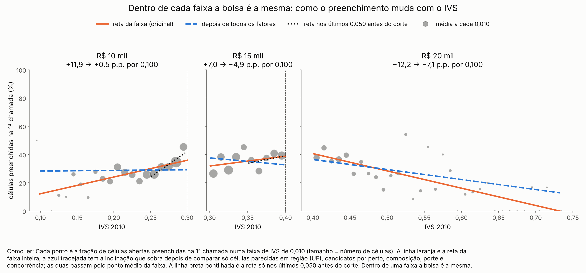
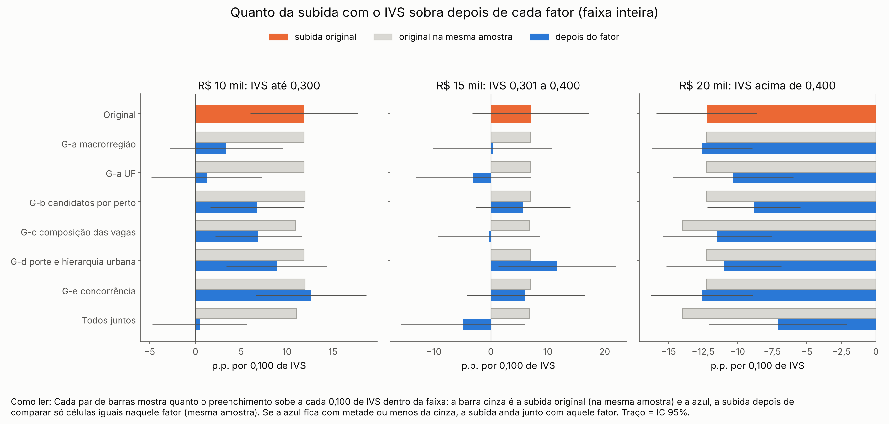
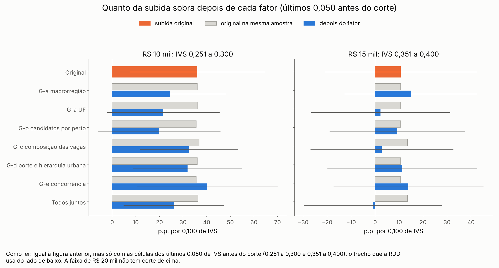

# 57m. Por que o preenchimento sobe com o IVS dentro das faixas da bolsa? (descritivo, protocolo 62)

> **Data:** 26/10/2026. 
> **Protocolo:** [`62_protocolo_gradiente_dentro_das_faixas.md`](62_protocolo_gradiente_dentro_das_faixas.md),
> congelado antes de qualquer conta (SHA-256 em `protocolo` de `GF_resumo.json`). 
> **Origem:** a figura de dados crus do deck (`output/apresentacao_banca2/exp_rdd_crua.png`), em que o preenchimento
> parece subir com o IVS nas faixas de R$ 10 e de R$ 15 mil. 
> **Estatuto:** `DESCRITIVO_62_POS_RESULTADO`. **Descritivo e pós-resultado**: não é contraste causal e não muda nenhum protocolo
> anterior. Dentro de cada faixa a bolsa é constante; nada aqui é efeito da bolsa, da participação no PMM-E ou do
> Agora Tem Especialistas. Toda linha de `GF_estimativas.csv` tem `natureza_dos_dados = EMPIRICO`. 
> **Script:** `scripts/rdd_bolsa/39_gradiente_faixas.py`. **Saídas:** `output/rdd_bolsa/GF_estimativas.csv`,
> `GF_resumo.json`, `GF_figuras/`. **Testes:** `tests/test_gradiente_faixas.py`. 
> **Números:** nenhum é digitado. Os blocos entre marcadores `<!-- GF:... -->` são regravados das saídas por
> `39_gradiente_faixas.py --atualizar-doc`; o teste confere que o documento é idêntico ao gerado.

## 1. Resposta curta

<!-- GF:resposta_curta:inicio -->
**Faixa de R$ 10 mil (IVS até 0,300).** A fração de células abertas preenchidas na 1ª chamada sobe +11,9 p.p. a cada 0,100 de IVS (IC 95% [+6,0; +17,7]; 2392 células). Quase toda essa subida anda junto com a **região**: comparando só células da mesma UF, sobram +1,3 p.p. (89% da subida some); só com a macrorregião, sobram +3,3 p.p. Na faixa, o Nordeste é a região que mais preenche (43% das células, contra 20% a 28% nas outras) e a de IVS médio mais alto (0,280, contra no máximo 0,256 nas outras); são 483 células em só 22 municípios. Cada 0,100 de IVS a mais vem com +49 p.p. a mais de células no Norte ou no Nordeste. Com todos os fatores juntos, sobram +0,5 p.p.

**Perto do corte de 0,300 (IVS de 0,251 a 0,300)** a subida é mais forte: +36,1 p.p. por 0,100 (IC 95% [+7,4; +64,7]). Ali nenhum fator a reduz pela metade; com todos juntos ainda sobram +26,1 p.p. (28% levados). Esse trecho não se explica com os dados disponíveis. É o mesmo trecho que a RDD usa do lado de baixo de 0,300: quanto mais íngreme ele é, mais alto fica o ponto de partida do lado de R$ 10 mil no corte.

**Faixa de R$ 15 mil (0,301 a 0,400).** A subida é menor e incerta: +7,0 p.p. por 0,100 (IC 95% [−3,2; +17,2], que inclui zero); nos últimos 0,050, +10,7 p.p. (IC 95% [−20,9; +42,3]). Fatores que a reduzem pela metade: na faixa inteira, G-a (região), G-c (composição das vagas); nos últimos 0,050, G-a (região), G-c (composição das vagas).

**Faixa de R$ 20 mil (acima de 0,400).** Não há subida: o preenchimento cai 12,2 p.p. a cada 0,100 de IVS (IC 95% [−15,9; −8,6]).

**Para dizer na banca:** "Dentro da faixa de R$ 10 mil, onde a bolsa é a mesma, os municípios mais vulneráveis preenchem mais vagas. Isso anda junto com a região: os de IVS mais alto da faixa estão mais no Nordeste, onde as vagas preenchem mais, e comparando municípios da mesma UF a subida quase some. Só nos últimos 0,050 antes de 0,300 sobra uma subida forte que nenhum dado nosso acompanha. Na faixa de R$ 15 mil a subida é pequena e incerta; na de R$ 20 mil o preenchimento cai. É descrição: mostra com o que a subida anda junto, não por quê."
<!-- GF:resposta_curta:fim -->

## 2. O que se mede

Células abertas (estabelecimento × curso) do quadro da 1ª chamada dos ciclos 1–3, a mesma base do A3 (adendo §7 do protocolo 48). Para cada faixa da bolsa, um modelo de probabilidade linear da célula preenchida (≥ 1 alocado na 1ª chamada) no IVS 2010 oficial contínuo, com efeito fixo de ciclo e erro-padrão agrupado por município. A inclinação é a variação, em pontos percentuais, a cada 0,100 de IVS, na faixa inteira e nos últimos 0,050 antes do corte de cima.

<!-- GF:original:inicio -->
| Faixa | IVS | Células | Municípios | Preenchidas (%) | Inclinação (p.p. por 0,100) | IC 95% | p | q BKY |
|---|---|---|---|---|---|---|---|---|
| R$ 10 mil | até 0,300 | 2392 | 404 | 28,9 | **+11,9** | [+6,0; +17,7] | < 0,001 | 0,001 |
| R$ 10 mil | 0,251 a 0,300 | 1180 | 145 | 33,3 | **+36,1** | [+7,4; +64,7] | 0,014 | 0,019 |
| R$ 15 mil | 0,301 a 0,400 | 1730 | 245 | 35,2 | **+7,0** | [−3,2; +17,2] | 0,178 | 0,143 |
| R$ 15 mil | 0,351 a 0,400 | 772 | 122 | 36,8 | **+10,7** | [−20,9; +42,3] | 0,507 | 0,315 |
| R$ 20 mil | acima de 0,400 | 1012 | 390 | 30,7 | **−12,2** | [−15,9; −8,6] | < 0,001 | 0,001 |
| R$ 20 mil | últimos 0,050 | — | — | — | — | — | — | não se aplica (sem corte de cima) |
<!-- GF:original:fim -->

## 3. G-a — região

Efeito fixo de macrorregião e, depois, de UF: a inclinação passa a comparar só células da mesma região. Depois da tabela: onde estão as células de cada faixa e quanto preenchem (sem controles).

<!-- GF:a_tabela:inicio -->
| Faixa | IVS | Fator | Células | Original (mesma amostra) | Depois do fator | IC 95% | Quanto da subida leva | Reduz pela metade? | q BKY |
|---|---|---|---|---|---|---|---|---|---|
| R$ 10 mil | até 0,300 | macrorregião | 2392 | +11,9 | **+3,3** | [−2,8; +9,5] | 72% | **sim** | 0,213 |
| R$ 10 mil | até 0,300 | UF | 2392 | +11,9 | **+1,3** | [−4,8; +7,3] | 89% | **sim** | 0,389 |
| R$ 10 mil | 0,251 a 0,300 | macrorregião | 1180 | +36,1 | **+24,5** | [+0,7; +48,2] | 32% | não | 0,042 |
| R$ 10 mil | 0,251 a 0,300 | UF | 1180 | +36,1 | **+21,6** | [−2,2; +45,4] | 40% | não | 0,068 |
| R$ 15 mil | 0,301 a 0,400 | macrorregião | 1730 | +7,0 | **+0,3** | [−10,1; +10,8] | 95% | **sim** | 0,521 |
| R$ 15 mil | 0,301 a 0,400 | UF | 1730 | +7,0 | **−3,1** | [−13,2; +7,0] | 144% | **sim** | 0,331 |
| R$ 15 mil | 0,351 a 0,400 | macrorregião | 772 | +10,7 | **+14,9** | [−12,7; +42,5] | −39% | não | 0,213 |
| R$ 15 mil | 0,351 a 0,400 | UF | 772 | +10,7 | **+2,3** | [−26,7; +31,3] | 79% | **sim** | 0,490 |
| R$ 20 mil | acima de 0,400 | macrorregião | 1012 | −12,2 | **−12,6** | [−16,2; −8,9] | — | não se aplica (sem subida) | 0,001 |
| R$ 20 mil | acima de 0,400 | UF | 1012 | −12,2 | **−10,3** | [−14,7; −6,0] | — | não se aplica (sem subida) | 0,001 |
<!-- GF:a_tabela:fim -->

<!-- GF:a_leitura:inicio -->
**Leitura (variante principal: UF).** R$ 10 mil, faixa inteira: de +11,9 para +1,3 p.p. (89% da subida, reduz pela metade); R$ 10 mil, últimos 0,050 antes do corte: de +36,1 para +21,6 p.p. (40% da subida); R$ 15 mil, faixa inteira: de +7,0 para −3,1 p.p. (144% da subida, reduz pela metade); R$ 15 mil, últimos 0,050 antes do corte: de +10,7 para +2,3 p.p. (79% da subida, reduz pela metade).
<!-- GF:a_leitura:fim -->

<!-- GF:a_regiao:inicio -->
| Faixa | Macrorregião | Células | Municípios | IVS médio | Preenchidas (%) |
|---|---|---|---|---|---|
| R$ 10 mil | Centro-Oeste | 348 | 66 | 0,256 | 24,7 |
| R$ 10 mil | Nordeste | 483 | 22 | 0,280 | 42,9 |
| R$ 10 mil | Norte | 158 | 18 | 0,254 | 25,9 |
| R$ 10 mil | Sudeste | 986 | 196 | 0,233 | 28,0 |
| R$ 10 mil | Sul | 417 | 102 | 0,198 | 19,7 |
| R$ 15 mil | Centro-Oeste | 70 | 29 | 0,335 | 31,4 |
| R$ 15 mil | Nordeste | 973 | 106 | 0,355 | 39,4 |
| R$ 15 mil | Norte | 280 | 30 | 0,351 | 31,8 |
| R$ 15 mil | Sudeste | 389 | 71 | 0,334 | 28,8 |
| R$ 15 mil | Sul | 18 | 9 | 0,321 | 16,7 |
| R$ 20 mil | Centro-Oeste | 9 | 7 | 0,452 | 11,1 |
| R$ 20 mil | Nordeste | 628 | 264 | 0,478 | 34,7 |
| R$ 20 mil | Norte | 255 | 81 | 0,508 | 23,9 |
| R$ 20 mil | Sudeste | 120 | 38 | 0,439 | 25,8 |
<!-- GF:a_regiao:fim -->

O próprio fator anda junto com o IVS dentro da faixa? Mesmo modelo, com o fator no lugar do preenchimento (descritivo, fora do BKY):

<!-- GF:a_balanco:inicio -->
| Faixa | IVS | Fator | Média na amostra | Variação do fator por 0,100 de IVS | IC 95% | Células sem o fator |
|---|---|---|---|---|---|---|
| R$ 10 mil | até 0,300 | célula no Norte ou Nordeste | 26,8% | +49,1 p.p. | [+32,4 p.p.; +65,7 p.p.] | 0 |
| R$ 10 mil | 0,251 a 0,300 | célula no Norte ou Nordeste | 47,7% | +62,8 p.p. | [−37,7 p.p.; +163,3 p.p.] | 0 |
| R$ 15 mil | 0,301 a 0,400 | célula no Norte ou Nordeste | 72,4% | +46,1 p.p. | [+16,5 p.p.; +75,6 p.p.] | 0 |
| R$ 15 mil | 0,351 a 0,400 | célula no Norte ou Nordeste | 83,8% | −10,5 p.p. | [−69,7 p.p.; +48,8 p.p.] | 0 |
| R$ 20 mil | acima de 0,400 | célula no Norte ou Nordeste | 87,3% | +9,9 p.p. | [+4,9 p.p.; +15,0 p.p.] | 0 |
<!-- GF:a_balanco:fim -->

## 4. G-b — candidatos por perto

Para cada célula: candidatos do mesmo curso e ciclo cuja origem (município principal de vínculo no CNES na competência de referência do G1, regra principal) está na mesma UF ou na mesma região de saúde da célula, divididos pelas vagas oferecidas do mesmo curso e ciclo nesse mercado. Candidato sem origem conhecida não entra; o conjunto de candidatos se forma depois do anúncio da faixa.

<!-- GF:b_tabela:inicio -->
| Faixa | IVS | Fator | Células | Original (mesma amostra) | Depois do fator | IC 95% | Quanto da subida leva | Reduz pela metade? | q BKY |
|---|---|---|---|---|---|---|---|---|---|
| R$ 10 mil | até 0,300 | candidatos na UF por vaga | 2392 | +11,9 | **+8,5** | [+3,4; +13,6] | 28% | não | 0,003 |
| R$ 10 mil | até 0,300 | candidatos na região de saúde por vaga | 2383 | +12,0 | **+7,4** | [+1,9; +12,8] | 38% | não | 0,014 |
| R$ 10 mil | até 0,300 | os dois | 2383 | +12,0 | **+6,8** | [+1,7; +11,9] | 44% | não | 0,015 |
| R$ 10 mil | 0,251 a 0,300 | candidatos na UF por vaga | 1180 | +36,1 | **+24,0** | [−2,0; +49,9] | 33% | não | 0,065 |
| R$ 10 mil | 0,251 a 0,300 | candidatos na região de saúde por vaga | 1171 | +35,6 | **+21,6** | [−5,4; +48,5] | 39% | não | 0,097 |
| R$ 10 mil | 0,251 a 0,300 | os dois | 1171 | +35,6 | **+19,9** | [−6,1; +45,8] | 44% | não | 0,110 |
| R$ 15 mil | 0,301 a 0,400 | candidatos na UF por vaga | 1730 | +7,0 | **+5,0** | [−3,6; +13,7] | 28% | não | 0,190 |
| R$ 15 mil | 0,301 a 0,400 | candidatos na região de saúde por vaga | 1730 | +7,0 | **+7,3** | [−1,5; +16,2] | −5% | não | 0,089 |
| R$ 15 mil | 0,301 a 0,400 | os dois | 1730 | +7,0 | **+5,7** | [−2,6; +14,0] | 19% | não | 0,143 |
| R$ 15 mil | 0,351 a 0,400 | candidatos na UF por vaga | 772 | +10,7 | **+10,2** | [−17,3; +37,7] | 5% | não | 0,306 |
| R$ 15 mil | 0,351 a 0,400 | candidatos na região de saúde por vaga | 772 | +10,7 | **+8,4** | [−23,5; +40,3] | 22% | não | 0,371 |
| R$ 15 mil | 0,351 a 0,400 | os dois | 772 | +10,7 | **+9,3** | [−18,9; +37,5] | 14% | não | 0,315 |
| R$ 20 mil | acima de 0,400 | candidatos na UF por vaga | 1012 | −12,2 | **−9,4** | [−12,8; −5,9] | — | não se aplica (sem subida) | 0,001 |
| R$ 20 mil | acima de 0,400 | candidatos na região de saúde por vaga | 1012 | −12,2 | **−10,1** | [−13,6; −6,6] | — | não se aplica (sem subida) | 0,001 |
| R$ 20 mil | acima de 0,400 | os dois | 1012 | −12,2 | **−8,8** | [−12,2; −5,5] | — | não se aplica (sem subida) | 0,001 |
<!-- GF:b_tabela:fim -->

<!-- GF:b_leitura:inicio -->
**Leitura (variante principal: os dois).** R$ 10 mil, faixa inteira: de +12,0 para +6,8 p.p. (44% da subida); R$ 10 mil, últimos 0,050 antes do corte: de +35,6 para +19,9 p.p. (44% da subida); R$ 15 mil, faixa inteira: de +7,0 para +5,7 p.p. (19% da subida); R$ 15 mil, últimos 0,050 antes do corte: de +10,7 para +9,3 p.p. (14% da subida).
<!-- GF:b_leitura:fim -->

O próprio fator anda junto com o IVS dentro da faixa? Mesmo modelo, com o fator no lugar do preenchimento (descritivo, fora do BKY):

<!-- GF:b_balanco:inicio -->
| Faixa | IVS | Fator | Média na amostra | Variação do fator por 0,100 de IVS | IC 95% | Células sem o fator |
|---|---|---|---|---|---|---|
| R$ 10 mil | até 0,300 | candidatos com origem na UF, por vaga | 0,55 | +0,257 | [+0,109; +0,405] | 0 |
| R$ 10 mil | até 0,300 | candidatos com origem na região de saúde, por vaga | 0,34 | +0,442 | [+0,218; +0,667] | 9 |
| R$ 10 mil | 0,251 a 0,300 | candidatos com origem na UF, por vaga | 0,65 | +0,984 | [+0,169; +1,799] | 0 |
| R$ 10 mil | 0,251 a 0,300 | candidatos com origem na região de saúde, por vaga | 0,50 | +1,463 | [+0,453; +2,473] | 9 |
| R$ 15 mil | 0,301 a 0,400 | candidatos com origem na UF, por vaga | 0,68 | +0,159 | [−0,092; +0,410] | 0 |
| R$ 15 mil | 0,301 a 0,400 | candidatos com origem na região de saúde, por vaga | 0,48 | −0,027 | [−0,381; +0,328] | 0 |
| R$ 15 mil | 0,351 a 0,400 | candidatos com origem na UF, por vaga | 0,73 | +0,043 | [−0,783; +0,869] | 0 |
| R$ 15 mil | 0,351 a 0,400 | candidatos com origem na região de saúde, por vaga | 0,43 | +0,201 | [−0,588; +0,989] | 0 |
| R$ 20 mil | acima de 0,400 | candidatos com origem na UF, por vaga | 0,67 | −0,199 | [−0,272; −0,125] | 0 |
| R$ 20 mil | acima de 0,400 | candidatos com origem na região de saúde, por vaga | 0,32 | −0,174 | [−0,241; −0,108] | 0 |
<!-- GF:b_balanco:fim -->

## 5. G-c — composição das vagas

Efeito fixo de curso × ciclo; indicador de célula só de cadastro reserva; tipo do estabelecimento (cardápio de gestores do ciclo 3; fora dele fica ausente) e gestão (quadro da 1ª chamada).

<!-- GF:c_tabela:inicio -->
| Faixa | IVS | Fator | Células | Original (mesma amostra) | Depois do fator | IC 95% | Quanto da subida leva | Reduz pela metade? | q BKY |
|---|---|---|---|---|---|---|---|---|---|
| R$ 10 mil | até 0,300 | curso × ciclo | 2392 | +11,9 | **+11,1** | [+5,7; +16,4] | 6% | não | 0,001 |
| R$ 10 mil | até 0,300 | só cadastro reserva | 2392 | +11,9 | **+8,3** | [+3,1; +13,4] | 30% | não | 0,005 |
| R$ 10 mil | até 0,300 | tipo e gestão do estabelecimento | 2298 | +10,9 | **+10,4** | [+4,8; +16,0] | 5% | não | 0,001 |
| R$ 10 mil | até 0,300 | os três | 2298 | +10,9 | **+6,9** | [+2,2; +11,6] | 37% | não | 0,009 |
| R$ 10 mil | 0,251 a 0,300 | curso × ciclo | 1180 | +36,1 | **+33,5** | [+7,1; +59,8] | 7% | não | 0,019 |
| R$ 10 mil | 0,251 a 0,300 | só cadastro reserva | 1180 | +36,1 | **+30,1** | [+7,3; +53,0] | 17% | não | 0,015 |
| R$ 10 mil | 0,251 a 0,300 | tipo e gestão do estabelecimento | 1114 | +36,9 | **+34,9** | [+9,0; +60,8] | 5% | não | 0,014 |
| R$ 10 mil | 0,251 a 0,300 | os três | 1114 | +36,9 | **+32,4** | [+11,7; +53,2] | 12% | não | 0,006 |
| R$ 15 mil | 0,301 a 0,400 | curso × ciclo | 1730 | +7,0 | **+3,6** | [−5,7; +13,0] | 48% | não | 0,291 |
| R$ 15 mil | 0,301 a 0,400 | só cadastro reserva | 1730 | +7,0 | **+1,1** | [−7,9; +10,2] | 84% | **sim** | 0,472 |
| R$ 15 mil | 0,301 a 0,400 | tipo e gestão do estabelecimento | 1669 | +6,8 | **+5,9** | [−4,1; +15,8] | 14% | não | 0,190 |
| R$ 15 mil | 0,301 a 0,400 | os três | 1669 | +6,8 | **−0,3** | [−9,3; +8,7] | 105% | **sim** | 0,521 |
| R$ 15 mil | 0,351 a 0,400 | curso × ciclo | 772 | +10,7 | **+3,3** | [−27,1; +33,6] | 69% | **sim** | 0,483 |
| R$ 15 mil | 0,351 a 0,400 | só cadastro reserva | 772 | +10,7 | **+4,1** | [−23,8; +32,0] | 62% | **sim** | 0,452 |
| R$ 15 mil | 0,351 a 0,400 | tipo e gestão do estabelecimento | 740 | +13,5 | **+14,3** | [−15,5; +44,1] | −6% | não | 0,241 |
| R$ 15 mil | 0,351 a 0,400 | os três | 740 | +13,5 | **+2,8** | [−27,0; +32,6] | 79% | **sim** | 0,486 |
| R$ 20 mil | acima de 0,400 | curso × ciclo | 1012 | −12,2 | **−10,6** | [−14,3; −6,8] | — | não se aplica (sem subida) | 0,001 |
| R$ 20 mil | acima de 0,400 | só cadastro reserva | 1012 | −12,2 | **−12,0** | [−15,7; −8,4] | — | não se aplica (sem subida) | 0,001 |
| R$ 20 mil | acima de 0,400 | tipo e gestão do estabelecimento | 942 | −14,0 | **−13,7** | [−17,5; −9,8] | — | não se aplica (sem subida) | 0,001 |
| R$ 20 mil | acima de 0,400 | os três | 942 | −14,0 | **−11,5** | [−15,4; −7,5] | — | não se aplica (sem subida) | 0,001 |
<!-- GF:c_tabela:fim -->

<!-- GF:c_leitura:inicio -->
**Leitura (variante principal: os três).** R$ 10 mil, faixa inteira: de +10,9 para +6,9 p.p. (37% da subida); R$ 10 mil, últimos 0,050 antes do corte: de +36,9 para +32,4 p.p. (12% da subida); R$ 15 mil, faixa inteira: de +6,8 para −0,3 p.p. (105% da subida, reduz pela metade); R$ 15 mil, últimos 0,050 antes do corte: de +13,5 para +2,8 p.p. (79% da subida, reduz pela metade).
<!-- GF:c_leitura:fim -->

O próprio fator anda junto com o IVS dentro da faixa? Mesmo modelo, com o fator no lugar do preenchimento (descritivo, fora do BKY):

<!-- GF:c_balanco:inicio -->
| Faixa | IVS | Fator | Média na amostra | Variação do fator por 0,100 de IVS | IC 95% | Células sem o fator |
|---|---|---|---|---|---|---|
| R$ 10 mil | até 0,300 | célula só de cadastro reserva | 56,2% | −7,6 p.p. | [−14,2 p.p.; −1,0 p.p.] | 0 |
| R$ 10 mil | até 0,300 | hospital geral | 76,5% | −3,0 p.p. | [−10,4 p.p.; +4,5 p.p.] | 94 |
| R$ 10 mil | até 0,300 | gestão estadual | 25,2% | +0,5 p.p. | [−14,5 p.p.; +15,5 p.p.] | 0 |
| R$ 10 mil | 0,251 a 0,300 | célula só de cadastro reserva | 52,5% | −11,8 p.p. | [−47,9 p.p.; +24,3 p.p.] | 0 |
| R$ 10 mil | 0,251 a 0,300 | hospital geral | 75,0% | −1,9 p.p. | [−53,4 p.p.; +49,5 p.p.] | 66 |
| R$ 10 mil | 0,251 a 0,300 | gestão estadual | 27,4% | +55,9 p.p. | [−5,5 p.p.; +117,4 p.p.] | 0 |
| R$ 15 mil | 0,301 a 0,400 | célula só de cadastro reserva | 56,2% | −11,4 p.p. | [−23,2 p.p.; +0,5 p.p.] | 0 |
| R$ 15 mil | 0,301 a 0,400 | hospital geral | 68,0% | −15,6 p.p. | [−32,6 p.p.; +1,4 p.p.] | 61 |
| R$ 15 mil | 0,301 a 0,400 | gestão estadual | 40,4% | +11,2 p.p. | [−11,5 p.p.; +33,9 p.p.] | 0 |
| R$ 15 mil | 0,351 a 0,400 | célula só de cadastro reserva | 53,1% | −13,8 p.p. | [−46,5 p.p.; +18,9 p.p.] | 0 |
| R$ 15 mil | 0,351 a 0,400 | hospital geral | 65,1% | −13,4 p.p. | [−61,1 p.p.; +34,4 p.p.] | 32 |
| R$ 15 mil | 0,351 a 0,400 | gestão estadual | 43,4% | −32,5 p.p. | [−94,8 p.p.; +29,8 p.p.] | 0 |
| R$ 20 mil | acima de 0,400 | célula só de cadastro reserva | 58,8% | +0,4 p.p. | [−3,2 p.p.; +4,1 p.p.] | 0 |
| R$ 20 mil | acima de 0,400 | hospital geral | 67,0% | +2,5 p.p. | [−3,9 p.p.; +8,8 p.p.] | 70 |
| R$ 20 mil | acima de 0,400 | gestão estadual | 26,8% | −8,8 p.p. | [−14,9 p.p.; −2,7 p.p.] | 0 |
<!-- GF:c_balanco:fim -->

## 6. G-d — porte e hierarquia urbana

Log da população do Censo 2022 e nível REGIC 2018 (1 metrópole … 5 centro local) como efeito fixo.

<!-- GF:d_tabela:inicio -->
| Faixa | IVS | Fator | Células | Original (mesma amostra) | Depois do fator | IC 95% | Quanto da subida leva | Reduz pela metade? | q BKY |
|---|---|---|---|---|---|---|---|---|---|
| R$ 10 mil | até 0,300 | log(população 2022) | 2392 | +11,9 | **+7,8** | [+2,4; +13,2] | 34% | não | 0,009 |
| R$ 10 mil | até 0,300 | REGIC | 2392 | +11,9 | **+10,9** | [+5,3; +16,5] | 8% | não | 0,001 |
| R$ 10 mil | até 0,300 | os dois | 2392 | +11,9 | **+8,9** | [+3,4; +14,4] | 25% | não | 0,005 |
| R$ 10 mil | 0,251 a 0,300 | log(população 2022) | 1180 | +36,1 | **+28,2** | [+2,5; +53,9] | 22% | não | 0,034 |
| R$ 10 mil | 0,251 a 0,300 | REGIC | 1180 | +36,1 | **+35,5** | [+12,3; +58,8] | 2% | não | 0,007 |
| R$ 10 mil | 0,251 a 0,300 | os dois | 1180 | +36,1 | **+31,9** | [+8,8; +55,0] | 12% | não | 0,013 |
| R$ 15 mil | 0,301 a 0,400 | log(população 2022) | 1730 | +7,0 | **+10,0** | [+0,8; +19,2] | −43% | não | 0,035 |
| R$ 15 mil | 0,301 a 0,400 | REGIC | 1730 | +7,0 | **+12,0** | [+2,0; +21,9] | −71% | não | 0,023 |
| R$ 15 mil | 0,301 a 0,400 | os dois | 1730 | +7,0 | **+11,6** | [+1,4; +21,9] | −66% | não | 0,030 |
| R$ 15 mil | 0,351 a 0,400 | log(população 2022) | 772 | +10,7 | **+10,3** | [−20,9; +41,5] | 4% | não | 0,315 |
| R$ 15 mil | 0,351 a 0,400 | REGIC | 772 | +10,7 | **+11,1** | [−20,2; +42,3] | −3% | não | 0,309 |
| R$ 15 mil | 0,351 a 0,400 | os dois | 772 | +10,7 | **+11,3** | [−19,9; +42,6] | −6% | não | 0,307 |
| R$ 20 mil | acima de 0,400 | log(população 2022) | 1012 | −12,2 | **−11,4** | [−15,1; −7,7] | — | não se aplica (sem subida) | 0,001 |
| R$ 20 mil | acima de 0,400 | REGIC | 1012 | −12,2 | **−10,6** | [−14,7; −6,5] | — | não se aplica (sem subida) | 0,001 |
| R$ 20 mil | acima de 0,400 | os dois | 1012 | −12,2 | **−11,0** | [−15,2; −6,8] | — | não se aplica (sem subida) | 0,001 |
<!-- GF:d_tabela:fim -->

<!-- GF:d_leitura:inicio -->
**Leitura (variante principal: os dois).** R$ 10 mil, faixa inteira: de +11,9 para +8,9 p.p. (25% da subida); R$ 10 mil, últimos 0,050 antes do corte: de +36,1 para +31,9 p.p. (12% da subida); R$ 15 mil, faixa inteira: de +7,0 para +11,6 p.p. (−66% da subida); R$ 15 mil, últimos 0,050 antes do corte: de +10,7 para +11,3 p.p. (−6% da subida).
<!-- GF:d_leitura:fim -->

O próprio fator anda junto com o IVS dentro da faixa? Mesmo modelo, com o fator no lugar do preenchimento (descritivo, fora do BKY):

<!-- GF:d_balanco:inicio -->
| Faixa | IVS | Fator | Média na amostra | Variação do fator por 0,100 de IVS | IC 95% | Células sem o fator |
|---|---|---|---|---|---|---|
| R$ 10 mil | até 0,300 | log(população 2022) | 11,99 | +0,866 | [+0,357; +1,374] | 0 |
| R$ 10 mil | até 0,300 | nível REGIC (1 metrópole … 5 centro local) | 2,57 | −0,304 | [−0,613; +0,004] | 0 |
| R$ 10 mil | 0,251 a 0,300 | log(população 2022) | 12,32 | +1,937 | [−0,694; +4,567] | 0 |
| R$ 10 mil | 0,251 a 0,300 | nível REGIC (1 metrópole … 5 centro local) | 2,42 | −0,710 | [−2,384; +0,965] | 0 |
| R$ 15 mil | 0,301 a 0,400 | log(população 2022) | 12,12 | −0,955 | [−2,249; +0,339] | 0 |
| R$ 15 mil | 0,301 a 0,400 | nível REGIC (1 metrópole … 5 centro local) | 2,46 | +1,083 | [+0,326; +1,840] | 0 |
| R$ 15 mil | 0,351 a 0,400 | log(população 2022) | 11,73 | +0,172 | [−2,702; +3,045] | 0 |
| R$ 15 mil | 0,351 a 0,400 | nível REGIC (1 metrópole … 5 centro local) | 2,86 | +0,317 | [−1,375; +2,009] | 0 |
| R$ 20 mil | acima de 0,400 | log(população 2022) | 10,59 | −0,177 | [−0,310; −0,044] | 0 |
| R$ 20 mil | acima de 0,400 | nível REGIC (1 metrópole … 5 centro local) | 4,06 | +0,498 | [+0,346; +0,650] | 0 |
<!-- GF:d_balanco:fim -->

## 7. G-e — concorrência

Número de outras células do mesmo curso e ciclo na mesma região de saúde (exposição do script 32, protocolo 58). Célula de município sem região de saúde fica de fora (contada).

<!-- GF:e_tabela:inicio -->
| Faixa | IVS | Fator | Células | Original (mesma amostra) | Depois do fator | IC 95% | Quanto da subida leva | Reduz pela metade? | q BKY |
|---|---|---|---|---|---|---|---|---|---|
| R$ 10 mil | até 0,300 | células do mesmo curso na região | 2383 | +12,0 | **+12,7** | [+6,6; +18,7] | −6% | não | 0,001 |
| R$ 10 mil | 0,251 a 0,300 | células do mesmo curso na região | 1171 | +35,6 | **+40,2** | [+10,3; +70,0] | −13% | não | 0,014 |
| R$ 15 mil | 0,301 a 0,400 | células do mesmo curso na região | 1730 | +7,0 | **+6,1** | [−4,3; +16,5] | 13% | não | 0,190 |
| R$ 15 mil | 0,351 a 0,400 | células do mesmo curso na região | 772 | +10,7 | **+13,9** | [−17,4; +45,2] | −30% | não | 0,259 |
| R$ 20 mil | acima de 0,400 | células do mesmo curso na região | 1012 | −12,2 | **−12,6** | [−16,3; −8,9] | — | não se aplica (sem subida) | 0,001 |
<!-- GF:e_tabela:fim -->

<!-- GF:e_leitura:inicio -->
**Leitura (variante principal: células do mesmo curso na região).** R$ 10 mil, faixa inteira: de +12,0 para +12,7 p.p. (−6% da subida); R$ 10 mil, últimos 0,050 antes do corte: de +35,6 para +40,2 p.p. (−13% da subida); R$ 15 mil, faixa inteira: de +7,0 para +6,1 p.p. (13% da subida); R$ 15 mil, últimos 0,050 antes do corte: de +10,7 para +13,9 p.p. (−30% da subida).
<!-- GF:e_leitura:fim -->

O próprio fator anda junto com o IVS dentro da faixa? Mesmo modelo, com o fator no lugar do preenchimento (descritivo, fora do BKY):

<!-- GF:e_balanco:inicio -->
| Faixa | IVS | Fator | Média na amostra | Variação do fator por 0,100 de IVS | IC 95% | Células sem o fator |
|---|---|---|---|---|---|---|
| R$ 10 mil | até 0,300 | outras células do curso na região de saúde | 1,43 | +0,747 | [+0,229; +1,264] | 9 |
| R$ 10 mil | 0,251 a 0,300 | outras células do curso na região de saúde | 1,69 | +3,304 | [+1,270; +5,337] | 9 |
| R$ 15 mil | 0,301 a 0,400 | outras células do curso na região de saúde | 2,66 | −0,750 | [−2,549; +1,049] | 0 |
| R$ 15 mil | 0,351 a 0,400 | outras células do curso na região de saúde | 2,07 | +1,771 | [−0,569; +4,110] | 0 |
| R$ 20 mil | acima de 0,400 | outras células do curso na região de saúde | 2,42 | −0,521 | [−0,915; −0,127] | 0 |
<!-- GF:e_balanco:fim -->

## 8. G-f — outras políticas que variam com o IVS (só relato)

<!-- GF:f_relato:inicio -->
Não há fator testável no nível da célula. Relato:

- **Pesquisa documental do mesmo dia:** arquivada em `docs/auditorias/35_incentivos_ligados_a_vulnerabilidade.md`.
- Na faixa de R$ 15 mil (0,301 a 0,400) todo município está na mesma classe de IVS ("média"): as regras por classe que a auditoria 18 lista (estrato do IED no cofinanciamento da APS, incentivo de nutrição, priorização de eMulti) não mudam dentro dela. ([auditoria 18](../auditorias/18_politicas_nos_mesmos_cortes_ivs.md), §2.5 e §2.7)
- Dentro da faixa de R$ 10 mil há um degrau em 0,200 (muito baixa → baixa): o estrato do IED muda no porte 1 (até 20 mil hab.). Dentro da faixa de R$ 20 mil há um degrau em 0,500 (alta → muito alta), nos portes 1 a 3 do IED. São degraus, não uma subida contínua, e nenhum cai nos últimos 0,050 antes de 0,300 ou de 0,400. ([auditoria 18](../auditorias/18_politicas_nos_mesmos_cortes_ivs.md), §2.5)
- A priorização de eMulti (Portaria 635/2023) tem cortes em 0,2, 0,3, 0,4 e 0,5: também degraus, em 0,200 dentro da faixa de R$ 10 mil e em 0,500 dentro da de R$ 20 mil. ([auditoria 18](../auditorias/18_politicas_nos_mesmos_cortes_ivs.md), §2.7)
- O único índice contínuo citado é o ICSD do SUS Digital, que não é o IVS e está marcado como não verificado. ([auditoria 18](../auditorias/18_politicas_nos_mesmos_cortes_ivs.md), §2.7)
<!-- GF:f_relato:fim -->

## 9. Quanto da subida cada fator leva

Cada célula da tabela é 1 − (inclinação depois do fator ÷ inclinação original na mesma amostra). Em negrito, 50% ou mais: o fator reduz a subida pela metade ou mais. "—" = não há subida a explicar (inclinação original ≤ 0). Acima de 100%: a inclinação troca de sinal. Negativo: a subida aumenta com o fator.

<!-- GF:tabela_quanto:inicio -->
| Fator | R$ 10 mil, IVS até 0,300 | R$ 10 mil, IVS 0,251 a 0,300 | R$ 15 mil, IVS 0,301 a 0,400 | R$ 15 mil, IVS 0,351 a 0,400 | R$ 20 mil, IVS acima de 0,400 |
|---|---|---|---|---|---|
| **Subida original** (p.p. por 0,100) | +11,9 | +36,1 | +7,0 | +10,7 | −12,2 |
| G-a região: macrorregião | **72%** | 32% | **95%** | −39% | — |
| G-a região: UF | **89%** | 40% | **144%** | **79%** | — |
| G-b candidatos por perto: candidatos na UF por vaga | 28% | 33% | 28% | 5% | — |
| G-b candidatos por perto: candidatos na região de saúde por vaga | 38% | 39% | −5% | 22% | — |
| G-b candidatos por perto: os dois | 44% | 44% | 19% | 14% | — |
| G-c composição das vagas: curso × ciclo | 6% | 7% | 48% | **69%** | — |
| G-c composição das vagas: só cadastro reserva | 30% | 17% | **84%** | **62%** | — |
| G-c composição das vagas: tipo e gestão do estabelecimento | 5% | 5% | 14% | −6% | — |
| G-c composição das vagas: os três | 37% | 12% | **105%** | **79%** | — |
| G-d porte e hierarquia urbana: log(população 2022) | 34% | 22% | −43% | 4% | — |
| G-d porte e hierarquia urbana: REGIC | 8% | 2% | −71% | −3% | — |
| G-d porte e hierarquia urbana: os dois | 25% | 12% | −66% | −6% | — |
| G-e concorrência: células do mesmo curso na região | −6% | −13% | 13% | −30% | — |
| Todos juntos (G-a (UF) + G-b + G-c + G-d + G-e; não é um fator) | **96%** | 28% | **172%** | **107%** | — |
<!-- GF:tabela_quanto:fim -->

## 10. Leitura pré-registrada (§3)

Regra: um fator que reduz a inclinação pela metade ou mais descreve a subida (associação); se nenhum reduz, a subida não se explica com os dados disponíveis. Aplicada a cada faixa e trecho com subida (inclinação original > 0). Em qualquer caso é descritivo: diz com o que a subida anda junto, não por quê.

<!-- GF:leitura:inicio -->
| Faixa | Trecho | Subida original [IC 95%] | Fatores que reduzem pela metade | Todos juntos levam | Leitura (§3) |
|---|---|---|---|---|---|
| R$ 10 mil | faixa inteira | +11,9 [+6,0; +17,7] | G-a (macrorregiao), G-a (uf) | 96% | **o fator descreve a subida (associação)** |
| R$ 10 mil | últimos 0,050 antes do corte | +36,1 [+7,4; +64,7] | nenhum | 28% | **a subida não se explica com os dados disponíveis** |
| R$ 15 mil | faixa inteira | +7,0 [−3,2; +17,2] | G-a (macrorregiao), G-a (uf), G-c (so_cr), G-c (todos) | 172% | **o fator descreve a subida (associação)** |
| R$ 15 mil | últimos 0,050 antes do corte | +10,7 [−20,9; +42,3] | G-a (uf), G-c (curso_x_ciclo), G-c (so_cr), G-c (todos) | 107% | **o fator descreve a subida (associação)** |
| R$ 20 mil | faixa inteira | −12,2 [−15,9; −8,6] | nenhum | — | **não há subida (a inclinação é negativa)** |
| R$ 20 mil | últimos 0,050 antes do corte | — | — | — | não se aplica |
<!-- GF:leitura:fim -->

## 11. Figuras

<!-- GF:figuras:inicio -->

**Como ler:** Cada ponto é a fração de células abertas preenchidas na 1ª chamada numa faixa de IVS de 0,010 (tamanho = número de células). A linha laranja é a reta da faixa inteira; a azul tracejada tem a inclinação que sobra depois de comparar só células parecidas em região (UF), candidatos por perto, composição, porte e concorrência; as duas passam pelo ponto médio da faixa. A linha preta pontilhada é a reta só nos últimos 0,050 antes do corte. Dentro de uma faixa a bolsa é a mesma.

*Detalhe técnico:* Médias de GF_estimativas.csv (tipo_linha = media_bin; faixas de 0,010 fechadas à direita, como as faixas da bolsa). Retas: inclinação de tipo_linha = inclinacao (ORIGINAL e TODOS), MQO com efeito fixo de ciclo, ancoradas na média de IVS e de preenchimento da amostra (faixa inteira ou janela). A reta 'todos juntos' é estimada nas células com todos os fatores definidos.

**Como ler:** Cada par de barras mostra quanto o preenchimento sobe a cada 0,100 de IVS dentro da faixa: a barra cinza é a subida original (na mesma amostra) e a azul, a subida depois de comparar só células iguais naquele fator (mesma amostra). Se a azul fica com metade ou menos da cinza, a subida anda junto com aquele fator. Traço = IC 95%.

*Detalhe técnico:* Inclinação em p.p. por 0,100 de IVS (MQO, efeito fixo de ciclo, CR1 por município). Barra cinza = inclinacao_original_mesma_amostra; barra azul = inclinacao depois do fator (GF_estimativas.csv). G-b, G-c e G-d na variante principal (todos os itens).

**Como ler:** Igual à figura anterior, mas só com as células dos últimos 0,050 de IVS antes do corte (0,251 a 0,300 e 0,351 a 0,400), o trecho que a RDD usa do lado de baixo. A faixa de R$ 20 mil não tem corte de cima.

*Detalhe técnico:* Como GF_inclinacao_fatores.png, com janela = janela_0050_corte_superior.
<!-- GF:figuras:fim -->

## 12. Limites

<!-- GF:limites:inicio -->
- **Descritivo e pós-resultado.** A subida foi vista na figura de dados crus antes de o protocolo ser escrito. Nenhuma linha é primária; o BKY corre entre todas as inclinações do preenchimento (coluna `q_bky`).
- **Não é contraste causal.** Dentro da faixa a bolsa é constante: a inclinação compara células com a mesma bolsa e IVS diferente. "Reduz pela metade" quer dizer que a subida anda junto com o fator, não que o fator a produz.
- **Fatores formados depois do anúncio.** Candidatos por perto (G-b), composição das vagas (G-c) e concorrência (G-e) se formam depois de a faixa ser conhecida. Comparar células iguais nesses fatores descreve, não isola.
- **Região é um rótulo largo.** O efeito fixo de UF compara células da mesma UF; tudo o que muda entre UFs (mercado médico, rede, gestão estadual, outras políticas) sai junto.
- **Fração da subida levada.** É 1 − (depois ÷ original na mesma amostra) e só existe quando a subida original é positiva. Passa de 100% quando a inclinação troca de sinal; com subida original pequena e incerta (faixa de R$ 15 mil), a fração é instável.
- **Ausências registradas, nada imputado:** tipo do estabelecimento fora do cardápio do ciclo 3; células de município sem região de saúde (G-b na região de saúde e G-e); candidatos sem origem no G1 não entram na contagem do G-b.
<!-- GF:limites:fim -->

## 13. Decisões e validações

<!-- GF:decisoes:inicio -->
- Base: celulas abertas do A3 (adendo §7 do protocolo 48), ciclos 1-3 juntos, lidas por carregar() do script 38 (que chama carregar_tudo() do 24); faixa pelo IVS 2010 oficial (s <= 0,300; 0,301-0,400; > 0,400), conferida contra a faixa anunciada do quadro.
- Modelo: MQO da celula preenchida (>= 1 alocado na 1a chamada) em IVS/0,100 com efeito fixo de ciclo; EP CR1 agrupado por municipio; IC e p pela normal (como a rdd_lib).
- Janela de 0,050 junto ao corte superior: 0,250 < IVS <= 0,300 e 0,350 < IVS <= 0,400 (|IVS - corte| < 0,050, como a janela da RDD); a faixa de R$ 20 mil nao tem corte superior (linha NAO_SE_APLICA).
- Fatores: indicadores para as categoricas (1a categoria em ordem = base; indicador colinear descartado de forma deterministica e anotado); continuas em nivel. Cada fator e comparado com a inclinacao original na mesma amostra (celulas com o fator definido).
- G-a: macrorregiao e UF pelo codigo IBGE (conferidas contra a regiao do quadro). Variante principal (e a usada em 'todos juntos'): UF.
- G-b: candidatos com alguma opcao no curso e ciclo, origem principal do G1 (regra g1_cpf_nome) na mesma UF ou CIR da celula, divididos pelas vagas oferecidas (imediatas + CR) do mesmo curso e ciclo naquela UF ou CIR (a propria celula incluida). 'Por vaga oferecida' lido como razao do mercado, nao da celula.
- G-c: efeito fixo de curso x ciclo; indicador de celula so de cadastro reserva; tipo (cardapio do ciclo 3) e gestao (quadro da 1a chamada) do estabelecimento, como no D-b do script 38.
- G-d: log(populacao 2022) e nivel REGIC 2018 como efeito fixo. G-e: outras celulas do mesmo curso e ciclo na CIR (exposicao 'mesmo_curso' do script 32).
- Fracao da subida levada = 1 - depois / original na mesma amostra, so com original > 0; reduz pela metade = fracao >= 0,5. Leitura do §3 por faixa x trecho; 'todos juntos' e relatado, mas nao conta como fator.
- BKY entre todas as inclinacoes do preenchimento (originais e depois de cada fator); balancos e medias nao entram.
- Balanco (fora do protocolo, descritivo): cada fator continuo ou indicador no lugar do preenchimento, mesmo modelo, para mostrar se o proprio fator anda junto com o IVS dentro da faixa.
- G-f: relato. A pesquisa documental do mesmo dia roda em paralelo; o script procura docs/auditorias/35_* na execucao e registra o que achou no resumo.
<!-- GF:decisoes:fim -->

<!-- GF:validacoes:inicio -->
| Conferência | Resultado |
|---|---|
| células (ciclos 1–3) | 5134 |
| células por faixa | R$ 10 mil: 2392, R$ 15 mil: 1730, R$ 20 mil: 1012 |
| faixa pelo IVS oficial = faixa anunciada | sim (o script para se não for) |
| macrorregião pelo código IBGE = região do quadro | sim (o script para se não for) |
| linhas em GF_estimativas.csv | 200 |
| inclinações EXECUTADO / SEM_ESTIMATIVA / NAO_SE_APLICA | 75 / 0 / 1 |
| células sem tipo do estabelecimento | 225 |
| células sem região de saúde (G-b na região, G-e) | 9 |
| candidatos sem origem no G1, por ciclo | ciclo 1: 75 de 993, ciclo 2: 108 de 2179, ciclo 3: 109 de 2604 |

Nada imputado ou simulado; IVS 2010 oficial (a08); o arquivo local de IVS da auditoria 16 não é lido; `data/` é só lido; nenhum identificador de pessoa em `output/`.
<!-- GF:validacoes:fim -->
