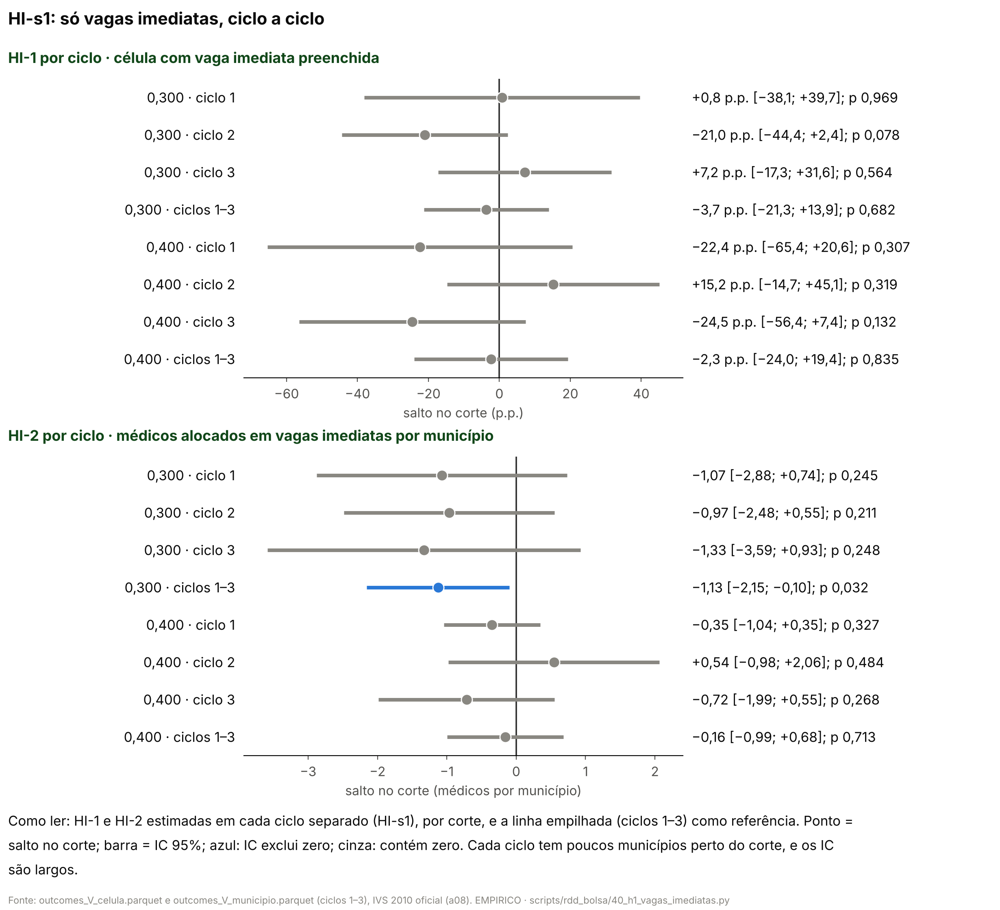

# 57n. Resultados da H1 só com vagas imediatas (adendo 48b)

> **Data:** 26/10/2026. 
> **Especificação:** [`48b_adendo_H1_vagas_imediatas.md`](48b_adendo_H1_vagas_imediatas.md), congelada antes das contas (commit `666aee1`), com a nota datada §7 (commit `4326241`: no ciclo 2, tipo de vaga pelo quadro de 13/02/2026) e as notas de 27/10/2026 depois do cabeçalho e da §1 (só texto); SHA-256 do adendo com a §7 e as notas `21d512b7ebf50928338670318cc6ce031c1bfa7ee2c9aa1e406d5e7a2ff4d09f`, conferido pelo script. 
> **Estatuto:** `ADENDO_48B_POS_RESULTADO`. Pós-resultado: as medidas que misturam vaga imediata e cadastro reserva já tinham sido vistas (docs 49, 49b e 57l). Antes da nota §7, o script chegou a rodar uma vez com o quadro de 19/03 no ciclo 2, e quem o executou viu essa versão de HI-1 e HI-2 (seção 6, "Tipo de vaga do ciclo 2"); ela é a sensibilidade SENS-19MAR. Toda linha de `HI_estimativas.csv` tem `natureza_dos_dados = EMPIRICO`. 
> **Script:** `scripts/rdd_bolsa/40_h1_vagas_imediatas.py` (estimadores de `rdd_lib.py` e funções dos scripts 23 e 36). 
> **Saídas:** `output/rdd_bolsa/HI_estimativas.csv`, `HI_resumo.json` (entradas com SHA-256, reprodução, decisões, contagens) e `HI_figuras/`. 
> **Testes:** `tests/test_h1_vagas_imediatas.py`. 
> **Números:** nenhum número é digitado aqui. O documento inteiro é gerado por `40_h1_vagas_imediatas.py --atualizar-doc`, e o teste confere que é idêntico ao gerado a partir de `output/`.

**Contraste.** O salto é o lado com bolsa maior (IVS acima do corte) menos o lado com bolsa menor; o próprio corte fica no lado de baixo. Em 0,300 a bolsa anunciada sobe de R$ 10 mil para R$ 15 mil e em 0,400 de R$ 15 mil para R$ 20 mil, mas outras regras federais mudam nos mesmos cortes ([auditoria 18](../auditorias/18_politicas_nos_mesmos_cortes_ivs.md)): o que se mede é o **pacote do corte**, não o incentivo de R$ 5 mil isolado, nem a participação no PMM-E, nem o Agora Tem Especialistas.

## 1. Resposta curta

<!-- HI:resposta_curta:inicio -->
**Depois do Holm, nenhuma linha primária rejeita zero**, mas o IC 95% convencional exclui zero em HI-2 em 0,300. A leitura pré-registrada do adendo tem dois casos (todas com IC que contém zero; alguma rejeita depois do Holm) e este fica entre os dois: relatam-se o sinal e o tamanho, como sinal sem correção por comparações múltiplas, com as ressalvas do diagnóstico 61 (poucos municípios, estimativa no corte). Não é a frase "não se detecta diferença" do primeiro caso, nem um efeito confirmado.

- **Corte 0,300** (R$ 10 mil → R$ 15 mil): na chance de uma célula com vaga imediata ser preenchida na 1ª chamada, o salto no corte é −3,7 p.p. (IC 95% [−21,3; +13,9], p Holm 1,000; abaixo do corte, 56,1 % das células são preenchidas); nos médicos alocados nessas vagas, comparando municípios com o mesmo número de vagas imediatas, o salto é −1,13 por município (IC 95% [−2,15; −0,10], p Holm 0,126; média abaixo 2,77).

- **Corte 0,400** (R$ 15 mil → R$ 20 mil): na chance de uma célula com vaga imediata ser preenchida na 1ª chamada, o salto no corte é −2,3 p.p. (IC 95% [−24,0; +19,4], p Holm 1,000; abaixo do corte, 59,0 % das células são preenchidas); nos médicos alocados nessas vagas, comparando municípios com o mesmo número de vagas imediatas, o salto é −0,16 por município (IC 95% [−0,99; +0,68], p Holm 1,000; média abaixo 2,01).

Um IC que contém zero quer dizer que os dados não distinguem a diferença de zero, não que ela seja zero: o intervalo inclui quedas e aumentos do tamanho indicado. No ciclo 2, o tipo de vaga vem do quadro de 13/02/2026, vigente na inscrição (adendo, §7); com o quadro de 19/03, refeito depois do resultado, os números estão na seção 4 ("tipo de vaga pós-resultado (não usar)").

**O que muda em relação à medida antiga, em 0,300.** Com todas as células abertas (A3), o salto era −8,4 p.p. [−18,5; +1,7] (IC que contém zero); só com células de vaga imediata (HI-1), −3,7 p.p. [−21,3; +13,9]. Com o controle por vagas imediatas + cadastro reserva (N1 S-a), o salto era −1,45 [−2,67; −0,22] (IC que exclui zero); só com vagas imediatas (HI-2), −1,13 [−2,15; −0,10]. Ver a figura `HI_antiga_vs_imediatas.png`.

**Secundárias com IC 95% convencional que exclui zero:** HI-s3 (HI-2 alocados em vagas imediatas, por município, sem_controle, ciclos 1+2+3, corte 0,300): −2,76 [−5,00; −0,51], q BKY 0,819; HI-s4 (HI-2 só células puras, so_celulas_puras, ciclos 1+2+3, corte 0,300): −1,08 [−2,03; −0,13], q BKY 0,819. Nenhuma é primária; o q BKY diz quanto resta depois de considerar as 34 secundárias.

**Onde estava a diferença (HI-s6, descritivo):** nas células só de cadastro reserva, em 0,300, o salto é −9,9 p.p. [−20,7; +0,9], contra −3,7 p.p. [−21,3; +13,9] nas células com vaga imediata (HI-1). As células só de reserva se preenchem por remanejamento e pela priorização da SGTES, outro mecanismo. Pela regra fixada no código, como o IC da HI-s6 contém zero, a HI-s6 **não** mostra a diferença concentrada nas células de reserva.

**Equivalência (HI-s7, TOST com as margens do protocolo 60):** HI-1 em 0,300 (margem ±10 p.p.): inconclusivo (nenhum dos dois testes rejeita); HI-1 em 0,400 (margem ±10 p.p.): inconclusivo (nenhum dos dois testes rejeita); HI-2 em 0,300 (margem ±0,69 médico por município, 25% de 2,77): não houve aumento igual ou maior que a margem, mas uma queda desse tamanho não fica descartada; HI-2 em 0,400 (margem ±0,50 médico por município, 25% de 2,01): inconclusivo (nenhum dos dois testes rejeita) — no IC convencional, sob a aproximação local linear e para o pacote do corte. Com o IC honesto, todas ficam inconclusivas (seção 4, HI-s8).

**Frase para a banca:** Comparando só vagas imediatas, nenhuma das quatro linhas primárias rejeita zero depois do Holm. A chance de a célula com vaga imediata ser preenchida não se distingue de zero (0,300: −3,7 p.p. [−21,3; +13,9]; 0,400: −2,3 p.p. [−24,0; +19,4]). O IC convencional exclui zero só em HI-2 em 0,300: −1,13 [−2,15; −0,10], p Holm 0,126: do lado de bolsa maior há menos médicos alocados por município, comparando municípios com as mesmas vagas imediatas, mas o sinal não sobrevive à correção para quatro testes. Em 0,400, HI-2 fica em −0,16 [−0,99; +0,68]. Tudo se refere ao pacote do corte, não à bolsa isolada.
<!-- HI:resposta_curta:fim -->

## 2. Amostra

Unidade de HI-1: célula (estabelecimento × curso) do quadro da 1ª chamada com pelo menos uma vaga imediata (células só de vagas imediatas e células mistas), ciclos 1–3. Unidade de HI-2: município com pelo menos uma dessas células, por ciclo. As células só de cadastro reserva ficam fora e são contadas; nada é imputado. **No ciclo 2, o tipo de vaga e as vagas imediatas vêm do quadro retificado de 13/02/2026, vigente na inscrição** (adendo, §7; leitura de `scripts/auditoria_H1/a36_leitura.py`): o quadro de 19/03/2026, usado no pipeline, foi refeito depois do resultado preliminar ([auditoria 36](../auditorias/36_auditoria_dados_H1.md), seção 3, item 3). Nos ciclos 1 e 3 nada muda.

<!-- HI:quadro_ciclo2:inicio -->
| Quadro do ciclo 2 | Células só imediatas | Mistas | Só cadastro reserva | Vagas imediatas | Alocados na 1ª chamada em células só de CR | Municípios na amostra HI-2 |
|---|---|---|---|---|---|---|
| 13/02/2026, vigente na inscrição (usado) | 712 | 2 | 833 | 1206 | 442 | 328 |
| 19/03/2026, refeito depois do resultado (pipeline; não usar) | 1014 | 1 | 532 | 1836 | 0 | 392 |

Conferência da leitura (`data/raw/aquisicao/vagas/2026_ciclo2_chamada1_vagas_e_servicos_retificado.xlsx`, SHA-256 `3393473cfe5c3163056a0314c3cad4779e8c9c957ba9ea714c29d6a2c77697f8`): 1547 células, as mesmas do quadro de 19/03; 2 com total de vagas diferente; das 833 células só de reserva em 13/02, 301 ganharam vaga imediata em 19/03, e 297 dessas tinham alocado.
<!-- HI:quadro_ciclo2:fim -->

<!-- HI:amostra:inicio -->
| Ciclo | Células no quadro | Sem IVS oficial (fora da RDD) | Só imediatas | Mistas | Na amostra HI-1 | Só cadastro reserva (fora, contadas) | Alocados na 1ª chamada em células só de CR | F1.3 ausente na amostra |
|---|---|---|---|---|---|---|---|---|
| 1 | 1295 | 0 | 503 | 10 | 513 | 782 | 211 | 0 |
| 2 | 1547 | 0 | 712 | 2 | 714 | 833 | 442 | 0 |
| 3 | 2293 | 1 | 449 | 245 | 694 | 1598 | 131 | 0 |

Municípios:

| Ciclo | Municípios no quadro com IVS oficial | Sem IVS oficial (fora da RDD) | Com vaga imediata (amostra HI-2) | Só cadastro reserva (fora, contados) | Com célula pura (HI-s4) | Com célula só de CR (HI-s6) |
|---|---|---|---|---|---|---|
| 1 | 368 | 0 | 215 | 153 | 214 | 306 |
| 2 | 454 | 0 | 328 | 126 | 328 | 287 |
| 3 | 747 | 1 | 307 | 440 | 257 | 653 |

Na janela h = 0,050 de cada corte (ciclos 1–3 juntos):

| Corte | Células na janela, na amostra HI-1 (abaixo / acima) | Células só de CR na janela, fora (abaixo / acima) | Município × ciclo na janela só com CR, fora da HI-2 (abaixo / acima) |
|---|---|---|---|
| 0,300 | 492 / 311 | 688 / 624 | 104 / 80 |
| 0,400 | 315 / 170 | 457 / 301 | 73 / 115 |
<!-- HI:amostra:fim -->

### 2.1 Reprodução antes das contas novas

Antes de estimar HI-1 e HI-2, o script refaz, das mesmas entradas e com os mesmos estimadores, o A3 por corte (`NA_estimativas.csv`), o N1 S-a por corte (`N_estimativas.csv`) e as linhas do 49b §14 por tipo de célula e só com vagas imediatas (`ND_estimativas.csv`). Se alguma não bater (tolerância relativa 1e-09 em salto, EP e p; contagens iguais), ele para sem gravar.

<!-- HI:reproducao:inicio -->
| Linha | Corte | Arquivo de referência | n abaixo / acima | Salto | IC 95% | p | máx |dif| |
|---|---|---|---|---|---|---|---|
| A3_PREENCHIDA | 0,300 | NA_estimativas.csv | 145 / 120 | −8,4 p.p. | [−18,5; +1,7] | 0,104 | 6.9e-17 |
| N1 S-a | 0,300 | N_estimativas.csv | 145 / 120 | −1,45 | [−2,67; −0,22] | 0,021 | 4.9e-17 |
| 49b §14 TAXA_SO_IMED | 0,300 | ND_estimativas.csv | 94 / 77 | −16,5 p.p. | [−37,0; +4,1] | 0,116 | 8.3e-17 |
| 49b §14 TAXA_SO_CR | 0,300 | ND_estimativas.csv | 130 / 102 | −5,4 p.p. | [−12,4; +1,7] | 0,136 | 7.6e-17 |
| 49b §14 TAXA_VI | 0,300 | ND_estimativas.csv | 98 / 79 | −19,2 p.p. | [−43,1; +4,7] | 0,115 | 5.6e-17 |
| A3_PREENCHIDA | 0,400 | NA_estimativas.csv | 122 / 145 | −1,3 p.p. | [−14,0; +11,3] | 0,838 | 4.3e-17 |
| N1 S-a | 0,400 | N_estimativas.csv | 122 / 145 | −0,14 | [−0,82; +0,54] | 0,682 | 0.0e+00 |
| 49b §14 TAXA_SO_IMED | 0,400 | ND_estimativas.csv | 82 / 76 | −2,1 p.p. | [−22,8; +18,6] | 0,843 | 5.6e-17 |
| 49b §14 TAXA_SO_CR | 0,400 | ND_estimativas.csv | 103 / 124 | +2,2 p.p. | [−5,1; +9,4] | 0,555 | 9.0e-17 |
| 49b §14 TAXA_VI | 0,400 | ND_estimativas.csv | 88 / 76 | +1,0 p.p. | [−26,0; +28,1] | 0,941 | 5.7e-17 |

Resultado: **reproduz** (10 linhas; máx |dif| = 9.0e-17). A contagem de células por tipo do 49b §14 também bate com `ND_resumo.json`. A forma literal da HI-s2 ('≥ 1 alocado') é idêntica a HI-1 célula a célula; a F1.3 difere de HI-1 em 2 célula(s) com vaga imediata no V1, 0 célula(s) com vaga imediata no V2, 0 célula(s) com vaga imediata no V3.
<!-- HI:reproducao:fim -->

## 3. Primárias (Holm entre as quatro linhas)

Local linear, kernel triangular, h = 0,050, cada corte separado, ciclos 1–3 empilhados com intercepto e inclinações por ciclo de cada lado e salto comum; EP agrupado por município (CR1). HI-1 tem efeitos fixos de curso × ciclo. HI-2 controla pelas vagas imediatas das células com vaga imediata, linear, com o mesmo coeficiente dos dois lados e um coeficiente por ciclo, como o S-a do protocolo 48. "Média abaixo" é a média simples do outcome nas linhas usadas do lado de baixo; MDE = 2,8 × EP. O IC honesto segue a regra do E6 (seção 4, HI-s8).

<!-- HI:primarias:inicio -->
| Linha | Corte | Municípios abaixo / acima | Linhas (células ou município × ciclo) | Média abaixo | Salto | IC 95% (CR1) | p | p Holm | IC honesto (M ×1) | MDE |
|---|---|---|---|---|---|---|---|---|---|---|
| HI-1 célula com vaga imediata preenchida | 0,300 | 95 / 72 | 803 | 56,1 % | −3,7 p.p. | [−21,3; +13,9] | 0,682 | 1,000 | [−930,0; +922,6] | 25,1 p.p. |
| HI-1 célula com vaga imediata preenchida | 0,400 | 83 / 69 | 485 | 59,0 % | −2,3 p.p. | [−24,0; +19,4] | 0,835 | 1,000 | [−758,7; +754,1] | 31,0 p.p. |
| HI-2 alocados em vagas imediatas, por município | 0,300 | 95 / 72 | 257 | 2,77 | −1,13 | [−2,15; −0,10] | 0,032 | 0,126 | [−39,02; +36,76] | 1,47 |
| HI-2 alocados em vagas imediatas, por município | 0,400 | 83 / 69 | 227 | 2,01 | −0,16 | [−0,99; +0,68] | 0,713 | 1,000 | [−31,05; +30,73] | 1,19 |
<!-- HI:primarias:fim -->

<!-- HI:leitura_primarias:inicio -->
Leitura pela regra pré-registrada (código `IC_CONVENCIONAL_EXCLUI_ZERO_SEM_HOLM`): Comparando só vagas imediatas, nenhuma das quatro linhas primárias rejeita zero depois do Holm. A chance de a célula com vaga imediata ser preenchida não se distingue de zero (0,300: −3,7 p.p. [−21,3; +13,9]; 0,400: −2,3 p.p. [−24,0; +19,4]). O IC convencional exclui zero só em HI-2 em 0,300: −1,13 [−2,15; −0,10], p Holm 0,126: do lado de bolsa maior há menos médicos alocados por município, comparando municípios com as mesmas vagas imediatas, mas o sinal não sobrevive à correção para quatro testes. Em 0,400, HI-2 fica em −0,16 [−0,99; +0,68]. Tudo se refere ao pacote do corte, não à bolsa isolada.
<!-- HI:leitura_primarias:fim -->

## 4. Secundárias (todas relatadas)

q-valores BKY (Benjamini, Krieger e Yekutieli) entre as secundárias que testam salto zero: HI-s1, HI-s2 (F1.3), HI-s3, HI-s4, HI-s5, HI-s6 e as janelas h da HI-s8. Ficam fora do BKY: a forma literal da HI-s2 (repete HI-1), o IC honesto (outra inferência) e o TOST (outra hipótese nula). Família BKY: 34 linhas.

### HI-s1 — HI-1 e HI-2 por ciclo

<!-- HI:hi_s1:inicio -->
| Linha | Variante | Ciclos | Corte | Janela | Municípios abaixo / acima | Linhas | Média abaixo | Salto | IC 95% | p | q BKY |
|---|---|---|---|---|---|---|---|---|---|---|---|
| HI-1 célula com vaga imediata preenchida | por_ciclo | 1 | 0,300 | h = 0,050 | 30 / 33 | 202 | 43,0 % | +0,8 p.p. | [−38,1; +39,7] | 0,969 | 1,000 |
| HI-2 alocados em vagas imediatas, por município | por_ciclo | 1 | 0,300 | h = 0,050 | 30 / 33 | 63 | 2,30 | −1,07 | [−2,88; +0,74] | 0,245 | 1,000 |
| HI-1 célula com vaga imediata preenchida | por_ciclo | 2 | 0,300 | h = 0,050 | 61 / 41 | 290 | 64,4 % | −21,0 p.p. | [−44,4; +2,4] | 0,078 | 1,000 |
| HI-2 alocados em vagas imediatas, por município | por_ciclo | 2 | 0,300 | h = 0,050 | 61 / 41 | 102 | 2,93 | −0,97 | [−2,48; +0,55] | 0,211 | 1,000 |
| HI-1 célula com vaga imediata preenchida | por_ciclo | 3 | 0,300 | h = 0,050 | 50 / 42 | 311 | 56,3 % | +7,2 p.p. | [−17,3; +31,6] | 0,564 | 1,000 |
| HI-2 alocados em vagas imediatas, por município | por_ciclo | 3 | 0,300 | h = 0,050 | 50 / 42 | 92 | 2,86 | −1,33 | [−3,59; +0,93] | 0,248 | 1,000 |
| HI-1 célula com vaga imediata preenchida | por_ciclo | 1 | 0,400 | h = 0,050 | 40 / 25 | 158 | 44,5 % | −22,4 p.p. | [−65,4; +20,6] | 0,307 | 1,000 |
| HI-2 alocados em vagas imediatas, por município | por_ciclo | 1 | 0,400 | h = 0,050 | 40 / 25 | 65 | 1,35 | −0,35 | [−1,04; +0,35] | 0,327 | 1,000 |
| HI-1 célula com vaga imediata preenchida | por_ciclo | 2 | 0,400 | h = 0,050 | 43 / 38 | 181 | 70,1 % | +15,2 p.p. | [−14,7; +45,1] | 0,319 | 1,000 |
| HI-2 alocados em vagas imediatas, por município | por_ciclo | 2 | 0,400 | h = 0,050 | 43 / 38 | 81 | 2,74 | +0,54 | [−0,98; +2,06] | 0,484 | 1,000 |
| HI-1 célula com vaga imediata preenchida | por_ciclo | 3 | 0,400 | h = 0,050 | 47 / 34 | 146 | 63,3 % | −24,5 p.p. | [−56,4; +7,4] | 0,132 | 1,000 |
| HI-2 alocados em vagas imediatas, por município | por_ciclo | 3 | 0,400 | h = 0,050 | 47 / 34 | 81 | 1,89 | −0,72 | [−1,99; +0,55] | 0,268 | 1,000 |
<!-- HI:hi_s1:fim -->

### HI-s2 — outra definição de "preenchida"

<!-- HI:nota_hi_s2:inicio -->
O adendo descreve HI-1 com "a definição de preenchida de cada ciclo, igual à do A3" e a HI-s2 com "uma definição única (≥ 1 alocado na 1ª chamada)". Na base, a definição do A3 já é `n_alocados_ch1 >= 1` em todos os ciclos; o que muda por ciclo é a fonte do "alocado". HI-1 segue o A3, para que a comparação com a medida antiga mude só a amostra. A forma literal da HI-s2 repete HI-1 (conferido célula a célula; linha `definicao_literal_alocado`, fora do BKY); por isso a HI-s2 relata também a outra definição da base, a F1.3 do protocolo 40 (ciclo 1: confirmação ou homologação).
<!-- HI:nota_hi_s2:fim -->

<!-- HI:hi_s2:inicio -->
| Linha | Variante | Ciclos | Corte | Janela | Municípios abaixo / acima | Linhas | Média abaixo | Salto | IC 95% | p | q BKY |
|---|---|---|---|---|---|---|---|---|---|---|---|
| HI-1 com '≥ 1 alocado' (literal) | definicao_literal_alocado | 1+2+3 | 0,300 | h = 0,050 | 95 / 72 | 803 | 56,1 % | −3,7 p.p. | [−21,3; +13,9] | 0,682 | fora do BKY |
| HI-1 com a F1.3 | definicao_F1.3 | 1+2+3 | 0,300 | h = 0,050 | 95 / 72 | 803 | 56,1 % | −3,7 p.p. | [−21,3; +13,9] | 0,682 | 1,000 |
| HI-1 com '≥ 1 alocado' (literal) | definicao_literal_alocado | 1+2+3 | 0,400 | h = 0,050 | 83 / 69 | 485 | 59,0 % | −2,3 p.p. | [−24,0; +19,4] | 0,835 | fora do BKY |
| HI-1 com a F1.3 | definicao_F1.3 | 1+2+3 | 0,400 | h = 0,050 | 83 / 69 | 485 | 59,4 % | −2,2 p.p. | [−23,9; +19,4] | 0,839 | 1,000 |
<!-- HI:hi_s2:fim -->

### HI-s3 — HI-2 sem controle (efeito total entre vagas imediatas)

<!-- HI:hi_s3:inicio -->
| Linha | Variante | Ciclos | Corte | Janela | Municípios abaixo / acima | Linhas | Média abaixo | Salto | IC 95% | p | q BKY |
|---|---|---|---|---|---|---|---|---|---|---|---|
| HI-2 alocados em vagas imediatas, por município | sem_controle | 1+2+3 | 0,300 | h = 0,050 | 95 / 72 | 257 | 2,77 | −2,76 | [−5,00; −0,51] | 0,016 | 0,819 |
| HI-2 alocados em vagas imediatas, por município | sem_controle | 1+2+3 | 0,400 | h = 0,050 | 83 / 69 | 227 | 2,01 | −0,92 | [−2,43; +0,60] | 0,236 | 1,000 |
<!-- HI:hi_s3:fim -->

### HI-s4 — só células puras de vaga imediata (sem as mistas)

<!-- HI:hi_s4:inicio -->
| Linha | Variante | Ciclos | Corte | Janela | Municípios abaixo / acima | Linhas | Média abaixo | Salto | IC 95% | p | q BKY |
|---|---|---|---|---|---|---|---|---|---|---|---|
| HI-1 só células puras | so_celulas_puras | 1+2+3 | 0,300 | h = 0,050 | 91 / 68 | 678 | 56,8 % | −10,1 p.p. | [−29,8; +9,7] | 0,317 | 1,000 |
| HI-2 só células puras | so_celulas_puras | 1+2+3 | 0,300 | h = 0,050 | 91 / 68 | 243 | 2,57 | −1,08 | [−2,03; −0,13] | 0,026 | 0,819 |
| HI-1 só células puras | so_celulas_puras | 1+2+3 | 0,400 | h = 0,050 | 77 / 69 | 444 | 56,8 % | +2,4 p.p. | [−21,7; +26,5] | 0,846 | 1,000 |
| HI-2 só células puras | so_celulas_puras | 1+2+3 | 0,400 | h = 0,050 | 77 / 69 | 216 | 1,89 | +0,09 | [−0,68; +0,85] | 0,827 | 1,000 |
<!-- HI:hi_s4:fim -->

### HI-s5 — preenchimento até a 2ª chamada, todas as células (F1.4; ciclos 1 e 2)

<!-- HI:hi_s5:inicio -->
| Linha | Variante | Ciclos | Corte | Janela | Municípios abaixo / acima | Linhas | Média abaixo | Salto | IC 95% | p | q BKY |
|---|---|---|---|---|---|---|---|---|---|---|---|
| preenchida até a 2ª chamada, todas as células | ate_2a_chamada_todas_as_celulas | 1+2 | 0,300 | h = 0,050 | 100 / 80 | 1150 | 47,0 % | −16,9 p.p. | [−33,9; +0,1] | 0,052 | 1,000 |
| preenchida até a 2ª chamada, todas as células | ate_2a_chamada_todas_as_celulas | 1+2 | 0,400 | h = 0,050 | 69 / 71 | 718 | 56,3 % | −5,1 p.p. | [−25,1; +14,9] | 0,616 | 1,000 |
<!-- HI:hi_s5:fim -->

### HI-s6 — só células de cadastro reserva (descritivo)

<!-- HI:leitura_hi_s6:inicio -->
Regra fixa no código: a diferença se mostra concentrada nas células só de reserva se, em 0,300 (onde as medidas antigas caíam), a HI-s6 por célula tiver IC 95% que exclui zero, com salto negativo, e HI-1 tiver IC que contém zero. Resultado: `NAO_SE_MOSTRA_CONCENTRADA`.
<!-- HI:leitura_hi_s6:fim -->

<!-- HI:hi_s6:inicio -->
| Linha | Variante | Ciclos | Corte | Janela | Municípios abaixo / acima | Linhas | Média abaixo | Salto | IC 95% | p | q BKY |
|---|---|---|---|---|---|---|---|---|---|---|---|
| célula só de reserva preenchida | so_cadastro_reserva | 1+2+3 | 0,300 | h = 0,050 | 132 / 105 | 1312 | 17,0 % | −9,9 p.p. | [−20,7; +0,9] | 0,072 | 1,000 |
| alocados em células só de reserva, por município | so_cadastro_reserva | 1+2+3 | 0,300 | h = 0,050 | 132 / 105 | 365 | 0,87 | −0,69 | [−1,66; +0,28] | 0,161 | 1,000 |
| célula só de reserva preenchida | so_cadastro_reserva | 1+2+3 | 0,400 | h = 0,050 | 104 / 128 | 758 | 21,4 % | −5,6 p.p. | [−15,5; +4,2] | 0,264 | 1,000 |
| alocados em células só de reserva, por município | so_cadastro_reserva | 1+2+3 | 0,400 | h = 0,050 | 104 / 128 | 327 | 0,86 | −0,04 | [−0,36; +0,29] | 0,831 | 1,000 |
<!-- HI:hi_s6:fim -->

### HI-s7 — equivalência (TOST com as margens do protocolo 60)

Dois testes unilaterais a 5% (IC 90%), com a função do script 36. Margens: HI-1, ±10 p.p.; HI-2, ±25% da média abaixo do corte na mesma amostra. "Honesto" usa o viés máximo do IC honesto (M ×1). A margem mínima é a menor margem com o IC 90% dentro dela.

<!-- HI:hi_s7:inicio -->
| Linha | Corte | IC | Margem | IC 90% | p (aumento ≥ margem) | p (queda ≥ margem) | Leitura | Margem mínima de equivalência |
|---|---|---|---|---|---|---|---|---|
| HI-1 célula com vaga imediata preenchida | 0,300 | convencional | ±10 p.p. | [−18,4; +11,1] | 0,064 | 0,240 | inconclusivo (nenhum dos dois testes rejeita) | 18,4 p.p. |
| HI-1 célula com vaga imediata preenchida | 0,300 | honesto (M ×1) | ±10 p.p. | [−930,0; +922,6] | 1,000 | 1,000 | inconclusivo (nenhum dos dois testes rejeita) | 930,0 p.p. |
| HI-2 alocados em vagas imediatas, por município | 0,300 | convencional | ±0,69 (25% de 2,77) | [−1,99; −0,26] | < 0,001 | 0,796 | não houve aumento igual ou maior que a margem, mas uma queda desse tamanho não fica descartada | 1,99 |
| HI-2 alocados em vagas imediatas, por município | 0,300 | honesto (M ×1) | ±0,69 (25% de 2,77) | [−39,02; +36,76] | 1,000 | 1,000 | inconclusivo (nenhum dos dois testes rejeita) | 39,02 |
| HI-1 célula com vaga imediata preenchida | 0,400 | convencional | ±10 p.p. | [−20,5; +15,9] | 0,133 | 0,244 | inconclusivo (nenhum dos dois testes rejeita) | 20,5 p.p. |
| HI-1 célula com vaga imediata preenchida | 0,400 | honesto (M ×1) | ±10 p.p. | [−758,7; +754,1] | 1,000 | 1,000 | inconclusivo (nenhum dos dois testes rejeita) | 758,7 p.p. |
| HI-2 alocados em vagas imediatas, por município | 0,400 | convencional | ±0,50 (25% de 2,01) | [−0,86; +0,55] | 0,061 | 0,209 | inconclusivo (nenhum dos dois testes rejeita) | 0,86 |
| HI-2 alocados em vagas imediatas, por município | 0,400 | honesto (M ×1) | ±0,50 (25% de 2,01) | [−31,05; +30,73] | 1,000 | 1,000 | inconclusivo (nenhum dos dois testes rejeita) | 31,05 |
<!-- HI:hi_s7:fim -->

### HI-s8 — janelas h = 0,030 e 0,080 e IC honesto

<!-- HI:hi_s8_h:inicio -->
| Linha | Variante | Ciclos | Corte | Janela | Municípios abaixo / acima | Linhas | Média abaixo | Salto | IC 95% | p | q BKY |
|---|---|---|---|---|---|---|---|---|---|---|---|
| HI-1 célula com vaga imediata preenchida | h=0.030 | 1+2+3 | 0,300 | h = 0,030 | 50 / 44 | 462 | 60,9 % | −2,0 p.p. | [−24,7; +20,7] | 0,860 | 1,000 |
| HI-2 alocados em vagas imediatas, por município | h=0.030 | 1+2+3 | 0,300 | h = 0,030 | 50 / 44 | 140 | 3,37 | −0,50 | [−1,67; +0,68] | 0,405 | 1,000 |
| HI-1 célula com vaga imediata preenchida | h=0.080 | 1+2+3 | 0,300 | h = 0,080 | 144 / 121 | 1118 | 52,5 % | −3,2 p.p. | [−18,2; +11,8] | 0,676 | 1,000 |
| HI-2 alocados em vagas imediatas, por município | h=0.080 | 1+2+3 | 0,300 | h = 0,080 | 144 / 121 | 400 | 2,21 | −0,74 | [−1,67; +0,20] | 0,122 | 1,000 |
| HI-1 célula com vaga imediata preenchida | h=0.030 | 1+2+3 | 0,400 | h = 0,030 | 48 / 38 | 308 | 60,2 % | −7,3 p.p. | [−36,1; +21,5] | 0,619 | 1,000 |
| HI-2 alocados em vagas imediatas, por município | h=0.030 | 1+2+3 | 0,400 | h = 0,030 | 48 / 38 | 134 | 2,33 | −0,35 | [−1,36; +0,65] | 0,488 | 1,000 |
| HI-1 célula com vaga imediata preenchida | h=0.080 | 1+2+3 | 0,400 | h = 0,080 | 127 / 88 | 740 | 59,8 % | +4,0 p.p. | [−13,6; +21,5] | 0,658 | 1,000 |
| HI-2 alocados em vagas imediatas, por município | h=0.080 | 1+2+3 | 0,400 | h = 0,080 | 127 / 88 | 327 | 2,17 | −0,13 | [−0,83; +0,57] | 0,716 | 1,000 |
<!-- HI:hi_s8_h:fim -->

<!-- HI:hi_s8_honesto:inicio -->
| Linha | Corte | M (× regra de bolso) | Salto | IC honesto 95% | Viés máximo | p honesto |
|---|---|---|---|---|---|---|
| HI-1 célula com vaga imediata preenchida | 0,300 | 0,5 | −3,7 p.p. | [−474,2; +466,9] | +455,8 p.p. | 1,000 |
| HI-1 célula com vaga imediata preenchida | 0,300 | 1,0 | −3,7 p.p. | [−930,0; +922,6] | +911,6 p.p. | 1,000 |
| HI-1 célula com vaga imediata preenchida | 0,300 | 2,0 | −3,7 p.p. | [−1841,6; +1834,2] | +1823,1 p.p. | 1,000 |
| HI-2 alocados em vagas imediatas, por município | 0,300 | 0,5 | −1,13 | [−20,46; +18,21] | +18,55 | 1,000 |
| HI-2 alocados em vagas imediatas, por município | 0,300 | 1,0 | −1,13 | [−39,02; +36,76] | +37,11 | 1,000 |
| HI-2 alocados em vagas imediatas, por município | 0,300 | 2,0 | −1,13 | [−76,12; +73,87] | +74,21 | 1,000 |
| HI-1 célula com vaga imediata preenchida | 0,400 | 0,5 | −2,3 p.p. | [−389,6; +385,0] | +369,1 p.p. | 1,000 |
| HI-1 célula com vaga imediata preenchida | 0,400 | 1,0 | −2,3 p.p. | [−758,7; +754,1] | +738,2 p.p. | 1,000 |
| HI-1 célula com vaga imediata preenchida | 0,400 | 2,0 | −2,3 p.p. | [−1497,0; +1492,4] | +1476,5 p.p. | 1,000 |
| HI-2 alocados em vagas imediatas, por município | 0,400 | 0,5 | −0,16 | [−15,95; +15,64] | +15,10 | 1,000 |
| HI-2 alocados em vagas imediatas, por município | 0,400 | 1,0 | −0,16 | [−31,05; +30,73] | +30,19 | 1,000 |
| HI-2 alocados em vagas imediatas, por município | 0,400 | 2,0 | −0,16 | [−61,24; +60,93] | +60,39 | 1,000 |
<!-- HI:hi_s8_honesto:fim -->

O IC honesto pela regra do E6 ajusta uma quártica num suporte largo; com um outcome binário (HI-1) ou uma contagem (HI-2) e poucos municípios, o M sai enorme e o intervalo fica muitas vezes mais largo que a própria escala do outcome, como no doc 49 (§3, item ii). Ele é relatado porque o adendo pede, mas não é ele que sustenta a leitura.

### Sensibilidade: tipo de vaga do ciclo 2 pelo quadro de 19/03/2026 — "tipo de vaga pós-resultado (não usar)"

Só para mostrar a diferença: as mesmas HI-1 e HI-2, com o tipo de vaga e as vagas imediatas do ciclo 2 tirados do quadro refeito depois do resultado preliminar. Fora do Holm e do BKY; não é especificação do adendo.

<!-- HI:sens_19mar:inicio -->
| Linha | Corte | Ciclos | Quadro de 13/02 (usado): salto [IC 95%] | n abaixo / acima | Quadro de 19/03: salto [IC 95%] | n abaixo / acima | Rótulo |
|---|---|---|---|---|---|---|---|
| HI-1 célula com vaga imediata preenchida | 0,300 | 1+2+3 | −3,7 p.p. [−21,3; +13,9] | 95 / 72 | −3,4 p.p. [−20,3; +13,6] | 98 / 79 | tipo de vaga pós-resultado (não usar) |
| HI-1 célula com vaga imediata preenchida | 0,300 | 2 | −21,0 p.p. [−44,4; +2,4] | 61 / 41 | −12,7 p.p. [−33,8; +8,4] | 69 / 52 | tipo de vaga pós-resultado (não usar) |
| HI-1 célula com vaga imediata preenchida | 0,400 | 1+2+3 | −2,3 p.p. [−24,0; +19,4] | 83 / 69 | −5,5 p.p. [−28,1; +17,1] | 88 / 76 | tipo de vaga pós-resultado (não usar) |
| HI-1 célula com vaga imediata preenchida | 0,400 | 2 | +15,2 p.p. [−14,7; +45,1] | 43 / 38 | +5,5 p.p. [−25,5; +36,6] | 51 / 50 | tipo de vaga pós-resultado (não usar) |
| HI-2 alocados em vagas imediatas, por município | 0,300 | 1+2+3 | −1,13 [−2,15; −0,10] | 95 / 72 | −1,00 [−2,16; +0,16] | 98 / 79 | tipo de vaga pós-resultado (não usar) |
| HI-2 alocados em vagas imediatas, por município | 0,300 | 2 | −0,97 [−2,48; +0,55] | 61 / 41 | −0,73 [−2,49; +1,03] | 69 / 52 | tipo de vaga pós-resultado (não usar) |
| HI-2 alocados em vagas imediatas, por município | 0,400 | 1+2+3 | −0,16 [−0,99; +0,68] | 83 / 69 | −0,16 [−1,00; +0,68] | 88 / 76 | tipo de vaga pós-resultado (não usar) |
| HI-2 alocados em vagas imediatas, por município | 0,400 | 2 | +0,54 [−0,98; +2,06] | 43 / 38 | +0,39 [−0,99; +1,77] | 51 / 50 | tipo de vaga pós-resultado (não usar) |
<!-- HI:sens_19mar:fim -->

## 5. Figuras

**Como ler: cada ponto é o salto no corte (lado de bolsa maior menos lado de bolsa menor) e a barra é o IC 95%. Em cima, a chance de uma célula com vaga imediata ser preenchida na 1ª chamada; embaixo, os médicos alocados nessas células por município, comparando municípios com o mesmo número de vagas imediatas. Azul: o IC exclui zero; cinza: contém zero. Barra que cruza a linha do zero quer dizer que não se detecta diferença, não que ela seja zero. Pacote do corte, não só a bolsa.**

**Como ler: só células com vaga imediata. Cada ponto é a fração de células preenchidas na 1ª chamada numa faixa de IVS de 0,010 (tamanho = número de células); cada linha é a reta local de um lado (kernel triangular, h = 0,050); a distância entre as retas no corte é o salto cru. Azul: bolsa menor; laranja: bolsa maior; tracejada: o corte. Dados crus, ciclos 1–3 juntos, sem efeitos fixos. A HI-1 do subtítulo compara células do mesmo curso e ciclo, com uma reta por ciclo; por isso pode diferir, até no sinal, da distância crua.**

**Como ler: em cada corte, a linha cinza é a medida antiga, que mistura vagas imediatas e de cadastro reserva (A3: todas as células abertas; N1: controle por vagas imediatas + reserva), e a azul é a mesma pergunta só com vagas imediatas (HI-1 e HI-2; no ciclo 2, tipo de vaga pelo quadro de 13/02/2026, anterior às escolhas). Ponto = salto no corte; barra = IC 95%. Mostra quanto do sinal antigo vinha de comparar vagas de tipos diferentes.**

**Como ler: HI-1 e HI-2 estimadas em cada ciclo separado (HI-s1), por corte, e a linha empilhada (ciclos 1–3) como referência. Ponto = salto no corte; barra = IC 95%; azul: IC exclui zero; cinza: contém zero. Cada ciclo tem poucos municípios perto do corte, e os IC são largos.**

## 6. Limites

<!-- HI:limites:inicio -->
- **Pós-resultado.** O adendo foi escrito depois de ver que as medidas com reserva caíam em 0,300 e as restritas a vagas imediatas não; é uma correção de definição, não uma primeira olhada. A especificação foi congelada antes destas contas, mas a escolha de olhar só vagas imediatas não é cega ao resultado. A justificativa do §1 do adendo (no ciclo 2, nenhuma célula só de reserva teve alocado) descrevia o quadro refeito depois do resultado: pela auditoria 36, os editais permitem preencher a reserva na 1ª chamada, e pôr essas células no denominador não é erro de regra. O que sustenta comparar só vagas imediatas é a célula só de reserva se preencher por outro mecanismo (remanejamento e priorização da SGTES), não uma regra que impeça preenchê-la.
- **Pacote do corte.** Em 0,300 e 0,400 mudam a bolsa anunciada e outras regras federais (auditoria 18). Nada aqui isola o incentivo de R$ 5 mil, a participação no PMM-E ou o Agora Tem Especialistas.
- **Definição de "preenchida" por ciclo.** No dicionário dos outcomes (`dicionario_outcomes_funil.json`): `n_alocados_ch1` = alocados na 1a chamada (ciclo 1: confirmações na alocação sub judice; ciclos 2-3: SITUAÇÃO ALOCADO); `f1_3_preenchida_ch1` = F1.3 na célula: ciclo 1 = Y1 do E3/E4; ciclos 2-3 = ≥1 alocado na 1a chamada; `f1_4_preenchida_ate_ch2` = F1.4 na célula: ciclo 1 = Y2 do E4; ciclo 2 = F1.3 ou ≥1 alocado na 2a chamada; ciclo 3 NaN. HI-1 usa `n_alocados_ch1 >= 1` (a definição do A3); a HI-s2 relata a F1.3 e a HI-s5 a F1.4. "Alocado" não é a mesma operação administrativa nos três ciclos, e o empilhamento usa intercepto e efeitos fixos por ciclo, não uma definição idêntica.
- **Células mistas.** A base não registra em que tipo de vaga cada alocado entrou. Nas células mistas contam todos os alocados da célula (HI-1 e HI-2), e o controle de HI-2 são as vagas imediatas dessas células: um alocado de célula mista que tenha ocupado vaga de cadastro reserva conta como preenchimento de vaga imediata. A HI-s4 (só células puras) mostra o resultado sem as mistas.
- **Tipo de vaga do ciclo 2 (adendo, §7).** O tipo de vaga do ciclo 2 vem do quadro de 13/02/2026, anterior às escolhas; o de 19/03/2026 registra o remanejamento feito depois do resultado preliminar e condicionaria no próprio outcome (auditoria 36). A sensibilidade com 19/03 está na seção 4, rotulada "tipo de vaga pós-resultado (não usar)". Exposição: antes de a nota §7 chegar, este script já tinha sido rodado uma vez com o quadro de 19/03 no ciclo 2, e o autor do script viu essa versão de HI-1 e HI-2; a nota §7 foi escrita a partir da auditoria 36, sem esses números. A versão com 19/03 é a da sensibilidade.
- **Regra da reserva nos editais.** A auditoria 36 (`docs/auditorias/36_auditoria_dados_H1.md`, seção 3, item 2) conclui que os editais dos ciclos 1 e 3 permitem preencher a reserva na 1ª chamada (itens 4.1.3.3, 4.1.3.4 e 5.7, tabela abaixo) e que, no ciclo 2, sem o texto do edital no repositório, a reserva foi preenchida na 1ª chamada pela conversão registrada no quadro de 19/03/2026 (por isso o tipo de vaga do ciclo 2 vem do quadro de 13/02). A célula só de reserva se preenche por remanejamento e pela priorização da SGTES (item 5.7), mecanismo diferente do da vaga imediata. Pela especificação do adendo, a comparação continua sendo entre vagas do mesmo tipo.
- **Controle de HI-2.** As vagas imediatas são definidas pelo gestor e pela SGTES e podem ter respondido ao corte (doc 49, §4); com controle, HI-2 compara municípios com as mesmas vagas imediatas, e só é causal se essa oferta não carregar seleção. A HI-s3 relata a forma sem controle. A própria amostra (células com vaga imediata) depende da mesma decisão: se o tipo de vaga responde ao corte, a amostra é selecionada pelo tratamento. O adendo 48f, congelado depois destas contas, mede essa seleção.
- **Precisão.** Poucos municípios ficam perto de cada corte e a estimativa é no corte (diagnóstico 61): os IC são largos, e não detectar diferença não é mostrar que ela é zero (ver o MDE e o TOST).
<!-- HI:limites:fim -->

<!-- HI:editais:inicio -->
Itens de edital já arquivados sobre o cadastro reserva:

| Edital | Item | Trecho |
|---|---|---|
| Edital de Chamamento Publico SGTES/MS no 3/2025 (DOU), ciclo 1 | 4.1.3.3 | “O candidato poderá escolher, dentre suas opções, município com vaga para preenchimento imediato e município que esteja em cadastro de reserva.” |
| Edital de Chamamento Publico SGTES/MS no 3/2025 (DOU), ciclo 1 | 4.1.3.4 | “Considera-se em cadastro de reserva o município que, na oferta inicial, não tinha vaga imediata, mas que poderá recebê-la por remanejamento” |
| Edital de Chamamento Publico SGTES/MS no 3/2025 (DOU), ciclo 1 | 5.7 | “as vagas remanescentes poderão ser redistribuídas para municípios com cadastro de reserva e que tenham candidatos na lista de espera” |
| Edital SGTES/MS no 28/2026, ciclo 3 | 4.1.3.4 | “A disponibilização de vaga para esses municípios poderá ocorrer por remanejamento de vagas não ocupadas” |
| Edital SGTES/MS no 28/2026, ciclo 3 | 5.7 | “as vagas remanescentes poderão ser redistribuídas para municípios com cadastro de reserva e que tenham candidatos na lista de espera” |
<!-- HI:editais:fim -->
