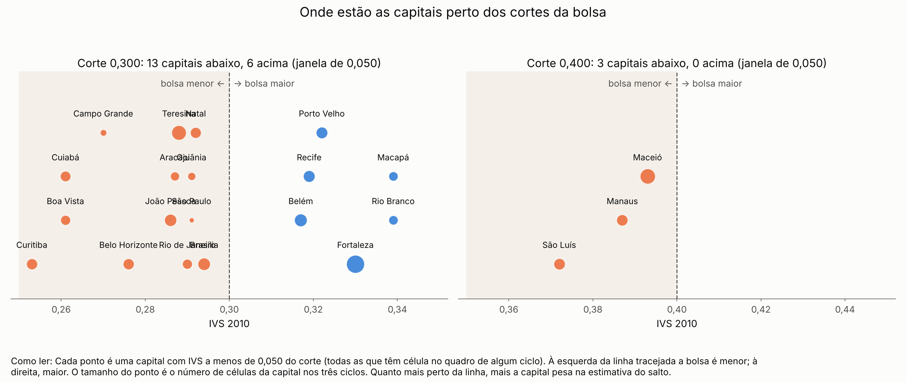
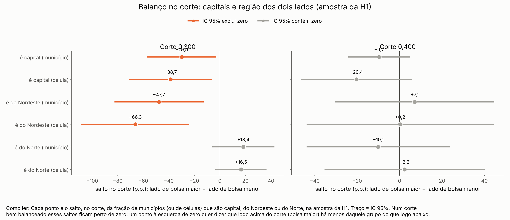
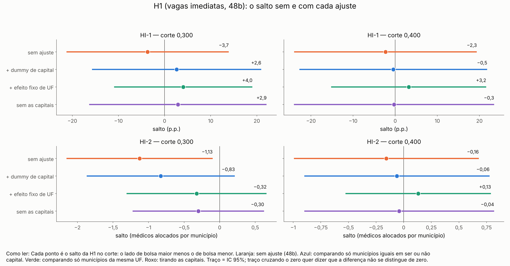
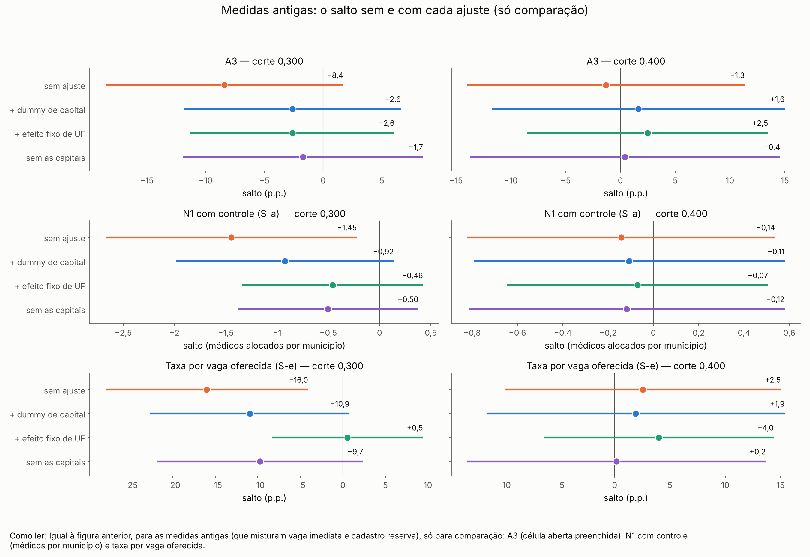

# 57o. H1 com capitais e UF no corte 0,300 (adendo 48c, robustez pós-resultado)

> **Data:** 26/10/2026. 
> **Adendo:** [`48c_adendo_capitais_e_UF.md`](48c_adendo_capitais_e_UF.md), congelado antes destas contas (SHA-256 em
> `adendo` de `HC_resumo.json`). Especificação principal da H1: [`48b`](48b_adendo_H1_vagas_imediatas.md) (com a §7:
> no ciclo 2, tipo de vaga do quadro de 13/02/2026). 
> **Origem:** a [auditoria 36](../auditorias/36_auditoria_dados_H1.md) viu capitais concentradas logo abaixo de 0,300. 
> **Estatuto:** `ADENDO_48C_POS_RESULTADO`. Robustez **pós-resultado**; não muda a especificação principal. O contraste é o pacote
> do corte (incentivo marginal anunciado e outras regras no mesmo corte), nunca a participação no PMM-E nem o Agora
> Tem Especialistas. Toda linha de `HC_estimativas.csv` tem `natureza_dos_dados = EMPIRICO`. 
> **Script:** `scripts/rdd_bolsa/41_h1_capitais_uf.py`. **Saídas:** `output/rdd_bolsa/HC_estimativas.csv`,
> `HC_resumo.json`, `HC_figuras/`. **Testes:** `tests/test_h1_capitais_uf.py`. 
> **Números:** nenhum é digitado. Os blocos entre marcadores `<!-- HC:... -->` são regravados das saídas por
> `41_h1_capitais_uf.py --atualizar-doc`; o teste confere que o documento é idêntico ao gerado.

## 1. Resposta curta

<!-- HC:resposta_curta:inicio -->
**Sim, pela leitura pré-registrada:** a queda em 0,300 anda junto com a presença de capitais (ou região) logo abaixo do corte, que é desbalanceamento de poucos municípios grandes, e não com a bolsa. É robustez pós-resultado, com poucos municípios perto do corte.

- **Capitais no corte.** Na janela de 0,050 em torno de 0,300 há 13 capitais abaixo (bolsa menor) e 6 acima. A menos de 0,010 do corte: São Paulo (0,291), Goiânia (0,291), Natal (0,292), Brasília (0,294), todas abaixo. Na amostra da H1, a fração de municípios que são capital é 29,9 p.p. menor logo acima do corte (bolsa maior) do que logo abaixo (IC [−57,1; −2,8]); por célula, a fração de células em capital é 38,7 p.p. menor logo acima do corte (bolsa maior) do que logo abaixo (IC [−71,2; −6,1]). Ser capital é anterior à bolsa: o corte não é balanceado em capital.
- **Região.** Nordeste: a fração de municípios do Nordeste é 47,7 p.p. menor logo acima do corte (bolsa maior) do que logo abaixo (IC [−82,6; −12,8]), embora na janela inteira de 0,050 sejam 26% abaixo e 39% acima (sem reta). A reta local pesa os municípios colados no corte, e logo abaixo estão capitais do Nordeste; Norte: o salto no corte tem IC que contém zero (+18,4 p.p. por município, IC [−6,0; +42,7]).
- **HI-1: célula com vaga imediata preenchida na 1ª chamada** (salto em p.p.): sem ajuste −3,7 [−21,3; +13,9]; + dummy de capital +2,6 [−15,7; +21,0]; + efeito fixo de UF +4,0 [−11,0; +19,0]; sem as capitais +2,9 [−16,3; +22,1].
- **HI-2: médicos alocados em células com vaga imediata, por município** (salto em médicos): sem ajuste −1,13 [−2,15; −0,10]; + dummy de capital −0,83 [−1,87; +0,21]; + efeito fixo de UF −0,32 [−1,31; +0,66]; sem as capitais −0,30 [−1,22; +0,62].
- **0,400:** relatar como está (C-1 não mostra salto em capital nem em região na amostra da H1; nenhuma linha da H1 (HI-1, HI-2) tem IC que exclui zero sem ajuste: não há salto a levar).

**Para dizer na banca:** Logo abaixo de 0,300 (a menos de 0,010) estão 4 capitais (São Paulo, Goiânia, Natal, Brasília) e nenhuma logo acima; o corte não é balanceado em capital. A única queda das vagas imediatas que se distinguia de zero (HI-2, −1,13 médico por município) deixa de se distinguir quando se compara capital com capital, municípios da mesma UF, ou quando se tiram as capitais; a HI-1 já não se distinguia de zero. A queda anda junto com essas poucas capitais grandes, e não com a bolsa. É robustez pós-resultado, com poucos municípios perto do corte.
<!-- HC:resposta_curta:fim -->

## 2. O que se estima

Todas as linhas: RDD *sharp* local linear, kernel triangular, h = 0,050, cada corte separado (0,300 e 0,400), ciclos 1–3 empilhados com intercepto e inclinações por ciclo e salto comum, erro-padrão agrupado por município (CR1). O salto é o lado de bolsa maior menos o de bolsa menor.

<!-- HC:especificacao:inicio -->
| Id | Linha | Como |
|---|---|---|
| C-1 | balanço no corte | salto de "é capital", "é do Nordeste" e "é do Norte", por município × ciclo e por célula, na amostra da H1 e no quadro inteiro; sem controle |
| base | HI-1 e HI-2 do 48b | HI-1: células com ≥ 1 vaga imediata, preenchida = ≥ 1 alocado na 1ª chamada, efeito fixo de curso × ciclo; HI-2: médicos alocados nessas células por município, controle = vagas imediatas delas com coeficiente por ciclo |
| C-2 | H1 com dummy de capital | acrescenta 1[capital] ao modelo |
| C-3 | H1 com efeito fixo de UF | acrescenta uma dummy por UF |
| C-4 | H1 sem as capitais | tira as 27 capitais da amostra |
| C-5 | medidas antigas | A3 (tipo de vaga do pipeline; e de 13/02), N1 com controle (S-a) e taxa por vaga oferecida (S-e), sem ajuste e com C-2, C-3 e C-4; só comparação |
| BKY | q-valores | entre as 12 linhas C-2 a C-4 (HI-1 e HI-2 × 3 ajustes × 2 cortes) |

Capital = um dos 27 municípios da lista do IBGE (Localidades do Brasil 2022, categoria "Capital Estadual" ou "Capital Federal"); região = Grande Região da UF pelo SIDRA/IBGE. A cópia e o manifesto ficam em `output/aquisicao/ibge_capitais_uf_regiao.csv` e `output/aquisicao/manifesto_ibge_capitais_uf_regiao.json`.
<!-- HC:especificacao:fim -->

## 3. C-1 — balanço de capital e de região no corte

Capitais a menos de 0,050 de cada corte (quadro inteiro, três ciclos):

<!-- HC:capitais:inicio -->
| Corte | Capital | Região | IVS | Distância ao corte | Lado | Ciclos no quadro | Células (3 ciclos) | Células com vaga imediata | Peso do kernel |
|---|---|---|---|---|---|---|---|---|---|
| 0,300 | Curitiba (PR) | Sul | 0,253 | −0,047 | abaixo (bolsa menor) | 1,2,3 | 35 | 12 | 0,06 |
| 0,300 | Boa Vista (RR) | Norte | 0,261 | −0,039 | abaixo (bolsa menor) | 1,2,3 | 27 | 21 | 0,22 |
| 0,300 | Cuiabá (MT) | Centro-Oeste | 0,261 | −0,039 | abaixo (bolsa menor) | 2,3 | 31 | 23 | 0,22 |
| 0,300 | Campo Grande (MS) | Centro-Oeste | 0,270 | −0,030 | abaixo (bolsa menor) | 1,2 | 8 | 6 | 0,40 |
| 0,300 | Belo Horizonte (MG) | Sudeste | 0,276 | −0,024 | abaixo (bolsa menor) | 2,3 | 35 | 1 | 0,52 |
| 0,300 | João Pessoa (PB) | Nordeste | 0,286 | −0,014 | abaixo (bolsa menor) | 2,3 | 44 | 11 | 0,72 |
| 0,300 | Aracaju (SE) | Nordeste | 0,287 | −0,013 | abaixo (bolsa menor) | 1,2,3 | 21 | 7 | 0,74 |
| 0,300 | Teresina (PI) | Nordeste | 0,288 | −0,012 | abaixo (bolsa menor) | 1,2,3 | 67 | 28 | 0,76 |
| 0,300 | Rio de Janeiro (RJ) | Sudeste | 0,290 | −0,010 | abaixo (bolsa menor) | 1,2,3 | 27 | 6 | 0,80 |
| 0,300 | São Paulo (SP) | Sudeste | 0,291 | −0,009 | abaixo (bolsa menor) | 2 | 2 | 0 | 0,82 |
| 0,300 | Goiânia (GO) | Centro-Oeste | 0,291 | −0,009 | abaixo (bolsa menor) | 3 | 15 | 10 | 0,82 |
| 0,300 | Natal (RN) | Nordeste | 0,292 | −0,008 | abaixo (bolsa menor) | 2,3 | 34 | 4 | 0,84 |
| 0,300 | Brasília (DF) | Centro-Oeste | 0,294 | −0,006 | abaixo (bolsa menor) | 1,2,3 | 46 | 22 | 0,88 |
| 0,300 | Belém (PA) | Norte | 0,317 | +0,017 | acima (bolsa maior) | 1,2,3 | 48 | 7 | 0,66 |
| 0,300 | Recife (PE) | Nordeste | 0,319 | +0,019 | acima (bolsa maior) | 2,3 | 40 | 21 | 0,62 |
| 0,300 | Porto Velho (RO) | Norte | 0,322 | +0,022 | acima (bolsa maior) | 1,2,3 | 39 | 17 | 0,56 |
| 0,300 | Fortaleza (CE) | Nordeste | 0,330 | +0,030 | acima (bolsa maior) | 2,3 | 104 | 15 | 0,40 |
| 0,300 | Rio Branco (AC) | Norte | 0,339 | +0,039 | acima (bolsa maior) | 1,2 | 23 | 19 | 0,22 |
| 0,300 | Macapá (AP) | Norte | 0,339 | +0,039 | acima (bolsa maior) | 1,2,3 | 23 | 11 | 0,22 |
| 0,400 | São Luís (MA) | Nordeste | 0,372 | −0,028 | abaixo (bolsa menor) | 1,2,3 | 38 | 15 | 0,44 |
| 0,400 | Manaus (AM) | Norte | 0,387 | −0,013 | abaixo (bolsa menor) | 1,2,3 | 37 | 22 | 0,74 |
| 0,400 | Maceió (AL) | Nordeste | 0,393 | −0,007 | abaixo (bolsa menor) | 1,2,3 | 73 | 13 | 0,86 |
<!-- HC:capitais:fim -->

Salto no corte (local linear, sem controle):

<!-- HC:balanco:inicio -->
| Corte | Amostra | Variável | Unidade | Salto (p.p.) | IC 95% | p | Municípios abaixo / acima |
|---|---|---|---|---|---|---|---|
| 0,300 | H1 (vagas imediatas) | é capital | município × ciclo | −29,9 | [−57,1; −2,8] | 0,031 | 95 / 72 |
| 0,300 | H1 (vagas imediatas) | é capital | célula | −38,7 | [−71,2; −6,1] | 0,020 | 95 / 72 |
| 0,300 | H1 (vagas imediatas) | é do Nordeste | município × ciclo | −47,7 | [−82,6; −12,8] | 0,007 | 95 / 72 |
| 0,300 | H1 (vagas imediatas) | é do Nordeste | célula | −66,3 | [−108,6; −23,9] | 0,002 | 95 / 72 |
| 0,300 | H1 (vagas imediatas) | é do Norte | município × ciclo | +18,4 | [−6,0; +42,7] | 0,139 | 95 / 72 |
| 0,300 | H1 (vagas imediatas) | é do Norte | célula | +16,5 | [−3,5; +36,6] | 0,106 | 95 / 72 |
| 0,300 | quadro inteiro | é capital | município × ciclo | −17,8 | [−34,1; −1,5] | 0,032 | 145 / 120 |
| 0,300 | quadro inteiro | é capital | célula | −50,3 | [−82,4; −18,2] | 0,002 | 145 / 120 |
| 0,300 | quadro inteiro | é do Nordeste | município × ciclo | −23,8 | [−50,1; +2,5] | 0,076 | 145 / 120 |
| 0,300 | quadro inteiro | é do Nordeste | célula | −56,2 | [−94,5; −17,9] | 0,004 | 145 / 120 |
| 0,300 | quadro inteiro | é do Norte | município × ciclo | +6,8 | [−9,0; +22,6] | 0,399 | 145 / 120 |
| 0,300 | quadro inteiro | é do Norte | célula | +14,6 | [−2,8; +32,0] | 0,100 | 145 / 120 |
| 0,400 | H1 (vagas imediatas) | é capital | município × ciclo | −9,7 | [−24,2; +4,9] | 0,193 | 83 / 69 |
| 0,400 | H1 (vagas imediatas) | é capital | célula | −20,4 | [−46,4; +5,7] | 0,126 | 83 / 69 |
| 0,400 | H1 (vagas imediatas) | é do Nordeste | município × ciclo | +7,1 | [−30,5; +44,7] | 0,710 | 83 / 69 |
| 0,400 | H1 (vagas imediatas) | é do Nordeste | célula | +0,2 | [−43,9; +44,4] | 0,991 | 83 / 69 |
| 0,400 | H1 (vagas imediatas) | é do Norte | município × ciclo | −10,1 | [−43,9; +23,7] | 0,559 | 83 / 69 |
| 0,400 | H1 (vagas imediatas) | é do Norte | célula | +2,3 | [−35,4; +40,1] | 0,904 | 83 / 69 |
| 0,400 | quadro inteiro | é capital | município × ciclo | −5,9 | [−15,1; +3,3] | 0,208 | 122 / 145 |
| 0,400 | quadro inteiro | é capital | célula | −32,0 | [−69,9; +5,8] | 0,097 | 122 / 145 |
| 0,400 | quadro inteiro | é do Nordeste | município × ciclo | +3,8 | [−24,9; +32,4] | 0,796 | 122 / 145 |
| 0,400 | quadro inteiro | é do Nordeste | célula | −4,2 | [−44,2; +35,9] | 0,839 | 122 / 145 |
| 0,400 | quadro inteiro | é do Norte | município × ciclo | −6,7 | [−29,7; +16,3] | 0,568 | 122 / 145 |
| 0,400 | quadro inteiro | é do Norte | célula | −0,4 | [−32,2; +31,4] | 0,981 | 122 / 145 |
<!-- HC:balanco:fim -->

Médias cruas na janela de 0,050, sem reta (só para ler o salto):

<!-- HC:composicao:inicio -->
| Corte | Amostra | Unidade | Linhas abaixo / acima | Capital (abaixo → acima) | Nordeste | Norte |
|---|---|---|---|---|---|---|
| 0,300 | H1 | município × ciclo | 141 / 116 | 17% → 11% | 26% → 39% | 11% → 15% |
| 0,300 | H1 | célula | 492 / 311 | 31% → 29% | 44% → 47% | 12% → 20% |
| 0,300 | quadro inteiro | município × ciclo | 245 / 196 | 12% → 8% | 20% → 33% | 10% → 12% |
| 0,300 | quadro inteiro | célula | 1180 / 935 | 33% → 30% | 39% → 47% | 8% → 16% |
| 0,400 | H1 | município × ciclo | 130 / 97 | 7% → 0% | 61% → 68% | 19% → 14% |
| 0,400 | H1 | célula | 315 / 170 | 16% → 0% | 61% → 61% | 20% → 16% |
| 0,400 | quadro inteiro | município × ciclo | 203 / 212 | 4% → 0% | 59% → 70% | 17% → 11% |
| 0,400 | quadro inteiro | célula | 772 / 471 | 19% → 0% | 67% → 67% | 17% → 13% |
<!-- HC:composicao:fim -->

## 4. C-2 a C-4 — H1 com dummy de capital, efeito fixo de UF e sem capitais

"Base" é a H1 do 48b sem controle extra, refeita aqui com a mesma base e o mesmo estimador. HI-1 em p.p.; HI-2 em médicos alocados por município. O coeficiente de capital é a diferença média entre capital e não capital, dos dois lados, na mesma unidade da medida.

<!-- HC:h1:inicio -->
| Corte | Medida | Linha | Ajuste | Salto | IC 95% | p | q BKY (C-2 a C-4) | Municípios abaixo / acima | Capitais abaixo / acima | Coef. de capital |
|---|---|---|---|---|---|---|---|---|---|---|
| 0,300 | HI-1 | base | sem ajuste | −3,7 p.p. | [−21,3; +13,9] | 0,682 | — | 95 / 72 | 12 / 6 | — |
| 0,300 | HI-1 | C-2 | com dummy de capital (C-2) | +2,6 p.p. | [−15,7; +21,0] | 0,780 | 1,000 | 95 / 72 | 12 / 6 | +16,8 |
| 0,300 | HI-1 | C-3 | com efeito fixo de UF (C-3) | +4,0 p.p. | [−11,0; +19,0] | 0,597 | 1,000 | 95 / 72 | 12 / 6 | — |
| 0,300 | HI-1 | C-4 | sem as capitais (C-4) | +2,9 p.p. | [−16,3; +22,1] | 0,768 | 1,000 | 83 / 66 | 0 / 0 | — |
| 0,300 | HI-2 | base | sem ajuste | −1,13 médicos | [−2,15; −0,10] | 0,032 | — | 95 / 72 | 12 / 6 | — |
| 0,300 | HI-2 | C-2 | com dummy de capital (C-2) | −0,83 médicos | [−1,87; +0,21] | 0,119 | 1,000 | 95 / 72 | 12 / 6 | +1,14 |
| 0,300 | HI-2 | C-3 | com efeito fixo de UF (C-3) | −0,32 médicos | [−1,31; +0,66] | 0,519 | 1,000 | 95 / 72 | 12 / 6 | — |
| 0,300 | HI-2 | C-4 | sem as capitais (C-4) | −0,30 médicos | [−1,22; +0,62] | 0,525 | 1,000 | 83 / 66 | 0 / 0 | — |
| 0,400 | HI-1 | base | sem ajuste | −2,3 p.p. | [−24,0; +19,4] | 0,835 | — | 83 / 69 | 3 / 0 | — |
| 0,400 | HI-1 | C-2 | com dummy de capital (C-2) | −0,5 p.p. | [−22,8; +21,8] | 0,968 | 1,000 | 83 / 69 | 3 / 0 | +15,8 |
| 0,400 | HI-1 | C-3 | com efeito fixo de UF (C-3) | +3,2 p.p. | [−15,2; +21,6] | 0,734 | 1,000 | 83 / 69 | 3 / 0 | — |
| 0,400 | HI-1 | C-4 | sem as capitais (C-4) | −0,3 p.p. | [−24,0; +23,5] | 0,981 | 1,000 | 80 / 69 | 0 / 0 | — |
| 0,400 | HI-2 | base | sem ajuste | −0,16 médicos | [−0,99; +0,68] | 0,713 | — | 83 / 69 | 3 / 0 | — |
| 0,400 | HI-2 | C-2 | com dummy de capital (C-2) | −0,06 médicos | [−0,90; +0,78] | 0,886 | 1,000 | 83 / 69 | 3 / 0 | +1,13 |
| 0,400 | HI-2 | C-3 | com efeito fixo de UF (C-3) | +0,13 médicos | [−0,53; +0,79] | 0,694 | 1,000 | 83 / 69 | 3 / 0 | — |
| 0,400 | HI-2 | C-4 | sem as capitais (C-4) | −0,04 médicos | [−0,90; +0,82] | 0,926 | 1,000 | 80 / 69 | 0 / 0 | — |
<!-- HC:h1:fim -->

## 5. C-5 — medidas antigas, para comparação

Fora do BKY e da leitura pré-registrada. As linhas sem ajuste são as do pipeline (conferidas na seção 7).

<!-- HC:antigas:inicio -->
| Corte | Medida | Ajuste | Salto | IC 95% | p | Municípios abaixo / acima |
|---|---|---|---|---|---|---|
| 0,300 | A3: célula aberta preenchida (tipo de vaga do pipeline) | sem ajuste | −8,4 p.p. | [−18,5; +1,7] | 0,104 | 145 / 120 |
| 0,300 | A3: célula aberta preenchida (tipo de vaga do pipeline) | com dummy de capital (C-2) | −2,6 p.p. | [−11,8; +6,6] | 0,579 | 145 / 120 |
| 0,300 | A3: célula aberta preenchida (tipo de vaga do pipeline) | com efeito fixo de UF (C-3) | −2,6 p.p. | [−11,3; +6,1] | 0,557 | 145 / 120 |
| 0,300 | A3: célula aberta preenchida (tipo de vaga do pipeline) | sem as capitais (C-4) | −1,7 p.p. | [−11,9; +8,5] | 0,741 | 132 / 114 |
| 0,300 | A3 com tipo de vaga de 13/02/2026 | sem ajuste | −10,1 p.p. | [−22,4; +2,1] | 0,105 | 145 / 120 |
| 0,300 | A3 com tipo de vaga de 13/02/2026 | com dummy de capital (C-2) | −3,0 p.p. | [−13,8; +7,8] | 0,588 | 145 / 120 |
| 0,300 | A3 com tipo de vaga de 13/02/2026 | com efeito fixo de UF (C-3) | −2,1 p.p. | [−12,2; +8,1] | 0,687 | 145 / 120 |
| 0,300 | A3 com tipo de vaga de 13/02/2026 | sem as capitais (C-4) | −2,2 p.p. | [−13,2; +8,9] | 0,703 | 132 / 114 |
| 0,300 | N1 com controle (S-a): vagas preenchidas por município | sem ajuste | −1,45 médicos | [−2,67; −0,22] | 0,021 | 145 / 120 |
| 0,300 | N1 com controle (S-a): vagas preenchidas por município | com dummy de capital (C-2) | −0,92 médicos | [−1,98; +0,14] | 0,088 | 145 / 120 |
| 0,300 | N1 com controle (S-a): vagas preenchidas por município | com efeito fixo de UF (C-3) | −0,46 médicos | [−1,34; +0,42] | 0,309 | 145 / 120 |
| 0,300 | N1 com controle (S-a): vagas preenchidas por município | sem as capitais (C-4) | −0,50 médicos | [−1,39; +0,38] | 0,264 | 132 / 114 |
| 0,300 | Taxa por vaga oferecida (S-e) | sem ajuste | −16,0 p.p. | [−27,9; −4,1] | 0,008 | 145 / 120 |
| 0,300 | Taxa por vaga oferecida (S-e) | com dummy de capital (C-2) | −10,9 p.p. | [−22,6; +0,8] | 0,067 | 145 / 120 |
| 0,300 | Taxa por vaga oferecida (S-e) | com efeito fixo de UF (C-3) | +0,5 p.p. | [−8,4; +9,4] | 0,907 | 145 / 120 |
| 0,300 | Taxa por vaga oferecida (S-e) | sem as capitais (C-4) | −9,7 p.p. | [−21,8; +2,4] | 0,116 | 132 / 114 |
| 0,400 | A3: célula aberta preenchida (tipo de vaga do pipeline) | sem ajuste | −1,3 p.p. | [−14,0; +11,3] | 0,838 | 122 / 145 |
| 0,400 | A3: célula aberta preenchida (tipo de vaga do pipeline) | com dummy de capital (C-2) | +1,6 p.p. | [−11,7; +15,0] | 0,810 | 122 / 145 |
| 0,400 | A3: célula aberta preenchida (tipo de vaga do pipeline) | com efeito fixo de UF (C-3) | +2,5 p.p. | [−8,5; +13,5] | 0,657 | 122 / 145 |
| 0,400 | A3: célula aberta preenchida (tipo de vaga do pipeline) | sem as capitais (C-4) | +0,4 p.p. | [−13,7; +14,6] | 0,955 | 119 / 145 |
| 0,400 | A3 com tipo de vaga de 13/02/2026 | sem ajuste | −4,1 p.p. | [−17,8; +9,6] | 0,556 | 122 / 145 |
| 0,400 | A3 com tipo de vaga de 13/02/2026 | com dummy de capital (C-2) | −0,1 p.p. | [−14,0; +13,7] | 0,986 | 122 / 145 |
| 0,400 | A3 com tipo de vaga de 13/02/2026 | com efeito fixo de UF (C-3) | +0,7 p.p. | [−10,2; +11,7] | 0,896 | 122 / 145 |
| 0,400 | A3 com tipo de vaga de 13/02/2026 | sem as capitais (C-4) | −0,7 p.p. | [−15,3; +13,8] | 0,922 | 119 / 145 |
| 0,400 | N1 com controle (S-a): vagas preenchidas por município | sem ajuste | −0,14 médicos | [−0,82; +0,54] | 0,682 | 122 / 145 |
| 0,400 | N1 com controle (S-a): vagas preenchidas por município | com dummy de capital (C-2) | −0,11 médicos | [−0,79; +0,58] | 0,761 | 122 / 145 |
| 0,400 | N1 com controle (S-a): vagas preenchidas por município | com efeito fixo de UF (C-3) | −0,07 médicos | [−0,65; +0,51] | 0,810 | 122 / 145 |
| 0,400 | N1 com controle (S-a): vagas preenchidas por município | sem as capitais (C-4) | −0,12 médicos | [−0,82; +0,58] | 0,740 | 119 / 145 |
| 0,400 | Taxa por vaga oferecida (S-e) | sem ajuste | +2,5 p.p. | [−9,9; +15,0] | 0,689 | 122 / 145 |
| 0,400 | Taxa por vaga oferecida (S-e) | com dummy de capital (C-2) | +1,9 p.p. | [−11,6; +15,4] | 0,783 | 122 / 145 |
| 0,400 | Taxa por vaga oferecida (S-e) | com efeito fixo de UF (C-3) | +4,0 p.p. | [−6,4; +14,4] | 0,450 | 122 / 145 |
| 0,400 | Taxa por vaga oferecida (S-e) | sem as capitais (C-4) | +0,2 p.p. | [−13,3; +13,7] | 0,981 | 119 / 145 |
<!-- HC:antigas:fim -->

## 6. Leitura pré-registrada (48c, §2)

Regra aplicada a cada corte. "C-1 mostra salto": alguma linha de balanço na amostra da H1 com IC 95% que exclui zero. "C-2 a C-4 levam o salto da H1 a um IC que contém zero": as linhas da H1 com IC que exclui zero sem ajuste passam a ter IC com zero nos três ajustes. Se as duas valem: "a queda em 0,300 anda junto com a presença de capitais (ou região) logo abaixo do corte, que é desbalanceamento de poucos municípios grandes, e não com a bolsa"; senão, "relatar como está".

<!-- HC:leitura:inicio -->
| Corte | C-1 mostra salto (amostra da H1)? | Linhas de balanço com IC sem zero | H1 sem e com ajuste | C-2 a C-4 levam a H1 a IC com zero? | Leitura | Por quê |
|---|---|---|---|---|---|---|
| 0,300 | sim | é capital (município), é do Nordeste (município), é capital (célula), é do Nordeste (célula) | HI-1: IC contém zero sem ajuste; contém zero com + dummy de capital, + efeito fixo de UF, sem as capitais; HI-2: IC exclui zero sem ajuste; contém zero com + dummy de capital, + efeito fixo de UF, sem as capitais | sim | **a queda em 0,300 anda junto com a presença de capitais (ou região) logo abaixo do corte, que é desbalanceamento de poucos municípios grandes, e não com a bolsa** | as duas condições do §2 valem |
| 0,400 | não | — | HI-1: IC contém zero sem ajuste; contém zero com + dummy de capital, + efeito fixo de UF, sem as capitais; HI-2: IC contém zero sem ajuste; contém zero com + dummy de capital, + efeito fixo de UF, sem as capitais | não | **relatar como está** | C-1 não mostra salto em capital nem em região na amostra da H1; nenhuma linha da H1 (HI-1, HI-2) tem IC que exclui zero sem ajuste: não há salto a levar |
<!-- HC:leitura:fim -->

## 7. Conferências

<!-- HC:conferencias:inicio -->
| Conferência | Resultado |
|---|---|
| base de células e de municípios × ciclo igual à da auditoria 36 (`a36_celulas.csv`, `a36_municipios.csv`) | sim (o script para se não for) |
| linhas já calculadas pela auditoria 36 (estimador próprio) | 26 linhas iguais; maior diferença 5.6e-14 |
| A3, N1 S-a e taxa S-e sem ajuste contra o pipeline (`NA_estimativas.csv`, `N_estimativas.csv`) | 6 linhas iguais; maior diferença 3.6e-14 |
| HI-1 e HI-2 sem ajuste contra `HI_estimativas.csv` (script 40) | **pendente**: HI_estimativas.csv (script 40) não estava no branch nesta execução |
| lista de capitais do IBGE igual à digitada na auditoria 36 | sim |
| municípios marcados CAPITAL no quadro do ciclo 3 estão na lista do IBGE | sim (22 marcados) |
| capitais com célula em algum quadro | 27 |
| sigla da UF do quadro = UF do código IBGE | sim (o script para se não for) |
| células por ciclo | ciclo 1: 1295, ciclo 2: 1547, ciclo 3: 2293 |
| células só de cadastro reserva (13/02 no ciclo 2), fora da H1 | ciclo 1: 782, ciclo 2: 833, ciclo 3: 1599 |
| municípios × ciclo sem célula com vaga imediata, fora da HI-2 | ciclo 1: 153, ciclo 2: 126, ciclo 3: 441 |
| células sem IVS 2010 (município criado depois de 2010), fora da RDD | ciclo 3: 1 |
| linhas em `HC_estimativas.csv` / sem estimativa | 72 / 0 |
<!-- HC:conferencias:fim -->

## 8. Figuras

<!-- HC:figuras:inicio -->

**Como ler:** Cada ponto é uma capital com IVS a menos de 0,050 do corte (todas as que têm célula no quadro de algum ciclo). À esquerda da linha tracejada a bolsa é menor; à direita, maior. O tamanho do ponto é o número de células da capital nos três ciclos. Quanto mais perto da linha, mais a capital pesa na estimativa do salto.

*Detalhe técnico:* Municípios × ciclo do quadro (a36), capitais pela lista do IBGE (Localidades 2022); IVS 2010 oficial (a08). Peso do kernel triangular = 1 − |IVS − corte| / 0,050.

**Como ler:** Cada ponto é o salto, no corte, da fração de municípios (ou de células) que são capital, do Nordeste ou do Norte, na amostra da H1. Traço = IC 95%. Num corte bem balanceado esses saltos ficam perto de zero; um ponto à esquerda de zero quer dizer que logo acima do corte (bolsa maior) há menos daquele grupo do que logo abaixo.

*Detalhe técnico:* Linhas C-1 com amostra = H1 de HC_estimativas.csv (local linear, h = 0,050, ciclos empilhados, CR1 por município); em p.p.

**Como ler:** Cada ponto é o salto da H1 no corte: o lado de bolsa maior menos o de bolsa menor. Laranja: sem ajuste (48b). Azul: comparando só municípios iguais em ser ou não capital. Verde: comparando só municípios da mesma UF. Roxo: tirando as capitais. Traço = IC 95%; traço cruzando o zero quer dizer que a diferença não se distingue de zero.

*Detalhe técnico:* Linhas base, C-2, C-3 e C-4 de HC_estimativas.csv; HI-1 em p.p., HI-2 em médicos alocados por município.

**Como ler:** Igual à figura anterior, para as medidas antigas (que misturam vaga imediata e cadastro reserva), só para comparação: A3 (célula aberta preenchida), N1 com controle (médicos por município) e taxa por vaga oferecida.

*Detalhe técnico:* Linhas C-5 de HC_estimativas.csv (A3 com o tipo de vaga do pipeline, N1 S-a e taxa S-e); fora do BKY e da leitura pré-registrada.
<!-- HC:figuras:fim -->

## 9. Limites

<!-- HC:limites:inicio -->
- **Balanço de capital em 0,300: violado.** A fração de capitais salta no corte (4 das 4 linhas de capital do C-1 com IC que exclui zero). Pelo 48c, isso é registrado como **limite da RDD em 0,300**.
- **Pós-resultado.** O adendo foi escrito depois de a auditoria 36 ver o desbalanceamento de capitais e o efeito da dummy de capital nas medidas antigas. Estas linhas são robustez; não substituem a especificação principal (48b) nem autorizam escolher, depois de ver, a variante que mais agrada.
- **Poucos municípios.** Na janela de 0,050 há poucas capitais de cada lado; a estimativa no corte se apoia nos municípios mais próximos, e cada capital tem muitas células. Um município a mais ou a menos muda o número.
- **Capital e região não são a explicação de mecanismo.** Ser capital junta porte, rede de serviços, residência médica e atratividade. "Anda junto com capitais" não diz qual desses atributos importa, nem que a bolsa não tenha efeito: diz que o corte não separa a bolsa da composição de capitais.
- **Indicador binário com reta local.** O salto de "é capital" ou "é do Nordeste" é uma reta levada até o corte em cada lado; com poucos municípios grandes colados no corte, ele pode ter sinal oposto ao das médias cruas da janela inteira (tabela da seção 3) e passar de ±100 p.p. O sinal e o tamanho relativo informam mais que o número exato.
- **Efeito fixo de UF.** Compara só municípios da mesma UF dos dois lados do corte; nas UFs sem município dos dois lados, a UF não informa o salto e o IC fica mais largo.
- **Pacote do corte.** Em 0,300 e 0,400 mudam também outras regras federais (auditoria 18). O contraste é o pacote do corte, nunca a participação no PMM-E nem o Agora Tem Especialistas.
- **Tipo de vaga.** No ciclo 2 o tipo de vaga é o do quadro de 13/02/2026 (48b, §7). A3 com o tipo de vaga do pipeline (19/03/2026, pós-resultado) só aparece como medida antiga, para comparar.
<!-- HC:limites:fim -->

## 10. Decisões

<!-- HC:decisoes:inicio -->
- Capital e região vêm de fontes do IBGE gravadas em `output/aquisicao/` com SHA-256 (nada digitado); a lista coincide com a que a auditoria 36 tinha digitado.
- HI-1 e HI-2 seguem o 48b com a §7: amostra e controle pelo tipo de vaga do quadro de 13/02/2026 no ciclo 2.
- C-1 é estimado na amostra da H1 (a que a leitura usa) e no quadro inteiro (a das medidas antigas); por município × ciclo e por célula, sem controle, com a mesma reta por ciclo e o mesmo kernel das outras linhas.
- "C-2 a C-4 levam o salto a um IC que contém zero" foi lido como: nos três ajustes, para toda linha da H1 cujo IC sem ajuste exclui zero. Sem nenhuma linha assim, não há salto a levar e vale "relatar como está".
- Efeito fixo de UF entra como uma dummy por UF (referência = a primeira em ordem de código); dummy sem variação ou colinear na janela é descartada e registrada em `covariaveis_descartadas`.
- C-5 traz o A3 com o tipo de vaga do pipeline (19/03/2026, a medida antiga como foi gravada) e com o de 13/02/2026; N1 S-a e taxa S-e não dependem do tipo de vaga. C-5 fica fora do BKY e da leitura.
- BKY entre as 12 linhas C-2 a C-4, como manda o adendo; sem Holm (o 48c não pede).
<!-- HC:decisoes:fim -->
