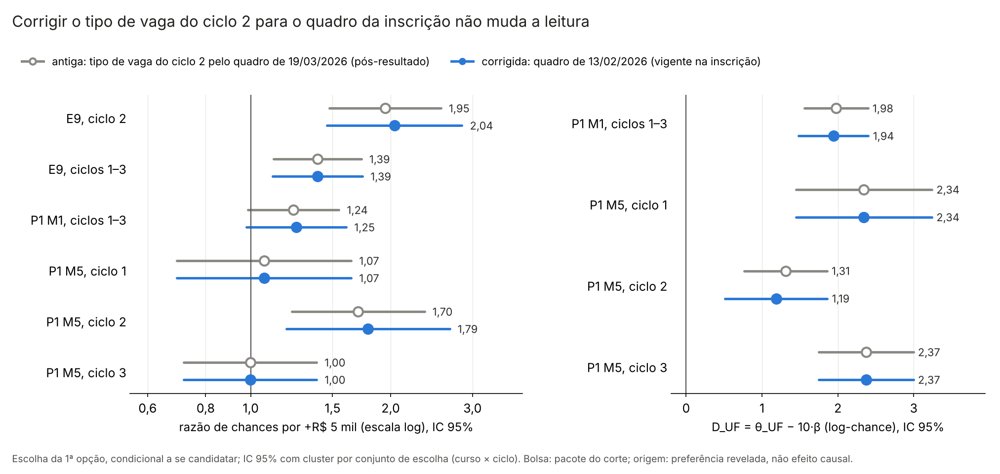

# 57p. Escolha com o tipo de vaga do ciclo 2 medido antes da alocação (adendo 52c)

> **Gerado por** `scripts/rdd_bolsa/42_escolha_vaga_imediata_c2.py` a partir de `output/rdd_bolsa/VC_*`; não editar à mão (o teste `tests/test_escolha_vaga_imediata_c2.py` confere que este arquivo é igual ao gerado; `--atualizar-doc` o regrava das saídas). 
> **Adendo:** [`52c_adendo_vaga_imediata_ciclo2.md`](52c_adendo_vaga_imediata_ciclo2.md), congelado em 26/10/2026 antes de reestimar; estatuto `ADENDO_52C_CORRECAO_COVARIAVEL`. Protocolos de origem: [40](40_protocolo_multioutcome_rdd_bolsa.md) (E9, §12), [52](52_protocolo_P1_escolha_dap.md) (P1) e [52b](52b_protocolo_P1h_magnitudes.md) (P1h). 
> **Motivo:** [auditoria 36](../auditorias/36_auditoria_dados_H1.md), seção 3, item 3, e seção 10a: no ciclo 2, "tem vaga imediata" e "log(vagas imediatas + 1)" vinham do quadro retificado de 19/03/2026, refeito depois do resultado preliminar (10/03). A correção usa o quadro de 13/02/2026, vigente na inscrição. 
> **Saídas:** `output/rdd_bolsa/VC_estimativas.csv`, `VC_resumo.json` e `VC_figuras/VC_antigo_corrigido.png`; toda linha tem `natureza_dos_dados = EMPIRICO`. As saídas do E9, do P1 e do P1h (`E9_*`, `P1_*`, `P1h_*`) não são regravadas, e os docs 42, 57a, 57i e 57 não são editados.

## 1. Resposta curta

<!-- VC:resposta:inicio -->
**H2 (bolsa × origem): a leitura não muda.** No M1, D_UF = θ_UF − 10·β passa de 1,98 (IC 95% [1,56; 2,40]; p < 0,001, unilateral) para 1,94 (IC [1,48; 2,40]; p < 0,001); nas duas versões o P1h-1 rejeita H0 (D_UF ≤ 0) depois do Holm (família de um teste, p de Holm = p). No modelo de escolha, a amplitude inteira da bolsa (R$ 10 → 20 mil) continua pesando menos que a vaga ficar na UF de origem.

**"Sinal do ciclo 2" (E9): a leitura não muda.** No E9 do ciclo 2, a razão de chances por +R$ 5 mil passa de 1,95 (IC [1,48; 2,57]) para 2,04 (IC [1,46; 2,85]); o IC exclui 1 nas duas versões. Com distância e origem (P1 M5, ciclo 2): de 1,70 [1,22; 2,37] para 1,79 [1,19; 2,68]. O E9 continua secundário e exploratório, sem Holm, e as fragilidades do doc 42 (só o ciclo 2; spline cúbico) não são reavaliadas aqui.

**P1a (M1, ciclos 1–3) e E9 empilhado.** O coeficiente da bolsa no M1 passa de 0,0424 (IC [−0,0027; 0,0874]; p de Holm 0,065; razão de chances 1,24) para 0,0453 (IC [−0,0041; 0,0947]; p de Holm 0,072; razão de chances 1,25): a decisão do P1a não muda (não rejeita zero na corrigida). No E9 empilhado, a razão de chances vai de 1,39 [1,12; 1,73] para 1,39 [1,11; 1,74].

**O que a correção mexe.** No ciclo 2, 301 das 1547 células do conjunto eram só de reserva na inscrição e aparecem com vaga imediata no quadro de 19/03; a concordância de "tem vaga imediata" entre os dois quadros é 80,5%. Das 2140 1ªs opções do ciclo 2, 84,0% estão em célula com vaga imediata pelo quadro de 19/03 e 53,3% pelo de 13/02. A versão corrigida é a de referência (adendo 52c, §2).

Tudo acima é escolha condicional a se candidatar, dentro das vagas abertas. O contraste da bolsa é o pacote do corte (bolsa e outras regras federais nos mesmos cortes, auditoria 18) e o incentivo marginal; não é efeito da participação no PMM-E nem do Agora Tem Especialistas.
<!-- VC:resposta:fim -->

## 2. Portão de reprodução (versão antiga)

<!-- VC:portao:inicio -->
**Portão de reprodução: PASSOU.** Com a covariável antiga, as funções originais (scripts 16, 25 e 25c, importadas sem alteração) reproduzem os números gravados em `E9_estimativas.csv`, `E9_efeitos_marginais.csv`, `P1_estimativas.csv` e `P1h_magnitudes.csv`. Tolerância 1e−8 na diferença máxima absoluta de cada quantidade comparada.

| Linha | Termos (reestimados / gravados) | Dif. máx. | Quantidades comparadas | Portão |
|---|---|---|---|---|
| E9_2 | 14 / 14 | 3,8e−10 | coef, efeitos_razao_chances_e_prob, ep_cluster_candidato, ep_cluster_conjunto, ep_mle | passou |
| E9_emp | 14 / 14 | 4,3e−10 | coef, efeitos_razao_chances_e_prob, ep_cluster_candidato, ep_cluster_conjunto, ep_mle | passou |
| M1 | 18 / 18 | 2,9e−10 | coef, ep_cluster_candidato, ep_cluster_conjunto, ep_mle | passou |
| M5_1 | 18 / 18 | 4,6e−10 | coef, ep_cluster_candidato, ep_cluster_conjunto, ep_mle | passou |
| M5_2 | 18 / 18 | 4,6e−10 | coef, ep_cluster_candidato, ep_cluster_conjunto, ep_mle | passou |
| M5_3 | 18 / 18 | 2,8e−10 | coef, ep_cluster_candidato, ep_cluster_conjunto, ep_mle | passou |
| P1d_wald | 1 / 1 | 3,6e−10 | estatistica_wald, p | passou |
| D_UF_M1 | 1 / 1 | 4,7e−10 | ep_cluster_candidato, ep_cluster_conjunto, ep_mle, estimativa, ic95_inf, ic95_sup, p_unilateral | passou |
| D_UF_M5_1 | 1 / 1 | 4,3e−10 | ep_cluster_candidato, ep_cluster_conjunto, ep_mle, estimativa, ic95_inf, ic95_sup, p_unilateral | passou |
| D_UF_M5_2 | 1 / 1 | 4,0e−10 | ep_cluster_candidato, ep_cluster_conjunto, ep_mle, estimativa, ic95_inf, ic95_sup, p_unilateral | passou |
| D_UF_M5_3 | 1 / 1 | 4,8e−10 | ep_cluster_candidato, ep_cluster_conjunto, ep_mle, estimativa, ic95_inf, ic95_sup, p_unilateral | passou |
<!-- VC:portao:fim -->

## 3. A correção da covariável

<!-- VC:correcao:inicio -->
| Item | Antiga (19/03/2026) | Corrigida (13/02/2026) |
|---|---|---|
| células do ciclo 2 no conjunto de escolha | 1547 | — |
| células sem linha (ou sem número) no quadro de 13/02 | — | 0 |
| células com vaga imediata | 1015 | 714 |
| vagas imediatas somadas nas células | 1836 | 1206 |
| 1ªs opções do ciclo 2 (E9) em célula com vaga imediata | 1798 de 2140 | 1140 de 2140 |

- Células que eram só de reserva em 13/02 e têm vaga imediata em 19/03: 301; o inverso: 0. Células com número de vagas imediatas diferente: 301. Concordância de "tem vaga imediata": 80,5%.
- Município e faixa das células iguais nos dois quadros (diferenças: 0 e 0). Nada imputado; nenhuma célula retirada.
- Conferências: a covariável antiga do conjunto é a do quadro de 19/03 em 1547 de 1547 células; o quadro de 13/02 lido pela função do script 12 bate com a leitura independente da auditoria 36 em 1547 células (0 diferenças).
- Ciclos 1 e 3: covariáveis sem mudança; o M5 desses ciclos sai idêntico nas duas versões (conferido).
<!-- VC:correcao:fim -->

## 4. Tabelas: antigo e corrigido lado a lado

### 4.1 Peso da bolsa (E9, P1a e P1d)

<!-- VC:bolsa:inicio -->
Coeficiente da bolsa por R$ 1 mil/mês (IC 95% e p bilateral com cluster por conjunto de escolha) e razão de chances por +R$ 5 mil (exp de 5 × coef.; IC transformado). Holm como nos protocolos: só o P1a (M1), família de um teste (p de Holm = p); o E9 é secundário e exploratório (protocolo 40, §12), sem Holm; o M5 entra no BKY da família secundária do P1, que não é refeito aqui.

| Especificação | Candidatos | Coef. antigo [IC]; p | Coef. corrigido [IC]; p | Razão de chances antiga [IC] | Razão de chances corrigida [IC] | p de Holm (antigo → corrigido) |
|---|---|---|---|---|---|---|
| E9, ciclo 2 | 2140 | 0,1331 [0,0778; 0,1884]; p < 0,001 | 0,1423 [0,0754; 0,2093]; p < 0,001 | 1,95 [1,48; 2,57] | 2,04 [1,46; 2,85] | sem Holm (exploratório) |
| E9, ciclos 1–3 | 5714 | 0,0662 [0,0227; 0,1096]; p = 0,003 | 0,0662 [0,0215; 0,1108]; p = 0,004 | 1,39 [1,12; 1,73] | 1,39 [1,11; 1,74] | sem Holm (exploratório) |
| P1 M1, ciclos 1–3 | 5421 | 0,0424 [−0,0027; 0,0874]; p = 0,065 | 0,0453 [−0,0041; 0,0947]; p = 0,072 | 1,24 [0,99; 1,55] | 1,25 [0,98; 1,61] | 0,065 → 0,072 |
| P1 M5, ciclo 1 | 915 | 0,0132 [−0,0731; 0,0996]; p = 0,764 | 0,0132 [−0,0731; 0,0996]; p = 0,764 | 1,07 [0,69; 1,65] | 1,07 [0,69; 1,65] | — |
| P1 M5, ciclo 2 | 2032 | 0,1064 [0,0405; 0,1722]; p = 0,002 | 0,1163 [0,0354; 0,1972]; p = 0,005 | 1,70 [1,22; 2,37] | 1,79 [1,19; 2,68] | — |
| P1 M5, ciclo 3 | 2474 | −0,0004 [−0,0662; 0,0653]; p = 0,990 | −0,0004 [−0,0662; 0,0653]; p = 0,990 | 1,00 [0,72; 1,39] | 1,00 [0,72; 1,39] | — |

P1d, Wald da igualdade de β entre ciclos (M5, χ² com 2 gl): 5,69 (p = 0,058) na antiga; 5,23 (p = 0,073) na corrigida.
<!-- VC:bolsa:fim -->

### 4.2 Bolsa contra origem (H2: P1h-1, D_UF)

<!-- VC:duf:inicio -->
D_UF = θ_UF − 10·β (peso de a vaga ficar na UF de origem menos o de toda a amplitude da bolsa), em log-chance; IC 95% bilateral, limite inferior (LI) unilateral de 95% e p unilateral de H0: D_UF ≤ 0, com cluster por conjunto. Holm só no P1h-1 (família de um teste, p de Holm = p). As linhas do M5 são as sensibilidades P1h-3 desse modelo, sem o BKY da família (M2, M4 e M7 não fazem parte do adendo).

| Linha | Especificação | Antigo: D_UF [IC]; LI; p | Corrigido: D_UF [IC]; LI; p | p de Holm (antigo → corrigido) | Rejeita H0 a 5% (antigo → corrigido) |
|---|---|---|---|---|---|
| P1h-1 | P1 M1, ciclos 1–3 | 1,978 [1,560; 2,396]; LI 1,628; p < 0,001 | 1,942 [1,482; 2,402]; LI 1,556; p < 0,001 | < 0,001 → < 0,001 | sim → sim |
| P1h-3 (sensib.) | P1 M5, ciclo 1 | 2,343 [1,447; 3,239]; LI 1,591; p < 0,001 | 2,343 [1,447; 3,239]; LI 1,591; p < 0,001 | — | — |
| P1h-3 (sensib.) | P1 M5, ciclo 2 | 1,310 [0,763; 1,857]; LI 0,851; p < 0,001 | 1,187 [0,513; 1,861]; LI 0,621; p < 0,001 | — | — |
| P1h-3 (sensib.) | P1 M5, ciclo 3 | 2,373 [1,750; 2,995]; LI 1,850; p < 0,001 | 2,373 [1,750; 2,995]; LI 1,850; p < 0,001 | — | — |
<!-- VC:duf:fim -->

### 4.3 Covariáveis corrigidas

<!-- VC:covariaveis:inicio -->
Coeficientes das covariáveis corrigidas (e de mesma UF, que entra no D_UF) nas duas versões, IC 95% com cluster por conjunto. Todos os termos de todas as especificações estão em `output/rdd_bolsa/VC_estimativas.csv`.

| Especificação | Termo | Antigo [IC] | Corrigido [IC] |
|---|---|---|---|
| E9, ciclo 2 | `tem_vaga_imediata` | 0,690 [0,144; 1,237] | −0,163 [−0,470; 0,145] |
| E9, ciclo 2 | `log_vagas_imediatas_mais_1` | 0,369 [0,227; 0,511] | 0,646 [0,444; 0,848] |
| E9, ciclos 1–3 | `tem_vaga_imediata` | 0,164 [−0,072; 0,400] | −0,086 [−0,296; 0,124] |
| E9, ciclos 1–3 | `log_vagas_imediatas_mais_1` | 0,359 [0,188; 0,530] | 0,499 [0,276; 0,722] |
| P1 M1, ciclos 1–3 | `tem_vaga_imediata` | 0,353 [0,070; 0,636] | 0,088 [−0,132; 0,309] |
| P1 M1, ciclos 1–3 | `log_vagas_imediatas_mais_1` | 0,309 [0,140; 0,478] | 0,569 [0,348; 0,791] |
| P1 M1, ciclos 1–3 | `mesma_uf` | 2,402 [2,278; 2,527] | 2,395 [2,268; 2,522] |
| P1 M5, ciclo 2 | `tem_vaga_imediata` | 0,890 [0,348; 1,432] | 0,294 [−0,065; 0,652] |
| P1 M5, ciclo 2 | `log_vagas_imediatas_mais_1` | 0,301 [0,165; 0,437] | 0,676 [0,325; 1,026] |
| P1 M5, ciclo 2 | `mesma_uf` | 2,374 [2,183; 2,565] | 2,350 [2,134; 2,566] |
<!-- VC:covariaveis:fim -->

## 5. Figura

<!-- VC:figura:inicio -->

Arquivo: `output/rdd_bolsa/VC_figuras/VC_antigo_corrigido.png`. Título: "Corrigir o tipo de vaga do ciclo 2 para o quadro da inscrição não muda a leitura".

**Como ler.** Cada linha é uma especificação; o círculo vazado cinza é a versão antiga (tipo de vaga do ciclo 2 pelo quadro de 19/03/2026, refeito depois do resultado preliminar) e o ponto azul é a versão corrigida (quadro de 13/02/2026, vigente na inscrição). As barras são o IC 95% com cluster por conjunto de escolha (curso × ciclo). À esquerda, a razão de chances por +R$ 5 mil de bolsa anunciada, em escala log: acima de 1, a bolsa maior desloca a 1ª opção para a vaga; a linha vertical marca 1 (nenhum efeito). À direita, D_UF = θ_UF − 10·β, o peso de a vaga ficar na UF de origem menos o de toda a amplitude da bolsa (R$ 10 → 20 mil), em log-chance; acima de 0, a origem pesa mais. Os ciclos 1 e 3 não mudam por construção (só o ciclo 2 é corrigido). Tudo é escolha condicional a se candidatar, dentro das vagas abertas; a bolsa mede o pacote do corte, e a origem é preferência revelada, não efeito causal.
<!-- VC:figura:fim -->

## 6. Decisões de implementação

<!-- VC:desvios:inicio -->
Decisões de implementação onde o adendo não fixava o detalhe. Elas estão no mesmo commit dos números. Nenhuma muda a amostra, o conjunto de escolha ou a especificação dos modelos.

1. **Célula ausente no quadro de 13/02** (26/10/2026). O pedido do autor manda registrar e contar; o adendo não diz o que fazer com ela. *Resolução:* A execução para (FALHA_CELULA_AUSENTE_1302) se alguma célula do conjunto do ciclo 2 não tiver linha ou número de vagas imediatas no quadro de 13/02: não se imputa e não se retira célula, porque a amostra e o conjunto têm de ser os mesmos. A contagem foi zero.
2. **D_UF no M5** (26/10/2026). O adendo pede P1h-1 (M1) e o M5 do P1; o D_UF do M5 é sensibilidade P1h-3. *Resolução:* O D_UF do M5 por ciclo é relatado como sensibilidade, com portão próprio contra P1h_magnitudes.csv, sem o BKY da família P1h-3 (M2, M4 e M7 não são reestimados).
3. **Razão de chances do P1** (26/10/2026). O P1 não gravou razão de chances; o E9 gravou (script 16). *Resolução:* E9: a função linhas_efeitos do script 16 (reproduzida no portão). P1: exp(5·coef.) com o IC transformado do IC do coeficiente, a mesma conta da síntese 57.
4. **BKY das secundárias do P1** (26/10/2026). O P1d (Wald entre ciclos) entra no BKY da família secundária do P1, com o M6 e o M8, que também usam o ciclo 2 e não fazem parte do adendo. *Resolução:* O Wald do P1d é relatado nas duas versões, sem q BKY refeito.
<!-- VC:desvios:fim -->

## 7. Limites

- **Pós-resultado.** O E9, o P1 e o P1h já eram conhecidos, e a auditoria 36 apontou o problema depois deles. O adendo foi congelado antes de reestimar, mas a correção não é teste confirmatório novo.
- **Só o tipo de vaga do ciclo 2 muda.** O conjunto de sensibilidade "só células com vaga imediata" do E9, o M2, o M4, o M6, o M7, o M8 e o M9 do P1, a DAP e as sensibilidades P1h-3 fora do M5 continuam com o quadro de 19/03 e não foram reestimados. O BKY das famílias secundárias não é refeito.
- **O quadro de 13/02 também é anúncio.** Ele mede o que estava publicado na inscrição, não a vaga que de fato seria preenchida: o remanejamento posterior (item 5.7 dos editais) fica fora do atributo, como deve ficar num controle pré-tratamento.
- **Escolha condicional.** Tudo vale para quem se candidatou, dentro das vagas abertas do seu curso e ciclo; o conjunto de escolha supõe que o candidato viu todas as células do curso; IIA do logit condicional.
- **Pacote do corte.** O peso da bolsa é identificado pelos saltos nos cortes de IVS (0,300 e 0,400), com o IVS em spline contínua; em 0,300 e 0,400 mudam também outras regras federais (auditoria 18) e há desequilíbrio de capitais em 0,300 (auditoria 36, seção 7). Não é efeito da participação no PMM-E.
- **Origem não é causal.** θ_UF é preferência revelada condicional ao modelo; a origem é o município do vínculo médico no CNES, não a residência.
- **Poucos conjuntos.** 16 a 24 conjuntos (curso × ciclo) por ciclo e 56 nos ciclos empilhados; o EP com cluster por conjunto é impreciso, e o p pela t com G − 1 gl está no CSV.
