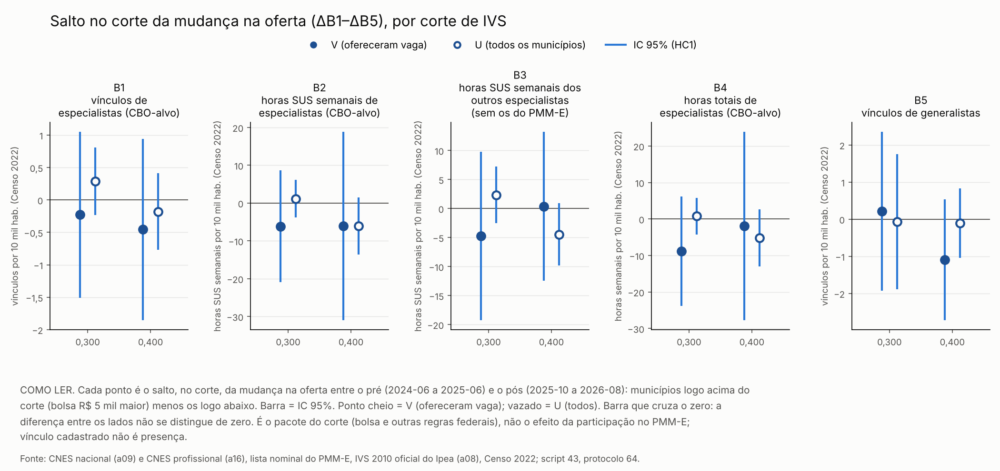
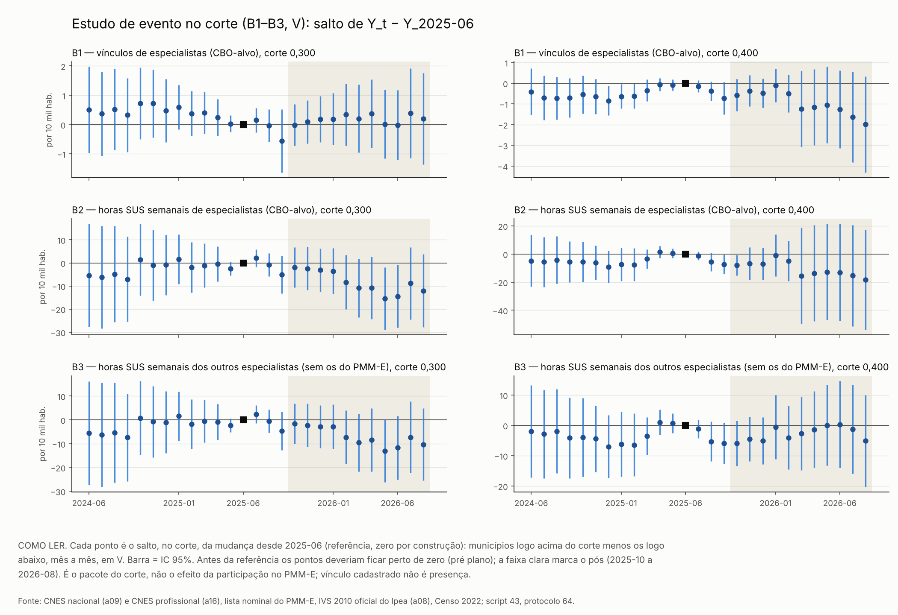
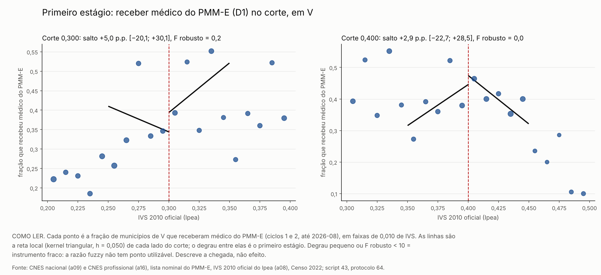

# 57q. Resultados do protocolo 64: oferta local de especialistas comparada no corte

> **Data:** 2026-10-26. 
> **Protocolo:** [`64_protocolo_oferta_local_no_corte.md`](64_protocolo_oferta_local_no_corte.md), congelado antes de qualquer conta. 
> **Script:** `scripts/rdd_bolsa/43_oferta_local_corte.py`, com os outcomes e a amostra do script 37 (importados) e os estimadores de `scripts/rdd_bolsa/rdd_lib.py`. 
> **Saídas:** `output/rdd_bolsa/OC_estimativas.csv`, `OC_estudo_evento.csv`, `OC_resumo.json` e `OC_figuras/`; toda linha tem `natureza_dos_dados = EMPIRICO`. 
> **Testes:** `tests/test_oferta_local_corte.py`. 
> **Estatuto:** `PROTOCOLO_64_POS_RESULTADO`. O lado do corte de IVS decide a bolsa e também outras regras federais (auditoria 18): o contraste é o **pacote do corte**. 
> **Auditoria:** [auditoria 39](../auditorias/39_auditoria_oferta_local_corte.md), aprovado com correções de texto; nenhum número mudou. Em 26/10/2026, correção de formato das linhas *fuzzy* do CSV, pedida pelo autor (seção 8).

Os blocos entre marcadores `<!-- OC:... -->` são gerados pelo script 43 a partir de `output/`
(`python3 scripts/rdd_bolsa/43_oferta_local_corte.py --atualizar-doc`). Não edite esses blocos à mão. Fora
deles, este texto não traz número de resultado.

## 1. O que se mede

**Pergunta.** Perto do corte de IVS, os municípios de cima e os de baixo mudaram a oferta cadastrada de
especialistas de forma diferente entre o pré e o pós? E, se o lado de cima recebe mais médicos do PMM-E, quanto
dessa diferença passa pelo médico do programa?

No doc 57k, quem recebeu médico foi comparado com quem ainda não tinha recebido, e o pré já subia. Aqui a
comparação é outra: o lado do corte. Perto do corte, os dois lados são parecidos antes do programa, e o lado
decide a bolsa.

- **Running variable:** IVS 2010 oficial do Ipea (a08). O arquivo local de IVS da auditoria 16 não é lido.
- **Cortes:** 0,300 e 0,400, cada um separado. Lado de cima = bolsa R$ 5 mil maior.
- **Estimador:** RDD local linear, kernel triangular, h = 0,050, um município por linha, erro-padrão HC1.
- **Outcome:** ΔY = média do pós (2025-10 a 2026-08) − média do pré (2024-06 a 2025-06), por município. Nenhum
  mês ≥ 2026-09 é lido.
- **Outcomes**, por 10 mil habitantes (Censo 2022), no CNES nacional (a09), CBO-alvo dos cursos do PMM-E, os
  mesmos do doc 57k:

| Id | O que é | Papel |
|---|---|---|
| B1 | vínculos de especialistas nas CBO-alvo | OC-A1, primária (Holm) |
| B2 | horas SUS semanais nas CBO-alvo | OC-A2, primária (Holm) |
| B3 | B2 sem as horas dos médicos do PMM-E ligados ao CNES: os **outros** especialistas | OC-A3, secundária (BKY) |
| B4 | horas totais (SUS e não SUS) nas CBO-alvo | OC-A4, secundária (BKY) |
| B5 | vínculos de generalistas (placebo) | OC-A5, secundária (BKY) |

**O que o corte identifica.**

- A **forma reduzida** (parte A) mede o pacote do corte sobre a mudança na oferta: a bolsa maior **e** as outras
  regras federais nos mesmos cortes. A DiRD tira só a parte dessas regras que fica igual entre o pré e o pós.
- A **razão *fuzzy*** (parte B) só é "efeito de receber médico" se o corte mexer na oferta local **apenas** pelo
  médico do programa (exclusão). O pacote do corte pode violar isso. Por isso ela é secundária e é lida junto com
  o placebo de generalistas (B5).
- Nada aqui é efeito da participação no PMM-E como política nem do Agora Tem Especialistas.

## 2. Amostra

**V** (principal): os municípios do doc 57k, de U com célula em algum ciclo (1 a 3). **U** (sensibilidade): todos
os municípios do IVS oficial com população 2022 > 0. Município sem todos os meses de uma janela sai daquele
outcome e é contado.

<!-- OC:amostra:inicio -->
| Item | Valor |
|---|---|
| U: municípios do IVS oficial (a08) com população 2022 > 0 | 5565 |
| U: municípios do a08 sem população 2022 > 0 (fora) | 0 |
| municípios de U com célula em algum ciclo (1 a 3) | 1039 |
| fora de V: tratados da lista nominal sem célula nos ciclos 1 ou 2 | 2 |
| V (municípios) | 1037 |
| V: receberam médico do PMM-E dos ciclos 1 e 2 até 2026-08 (D1 = 1) | 315 |
| V, B1: fora por falta de mês (pré / pós / sem ΔY) | 0 / 0 / 0 |
| V, B2: fora por falta de mês (pré / pós / sem ΔY) | 4 / 4 / 4 |
| V, B3: fora por falta de mês (pré / pós / sem ΔY) | 4 / 4 / 4 |
| V, B4: fora por falta de mês (pré / pós / sem ΔY) | 4 / 4 / 4 |
| V, B5: fora por falta de mês (pré / pós / sem ΔY) | 0 / 0 / 0 |
| U, B1: fora por falta de mês (pré / pós / sem ΔY) | 0 / 0 / 0 |
| U, B2: fora por falta de mês (pré / pós / sem ΔY) | 6 / 6 / 6 |
| U, B3: fora por falta de mês (pré / pós / sem ΔY) | 6 / 6 / 6 |
| U, B4: fora por falta de mês (pré / pós / sem ΔY) | 6 / 6 / 6 |
| U, B5: fora por falta de mês (pré / pós / sem ΔY) | 0 / 0 / 0 |

| Corte | V abaixo / acima (h = 0,050) | U abaixo / acima (h = 0,050) |
|---|---|---|
| 0,300 | 144 / 119 | 859 / 654 |
| 0,400 | 122 / 145 | 587 / 603 |
<!-- OC:amostra:fim -->

## 3. Portão de reprodução

Antes de qualquer conta nova, o script refaz o salto do F3.1 do E7 (doc 43) em U no corte 0,300, com a mesma
função da biblioteca, a partir do B1 construído pelo script 37. Se a diferença passar de 1e−8, o script para sem
gravar.

<!-- OC:portao:inicio -->
| Conferência | E7 (doc 43) | Este script | Diferença | Resultado |
|---|---|---|---|---|
| salto do F3.1, U, 0,300 | +0,287332 | +0,287332 | 5,6e-17 | sim |
| EP HC1 | 0,266477 | 0,266477 | 5,6e-17 | sim |
| municípios abaixo / acima | 859 / 654 | 859 / 654 | — | sim |
<!-- OC:portao:fim -->

## 4. Leitura

<!-- OC:leitura:inicio -->
Parte A, primárias em V (salto da mudança pós − pré, lado de cima menos lado de baixo): vínculos de especialistas (B1) em 0,300: −0,23 [−1,51; +1,05], p de Holm 1,000; vínculos de especialistas (B1) em 0,400: −0,46 [−1,86; +0,94], p de Holm 1,000; horas SUS de especialistas (B2) em 0,300: −6,15 [−20,91; +8,62], p de Holm 1,000; horas SUS de especialistas (B2) em 0,400: −6,09 [−31,01; +18,83], p de Holm 1,000. Os quatro IC contêm zero. Pela leitura pré-registrada: comparando os dois lados do corte, a mudança na oferta local de especialistas não se distingue; o corte não detecta efeito do pacote sobre a oferta local. Placebo de generalistas (OC-A5): 0,300: +0,21 [−1,92; +2,35], q BKY 1,000; 0,400: −1,09 [−2,72; +0,54], q BKY 1,000. O placebo não se distingue de zero nos dois cortes. Outros especialistas (OC-A3): 0,300: −4,75 [−19,26; +9,76]; 0,400: +0,37 [−12,46; +13,20]. Não há sinal de deslocamento dos outros especialistas no corte. Estudo de evento no corte (OC-C), teste conjunto do pré: B1 em 0,300 p = 0,063; B1 em 0,400 p = 0,389; B2 em 0,300 p = 0,158; B2 em 0,400 p = 0,707; B3 em 0,300 p = 0,101; B3 em 0,400 p = 0,640. O pré é plano em todos. Primeiro estágio (OC-B0, D1 em V): 0,300: salto de +5,0 p.p. em receber médico [−20,1; +30,1], F robusto = 0,2; 0,400: salto de +2,9 p.p. em receber médico [−22,7; +28,5], F robusto = 0,0. Em 0,300 o instrumento é fraco (F robusto < 10): a razão fuzzy não tem estimativa pontual utilizável. Só o IC de Anderson–Rubin vale: B1 ilimitado (aceita todo β da grade, ±41,62); B2 ilimitado (aceita todo β da grade, ±314,47). Em 0,400 o instrumento é fraco (F robusto < 10): a razão fuzzy não tem estimativa pontual utilizável. Só o IC de Anderson–Rubin vale: B1 ilimitado (aceita todo β da grade, ±39,86); B2 ilimitado (aceita todo β da grade, ±542,40). Chegada abaixo e acima do corte (OC-D): a diferença entre lados tem IC que contém zero em B1, B2 e B3 nos dois cortes; não se detecta que a chegada mude a oferta de forma diferente onde a bolsa é maior. São poucos tratados perto de cada corte (seção 5.6). Seleção de V (OC-E, ter célula em algum ciclo, em U): 0,300: −2,2 p.p. [−10,5; +6,1], p = 0,602; 0,400: −1,7 p.p. [−12,3; +8,9], p = 0,756. Não se detecta salto: a seleção de V pelo corte não aparece nesse teste. Tudo aqui compara os lados do corte, que mudam a bolsa e outras regras federais ao mesmo tempo; nada é efeito da participação no PMM-E como política; vínculo cadastrado não é presença.
<!-- OC:leitura:fim -->

Leitura pré-registrada (protocolo 64, §4):

| Resultado | Leitura |
|---|---|
| OC-A1 e OC-A2 com IC que contém zero nos dois cortes | a mudança na oferta local não se distingue entre os lados; o corte não detecta efeito do pacote sobre a oferta local |
| alguma primária rejeita zero depois do Holm, OC-A5 não rejeita e o pré do OC-C é plano | sinal e tamanho como efeito do **pacote do corte** sobre a mudança na oferta local |
| alguma primária rejeita zero, mas OC-A5 também rejeita ou o pré do OC-C não é plano | não ler como efeito da bolsa nem da chegada |
| primeiro estágio (OC-B0, D1) com F robusto < 10 | instrumento fraco: só o IC de Anderson–Rubin, sem ponto |
| primeiro estágio com F robusto ≥ 10 | razão *fuzzy* com IC de Anderson–Rubin, sob exclusão, com a ressalva do pacote do corte |
| OC-A3 negativo com IC que exclui zero | sinal de deslocamento dos outros especialistas no corte |
| OC-D: diferença entre lados com IC que contém zero | não se detecta que a chegada mude a oferta de forma diferente onde a bolsa é maior |
| OC-E salta no corte | V é selecionada: dar peso a OC-A-U |

Como o código aplica as regras está na seção 9 (decisões D14 e D15).

## 5. Tabelas

### 5.1 Parte A: salto de ΔY no corte (forma reduzida), em V

Salto = lado de cima (bolsa maior) menos lado de baixo. IC 95% pela normal, EP HC1.

<!-- OC:principal:inicio -->
| Id | Outcome | Corte | Salto | IC 95% | p | p Holm / q BKY | n abaixo / acima |
|---|---|---|---|---|---|---|---|
| OC-A1 | vínculos de especialistas (CBO-alvo) | 0,300 | −0,23 | [−1,51; +1,05] | 0,725 | 1,000 (Holm) | 144 / 119 |
| OC-A1 | vínculos de especialistas (CBO-alvo) | 0,400 | −0,46 | [−1,86; +0,94] | 0,523 | 1,000 (Holm) | 122 / 145 |
| OC-A2 | horas SUS semanais de especialistas (CBO-alvo) | 0,300 | −6,15 | [−20,91; +8,62] | 0,414 | 1,000 (Holm) | 141 / 119 |
| OC-A2 | horas SUS semanais de especialistas (CBO-alvo) | 0,400 | −6,09 | [−31,01; +18,83] | 0,632 | 1,000 (Holm) | 122 / 145 |
| OC-A3 | horas SUS semanais dos outros especialistas (sem os do PMM-E) | 0,300 | −4,75 | [−19,26; +9,76] | 0,521 | 1,000 (BKY) | 141 / 119 |
| OC-A3 | horas SUS semanais dos outros especialistas (sem os do PMM-E) | 0,400 | +0,37 | [−12,46; +13,20] | 0,955 | 1,000 (BKY) | 122 / 145 |
| OC-A4 | horas totais de especialistas (CBO-alvo) | 0,300 | −8,81 | [−23,79; +6,17] | 0,249 | 1,000 (BKY) | 141 / 119 |
| OC-A4 | horas totais de especialistas (CBO-alvo) | 0,400 | −1,94 | [−27,76; +23,87] | 0,883 | 1,000 (BKY) | 122 / 145 |
| OC-A5 | vínculos de generalistas | 0,300 | +0,21 | [−1,92; +2,35] | 0,844 | 1,000 (BKY) | 144 / 119 |
| OC-A5 | vínculos de generalistas | 0,400 | −1,09 | [−2,72; +0,54] | 0,188 | 1,000 (BKY) | 122 / 145 |

Unidades: B1 e B5 em vínculos por 10 mil hab.; B2 e B3 em horas SUS semanais por 10 mil hab.; B4 em horas semanais por 10 mil hab.
<!-- OC:principal:fim -->

### 5.2 Parte A em U e sensibilidades

<!-- OC:sensibilidades:inicio -->
| Outcome | Pop. | Corte | Principal | h = 0,030 | h = 0,080 | IC honesto (M) | Pós com pré covariável |
|---|---|---|---|---|---|---|---|
| B1 | V | 0,300 | −0,23 [−1,51; +1,05] | +0,10 [−1,41; +1,62] | −0,37 [−1,53; +0,78] | [−23,09; +22,63] (46915,1) | −0,19 [−1,51; +1,14] |
| B1 | V | 0,400 | −0,46 [−1,86; +0,94] | −0,82 [−2,75; +1,11] | −0,25 [−1,30; +0,79] | [−29,06; +28,14] (61301,1) | −0,07 [−1,05; +0,91] |
| B1 | U | 0,300 | +0,29 [−0,23; +0,81] | +0,40 [−0,25; +1,05] | +0,14 [−0,30; +0,57] | [−8,77; +9,35] (18804,5) | +0,34 [−0,18; +0,85] |
| B1 | U | 0,400 | −0,18 [−0,77; +0,41] | −0,67 [−1,82; +0,48] | +0,17 [−0,62; +0,96] | [−10,51; +10,15] (20971,9) | −0,31 [−1,20; +0,58] |
| B2 | V | 0,300 | −6,15 [−20,91; +8,62] | −5,64 [−25,10; +13,83] | −1,89 [−13,97; +10,18] | [−89,90; +77,61] (153142,5) | −3,84 [−18,09; +10,40] |
| B2 | V | 0,400 | −6,09 [−31,01; +18,83] | −6,80 [−42,20; +28,61] | −3,69 [−21,90; +14,51] | [−406,14; +393,96] (848148,1) | −4,42 [−26,70; +17,86] |
| B2 | U | 0,300 | +1,15 [−3,84; +6,13] | +2,37 [−3,82; +8,56] | +1,57 [−2,76; +5,90] | [−50,78; +53,07] (104162,6) | +1,63 [−3,27; +6,54] |
| B2 | U | 0,400 | −6,11 [−13,67; +1,45] | −5,97 [−16,30; +4,35] | −4,27 [−10,07; +1,52] | [−96,47; +84,24] (179257,5) | −6,58 [−13,70; +0,54] |
| B3 | V | 0,300 | −4,75 [−19,26; +9,76] | −4,44 [−23,98; +15,10] | −1,91 [−13,63; +9,81] | [−75,88; +66,38] (126291,5) | −2,98 [−17,25; +11,29] |
| B3 | V | 0,400 | +0,37 [−12,46; +13,20] | +2,26 [−13,31; +17,83] | −0,45 [−11,30; +10,39] | [−80,14; +80,87] (155710,0) | +1,66 [−9,28; +12,61] |
| B3 | U | 0,300 | +2,35 [−2,52; +7,22] | +3,52 [−2,59; +9,63] | +2,31 [−1,92; +6,54] | [−49,95; +54,65] (105175,2) | +2,78 [−2,02; +7,58] |
| B3 | U | 0,400 | −4,48 [−9,84; +0,88] | −3,83 [−10,15; +2,49] | −3,47 [−8,02; +1,09] | [−68,60; +59,64] (127198,8) | −4,74 [−9,83; +0,35] |
| B4 | V | 0,300 | −8,81 [−23,79; +6,17] | −8,23 [−27,11; +10,65] | −4,53 [−17,01; +7,95] | [−57,67; +40,05] (77977,3) | −5,57 [−20,12; +8,98] |
| B4 | V | 0,400 | −1,94 [−27,76; +23,87] | −0,60 [−37,32; +36,12] | −2,36 [−21,26; +16,53] | [−492,60; +488,71] (1049854,1) | −0,56 [−24,03; +22,92] |
| B4 | U | 0,300 | +0,78 [−4,21; +5,77] | +2,24 [−3,90; +8,37] | +1,01 [−3,35; +5,38] | [−31,39; +32,95] (61092,0) | +1,49 [−3,38; +6,35] |
| B4 | U | 0,400 | −5,13 [−12,95; +2,69] | −6,77 [−18,57; +5,03] | −2,51 [−9,63; +4,60] | [−152,56; +142,30] (300587,1) | −7,13 [−14,95; +0,70] |
| B5 | V | 0,300 | +0,21 [−1,92; +2,35] | +0,48 [−1,80; +2,76] | +0,25 [−1,68; +2,19] | [−10,83; +11,26] (19762,8) | +0,21 [−1,89; +2,31] |
| B5 | V | 0,400 | −1,09 [−2,72; +0,54] | −1,01 [−3,05; +1,04] | −0,88 [−2,21; +0,45] | [−30,15; +27,96] (61884,8) | −1,07 [−2,70; +0,55] |
| B5 | U | 0,300 | −0,07 [−1,89; +1,75] | +0,51 [−1,93; +2,94] | −0,40 [−1,83; +1,02] | [−39,74; +39,60] (83229,2) | −0,11 [−1,91; +1,70] |
| B5 | U | 0,400 | −0,11 [−1,04; +0,82] | −1,92 [−5,05; +1,22] | +0,71 [−1,71; +3,13] | [−67,79; +67,57] (142646,4) | +0,72 [−1,19; +2,62] |

IC honesto: Armstrong–Kolesár, M da regra de bolso (fator 1), como no E7. Nenhuma linha desta tabela entra no Holm ou no BKY.
<!-- OC:sensibilidades:fim -->

### 5.3 Parte B: primeiro estágio (OC-B0)

O que mede o D2 (sensibilidade): conta os médicos dos ciclos 1 e 2 ligados ao CNES que têm **qualquer** vínculo
SUS em CBO-alvo em estabelecimento do município, do primeiro mês de chegada da lista nominal até 2026-08
(decisão D6). Entra quem trabalha no município mas foi alocado em outro, e entra o vínculo de antes do início do
próprio médico. Por isso o D2 é positivo em muito mais municípios do que os que receberam médico (D1). É a
presença cadastrada de médicos do programa no município, não a intensidade da alocação (auditoria 39).

<!-- OC:primeiro_estagio:inicio -->
| Variável | Pop. | Corte | Salto | IC 95% | p | q BKY | F robusto | n abaixo / acima |
|---|---|---|---|---|---|---|---|---|
| D1 | V | 0,300 | +5,0 | [−20,1; +30,1] | 0,696 | 1,000 | 0,2 | 144 / 119 |
| D1 | V | 0,400 | +2,9 | [−22,7; +28,5] | 0,825 | 1,000 | 0,0 | 122 / 145 |
| D1 | U | 0,300 | −0,5 | [−5,7; +4,8] | 0,862 | — | 0,0 | 859 / 654 |
| D1 | U | 0,400 | −0,8 | [−8,7; +7,2] | 0,850 | — | 0,0 | 587 / 603 |
| D2 | V | 0,300 | −0,101 | [−0,705; +0,504] | 0,744 | — | 0,1 | 144 / 119 |
| D2 | V | 0,400 | −1,048 | [−3,422; +1,326] | 0,387 | — | 0,7 | 122 / 145 |

D1 em pontos percentuais (fração de municípios que receberam médico); D2 em médicos do PMM-E ligados por 10 mil hab. A linha principal é D1 em V; as outras são sensibilidade. F robusto = (salto ÷ EP HC1)².
<!-- OC:primeiro_estagio:fim -->

### 5.4 Parte B: razão *fuzzy* com IC de Anderson–Rubin (OC-B1 a OC-B5)

Como ler "ilimitado": com primeiro estágio tão fraco, o conjunto de Anderson–Rubin não é só "toda a grade". A
auditoria 39 resolveu a inversão de forma exata (a estatística é razão de duas quadráticas em β) e, nas dez
linhas com D1 em V, o conjunto é a **reta inteira**: nenhum valor de β é rejeitado. A borda ±L da tabela é só o
tamanho da grade, não um limite do IC. Em `OC_estimativas.csv`, as linhas `fuzzy_*` com F robusto < 10 (todas
as 30) levam a nota `instrumento_fraco_F<10` e têm `tau`, `ep`, IC convencional e `p_valor` vazios: com
instrumento fraco, a razão forma reduzida ÷ primeiro estágio não é estimativa. O IC de Anderson–Rubin aparece
como `ar_ilimitado = True`, com `ar_ic_inf`/`ar_ic_sup` vazios; a borda da grade fica só em `ar_grade_L`. O p de
Anderson–Rubin em β = 0, que entra no BKY, está em `ar_p_beta0`. Só a forma reduzida (`tau_forma_reduzida`) e o
primeiro estágio são números para relatar (protocolo 64, §4). Até 26/10/2026, o CSV gravava a razão em `tau` e a
borda da grade em `ar_ic_*` (seção 8).

<!-- OC:fuzzy:inicio -->
| Id | Outcome | Variável / pop. | Corte | F robusto | Forma reduzida | Primeiro estágio | Razão | IC de Anderson–Rubin | p (β = 0) | q BKY |
|---|---|---|---|---|---|---|---|---|---|---|
| OC-B1 | B1 | D1 / V | 0,300 | 0,2 | −0,23 | +0,050 | — (fraco) | ilimitado (aceita todo β da grade, ±41,62) | 0,725 | 1,000 |
| OC-B1 | B1 | D1 / V | 0,400 | 0,0 | −0,46 | +0,029 | — (fraco) | ilimitado (aceita todo β da grade, ±39,86) | 0,523 | 1,000 |
| OC-B2 | B2 | D1 / V | 0,300 | 0,3 | −6,15 | +0,064 | — (fraco) | ilimitado (aceita todo β da grade, ±314,47) | 0,414 | 1,000 |
| OC-B2 | B2 | D1 / V | 0,400 | 0,0 | −6,09 | +0,029 | — (fraco) | ilimitado (aceita todo β da grade, ±542,40) | 0,632 | 1,000 |
| OC-B3 | B3 | D1 / V | 0,300 | 0,3 | −4,75 | +0,064 | — (fraco) | ilimitado (aceita todo β da grade, ±314,47) | 0,521 | 1,000 |
| OC-B3 | B3 | D1 / V | 0,400 | 0,0 | +0,37 | +0,029 | — (fraco) | ilimitado (aceita todo β da grade, ±326,88) | 0,955 | 1,000 |
| OC-B4 | B4 | D1 / V | 0,300 | 0,3 | −8,81 | +0,064 | — (fraco) | ilimitado (aceita todo β da grade, ±312,16) | 0,249 | 1,000 |
| OC-B4 | B4 | D1 / V | 0,400 | 0,0 | −1,94 | +0,029 | — (fraco) | ilimitado (aceita todo β da grade, ±559,47) | 0,883 | 1,000 |
| OC-B5 | B5 | D1 / V | 0,300 | 0,2 | +0,21 | +0,050 | — (fraco) | ilimitado (aceita todo β da grade, ±70,92) | 0,844 | 1,000 |
| OC-B5 | B5 | D1 / V | 0,400 | 0,0 | −1,09 | +0,029 | — (fraco) | ilimitado (aceita todo β da grade, ±34,09) | 0,188 | 1,000 |
| OC-B1 | B1 | D1 / U | 0,300 | 0,0 | +0,29 | −0,005 | — (fraco) | ilimitado (aceita todo β da grade, ±41,62) | 0,281 | — |
| OC-B1 | B1 | D1 / U | 0,400 | 0,0 | −0,18 | −0,008 | — (fraco) | ilimitado (aceita todo β da grade, ±400,16) | 0,556 | — |
| OC-B2 | B2 | D1 / U | 0,300 | 0,0 | +1,15 | −0,002 | — (fraco) | ilimitado (aceita todo β da grade, ±571,14) | 0,652 | — |
| OC-B2 | B2 | D1 / U | 0,400 | 0,0 | −6,11 | −0,008 | — (fraco) | ilimitado (aceita todo β da grade, ±542,40) | 0,113 | — |
| OC-B3 | B3 | D1 / U | 0,300 | 0,0 | +2,35 | −0,002 | — (fraco) | ilimitado (aceita todo β da grade, ±571,14) | 0,344 | — |
| OC-B3 | B3 | D1 / U | 0,400 | 0,0 | −4,48 | −0,008 | — (fraco) | ilimitado (aceita todo β da grade, ±520,97) | 0,101 | — |
| OC-B4 | B4 | D1 / U | 0,300 | 0,0 | +0,78 | −0,002 | — (fraco) | ilimitado (aceita todo β da grade, ±571,14) | 0,759 | — |
| OC-B4 | B4 | D1 / U | 0,400 | 0,0 | −5,13 | −0,008 | — (fraco) | ilimitado (aceita todo β da grade, ±2407,36) | 0,198 | — |
| OC-B5 | B5 | D1 / U | 0,300 | 0,0 | −0,07 | −0,005 | — (fraco) | ilimitado (aceita todo β da grade, ±169,48) | 0,939 | — |
| OC-B5 | B5 | D1 / U | 0,400 | 0,0 | −0,11 | −0,008 | — (fraco) | ilimitado (aceita todo β da grade, ±1416,54) | 0,816 | — |
| OC-B1 | B1 | D2 / V | 0,300 | 0,1 | −0,23 | −0,101 | — (fraco) | ilimitado (aceita todo β da grade, ±41,62) | 0,725 | — |
| OC-B1 | B1 | D2 / V | 0,400 | 0,7 | −0,46 | −1,048 | — (fraco) | ilimitado (aceita todo β da grade, ±39,86) | 0,523 | — |
| OC-B2 | B2 | D2 / V | 0,300 | 0,1 | −6,15 | −0,109 | — (fraco) | ilimitado (aceita todo β da grade, ±314,47) | 0,414 | — |
| OC-B2 | B2 | D2 / V | 0,400 | 0,7 | −6,09 | −1,048 | — (fraco) | ilimitado (aceita todo β da grade, ±542,40) | 0,632 | — |
| OC-B3 | B3 | D2 / V | 0,300 | 0,1 | −4,75 | −0,109 | — (fraco) | ilimitado (aceita todo β da grade, ±314,47) | 0,521 | — |
| OC-B3 | B3 | D2 / V | 0,400 | 0,7 | +0,37 | −1,048 | — (fraco) | ilimitado (aceita todo β da grade, ±326,88) | 0,955 | — |
| OC-B4 | B4 | D2 / V | 0,300 | 0,1 | −8,81 | −0,109 | — (fraco) | ilimitado (aceita todo β da grade, ±312,16) | 0,249 | — |
| OC-B4 | B4 | D2 / V | 0,400 | 0,7 | −1,94 | −1,048 | — (fraco) | ilimitado (aceita todo β da grade, ±559,47) | 0,883 | — |
| OC-B5 | B5 | D2 / V | 0,300 | 0,1 | +0,21 | −0,101 | — (fraco) | ilimitado (aceita todo β da grade, ±70,92) | 0,844 | — |
| OC-B5 | B5 | D2 / V | 0,400 | 0,7 | −1,09 | −1,048 | — (fraco) | ilimitado (aceita todo β da grade, ±34,09) | 0,188 | — |

Razão = forma reduzida ÷ primeiro estágio, na amostra com ΔY observado. Com F robusto < 10 a razão não tem ponto utilizável: a tabela mostra só o IC, e no CSV a linha leva a nota `instrumento_fraco_F<10`, com `tau`, `ep`, IC convencional e `p_valor` vazios. IC de Anderson–Rubin: β aceito se o p da RDD de ΔY − β·D é ≥ 0,05; grade de 4001 pontos em [−L; L], L = 2 × o maior |ΔY| na janela, fronteiras refinadas por bisseção (60 passos). 'Ilimitado' = o conjunto aceita todo β da grade (reta inteira); no CSV, `ar_ilimitado = True` e `ar_ic_inf`/`ar_ic_sup` vazios, porque a borda da grade não é limite do IC. '(aberto)' = o conjunto toca a borda daquele lado. p (β = 0) = p de Anderson–Rubin em β = 0 (coluna `ar_p_beta0`), igual ao p da forma reduzida na mesma amostra. Só D1 em V entra no BKY.
<!-- OC:fuzzy:fim -->

### 5.5 Parte C: estudo de evento no corte (OC-C)

Salto, mês a mês, de Y_t − Y_2025-06. O pré deve ficar plano. Por mês: `output/rdd_bolsa/OC_estudo_evento.csv`.

A leitura usa o teste conjunto do pré (decisão D11), não os meses um a um. Na tabela mensal, alguns IC isolados
excluem zero: no pré, B1 em 0,400 (fim de 2024 e começo de 2025); depois da referência, B2 em 0,300 (meio de
2026) e B2 em 0,400 (virada de 2025-09 para 2025-10). São poucos entre os meses estimados das seis séries, perto do
que se espera ao acaso com IC de 95%; não são lidos como efeito. No B1 em 0,300 o
teste conjunto passa perto do limite de 0,05 e os pontos do pré ficam todos do mesmo lado: "plano" vale pela
regra, com essa ressalva (auditoria 39).

<!-- OC:evento:inicio -->
| Outcome | Corte | Wald do pré (gl) | p | Municípios com todos os meses | Fora por falta de mês |
|---|---|---|---|---|---|
| B1 | 0,300 | 20,2 (12) | 0,063 | 1037 | 0 |
| B1 | 0,400 | 12,7 (12) | 0,389 | 1037 | 0 |
| B2 | 0,300 | 16,8 (12) | 0,158 | 1033 | 4 |
| B2 | 0,400 | 8,9 (12) | 0,707 | 1033 | 4 |
| B3 | 0,300 | 18,5 (12) | 0,101 | 1033 | 4 |
| B3 | 0,400 | 9,7 (12) | 0,640 | 1033 | 4 |

| Mês | B1 em 0,300 | B1 em 0,400 | B2 em 0,300 | B2 em 0,400 | B3 em 0,300 | B3 em 0,400 |
|---|---|---|---|---|---|---|
| 2024-06 | +0,50 [−0,97; +1,97] | −0,41 [−1,54; +0,72] | −5,37 [−27,62; +16,88] | −4,87 [−23,22; +13,48] | −5,55 [−27,35; +16,25] | −1,97 [−17,20; +13,27] |
| 2024-07 | +0,37 [−1,07; +1,81] | −0,70 [−1,77; +0,38] | −6,12 [−28,29; +16,05] | −5,68 [−23,46; +12,11] | −6,27 [−28,11; +15,57] | −2,86 [−17,40; +11,69] |
| 2024-08 | +0,52 [−0,86; +1,90] | −0,72 [−1,75; +0,31] | −4,82 [−25,59; +15,94] | −4,27 [−21,07; +12,54] | −5,39 [−26,42; +15,65] | −1,90 [−15,71; +11,91] |
| 2024-09 | +0,32 [−0,94; +1,59] | −0,71 [−1,65; +0,24] | −7,08 [−25,45; +11,29] | −5,45 [−20,03; +9,12] | −7,38 [−25,78; +11,02] | −4,14 [−17,40; +9,13] |
| 2024-10 | +0,72 [−0,50; +1,95] | −0,55 [−1,47; +0,37] | +1,36 [−14,18; +16,89] | −5,60 [−19,80; +8,61] | +0,80 [−14,76; +16,37] | −3,90 [−16,86; +9,07] |
| 2024-11 | +0,72 [−0,44; +1,88] | −0,64 [−1,48; +0,20] | −0,99 [−16,29; +14,32] | −6,07 [−18,24; +6,11] | −0,78 [−15,84; +14,28] | −4,43 [−15,29; +6,43] |
| 2024-12 | +0,48 [−0,60; +1,55] | −0,84 [−1,55; −0,13] | −0,92 [−13,97; +12,14] | −9,04 [−20,42; +2,34] | −1,00 [−13,97; +11,97] | −6,99 [−17,31; +3,33] |
| 2025-01 | +0,59 [−0,16; +1,35] | −0,64 [−1,22; −0,05] | +1,54 [−9,18; +12,25] | −7,36 [−19,15; +4,42] | +1,57 [−8,72; +11,86] | −6,22 [−16,93; +4,49] |
| 2025-02 | +0,38 [−0,39; +1,14] | −0,62 [−1,21; −0,03] | −1,97 [−12,92; +8,99] | −7,53 [−19,16; +4,09] | −1,85 [−12,25; +8,56] | −6,42 [−16,83; +3,99] |
| 2025-03 | +0,40 [−0,31; +1,11] | −0,35 [−0,88; +0,18] | −1,14 [−10,70; +8,42] | −3,49 [−10,29; +3,32] | −0,52 [−9,58; +8,53] | −3,50 [−9,72; +2,72] |
| 2025-04 | +0,24 [−0,39; +0,87] | −0,07 [−0,37; +0,24] | −0,50 [−8,12; +7,12] | +1,31 [−2,95; +5,56] | −0,80 [−8,34; +6,74] | +1,05 [−3,17; +5,28] |
| 2025-05 | +0,03 [−0,25; +0,31] | −0,08 [−0,35; +0,19] | −2,48 [−5,40; +0,44] | +0,48 [−2,84; +3,80] | −2,37 [−5,26; +0,52] | +0,73 [−2,52; +3,97] |
| 2025-06 | 0 (ref.) | 0 (ref.) | 0 (ref.) | 0 (ref.) | 0 (ref.) | 0 (ref.) |
| 2025-07 | +0,15 [−0,26; +0,57] | −0,15 [−0,45; +0,14] | +2,10 [−1,67; +5,87] | −1,25 [−4,34; +1,84] | +2,33 [−1,42; +6,09] | −1,19 [−4,17; +1,80] |
| 2025-08 | −0,03 [−0,58; +0,52] | −0,38 [−0,85; +0,08] | −0,84 [−5,79; +4,11] | −5,65 [−12,27; +0,97] | −0,55 [−5,43; +4,34] | −5,30 [−11,84; +1,24] |
| 2025-09 | −0,56 [−1,64; +0,52] | −0,72 [−1,52; +0,07] | −5,07 [−13,27; +3,13] | −7,27 [−14,13; −0,42] | −4,68 [−12,71; +3,34] | −5,92 [−12,66; +0,82] |
| 2025-10 | −0,02 [−0,73; +0,69] | −0,57 [−1,35; +0,20] | −1,93 [−10,60; +6,74] | −7,96 [−15,40; −0,53] | −1,56 [−10,04; +6,91] | −5,98 [−13,45; +1,49] |
| 2025-11 | +0,09 [−0,65; +0,83] | −0,37 [−1,12; +0,39] | −2,43 [−11,81; +6,95] | −6,67 [−18,26; +4,92] | −2,25 [−11,26; +6,77] | −4,54 [−11,83; +2,76] |
| 2025-12 | +0,18 [−0,60; +0,96] | −0,48 [−1,19; +0,23] | −3,08 [−12,44; +6,29] | −6,94 [−18,33; +4,45] | −2,87 [−11,86; +6,13] | −5,12 [−12,85; +2,61] |
| 2026-01 | +0,19 [−0,69; +1,08] | −0,11 [−0,91; +0,69] | −3,53 [−13,49; +6,43] | −0,89 [−15,74; +13,95] | −2,87 [−12,26; +6,52] | −0,53 [−11,13; +10,07] |
| 2026-02 | +0,34 [−0,71; +1,39] | −0,50 [−1,40; +0,40] | −8,38 [−20,11; +3,36] | −4,86 [−19,13; +9,42] | −7,32 [−18,57; +3,94] | −4,06 [−14,52; +6,41] |
| 2026-03 | +0,20 [−0,96; +1,37] | −1,24 [−3,08; +0,60] | −10,86 [−23,51; +1,79] | −15,47 [−49,61; +18,68] | −9,59 [−21,67; +2,50] | −2,68 [−14,84; +9,47] |
| 2026-04 | +0,37 [−0,80; +1,54] | −1,15 [−2,99; +0,68] | −10,75 [−24,25; +2,75] | −13,59 [−47,65; +20,46] | −8,43 [−21,74; +4,89] | −1,38 [−14,00; +11,24] |
| 2026-05 | +0,01 [−1,16; +1,19] | −1,05 [−2,90; +0,79] | −15,43 [−28,90; −1,95] | −12,68 [−46,81; +21,44] | −13,06 [−26,24; +0,13] | +0,05 [−13,30; +13,39] |
| 2026-06 | −0,02 [−1,20; +1,17] | −1,26 [−3,14; +0,62] | −14,42 [−28,05; −0,79] | −13,09 [−47,55; +21,37] | −11,73 [−25,09; +1,62] | +0,34 [−13,98; +14,66] |
| 2026-07 | +0,39 [−1,14; +1,92] | −1,63 [−3,81; +0,56] | −8,86 [−24,44; +6,71] | −15,29 [−51,29; +20,70] | −7,28 [−22,24; +7,68] | −1,28 [−15,91; +13,34] |
| 2026-08 | +0,20 [−1,36; +1,76] | −2,00 [−4,32; +0,33] | −12,06 [−27,84; +3,72] | −18,26 [−53,77; +17,25] | −10,32 [−25,49; +4,86] | −5,09 [−20,23; +10,05] |
<!-- OC:evento:fim -->

### 5.6 Parte D: chegada abaixo e acima do corte (OC-D)

ATT médio dos meses 0 a 6 depois da chegada (o estimador do doc 57k), só com os tratados a menos de 0,050 abaixo
ou acima de cada corte. Pouca potência esperada: veja o número de tratados em cada grupo.

Só a diferença entre lados é lida (protocolo 64, §4). O ATT de cada lado é o estimador do doc 57k numa
subamostra e herda o problema dele: o pré já subia e a ruptura M̄ fica abaixo de 1. Um ATT de um lado com IC fora
do zero não é efeito da chegada (auditoria 39).

<!-- OC:chegada_lados:inicio -->
| Outcome | Corte | Tratados abaixo / acima | ATT abaixo | ATT acima | Diferença (acima − abaixo) | p | q BKY |
|---|---|---|---|---|---|---|---|
| B1 | 0,300 | 50 / 53 | +0,14 [−0,22; +0,49] | +0,50 [+0,15; +0,86] | +0,37 [−0,13; +0,87] | 0,148 | 1,000 |
| B1 | 0,400 | 47 / 59 | +0,65 [+0,16; +1,14] | +0,46 [+0,12; +0,79] | −0,19 [−0,77; +0,38] | 0,512 | 1,000 |
| B2 | 0,300 | 50 / 53 | +6,60 [+2,81; +10,39] | +6,53 [+2,26; +10,79] | −0,08 [−5,64; +5,49] | 0,978 | 1,000 |
| B2 | 0,400 | 47 / 59 | +14,05 [+1,37; +26,72] | +8,66 [+2,78; +14,55] | −5,38 [−18,55; +7,79] | 0,423 | 1,000 |
| B3 | 0,300 | 50 / 53 | +4,06 [+0,22; +7,90] | +2,21 [−0,82; +5,24] | −1,85 [−6,52; +2,82] | 0,437 | 1,000 |
| B3 | 0,400 | 47 / 59 | +4,81 [−0,18; +9,80] | −0,61 [−5,54; +4,32] | −5,42 [−12,20; +1,36] | 0,117 | 1,000 |
<!-- OC:chegada_lados:fim -->

### 5.7 Parte E: seleção de V (OC-E)

<!-- OC:selecao:inicio -->
| Corte | Salto em ter célula (p.p.) | IC 95% | p | n abaixo / acima |
|---|---|---|---|---|
| 0,300 | −2,2 | [−10,5; +6,1] | 0,602 | 859 / 654 |
| 0,400 | −1,7 | [−12,3; +8,9] | 0,756 | 587 / 603 |
<!-- OC:selecao:fim -->

## 6. Figuras

<!-- OC:figuras:inicio -->
**Salto no corte da mudança na oferta (ΔB1–ΔB5)** 

Como ler: Cada ponto é o salto, no corte, da mudança na oferta entre o pré (2024-06 a 2025-06) e o pós (2025-10 a 2026-08): municípios logo acima do corte (bolsa R$ 5 mil maior) menos os logo abaixo. Barra = IC 95%. Ponto cheio = V (ofereceram vaga); vazado = U (todos). Barra que cruza o zero: a diferença entre os lados não se distingue de zero. É o pacote do corte (bolsa e outras regras federais), não o efeito da participação no PMM-E; vínculo cadastrado não é presença.

**Estudo de evento no corte (B1–B3, V)** 

Como ler: Cada ponto é o salto, no corte, da mudança desde 2025-06 (referência, zero por construção): municípios logo acima do corte menos os logo abaixo, mês a mês, em V. Barra = IC 95%. Antes da referência os pontos deveriam ficar perto de zero (pré plano); a faixa clara marca o pós (2025-10 a 2026-08). É o pacote do corte, não o efeito da participação no PMM-E; vínculo cadastrado não é presença.

**Primeiro estágio: receber médico do PMM-E (D1) no corte** 

Como ler: Cada ponto é a fração de municípios de V que receberam médico do PMM-E (ciclos 1 e 2, até 2026-08), em faixas de 0,010 de IVS. As linhas são a reta local (kernel triangular, h = 0,050) de cada lado do corte; o degrau entre elas é o primeiro estágio. Degrau pequeno ou F robusto < 10 = instrumento fraco: a razão fuzzy não tem ponto utilizável. Descreve a chegada, não efeito.
<!-- OC:figuras:fim -->

## 7. Limites

- **Pacote do corte.** Em 0,300 e 0,400 mudam também o teto do PMMB, o estrato do cofinanciamento da APS, as
  emendas e, em 0,400, a ajuda de custo (auditoria 18). A forma reduzida mede tudo isso junto. A DiRD tira só a
  parte constante no tempo.
- **Exclusão.** A razão *fuzzy* supõe que o corte só mexe na oferta local pelo médico do programa. As outras regras
  do corte podem mexer também. O placebo de generalistas (B5) testa parte disso, não tudo.
- **Seleção de V.** V são os municípios que ofereceram vaga. Oferecer vaga pode responder ao corte. A parte E testa
  isso, e a parte A é repetida em U.
- **Pouca potência da parte D.** Poucos tratados ficam a menos de 0,050 de cada corte.
- **Vínculo cadastrado não é presença.** O CNES registra vínculo e carga horária declarada, não atendimento.
- **B3 e a ligação.** O B3 só tira os médicos do PMM-E ligados ao CNES; os não ligados ficam dentro (doc 57k, 5.4).

## 8. Desvios e esclarecimentos datados

Nenhum desvio mudou o protocolo. As decisões de implementação da seção 9 foram fixadas antes de abrir as
estimativas.

**Esclarecimento da auditoria 39 (26/10/2026), sobre a decisão D5.** A D5 diz que, em U, "os dois tratados sem
célula nos ciclos 1 ou 2 têm D1 = 1". Os tratados de U fora de V são mais que dois: além dos dois com célula só no
ciclo 3, há municípios da lista nominal sem célula em nenhum ciclo do quadro (`outcomes_V_municipio`). O código já
dá D1 = 1 a **todos** os tratados de U (`OC_resumo.json`, `primeiro_estagio`), que é a definição do protocolo
(§2). Só o texto da D5 estava incompleto; nenhum número muda.

**Correção de formato pedida pelo autor (26/10/2026), a partir da auditoria 39 (achado B1).** Antes, as linhas
`fuzzy_*` de `OC_estimativas.csv` gravavam em `tau` a razão forma reduzida ÷ primeiro estágio e em
`ar_ic_inf`/`ar_ic_sup` a borda da grade, mesmo com instrumento fraco. Agora o script 43 deixa `tau`, `ep`, IC
convencional e `p_valor` vazios quando o F robusto do primeiro estágio na mesma amostra é < 10, marca a linha com
a nota `instrumento_fraco_F<10` e grava o IC de Anderson–Rubin ilimitado como `ar_ilimitado = True`, com os
limites vazios. O p de Anderson–Rubin em β = 0 passa para a coluna nova `ar_p_beta0`, e Holm e BKY o usam como
antes. Especificação, amostra, famílias e as demais 132 linhas do CSV não mudaram; os q de BKY, as tabelas e a
leitura também não. O esquema ganhou duas colunas (`ar_ilimitado`, `ar_p_beta0`).

<!-- OC:desvios:inicio -->
Nenhum desvio registrado na execução.
<!-- OC:desvios:fim -->

## 9. Decisões de implementação

Fixadas em **2026-10-26, antes de olhar qualquer estimativa do protocolo 64**. Onde o protocolo não decide, vale a
leitura mais próxima do E7 (doc 43, script 14) e do script 37 (doc 57k).

| Id | Item | Decisão |
|---|---|---|
| D1 | amostra V e outcomes | refeitos pelas funções importadas do script 37 (`ler_amostra`, `ler_chegadas` do 22, `ler_painel`, `contagem`, `ler_ligados`, `cbos_alvo`, `horas_ligados`), na mesma ordem do `main` do 37: V = U com célula em algum ciclo, menos os tratados da lista nominal sem célula nos ciclos 1 ou 2. O script para se o tamanho de V diferir do `OL_resumo.json`. |
| D2 | U | `ler_universo` do script 21 (a08 com população 2022 > 0), a mesma base do script 37. Município sem população fica fora e é contado. |
| D3 | ΔY | `diferenca_pos_pre` da biblioteca com `exigir_completo = True` (como no E7): pré 2024-06 a 2025-06, pós 2025-10 a 2026-08. Município sem algum mês sai do outcome e é contado. |
| D4 | portão | B1 em U (função do 37) → ΔB1 → `rd_dird_delta` em 0,300, h = 0,050; compara com o `tau` da linha F3.1, U, 0,300, `principal` de `E7_estimativas.csv`. Tolerância 1e−8. Também confere o EP e os n. |
| D5 | D1 | município com chegada do 1º médico dos ciclos 1 e 2 (lista nominal) até 2026-08: o "tratado" do script 37. Em U, os dois tratados sem célula nos ciclos 1 ou 2 têm D1 = 1. |
| D6 | D2 | médicos distintos ligados ao CNES (regra D1 da X1) cujo registro na X1 é do ciclo 1 ou 2, com algum vínculo SUS em CBO-alvo (o mesmo filtro do B3) em estabelecimento do município em algum mês entre o 1º mês de chegada da lista nominal e 2026-08, por 10 mil hab. Médico não ligado não entra (nada é imputado). |
| D7 | razão *fuzzy* | forma reduzida e primeiro estágio na mesma amostra (municípios com ΔBk observado); razão = salto de ΔBk ÷ salto de D1. Linha principal com D1 em V; D1 em U e D2 em V são sensibilidade (fora do BKY). Sem EP pontual: só o IC de Anderson–Rubin. |
| D8 | grade de Anderson–Rubin | para cada β, `rd_local_linear` de ΔBk − β·D1 (mesmo kernel, h e HC1); β aceito se p ≥ 0,05. Grade de 4.001 pontos igualmente espaçados em [−L; L], L = 2 × o maior \|ΔBk\| entre os municípios com peso de kernel no corte. Cada fronteira interna é refinada por bisseção (60 passos) com o mesmo teste. Conjunto que toca a borda da grade sai como aberto daquele lado. Conjunto com mais de um intervalo é relatado pela envoltória, com o número de intervalos. |
| D9 | F robusto | (salto ÷ EP HC1)² do primeiro estágio com D1 em V, em toda V (todos têm D1). É o F que a leitura usa. |
| D10 | família BKY | 24 testes, todos em V e h = 0,050: OC-A3, A4 e A5 nos dois cortes (6); OC-B0 com D1 nos dois cortes (2); OC-B1 a B5 com D1 nos dois cortes (10), com p = p de Anderson–Rubin em β = 0 (que é o p da forma reduzida na mesma amostra); OC-D, diferença entre lados de B1, B2 e B3 nos dois cortes (6). |
| D11 | OC-C | `rd_estudo_evento` em cada corte, meses 2024-06 a 2026-08, referência 2025-06, em V. "Pré plano": Wald conjunto dos 12 meses de 2024-06 a 2025-05 = 0, com covariância HC1 conjunta das mesmas regressões mensais (pesos lineares da biblioteca), nos municípios com todos esses meses e a referência observados; plano se p ≥ 0,05. |
| D12 | OC-D | tratados de V com −0,050 < IVS − corte ≤ 0 (abaixo) ou 0 < IVS − corte < 0,050 (acima), a convenção da biblioteca. Controles: os mesmos do script 37 em toda V. O tratado fora do grupo é controle até a sua chegada e sai dos controles a partir dela (a regra do 37 para início fora das coortes). Diferença = acima − abaixo. EP pelo bootstrap de Mammen do 37 (B = 9.999, semente 20261026, os mesmos pesos para todos), aplicado à diferença das funções de influência. |
| D13 | OC-E | indicador de ter célula em algum ciclo (1 a 3), em U, `rd_local_linear` h = 0,050. "Salta" = p < 0,05 em algum corte. |
| D14 | regras da leitura | "IC contém zero" = IC 95% convencional. "Rejeita depois do Holm" = p de Holm < 0,05. "OC-A5 rejeita" = q BKY < 0,05 no mesmo corte (regra do 37 para o placebo). O pré do OC-C é conferido no outcome e no corte da primária que rejeita. "OC-A3 negativo com IC que exclui zero" = salto < 0 e IC convencional < 0 em algum corte. OC-D lida pelo IC da diferença. |
| D15 | caso que a tabela não cobre | primária com IC que exclui zero, mas sem rejeitar depois do Holm: relatada como descritiva, sem ler efeito do pacote. |
| D16 | sensibilidades | h = 0,030 e 0,080; IC honesto (`rd_honesto_relato`, M da regra de bolso com suporte até o ponto médio entre cortes, fator 1, h = 0,050, como no E7); média do pós com a média do pré como covariável. Em OC-A1 a A5, em V e em U. Fora do Holm e do BKY. |
