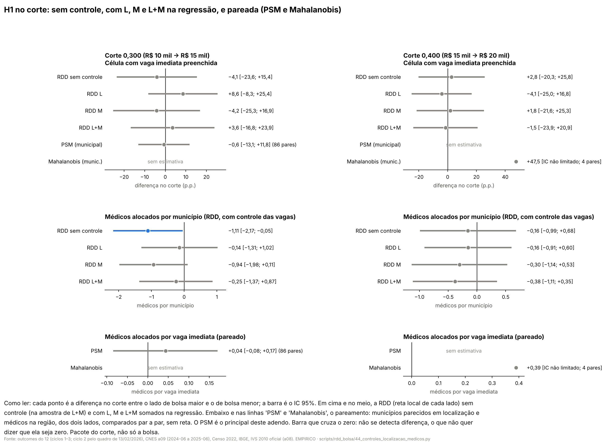
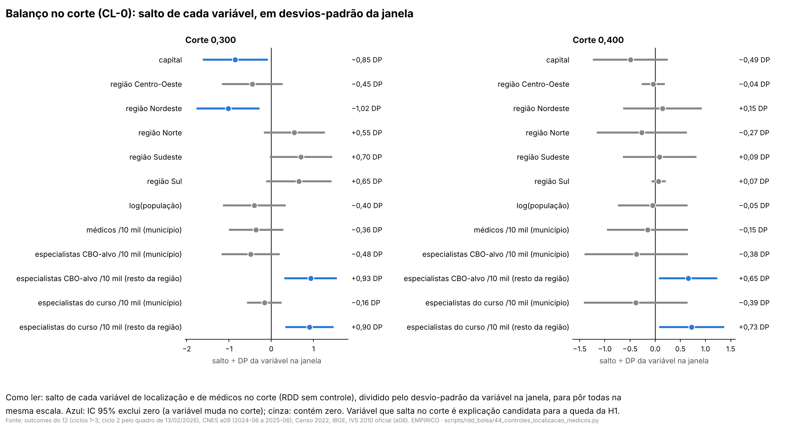
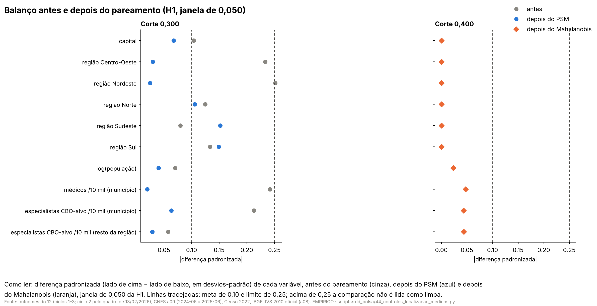
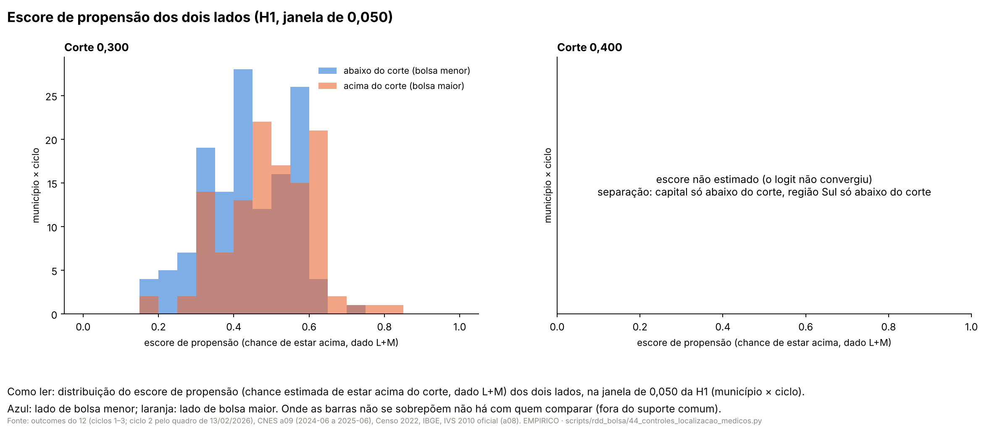

# 57r. H1 e oferta local no corte com controles de localização e de médicos na região, e pareamento (adendo 48d)

> **Data:** 26/10/2026. 
> **Adendo:** [`48d_adendo_controles_localizacao_e_medicos.md`](48d_adendo_controles_localizacao_e_medicos.md),
> congelado antes destas contas (commit `148479c`), com a nota §3.2 (commit `ff62365`: o pareamento por escore de
> propensão passa a ser o principal). SHA-256 do adendo em `adendo` de `CL_resumo.json`, conferido pelo script. 
> **Estatuto:** `ADENDO_48D_POS_RESULTADO` para a H1 (os saltos da H1 já tinham sido vistos, inclusive com capital e
> UF, no adendo 48c). Para a oferta local (protocolo 64) é pré-resultado. Toda linha de `CL_estimativas.csv` e
> `CL_balanco.csv` tem `natureza_dos_dados = EMPIRICO`. 
> **Auditoria:** pendente. 
> **Script:** `scripts/rdd_bolsa/44_controles_localizacao_medicos.py` (estimadores de `rdd_lib.py` e funções dos
> scripts 23, 37 e 40, importadas). **Saídas:** `output/rdd_bolsa/CL_estimativas.csv`, `CL_balanco.csv`,
> `CL_resumo.json`, `CL_figuras/`. **Testes:** `tests/test_controles_localizacao_medicos.py`. 
> **Números:** nenhum é digitado. Os blocos entre marcadores `<!-- CL:... -->` são regravados das saídas por
> `44_controles_localizacao_medicos.py --atualizar-doc`; o teste confere que cada bloco é idêntico ao gerado.

**Contraste.** Em toda linha, o lado com bolsa maior (IVS acima do corte) é comparado com o lado com bolsa menor; o
próprio corte fica no lado de baixo. Em 0,300 a bolsa anunciada sobe de R$ 10 mil para R$ 15 mil e em 0,400 de
R$ 15 mil para R$ 20 mil, mas outras regras federais mudam nos mesmos cortes
([auditoria 18](../auditorias/18_politicas_nos_mesmos_cortes_ivs.md)). O que se mede é o **pacote do corte**, não o
incentivo de R$ 5 mil isolado, nem a participação no PMM-E, nem o Agora Tem Especialistas. Este adendo é robustez:
o principal da H1 continua o 48b, e o da oferta local continua o protocolo 64 sem controle.

## 0. Decisões de implementação (26/10/2026, registradas antes de qualquer estimativa deste adendo)

O adendo deixa alguns pontos abertos. Em cada um, ficou a leitura mais próxima dos scripts 40 (H1) e 37 (oferta
local). Estas decisões foram escritas antes de rodar qualquer conta nova do adendo. Nenhuma depende de resultado.

**Variáveis**

1. **"Médicos" é número de vínculos.** O a09 conta vínculos (`n_vinculos`) e profissionais distintos. Os outcomes B1
   do script 37 e F3.1 do E7 usam vínculos. Aqui também. Profissionais distintos não podem ser somados entre grupos
   de CBO (a mesma pessoa conta duas vezes).
2. **Médicos (todos) = CBO 2251, 2252 e 2253.** O grupo `todos_medicos` do a09 inclui a família 2231 (residentes e
   códigos antigos), que o adendo não pede. Por isso, médicos = soma dos grupos `alvo_pmme`, `generalistas` e
   `especialistas_nao_alvo`, que são disjuntos e cobrem exatamente 2251, 2252 e 2253 (definição do manifesto a09). O
   script confere que essa soma não passa de `todos_medicos` em nenhum município e mês.
3. **Média do pré.** Média mensal de 2024-06 a 2025-06 (13 competências), dividida pela população do Censo 2022 e
   multiplicada por 10 mil. Município sem alguma das 13 competências, ou sem população > 0, fica ausente naquela
   variável (contado), como em `diferenca_pos_pre` do E7.
4. **Especialistas do curso, na célula (HI-1).** CBO do curso pela ponte do manifesto a09 (`cbo_para_cursos`), soma
   dos grupos `cbo_XXXXXX` dessas CBO. Os cursos 17 a 20 do ciclo 3 não estão na ponte: nessas células as duas
   variáveis do curso ficam ausentes e a célula sai das linhas que usam M (contada), como no doc 57e. No município
   (HI-2, pareamento e protocolo 64), especialistas = grupo `alvo_pmme` (todas as CBO-alvo), como manda o adendo.
5. **Resto da região de saúde.** ~~Região = UF + nome da região de saúde da malha.~~ *Revista em 26/10/2026, antes de
   qualquer estimativa, ao ler a malha:* a coluna `no_regiao_saude` de `malha_municipios_regioes_saude.parquet` está
   vazia em 5.034 dos 5.565 municípios (só tem valor onde houve ativo do PMM-E) e o script 19 a trata só como
   conferência (`conferir_cir_contra_malha`). A região de saúde vem então da **tabela oficial município → CIR do
   TabNet/DATASUS** já versionada (`data/raw/aquisicao/territorio/datasus_tabnet_br_regsaud.cnv`, só lida), pela
   função `ler_cir` do script 19, com o SHA-256 conferido contra `X5_manifesto_regioes_saude_cir.json` por
   `adquirir_cir(baixar=False)` (sem rede). É a mesma fonte dos scripts 19, 32 e 38. Nada é adquirido. Da malha
   nada é lido. Taxa = vínculos dos outros municípios da CIR ÷ população deles × 10 mil. CIR com um município só,
   ou município sem CIR na tabela: a variável fica ausente (contada). Se algum outro município da CIR não tiver a
   média do pré ou a população, a variável do resto fica ausente.
6. **Capital e macrorregião.** Da referência do IBGE gravada pelo 48c (`ibge_capitais_uf_regiao.csv`), com a
   conferência de SHA-256 e de 27 capitais da função `carregar_referencias` do script 41, importada. Macrorregião
   entra como quatro dummies (referência: Centro-Oeste). UF, na sensibilidade L-UF, como 26 dummies.
7. **Um coeficiente por covariável.** Cada covariável entra linear, com o mesmo coeficiente dos dois lados e em
   todos os ciclos empilhados, como a dummy de capital do script 41. O controle das vagas imediatas da HI-2 continua
   com um coeficiente por ciclo, como no 48b. Coluna sem variação na janela é descartada pela `rdd_lib` e registrada.
8. **Amostra comum.** As linhas com covariável usam só as unidades com todas as variáveis daquela linha. A
   "variação em relação ao sem controle" de cada linha compara com a mesma especificação sem covariável **na mesma
   amostra** daquela linha. A CL-4 é a sem controle na amostra de L+M.
9. **CL-0 (balanço).** Salto de cada variável no corte, sem controle: (a) na amostra da HI-2 (município × ciclo,
   ciclos empilhados, CR1 por município); (b) em V do protocolo 64 (um município por linha, HC1); (c) as duas do
   curso, na amostra da HI-1 (célula, CR1). Macrorregião: uma dummy por região. UF (27 níveis) não entra no balanço.

**Pareamento (CL-7 a CL-9, Mahalanobis; PS-1 a PS-4, escore de propensão)**

10. **Outcomes da H1 pareada,** por município × ciclo com pelo menos uma célula com vaga imediata (ciclo 2 pelo
    quadro de 13/02/2026): fração das células com vaga imediata preenchidas na 1ª chamada (média de `preenchida` do
    48b) e médicos alocados nessas células por vaga imediata (`aloc_imed / vi_imed`).
11. **Algoritmo 1:1 sem reposição:** guloso global, o par de menor distância primeiro; empates pela ordem do código
    IBGE (e do ciclo). Com essa regra, os pares não dependem de qual lado "procura"; o lado com menos unidades é
    registrado.
12. **Mahalanobis:** matriz de covariância das quatro variáveis contínuas (log da população e as três de M) na
    amostra da janela, os dois lados juntos, por corte (e por ciclo na H1). *Caliper* = 0,25 × desvio-padrão das
    distâncias de todos os pares admissíveis (mesmo estrato exato: macrorregião, capital e, na H1, ciclo).
13. **Escore de propensão:** logit por máxima verossimilhança (statsmodels) na amostra da janela de cada corte, com
    L+M; na H1, ajustado nas linhas município × ciclo dos três ciclos juntos e pareado dentro do ciclo. Coluna sem
    variação ou colinear é tirada antes do ajuste e registrada; separação perfeita ou falta de convergência é
    registrada e a linha fica sem estimativa. *Caliper* = 0,2 × desvio-padrão do logit do escore na amostra da
    janela (os dois lados).
14. **Suporte comum** (só no PSM): regra mínimo–máximo, escore entre o maior dos mínimos e o menor dos máximos dos
    dois lados. Quem fica fora é contado, com capitais e região.
15. **Balanço:** diferença padronizada = diferença de médias (acima − abaixo) ÷ desvio-padrão combinado
    √((s²_acima + s²_abaixo)/2) calculado **antes** do pareamento; o mesmo denominador é usado depois.
16. **Inferência pareada:** média das diferenças (acima − abaixo). Permutação de sinais dentro dos pares, 9.999
    sorteios, semente 20261026, p bicaudal = (1 + nº de |média*| ≥ |média|) ÷ 10.000; IC 95% por inversão desse
    teste (os mesmos sorteios, busca por bisseção). IC t pareado também relatado. O p usado no Holm e no BKY é o da
    permutação. Na H1, o mesmo município pode estar em pares de ciclos diferentes (limite registrado).
17. **IPW (PS-4):** pesos do ATT (1 acima; e/(1 − e) abaixo), escore aparado: unidades com escore fora de
    [0,05; 0,95] saem (contadas). Estimativa = diferença de médias ponderadas, por MQP de y em 1 e no lado, EP
    sanduíche (HC1 por município no protocolo 64; CR1 por município na H1), escore tratado como fixo.
18. **Mínimo de pares:** com menos de 2 pares, a linha fica `SEM_ESTIMATIVA`.

**Testes múltiplos e linhas pendentes**

19. **Holm** só nas principais da nota §3.2: PS-1 (dois outcomes × dois cortes) e PS-2 (ΔB1, ΔB2 × dois cortes).
    **BKY** nas secundárias: CL-1, CL-2, CL-3, CL-5, CL-6, CL-7 e CL-8. Fora das duas famílias: CL-0 (diagnóstico),
    CL-4 (referência), CL-9, PS-3 e PS-4 (sensibilidades).
20. **Oferta local pendente.** CL-5, CL-6, CL-8, a parte de oferta local do CL-9, PS-2 e a oferta local de PS-3 e
    PS-4 só rodam com as saídas `OC_*` do protocolo 64 presentes (flag `--so-oferta-local`), depois de reproduzir
    OC-A1 em 0,300 (≤ 1e−8). Sem elas, essas linhas ficam `PENDENTE_OC`, sem número, contadas. Enquanto houver
    linha pendente, o Holm das PS-1 e o BKY são **provisórios**: calculados com o tamanho da família completa, com
    as linhas pendentes contadas como p = 1; a flag `--so-oferta-local` refaz os dois com os p de verdade.
21. **ΔB da oferta local:** construção do script 37 importada (`ler_painel`, `contagem`, `horas_ligados`), em V
    (a amostra do doc 57k), ΔY = média de 2025-10 a 2026-08 − média de 2024-06 a 2025-06, com todas as competências
    de cada janela (`diferenca_pos_pre` com `exigir_completo`), como o E7. *Nota de 26/10/2026:* com as saídas do
    protocolo 64 já no branch, ΔB1–ΔB5 vêm das funções do script 43 (`carregar`, `completar_b3`, `deltas`, `taxa`),
    importadas, que por sua vez usam as do 37: a construção é a mesma, e o portão do OC-A1 confere.

**Regras de leitura fixadas no código (antes de ver resultado)**

22. **CL-0 com salto:** IC 95% da variável no corte não contém zero.
23. **Salto "parecido" ao sem controle:** a estimativa com L+M (CL-1) fica dentro do IC 95% da CL-4 e tem o mesmo
    sinal. **"IC menor":** IC da CL-1 mais estreito que o da CL-4. **"Leva para perto de zero":** IC da CL-1 contém
    zero e |CL-1| ≤ metade de |CL-4|.
24. **Pareado limpo:** todas as diferenças padronizadas depois do pareamento com |DP| ≤ 0,25.
25. **Pareado concorda com a RDD:** as duas com IC que contém zero, ou as duas com IC sem zero e o mesmo sinal.
    Compara-se PS-1 (e CL-7) com a HI-1/HI-2 sem controle (CL-4) e com L+M (CL-1), corte a corte.

## 1. Resposta curta

<!-- CL:resposta_curta:inicio -->
**Pareando por escore de propensão (principal deste adendo), a H1 não se distingue de zero em 0,300**: comparando municípios parecidos em localização e em médicos na região, dos dois lados do corte, o preenchimento das vagas imediatas não difere de forma detectável. Em 0,400 o PSM **não tem estimativa**: pela regra fixada antes (decisão 13), o logit não convergiu porque há categoria de L presente só de um lado da janela (separação): em 0,400, capital (10 unidade(s), todas abaixo do corte), região Sul (1 unidade(s), todas abaixo do corte).

- **Corte 0,300** (R$ 10 mil → R$ 15 mil): fração de células preenchidas (município × ciclo): −0,6 p.p. (IC permutação [−13,1; +11,8]; p Holm 1,000; 86 pares; balanço limpo); alocados por vaga imediata (município × ciclo): +0,04 (IC permutação [−0,08; +0,17]; p Holm 1,000; 86 pares; balanço limpo).

- **Corte 0,400** (R$ 15 mil → R$ 20 mil): fração de células preenchidas (município × ciclo): sem estimativa (escore nao estimado; logit nao convergiu); alocados por vaga imediata (município × ciclo): sem estimativa (escore nao estimado; logit nao convergiu).

**Oferta local pareada (PS-2, principal deste adendo para o protocolo 64):** ΔB1 vínculos de especialistas em 0,300: −0,09 (IC permutação [−0,96; +0,78]; p Holm 1,000; 88 pares); ΔB2 horas SUS de especialistas em 0,300: −0,71 (IC permutação [−9,32; +8,01]; p Holm 1,000; 87 pares); ΔB1 vínculos de especialistas em 0,400: sem estimativa; ΔB2 horas SUS de especialistas em 0,400: sem estimativa. Onde falta estimativa, o motivo é o mesmo: há categoria de L presente só de um lado da janela (separação): em 0,400, capital (4 unidade(s), todas abaixo do corte), região Sul (1 unidade(s), todas abaixo do corte).

**Controles somados na regressão (CL-1, secundária), na mesma amostra:** HI-1 em 0,300: sem controle −4,1 p.p. [−23,6; +15,4], com L+M +3,6 p.p. [−16,8; +23,9] (`RELATAR_COMO_ESTA`); HI-2 em 0,300: sem controle −1,11 [−2,17; −0,05], com L+M −0,25 [−1,37; +0,87] (`ANDA_JUNTO_COM_LOCALIZACAO_OU_MEDICOS`); HI-1 em 0,400: sem controle +2,8 p.p. [−20,3; +25,8], com L+M −1,5 p.p. [−23,9; +20,9] (`RELATAR_COMO_ESTA`); HI-2 em 0,400: sem controle −0,16 [−0,99; +0,68], com L+M −0,38 [−1,11; +0,35] (`RELATAR_COMO_ESTA`).

**Balanço no corte (CL-0):** as variáveis com salto (IC sem zero) na amostra da H1 são em 0,300 (H1, celula, amostra da HI-1): especialistas do curso /10 mil (resto da região); em 0,300 (H1, municipio x ciclo, amostra da HI-2): capital, especialistas CBO-alvo /10 mil (resto da região), região Nordeste; em 0,400 (H1, celula, amostra da HI-1): especialistas do curso /10 mil (resto da região); em 0,400 (H1, municipio x ciclo, amostra da HI-2): especialistas CBO-alvo /10 mil (resto da região).

**Pareado × RDD:** discordam em PS-1 alocados por vaga imediata (município × ciclo) × CL-4 HI-2 em 0,300. Relatam-se as duas: o pareado supõe randomização local condicional; a RDD supõe continuidade. Nenhuma passa a ser a principal da H1 por isso.

Tudo é robustez pós-resultado da H1 e se refere ao pacote do corte, não à bolsa isolada. O principal da H1 continua o 48b.
<!-- CL:resposta_curta:fim -->

### 1.1 Portão de reprodução

Antes de qualquer conta nova, o script refaz HI-1 e HI-2 do 48b nos dois cortes, das mesmas entradas, com as funções
do script 40 e com a função com covariáveis deste script sem covariável. A parte da oferta local só roda depois de
refazer o OC-A1 do protocolo 64 em 0,300. Tolerância: 1e−8.

<!-- CL:portao:inicio -->
| Linha do 48b | Corte | Salto em HI_estimativas.csv | Salto refeito aqui | máx. dif. absoluta | Reproduz |
|---|---|---|---|---|---|
| HI-1 | 0,300 | −0,036784 | −0,036784 | 6.9e-17 | sim |
| HI-2 | 0,300 | −1,126326 | −1,126326 | 8.3e-17 | sim |
| HI-1 | 0,400 | −0,023120 | −0,023120 | 6.9e-17 | sim |
| HI-2 | 0,400 | −0,156707 | −0,156707 | 0.0e+00 | sim |

Portão do protocolo 64: OC-A1 em V, 0,300, salto −0,229095 em `output/rdd_bolsa/OC_estimativas.csv` e −0,229095 refeito aqui (máx. dif. absoluta 2.8e-17): reproduz.
<!-- CL:portao:fim -->

### 1.2 Variáveis: o que entrou e o que ficou fora

<!-- CL:variaveis:inicio -->
| Variável | Conjunto | Situação | Observação |
|---|---|---|---|
| capital | L | entrou | referência do IBGE (48c), 27 capitais |
| macrorregião (efeito fixo) | L | entrou | 5 Grandes Regiões, referência do IBGE; quatro dummies (Centro-Oeste de referência) |
| UF (efeito fixo) | L-UF (sensibilidade, CL-2) | entrou | no lugar da macrorregião, só na linha L-UF + M |
| log(população 2022) | L | entrou | Censo 2022; municípios do a08 sem população > 0: 0 |
| médicos por 10 mil hab. (município) | M | entrou | vínculos CBO 2251/2252/2253, média 2024-06 a 2025-06; ausente em 0 município(s) do a08 |
| especialistas nas CBO-alvo por 10 mil hab. (município) | M | entrou | na célula, CBO do curso (ponte do a09); no município, todas as CBO-alvo |
| especialistas nas CBO-alvo por 10 mil hab. (resto da região de saúde) | M | entrou | região de saúde = CIR oficial do TabNet/DATASUS; 439 CIR; municípios do a08 sem CIR: 1; em CIR de um só (resto ausente): 2 |
<!-- CL:variaveis:fim -->

### 1.3 Amostra e quem saiu por ausência

<!-- CL:amostra:inicio -->
| Linha | Corte | Na janela h = 0,050 (células ou município × ciclo) | Saíram de L+M por variável ausente | Municípios distintos que saíram |
|---|---|---|---|---|
| HI-1 | 0,300 | 803 | 104 | 38 |
| HI-2 | 0,300 | 257 | 5 | 2 |
| HI-1 | 0,400 | 485 | 41 | 26 |
| HI-2 | 0,400 | 227 | 0 | 0 |

Pareamento (unidades: município × ciclo na H1; município em V):

| Parte | Corte | Janela | Na janela (abaixo / acima) | Sem alguma covariável (abaixo / acima) | Lado com menos unidades |
|---|---|---|---|---|---|
| H1 | 0,300 | 0,050 | 141 / 118 | 5 / 0 | acima |
| H1 | 0,300 | 0,020 | 57 / 45 | 3 / 0 | acima |
| H1 | 0,400 | 0,050 | 132 / 98 | 0 / 0 | acima |
| H1 | 0,400 | 0,020 | 61 / 43 | 0 / 0 | acima |
| oferta local | 0,300 | 0,050 | 144 / 122 | 3 / 0 | acima |
| oferta local | 0,300 | 0,020 | 58 / 49 | 2 / 0 | acima |
| oferta local | 0,400 | 0,050 | 125 / 146 | 0 / 0 | abaixo |
| oferta local | 0,400 | 0,020 | 55 / 58 | 0 / 0 | abaixo |
<!-- CL:amostra:fim -->

## 2. Principal: pareamento por escore de propensão (nota §3.2)

Cada município do lado de bolsa maior é pareado com um do lado de bolsa menor de escore parecido, dentro da janela
de 0,050 (na H1, no mesmo ciclo). A estimativa é a média das diferenças nos pares. O IC principal vem do teste de
permutação de sinais; o t pareado vai ao lado. Holm entre PS-1 e PS-2.

### 2.1 H1 (PS-1)

<!-- CL:psm_h1:inicio -->
| Linha | Outcome | Corte | Janela | Status | Pares (ou n abaixo / acima) | Sem par abaixo / acima | Diferença média (acima − abaixo) | IC 95% permutação (IPW: normal) | IC 95% t pareado | p | p Holm ou q BKY | Maior DP absoluta depois |
|---|---|---|---|---|---|---|---|---|---|---|---|---|
| PS-1 | fração de células preenchidas (município × ciclo) | 0,300 | 0,050 | EXECUTADO | 86 | 50 / 32 (fora do suporte: 0 / 5) | −0,6 p.p. | [−13,1; +11,8] | [−12,9; +11,7] | 0,922 | Holm 1,000 | 0,15 (limpa) |
| PS-1 | alocados por vaga imediata (município × ciclo) | 0,300 | 0,050 | EXECUTADO | 86 | 50 / 32 (fora do suporte: 0 / 5) | +0,04 | [−0,08; +0,17] | [−0,08; +0,17] | 0,492 | Holm 1,000 | 0,15 (limpa) |
| PS-1 | fração de células preenchidas (município × ciclo) | 0,400 | 0,050 | SEM_ESTIMATIVA (escore não estimado (separação)) | — | — | — | — | — | — | — | — |
| PS-1 | alocados por vaga imediata (município × ciclo) | 0,400 | 0,050 | SEM_ESTIMATIVA (escore não estimado (separação)) | — | — | — | — | — | — | — | — |
<!-- CL:psm_h1:fim -->

### 2.2 Oferta local (PS-2)

<!-- CL:psm_oferta:inicio -->
| Linha | Outcome | Corte | Janela | Status | Pares (ou n abaixo / acima) | Sem par abaixo / acima | Diferença média (acima − abaixo) | IC 95% permutação (IPW: normal) | IC 95% t pareado | p | p Holm ou q BKY | Maior DP absoluta depois |
|---|---|---|---|---|---|---|---|---|---|---|---|---|
| PS-2 | ΔB1 vínculos de especialistas | 0,300 | 0,050 | EXECUTADO | 88 | 53 / 34 (fora do suporte: 0 / 3) | −0,09 | [−0,96; +0,78] | [−0,98; +0,80] | 0,840 | Holm 1,000 | 0,11 (limpa) |
| PS-2 | ΔB2 horas SUS de especialistas | 0,300 | 0,050 | EXECUTADO | 87 | 53 / 34 (fora do suporte: 0 / 3) | −0,71 | [−9,32; +8,01] | [−9,38; +7,96] | 0,878 | Holm 1,000 | 0,11 (limpa) |
| PS-2 | ΔB1 vínculos de especialistas | 0,400 | 0,050 | SEM_ESTIMATIVA (escore não estimado (separação)) | — | — | — | — | — | — | — | — |
| PS-2 | ΔB2 horas SUS de especialistas | 0,400 | 0,050 | SEM_ESTIMATIVA (escore não estimado (separação)) | — | — | — | — | — | — | — | — |
<!-- CL:psm_oferta:fim -->

### 2.3 Sensibilidades: janela de 0,020 (PS-3) e IPW (PS-4)

<!-- CL:psm_sens:inicio -->
| Linha | Outcome | Corte | Janela | Status | Pares (ou n abaixo / acima) | Sem par abaixo / acima | Diferença média (acima − abaixo) | IC 95% permutação (IPW: normal) | IC 95% t pareado | p | p Holm ou q BKY | Maior DP absoluta depois |
|---|---|---|---|---|---|---|---|---|---|---|---|---|
| PS-4 | fração de células preenchidas (município × ciclo) | 0,300 | 0,050 | EXECUTADO | 136 / 118 (ponderados) | — | +3,4 p.p. | [−7,2; +14,1] | — | 0,524 | — (sensibilidade) | — |
| PS-4 | alocados por vaga imediata (município × ciclo) | 0,300 | 0,050 | EXECUTADO | 136 / 118 (ponderados) | — | +0,08 | [−0,03; +0,19] | — | 0,157 | — (sensibilidade) | — |
| PS-3 | fração de células preenchidas (município × ciclo) | 0,300 | 0,020 | EXECUTADO | 23 | 31 / 22 (fora do suporte: 6 / 12) | +0,9 p.p. | [−21,9; +23,3] | [−21,7; +23,5] | 0,945 | — (sensibilidade) | 0,30 (não limpa) |
| PS-3 | alocados por vaga imediata (município × ciclo) | 0,300 | 0,020 | EXECUTADO | 23 | 31 / 22 (fora do suporte: 6 / 12) | +0,02 | [−0,21; +0,23] | [−0,20; +0,23] | 0,891 | — (sensibilidade) | 0,30 (não limpa) |
| PS-4 | fração de células preenchidas (município × ciclo) | 0,400 | 0,050 | SEM_ESTIMATIVA (escore não estimado (separação)) | — | — | — | — | — | — | — | — |
| PS-4 | alocados por vaga imediata (município × ciclo) | 0,400 | 0,050 | SEM_ESTIMATIVA (escore não estimado (separação)) | — | — | — | — | — | — | — | — |
| PS-3 | fração de células preenchidas (município × ciclo) | 0,400 | 0,020 | SEM_ESTIMATIVA (escore não estimado (separação)) | — | — | — | — | — | — | — | — |
| PS-3 | alocados por vaga imediata (município × ciclo) | 0,400 | 0,020 | SEM_ESTIMATIVA (escore não estimado (separação)) | — | — | — | — | — | — | — | — |
| PS-4 | ΔB1 vínculos de especialistas | 0,300 | 0,050 | EXECUTADO | 140 / 121 (ponderados) | — | −0,06 | [−0,64; +0,53] | — | 0,847 | — (sensibilidade) | — |
| PS-4 | ΔB2 horas SUS de especialistas | 0,300 | 0,050 | EXECUTADO | 138 / 121 (ponderados) | — | +0,87 | [−5,64; +7,38] | — | 0,794 | — (sensibilidade) | — |
| PS-3 | ΔB1 vínculos de especialistas | 0,300 | 0,020 | EXECUTADO | 38 | 18 / 11 (fora do suporte: 4 / 10) | −0,03 | [−1,71; +1,68] | [−1,75; +1,70] | 0,980 | — (sensibilidade) | 0,16 (limpa) |
| PS-3 | ΔB2 horas SUS de especialistas | 0,300 | 0,020 | EXECUTADO | 38 | 18 / 11 (fora do suporte: 4 / 10) | −4,34 | [−15,77; +7,14] | [−15,82; +7,14] | 0,445 | — (sensibilidade) | 0,16 (limpa) |
| PS-4 | ΔB1 vínculos de especialistas | 0,400 | 0,050 | SEM_ESTIMATIVA (escore não estimado (separação)) | — | — | — | — | — | — | — | — |
| PS-4 | ΔB2 horas SUS de especialistas | 0,400 | 0,050 | SEM_ESTIMATIVA (escore não estimado (separação)) | — | — | — | — | — | — | — | — |
| PS-3 | ΔB1 vínculos de especialistas | 0,400 | 0,020 | SEM_ESTIMATIVA (escore não estimado (separação)) | — | — | — | — | — | — | — | — |
| PS-3 | ΔB2 horas SUS de especialistas | 0,400 | 0,020 | SEM_ESTIMATIVA (escore não estimado (separação)) | — | — | — | — | — | — | — | — |
<!-- CL:psm_sens:fim -->

### 2.4 Balanço antes e depois do pareamento

Diferença padronizada de cada variável de L+M (lado de cima − lado de baixo, em desvios-padrão). Meta: até 0,10.
Acima de 0,25 depois do pareamento, a linha não é lida como comparação limpa. Tabela completa em `CL_balanco.csv`.

<!-- CL:balanco_pareamento:inicio -->
| Linha | Parte | Corte | Janela | Pares | Maior DP absoluta antes | Maior DP absoluta depois | Pior variável depois | Variáveis com DP absoluta > 0,10 | Variáveis com DP absoluta > 0,25 |
|---|---|---|---|---|---|---|---|---|---|
| CL-7 | H1 | 0,300 | 0,050 | 0 | 0,25 | — | — | — | — |
| PS-1 | H1 | 0,300 | 0,050 | 86 | 0,25 | 0,15 | região Sudeste | 3 | 0 |
| CL-9 | H1 | 0,300 | 0,020 | 0 | 0,70 | — | — | — | — |
| PS-3 | H1 | 0,300 | 0,020 | 23 | 0,70 | 0,30 | log(população) | 4 | 2 |
| CL-7 | H1 | 0,400 | 0,050 | 4 | 0,58 | 0,05 | médicos /10 mil (município) | 0 | 0 |
| CL-9 | H1 | 0,400 | 0,020 | 3 | 0,52 | 0,10 | especialistas CBO-alvo /10 mil (resto da região) | 0 | 0 |
| CL-8 | oferta local | 0,300 | 0,050 | 10 | 0,39 | 0,11 | especialistas CBO-alvo /10 mil (município) | 1 | 0 |
| CL-9 | oferta local | 0,300 | 0,020 | 1 | 0,34 | 0,17 | log(população) | 1 | 0 |
| PS-2 | oferta local | 0,300 | 0,050 | 88 | 0,39 | 0,11 | log(população) | 3 | 0 |
| PS-3 | oferta local | 0,300 | 0,020 | 38 | 0,34 | 0,16 | região Sudeste | 2 | 0 |
| CL-8 | oferta local | 0,400 | 0,050 | 15 | 0,52 | 0,06 | especialistas CBO-alvo /10 mil (município) | 0 | 0 |
| CL-9 | oferta local | 0,400 | 0,020 | 7 | 0,36 | 0,09 | log(população) | 0 | 0 |
<!-- CL:balanco_pareamento:fim -->

## 3. Balanço no corte (CL-0)

Salto de cada variável no corte, pela RDD sem controle. Variável que salta no corte não é balanceada entre os lados
e é explicação candidata para a queda da H1.

<!-- CL:cl0:inicio -->
| Amostra | Corte | Variável | n abaixo / acima | Salto no corte | IC 95% | p | Salto ÷ DP na janela |
|---|---|---|---|---|---|---|---|
| H1 (municipio x ciclo, amostra da HI-2) | 0,300 | capital | 95 / 72 | −29,9 p.p. **(IC sem zero)** | [−57,1; −2,8] | 0,031 | −0,85 |
| H1 (municipio x ciclo, amostra da HI-2) | 0,300 | região Centro-Oeste | 95 / 72 | −18,1 p.p. | [−47,0; +10,8] | 0,220 | −0,45 |
| H1 (municipio x ciclo, amostra da HI-2) | 0,300 | região Nordeste | 95 / 72 | −47,7 p.p. **(IC sem zero)** | [−82,6; −12,8] | 0,007 | −1,02 |
| H1 (municipio x ciclo, amostra da HI-2) | 0,300 | região Norte | 95 / 72 | +18,4 p.p. | [−6,0; +42,7] | 0,139 | +0,55 |
| H1 (municipio x ciclo, amostra da HI-2) | 0,300 | região Sudeste | 95 / 72 | +32,0 p.p. | [−1,7; +65,7] | 0,062 | +0,70 |
| H1 (municipio x ciclo, amostra da HI-2) | 0,300 | região Sul | 95 / 72 | +15,3 p.p. | [−2,8; +33,4] | 0,097 | +0,65 |
| H1 (municipio x ciclo, amostra da HI-2) | 0,300 | log(população) | 95 / 72 | −0,59 | [−1,67; +0,50] | 0,288 | −0,40 |
| H1 (municipio x ciclo, amostra da HI-2) | 0,300 | médicos /10 mil (município) | 95 / 72 | −17,19 | [−48,02; +13,64] | 0,275 | −0,36 |
| H1 (municipio x ciclo, amostra da HI-2) | 0,300 | especialistas CBO-alvo /10 mil (município) | 95 / 72 | −8,75 | [−21,16; +3,66] | 0,167 | −0,48 |
| H1 (municipio x ciclo, amostra da HI-2) | 0,300 | especialistas CBO-alvo /10 mil (resto da região) | 93 / 72 | +10,54 **(IC sem zero)** | [+3,54; +17,54] | 0,003 | +0,93 |
| H1 (celula, amostra da HI-1) | 0,300 | especialistas do curso /10 mil (município) | 90 / 66 | −0,50 | [−1,79; +0,78] | 0,443 | −0,16 |
| H1 (celula, amostra da HI-1) | 0,300 | especialistas do curso /10 mil (resto da região) | 88 / 66 | +1,33 **(IC sem zero)** | [+0,49; +2,17] | 0,002 | +0,90 |
| V (protocolo 64, um municipio por linha) | 0,300 | capital | 144 / 119 | −11,6 p.p. **(IC sem zero)** | [−22,3; −0,8] | 0,035 | −0,46 |
| V (protocolo 64, um municipio por linha) | 0,300 | região Centro-Oeste | 144 / 119 | −12,0 p.p. | [−32,2; +8,2] | 0,244 | −0,29 |
| V (protocolo 64, um municipio por linha) | 0,300 | região Nordeste | 144 / 119 | −8,8 p.p. | [−29,3; +11,6] | 0,397 | −0,22 |
| V (protocolo 64, um municipio por linha) | 0,300 | região Norte | 144 / 119 | −2,6 p.p. | [−14,1; +8,9] | 0,656 | −0,09 |
| V (protocolo 64, um municipio por linha) | 0,300 | região Sudeste | 144 / 119 | +12,5 p.p. | [−14,0; +39,0] | 0,355 | +0,25 |
| V (protocolo 64, um municipio por linha) | 0,300 | região Sul | 144 / 119 | +11,0 p.p. | [−3,2; +25,2] | 0,130 | +0,43 |
| V (protocolo 64, um municipio por linha) | 0,300 | log(população) | 144 / 119 | +0,30 | [−0,45; +1,05] | 0,437 | +0,21 |
| V (protocolo 64, um municipio por linha) | 0,300 | médicos /10 mil (município) | 144 / 119 | −5,89 | [−22,47; +10,69] | 0,486 | −0,14 |
| V (protocolo 64, um municipio por linha) | 0,300 | especialistas CBO-alvo /10 mil (município) | 144 / 119 | −3,60 | [−10,34; +3,15] | 0,296 | −0,23 |
| V (protocolo 64, um municipio por linha) | 0,300 | especialistas CBO-alvo /10 mil (resto da região) | 141 / 119 | +4,18 | [−2,05; +10,40] | 0,189 | +0,30 |
| H1 (municipio x ciclo, amostra da HI-2) | 0,400 | capital | 83 / 69 | −9,7 p.p. | [−24,2; +4,9] | 0,193 | −0,49 |
| H1 (municipio x ciclo, amostra da HI-2) | 0,400 | região Centro-Oeste | 83 / 69 | −0,7 p.p. | [−4,9; +3,6] | 0,753 | −0,04 |
| H1 (municipio x ciclo, amostra da HI-2) | 0,400 | região Nordeste | 83 / 69 | +7,1 p.p. | [−30,5; +44,7] | 0,710 | +0,15 |
| H1 (municipio x ciclo, amostra da HI-2) | 0,400 | região Norte | 83 / 69 | −10,1 p.p. | [−43,9; +23,7] | 0,559 | −0,27 |
| H1 (municipio x ciclo, amostra da HI-2) | 0,400 | região Sudeste | 83 / 69 | +3,2 p.p. | [−23,0; +29,4] | 0,812 | +0,09 |
| H1 (municipio x ciclo, amostra da HI-2) | 0,400 | região Sul | 83 / 69 | +0,5 p.p. | [−0,5; +1,4] | 0,324 | +0,07 |
| H1 (municipio x ciclo, amostra da HI-2) | 0,400 | log(população) | 83 / 69 | −0,06 | [−0,85; +0,74] | 0,890 | −0,05 |
| H1 (municipio x ciclo, amostra da HI-2) | 0,400 | médicos /10 mil (município) | 83 / 69 | −3,17 | [−19,83; +13,49] | 0,709 | −0,15 |
| H1 (municipio x ciclo, amostra da HI-2) | 0,400 | especialistas CBO-alvo /10 mil (município) | 83 / 69 | −3,55 | [−13,23; +6,14] | 0,473 | −0,38 |
| H1 (municipio x ciclo, amostra da HI-2) | 0,400 | especialistas CBO-alvo /10 mil (resto da região) | 83 / 69 | +6,21 **(IC sem zero)** | [+0,71; +11,70] | 0,027 | +0,65 |
| H1 (celula, amostra da HI-1) | 0,400 | especialistas do curso /10 mil (município) | 78 / 61 | −1,25 | [−4,56; +2,07] | 0,461 | −0,39 |
| H1 (celula, amostra da HI-1) | 0,400 | especialistas do curso /10 mil (resto da região) | 78 / 61 | +1,17 **(IC sem zero)** | [+0,13; +2,22] | 0,028 | +0,73 |
| V (protocolo 64, um municipio por linha) | 0,400 | capital | 122 / 145 | −3,6 p.p. | [−9,2; +2,0] | 0,210 | −0,34 |
| V (protocolo 64, um municipio por linha) | 0,400 | região Centro-Oeste | 122 / 145 | −1,5 p.p. | [−8,0; +5,0] | 0,654 | −0,07 |
| V (protocolo 64, um municipio por linha) | 0,400 | região Nordeste | 122 / 145 | +5,3 p.p. | [−19,2; +29,9] | 0,669 | +0,11 |
| V (protocolo 64, um municipio por linha) | 0,400 | região Norte | 122 / 145 | −10,8 p.p. | [−27,6; +5,9] | 0,205 | −0,36 |
| V (protocolo 64, um municipio por linha) | 0,400 | região Sudeste | 122 / 145 | +6,5 p.p. | [−14,6; +27,5] | 0,546 | +0,17 |
| V (protocolo 64, um municipio por linha) | 0,400 | região Sul | 122 / 145 | +0,5 p.p. | [−0,5; +1,5] | 0,319 | +0,08 |
| V (protocolo 64, um municipio por linha) | 0,400 | log(população) | 122 / 145 | −0,01 | [−0,61; +0,59] | 0,975 | −0,01 |
| V (protocolo 64, um municipio por linha) | 0,400 | médicos /10 mil (município) | 122 / 145 | −3,55 | [−15,04; +7,95] | 0,545 | −0,18 |
| V (protocolo 64, um municipio por linha) | 0,400 | especialistas CBO-alvo /10 mil (município) | 122 / 145 | −2,98 | [−9,16; +3,19] | 0,344 | −0,36 |
| V (protocolo 64, um municipio por linha) | 0,400 | especialistas CBO-alvo /10 mil (resto da região) | 122 / 145 | +6,56 **(IC sem zero)** | [+0,42; +12,70] | 0,036 | +0,54 |
<!-- CL:cl0:fim -->

## 4. Secundárias: controles somados na regressão (CL-1 a CL-4) e Mahalanobis (CL-7 a CL-9)

### 4.1 H1 com L, M e L+M na regressão

A variação compara cada linha com a mesma especificação sem controle, na mesma amostra.

<!-- CL:rdd_h1:inicio -->
| Linha | Outcome | Corte | Controles | Municípios abaixo / acima | Saíram por ausência (abaixo / acima) | Salto | IC 95% | p | q BKY | Variação vs. sem controle na mesma amostra |
|---|---|---|---|---|---|---|---|---|---|---|
| CL-4 | HI-1 célula preenchida | 0,300 | sem controle | 88 / 66 | 64 / 40 | −4,1 p.p. | [−23,6; +15,4] | 0,681 | — | — |
| CL-1 | HI-1 célula preenchida | 0,300 | L+M | 88 / 66 | 64 / 40 | +3,6 p.p. | [−16,8; +23,9] | 0,732 | 1,000 | +7,6 p.p. (+187%) |
| CL-2 | HI-1 célula preenchida | 0,300 | L | 95 / 72 | 0 / 0 | +8,6 p.p. | [−8,3; +25,4] | 0,320 | 1,000 | +12,2 p.p. (+332%) |
| CL-2 | HI-1 célula preenchida | 0,300 | M | 88 / 66 | 64 / 40 | −4,2 p.p. | [−25,3; +16,9] | 0,698 | 1,000 | −0,1 p.p. (−2%) |
| CL-2 | HI-1 célula preenchida | 0,300 | L-UF + M | 88 / 66 | 64 / 40 | +2,8 p.p. | [−16,6; +22,1] | 0,780 | 1,000 | +6,8 p.p. (+167%) |
| CL-3 | HI-1 célula preenchida | 0,300 | capital | 95 / 72 | 0 / 0 | +2,6 p.p. | [−15,7; +21,0] | 0,780 | 1,000 | +6,3 p.p. (+171%) |
| CL-3 | HI-1 célula preenchida | 0,300 | macrorregião (efeito fixo) | 95 / 72 | 0 / 0 | +4,0 p.p. | [−13,8; +21,8] | 0,657 | 1,000 | +7,7 p.p. (+210%) |
| CL-3 | HI-1 célula preenchida | 0,300 | log(população 2022) | 95 / 72 | 0 / 0 | +1,6 p.p. | [−15,7; +18,9] | 0,858 | 1,000 | +5,3 p.p. (+143%) |
| CL-3 | HI-1 célula preenchida | 0,300 | médicos por 10 mil hab. no município | 95 / 72 | 0 / 0 | −2,6 p.p. | [−21,2; +15,9] | 0,780 | 1,000 | +1,0 p.p. (+28%) |
| CL-3 | HI-1 célula preenchida | 0,300 | especialistas nas CBO-alvo por 10 mil hab. no município | 90 / 66 | 50 / 40 | +0,1 p.p. | [−19,9; +20,0] | 0,994 | 1,000 | +1,9 p.p. (+104%) |
| CL-3 | HI-1 célula preenchida | 0,300 | especialistas nas CBO-alvo por 10 mil hab. no resto da região de saúde | 88 / 66 | 64 / 40 | −4,4 p.p. | [−25,4; +16,6] | 0,681 | 1,000 | −0,3 p.p. (−8%) |
| CL-4 | HI-2 alocados por município | 0,300 | sem controle | 93 / 72 | 5 / 0 | −1,11 | [−2,17; −0,05] | 0,041 | — | — |
| CL-1 | HI-2 alocados por município | 0,300 | L+M | 93 / 72 | 5 / 0 | −0,25 | [−1,37; +0,87] | 0,662 | 1,000 | +0,86 (+77%) |
| CL-2 | HI-2 alocados por município | 0,300 | L | 95 / 72 | 0 / 0 | −0,14 | [−1,31; +1,02] | 0,809 | 1,000 | +0,98 (+87%) |
| CL-2 | HI-2 alocados por município | 0,300 | M | 93 / 72 | 5 / 0 | −0,94 | [−1,98; +0,11] | 0,079 | 1,000 | +0,17 (+15%) |
| CL-2 | HI-2 alocados por município | 0,300 | L-UF + M | 93 / 72 | 5 / 0 | −0,11 | [−1,04; +0,83] | 0,825 | 1,000 | +1,00 (+90%) |
| CL-3 | HI-2 alocados por município | 0,300 | capital | 95 / 72 | 0 / 0 | −0,83 | [−1,87; +0,21] | 0,119 | 1,000 | +0,30 (+27%) |
| CL-3 | HI-2 alocados por município | 0,300 | macrorregião (efeito fixo) | 95 / 72 | 0 / 0 | −0,53 | [−1,64; +0,58] | 0,351 | 1,000 | +0,60 (+53%) |
| CL-3 | HI-2 alocados por município | 0,300 | log(população 2022) | 95 / 72 | 0 / 0 | −0,99 | [−2,00; +0,01] | 0,053 | 1,000 | +0,13 (+12%) |
| CL-3 | HI-2 alocados por município | 0,300 | médicos por 10 mil hab. no município | 95 / 72 | 0 / 0 | −1,03 | [−2,10; +0,04] | 0,060 | 1,000 | +0,10 (+9%) |
| CL-3 | HI-2 alocados por município | 0,300 | especialistas nas CBO-alvo por 10 mil hab. no município | 95 / 72 | 0 / 0 | −0,97 | [−2,05; +0,10] | 0,076 | 1,000 | +0,15 (+14%) |
| CL-3 | HI-2 alocados por município | 0,300 | especialistas nas CBO-alvo por 10 mil hab. no resto da região de saúde | 93 / 72 | 5 / 0 | −1,11 | [−2,15; −0,07] | 0,037 | 1,000 | 0,00 (0%) |
| CL-4 | HI-1 célula preenchida | 0,400 | sem controle | 78 / 61 | 28 / 13 | +2,8 p.p. | [−20,3; +25,8] | 0,815 | — | — |
| CL-1 | HI-1 célula preenchida | 0,400 | L+M | 78 / 61 | 28 / 13 | −1,5 p.p. | [−23,9; +20,9] | 0,896 | 1,000 | −4,2 p.p. (−154%) |
| CL-2 | HI-1 célula preenchida | 0,400 | L | 83 / 69 | 0 / 0 | −4,1 p.p. | [−25,0; +16,8] | 0,700 | 1,000 | −1,8 p.p. (−77%) |
| CL-2 | HI-1 célula preenchida | 0,400 | M | 78 / 61 | 28 / 13 | +1,8 p.p. | [−21,6; +25,3] | 0,877 | 1,000 | −0,9 p.p. (−33%) |
| CL-2 | HI-1 célula preenchida | 0,400 | L-UF + M | 78 / 61 | 28 / 13 | +6,1 p.p. | [−14,0; +26,2] | 0,554 | 1,000 | +3,3 p.p. (+121%) |
| CL-3 | HI-1 célula preenchida | 0,400 | capital | 83 / 69 | 0 / 0 | −0,5 p.p. | [−22,8; +21,8] | 0,968 | 1,000 | +1,9 p.p. (+80%) |
| CL-3 | HI-1 célula preenchida | 0,400 | macrorregião (efeito fixo) | 83 / 69 | 0 / 0 | −5,8 p.p. | [−25,9; +14,3] | 0,574 | 1,000 | −3,5 p.p. (−150%) |
| CL-3 | HI-1 célula preenchida | 0,400 | log(população 2022) | 83 / 69 | 0 / 0 | −1,9 p.p. | [−24,3; +20,5] | 0,867 | 1,000 | +0,4 p.p. (+17%) |
| CL-3 | HI-1 célula preenchida | 0,400 | médicos por 10 mil hab. no município | 83 / 69 | 0 / 0 | −1,7 p.p. | [−22,7; +19,2] | 0,871 | 1,000 | +0,6 p.p. (+25%) |
| CL-3 | HI-1 célula preenchida | 0,400 | especialistas nas CBO-alvo por 10 mil hab. no município | 78 / 61 | 28 / 13 | +6,5 p.p. | [−16,2; +29,2] | 0,576 | 1,000 | +3,7 p.p. (+136%) |
| CL-3 | HI-1 célula preenchida | 0,400 | especialistas nas CBO-alvo por 10 mil hab. no resto da região de saúde | 78 / 61 | 28 / 13 | +0,9 p.p. | [−22,1; +24,0] | 0,936 | 1,000 | −1,8 p.p. (−66%) |
| CL-4 | HI-2 alocados por município | 0,400 | sem controle | 83 / 69 | 0 / 0 | −0,16 | [−0,99; +0,68] | 0,713 | — | — |
| CL-1 | HI-2 alocados por município | 0,400 | L+M | 83 / 69 | 0 / 0 | −0,38 | [−1,11; +0,35] | 0,306 | 1,000 | −0,23 (−144%) |
| CL-2 | HI-2 alocados por município | 0,400 | L | 83 / 69 | 0 / 0 | −0,16 | [−0,91; +0,60] | 0,688 | 1,000 | 0,00 (+1%) |
| CL-2 | HI-2 alocados por município | 0,400 | M | 83 / 69 | 0 / 0 | −0,30 | [−1,14; +0,53] | 0,475 | 1,000 | −0,15 (−93%) |
| CL-2 | HI-2 alocados por município | 0,400 | L-UF + M | 83 / 69 | 0 / 0 | −0,01 | [−0,67; +0,66] | 0,985 | 1,000 | +0,15 (+96%) |
| CL-3 | HI-2 alocados por município | 0,400 | capital | 83 / 69 | 0 / 0 | −0,06 | [−0,90; +0,78] | 0,886 | 1,000 | +0,10 (+61%) |
| CL-3 | HI-2 alocados por município | 0,400 | macrorregião (efeito fixo) | 83 / 69 | 0 / 0 | −0,17 | [−0,91; +0,57] | 0,652 | 1,000 | −0,01 (−8%) |
| CL-3 | HI-2 alocados por município | 0,400 | log(população 2022) | 83 / 69 | 0 / 0 | −0,16 | [−1,01; +0,70] | 0,720 | 1,000 | 0,00 (+1%) |
| CL-3 | HI-2 alocados por município | 0,400 | médicos por 10 mil hab. no município | 83 / 69 | 0 / 0 | −0,13 | [−0,93; +0,67] | 0,755 | 1,000 | +0,03 (+19%) |
| CL-3 | HI-2 alocados por município | 0,400 | especialistas nas CBO-alvo por 10 mil hab. no município | 83 / 69 | 0 / 0 | −0,06 | [−0,89; +0,78] | 0,897 | 1,000 | +0,10 (+65%) |
| CL-3 | HI-2 alocados por município | 0,400 | especialistas nas CBO-alvo por 10 mil hab. no resto da região de saúde | 83 / 69 | 0 / 0 | −0,27 | [−1,11; +0,56] | 0,520 | 1,000 | −0,12 (−75%) |
<!-- CL:rdd_h1:fim -->

### 4.2 Pareamento por Mahalanobis (CL-7, CL-8 e CL-9)

<!-- CL:mahalanobis:inicio -->
| Linha | Outcome | Corte | Janela | Status | Pares (ou n abaixo / acima) | Sem par abaixo / acima | Diferença média (acima − abaixo) | IC 95% permutação (IPW: normal) | IC 95% t pareado | p | p Holm ou q BKY | Maior DP absoluta depois |
|---|---|---|---|---|---|---|---|---|---|---|---|---|
| CL-7 | fração de células preenchidas (município × ciclo) | 0,300 | 0,050 | SEM_ESTIMATIVA (sem pares (caliper)) | 0 | 136 / 118 | — | — | — | — | — | — |
| CL-7 | alocados por vaga imediata (município × ciclo) | 0,300 | 0,050 | SEM_ESTIMATIVA (sem pares (caliper)) | 0 | 136 / 118 | — | — | — | — | — | — |
| CL-9 | fração de células preenchidas (município × ciclo) | 0,300 | 0,020 | SEM_ESTIMATIVA (sem pares (caliper)) | 0 | 54 / 45 | — | — | — | — | — | — |
| CL-9 | alocados por vaga imediata (município × ciclo) | 0,300 | 0,020 | SEM_ESTIMATIVA (sem pares (caliper)) | 0 | 54 / 45 | — | — | — | — | — | — |
| CL-7 | fração de células preenchidas (município × ciclo) | 0,400 | 0,050 | EXECUTADO | 4 | 128 / 94 | +47,5 p.p. | não limitado | [−49,2; +144,2] | 0,503 | BKY 1,000 | 0,05 (limpa) |
| CL-7 | alocados por vaga imediata (município × ciclo) | 0,400 | 0,050 | EXECUTADO | 4 | 128 / 94 | +0,39 | não limitado | [−0,77; +1,55] | 0,503 | BKY 1,000 | 0,05 (limpa) |
| CL-9 | fração de células preenchidas (município × ciclo) | 0,400 | 0,020 | EXECUTADO | 3 | 58 / 40 | +38,9 p.p. | não limitado | [−116,5; +194,3] | 0,500 | — (sensibilidade) | 0,10 (limpa) |
| CL-9 | alocados por vaga imediata (município × ciclo) | 0,400 | 0,020 | EXECUTADO | 3 | 58 / 40 | +0,32 | não limitado | [−1,05; +1,68] | 0,500 | — (sensibilidade) | 0,10 (limpa) |
| CL-8 | ΔB1 vínculos de especialistas | 0,300 | 0,050 | EXECUTADO | 10 | 131 / 112 | +1,26 | [−0,86; +3,35] | [−0,79; +3,32] | 0,192 | BKY 1,000 | 0,11 (limpa) |
| CL-8 | ΔB2 horas SUS de especialistas | 0,300 | 0,050 | EXECUTADO | 10 | 131 / 112 | −9,90 | [−37,49; +15,17] | [−35,61; +15,82] | 0,418 | BKY 1,000 | 0,11 (limpa) |
| CL-8 | ΔB3 horas SUS dos outros especialistas | 0,300 | 0,050 | EXECUTADO | 10 | 131 / 112 | −9,11 | [−35,09; +14,31] | [−34,02; +15,80] | 0,460 | BKY 1,000 | 0,11 (limpa) |
| CL-8 | ΔB4 horas totais | 0,300 | 0,050 | EXECUTADO | 10 | 131 / 112 | −9,89 | [−38,70; +17,41] | [−37,19; +17,41] | 0,450 | BKY 1,000 | 0,11 (limpa) |
| CL-8 | ΔB5 generalistas | 0,300 | 0,050 | EXECUTADO | 10 | 131 / 112 | −0,13 | [−3,27; +2,35] | [−3,14; +2,89] | 0,958 | BKY 1,000 | 0,11 (limpa) |
| CL-9 | ΔB1 vínculos de especialistas | 0,300 | 0,020 | SEM_ESTIMATIVA (menos de 2 pares) | 1 | 55 / 48 | — | — | — | — | — | — |
| CL-9 | ΔB2 horas SUS de especialistas | 0,300 | 0,020 | SEM_ESTIMATIVA (menos de 2 pares) | 1 | 55 / 48 | — | — | — | — | — | — |
| CL-9 | ΔB3 horas SUS dos outros especialistas | 0,300 | 0,020 | SEM_ESTIMATIVA (menos de 2 pares) | 1 | 55 / 48 | — | — | — | — | — | — |
| CL-9 | ΔB4 horas totais | 0,300 | 0,020 | SEM_ESTIMATIVA (menos de 2 pares) | 1 | 55 / 48 | — | — | — | — | — | — |
| CL-9 | ΔB5 generalistas | 0,300 | 0,020 | SEM_ESTIMATIVA (menos de 2 pares) | 1 | 55 / 48 | — | — | — | — | — | — |
| CL-8 | ΔB1 vínculos de especialistas | 0,400 | 0,050 | EXECUTADO | 15 | 110 / 131 | −1,52 | [−3,21; +0,14] | [−3,20; +0,15] | 0,066 | BKY 1,000 | 0,06 (limpa) |
| CL-8 | ΔB2 horas SUS de especialistas | 0,400 | 0,050 | EXECUTADO | 15 | 110 / 131 | −12,33 | [−28,49; +1,86] | [−28,25; +3,58] | 0,097 | BKY 1,000 | 0,06 (limpa) |
| CL-8 | ΔB3 horas SUS dos outros especialistas | 0,400 | 0,050 | EXECUTADO | 15 | 110 / 131 | −13,08 | [−26,70; −0,80] | [−26,51; +0,34] | 0,036 | BKY 1,000 | 0,06 (limpa) |
| CL-8 | ΔB4 horas totais | 0,400 | 0,050 | EXECUTADO | 15 | 110 / 131 | −16,20 | [−33,23; −1,25] | [−33,14; +0,75] | 0,030 | BKY 1,000 | 0,06 (limpa) |
| CL-8 | ΔB5 generalistas | 0,400 | 0,050 | EXECUTADO | 15 | 110 / 131 | −0,77 | [−1,98; +0,43] | [−2,00; +0,46] | 0,200 | BKY 1,000 | 0,06 (limpa) |
| CL-9 | ΔB1 vínculos de especialistas | 0,400 | 0,020 | EXECUTADO | 7 | 48 / 51 | −0,68 | [−3,96; +1,96] | [−3,63; +2,26] | 0,621 | — (sensibilidade) | 0,09 (limpa) |
| CL-9 | ΔB2 horas SUS de especialistas | 0,400 | 0,020 | EXECUTADO | 7 | 48 / 51 | −11,27 | [−27,44; +6,46] | [−26,84; +4,29] | 0,140 | — (sensibilidade) | 0,09 (limpa) |
| CL-9 | ΔB3 horas SUS dos outros especialistas | 0,400 | 0,020 | EXECUTADO | 7 | 48 / 51 | −9,38 | [−22,43; +4,60] | [−21,53; +2,77] | 0,128 | — (sensibilidade) | 0,09 (limpa) |
| CL-9 | ΔB4 horas totais | 0,400 | 0,020 | EXECUTADO | 7 | 48 / 51 | −13,79 | [−28,30; +4,93] | [−28,49; +0,91] | 0,082 | — (sensibilidade) | 0,09 (limpa) |
| CL-9 | ΔB5 generalistas | 0,400 | 0,020 | EXECUTADO | 7 | 48 / 51 | −1,12 | [−3,01; +0,53] | [−2,80; +0,56] | 0,196 | — (sensibilidade) | 0,09 (limpa) |
<!-- CL:mahalanobis:fim -->

### 4.3 Oferta local com L, M e L+M na regressão (CL-5 e CL-6)

<!-- CL:oferta_rdd:inicio -->
| Linha | Outcome | Corte | Controles | Municípios abaixo / acima | Saíram por ausência (abaixo / acima) | Salto | IC 95% | p | q BKY | Variação vs. sem controle na mesma amostra |
|---|---|---|---|---|---|---|---|---|---|---|
| CL-5 | ΔB1 vínculos de especialistas | 0,300 | L+M | 141 / 119 | 3 / 0 | +0,12 | [−1,22; +1,46] | 0,865 | 1,000 | +0,31 (+160%) |
| CL-5 | ΔB2 horas SUS de especialistas | 0,300 | L+M | 139 / 119 | 3 / 0 | −6,32 | [−21,65; +9,01] | 0,419 | 1,000 | +0,25 (+4%) |
| CL-6 | ΔB1 vínculos de especialistas | 0,300 | L | 144 / 119 | 0 / 0 | +0,08 | [−1,19; +1,36] | 0,898 | 1,000 | +0,31 (+137%) |
| CL-6 | ΔB1 vínculos de especialistas | 0,300 | M | 141 / 119 | 3 / 0 | +0,02 | [−1,34; +1,37] | 0,982 | 1,000 | +0,21 (+108%) |
| CL-6 | ΔB2 horas SUS de especialistas | 0,300 | L | 141 / 119 | 0 / 0 | −7,20 | [−22,45; +8,05] | 0,355 | 1,000 | −1,05 (−17%) |
| CL-6 | ΔB2 horas SUS de especialistas | 0,300 | M | 139 / 119 | 3 / 0 | −4,67 | [−20,32; +10,99] | 0,559 | 1,000 | +1,90 (+29%) |
| CL-6 | ΔB3 horas SUS dos outros especialistas | 0,300 | L | 141 / 119 | 0 / 0 | −6,20 | [−21,41; +9,01] | 0,424 | 1,000 | −1,45 (−30%) |
| CL-6 | ΔB3 horas SUS dos outros especialistas | 0,300 | M | 139 / 119 | 3 / 0 | −3,81 | [−19,38; +11,76] | 0,632 | 1,000 | +1,34 (+26%) |
| CL-6 | ΔB4 horas totais | 0,300 | L | 141 / 119 | 0 / 0 | −8,63 | [−24,09; +6,82] | 0,274 | 1,000 | +0,18 (+2%) |
| CL-6 | ΔB4 horas totais | 0,300 | M | 139 / 119 | 3 / 0 | −7,17 | [−22,73; +8,39] | 0,366 | 1,000 | +2,53 (+26%) |
| CL-6 | ΔB5 generalistas | 0,300 | L | 144 / 119 | 0 / 0 | +0,59 | [−1,49; +2,66] | 0,580 | 1,000 | +0,37 (+173%) |
| CL-6 | ΔB5 generalistas | 0,300 | M | 141 / 119 | 3 / 0 | +0,12 | [−1,78; +2,02] | 0,898 | 1,000 | +0,03 (+33%) |
| CL-5 | ΔB1 vínculos de especialistas | 0,400 | L+M | 122 / 145 | 0 / 0 | −0,22 | [−1,23; +0,80] | 0,676 | 1,000 | +0,24 (+52%) |
| CL-5 | ΔB2 horas SUS de especialistas | 0,400 | L+M | 122 / 145 | 0 / 0 | −1,62 | [−17,22; +13,98] | 0,839 | 1,000 | +4,47 (+73%) |
| CL-6 | ΔB1 vínculos de especialistas | 0,400 | L | 122 / 145 | 0 / 0 | −0,45 | [−1,86; +0,96] | 0,532 | 1,000 | +0,01 (+2%) |
| CL-6 | ΔB1 vínculos de especialistas | 0,400 | M | 122 / 145 | 0 / 0 | −0,13 | [−1,09; +0,83] | 0,794 | 1,000 | +0,33 (+72%) |
| CL-6 | ΔB2 horas SUS de especialistas | 0,400 | L | 122 / 145 | 0 / 0 | −5,45 | [−31,37; +20,47] | 0,680 | 1,000 | +0,64 (+10%) |
| CL-6 | ΔB2 horas SUS de especialistas | 0,400 | M | 122 / 145 | 0 / 0 | −0,94 | [−15,90; +14,02] | 0,902 | 1,000 | +5,15 (+85%) |
| CL-6 | ΔB3 horas SUS dos outros especialistas | 0,400 | L | 122 / 145 | 0 / 0 | +1,12 | [−12,93; +15,17] | 0,876 | 1,000 | +0,75 (+205%) |
| CL-6 | ΔB3 horas SUS dos outros especialistas | 0,400 | M | 122 / 145 | 0 / 0 | −0,47 | [−12,74; +11,81] | 0,941 | 1,000 | −0,83 (−227%) |
| CL-6 | ΔB4 horas totais | 0,400 | L | 122 / 145 | 0 / 0 | −1,09 | [−28,00; +25,82] | 0,937 | 1,000 | +0,85 (+44%) |
| CL-6 | ΔB4 horas totais | 0,400 | M | 122 / 145 | 0 / 0 | +3,73 | [−11,89; +19,36] | 0,640 | 1,000 | +5,68 (+292%) |
| CL-6 | ΔB5 generalistas | 0,400 | L | 122 / 145 | 0 / 0 | −0,83 | [−2,54; +0,88] | 0,343 | 1,000 | +0,27 (+25%) |
| CL-6 | ΔB5 generalistas | 0,400 | M | 122 / 145 | 0 / 0 | −1,23 | [−2,83; +0,37] | 0,131 | 1,000 | −0,14 (−13%) |
<!-- CL:oferta_rdd:fim -->

<!-- CL:pendentes:inicio -->
Nenhuma linha pendente: as saídas `OC_*` existiam e o portão de OC-A1 passou.
<!-- CL:pendentes:fim -->

## 5. Leitura pelas regras fixadas (§4 e §3.1 do adendo, nota §3.2)

As regras estão na seção 0 (itens 22 a 25). O código as aplica; nada aqui é escolhido depois de ver o número.

<!-- CL:leitura:inicio -->
| Regra | Linha | Corte | Código | Detalhe |
|---|---|---|---|---|
| §4 (CL-1 × CL-4) | HI-1 | 0,300 | `RELATAR_COMO_ESTA` | CL-0 com salto na H1: sim; parecido: não; IC menor: não; perto de zero: não; q BKY < 0,05: não |
| §4 (CL-1 × CL-4) | HI-2 | 0,300 | `ANDA_JUNTO_COM_LOCALIZACAO_OU_MEDICOS` | CL-0 com salto na H1: sim; parecido: sim; IC menor: não; perto de zero: sim; q BKY < 0,05: não |
| §4 (CL-1 × CL-4) | HI-1 | 0,400 | `RELATAR_COMO_ESTA` | CL-0 com salto na H1: sim; parecido: não; IC menor: sim; perto de zero: não; q BKY < 0,05: não |
| §4 (CL-1 × CL-4) | HI-2 | 0,400 | `RELATAR_COMO_ESTA` | CL-0 com salto na H1: sim; parecido: sim; IC menor: sim; perto de zero: não; q BKY < 0,05: não |
| §3.2 (PSM) | PS-1 fração de células preenchidas (município × ciclo) | 0,300 | `IC_CONTEM_ZERO` | comparação limpa: SIM |
| §3.2 (PSM) | PS-1 alocados por vaga imediata (município × ciclo) | 0,300 | `IC_CONTEM_ZERO` | comparação limpa: SIM |
| §3.2 (PSM) | PS-1 fração de células preenchidas (município × ciclo) | 0,400 | `SEM_ESTIMATIVA` | comparação limpa: — |
| §3.2 (PSM) | PS-1 alocados por vaga imediata (município × ciclo) | 0,400 | `SEM_ESTIMATIVA` | comparação limpa: — |
| §3.2 (PSM) | PS-2 ΔB1 vínculos de especialistas | 0,300 | `IC_CONTEM_ZERO` | comparação limpa: SIM |
| §3.2 (PSM) | PS-2 ΔB2 horas SUS de especialistas | 0,300 | `IC_CONTEM_ZERO` | comparação limpa: SIM |
| §3.2 (PSM) | PS-2 ΔB1 vínculos de especialistas | 0,400 | `SEM_ESTIMATIVA` | comparação limpa: — |
| §3.2 (PSM) | PS-2 ΔB2 horas SUS de especialistas | 0,400 | `SEM_ESTIMATIVA` | comparação limpa: — |
| §3.1 (pareado × RDD) | PS-1 fração de células preenchidas (município × ciclo) × CL-4 HI-1 | 0,300 | `CONCORDA` |  |
| §3.1 (pareado × RDD) | PS-1 fração de células preenchidas (município × ciclo) × CL-1 HI-1 | 0,300 | `CONCORDA` |  |
| §3.1 (pareado × RDD) | PS-1 alocados por vaga imediata (município × ciclo) × CL-4 HI-2 | 0,300 | `DISCORDA` |  |
| §3.1 (pareado × RDD) | PS-1 alocados por vaga imediata (município × ciclo) × CL-1 HI-2 | 0,300 | `CONCORDA` |  |
| §3.1 (pareado × RDD) | CL-7 fração de células preenchidas (município × ciclo) × CL-4 HI-1 | 0,400 | `CONCORDA` |  |
| §3.1 (pareado × RDD) | CL-7 fração de células preenchidas (município × ciclo) × CL-1 HI-1 | 0,400 | `CONCORDA` |  |
| §3.1 (pareado × RDD) | CL-7 alocados por vaga imediata (município × ciclo) × CL-4 HI-2 | 0,400 | `CONCORDA` |  |
| §3.1 (pareado × RDD) | CL-7 alocados por vaga imediata (município × ciclo) × CL-1 HI-2 | 0,400 | `CONCORDA` |  |
| §4 (CL-5) | ΔB1 vínculos de especialistas | 0,300 | `CONTEM_ZERO` | difere do sem controle: não |
| §4 (CL-5) | ΔB2 horas SUS de especialistas | 0,300 | `CONTEM_ZERO` | difere do sem controle: não |
| §4 (CL-5) | ΔB1 vínculos de especialistas | 0,400 | `CONTEM_ZERO` | difere do sem controle: não |
| §4 (CL-5) | ΔB2 horas SUS de especialistas | 0,400 | `CONTEM_ZERO` | difere do sem controle: não |
<!-- CL:leitura:fim -->

## 6. Figuras

<!-- CL:figuras:inicio -->

**Como ler: cada ponto é a diferença no corte entre o lado de bolsa maior e o de bolsa menor; a barra é o IC 95%. Em cima e no meio, a RDD (reta local de cada lado) sem controle (na amostra de L+M) e com L, M e L+M somados na regressão. Embaixo e nas linhas 'PSM' e 'Mahalanobis', o pareamento: municípios parecidos em localização e médicos na região, dos dois lados, comparados par a par, sem reta. O PSM é o principal deste adendo. Barra que cruza o zero: não se detecta diferença, o que não quer dizer que ela seja zero. Pacote do corte, não só a bolsa.**

**Como ler: salto de cada variável de localização e de médicos no corte (RDD sem controle), dividido pelo desvio-padrão da variável na janela, para pôr todas na mesma escala. Azul: IC 95% exclui zero (a variável muda no corte); cinza: contém zero. Variável que salta no corte é explicação candidata para a queda da H1.**

**Como ler: diferença padronizada (lado de cima − lado de baixo, em desvios-padrão) de cada variável, antes do pareamento (cinza), depois do PSM (azul) e depois do Mahalanobis (laranja), janela de 0,050 da H1. Linhas tracejadas: meta de 0,10 e limite de 0,25; acima de 0,25 a comparação não é lida como limpa.**

**Como ler: distribuição do escore de propensão (chance estimada de estar acima do corte, dado L+M) dos dois lados, na janela de 0,050 da H1 (município × ciclo). Azul: lado de bolsa menor; laranja: lado de bolsa maior. Onde as barras não se sobrepõem não há com quem comparar (fora do suporte comum).**
<!-- CL:figuras:fim -->

## 7. Limites

<!-- CL:limites:inicio -->
- **Pós-resultado na H1.** Os saltos da H1 já tinham sido vistos (48b e 48c). As variáveis e o pareamento foram congelados antes destas contas, mas a pergunta não é cega ao resultado.
- **Pacote do corte.** Em 0,300 e 0,400 mudam a bolsa e outras regras federais (auditoria 18). Nem a RDD nem o pareamento isolam o incentivo de R$ 5 mil.
- **O que o pareamento supõe.** Que, perto do corte e com o mesmo L+M, estar de um lado ou do outro é como sorteado. A RDD supõe continuidade e usa a reta. Nenhuma das duas é a principal da H1 por concordar ou não.
- **Poucos municípios.** Perto de cada corte há poucas unidades; o pareamento descarta quem não tem par, e o estimando passa a ser a média nos pares formados, não em todo o lado de cima.
- **Mesmo município em ciclos diferentes.** Na H1 pareada, um município pode aparecer em pares de ciclos diferentes; a permutação trata os pares como independentes.
- **Variáveis que ficaram fora.** Do registro 63, ficaram fora deste adendo por não estarem no repositório ou não serem pré-determinadas: escola médica e residência (e-MEC, CNRM), beneficiários de plano (ANS), PIB e receita municipal, homicídios e leitos (não adquiridos; nada foi adquirido aqui); REGIC (testado no 61, não está no conjunto congelado); tipo de vaga, concorrência, candidatos e vagas oferecidas (podem responder ao corte). PIB, IDHM e renda não entram (não podem substituir o IVS).
- **Cursos fora da ponte.** Na célula, as variáveis de especialistas usam as CBO do curso; os cursos 17 a 20 do ciclo 3 não estão na ponte do a09: 192 células com vaga imediata desses cursos ficam fora das linhas da HI-1 que usam M (contadas na seção 1).
- **Médicos é vínculo, não pessoa.** M conta vínculos do CNES (um médico em dois estabelecimentos conta duas vezes), como o B1 do protocolo 64.
<!-- CL:limites:fim -->
