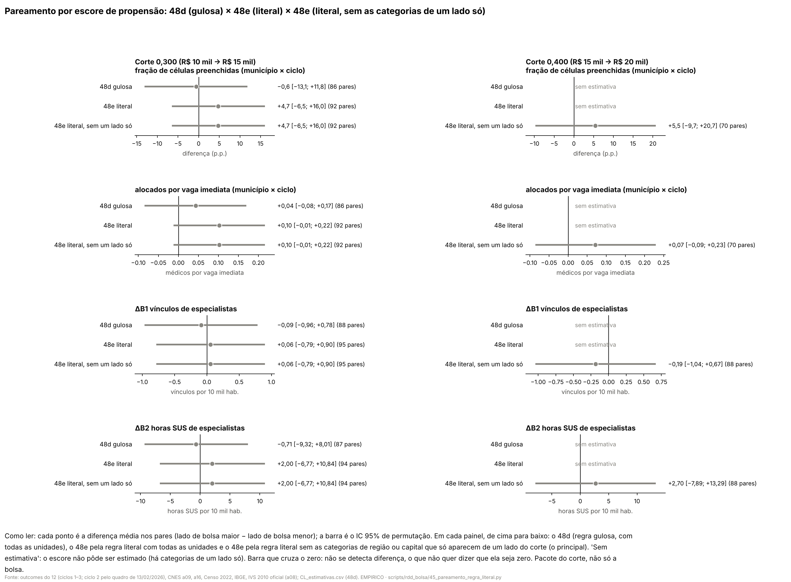
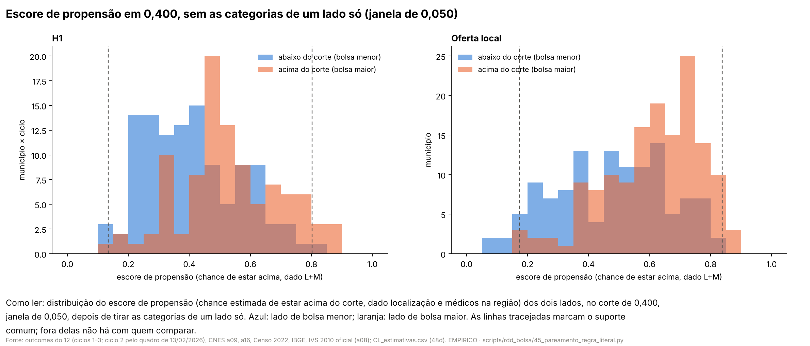

# 57s. Pareamento pela regra literal do 48d e PSM em 0,400 sem as categorias de um lado só (adendo 48e)

> **Data:** 26/10/2026. 
> **Adendo:** [`48e_adendo_pareamento_regra_literal_e_0400.md`](48e_adendo_pareamento_regra_literal_e_0400.md),
> congelado antes destas contas (commit `f97e1ca`). SHA-256 do adendo em `adendo` de `PM_resumo.json`, conferido pelo
> script. 
> **Estatuto:** `ADENDO_48E_POS_RESULTADO`. Os resultados do 48d (doc
> [57r](57r_resultados_controles_localizacao_medicos.md)) e a
> [auditoria 40](../auditorias/40_auditoria_controles_localizacao_medicos.md) já tinham sido vistos, inclusive o PSM em
> 0,300 refeito pela auditoria com o lado menor procurando par. Toda linha de `PM_estimativas.csv`, `PM_balanco.csv` e
> `PM_excluidos.csv` tem `natureza_dos_dados = EMPIRICO`. 
> **Auditoria:** [auditoria 43](../auditorias/43_auditoria_pareamento_regra_literal.md), aprovado com correções de
> texto; nenhuma estimativa mudou. 
> **Script:** `scripts/rdd_bolsa/45_pareamento_regra_literal.py` (importa o script 44; não o reescreve). **Saídas:**
> `output/rdd_bolsa/PM_estimativas.csv`, `PM_balanco.csv`, `PM_excluidos.csv`, `PM_resumo.json`, `PM_figuras/`.
> **Testes:** `tests/test_pareamento_regra_literal.py`. 
> **Números:** nenhum é digitado. Os blocos entre marcadores `<!-- PM:... -->` são regravados das saídas por
> `45_pareamento_regra_literal.py --atualizar-doc`; o teste confere que cada bloco é idêntico ao gerado.

**Contraste.** Em toda linha, o lado com bolsa maior (IVS acima do corte) é comparado com o lado com bolsa menor; o
próprio corte fica no lado de baixo. Em 0,300 a bolsa anunciada sobe de R$ 10 mil para R$ 15 mil e em 0,400 de
R$ 15 mil para R$ 20 mil, mas outras regras federais mudam nos mesmos cortes
([auditoria 18](../auditorias/18_politicas_nos_mesmos_cortes_ivs.md)). O que se mede é o **pacote do corte**, não o
incentivo de R$ 5 mil isolado, nem a participação no PMM-E, nem o Agora Tem Especialistas. Este adendo é robustez do
48d: o principal da H1 continua o 48b, e o da oferta local continua o protocolo 64 sem controle.

## 0. Decisões de implementação (26/10/2026, registradas antes de qualquer estimativa deste adendo)

O adendo segue o 48d (§3.1 e §3.2) e as 25 decisões da seção 0 do doc 57r, salvo onde o 48e muda. Nos pontos que o
48e deixa abertos, ficou a leitura mais próxima do script 44. Estas decisões foram escritas antes de rodar qualquer
conta nova do adendo. A composição das janelas por região e capital já era conhecida (`CL_resumo.json` e auditoria
40); nenhum outcome foi olhado para escrevê-las.

**Base e regra 2 (categorias de um lado só)**

1. **Bases.** As mesmas do 48d, montadas pelas funções do script 44, importadas: unidades município × ciclo da H1
   (`bases_h1`, com os outcomes da decisão 10 do 57r) e a amostra V do protocolo 64 com ΔB1–ΔB5 (`base_v` e
   `construir_delta_b`). Janela |IVS − corte| ≤ w pela função `_janela` do 44. Quem não tem alguma covariável de
   L+M sai primeiro, contado, como no 44; a regra 2 vem depois.
2. **Categorias da regra 2.** Capital (as duas categorias: capital e não capital) e cada uma das cinco
   macrorregiões, inclusive o Centro-Oeste (categoria de referência). Uma categoria é "de um lado só" quando tem pelo
   menos uma unidade na amostra e todas do mesmo lado do corte. A conferência é feita por corte, janela e amostra (H1
   ou oferta local). Na H1, com os três ciclos juntos, porque o logit junta os três ciclos (decisão 13 do 57r); não
   ciclo a ciclo. É o mesmo critério do diagnóstico de separação do 44 (`categorias_so_de_um_lado`).
3. **Uma passada só.** Saem de uma vez as unidades de todas as categorias de um lado só. A conferência não é
   repetida. Se, depois da saída, outra categoria ficar de um lado só, isso é registrado no resumo, o logit roda
   assim mesmo e, se não convergir ou separar, a linha fica sem estimativa (48e §1, item 2; decisão 13 do 57r).
4. **A regra 2 vale para toda a amostra do pareamento** de cada corte, janela e amostra: PSM, IPW e Mahalanobis
   (PM-1 a PM-7). No Mahalanobis, o pareamento exato em macrorregião e capital já deixava essas unidades sem par;
   tirá-las muda só a matriz de covariância da janela.
5. **Quem sai é listado** em `PM_excluidos.csv`, uma linha por unidade que saiu (município × ciclo na H1; município
   na oferta local), por amostra, corte e janela: código IBGE, nome do município (coluna `nome_municipio_uf` do a08),
   UF, ciclo, lado, categorias que o tiraram e IVS.
6. **"Mais de 25% de um lado"** (leitura do §3): o denominador é o número de unidades daquele lado na janela depois
   da saída por covariável ausente (a amostra em que a regra 2 se aplica), por amostra e corte, na janela de 0,050.
   A fração da janela de 0,020 é relatada, mas não entra na leitura.

**Regra literal de pareamento (regra 1)**

7. **Quem procura par.** Em cada corte e janela (e, na H1, em cada ciclo), contam-se as unidades de cada lado na
   amostra depois da saída por covariável ausente e da regra 2, antes do suporte comum (onde o 44 conta o
   `lado_com_menos_unidades`). O lado com menos unidades procura par. Empate: procura o lado de bolsa maior (acima).
8. **Ordem.** PSM: em ordem decrescente do escore (chance estimada de estar acima do corte); empate no escore pela
   ordem crescente do identificador (código IBGE e, na H1, ciclo). Mahalanobis: em ordem crescente do identificador
   (código IBGE e, na H1, ciclo; como os pares são formados dentro do ciclo, a ordem entre ciclos não muda nada).
9. **Escolha do par.** Cada unidade que procura fica com a unidade do outro lado mais próxima entre as ainda livres e
   admissíveis, sem reposição. Admissível é o que o 44 já define: no PSM, as duas no suporte comum, no mesmo ciclo
   na H1 e com |diferença no logit do escore| ≤ *caliper*; no Mahalanobis, mesmo estrato exato (macrorregião,
   capital e, na H1, ciclo) e distância ≤ *caliper*. Empate na distância: a de menor identificador. Sem candidata
   livre, fica sem par (contada). Não há segunda passada.
10. **Implementação.** Distâncias, *caliper* e suporte vêm das funções `parear_psm` e `parear_mahalanobis` do 44, sem
    mudança. O script 45 troca só o último passo (`guloso_global`) pela regra literal durante a chamada e o devolve
    depois. Inferência, balanço, IPW e montagem das linhas são as do `pareamentos` do 44. A regra gulosa (PM-3) é o
    44 sem troca nenhuma.
11. **Escore, *caliper* e suporte** como nas decisões 13 e 14 do 57r, aplicados depois da regra 2: logit de
    P(acima | L+M) na amostra da regra 2; *caliper* = 0,2 × desvio-padrão do logit do escore nessa amostra; suporte
    mínimo–máximo nessa amostra.

**Linhas**

12. **PM-1:** fração de células com vaga imediata preenchidas e alocados por vaga imediata (município × ciclo,
    decisão 10 do 57r), por corte, janela 0,050. **PM-2:** ΔB1 e ΔB2, por corte, janela 0,050. São as oito linhas
    principais.
13. **Sensibilidades e secundária.** PM-3: as mesmas oito com a regra gulosa global (decisão 11 do 57r), com a
    regra 2. PM-4: as mesmas oito na janela de 0,020, regra literal, com a regra 2 refeita nessa janela. PM-5: IPW
    (decisão 17 do 57r) na amostra da regra 2, janela 0,050, os mesmos quatro outcomes × dois cortes. PM-6:
    Mahalanobis (decisão 12 do 57r) com a regra literal e a regra 2, janela 0,050, os mesmos quatro outcomes × dois
    cortes. PM-7: ΔB3, ΔB4 e ΔB5 por PSM, regra literal, regra 2, janela 0,050, por corte (seis linhas).
14. **Linha só para a figura (PM-F).** A figura principal pede, ao lado do 48d e do PM-1/PM-2, o PSM pela regra
    literal **sem** a regra 2. Ela é calculada com os mesmos quatro outcomes × dois cortes, janela 0,050, gravada em
    `PM_estimativas.csv` com papel `figura` e fica fora do Holm, do BKY e da leitura. Em 0,400, sem a regra 2, o
    logit separa como no 48d e a linha fica sem estimativa.

**Portão**

15. Antes de qualquer conta nova, o script refaz com as funções do 44, sem troca nenhuma, o PS-1 (dois outcomes) e o
    PS-2 (ΔB1 e ΔB2) em 0,300, janela 0,050, regra gulosa, sem a regra 2, e compara com `CL_estimativas.csv`:
    estimativa, p, IC de permutação e IC t com diferença ≤ 1e−8, e o número de pares igual (86 na H1; 88 no ΔB1 da
    oferta local; no ΔB2, 87, porque um par não tem o outcome). Confere também que os pares formados são os mesmos
    de `CL_resumo.json`. Se falhar, para sem gravar nada.
16. **Saídas de outros adendos.** O script grava o SHA-256 de cada arquivo `CL_*`, `HI_*` e `OC_*` antes de começar
    e confere de novo antes de gravar; se algum mudar, para sem gravar.

**Inferência e testes múltiplos**

17. **Inferência pareada** como na decisão 16 do 57r (permutação de sinais, 9.999 sorteios, semente 20261026; IC por
    inversão; IC t ao lado; o p do Holm e do BKY é o da permutação). IPW como na decisão 17. Menos de 2 pares: sem
    estimativa (decisão 18).
18. **Holm** nas oito linhas de PM-1 e PM-2, família de tamanho fixo: linha sem estimativa entra com p = 1 e fica
    sem p ajustado (resolve o achado 6 da auditoria 40). **BKY** nas 38 linhas de PM-3 a PM-7, do mesmo jeito. PM-F
    fica fora das duas famílias.
19. **Balanço** como na decisão 15 do 57r, na amostra que entrou no pareamento (depois da regra 2): diferença
    padronizada com o desvio-padrão combinado antes do pareamento. Variável sem variação na amostra (por exemplo,
    capital depois de tirar as capitais) tem diferença zero. **Comparação limpa:** todas as |DP| depois do
    pareamento ≤ 0,25 (decisão 24).

**Leitura do §3, fixada no código**

20. **`NAO_SE_DETECTA_DIFERENCA`** (1ª linha do §3): as oito linhas de PM-1 e PM-2 com estimativa, IC de permutação
    contendo zero e comparação limpa.
21. **`REJEITA_ZERO_DEPOIS_DO_HOLM`** (2ª linha), por linha principal com p de Holm < 0,05: relatar sinal e tamanho,
    o pacote do corte e quem saiu pela regra 2 naquele corte.
22. **`VALE_SO_PARA_PARTE_COMPARAVEL`** (3ª linha), por amostra e corte: a regra 2 tira mais de 25% de um lado na
    janela de 0,050 (decisão 6); o texto diz quais categorias saíram.
23. **`PONTO_DEPENDE_DA_REGRA`** (4ª linha), por linha principal: PM-3 e a linha correspondente de PM-1 ou PM-2 com
    estimativa, sinais opostos (os dois diferentes de zero) e os dois IC contendo zero.
24. Quando a 1ª linha não vale, o código diz por quê, linha a linha: `SEM_ESTIMATIVA`, `BALANCO_NAO_LIMPO` ou
    `IC_EXCLUI_ZERO_SEM_HOLM` (IC de permutação sem zero e p de Holm ≥ 0,05).
25. **Saídas.** Estatuto `ADENDO_48E_POS_RESULTADO` e `natureza_dos_dados = EMPIRICO` em toda saída; o script
    confere o SHA-256 do adendo 48e; nada é escrito em `data/`; o arquivo de IVS errado não é lido; nenhuma
    competência do CNES ≥ 202609 (conferências herdadas das funções do 44 e do 43).

## 1. Resposta curta

<!-- PM:resposta_curta:inicio -->
**Pareando pela regra literal e sem as categorias de um lado só, não se detecta diferença nos dois cortes**: comparando municípios parecidos em localização e em médicos na região, perto do corte, não se detecta diferença no preenchimento das vagas imediatas nem na oferta local de especialistas. Todas as oito linhas principais têm IC que contém zero e balanço limpo depois do pareamento.

- **Corte 0,300** (R$ 10 mil → R$ 15 mil): fração de células preenchidas (município × ciclo): +4,7 p.p. (IC permutação [−6,5; +16,0]; p Holm 1,000; 92 pares; balanço limpo); alocados por vaga imediata (município × ciclo): +0,10 (IC permutação [−0,01; +0,22]; p Holm 0,636; 92 pares; balanço limpo); ΔB1 vínculos de especialistas: +0,06 (IC permutação [−0,79; +0,90]; p Holm 1,000; 95 pares; balanço limpo); ΔB2 horas SUS de especialistas: +2,00 (IC permutação [−6,77; +10,84]; p Holm 1,000; 94 pares; balanço limpo).

- **Corte 0,400** (R$ 15 mil → R$ 20 mil): fração de células preenchidas (município × ciclo): +5,5 p.p. (IC permutação [−9,7; +20,7]; p Holm 1,000; 70 pares; balanço limpo); alocados por vaga imediata (município × ciclo): +0,07 (IC permutação [−0,09; +0,23]; p Holm 1,000; 70 pares; balanço limpo); ΔB1 vínculos de especialistas: −0,19 (IC permutação [−1,04; +0,67]; p Holm 1,000; 88 pares; balanço limpo); ΔB2 horas SUS de especialistas: +2,70 (IC permutação [−7,89; +13,29]; p Holm 1,000; 88 pares; balanço limpo).

**Quem saiu pela regra 2 (janela de 0,050):** Em 0,300, na H1, ninguém; na oferta local, ninguém. Em 0,400, na H1, 19 linhas município × ciclo (19 de 132 abaixo, 14%; 0 de 98 acima, 0%): capitais, região Centro-Oeste, região Sul; na oferta local, 5 municípios (5 de 125 abaixo, 4%; 0 de 146 acima, 0%): capitais, região Sul. A lista com nomes está na seção 2.

**Parte comparável:** em nenhum corte a regra 2 tirou mais de 25% de um lado. Mesmo assim, a comparação vale só para as unidades que ficaram: em 0,300, a regra 2 não tirou ninguém; em 0,400, na H1, só municípios que não são capitais, fora do Centro-Oeste e do Sul; na oferta local, só municípios que não são capitais, fora do Sul. Dentro delas, quem ficou fora do suporte comum também não entra (seção 4).

**O ponto depende da regra de pareamento:** a regra gulosa (PM-3) e a literal dão sinais opostos, com os dois IC contendo zero, em fração de células preenchidas (município × ciclo) em 0,300 (gulosa −0,6 p.p., literal +4,7 p.p.); ΔB1 vínculos de especialistas em 0,300 (gulosa −0,09, literal +0,06); ΔB2 horas SUS de especialistas em 0,300 (gulosa −0,71, literal +2,00). Nessas linhas, ler só o intervalo, não o ponto.

Tudo é robustez pós-resultado do 48d e se refere ao pacote do corte, não à bolsa isolada. O principal da H1 continua o 48b, e o da oferta local, o protocolo 64 sem controle.
<!-- PM:resposta_curta:fim -->

### 1.1 Portão de reprodução

Antes de qualquer conta nova, o script refaz o PS-1 e o PS-2 do 48d em 0,300 com as funções do 44, sem trocar nada
(regra gulosa, sem a regra 2), e compara com `CL_estimativas.csv` e com os pares de `CL_resumo.json`. Tolerância: 1e−8.

<!-- PM:portao:inicio -->
| Linha do 48d | Outcome | Corte | Diferença média em CL_estimativas.csv | Refeita aqui | máx. dif. absoluta (estimativa, p, IC) | Pares (48d / refeito) | Mesmos pares | Reproduz |
|---|---|---|---|---|---|---|---|---|
| PS-1 | fração de células preenchidas (município × ciclo) | 0,300 | −0,006088 | −0,006088 | 8.5e-17 | 86 / 86 | sim | sim |
| PS-1 | alocados por vaga imediata (município × ciclo) | 0,300 | +0,043612 | +0,043612 | 6.9e-17 | 86 / 86 | sim | sim |
| PS-2 | ΔB1 vínculos de especialistas | 0,300 | −0,089191 | −0,089191 | 1.1e-16 | 88 / 88 | sim | sim |
| PS-2 | ΔB2 horas SUS de especialistas | 0,300 | −0,710644 | −0,710644 | 0.0e+00 | 87 / 87 | sim | sim |
<!-- PM:portao:fim -->

## 2. Quem saiu pela regra 2

Antes do logit, saem as unidades de categorias de macrorregião ou de capital que, na janela, só aparecem de um lado
do corte (decisões 2 a 6).

<!-- PM:regra2:inicio -->
| Amostra | Corte | Janela | Unidades com todas as covariáveis (abaixo / acima) | Categorias de um lado só | Saíram pela regra 2 (abaixo / acima) | Fração que saiu (abaixo / acima) | Categorias de um lado só depois da saída |
|---|---|---|---|---|---|---|---|
| H1 | 0,300 | 0,050 | 136 / 118 | nenhuma | 0 / 0 | 0% / 0% | nenhuma |
| H1 | 0,300 | 0,020 | 54 / 45 | nenhuma | 0 / 0 | 0% / 0% | nenhuma |
| oferta local | 0,300 | 0,050 | 141 / 122 | nenhuma | 0 / 0 | 0% / 0% | nenhuma |
| oferta local | 0,300 | 0,020 | 56 / 49 | nenhuma | 0 / 0 | 0% / 0% | nenhuma |
| H1 | 0,400 | 0,050 | 132 / 98 | capitais (10, todas abaixo), região Centro-Oeste (8, todas abaixo), região Sul (1, todas abaixo) | 19 / 0 | 14% / 0% | nenhuma |
| H1 | 0,400 | 0,020 | 61 / 43 | capitais (6, todas abaixo), região Centro-Oeste (1, todas abaixo) | 7 / 0 | 11% / 0% | nenhuma |
| oferta local | 0,400 | 0,050 | 125 / 146 | capitais (4, todas abaixo), região Sul (1, todas abaixo) | 5 / 0 | 4% / 0% | nenhuma |
| oferta local | 0,400 | 0,020 | 55 / 58 | capitais (2, todas abaixo), região Centro-Oeste (1, todas abaixo) | 3 / 0 | 5% / 0% | nenhuma |

Quem saiu (lista completa em `output/rdd_bolsa/PM_excluidos.csv`):

| Amostra | Corte | Janela | Município | Código IBGE | Ciclos | Lado | Por quê |
|---|---|---|---|---|---|---|---|
| H1 | 0,400 | 0,050 | Manaus (AM) | 130260 | 1, 2, 3 | abaixo | capitais |
| H1 | 0,400 | 0,050 | São Luís (MA) | 211130 | 1, 2, 3 | abaixo | capitais |
| H1 | 0,400 | 0,050 | Maceió (AL) | 270430 | 1, 2, 3 | abaixo | capitais |
| H1 | 0,400 | 0,050 | Salvador (BA) | 292740 | 3 | abaixo | capitais |
| H1 | 0,400 | 0,050 | Antonina (PR) | 410120 | 2 | abaixo | região Sul |
| H1 | 0,400 | 0,050 | Amambai (MS) | 500060 | 3 | abaixo | região Centro-Oeste |
| H1 | 0,400 | 0,050 | Itaquiraí (MS) | 500460 | 3 | abaixo | região Centro-Oeste |
| H1 | 0,400 | 0,050 | Ribas do Rio Pardo (MS) | 500710 | 3 | abaixo | região Centro-Oeste |
| H1 | 0,400 | 0,050 | Novo São Joaquim (MT) | 510628 | 3 | abaixo | região Centro-Oeste |
| H1 | 0,400 | 0,050 | Peixoto de Azevedo (MT) | 510642 | 2 | abaixo | região Centro-Oeste |
| H1 | 0,400 | 0,050 | Luziânia (GO) | 521250 | 1 | abaixo | região Centro-Oeste |
| H1 | 0,400 | 0,050 | São João D'Aliança (GO) | 522000 | 3 | abaixo | região Centro-Oeste |
| H1 | 0,400 | 0,050 | Senador Canedo (GO) | 522045 | 1 | abaixo | região Centro-Oeste |
| H1 | 0,400 | 0,020 | Manaus (AM) | 130260 | 1, 2, 3 | abaixo | capitais |
| H1 | 0,400 | 0,020 | Maceió (AL) | 270430 | 1, 2, 3 | abaixo | capitais |
| H1 | 0,400 | 0,020 | Luziânia (GO) | 521250 | 1 | abaixo | região Centro-Oeste |
| oferta local | 0,400 | 0,050 | Manaus (AM) | 130260 | — | abaixo | capitais |
| oferta local | 0,400 | 0,050 | São Luís (MA) | 211130 | — | abaixo | capitais |
| oferta local | 0,400 | 0,050 | Maceió (AL) | 270430 | — | abaixo | capitais |
| oferta local | 0,400 | 0,050 | Salvador (BA) | 292740 | — | abaixo | capitais |
| oferta local | 0,400 | 0,050 | Antonina (PR) | 410120 | — | abaixo | região Sul |
| oferta local | 0,400 | 0,020 | Manaus (AM) | 130260 | — | abaixo | capitais |
| oferta local | 0,400 | 0,020 | Maceió (AL) | 270430 | — | abaixo | capitais |
| oferta local | 0,400 | 0,020 | Luziânia (GO) | 521250 | — | abaixo | região Centro-Oeste |
<!-- PM:regra2:fim -->

## 3. Amostra e lado que procura par

O lado com menos unidades procura par (na H1, ciclo a ciclo); empate, procura o lado de bolsa maior (decisão 7).

<!-- PM:amostra:inicio -->
| Amostra | Corte | Janela | Regra 2 | Na janela (abaixo / acima) | Sem alguma covariável (abaixo / acima) | No pareamento (abaixo / acima) | Lado que procura par, por grupo (abaixo / acima) |
|---|---|---|---|---|---|---|---|
| H1 | 0,300 | 0,050 | sim | 141 / 118 | 5 / 0 | 136 / 118 | ciclo 1: abaixo (28 / 33); ciclo 2: acima (59 / 42); ciclo 3: acima (49 / 43) |
| H1 | 0,300 | 0,020 | sim | 57 / 45 | 3 / 0 | 54 / 45 | ciclo 1: abaixo (9 / 12); ciclo 2: acima (24 / 17); ciclo 3: acima (21 / 16) |
| H1 | 0,300 | 0,050 | não | 141 / 118 | 5 / 0 | 136 / 118 | ciclo 1: abaixo (28 / 33); ciclo 2: acima (59 / 42); ciclo 3: acima (49 / 43) |
| oferta local | 0,300 | 0,050 | sim | 144 / 122 | 3 / 0 | 141 / 122 | todos: acima (141 / 122) |
| oferta local | 0,300 | 0,020 | sim | 58 / 49 | 2 / 0 | 56 / 49 | todos: acima (56 / 49) |
| oferta local | 0,300 | 0,050 | não | 144 / 122 | 3 / 0 | 141 / 122 | todos: acima (141 / 122) |
| H1 | 0,400 | 0,050 | sim | 132 / 98 | 0 / 0 | 113 / 98 | ciclo 1: acima (35 / 25); ciclo 2: acima (39 / 38); ciclo 3: acima (39 / 35) |
| H1 | 0,400 | 0,020 | sim | 61 / 43 | 0 / 0 | 54 / 43 | ciclo 1: acima (18 / 9); ciclo 2: acima (18 / 17); ciclo 3: acima (18 / 17) |
| H1 | 0,400 | 0,050 | não | 132 / 98 | 0 / 0 | 132 / 98 | ciclo 1: acima (40 / 25); ciclo 2: acima (44 / 38); ciclo 3: acima (48 / 35) |
| oferta local | 0,400 | 0,050 | sim | 125 / 146 | 0 / 0 | 120 / 146 | todos: abaixo (120 / 146) |
| oferta local | 0,400 | 0,020 | sim | 55 / 58 | 0 / 0 | 52 / 58 | todos: abaixo (52 / 58) |
| oferta local | 0,400 | 0,050 | não | 125 / 146 | 0 / 0 | 125 / 146 | todos: abaixo (125 / 146) |
<!-- PM:amostra:fim -->

## 4. Principais: PM-1 (H1) e PM-2 (oferta local)

Escore de propensão, regra literal, sem as categorias de um lado só, janela de 0,050. A estimativa é a média das
diferenças nos pares; o IC principal vem do teste de permutação de sinais, e o t pareado vai ao lado. Holm entre as
oito linhas.

<!-- PM:principais:inicio -->
| Linha | Outcome | Corte | Janela | Status | Pares (ou n abaixo / acima) | Sem par abaixo / acima | Diferença média (acima − abaixo) | IC 95% permutação (IPW: normal) | IC 95% t pareado | p | p Holm ou q BKY | Maior DP absoluta depois |
|---|---|---|---|---|---|---|---|---|---|---|---|---|
| PM-1 | fração de células preenchidas (município × ciclo) | 0,300 | 0,050 | EXECUTADO | 92 | 44 / 26 (fora do suporte: 0 / 5) | +4,7 p.p. | [−6,5; +16,0] | [−6,5; +15,9] | 0,409 | Holm 1,000 | 0,14 (limpa) |
| PM-1 | alocados por vaga imediata (município × ciclo) | 0,300 | 0,050 | EXECUTADO | 92 | 44 / 26 (fora do suporte: 0 / 5) | +0,10 | [−0,01; +0,22] | [−0,01; +0,22] | 0,080 | Holm 0,636 | 0,14 (limpa) |
| PM-2 | ΔB1 vínculos de especialistas | 0,300 | 0,050 | EXECUTADO | 95 | 46 / 27 (fora do suporte: 0 / 3) | +0,06 | [−0,79; +0,90] | [−0,78; +0,90] | 0,896 | Holm 1,000 | 0,07 (limpa) |
| PM-2 | ΔB2 horas SUS de especialistas | 0,300 | 0,050 | EXECUTADO | 94 | 46 / 27 (fora do suporte: 0 / 3) | +2,00 | [−6,77; +10,84] | [−6,72; +10,71] | 0,654 | Holm 1,000 | 0,07 (limpa) |
| PM-1 | fração de células preenchidas (município × ciclo) | 0,400 | 0,050 | EXECUTADO | 70 | 43 / 28 (fora do suporte: 0 / 7) | +5,5 p.p. | [−9,7; +20,7] | [−9,9; +20,9] | 0,476 | Holm 1,000 | 0,17 (limpa) |
| PM-1 | alocados por vaga imediata (município × ciclo) | 0,400 | 0,050 | EXECUTADO | 70 | 43 / 28 (fora do suporte: 0 / 7) | +0,07 | [−0,09; +0,23] | [−0,09; +0,23] | 0,377 | Holm 1,000 | 0,17 (limpa) |
| PM-2 | ΔB1 vínculos de especialistas | 0,400 | 0,050 | EXECUTADO | 88 | 32 / 58 (fora do suporte: 5 / 4) | −0,19 | [−1,04; +0,67] | [−1,05; +0,67] | 0,679 | Holm 1,000 | 0,15 (limpa) |
| PM-2 | ΔB2 horas SUS de especialistas | 0,400 | 0,050 | EXECUTADO | 88 | 32 / 58 (fora do suporte: 5 / 4) | +2,70 | [−7,89; +13,29] | [−7,92; +13,32] | 0,621 | Holm 1,000 | 0,15 (limpa) |
<!-- PM:principais:fim -->

### 4.1 O 48d e o 48e lado a lado

<!-- PM:comparacao:inicio -->
| Outcome | Corte | 48d: gulosa, sem a regra 2 (PS-1/PS-2) | 48e: literal, sem a regra 2 (PM-F) | 48e: gulosa, com a regra 2 (PM-3) | 48e: literal, com a regra 2 (PM-1/PM-2, principal) |
|---|---|---|---|---|---|
| fração de células preenchidas (município × ciclo) | 0,300 | −0,6 p.p. [−13,1; +11,8] (86 pares) | +4,7 p.p. [−6,5; +16,0] (92 pares) | −0,6 p.p. [−13,1; +11,8] (86 pares) | +4,7 p.p. [−6,5; +16,0] (92 pares) |
| alocados por vaga imediata (município × ciclo) | 0,300 | +0,04 [−0,08; +0,17] (86 pares) | +0,10 [−0,01; +0,22] (92 pares) | +0,04 [−0,08; +0,17] (86 pares) | +0,10 [−0,01; +0,22] (92 pares) |
| ΔB1 vínculos de especialistas | 0,300 | −0,09 [−0,96; +0,78] (88 pares) | +0,06 [−0,79; +0,90] (95 pares) | −0,09 [−0,96; +0,78] (88 pares) | +0,06 [−0,79; +0,90] (95 pares) |
| ΔB2 horas SUS de especialistas | 0,300 | −0,71 [−9,32; +8,01] (87 pares) | +2,00 [−6,77; +10,84] (94 pares) | −0,71 [−9,32; +8,01] (87 pares) | +2,00 [−6,77; +10,84] (94 pares) |
| fração de células preenchidas (município × ciclo) | 0,400 | sem estimativa | sem estimativa | +5,3 p.p. [−9,1; +20,0] (65 pares) | +5,5 p.p. [−9,7; +20,7] (70 pares) |
| alocados por vaga imediata (município × ciclo) | 0,400 | sem estimativa | sem estimativa | +0,06 [−0,09; +0,22] (65 pares) | +0,07 [−0,09; +0,23] (70 pares) |
| ΔB1 vínculos de especialistas | 0,400 | sem estimativa | sem estimativa | −0,16 [−1,04; +0,71] (91 pares) | −0,19 [−1,04; +0,67] (88 pares) |
| ΔB2 horas SUS de especialistas | 0,400 | sem estimativa | sem estimativa | +4,25 [−7,28; +15,77] (91 pares) | +2,70 [−7,89; +13,29] (88 pares) |
<!-- PM:comparacao:fim -->

## 5. Sensibilidades (PM-3 a PM-6) e secundária (PM-7)

BKY entre as 38 linhas de PM-3 a PM-7.

<!-- PM:sensibilidades:inicio -->
| Linha | Outcome | Corte | Janela | Status | Pares (ou n abaixo / acima) | Sem par abaixo / acima | Diferença média (acima − abaixo) | IC 95% permutação (IPW: normal) | IC 95% t pareado | p | p Holm ou q BKY | Maior DP absoluta depois |
|---|---|---|---|---|---|---|---|---|---|---|---|---|
| PM-3 | fração de células preenchidas (município × ciclo) | 0,300 | 0,050 | EXECUTADO | 86 | 50 / 32 (fora do suporte: 0 / 5) | −0,6 p.p. | [−13,1; +11,8] | [−12,9; +11,7] | 0,922 | BKY 1,000 | 0,15 (limpa) |
| PM-3 | alocados por vaga imediata (município × ciclo) | 0,300 | 0,050 | EXECUTADO | 86 | 50 / 32 (fora do suporte: 0 / 5) | +0,04 | [−0,08; +0,17] | [−0,08; +0,17] | 0,492 | BKY 1,000 | 0,15 (limpa) |
| PM-4 | fração de células preenchidas (município × ciclo) | 0,300 | 0,020 | EXECUTADO | 24 | 30 / 21 (fora do suporte: 6 / 12) | +4,8 p.p. | [−18,1; +27,6] | [−17,8; +27,4] | 0,675 | BKY 1,000 | 0,34 (não limpa) |
| PM-4 | alocados por vaga imediata (município × ciclo) | 0,300 | 0,020 | EXECUTADO | 24 | 30 / 21 (fora do suporte: 6 / 12) | +0,07 | [−0,16; +0,29] | [−0,16; +0,29] | 0,551 | BKY 1,000 | 0,34 (não limpa) |
| PM-5 | fração de células preenchidas (município × ciclo) | 0,300 | 0,050 | EXECUTADO | 136 / 118 (ponderados) | — | +3,4 p.p. | [−7,2; +14,1] | — | 0,524 | BKY 1,000 | — |
| PM-5 | alocados por vaga imediata (município × ciclo) | 0,300 | 0,050 | EXECUTADO | 136 / 118 (ponderados) | — | +0,08 | [−0,03; +0,19] | — | 0,157 | BKY 1,000 | — |
| PM-6 | fração de células preenchidas (município × ciclo) | 0,300 | 0,050 | SEM_ESTIMATIVA (sem pares (caliper)) | 0 | 136 / 118 | — | — | — | — | — | — |
| PM-6 | alocados por vaga imediata (município × ciclo) | 0,300 | 0,050 | SEM_ESTIMATIVA (sem pares (caliper)) | 0 | 136 / 118 | — | — | — | — | — | — |
| PM-3 | ΔB1 vínculos de especialistas | 0,300 | 0,050 | EXECUTADO | 88 | 53 / 34 (fora do suporte: 0 / 3) | −0,09 | [−0,96; +0,78] | [−0,98; +0,80] | 0,840 | BKY 1,000 | 0,11 (limpa) |
| PM-3 | ΔB2 horas SUS de especialistas | 0,300 | 0,050 | EXECUTADO | 87 | 53 / 34 (fora do suporte: 0 / 3) | −0,71 | [−9,32; +8,01] | [−9,38; +7,96] | 0,878 | BKY 1,000 | 0,11 (limpa) |
| PM-4 | ΔB1 vínculos de especialistas | 0,300 | 0,020 | EXECUTADO | 38 | 18 / 11 (fora do suporte: 4 / 10) | +0,31 | [−1,03; +1,63] | [−1,03; +1,65] | 0,648 | BKY 1,000 | 0,16 (limpa) |
| PM-4 | ΔB2 horas SUS de especialistas | 0,300 | 0,020 | EXECUTADO | 38 | 18 / 11 (fora do suporte: 4 / 10) | −1,37 | [−12,36; +9,45] | [−12,23; +9,48] | 0,791 | BKY 1,000 | 0,16 (limpa) |
| PM-5 | ΔB1 vínculos de especialistas | 0,300 | 0,050 | EXECUTADO | 140 / 121 (ponderados) | — | −0,06 | [−0,64; +0,53] | — | 0,847 | BKY 1,000 | — |
| PM-5 | ΔB2 horas SUS de especialistas | 0,300 | 0,050 | EXECUTADO | 138 / 121 (ponderados) | — | +0,87 | [−5,64; +7,38] | — | 0,794 | BKY 1,000 | — |
| PM-6 | ΔB1 vínculos de especialistas | 0,300 | 0,050 | EXECUTADO | 10 | 131 / 112 | +1,26 | [−0,86; +3,41] | [−0,79; +3,32] | 0,194 | BKY 1,000 | 0,11 (limpa) |
| PM-6 | ΔB2 horas SUS de especialistas | 0,300 | 0,050 | EXECUTADO | 10 | 131 / 112 | −9,90 | [−37,28; +15,17] | [−35,61; +15,82] | 0,407 | BKY 1,000 | 0,11 (limpa) |
| PM-3 | fração de células preenchidas (município × ciclo) | 0,400 | 0,050 | EXECUTADO | 65 | 48 / 33 (fora do suporte: 0 / 7) | +5,3 p.p. | [−9,1; +20,0] | [−9,1; +19,7] | 0,466 | BKY 1,000 | 0,11 (limpa) |
| PM-3 | alocados por vaga imediata (município × ciclo) | 0,400 | 0,050 | EXECUTADO | 65 | 48 / 33 (fora do suporte: 0 / 7) | +0,06 | [−0,09; +0,22] | [−0,09; +0,22] | 0,427 | BKY 1,000 | 0,11 (limpa) |
| PM-4 | fração de células preenchidas (município × ciclo) | 0,400 | 0,020 | EXECUTADO | 34 | 20 / 9 (fora do suporte: 2 / 3) | +8,2 p.p. | [−11,1; +27,4] | [−10,8; +27,3] | 0,385 | BKY 1,000 | 0,14 (limpa) |
| PM-4 | alocados por vaga imediata (município × ciclo) | 0,400 | 0,020 | EXECUTADO | 34 | 20 / 9 (fora do suporte: 2 / 3) | +0,04 | [−0,16; +0,24] | [−0,16; +0,24] | 0,692 | BKY 1,000 | 0,14 (limpa) |
| PM-5 | fração de células preenchidas (município × ciclo) | 0,400 | 0,050 | EXECUTADO | 113 / 98 (ponderados) | — | +13,0 p.p. | [−1,0; +27,0] | — | 0,069 | BKY 1,000 | — |
| PM-5 | alocados por vaga imediata (município × ciclo) | 0,400 | 0,050 | EXECUTADO | 113 / 98 (ponderados) | — | +0,14 | [0,00; +0,28] | — | 0,051 | BKY 1,000 | — |
| PM-6 | fração de células preenchidas (município × ciclo) | 0,400 | 0,050 | EXECUTADO | 4 | 109 / 94 | +47,5 p.p. | não limitado | [−49,2; +144,2] | 0,497 | BKY 1,000 | 0,05 (limpa) |
| PM-6 | alocados por vaga imediata (município × ciclo) | 0,400 | 0,050 | EXECUTADO | 4 | 109 / 94 | +0,39 | não limitado | [−0,77; +1,55] | 0,497 | BKY 1,000 | 0,05 (limpa) |
| PM-3 | ΔB1 vínculos de especialistas | 0,400 | 0,050 | EXECUTADO | 91 | 29 / 55 (fora do suporte: 5 / 4) | −0,16 | [−1,04; +0,71] | [−1,05; +0,72] | 0,712 | BKY 1,000 | 0,10 (limpa) |
| PM-3 | ΔB2 horas SUS de especialistas | 0,400 | 0,050 | EXECUTADO | 91 | 29 / 55 (fora do suporte: 5 / 4) | +4,25 | [−7,28; +15,77] | [−7,29; +15,78] | 0,480 | BKY 1,000 | 0,10 (limpa) |
| PM-4 | ΔB1 vínculos de especialistas | 0,400 | 0,020 | EXECUTADO | 32 | 20 / 26 (fora do suporte: 3 / 0) | −0,18 | [−1,28; +0,95] | [−1,30; +0,95] | 0,745 | BKY 1,000 | 0,24 (limpa) |
| PM-4 | ΔB2 horas SUS de especialistas | 0,400 | 0,020 | EXECUTADO | 32 | 20 / 26 (fora do suporte: 3 / 0) | +7,03 | [−9,08; +24,12] | [−9,91; +23,96] | 0,428 | BKY 1,000 | 0,24 (limpa) |
| PM-5 | ΔB1 vínculos de especialistas | 0,400 | 0,050 | EXECUTADO | 120 / 146 (ponderados) | — | −0,69 | [−1,85; +0,47] | — | 0,245 | BKY 1,000 | — |
| PM-5 | ΔB2 horas SUS de especialistas | 0,400 | 0,050 | EXECUTADO | 120 / 146 (ponderados) | — | +2,19 | [−5,26; +9,63] | — | 0,565 | BKY 1,000 | — |
| PM-6 | ΔB1 vínculos de especialistas | 0,400 | 0,050 | EXECUTADO | 14 | 106 / 132 | −1,17 | [−2,79; +0,39] | [−2,78; +0,44] | 0,139 | BKY 1,000 | 0,04 (limpa) |
| PM-6 | ΔB2 horas SUS de especialistas | 0,400 | 0,050 | EXECUTADO | 14 | 106 / 132 | −11,26 | [−28,60; +3,60] | [−28,29; +5,78] | 0,171 | BKY 1,000 | 0,04 (limpa) |
<!-- PM:sensibilidades:fim -->

<!-- PM:secundaria:inicio -->
| Linha | Outcome | Corte | Janela | Status | Pares (ou n abaixo / acima) | Sem par abaixo / acima | Diferença média (acima − abaixo) | IC 95% permutação (IPW: normal) | IC 95% t pareado | p | p Holm ou q BKY | Maior DP absoluta depois |
|---|---|---|---|---|---|---|---|---|---|---|---|---|
| PM-7 | ΔB3 horas SUS dos outros especialistas | 0,300 | 0,050 | EXECUTADO | 94 | 46 / 27 (fora do suporte: 0 / 3) | +1,00 | [−6,77; +8,85] | [−6,71; +8,71] | 0,798 | BKY 1,000 | 0,07 (limpa) |
| PM-7 | ΔB4 horas totais | 0,300 | 0,050 | EXECUTADO | 94 | 46 / 27 (fora do suporte: 0 / 3) | +1,38 | [−7,67; +10,53] | [−7,73; +10,49] | 0,766 | BKY 1,000 | 0,07 (limpa) |
| PM-7 | ΔB5 generalistas | 0,300 | 0,050 | EXECUTADO | 95 | 46 / 27 (fora do suporte: 0 / 3) | +0,05 | [−1,41; +1,49] | [−1,41; +1,50] | 0,950 | BKY 1,000 | 0,07 (limpa) |
| PM-7 | ΔB3 horas SUS dos outros especialistas | 0,400 | 0,050 | EXECUTADO | 88 | 32 / 58 (fora do suporte: 5 / 4) | +2,76 | [−6,65; +12,11] | [−6,51; +12,03] | 0,562 | BKY 1,000 | 0,15 (limpa) |
| PM-7 | ΔB4 horas totais | 0,400 | 0,050 | EXECUTADO | 88 | 32 / 58 (fora do suporte: 5 / 4) | +1,03 | [−9,80; +11,86] | [−9,82; +11,89] | 0,849 | BKY 1,000 | 0,15 (limpa) |
| PM-7 | ΔB5 generalistas | 0,400 | 0,050 | EXECUTADO | 88 | 32 / 58 (fora do suporte: 5 / 4) | −0,31 | [−1,27; +0,64] | [−1,27; +0,65] | 0,521 | BKY 1,000 | 0,15 (limpa) |
<!-- PM:secundaria:fim -->

### 5.1 Linha só para a figura: regra literal sem a regra 2 (PM-F)

<!-- PM:figura_sem_regra2:inicio -->
| Linha | Outcome | Corte | Janela | Status | Pares (ou n abaixo / acima) | Sem par abaixo / acima | Diferença média (acima − abaixo) | IC 95% permutação (IPW: normal) | IC 95% t pareado | p | p Holm ou q BKY | Maior DP absoluta depois |
|---|---|---|---|---|---|---|---|---|---|---|---|---|
| PM-F | fração de células preenchidas (município × ciclo) | 0,300 | 0,050 | EXECUTADO | 92 | 44 / 26 (fora do suporte: 0 / 5) | +4,7 p.p. | [−6,5; +16,0] | [−6,5; +15,9] | 0,409 | — (só para a figura) | 0,14 (limpa) |
| PM-F | alocados por vaga imediata (município × ciclo) | 0,300 | 0,050 | EXECUTADO | 92 | 44 / 26 (fora do suporte: 0 / 5) | +0,10 | [−0,01; +0,22] | [−0,01; +0,22] | 0,080 | — (só para a figura) | 0,14 (limpa) |
| PM-F | ΔB1 vínculos de especialistas | 0,300 | 0,050 | EXECUTADO | 95 | 46 / 27 (fora do suporte: 0 / 3) | +0,06 | [−0,79; +0,90] | [−0,78; +0,90] | 0,896 | — (só para a figura) | 0,07 (limpa) |
| PM-F | ΔB2 horas SUS de especialistas | 0,300 | 0,050 | EXECUTADO | 94 | 46 / 27 (fora do suporte: 0 / 3) | +2,00 | [−6,77; +10,84] | [−6,72; +10,71] | 0,654 | — (só para a figura) | 0,07 (limpa) |
| PM-F | fração de células preenchidas (município × ciclo) | 0,400 | 0,050 | SEM_ESTIMATIVA (escore não estimado (separação)) | — | — | — | — | — | — | — | — |
| PM-F | alocados por vaga imediata (município × ciclo) | 0,400 | 0,050 | SEM_ESTIMATIVA (escore não estimado (separação)) | — | — | — | — | — | — | — | — |
| PM-F | ΔB1 vínculos de especialistas | 0,400 | 0,050 | SEM_ESTIMATIVA (escore não estimado (separação)) | — | — | — | — | — | — | — | — |
| PM-F | ΔB2 horas SUS de especialistas | 0,400 | 0,050 | SEM_ESTIMATIVA (escore não estimado (separação)) | — | — | — | — | — | — | — | — |
<!-- PM:figura_sem_regra2:fim -->

## 6. Balanço antes e depois do pareamento

Diferença padronizada de cada variável de L+M (lado de cima − lado de baixo, em desvios-padrão), na amostra que
entrou no pareamento. Meta: até 0,10. Acima de 0,25 depois do pareamento, a linha não é lida como comparação limpa.
Tabela completa em `PM_balanco.csv`.

<!-- PM:balanco:inicio -->
| Linha | Parte | Corte | Janela | Pares | Maior DP absoluta antes | Maior DP absoluta depois | Pior variável depois | Variáveis com DP absoluta > 0,10 | Variáveis com DP absoluta > 0,25 |
|---|---|---|---|---|---|---|---|---|---|
| PM-1 | H1 | 0,300 | 0,050 | 92 | 0,25 | 0,14 | região Sul | 2 | 0 |
| PM-3 | H1 | 0,300 | 0,050 | 86 | 0,25 | 0,15 | região Sudeste | 3 | 0 |
| PM-4 | H1 | 0,300 | 0,020 | 24 | 0,70 | 0,34 | log(população) | 5 | 2 |
| PM-6 | H1 | 0,300 | 0,050 | 0 | 0,25 | — | — | — | — |
| PM-F | H1 | 0,300 | 0,050 | 92 | 0,25 | 0,14 | região Sul | 2 | 0 |
| PM-2 | oferta local | 0,300 | 0,050 | 95 | 0,39 | 0,07 | log(população) | 0 | 0 |
| PM-3 | oferta local | 0,300 | 0,050 | 88 | 0,39 | 0,11 | log(população) | 3 | 0 |
| PM-4 | oferta local | 0,300 | 0,020 | 38 | 0,34 | 0,16 | região Sudeste | 2 | 0 |
| PM-6 | oferta local | 0,300 | 0,050 | 10 | 0,39 | 0,11 | especialistas CBO-alvo /10 mil (município) | 1 | 0 |
| PM-F | oferta local | 0,300 | 0,050 | 95 | 0,39 | 0,07 | log(população) | 0 | 0 |
| PM-7 | oferta local | 0,300 | 0,050 | 95 | 0,39 | 0,07 | log(população) | 0 | 0 |
| PM-1 | H1 | 0,400 | 0,050 | 70 | 0,49 | 0,17 | médicos /10 mil (município) | 2 | 0 |
| PM-3 | H1 | 0,400 | 0,050 | 65 | 0,49 | 0,11 | médicos /10 mil (município) | 2 | 0 |
| PM-4 | H1 | 0,400 | 0,020 | 34 | 0,50 | 0,14 | médicos /10 mil (município) | 2 | 0 |
| PM-6 | H1 | 0,400 | 0,050 | 4 | 0,49 | 0,05 | médicos /10 mil (município) | 0 | 0 |
| PM-2 | oferta local | 0,400 | 0,050 | 88 | 0,47 | 0,15 | especialistas CBO-alvo /10 mil (resto da região) | 2 | 0 |
| PM-3 | oferta local | 0,400 | 0,050 | 91 | 0,47 | 0,10 | região Centro-Oeste | 0 | 0 |
| PM-4 | oferta local | 0,400 | 0,020 | 32 | 0,31 | 0,24 | médicos /10 mil (município) | 5 | 0 |
| PM-6 | oferta local | 0,400 | 0,050 | 14 | 0,47 | 0,04 | especialistas CBO-alvo /10 mil (município) | 0 | 0 |
| PM-7 | oferta local | 0,400 | 0,050 | 88 | 0,47 | 0,15 | especialistas CBO-alvo /10 mil (resto da região) | 2 | 0 |
<!-- PM:balanco:fim -->

## 7. Leitura pelas regras fixadas (§3 do adendo)

As regras estão na seção 0 (decisões 20 a 24). O código as aplica; nada aqui é escolhido depois de ver o número.

<!-- PM:leitura:inicio -->
| Regra | Linha | Corte | Código |
|---|---|---|---|
| §3, 1ª e 2ª linhas | PM-1 fração de células preenchidas (município × ciclo) | 0,300 | `IC_CONTEM_ZERO_BALANCO_LIMPO` |
| §3, 1ª e 2ª linhas | PM-1 alocados por vaga imediata (município × ciclo) | 0,300 | `IC_CONTEM_ZERO_BALANCO_LIMPO` |
| §3, 1ª e 2ª linhas | PM-2 ΔB1 vínculos de especialistas | 0,300 | `IC_CONTEM_ZERO_BALANCO_LIMPO` |
| §3, 1ª e 2ª linhas | PM-2 ΔB2 horas SUS de especialistas | 0,300 | `IC_CONTEM_ZERO_BALANCO_LIMPO` |
| §3, 1ª e 2ª linhas | PM-1 fração de células preenchidas (município × ciclo) | 0,400 | `IC_CONTEM_ZERO_BALANCO_LIMPO` |
| §3, 1ª e 2ª linhas | PM-1 alocados por vaga imediata (município × ciclo) | 0,400 | `IC_CONTEM_ZERO_BALANCO_LIMPO` |
| §3, 1ª e 2ª linhas | PM-2 ΔB1 vínculos de especialistas | 0,400 | `IC_CONTEM_ZERO_BALANCO_LIMPO` |
| §3, 1ª e 2ª linhas | PM-2 ΔB2 horas SUS de especialistas | 0,400 | `IC_CONTEM_ZERO_BALANCO_LIMPO` |
| §3, 1ª linha (as oito juntas) | PM-1 e PM-2 | 0,300 e 0,400 | `NAO_SE_DETECTA_DIFERENCA` |
| §3, 3ª linha | H1 e oferta local | 0,300 e 0,400 | a regra 2 não tira mais de 25% de nenhum lado |
| §3, 4ª linha | fração de células preenchidas (município × ciclo) | 0,300 | `PONTO_DEPENDE_DA_REGRA` |
| §3, 4ª linha | ΔB1 vínculos de especialistas | 0,300 | `PONTO_DEPENDE_DA_REGRA` |
| §3, 4ª linha | ΔB2 horas SUS de especialistas | 0,300 | `PONTO_DEPENDE_DA_REGRA` |
<!-- PM:leitura:fim -->

## 8. Figuras

<!-- PM:figuras:inicio -->

**Como ler: cada ponto é a diferença média nos pares (lado de bolsa maior − lado de bolsa menor); a barra é o IC 95% de permutação. Em cada painel, de cima para baixo: o 48d (regra gulosa, com todas as unidades), o 48e pela regra literal com todas as unidades e o 48e pela regra literal sem as categorias de região ou capital que só aparecem de um lado do corte (o principal). 'Sem estimativa': o escore não pôde ser estimado (há categorias de um lado só). Barra que cruza o zero: não se detecta diferença, o que não quer dizer que ela seja zero. Pacote do corte, não só a bolsa.**

**Como ler: distribuição do escore de propensão (chance estimada de estar acima do corte, dado localização e médicos na região) dos dois lados, no corte de 0,400, janela de 0,050, depois de tirar as categorias de um lado só. Azul: lado de bolsa menor; laranja: lado de bolsa maior. As linhas tracejadas marcam o suporte comum; fora delas não há com quem comparar.**
<!-- PM:figuras:fim -->

## 9. Limites

<!-- PM:limites:inicio -->
- **Pós-resultado.** Os resultados do 48d e a auditoria 40 (inclusive o PSM em 0,300 refeito com o lado menor procurando par) já tinham sido vistos quando o 48e foi congelado. As regras foram fixadas antes destas contas, mas a pergunta não é cega ao resultado.
- **Pacote do corte.** Em 0,300 e 0,400 mudam a bolsa e outras regras federais (auditoria 18). Nenhum dos desenhos, nem a RDD nem o pareamento, remove esse pacote: o pareamento também não isola o incentivo de R$ 5 mil.
- **A regra 2 muda quem é comparado.** Onde ela tira unidades, a comparação vale só para quem ficou (por exemplo, municípios que não são capitais e de regiões presentes dos dois lados), não para toda a janela.
- **O que o pareamento supõe.** Randomização local condicional: que, perto do corte e com o mesmo L+M, estar de um lado ou do outro é como sorteado. O IVS não entra no escore, então a suposição inclui que a diferença de IVS entre os lados, dentro da janela, não pesa no outcome. Não usa a reta da RDD; a RDD supõe continuidade.
- **O ponto depende da ordem.** Com poucas unidades, a ordem em que se procura par muda quem forma par e a estimativa pontual; por isso a regra gulosa (PM-3) é relatada ao lado.
- **Poucos municípios e o mesmo município em ciclos diferentes.** O estimando é a média nos pares formados, e na H1 um município pode estar em pares de ciclos diferentes; a permutação trata os pares como independentes.
- **Mahalanobis com *caliper* apertado.** O *caliper* do 48d deixa quase nenhum par (auditoria 40, achado 10); a PM-6 herda isso.
<!-- PM:limites:fim -->
