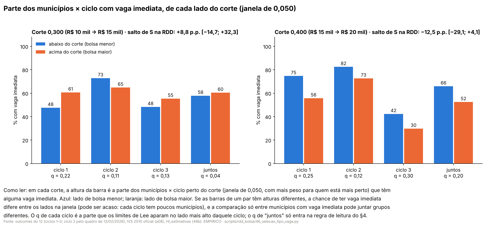
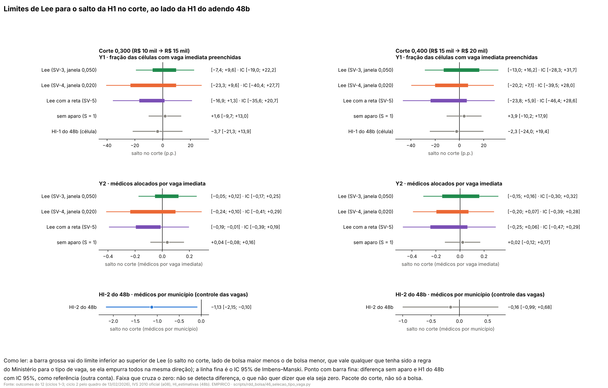

# 57t. Seleção pelo tipo de vaga na H1: tipo como outcome, balanço na amostra selecionada e limites de Lee (adendo 48f)

> **Data:** 26/10/2026. 
> **Adendo:** [`48f_adendo_selecao_tipo_de_vaga.md`](48f_adendo_selecao_tipo_de_vaga.md), congelado antes destas contas
> (commit `f97e1ca`). SHA-256 do adendo em `adendo` de `SV_resumo.json`, conferido pelo script. 
> **Estatuto:** `ADENDO_48F_POS_RESULTADO`. A H1 só com vagas imediatas (48b, doc 57n) e o salto da parte de células
> só de reserva (doc 57l, D-b) já tinham sido vistos. Toda linha de `SV_estimativas.csv` e `SV_balanco.csv` tem
> `natureza_dos_dados = EMPIRICO`. 
> **Auditoria:** [auditoria 44](../auditorias/44_auditoria_selecao_tipo_vaga.md), aprovado com correções de texto
> (nenhuma estimativa mudou). As ressalvas da auditoria entram nos blocos gerados: o código `SELECAO_PEQUENA` vem do q
> dos ciclos juntos; o peso da linha do SV-5 que fica de um lado do zero; por que o D-b do 57l mostrava salto no tipo
> de vaga e o SV-1 não; para quem vale o intervalo de Lee. 
> **Script:** `scripts/rdd_bolsa/46_selecao_tipo_vaga.py` (construtores dos scripts 40 e 44, estimadores de
> `rdd_lib.py` e o IC de Imbens–Manski do script 24, importados). **Saídas:** `output/rdd_bolsa/SV_estimativas.csv`,
> `SV_balanco.csv`, `SV_resumo.json`, `SV_figuras/`. **Testes:** `tests/test_selecao_tipo_vaga.py`. 
> **Números:** nenhum é digitado. Os blocos entre marcadores `<!-- SV:... -->` são regravados das saídas por
> `46_selecao_tipo_vaga.py --atualizar-doc`; o teste confere que cada bloco é idêntico ao gerado.

**Contraste.** Em toda linha, o lado com bolsa maior (IVS acima do corte) é comparado com o lado com bolsa menor; o
próprio corte fica no lado de baixo. Em 0,300 a bolsa anunciada sobe de R$ 10 mil para R$ 15 mil e em 0,400 de
R$ 15 mil para R$ 20 mil, mas outras regras federais mudam nos mesmos cortes
([auditoria 18](../auditorias/18_politicas_nos_mesmos_cortes_ivs.md)). O que se mede é o **pacote do corte**, não o
incentivo de R$ 5 mil isolado, nem a participação no PMM-E, nem o Agora Tem Especialistas. Este adendo é robustez da
H1: o principal continua o 48b.

**A pergunta, em linguagem simples.** A SGTES decide qual município recebe vaga imediata e qual fica no cadastro
reserva, com critério que não está nos dados. A H1 do 48b compara só municípios (e células) com vaga imediata. Se o
corte muda a chance de ter vaga imediata, os municípios com vaga imediata acima e abaixo do corte podem não ser
comparáveis. Este doc mede o tamanho dessa seleção (SV-1), olha se os municípios selecionados são parecidos dos dois
lados (SV-2) e dá um intervalo para o salto da H1 que vale qualquer que tenha sido a regra do Ministério, desde que
ela empurre todos os municípios na mesma direção (SV-3 a SV-5).

## 0. Decisões de implementação (26/10/2026, registradas antes de qualquer estimativa deste adendo)

O adendo deixa alguns pontos abertos. Em cada um, ficou a leitura mais próxima dos scripts 40 (H1 só com vagas
imediatas) e 44 (controles e pareamento). Estas decisões foram escritas e registradas em commit antes de rodar qualquer
conta do adendo, inclusive o portão. Nenhuma depende de resultado.

**Amostra e variáveis**

1. **Unidade.** Município × ciclo, ciclos 1–3, da base `MK` montada por `bases_h1` do script 44 (que chama
   `carregar()` do script 40, versão `13fev`): municípios com IVS 2010 oficial (a08) e pelo menos uma célula no quadro
   da 1ª chamada do ciclo, de qualquer tipo. Municípios sem IVS oficial ficam fora da RDD, como no 48b (contados pelo
   script 40). O script confere que toda linha tem pelo menos uma célula (só imediata, mista ou só de reserva).
2. **Tipo de vaga.** O do quadro da 1ª chamada; no ciclo 2, o do quadro retificado de 13/02/2026 (48b, §7), lido pelo
   script 40 com `scripts/auditoria_H1/a36_leitura.py`.
3. **Seleção.** S = 1 quando o município × ciclo tem pelo menos uma célula com vaga imediata (só imediata ou mista),
   isto é, `n_cel_imed > 0` do script 40.
4. **Outcomes.** Y1 = `frac_preenchida` e Y2 = `aloc_por_vi` do `bases_h1` do script 44: as mesmas versões municipais
   da H1 usadas no pareamento do 48d (H1M-FRAC e H1M-ALOC). Y1 é a fração das células com vaga imediata do município
   preenchidas na 1ª chamada (`n_alocados_ch1 >= 1`, a definição do A3 e da HI-1); Y2 é o número de médicos alocados
   na 1ª chamada nessas células dividido pelas vagas imediatas delas. Nas células mistas contam todos os alocados da
   célula (limite herdado do 48b). O script confere que Y1 e Y2 são observados exatamente quando S = 1; quando S = 0
   ficam ausentes, nunca zero.
5. **Covariáveis do SV-2.** As do balanço CL-0 do 48d, construídas por `construir_covariaveis` do script 44: capital,
   uma indicadora por macrorregião (as cinco), log da população do Censo 2022, médicos (CBO 2251, 2252, 2253) por
   10 mil hab. no município, especialistas nas CBO-alvo (todas) por 10 mil hab. no município e no resto da região de
   saúde, média de 2024-06 a 2025-06 do painel a09. Valor ausente fica ausente; a `rdd_lib` descarta a linha e conta.

**SV-1 (tamanho da seleção)**

6. **RDD de S no município.** `ajustar` do script 23 sem controle, na amostra empilhada de `amostra` do script 40
   (intercepto e inclinações por ciclo × lado, salto comum, local linear, kernel triangular, h = 0,050, CR1 por
   município), cada corte separado: a especificação comum do adendo.
7. **RDD de "célula tem vaga imediata".** `est_celula` do script 40 (efeitos fixos de curso × ciclo, CR1 por
   município) com todas as células do quadro, de qualquer tipo; outcome = `tipo_vaga_imediata` (1 se a célula tem
   vaga imediata; ciclo 2 pelo quadro de 13/02).
8. **Qual linha entra na leitura do §4.** A de S no município × ciclo, que é a unidade dos limites de Lee. A da célula
   é relatada ao lado; se as duas discordarem (uma com IC que exclui zero e a outra não), isso é dito.

**Taxas de seleção e aparagem (SV-3; mesmas regras no SV-4 e no SV-5)**

9. **Janela e pesos.** x = IVS − corte em milésimos (`normalizar_s_mil`); peso = kernel triangular da `rdd_lib`
   (`pesos_kernel(x, 50)`), positivo em |x| < 0,050 (em |x| = 0,050 o peso triangular já é zero). Lado de cima:
   x > 0; o corte fica no lado de baixo, como em toda a RDD.
10. **Taxas por ciclo.** Em cada ciclo k, p_acima,k e p_abaixo,k = média de S ponderada pelo kernel entre as
    unidades de cada lado na janela.
11. **Fração aparada por ciclo.** q_k = (p_maior − p_menor) / p_maior, no lado de taxa maior. Taxas iguais: q_k = 0
    e nada é aparado.
12. **Quantis ponderados.** Apara-se q_k da massa de peso do kernel das unidades com S = 1 do lado aparado, pela função
    `_multiplicador_aparo` da `rdd_lib` com `empates="proporcional"` (auditoria 22): Y1 é uma fração com muitos
    valores repetidos (0, 1/2, 1), e assim o bloco de valores iguais na fronteira perde a mesma fração de peso em todas
    as suas unidades, sem depender da ordem das linhas. A unidade da fronteira é aparada em parte (peso fracionário).
13. **Direção (§3, passo 2, literal).** Salto = acima − abaixo. Lado aparado de **cima**: no limite inferior saem as
    unidades de **maior** Y; no superior, as de **menor** Y. Lado aparado de **baixo**: no limite inferior saem as de
    **menor** Y; no superior, as de **maior** Y.
14. **Limites por ciclo.** Diferença entre a média de Y ponderada pelo kernel (já aparada) das unidades com S = 1 de
    cima e a de baixo. A mesma diferença sem aparo é relatada como "sem aparo" (referência, não é limite).
15. **Combinação dos ciclos.** n_k = número de unidades município × ciclo com S = 1 e peso positivo na janela (os dois
    lados). Limite do corte = Σ n_k × limite_k ÷ Σ n_k; o mesmo para o "sem aparo". Ciclo sem unidade com S = 1 e peso
    positivo em algum dos lados fica fora da combinação (contado); sem ciclo, a linha fica sem estimativa.
16. **Taxas e q do corte (para relatar e para a leitura).** p_acima e p_abaixo do corte = médias das taxas por ciclo
    com os mesmos pesos n_k; q do corte = (maior − menor) ÷ maior dessas duas. É esse q que entra na regra "q < 0,05"
    do §4. As taxas, o q e o lado aparado de cada ciclo ficam nas linhas por ciclo.

**Bootstrap e IC de Imbens–Manski**

17. **Bootstrap em blocos de município.** Em cada corte e janela, o bloco é o município (todas as suas linhas
    município × ciclo na janela). Sorteiam-se municípios com reposição **dentro de cada lado do corte** (o lado é fixo
    pelo IVS; cada lado mantém o seu número de municípios); a multiplicidade entra como peso de frequência, como no
    bootstrap do script 24. 1.999 reamostras. Cada combinação corte × janela começa um gerador novo
    (`numpy.random.default_rng(20261026)`); os mesmos sorteios servem a Y1 e a Y2 e às versões sem e com a reta.
18. **Refazer tudo em cada reamostra.** Taxas, lado aparado, q_k, aparagem e combinação são refeitos com os pesos
    kernel × multiplicidade. Reamostra em que um limite não fica definido é descartada e contada.
19. **IC 95% de Imbens e Manski (2004).** EP de cada limite = desvio-padrão (ddof = 1) das reamostras válidas; IC =
    [inf − c × ep_inf; sup + c × ep_sup], com c de Φ(c + Δ / máx(ep)) − Φ(−c) = 0,95 e Δ = sup − inf (função
    `ic_imbens_manski` do script 24, importada). O "sem aparo" leva EP do mesmo bootstrap e IC normal (±1,96 EP).

**SV-4 e SV-5**

20. **SV-4 (janela 0,020).** O SV-3 inteiro com kernel triangular de h = 0,020 (a janela define o suporte do kernel,
    como 0,050 no SV-3).
21. **SV-5 (com a reta).** Em cada ciclo × lado, entre as unidades com S = 1 e peso positivo, ajusta-se por mínimos
    quadrados ponderados pelo kernel a reta de Y em x. A aparagem (mesmo q_k, mesma direção da decisão 13) é feita nos
    resíduos. Limite do ciclo = (intercepto de cima − intercepto de baixo) + (média ponderada dos resíduos que ficaram
    em cima − a de baixo); do lado não aparado essa média é zero. Ciclo × lado com menos de dois valores distintos de
    x com peso positivo fica fora (contado). No bootstrap a reta é reajustada em cada reamostra.

**SV-2 (balanço)**

22. **Estimador.** `ajustar` do script 23 sem controle, como o CL-0 do 48d, cada covariável como outcome, em duas
    amostras: só S = 1 (que é a amostra da HI-2 e reproduz as linhas município × ciclo do CL-0 em `CL_balanco.csv`;
    conferido) e a amostra toda (todo município × ciclo do quadro).
23. **Escala comum.** Salto padronizado = salto ÷ desvio-padrão da covariável na janela da amostra toda (peso
    positivo, valor observado). O mesmo denominador nas duas amostras.
24. **Regra de leitura do SV-2.** Em cada corte, "desbalanço maior entre S = 1" se o número de covariáveis com IC 95%
    que exclui zero for maior entre S = 1 do que na amostra toda. A média do |salto padronizado| é relatada, sem
    entrar na regra.

**Portão**

25. **HI-1 e HI-2 do 48b.** Pela função `portao_hi` do script 44 (funções do script 40, diferença ≤ 1e−8 contra
    `HI_estimativas.csv`, nos dois cortes). Se falhar, o script para sem gravar.
26. **Parte de células só de reserva do doc 57l (D-b).** Refazem-se, com o quadro do ciclo 2 de 19/03/2026 (o que o 57l
    usou, antes da nota §7 do 48b), as linhas "célula só de CR" (célula, sem efeitos fixos) e "parte das células só de
    CR (municípios)" (peso = células) de `DQ_estimativas.csv`, por ciclo e com os ciclos juntos, nos dois cortes:
    salto, EP, n por lado, média abaixo e média acima, ≤ 1e−8. Se não bater, para. **Diferença de definição relatada:**
    o 48f mede S (município × ciclo com alguma vaga imediata), não a parte das células só de reserva, e no ciclo 2 usa
    o quadro de 13/02; a mesma medida do D-b com o quadro de 13/02 é relatada ao lado, descritiva.

**Leitura (regras fixadas no código, pelo §4 do adendo)**

27. **SV-1, por corte:** IC da RDD de S que exclui zero → "o tipo de vaga responde ao corte; dar peso aos limites";
    IC que contém zero e q < 0,05 → "seleção pequena; o 48b não é muito afetado por ela"; IC que contém zero e
    q ≥ 0,05 → caso fora da tabela do §4: "não se detecta salto no tipo de vaga, mas as taxas na janela diferem; dar
    peso aos limites".
28. **SV-3, por corte e outcome:** intervalo identificado [inf; sup] que contém zero (o IC de Imbens–Manski então
    também contém) → "não se detecta diferença de preenchimento no corte, mesmo sem supor nada sobre como o Ministério
    escolheu o tipo, além da monotonicidade"; intervalo inteiro de um lado do zero → "sinal robusto à seleção pelo tipo
    de vaga, com o pacote do corte", dizendo se o IC de Imbens–Manski exclui zero ou não.
29. **SV-4 e SV-5** são sensibilidades: a mesma regra é aplicada e relatada ao lado, sem mudar a leitura do SV-3.
30. **Testes múltiplos.** O adendo não define família; nenhum ajuste de Holm ou BKY é feito.

## 1. Resposta curta

<!-- SV:resposta_curta:inicio -->
**O tipo de vaga responde ao corte? (SV-1)** Pela regra pré-registrada, em 0,300, a seleção pelo tipo de vaga é **pequena** (IC do salto de S com zero e q < 0,05): o 48b não é muito afetado por ela. Isso vale só com os ciclos juntos: dentro de cada ciclo as taxas diferem mais (q de até 0,216; ver "Por ciclo"); em 0,400, não se detecta salto no tipo de vaga (IC de S com zero), mas as taxas de seleção na janela **diferem** (q ≥ 0,05): a seleção não é pequena o bastante para ser ignorada, e os limites de Lee pesam mais.

- **Corte 0,300** (R$ 10 mil → R$ 15 mil): chance de o município × ciclo ter vaga imediata: salto +8,8 p.p. (IC 95% [−14,7; +32,3]; abaixo do corte, 57,6% dos municípios × ciclo têm); chance de a célula ter vaga imediata: −4,3 p.p. (IC [−16,1; +7,5]); na janela, 57,9% abaixo e 60,4% acima, q = 0,042 (código `SELECAO_PEQUENA`).

- **Corte 0,400** (R$ 15 mil → R$ 20 mil): chance de o município × ciclo ter vaga imediata: salto −12,5 p.p. (IC 95% [−29,1; +4,1]; abaixo do corte, 64,0% dos municípios × ciclo têm); chance de a célula ter vaga imediata: −2,3 p.p. (IC [−23,5; +18,9]); na janela, 65,9% abaixo e 52,5% acima, q = 0,204 (código `IC_CONTEM_ZERO_MAS_TAXAS_DIFEREM`).

**Por ciclo.** Em 0,300, q vai de 0,111 a 0,216 nos ciclos (ciclos juntos: 0,042), e o lado com mais vaga imediata muda de ciclo para ciclo (de cima no(s) ciclo(s) 1, 3; de baixo no(s) ciclo(s) 2): as diferenças se compensam ao juntar os ciclos; em 0,400, q vai de 0,119 a 0,298 nos ciclos (ciclos juntos: 0,204), sempre com mais vaga imediata do lado de baixo. Os limites de Lee aparam com o q de cada ciclo, não com o dos ciclos juntos; a regra do §4 usa o dos ciclos juntos (decisão 16). Por isso, em 0,300, o código `SELECAO_PEQUENA` vem da regra fixada antes das contas e **não** quer dizer que a seleção seja pequena dentro de cada ciclo. O 48b compara dentro do ciclo (intercepto e inclinações por ciclo), e uma seleção de um sentido num ciclo e do outro sentido em outro não se anula necessariamente na H1. O que protege a H1 da seleção nesse corte são os limites de Lee, que aparam com o q de cada ciclo.

**Limites de Lee (SV-3, principal).** Nos dois cortes e nos dois outcomes, o intervalo identificado contém zero: mesmo sem supor nada sobre como o Ministério escolheu o tipo de vaga (além da monotonicidade), **não se detecta diferença de preenchimento no corte**. O intervalo é largo, e não detectar não é mostrar que a diferença é zero.

- **0,300, Y1 · fração das células com vaga imediata preenchidas:** limites [−7,4; +9,6] p.p. (IC de Imbens–Manski [−19,0; +22,2]; sem aparo +1,6 p.p.; código `NAO_SE_DETECTA_DIFERENCA`).

- **0,300, Y2 · médicos alocados por vaga imediata:** limites [−0,05; +0,12] (IC de Imbens–Manski [−0,17; +0,25]; sem aparo +0,04; código `NAO_SE_DETECTA_DIFERENCA`).

- **0,400, Y1 · fração das células com vaga imediata preenchidas:** limites [−13,0; +16,2] p.p. (IC de Imbens–Manski [−28,3; +31,7]; sem aparo +3,9 p.p.; código `NAO_SE_DETECTA_DIFERENCA`).

- **0,400, Y2 · médicos alocados por vaga imediata:** limites [−0,15; +0,16] (IC de Imbens–Manski [−0,30; +0,32]; sem aparo +0,02; código `NAO_SE_DETECTA_DIFERENCA`).

Para referência (outra conta: célula com a reta, e médicos por município com controle das vagas), a H1 do 48b é em 0,300, HI-1 −3,7 p.p. [−21,3; +13,9] (p Holm 1,000) e HI-2 −1,13 [−2,15; −0,10] (p Holm 0,126); em 0,400, HI-1 −2,3 p.p. [−24,0; +19,4] (p Holm 1,000) e HI-2 −0,16 [−0,99; +0,68] (p Holm 1,000). Nenhuma das quatro rejeita zero depois do Holm do 48b.

**Balanço (SV-2).** Em 0,300, 3 covariável(is) com IC sem zero entre S = 1 contra 1 na amostra toda (`DESBALANCO_MAIOR_EM_S1`); em 0,400, 1 covariável(is) com IC sem zero entre S = 1 contra 1 na amostra toda (`DESBALANCO_NAO_MAIOR_EM_S1`).

**Sensibilidades.** SV-4 (janela 0,020): mesma leitura do SV-3 em tudo; SV-5 (com a reta): leitura diferente da do SV-3 em Y2 · médicos alocados por vaga imediata em 0,300: limites [−0,19; −0,01] (IC de Imbens–Manski [−0,39; +0,19]; sem aparo −0,10; código `INTERVALO_DE_UM_LADO_DO_ZERO`), com IC de Imbens–Manski que contém zero. Pela decisão 29 isso não muda a leitura do SV-3; o limite mais perto de zero fica em −0,01, e, com o IC de Imbens–Manski contendo zero, o sinal não se distingue do acaso. O SV-5 tira a reta de Y no IVS, como a HI-1 e a HI-2 do 48b: a diferença sem aparo passa de +0,04 (SV-3, sem a reta) para −0,10; a leitura do SV-3 depende da hipótese de randomização local na janela (seção 9). O sentido é o da HI-2 do 48b nesse corte (−1,13 médicos por município, p Holm 0,126), em outra escala.

Tudo depende da premissa de monotonicidade (seção 9) e se refere ao pacote do corte, não à bolsa isolada. O principal da H1 continua o 48b.
<!-- SV:resposta_curta:fim -->

### 1.1 Portão

<!-- SV:portao:inicio -->
| Linha do 48b | Corte | Salto em HI_estimativas.csv | Salto refeito aqui | máx. dif. absoluta | Reproduz |
|---|---|---|---|---|---|
| HI-1 | 0,300 | −0,036784 | −0,036784 | 6.9e-17 | sim |
| HI-2 | 0,300 | −1,126326 | −1,126326 | 8.3e-17 | sim |
| HI-1 | 0,400 | −0,023120 | −0,023120 | 6.9e-17 | sim |
| HI-2 | 0,400 | −0,156707 | −0,156707 | 0.0e+00 | sim |

Resultado: **reproduz** (máx. dif. 8.3e-17).

| Medida do D-b | Ciclos | Corte | Abaixo / acima (19/03, como no 57l) | Salto [IC 95%] (19/03) | máx. dif. contra o 57l | Abaixo / acima (13/02) | Salto [IC 95%] (13/02) |
|---|---|---|---|---|---|---|---|
| célula só de CR (célula) | 1 | 0,300 | 58,0% / 62,3% | +17,9 p.p. [−7,7; +43,4] | 2.8e-17 | 58,0% / 62,3% | +17,9 p.p. [−7,7; +43,4] |
| parte das células só de CR (municípios) | 1 | 0,300 | 58,0% / 62,3% | +17,9 p.p. [−7,9; +43,7] | 8.3e-17 | 58,0% / 62,3% | +17,9 p.p. [−7,9; +43,7] |
| célula só de CR (célula) | 2 | 0,300 | 33,4% / 33,0% | +28,4 p.p. [+8,3; +48,4] | 5.6e-17 | 51,3% / 60,9% | +24,1 p.p. [−4,7; +52,8] |
| parte das células só de CR (municípios) | 2 | 0,300 | 33,4% / 33,0% | +28,4 p.p. [+8,2; +48,6] | 5.6e-17 | 51,3% / 60,9% | +24,1 p.p. [−4,9; +53,1] |
| célula só de CR (célula) | 3 | 0,300 | 63,8% / 72,1% | +5,6 p.p. [−16,0; +27,2] | 9.7e-17 | 63,8% / 72,1% | +5,6 p.p. [−16,0; +27,2] |
| parte das células só de CR (municípios) | 3 | 0,300 | 63,8% / 72,1% | +5,6 p.p. [−16,1; +27,4] | 4.9e-17 | 63,8% / 72,1% | +5,6 p.p. [−16,1; +27,4] |
| célula só de CR (célula) | 1+2+3 | 0,300 | 52,5% / 58,9% | +15,4 p.p. [+2,1; +28,6] | 4.2e-17 | 58,3% / 66,7% | +14,0 p.p. [−0,2; +28,3] |
| parte das células só de CR (municípios) | 1+2+3 | 0,300 | 52,5% / 58,9% | +15,4 p.p. [+2,0; +28,7] | 5.6e-17 | 58,3% / 66,7% | +14,0 p.p. [−0,3; +28,4] |
| célula só de CR (célula) | 1 | 0,400 | 55,5% / 65,5% | +32,8 p.p. [+14,3; +51,3] | 1.4e-17 | 55,5% / 65,5% | +32,8 p.p. [+14,3; +51,3] |
| parte das células só de CR (municípios) | 1 | 0,400 | 55,5% / 65,5% | +32,8 p.p. [+14,0; +51,6] | 4.2e-17 | 55,5% / 65,5% | +32,8 p.p. [+14,0; +51,6] |
| célula só de CR (célula) | 2 | 0,400 | 27,7% / 13,4% | +0,3 p.p. [−21,2; +21,9] | 8.3e-17 | 49,8% / 37,8% | −12,9 p.p. [−59,7; +34,0] |
| parte das células só de CR (municípios) | 2 | 0,400 | 27,7% / 13,4% | +0,3 p.p. [−21,4; +22,1] | 5.6e-17 | 49,8% / 37,8% | −12,9 p.p. [−60,2; +34,5] |
| célula só de CR (célula) | 3 | 0,400 | 68,6% / 77,5% | +6,0 p.p. [−12,0; +23,9] | 4.2e-17 | 68,6% / 77,5% | +6,0 p.p. [−12,0; +23,9] |
| parte das células só de CR (municípios) | 3 | 0,400 | 68,6% / 77,5% | +6,0 p.p. [−12,0; +24,0] | 6.2e-17 | 68,6% / 77,5% | +6,0 p.p. [−12,0; +24,0] |
| célula só de CR (célula) | 1+2+3 | 0,400 | 53,1% / 57,7% | +11,3 p.p. [−1,5; +24,1] | 5.6e-17 | 59,2% / 63,9% | +7,2 p.p. [−12,8; +27,2] |
| parte das células só de CR (municípios) | 1+2+3 | 0,400 | 53,1% / 57,7% | +11,3 p.p. [−1,6; +24,2] | 5.6e-17 | 59,2% / 63,9% | +7,2 p.p. [−13,0; +27,4] |

Resultado: as 16 linhas do D-b com o quadro de 19/03 **reproduzem** o 57l (máx. dif. 9.7e-17). **Diferença de definição:** o D-b mede a parte das células só de cadastro reserva com o quadro do ciclo 2 de 19/03/2026; o 48f mede S (município × ciclo com alguma vaga imediata) e usa no ciclo 2 o quadro de 13/02/2026. As colunas "13/02" mostram a mesma medida do D-b com o quadro de 13/02 (descritivo). "Abaixo / acima" são as médias simples (célula) ou ponderadas pelas células (municípios) nas linhas usadas de cada lado da janela.

**Por que o D-b mostrava salto no tipo de vaga e o SV-1 não (auditoria 44).** Na célula, ter vaga imediata é 1 menos ser só de CR, então as duas medidas são a mesma com o sinal trocado. Com os ciclos juntos, em 0,300, a parte das células só de CR salta +15,4 p.p. [+2,1; +28,6] com o quadro de 19/03 e +14,0 p.p. [−0,2; +28,3] com o de 13/02, sem efeitos fixos; com efeitos fixos de curso × ciclo (linha da célula do SV-1), o salto na parte só de CR é +4,3 p.p. [−7,5; +16,1]; em 0,400, a parte das células só de CR salta +11,3 p.p. [−1,5; +24,1] com o quadro de 19/03 e +7,2 p.p. [−12,8; +27,2] com o de 13/02, sem efeitos fixos; com efeitos fixos de curso × ciclo (linha da célula do SV-1), o salto na parte só de CR é +2,3 p.p. [−18,9; +23,5]. Duas coisas mudam do 57l para cá: o quadro do ciclo 2 (o de 19/03 foi refeito depois do resultado preliminar) e a comparação dentro do mesmo curso e ciclo, que reduz o salto: a parte só de CR varia por curso, e a mistura de cursos não é a mesma dos dois lados do corte (descritivo). A linha principal do SV-1, S, é outra margem: o município × ciclo ter alguma vaga imediata.
<!-- SV:portao:fim -->

## 2. Amostra

<!-- SV:amostra:inicio -->
| Ciclo | Município × ciclo no quadro (com IVS oficial) | Com vaga imediata (S = 1) | Só cadastro reserva (S = 0; Y ausente) |
|---|---|---|---|
| 1 | 368 | 215 | 153 |
| 2 | 454 | 328 | 126 |
| 3 | 747 | 307 | 440 |

Na janela de cada corte (peso do kernel triangular positivo), ciclos 1–3 juntos:

| Corte | Janela | Município × ciclo na janela | Municípios abaixo / acima | Município × ciclo com S = 1 abaixo / acima |
|---|---|---|---|---|
| 0,300 | 0,050 | 441 | 145 / 120 | 141 / 116 |
| 0,300 | 0,020 | 169 | 54 / 47 | 51 / 44 |
| 0,400 | 0,050 | 415 | 122 / 145 | 130 / 97 |
| 0,400 | 0,020 | 176 | 52 / 53 | 60 / 42 |
<!-- SV:amostra:fim -->

## 3. SV-1 — o tipo de vaga responde ao corte?

<!-- SV:sv1:inicio -->
| Outcome | Corte | Municípios abaixo / acima | Linhas | Média abaixo / acima (linhas usadas) | Salto | IC 95% (CR1) | p |
|---|---|---|---|---|---|---|---|
| município × ciclo tem vaga imediata (S) | 0,300 | 145 / 120 | 441 | 57,6% / 59,2% | +8,8 p.p. | [−14,7; +32,3] | 0,462 |
| célula tem vaga imediata (EF de curso × ciclo) | 0,300 | 145 / 120 | 2115 | 41,7% / 33,3% | −4,3 p.p. | [−16,1; +7,5] | 0,475 |
| município × ciclo tem vaga imediata (S) | 0,400 | 122 / 145 | 415 | 64,0% / 45,8% | −12,5 p.p. | [−29,1; +4,1] | 0,140 |
| célula tem vaga imediata (EF de curso × ciclo) | 0,400 | 122 / 145 | 1243 | 40,8% / 36,1% | −2,3 p.p. | [−23,5; +18,9] | 0,830 |

Taxas de seleção na janela de 0,050 (média de S ponderada pelo kernel triangular, por lado; os ciclos combinados com o peso de cada ciclo no número de municípios × ciclo com S = 1):

| Corte | Ciclo | Municípios abaixo / acima | p_abaixo | p_acima | q | Lado aparado |
|---|---|---|---|---|---|---|
| 0,300 | 1 | 61 / 53 | 47,6% | 60,7% | 0,216 | de cima (bolsa maior) |
| 0,300 | 2 | 82 / 61 | 72,9% | 64,8% | 0,111 | de baixo (bolsa menor) |
| 0,300 | 3 | 102 / 82 | 48,3% | 55,4% | 0,128 | de cima (bolsa maior) |
| 0,300 | combinados | 145 / 120 | 57,9% | 60,4% | 0,042 | de cima (bolsa maior) |
| 0,400 | 1 | 53 / 41 | 74,7% | 55,7% | 0,254 | de baixo (bolsa menor) |
| 0,400 | 2 | 53 / 53 | 82,5% | 72,6% | 0,119 | de baixo (bolsa menor) |
| 0,400 | 3 | 97 / 118 | 42,3% | 29,7% | 0,298 | de baixo (bolsa menor) |
| 0,400 | combinados | 122 / 145 | 65,9% | 52,5% | 0,204 | de baixo (bolsa menor) |
<!-- SV:sv1:fim -->

## 4. SV-2 — os municípios com vaga imediata são parecidos dos dois lados?

<!-- SV:sv2:inicio -->
| Corte | Covariável | Amostra toda: salto [IC 95%] | Amostra toda: em DP | S = 1: salto [IC 95%] | S = 1: em DP |
|---|---|---|---|---|---|
| 0,300 | capital | −0,178 [−0,341; −0,015] | −0,59 | −0,299 [−0,571; −0,028] | −0,99 |
| 0,300 | região Centro-Oeste | −0,082 [−0,270; +0,107] | −0,21 | −0,181 [−0,470; +0,108] | −0,46 |
| 0,300 | região Nordeste | −0,238 [−0,501; +0,025] | −0,55 | −0,477 [−0,826; −0,128] | −1,09 |
| 0,300 | região Norte | +0,068 [−0,090; +0,226] | +0,22 | +0,184 [−0,060; +0,427] | +0,59 |
| 0,300 | região Sudeste | +0,149 [−0,134; +0,431] | +0,31 | +0,320 [−0,017; +0,657] | +0,66 |
| 0,300 | região Sul | +0,103 [−0,020; +0,227] | +0,42 | +0,153 [−0,028; +0,334] | +0,63 |
| 0,300 | log(população) | −0,023 [−0,845; +0,799] | −0,02 | −0,588 [−1,674; +0,497] | −0,40 |
| 0,300 | médicos /10 mil (município) | −8,602 [−28,483; +11,278] | −0,19 | −17,188 [−48,017; +13,641] | −0,39 |
| 0,300 | especialistas CBO-alvo /10 mil (município) | −5,102 [−13,252; +3,048] | −0,30 | −8,749 [−21,158; +3,659] | −0,52 |
| 0,300 | especialistas CBO-alvo /10 mil (resto da região) | +4,567 [−1,244; +10,378] | +0,35 | +10,540 [+3,537; +17,543] | +0,81 |
| 0,400 | capital | −0,059 [−0,151; +0,033] | −0,40 | −0,097 [−0,242; +0,049] | −0,66 |
| 0,400 | região Centro-Oeste | −0,023 [−0,090; +0,043] | −0,13 | −0,007 [−0,049; +0,036] | −0,04 |
| 0,400 | região Nordeste | +0,038 [−0,249; +0,324] | +0,08 | +0,071 [−0,305; +0,447] | +0,15 |
| 0,400 | região Norte | −0,067 [−0,297; +0,163] | −0,19 | −0,101 [−0,439; +0,237] | −0,29 |
| 0,400 | região Sudeste | +0,050 [−0,176; +0,276] | +0,13 | +0,032 [−0,230; +0,294] | +0,08 |
| 0,400 | região Sul | +0,003 [−0,003; +0,008] | +0,05 | +0,005 [−0,005; +0,014] | +0,09 |
| 0,400 | log(população) | −0,038 [−0,680; +0,603] | −0,03 | −0,056 [−0,853; +0,740] | −0,05 |
| 0,400 | médicos /10 mil (município) | −2,170 [−16,776; +12,436] | −0,11 | −3,169 [−19,832; +13,494] | −0,15 |
| 0,400 | especialistas CBO-alvo /10 mil (município) | −3,386 [−11,864; +5,092] | −0,37 | −3,545 [−13,231; +6,141] | −0,39 |
| 0,400 | especialistas CBO-alvo /10 mil (resto da região) | +6,398 [+1,109; +11,686] | +0,56 | +6,207 [+0,715; +11,700] | +0,55 |

"Em DP" = salto ÷ desvio-padrão da covariável na janela da amostra toda (o mesmo denominador nas duas colunas). As linhas de S = 1 são as do CL-0 do 48d (amostra da HI-2), conferidas contra `CL_balanco.csv`.

Em 0,300: IC sem zero em 3 covariável(is) entre S = 1 (capital, região Nordeste, especialistas CBO-alvo /10 mil (resto da região)) e em 1 na amostra toda (capital); média do |salto em DP| 0,65 entre S = 1 e 0,32 na amostra toda. Código `DESBALANCO_MAIOR_EM_S1`.

Em 0,400: IC sem zero em 1 covariável(is) entre S = 1 (especialistas CBO-alvo /10 mil (resto da região)) e em 1 na amostra toda (especialistas CBO-alvo /10 mil (resto da região)); média do |salto em DP| 0,24 entre S = 1 e 0,21 na amostra toda. Código `DESBALANCO_NAO_MAIOR_EM_S1`.
<!-- SV:sv2:fim -->

## 5. SV-3 — limites de Lee para o salto da H1

<!-- SV:sv3:inicio -->
| Linha | Corte | Outcome | Municípios com S = 1 abaixo / acima | q (ciclos juntos) | Lado de taxa maior (ciclos juntos) | Sem aparo [IC 95%] | Limites de Lee | IC 95% Imbens–Manski | Reamostras válidas | Ciclos fora |
|---|---|---|---|---|---|---|---|---|---|---|
| SV-3 | 0,300 | Y1 · fração das células com vaga imediata preenchidas | 95 / 72 | 0,042 | de cima (bolsa maior) | +1,6 p.p. [−9,7; +13,0] | [−7,4; +9,6] p.p. | [−19,0; +22,2] | 1999 / 1999 | — |
| SV-3 | 0,300 | Y2 · médicos alocados por vaga imediata | 95 / 72 | 0,042 | de cima (bolsa maior) | +0,04 [−0,08; +0,16] | [−0,05; +0,12] | [−0,17; +0,25] | 1999 / 1999 | — |
| SV-3 | 0,400 | Y1 · fração das células com vaga imediata preenchidas | 83 / 69 | 0,204 | de baixo (bolsa menor) | +3,9 p.p. [−10,2; +17,9] | [−13,0; +16,2] p.p. | [−28,3; +31,7] | 1999 / 1999 | — |
| SV-3 | 0,400 | Y2 · médicos alocados por vaga imediata | 83 / 69 | 0,204 | de baixo (bolsa menor) | +0,02 [−0,12; +0,17] | [−0,15; +0,16] | [−0,30; +0,32] | 1999 / 1999 | — |

Componentes por ciclo (sem IC; o limite do corte é a média ponderada deles):

| Linha | Corte | Outcome | Ciclo | p_abaixo / p_acima | q | Peso do ciclo | Sem aparo | Limites do ciclo |
|---|---|---|---|---|---|---|---|---|
| SV-3 | 0,300 | Y1 · fração das células com vaga imediata preenchidas | 1 | 47,6% / 60,7% | 0,216 | 0,25 | +4,3 p.p. | [−10,4; +17,1] p.p. |
| SV-3 | 0,300 | Y1 · fração das células com vaga imediata preenchidas | 2 | 72,9% / 64,8% | 0,111 | 0,40 | +2,8 p.p. | [−4,7; +7,8] p.p. |
| SV-3 | 0,300 | Y1 · fração das células com vaga imediata preenchidas | 3 | 48,3% / 55,4% | 0,128 | 0,36 | −1,5 p.p. | [−8,3; +6,4] p.p. |
| SV-3 | 0,300 | Y2 · médicos alocados por vaga imediata | 1 | 47,6% / 60,7% | 0,216 | 0,25 | +0,04 | [−0,11; +0,17] |
| SV-3 | 0,300 | Y2 · médicos alocados por vaga imediata | 2 | 72,9% / 64,8% | 0,111 | 0,40 | +0,08 | [+0,02; +0,15] |
| SV-3 | 0,300 | Y2 · médicos alocados por vaga imediata | 3 | 48,3% / 55,4% | 0,128 | 0,36 | −0,02 | [−0,10; +0,06] |
| SV-3 | 0,400 | Y1 · fração das células com vaga imediata preenchidas | 1 | 74,7% / 55,7% | 0,254 | 0,29 | −9,4 p.p. | [−25,0; +7,4] p.p. |
| SV-3 | 0,400 | Y1 · fração das células com vaga imediata preenchidas | 2 | 82,5% / 72,6% | 0,119 | 0,36 | +10,9 p.p. | [+1,3; +14,8] p.p. |
| SV-3 | 0,400 | Y1 · fração das células com vaga imediata preenchidas | 3 | 42,3% / 29,7% | 0,298 | 0,36 | +7,5 p.p. | [−17,6; +24,8] p.p. |
| SV-3 | 0,400 | Y2 · médicos alocados por vaga imediata | 1 | 74,7% / 55,7% | 0,254 | 0,29 | −0,09 | [−0,23; +0,10] |
| SV-3 | 0,400 | Y2 · médicos alocados por vaga imediata | 2 | 82,5% / 72,6% | 0,119 | 0,36 | +0,11 | [+0,02; +0,15] |
| SV-3 | 0,400 | Y2 · médicos alocados por vaga imediata | 3 | 42,3% / 29,7% | 0,298 | 0,36 | +0,02 | [−0,25; +0,22] |
<!-- SV:sv3:fim -->

## 6. SV-4 (janela 0,020) e SV-5 (com a reta)

<!-- SV:sv4_sv5:inicio -->
Taxas de seleção na janela de 0,020 (ciclos combinados): 0,300: 54,0% abaixo e 58,7% acima, q = 0,081; 0,400: 69,7% abaixo e 53,0% acima, q = 0,239.

| Linha | Corte | Outcome | Municípios com S = 1 abaixo / acima | q (ciclos juntos) | Lado de taxa maior (ciclos juntos) | Sem aparo [IC 95%] | Limites de Lee | IC 95% Imbens–Manski | Reamostras válidas | Ciclos fora |
|---|---|---|---|---|---|---|---|---|---|---|
| SV-4 | 0,300 | Y1 · fração das células com vaga imediata preenchidas | 31 / 29 | 0,081 | de cima (bolsa maior) | −5,3 p.p. [−22,1; +11,6] | [−23,3; +9,6] p.p. | [−40,4; +27,7] | 1999 / 1999 | — |
| SV-4 | 0,300 | Y2 · médicos alocados por vaga imediata | 31 / 29 | 0,081 | de cima (bolsa maior) | −0,06 [−0,23; +0,12] | [−0,24; +0,10] | [−0,41; +0,29] | 1999 / 1999 | — |
| SV-4 | 0,400 | Y1 · fração das células com vaga imediata preenchidas | 35 / 26 | 0,239 | de baixo (bolsa menor) | −4,4 p.p. [−25,2; +16,5] | [−20,2; +7,1] p.p. | [−39,5; +28,0] | 1999 / 1999 | — |
| SV-4 | 0,400 | Y2 · médicos alocados por vaga imediata | 35 / 26 | 0,239 | de baixo (bolsa menor) | −0,05 [−0,26; +0,16] | [−0,20; +0,07] | [−0,39; +0,28] | 1999 / 1999 | — |
| SV-5 | 0,300 | Y1 · fração das células com vaga imediata preenchidas | 95 / 72 | 0,042 | de cima (bolsa maior) | −7,6 p.p. [−28,5; +13,4] | [−16,9; +1,3] p.p. | [−35,6; +20,7] | 1999 / 1999 | — |
| SV-5 | 0,300 | Y2 · médicos alocados por vaga imediata | 95 / 72 | 0,042 | de cima (bolsa maior) | −0,10 [−0,32; +0,12] | [−0,19; −0,01] | [−0,39; +0,19] | 1999 / 1999 | — |
| SV-5 | 0,400 | Y1 · fração das células com vaga imediata preenchidas | 83 / 69 | 0,204 | de baixo (bolsa menor) | −7,3 p.p. [−32,2; +17,5] | [−23,8; +5,9] p.p. | [−46,4; +28,6] | 1999 / 1999 | — |
| SV-5 | 0,400 | Y2 · médicos alocados por vaga imediata | 83 / 69 | 0,204 | de baixo (bolsa menor) | −0,08 [−0,33; +0,17] | [−0,25; +0,06] | [−0,47; +0,29] | 1999 / 1999 | — |

Componentes por ciclo (sem IC; o limite do corte é a média ponderada deles):

| Linha | Corte | Outcome | Ciclo | p_abaixo / p_acima | q | Peso do ciclo | Sem aparo | Limites do ciclo |
|---|---|---|---|---|---|---|---|---|
| SV-4 | 0,300 | Y1 · fração das células com vaga imediata preenchidas | 1 | 45,7% / 63,0% | 0,275 | 0,22 | −9,6 p.p. | [−26,7; +6,8] p.p. |
| SV-4 | 0,300 | Y1 · fração das células com vaga imediata preenchidas | 2 | 71,2% / 57,7% | 0,189 | 0,42 | −13,1 p.p. | [−29,6; −6,3] p.p. |
| SV-4 | 0,300 | Y1 · fração das células com vaga imediata preenchidas | 3 | 38,9% / 57,3% | 0,320 | 0,36 | +6,5 p.p. | [−13,7; +30,2] p.p. |
| SV-4 | 0,300 | Y2 · médicos alocados por vaga imediata | 1 | 45,7% / 63,0% | 0,275 | 0,22 | −0,10 | [−0,27; +0,06] |
| SV-4 | 0,300 | Y2 · médicos alocados por vaga imediata | 2 | 71,2% / 57,7% | 0,189 | 0,42 | −0,06 | [−0,21; +0,03] |
| SV-4 | 0,300 | Y2 · médicos alocados por vaga imediata | 3 | 38,9% / 57,3% | 0,320 | 0,36 | −0,02 | [−0,25; +0,20] |
| SV-4 | 0,400 | Y1 · fração das células com vaga imediata preenchidas | 1 | 80,6% / 48,6% | 0,397 | 0,28 | −18,2 p.p. | [−42,1; +8,6] p.p. |
| SV-4 | 0,400 | Y1 · fração das células com vaga imediata preenchidas | 2 | 90,0% / 74,0% | 0,178 | 0,35 | +17,6 p.p. | [+3,3; +24,6] p.p. |
| SV-4 | 0,400 | Y1 · fração das células com vaga imediata preenchidas | 3 | 41,3% / 36,0% | 0,128 | 0,36 | −14,9 p.p. | [−25,8; −11,2] p.p. |
| SV-4 | 0,400 | Y2 · médicos alocados por vaga imediata | 1 | 80,6% / 48,6% | 0,397 | 0,28 | −0,14 | [−0,35; +0,08] |
| SV-4 | 0,400 | Y2 · médicos alocados por vaga imediata | 2 | 90,0% / 74,0% | 0,178 | 0,35 | +0,20 | [+0,07; +0,28] |
| SV-4 | 0,400 | Y2 · médicos alocados por vaga imediata | 3 | 41,3% / 36,0% | 0,128 | 0,36 | −0,21 | [−0,33; −0,14] |
| SV-5 | 0,300 | Y1 · fração das células com vaga imediata preenchidas | 1 | 47,6% / 60,7% | 0,216 | 0,25 | −16,8 p.p. | [−31,3; −3,3] p.p. |
| SV-5 | 0,300 | Y1 · fração das células com vaga imediata preenchidas | 2 | 72,9% / 64,8% | 0,111 | 0,40 | −17,3 p.p. | [−25,6; −10,8] p.p. |
| SV-5 | 0,300 | Y1 · fração das células com vaga imediata preenchidas | 3 | 48,3% / 55,4% | 0,128 | 0,36 | +9,5 p.p. | [+2,5; +17,8] p.p. |
| SV-5 | 0,300 | Y2 · médicos alocados por vaga imediata | 1 | 47,6% / 60,7% | 0,216 | 0,25 | −0,17 | [−0,32; −0,04] |
| SV-5 | 0,300 | Y2 · médicos alocados por vaga imediata | 2 | 72,9% / 64,8% | 0,111 | 0,40 | −0,13 | [−0,20; −0,06] |
| SV-5 | 0,300 | Y2 · médicos alocados por vaga imediata | 3 | 48,3% / 55,4% | 0,128 | 0,36 | −0,02 | [−0,10; +0,05] |
| SV-5 | 0,400 | Y1 · fração das células com vaga imediata preenchidas | 1 | 74,7% / 55,7% | 0,254 | 0,29 | −21,3 p.p. | [−36,9; −4,5] p.p. |
| SV-5 | 0,400 | Y1 · fração das células com vaga imediata preenchidas | 2 | 82,5% / 72,6% | 0,119 | 0,36 | +19,7 p.p. | [+10,0; +23,8] p.p. |
| SV-5 | 0,400 | Y1 · fração das células com vaga imediata preenchidas | 3 | 42,3% / 29,7% | 0,298 | 0,36 | −23,2 p.p. | [−47,1; −3,7] p.p. |
| SV-5 | 0,400 | Y2 · médicos alocados por vaga imediata | 1 | 74,7% / 55,7% | 0,254 | 0,29 | −0,16 | [−0,30; +0,02] |
| SV-5 | 0,400 | Y2 · médicos alocados por vaga imediata | 2 | 82,5% / 72,6% | 0,119 | 0,36 | +0,22 | [+0,13; +0,27] |
| SV-5 | 0,400 | Y2 · médicos alocados por vaga imediata | 3 | 42,3% / 29,7% | 0,298 | 0,36 | −0,32 | [−0,58; −0,11] |
<!-- SV:sv4_sv5:fim -->

## 7. Leitura pela regra pré-registrada

<!-- SV:leitura:inicio -->
Regras fixadas no código antes de rodar (decisões 24 e 27 a 29):

- **SV-1, 0,300:** `SELECAO_PEQUENA` — a seleção pelo tipo de vaga é pequena no corte; o 48b não é muito afetado por ela. Ressalva (auditoria 44): o q que entra na regra é o dos ciclos juntos; dentro de cada ciclo ele chega a 0,216, e os limites de Lee usam o de cada ciclo.
- **SV-1, 0,400:** `IC_CONTEM_ZERO_MAS_TAXAS_DIFEREM` — caso fora da tabela do §4: não se detecta salto no tipo de vaga, mas as taxas de seleção na janela diferem (q ≥ 0,05); dar peso aos limites de SV-3.
- **SV-3, 0,300, Y1 · fração das células com vaga imediata preenchidas:** `NAO_SE_DETECTA_DIFERENCA` — os dois limites e o IC de Imbens–Manski contêm zero: mesmo sem supor nada sobre como o Ministério escolheu o tipo (além da monotonicidade), não se detecta diferença de preenchimento no corte.
- **SV-3, 0,300, Y2 · médicos alocados por vaga imediata:** `NAO_SE_DETECTA_DIFERENCA` — os dois limites e o IC de Imbens–Manski contêm zero: mesmo sem supor nada sobre como o Ministério escolheu o tipo (além da monotonicidade), não se detecta diferença de preenchimento no corte.
- **SV-3, 0,400, Y1 · fração das células com vaga imediata preenchidas:** `NAO_SE_DETECTA_DIFERENCA` — os dois limites e o IC de Imbens–Manski contêm zero: mesmo sem supor nada sobre como o Ministério escolheu o tipo (além da monotonicidade), não se detecta diferença de preenchimento no corte.
- **SV-3, 0,400, Y2 · médicos alocados por vaga imediata:** `NAO_SE_DETECTA_DIFERENCA` — os dois limites e o IC de Imbens–Manski contêm zero: mesmo sem supor nada sobre como o Ministério escolheu o tipo (além da monotonicidade), não se detecta diferença de preenchimento no corte.
- **SV-2, 0,300:** `DESBALANCO_MAIOR_EM_S1` — a restrição a vagas imediatas piora a comparabilidade no corte.
- **SV-2, 0,400:** `DESBALANCO_NAO_MAIOR_EM_S1` — a restrição a vagas imediatas não aumenta o número de covariáveis desbalanceadas no corte.
- **SV-4 (sensibilidade):** Y1 0,300: `NAO_SE_DETECTA_DIFERENCA`, Y2 0,300: `NAO_SE_DETECTA_DIFERENCA`, Y1 0,400: `NAO_SE_DETECTA_DIFERENCA`, Y2 0,400: `NAO_SE_DETECTA_DIFERENCA`.
- **SV-5 (sensibilidade):** Y1 0,300: `NAO_SE_DETECTA_DIFERENCA`, Y2 0,300: `INTERVALO_DE_UM_LADO_DO_ZERO`, Y1 0,400: `NAO_SE_DETECTA_DIFERENCA`, Y2 0,400: `NAO_SE_DETECTA_DIFERENCA`.
<!-- SV:leitura:fim -->

## 8. Figuras

<!-- SV:figuras:inicio -->

**Como ler: em cada corte, a altura da barra é a parte dos municípios × ciclo perto do corte (janela de 0,050, com mais peso para quem está mais perto) que têm alguma vaga imediata. Azul: lado de bolsa menor; laranja: lado de bolsa maior. Se as barras de um par têm alturas diferentes, a chance de ter vaga imediata difere entre os lados na janela (pode ser acaso: cada ciclo tem poucos municípios), e a comparação só entre municípios com vaga imediata pode juntar grupos diferentes. O q de cada ciclo é a parte que os limites de Lee aparam no lado mais alto daquele ciclo; o q de "juntos" só entra na regra de leitura do §4.**

**Como ler: a barra grossa vai do limite inferior ao superior de Lee (o salto no corte, lado de bolsa maior menos o de bolsa menor, que vale qualquer que tenha sido a regra do Ministério para o tipo de vaga, se ela empurra todos na mesma direção); a linha fina é o IC 95% de Imbens–Manski. Ponto com barra fina: diferença sem aparo e H1 do 48b com IC 95%, como referência (outra conta). Faixa que cruza o zero: não se detecta diferença, o que não quer dizer que ela seja zero. Pacote do corte, não só a bolsa.**
<!-- SV:figuras:fim -->

## 9. Premissa e limites

<!-- SV:limites:inicio -->
- **Premissa de monotonicidade (Lee, 2009).** Os limites supõem que o corte muda a chance de um município ter vaga imediata **numa só direção para todos**: se do lado de cima a chance é maior, nenhum município que teria vaga imediata abaixo do corte deixaria de tê-la acima (e vice-versa). Com isso, os municípios com vaga imediata do lado de taxa maior são os que teriam vaga de qualquer jeito mais um excesso, e aparar esse excesso nas duas pontas de Y dá o pior e o melhor caso. A premissa **não é testável** com estes dados; é relatada. Se o Ministério deu vaga imediata a alguns municípios por estarem acima do corte e tirou de outros pelo mesmo motivo, os limites não valem. **Para quem vale o intervalo:** para os municípios × ciclo que teriam vaga imediata dos dois lados do corte (os "sempre selecionados" de Lee), não para todo município com vaga imediata.
- **Pós-resultado.** A H1 do 48b e o salto da parte de células só de reserva (57l) já tinham sido vistos. As regras foram congeladas antes destas contas, mas a pergunta não é cega ao resultado.
- **Pacote do corte.** Em 0,300 e 0,400 mudam a bolsa e outras regras federais (auditoria 18). Nada aqui isola o incentivo de R$ 5 mil.
- **Randomização local.** O SV-3 e o SV-4 comparam médias ponderadas dentro da janela, sem a reta: supõem que, perto do corte, Y não varia com o IVS entre os selecionados. O SV-5 tira a reta de cada lado e mostra o que muda; a HI-1 e a HI-2 do 48b usam a reta.
- **Escalas diferentes das do 48b.** Y1 é a fração das células com vaga imediata do município (cada município × ciclo pesa igual), não a célula da HI-1; Y2 é médicos por vaga imediata, não médicos por município com controle das vagas (HI-2). As figuras põem a HI ao lado como referência, não como a mesma conta.
- **Células mistas.** A base não diz em que tipo de vaga cada alocado entrou: nas células mistas contam todos os alocados da célula (limite herdado do 48b).
- **Poucos municípios e mesmo município em ciclos diferentes.** A janela tem poucas unidades com vaga imediata de cada lado; o bootstrap sorteia municípios inteiros (todas as suas linhas município × ciclo), por isso a dependência entre ciclos do mesmo município entra no EP. O IC de Imbens–Manski usa EP de bootstrap e não leva em conta a incerteza de q além da que o bootstrap capta ao refazer a aparagem.
- **Combinação dos ciclos.** Os limites são calculados dentro de cada ciclo e combinados pelo número de unidades com S = 1; os limites de cada ciclo estão na seção 5. A monotonicidade é usada dentro de cada ciclo: o sentido da seleção pode mudar de um ciclo para outro (seção 3), mas dentro do ciclo tem de valer para todos os municípios. Juntar os ciclos num só conjunto, com um q só, exigiria o mesmo sentido em todos os ciclos, o que os dados não mostram em todos os cortes (seção 3). A troca de sentido entre ciclos também é compatível com acaso: cada ciclo tem poucos municípios na janela, e o lado aparado em cada ciclo é o da taxa estimada.
- **q dos ciclos juntos.** A regra "q < 0,05" do §4 é aplicada ao q dos ciclos juntos (decisão 16). Quando os ciclos têm seleção em sentidos opostos, esse q fica pequeno mesmo com q grande em cada ciclo; por isso o q de cada ciclo é relatado ao lado e é ele que entra nos limites.
<!-- SV:limites:fim -->
