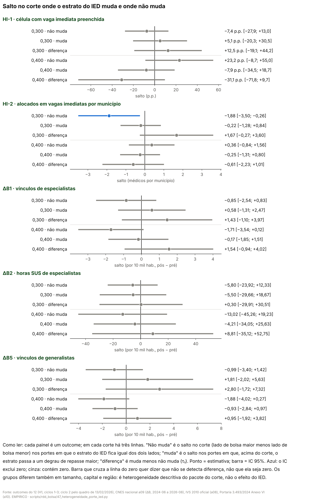

# 57u. O salto no corte muda conforme o estrato do IED da atenção primária muda ou não? (adendo 48g)

> **Data:** 26/10/2026. 
> **Adendo:** [`48g_adendo_heterogeneidade_porte_ied.md`](48g_adendo_heterogeneidade_porte_ied.md), congelado antes destas
> contas (commit `c87ed75`). SHA-256 do adendo em `adendo` de `PO_resumo.json`, conferido pelo script. 
> **Estatuto:** `ADENDO_48G_POS_RESULTADO`. A H1 só com vagas imediatas (48b, doc 57n), a oferta local no corte
> (protocolo 64, doc 57q) e os controles e pareamentos (48d, 48e) já tinham sido vistos; a divisão por porte, não.
> Toda linha de `PO_estimativas.csv` e `PO_contagens.csv` tem `natureza_dos_dados = EMPIRICO`. 
> **Auditoria:** [auditoria 45](../auditorias/45_auditoria_heterogeneidade_porte.md), aprovado com correções de texto
> e de proveniência; nenhuma estimativa mudou. 
> **Script:** `scripts/rdd_bolsa/47_heterogeneidade_porte_ied.py` (construtores dos scripts 40 e 43 e estimadores de
> `rdd_lib.py`, importados; a leitura de capitais e regiões vem do script 44). **Saídas:**
> `output/rdd_bolsa/PO_estimativas.csv`, `PO_contagens.csv`, `PO_resumo.json`, `PO_figuras/`. **Testes:**
> `tests/test_heterogeneidade_porte_ied.py`. 
> **Números:** nenhum é digitado. Os blocos entre marcadores `<!-- PO:... -->` são regravados das saídas por
> `47_heterogeneidade_porte_ied.py --atualizar-doc`; o teste confere que cada bloco é idêntico ao gerado.

**Contraste.** Em toda linha, o lado com bolsa maior (IVS acima do corte) é comparado com o lado com bolsa menor; o
próprio corte fica no lado de baixo. Em 0,300 a bolsa anunciada sobe de R$ 10 mil para R$ 15 mil e em 0,400 de
R$ 15 mil para R$ 20 mil, mas outras regras federais mudam nos mesmos cortes
([auditoria 18](../auditorias/18_politicas_nos_mesmos_cortes_ivs.md)). O que se mede é o **pacote do corte**, não o
incentivo de R$ 5 mil isolado, nem a participação no PMM-E, nem o Agora Tem Especialistas.

**A pergunta, em linguagem simples.** Uma das regras que mudam no corte é o estrato do IED, que define quanto o
Ministério repassa por equipe de saúde da família (R$ 2.000 por equipe por mês a cada degrau). Só que o estrato não muda
em todo município: depende também do porte (tamanho da população). A bolsa do PMM-E muda em todos. Então dá para
comparar o salto no corte entre os municípios em que o estrato muda e aqueles em que não muda. Se o salto só aparece
onde o estrato muda, o IED é um candidato a explicar o sinal; se aparece igual nos dois grupos, o IED não explica. Os
grupos diferem também em tamanho, capital e região, então a diferença entre eles é **descritiva**, não um efeito
causal do IED.

## 0. Decisões de implementação (26/10/2026, registradas antes de qualquer estimativa deste adendo)

O adendo deixa alguns pontos abertos. Em cada um, ficou a leitura mais próxima dos scripts 40 (H1 só com vagas
imediatas) e 43 (oferta local no corte). Estas decisões foram escritas e registradas em commit antes de rodar qualquer
conta do adendo, inclusive o portão. Antes de escrevê-las, foi olhada só uma contagem de desenho, sem outcome: quantos
municípios com célula no quadro ficam em cada porte, lado e ciclo na janela de 0,050, para saber se cada grupo × ciclo
tem suporte para ter retas próprias. Nenhuma decisão depende de resultado.

**Grupo G (o estrato do IED muda ou não no corte)**

1. **Regra lida, não digitada.** Para cada corte, o script lê `output/aquisicao/a10_diagnostico_cortes_normas.json`:
   - o **código de IVS de baixo** é o código cuja faixa do IVS oficial (`faixa_ivs_oficial_por_codigo`, mínimo e
     máximo) contém o corte (o corte fica no lado de baixo, como na `rdd_lib`);
   - o **código de IVS de cima** é o código cuja faixa começa no menor mínimo acima do corte;
   - o estrato de cada código × porte vem de `estrato_ied_por_codigo_ivs_e_porte` (o script exige um só estrato
     observado em cada combinação e `regra_deterministica = true`);
   - **G = 1** no porte em que o estrato do código de baixo difere do estrato do código de cima; **G = 0** no porte em
     que é igual.
   O conjunto de portes com G = 1 não é digitado no script; o teste confere que ele bate com o texto do adendo.
2. **Conferência com a tabela do a10.** O script confere, para cada município de `a10_ied_aps_2024_municipio.csv`, que o
   estrato gravado é o da regra código × porte do JSON, e que o SHA-256 do CSV é o registrado em `saidas` do JSON.
   Para cada município na janela de cada corte, confere ainda que o código de IVS do Anexo VI é o código de baixo
   quando o IVS oficial (a08) é menor ou igual ao corte e o de cima quando é maior. Qualquer diferença para o script
   sem gravar nada.
3. **Porte.** `porte_codigo` do Anexo VI (IBGE 2022, pré-tratamento), pela chave `co_ibge` de 6 dígitos. Município da
   amostra sem linha ou sem porte no a10 sai, contado por outcome e corte.

**Amostras e outcomes (os mesmos das especificações de base)**

4. **HI-1 e HI-2.** As amostras do 48b montadas por `carregar()` do script 40, versão `13fev` (no ciclo 2, tipo de vaga
   pelo quadro de 13/02/2026, adendo 48b §7): HI-1 nas células com vaga imediata (só imediatas e mistas), ciclos 1–3;
   HI-2 nos municípios × ciclo com pelo menos uma dessas células. Outcomes `preenchida` e `aloc_imed`; controle de
   HI-2 `vi_imed`.
5. **ΔB1, ΔB2 e ΔB5.** A amostra V e os outcomes do protocolo 64 montados por `carregar()`, `taxa()` e `deltas()` do
   script 43 (por 10 mil hab., média do pós 2025-10 a 2026-08 menos a do pré 2024-06 a 2025-06). Município sem todos os
   meses de uma janela sai daquele outcome, contado, como no 43. Nenhuma competência do CNES ≥ 2026-09 é lida; o
   script confere a maior competência do painel usado.

**Especificação**

6. **HI-1 (PO-1).** `rdd_lib.rd_empilhado` com `grupo` = ciclo × G: intercepto, inclinação e inclinação acima do corte
   próprios em cada ciclo × G (a especificação de base já tem retas por ciclo; o adendo acrescenta retas por grupo).
   Salto comum T, que é o salto onde G = 0 (τ₀), mais a coluna T × G, cujo coeficiente é τ₁. Efeitos fixos de curso ×
   ciclo; EP agrupado por município (CR1); local linear, kernel triangular, h = 0,050; cada corte separado.
7. **HI-2 (PO-1).** O mesmo, com o controle do S-a do script 40: vagas imediatas das células com vaga imediata, linear,
   igual dos dois lados, **um coeficiente por ciclo** (não por ciclo × G, como na base), centrado como em
   `colunas_controle` do script 23. Uma linha por município × ciclo; CR1 por município.
8. **ΔB1, ΔB2, ΔB5 (PO-2 e PO-3).** `rd_empilhado` sobre ΔY com `grupo` = G (retas próprias por G e lado), T comum
   (τ₀) e T × G (τ₁); um município por linha, EP HC1, como o `rd_dird_delta` da base.
9. **Inferência.** τ₀ é o coeficiente de T, τ₁ o de T × G, e o salto onde o estrato muda é τ₀ + τ₁, com variância
   V(T) + V(T × G) + 2 Cov, da mesma matriz sanduíche. IC 95% e p pela normal, como na biblioteca.
10. **Sem estimativa.** Se a biblioteca descartar a coluna T × G por colinearidade, ou devolver NaN (menos de 2 mass
    points de algum lado em algum grupo), a linha fica `SEM_ESTIMATIVA`, com o motivo, contada. Não há especificação
    de reserva.
11. **Menos de 10 unidades.** A unidade é o **município distinto** (a unidade do cluster; é o que `n_abaixo` e
    `n_acima` contam no 48b e no 64), com peso de kernel positivo (−0,050 < IVS − corte < 0,050) e outcome (e
    controle) observados. Se algum G × lado tiver menos de 10, as linhas PO-1 a PO-4 desse outcome e corte ficam
    `SEM_ESTIMATIVA_MENOS_DE_10`, contadas. Na HI-1 as células também são contadas.

**Testes múltiplos**

12. **Holm** entre as 4 linhas τ₁ da PO-1 (HI-1 e HI-2 × dois cortes), com `rdd_lib.holm`. **BKY** entre as 6 linhas τ₁
    secundárias: PO-2 (ΔB1 e ΔB2 × dois cortes) e PO-3 (ΔB5 × dois cortes), com `rdd_lib.qvalores_bky`. O tamanho de
    cada família fica fixo: linha sem estimativa entra com p = 1 só no cálculo, e seu p ajustado fica vazio. A PO-4
    (τ₀ e τ₀ + τ₁) é descritiva, fora das duas famílias.

**Portão (antes de qualquer conta nova; falha fechada)**

13. Das amostras refeitas (decisões 4 e 5), o script reestima, com as funções de base (`est_celula` e `est_municipio`
    do script 40; `rd_dird_delta`), HI-1 e HI-2 em 0,300 e OC-A1 (ΔB1 em V) em 0,300, e compara com
    `HI_estimativas.csv` (variante `principal`) e `OC_estimativas.csv` (parte A, V, `principal`): |diferença| ≤ 1e−8 no
    salto e no EP, contagens iguais. Depois roda o estimador desta análise **sem a divisão por grupo** (grupo = ciclo,
    sem T × G; no OC, um grupo só) e exige o mesmo resultado. Junto vêm as conferências de G das decisões 1 e 2. Se algo
    não bater, o script para sem gravar.

**PO-5 (diagnóstico)**

14. **Contagens** por corte × G × lado na janela, para cada amostra de estimação: HI-1 (municípios e células), HI-2
    (municípios e linhas município × ciclo), ΔB1, ΔB2 e ΔB5 (municípios); e os municípios fora por falta de porte.
15. **Balanço de capital e região.** Na janela de cada corte, por G × lado: número de municípios, fração de capitais e
    fração em cada uma das cinco macrorregiões. Duas populações: "H1" (municípios distintos da amostra da HI-2, em
    qualquer ciclo) e "V" (municípios da amostra de ΔB1). Capital e região vêm da referência do IBGE gravada
    (`output/aquisicao/ibge_capitais_uf_regiao.csv`), lida por `ler_referencia_ibge` do script 44; a UF é o prefixo de
    2 dígitos do `co_ibge`. São médias simples, sem teste: descrevem quem está em cada grupo.

**Leitura (§4 do adendo, regra fixada no código)**

16. **PO-1.** `TAU1_TODOS_CONTEM_ZERO` se as 4 linhas τ₁ têm IC 95% que contém zero; `TAU1_REJEITA_HOLM_CONCENTRADO` se
    alguma τ₁ tem p de Holm < 0,05 e, nessa linha, o IC de τ₀ + τ₁ (estrato muda) exclui zero e o de τ₀ (não muda)
    contém zero; `TAU1_REJEITA_HOLM_SEM_CONCENTRACAO` se rejeita depois do Holm sem essa concentração;
    `TAU1_IC_EXCLUI_ZERO_SEM_HOLM` se algum IC convencional de τ₁ exclui zero, mas nenhum p de Holm fica abaixo de
    0,05 (relatado como sinal sem correção, entre os dois casos do adendo). Linhas sem estimativa são listadas.
17. **PO-3, por corte.** `INDICIO_IED_MOVE_APS` se o IC do salto de generalistas onde o estrato muda (τ₀ + τ₁) exclui
    zero e o IC onde não muda (τ₀) contém zero; senão `SEM_INDICIO`. O τ₁ e seu q BKY vêm junto, para dizer se a
    diferença entre os grupos também se distingue de zero.
18. **Potência.** Todo G × lado com menos de 10 municípios é listado como "sem potência para esse grupo". As contagens
    vêm sempre junto com a leitura.

**Saídas e figura**

19. Sem sensibilidades além do adendo (o adendo não pede outras janelas nem IC honesto). Uma figura,
    `PO_figuras/PO_salto_por_grupo.png`: um painel por outcome, e em cada corte o salto onde o estrato não muda (τ₀),
    onde muda (τ₀ + τ₁) e a diferença (τ₁), com IC 95% e "Como ler". Nenhuma saída `HI_*`, `OC_*`, `CL_*` ou `PM_*` é
    regravada.

## 1. Resposta curta

<!-- PO:resposta_curta:inicio -->
**Não se detecta que o salto da H1 dependa de o estrato do IED mudar** (leitura pré-registrada do primeiro caso): nas quatro linhas da PO-1 o IC 95% da diferença τ₁ contém zero. Pelo adendo, o IED não explica o sinal da H1, com pouca potência: os grupos são pequenos (contagens na seção 3). Com IC de τ₁ tão largos, "não explica" quer dizer que os dados não mostram que o IED explique o salto; não quer dizer que o canal do IED esteja descartado.

- **Corte 0,300** (R$ 10 mil → R$ 15 mil; o estrato muda nos portes 2 e 3 e não muda nos portes 1 e 4). HI-1: onde o estrato muda, +5,1 p.p. [−20,3; +30,5]; onde não muda, −7,4 p.p. [−27,9; +13,0]; diferença τ₁ = +12,5 p.p. [−19,1; +44,2], p Holm 0,876; HI-2: onde o estrato muda, −0,22 [−1,28; +0,84]; onde não muda, −1,88 [−3,50; −0,26]; diferença τ₁ = +1,67 [−0,27; +3,60], p Holm 0,366.

- **Corte 0,400** (R$ 15 mil → R$ 20 mil; o estrato muda nos portes 1, 2 e 4 e não muda no porte 3). HI-1: onde o estrato muda, −7,9 p.p. [−34,5; +18,7]; onde não muda, +23,2 p.p. [−8,7; +55,0]; diferença τ₁ = −31,1 p.p. [−71,8; +9,7], p Holm 0,405; HI-2: onde o estrato muda, −0,25 [−1,31; +0,80]; onde não muda, +0,36 [−0,84; +1,56]; diferença τ₁ = −0,61 [−2,23; +1,01], p Holm 0,876.

A própria H1, sem a divisão, não tem linha primária que rejeite zero depois do Holm (doc 57n, código `IC_CONVENCIONAL_EXCLUI_ZERO_SEM_HOLM`): não há um sinal firme da H1 para o IED explicar. A comparação entre grupos pergunta se o salto, seja qual for, difere entre eles.

Na linha da H1 com IC convencional sem zero no 57n (HI-2 em 0,300), o IC 95% exclui zero onde o estrato não muda (não muda: −1,88 [−3,50; −0,26]; muda: −0,22 [−1,28; +0,84]). Isso é descritivo e não mostra que o salto da H1 venha de um grupo e não do outro: a PO-4 fica fora do Holm; a diferença entre os grupos nessa linha (τ₁) não se distingue de zero (p 0,091, p Holm 0,366); e em 0,300, o grupo em que o estrato não muda é formado pelos municípios dos portes 1 e 4, com 24 % e 14 % de capitais e 24 % e 31 % no Nordeste (abaixo e acima do corte), contra 0 % e 0 % de capitais e 11 % e 40 % no Nordeste onde o estrato muda (seção 7). A comparação entre grupos mistura o canal do IED com porte, capital e região.

Na PO-4 inteira, 1 de 20 intervalos exclui zero; a 5%, cerca de um intervalo em vinte excluiria zero só por acaso, mesmo sem salto nenhum.

**Generalistas (PO-3, o outcome que o IED deveria mover):** em 0,300, não há indício de salto só onde o estrato muda: onde muda, +1,81 [−2,02; +5,63]; onde não muda, −0,99 [−3,40; +1,42]; diferença +2,80 [−1,72; +7,32], q BKY 1,000; em 0,400, não há indício de salto só onde o estrato muda: onde muda, −0,93 [−2,84; +0,97]; onde não muda, −1,88 [−4,02; +0,27]; diferença +0,95 [−1,92; +3,82], q BKY 1,000 (vínculos por 10 mil hab., mudança pós − pré).

Nas secundárias (ΔB1, ΔB2, ΔB5), nenhuma diferença τ₁ tem IC 95% convencional sem zero.

**Potência.** O menor grupo × lado tem 15 municípios (HI-1, corte 0,400, estrato não muda, acima do corte); nenhum fica abaixo de 10. Não detectar diferença entre grupos não é mostrar que ela é zero.

**O que isto é e o que não é.** Os grupos são definidos pelo porte, uma condição anterior ao tratamento, mas diferem também em tamanho, capital e região (seção 7). A diferença entre eles descreve heterogeneidade do salto do pacote do corte; não é o efeito do IED nem da bolsa isolada.
<!-- PO:resposta_curta:fim -->

### 1.1 Portão

<!-- PO:portao:inicio -->
| Linha de base | Como foi refeita | n abaixo / acima | Salto gravado | Salto refeito | Diferença absoluta no salto | Diferença absoluta no EP |
|---|---|---|---|---|---|---|
| HI-1 0,300 | est_celula do 40 | 95 / 72 | −0,036784 | −0,036784 | 0.0e+00 | 6.9e-17 |
| HI-1 0,300 | estimador do 47 sem divisao | 95 / 72 | −0,036784 | −0,036784 | 0.0e+00 | 6.9e-17 |
| HI-2 0,300 | est_municipio do 40 | 95 / 72 | −1,126326 | −1,126326 | 0.0e+00 | 0.0e+00 |
| HI-2 0,300 | estimador do 47 sem divisao | 95 / 72 | −1,126326 | −1,126326 | 0.0e+00 | 0.0e+00 |
| OC-A1 0,300 | rd_dird_delta (como o 43) | 144 / 119 | −0,229095 | −0,229095 | 2.8e-17 | 0.0e+00 |
| OC-A1 0,300 | estimador do 47 sem divisao | 144 / 119 | −0,229095 | −0,229095 | 1.4e-15 | 6.7e-16 |

Resultado: **aprovado** (máx |dif| = 1.4e-15, tolerância 1e−8). G vem de `output/aquisicao/a10_diagnostico_cortes_normas.json`; o estrato gravado no CSV do a10 bate com a regra código × porte em todos os municípios, e o código de IVS do Anexo VI está do lado certo do corte pelo IVS oficial (em 0,300, 265 municípios na janela conferidos, 0 divergentes; em 0,400, 267 municípios na janela conferidos, 0 divergentes).
<!-- PO:portao:fim -->

## 2. Onde o estrato muda (regra lida do a10)

<!-- PO:regra_g:inicio -->
| Corte | Porte (Anexo VI, IBGE 2022) | Código de IVS (abaixo → acima) | Estrato do IED (abaixo → acima) | Grupo |
|---|---|---|---|---|
| 0,300 | 1-Até 20mil hab. | 4 → 3 | 3 → 3 | não muda (G = 0) |
| 0,300 | 2-Acima de 20mil até 50mil hab. | 4 → 3 | 4 → 3 | **muda (G = 1)** |
| 0,300 | 3-Acima de 50mil até 100mil hab. | 4 → 3 | 4 → 3 | **muda (G = 1)** |
| 0,300 | 4-Acima de 100mil hab. | 4 → 3 | 4 → 4 | não muda (G = 0) |
| 0,400 | 1-Até 20mil hab. | 3 → 2 | 3 → 2 | **muda (G = 1)** |
| 0,400 | 2-Acima de 20mil até 50mil hab. | 3 → 2 | 3 → 2 | **muda (G = 1)** |
| 0,400 | 3-Acima de 50mil até 100mil hab. | 3 → 2 | 3 → 3 | não muda (G = 0) |
| 0,400 | 4-Acima de 100mil hab. | 3 → 2 | 4 → 3 | **muda (G = 1)** |

Código de IVS 1 = muito alta … 5 = muito baixa; estrato 1 recebe mais por equipe. Cada degrau de estrato vale R$ 2.000 por equipe de saúde da família por mês (auditoria 18, §2.5).
<!-- PO:regra_g:fim -->

## 3. Contagens por grupo, lado e corte (PO-5)

<!-- PO:contagens:inicio -->
| Outcome | Corte | Não muda, abaixo | Não muda, acima | Muda, abaixo | Muda, acima | Fora sem porte |
|---|---|---|---|---|---|---|
| HI-1 · célula com vaga imediata preenchida | 0,300 | 50 (330 células) | 42 (211 células) | 45 (162 células) | 30 (100 células) | 0 |
| HI-1 · célula com vaga imediata preenchida | 0,400 | 18 (85 células) | 15 (39 células) | 65 (230 células) | 54 (131 células) | 0 |
| HI-2 · alocados em vagas imediatas por município | 0,300 | 50 (80 mun. × ciclo) | 42 (68 mun. × ciclo) | 45 (61 mun. × ciclo) | 30 (48 mun. × ciclo) | 0 |
| HI-2 · alocados em vagas imediatas por município | 0,400 | 18 (37 mun. × ciclo) | 15 (25 mun. × ciclo) | 65 (93 mun. × ciclo) | 54 (72 mun. × ciclo) | 0 |
| ΔB1 · vínculos de especialistas | 0,300 | 73 | 72 | 71 | 47 | 0 |
| ΔB1 · vínculos de especialistas | 0,400 | 22 | 22 | 100 | 123 | 0 |
| ΔB2 · horas SUS de especialistas | 0,300 | 70 | 72 | 71 | 47 | 0 |
| ΔB2 · horas SUS de especialistas | 0,400 | 22 | 22 | 100 | 123 | 0 |
| ΔB5 · vínculos de generalistas | 0,300 | 73 | 72 | 71 | 47 | 0 |
| ΔB5 · vínculos de generalistas | 0,400 | 22 | 22 | 100 | 123 | 0 |

Municípios distintos na janela h = 0,050 com outcome observado (decisão 11); entre parênteses, as linhas da regressão. Grupo × lado com menos de 10 municípios deixaria a linha sem estimativa.
<!-- PO:contagens:fim -->

## 4. PO-1 — a H1 depende de o estrato mudar? (primária, Holm)

<!-- PO:po1:inicio -->
| Outcome | Corte | Municípios: não muda (abaixo / acima) · muda (abaixo / acima) | Linhas | Diferença τ₁ | IC 95% | p | p Holm |
|---|---|---|---|---|---|---|---|
| HI-1 · célula com vaga imediata preenchida | 0,300 | 50 / 42 · 45 / 30 | 803 | +12,5 p.p. | [−19,1; +44,2] | 0,438 | 0,876 |
| HI-1 · célula com vaga imediata preenchida | 0,400 | 18 / 15 · 65 / 54 | 485 | −31,1 p.p. | [−71,8; +9,7] | 0,135 | 0,405 |
| HI-2 · alocados em vagas imediatas por município | 0,300 | 50 / 42 · 45 / 30 | 257 | +1,67 | [−0,27; +3,60] | 0,091 | 0,366 |
| HI-2 · alocados em vagas imediatas por município | 0,400 | 18 / 15 · 65 / 54 | 227 | −0,61 | [−2,23; +1,01] | 0,459 | 0,876 |

τ₁ = salto onde o estrato muda − salto onde não muda. Holm entre as quatro linhas (decisão 12).
<!-- PO:po1:fim -->

## 5. PO-2 e PO-3 — oferta local de especialistas e de generalistas (secundárias, BKY)

<!-- PO:po2_po3:inicio -->
| Outcome | Corte | Municípios: não muda (abaixo / acima) · muda (abaixo / acima) | Linhas | Diferença τ₁ | IC 95% | p | q BKY |
|---|---|---|---|---|---|---|---|
| ΔB1 · vínculos de especialistas | 0,300 | 73 / 72 · 71 / 47 | 263 | +1,43 | [−1,10; +3,97] | 0,267 | 1,000 |
| ΔB1 · vínculos de especialistas | 0,400 | 22 / 22 · 100 / 123 | 267 | +1,54 | [−0,94; +4,02] | 0,225 | 1,000 |
| ΔB2 · horas SUS de especialistas | 0,300 | 70 / 72 · 71 / 47 | 260 | +0,30 | [−29,91; +30,51] | 0,984 | 1,000 |
| ΔB2 · horas SUS de especialistas | 0,400 | 22 / 22 · 100 / 123 | 267 | +8,81 | [−35,12; +52,75] | 0,694 | 1,000 |
| ΔB5 · vínculos de generalistas | 0,300 | 73 / 72 · 71 / 47 | 263 | +2,80 | [−1,72; +7,32] | 0,225 | 1,000 |
| ΔB5 · vínculos de generalistas | 0,400 | 22 / 22 · 100 / 123 | 267 | +0,95 | [−1,92; +3,82] | 0,518 | 1,000 |

BKY entre as seis linhas (ΔB1 e ΔB2 da PO-2; ΔB5 da PO-3). Um município por linha, EP HC1.
<!-- PO:po2_po3:fim -->

## 6. PO-4 — o salto em cada grupo (descritivo)

<!-- PO:po4:inicio -->
| Outcome | Corte | Salto onde o estrato não muda (τ₀) [IC 95%] | p | Salto onde o estrato muda (τ₀ + τ₁) [IC 95%] | p |
|---|---|---|---|---|---|
| HI-1 · célula com vaga imediata preenchida | 0,300 | −7,4 p.p. [−27,9; +13,0] | 0,475 | +5,1 p.p. [−20,3; +30,5] | 0,694 |
| HI-1 · célula com vaga imediata preenchida | 0,400 | +23,2 p.p. [−8,7; +55,0] | 0,154 | −7,9 p.p. [−34,5; +18,7] | 0,560 |
| HI-2 · alocados em vagas imediatas por município | 0,300 | −1,88 [−3,50; −0,26] | 0,023 | −0,22 [−1,28; +0,84] | 0,688 |
| HI-2 · alocados em vagas imediatas por município | 0,400 | +0,36 [−0,84; +1,56] | 0,557 | −0,25 [−1,31; +0,80] | 0,639 |
| ΔB1 · vínculos de especialistas | 0,300 | −0,85 [−2,54; +0,83] | 0,322 | +0,58 [−1,31; +2,47] | 0,547 |
| ΔB1 · vínculos de especialistas | 0,400 | −1,71 [−3,54; +0,12] | 0,067 | −0,17 [−1,85; +1,51] | 0,841 |
| ΔB2 · horas SUS de especialistas | 0,300 | −5,80 [−23,92; +12,33] | 0,531 | −5,50 [−29,66; +18,67] | 0,656 |
| ΔB2 · horas SUS de especialistas | 0,400 | −13,02 [−45,26; +19,23] | 0,429 | −4,21 [−34,05; +25,63] | 0,782 |
| ΔB5 · vínculos de generalistas | 0,300 | −0,99 [−3,40; +1,42] | 0,419 | +1,81 [−2,02; +5,63] | 0,354 |
| ΔB5 · vínculos de generalistas | 0,400 | −1,88 [−4,02; +0,27] | 0,086 | −0,93 [−2,84; +0,97] | 0,337 |

HI-1 em pontos percentuais; HI-2 em médicos alocados por município, comparando municípios com as mesmas vagas imediatas; ΔB1, ΔB2 e ΔB5 por 10 mil hab., mudança da média do pós menos a do pré. Descritivo: fora do Holm e do BKY.
<!-- PO:po4:fim -->

## 7. PO-5 — quem está em cada grupo: capital e região (diagnóstico)

<!-- PO:balanco:inicio -->
| População | Corte | Estrato | Lado | Municípios | Capitais | Centro-Oeste | Nordeste | Norte | Sudeste | Sul |
|---|---|---|---|---|---|---|---|---|---|---|
| H1 | 0,300 | não muda | abaixo | 50 | 24 % | 18 % | 24 % | 8 % | 40 % | 10 % |
| H1 | 0,300 | não muda | acima | 42 | 14 % | 12 % | 31 % | 17 % | 36 % | 5 % |
| H1 | 0,300 | muda | abaixo | 45 | 0 % | 40 % | 11 % | 11 % | 36 % | 2 % |
| H1 | 0,300 | muda | acima | 30 | 0 % | 30 % | 40 % | 3 % | 23 % | 3 % |
| V | 0,300 | não muda | abaixo | 73 | 16 % | 18 % | 18 % | 7 % | 47 % | 11 % |
| V | 0,300 | não muda | acima | 72 | 8 % | 11 % | 22 % | 14 % | 46 % | 7 % |
| V | 0,300 | muda | abaixo | 71 | 0 % | 35 % | 10 % | 8 % | 44 % | 3 % |
| V | 0,300 | muda | acima | 47 | 0 % | 23 % | 32 % | 4 % | 34 % | 6 % |
| H1 | 0,400 | não muda | abaixo | 18 | 0 % | 0 % | 78 % | 17 % | 6 % | 0 % |
| H1 | 0,400 | não muda | acima | 15 | 0 % | 0 % | 93 % | 0 % | 7 % | 0 % |
| H1 | 0,400 | muda | abaixo | 65 | 5 % | 12 % | 52 % | 17 % | 17 % | 2 % |
| H1 | 0,400 | muda | acima | 54 | 0 % | 0 % | 65 % | 15 % | 20 % | 0 % |
| V | 0,400 | não muda | abaixo | 22 | 0 % | 0 % | 82 % | 14 % | 5 % | 0 % |
| V | 0,400 | não muda | acima | 22 | 0 % | 0 % | 91 % | 0 % | 9 % | 0 % |
| V | 0,400 | muda | abaixo | 100 | 3 % | 9 % | 55 % | 15 % | 20 % | 1 % |
| V | 0,400 | muda | acima | 123 | 0 % | 2 % | 72 % | 7 % | 18 % | 0 % |

H1: municípios distintos da amostra da HI-2 (qualquer ciclo) na janela; V: municípios da amostra de ΔB1 na janela. Médias simples, sem teste. Capital e região pela referência do IBGE gravada (`output/aquisicao/ibge_capitais_uf_regiao.csv`).
<!-- PO:balanco:fim -->

## 8. Leitura pela regra pré-registrada

<!-- PO:leitura:inicio -->
**PO-1:** código `TAU1_TODOS_CONTEM_ZERO`. Regra (decisão 16): `TAU1_TODOS_CONTEM_ZERO` se as quatro τ₁ têm IC 95% que contém zero; `TAU1_REJEITA_HOLM_CONCENTRADO` se alguma τ₁ tem p de Holm abaixo de 0,05 e, nela, o IC de τ₀ + τ₁ exclui zero e o de τ₀ contém zero; `TAU1_REJEITA_HOLM_SEM_CONCENTRACAO` se rejeita depois do Holm sem essa concentração; `TAU1_IC_EXCLUI_ZERO_SEM_HOLM` se algum IC convencional de τ₁ exclui zero e nenhum p de Holm fica abaixo de 0,05.

**Não se detecta que o salto da H1 dependa de o estrato do IED mudar** (leitura pré-registrada do primeiro caso): nas quatro linhas da PO-1 o IC 95% da diferença τ₁ contém zero. Pelo adendo, o IED não explica o sinal da H1, com pouca potência: os grupos são pequenos (contagens na seção 3). Com IC de τ₁ tão largos, "não explica" quer dizer que os dados não mostram que o IED explique o salto; não quer dizer que o canal do IED esteja descartado.

**PO-3 em 0,300:** código `SEM_INDICIO`; τ₁ com q BKY acima de 0,05. Regra: `INDICIO_IED_MOVE_APS` se o IC do salto de generalistas onde o estrato muda exclui zero e o IC onde não muda contém zero; senão `SEM_INDICIO`.

**PO-3 em 0,400:** código `SEM_INDICIO`; τ₁ com q BKY acima de 0,05. Regra: `INDICIO_IED_MOVE_APS` se o IC do salto de generalistas onde o estrato muda exclui zero e o IC onde não muda contém zero; senão `SEM_INDICIO`.

**Potência:** nenhum grupo × lado com menos de 10 municípios. Mesmo acima de 10, cada grupo tem poucas dezenas de municípios perto do corte.
<!-- PO:leitura:fim -->

## 9. Figura

<!-- PO:figura:inicio -->

**Como ler: cada painel é um outcome; em cada corte há três linhas. "Não muda" é o salto no corte (lado de bolsa maior menos lado de bolsa menor) nos portes em que o estrato do IED fica igual dos dois lados; "muda" é o salto nos portes em que, acima do corte, o estrato passa a um degrau de repasse maior; "diferença" é muda menos não muda (τ₁). Ponto = estimativa; barra = IC 95%. Azul: o IC exclui zero; cinza: contém zero. Barra que cruza a linha do zero quer dizer que não se detecta diferença, não que ela seja zero. Os grupos diferem também em tamanho, capital e região: é heterogeneidade descritiva do pacote do corte, não o efeito do IED.**
<!-- PO:figura:fim -->

## 10. Limites

<!-- PO:limites:inicio -->
- **Descritivo, não causal do IED.** O porte é anterior ao tratamento, mas os portes em que o estrato muda diferem dos outros em tamanho, capital e região (seção 7) e em outras regras que dependem do porte. A diferença τ₁ mistura o canal do IED com tudo o que difere entre esses municípios perto do corte.
- **Os grupos não são os mesmos nos dois cortes.** Em 0,300, o grupo em que o estrato não muda é formado pelos municípios dos portes 1 e 4, com 24 % e 14 % de capitais e 24 % e 31 % no Nordeste (abaixo e acima do corte), contra 0 % e 0 % de capitais e 11 % e 40 % no Nordeste onde o estrato muda (seção 7); em 0,400, o grupo em que o estrato não muda é formado pelos municípios do porte 3, com 0 % e 0 % de capitais e 78 % e 93 % no Nordeste (abaixo e acima do corte), contra 5 % e 0 % de capitais e 52 % e 65 % no Nordeste onde o estrato muda (seção 7). A τ₁ de um corte e a do outro não comparam o mesmo tipo de município.
- **Pacote do corte.** Em 0,300 e 0,400 mudam a bolsa anunciada e outras regras federais (auditoria 18). Mesmo onde o estrato não muda, o salto é de um pacote, não da bolsa isolada; nada aqui isola o incentivo de R$ 5 mil, a participação no PMM-E ou o Agora Tem Especialistas.
- **Pós-resultado.** A H1 e a oferta local no corte já tinham sido vistas; só a divisão por porte é nova. A especificação e as decisões foram fixadas antes destas contas.
- **Potência.** Cada grupo × lado tem poucas dezenas de municípios na janela (seção 3); os IC da diferença são mais largos que os da H1 sem divisão. Não detectar diferença não é mostrar que ela é zero.
- **Retas por ciclo × grupo.** Na H1 cada ciclo × grupo tem retas próprias de cada lado; com poucos municípios por ciclo × grupo, as retas são imprecisas, e é isso que alarga os IC.
- **IED e compensação.** O art. 12-T da 3.493/2024 compensa quem perderia recursos frente às doze parcelas anteriores (auditoria 18, §2.5): o degrau de estrato pode valer menos que R$ 2.000 por equipe no curto prazo. O grupo G marca onde a regra muda o estrato, não quanto dinheiro mudou.
- **Porte de 2022.** O porte é o do Anexo VI (IBGE 2022). A H1 e a oferta local são de 2025–2026; um município que tenha mudado de porte depois não muda de grupo aqui.
<!-- PO:limites:fim -->
