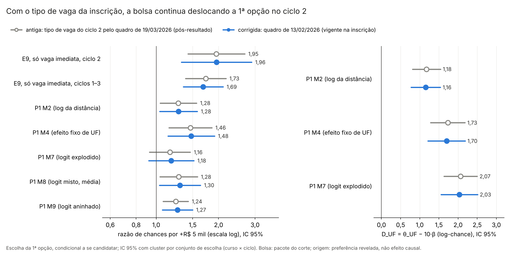

# 57v. Sensibilidades da escolha no ciclo 2 com o tipo de vaga do quadro de 13/02/2026 (adendo 52d)

> **Gerado por** `scripts/rdd_bolsa/48_sensibilidades_ciclo2_quadro_1302.py` a partir de `output/rdd_bolsa/VD_*`; não editar à mão (o teste `tests/test_sensibilidades_ciclo2_quadro_1302.py` confere que este arquivo é igual ao gerado; `--atualizar-doc` o regrava das saídas). 
> **Adendo:** [`52d_adendo_sensibilidades_ciclo2_quadro_1302.md`](52d_adendo_sensibilidades_ciclo2_quadro_1302.md), congelado em 26/10/2026 antes de rodar (commit `c87ed75`); SHA-256 em `adendo` de `VD_resumo.json`, conferido pelo teste. Protocolos de origem: [40](40_protocolo_multioutcome_rdd_bolsa.md) (E9, §12), [52](52_protocolo_P1_escolha_dap.md) (P1) e [52b](52b_protocolo_P1h_magnitudes.md) (P1h); adendo [52c](52c_adendo_vaga_imediata_ciclo2.md) (principais corrigidas, doc [57p](57p_escolha_vaga_imediata_c2.md)). 
> **Estatuto:** `ADENDO_52D_POS_RESULTADO`. As versões com o quadro de 19/03 (docs 42, 57a e 57i) e as principais corrigidas do adendo 52c (doc 57p) já tinham sido vistas; isto não é teste confirmatório novo. Toda linha de `VD_estimativas.csv` e o resumo têm `natureza_dos_dados = EMPIRICO`. 
> **Motivo:** [auditoria 41](../auditorias/41_auditoria_escolha_vaga_imediata_c2.md), achado A1: as sensibilidades que sustentam a robustez do ciclo 2 ([doc 44](44_sintese_rdd_bolsa_multioutcome.md)) ainda usavam o tipo de vaga do quadro retificado de 19/03/2026, refeito depois do resultado preliminar ([auditoria 36](../auditorias/36_auditoria_dados_H1.md)). 
> **Saídas:** `output/rdd_bolsa/VD_estimativas.csv`, `VD_resumo.json` e `VD_figuras/VD_antigo_corrigido.png`. As saídas `E9_*`, `P1_*`, `P1h_*` e `VC_*` não são regravadas, e os docs 42, 44, 57, 57a, 57i e 57p não são editados. 
> **Auditoria:** pendente.

## 1. Resposta curta

<!-- VD:resposta:inicio -->
**VD-1 (principal deste adendo): a robustez do ciclo 2 (doc 44) se mantém com o tipo de vaga anterior à alocação.** No E9 do ciclo 2, no conjunto só com células de vaga imediata, a razão de chances da 1ª opção por +R$ 5 mil de bolsa passa de 1,95 (IC 95% [1,42; 2,67]) para 1,96 (IC [1,32; 2,89]); o IC corrigido exclui 1. Com o quadro de 13/02 o conjunto tem 714 células usadas e 1140 candidatos, contra 1015 e 1798 na versão antiga. Pela leitura pré-registrada (§3), o mesmo sinal e o IC que exclui 1 mantêm a frase do doc 44 nesta peça. Os placebos de corte, o score bootstrap e o spline cúbico do doc 42 não foram refeitos no conjunto de sensibilidade (decisão 2).

**VD-2 (E9 empilhado, mesmo conjunto).** A razão de chances vai de 1,73 [1,39; 2,17] para 1,69 [1,35; 2,10]; o IC exclui 1 na antiga e exclui 1 na corrigida. O empilhado continua sendo uma média de ciclos heterogêneos (doc 42).

**VD-3 (variantes do P1).** Razão de chances por +R$ 5 mil, antiga → corrigida: M2 (log da distância): 1,28 → 1,28; M4 (efeito fixo de UF): 1,46 → 1,48; M7 (logit explodido): 1,16 → 1,18; M8 (logit misto, média): 1,28 → 1,30; M9 (logit aninhado): 1,24 → 1,27. Mudam de sinal em algum peso da bolsa: M6, curso. Pela leitura pré-registrada, a leitura da H2 se apoia nas que não mudam: M2 (log da distância), M4 (efeito fixo de UF), M6, nota, M6, município de origem, M7 (logit explodido), M8 (logit misto, média), M9 (logit aninhado). Mudam de significância: P1 M6, nota, `bolsa_x_sem_pontuacao` (sim → não).

**VD-4 (DAP, km e D_UF).** D_UF no P1h-3, antiga → corrigida: M2 (log da distância): 1,18 → 1,16 (q BKY 0,001 → 0,001); M4 (efeito fixo de UF): 1,73 → 1,70 (q BKY 0,001 → 0,001); M7 (logit explodido): 2,07 → 2,03 (q BKY 0,001 → 0,001). Um degrau da bolsa equivale a 112 km na antiga e 119 km na corrigida (IC delta [−12; 250]). Muda de sinal ou de significância uma linha de DAP, km ou D_UF (seção 5.7).

**Em linguagem simples.** A conta foi refeita usando o tipo de vaga que o candidato via na inscrição, e não o quadro arrumado depois do resultado. A tabela da seção 5.7 lista tudo o que mudou de lado do zero ou de significância. A bolsa aqui é o pacote do corte de IVS (bolsa e outras regras federais que mudam nos mesmos cortes), não a participação no PMM-E; a origem do candidato é preferência revelada, não efeito causal; e tudo vale para quem se candidatou, dentro das vagas abertas.
<!-- VD:resposta:fim -->

## 2. Portão de reprodução (VD-5)

<!-- VD:portao:inicio -->
**Portão de reprodução (VD-5): PASSOU.** Com o tipo de vaga antigo, as funções originais (scripts 16, 25 e 25c, importadas sem alteração pelo 42) reproduzem as linhas gravadas em `E9_estimativas.csv`, `E9_efeitos_marginais.csv`, `P1_estimativas.csv`, `P1_dap.csv` e `P1h_magnitudes.csv`. A diferença é absoluta quando o valor gravado tem módulo até 1 e relativa acima disso (decisão 6); a coluna mostra a maior diferença entre todas as quantidades comparadas da linha (a lista completa está em `portao` de `VD_resumo.json`).

| Linha | Linhas (reestimadas / gravadas) | Dif. máx. | Portão |
|---|---|---|---|
| E9s_2 | 13 / 13 | 4,2e−10 | passou |
| E9s_emp | 13 / 13 | 4,1e−10 | passou |
| P1_M1 | 18 / 18 | 4,0e−10 | passou |
| P1_M2 | 18 / 18 | 4,0e−10 | passou |
| P1_M4 | 40 / 40 | 4,3e−10 | passou |
| P1_M5_1 | 18 / 18 | 4,1e−10 | passou |
| P1_M5_2 | 18 / 18 | 4,7e−10 | passou |
| P1_M5_3 | 18 / 18 | 2,0e−10 | passou |
| P1_P1d | 1 / 1 | 6,4e−11 | passou |
| P1_M6_nota | 25 / 25 | 3,1e−10 | passou |
| P1_M6_municipio | 20 / 20 | 3,6e−10 | passou |
| P1_M6_curso | 43 / 43 | 2,9e−10 | passou |
| P1_M7 | 18 / 18 | 2,7e−10 | passou |
| P1_M8 | 20 / 20 | 4,5e−10 | passou |
| P1_M9 | 20 / 20 | 3,0e−10 | passou |
| DAP_M1 | 4 / 4 | 3,6e−10 | passou |
| DAP_M4 | 4 / 4 | 3,2e−10 | passou |
| DAP_M7 | 4 / 4 | 4,2e−10 | passou |
| DAP_M5_2 | 4 / 4 | 2,2e−10 | passou |
| P1h_P1h-1_M1 | 1 / 1 | 3,0e−10 | passou |
| P1h_P1h-2a_M1 | 1 / 1 | 1,8e−10 | passou |
| P1h_P1h-2b_M1 | 1 / 1 | 2,3e−10 | passou |
| P1h_P1h-3_M2 | 1 / 1 | 2,6e−10 | passou |
| P1h_P1h-3_M4 | 1 / 1 | 2,8e−10 | passou |
| P1h_P1h-3_M5_1 | 1 / 1 | 3,0e−10 | passou |
| P1h_P1h-3_M5_2 | 1 / 1 | 2,1e−10 | passou |
| P1h_P1h-3_M5_3 | 1 / 1 | 2,0e−10 | passou |
| P1h_P1h-3_M7 | 1 / 1 | 2,4e−10 | passou |
<!-- VD:portao:fim -->

## 3. O que usa o tipo de vaga do ciclo 2

<!-- VD:inventario:inicio -->
Lido do código dos scripts 16, 25 e 25c, antes de qualquer estimativa. "Usa" quer dizer que a linha depende de `tem_vaga_imediata`, `log_vagas_imediatas_mais_1` ou da definição do conjunto "só células com vaga imediata" no ciclo 2. As linhas que não usam não precisam ser refeitas e não são.

| Linha (origem) | Usa o tipo de vaga do ciclo 2? | Por onde | Neste adendo |
|---|---|---|---|
| E9, conjunto "só células com vaga imediata", ciclo 2 e empilhado (doc 42) | sim | define o conjunto e os candidatos; `log_vagas_imediatas_mais_1` é covariável (`tem_vaga_imediata` é constante e sai) | refeita (VD-1, VD-2) |
| E9, mesmo conjunto, ciclos 1 e 3 | não | o tipo de vaga só muda no ciclo 2 | não refeita |
| P1 M2 (log da distância) | sim | `tem_vaga_imediata` e `log_vagas_imediatas_mais_1` do M1, ciclos 1–3 empilhados | refeita (VD-3) |
| P1 M4 (efeito fixo de UF da vaga) | sim | idem | refeita (VD-3) |
| P1 M6 da nota, do município e do curso | sim | idem, mais as interações da bolsa | refeitas (VD-3) |
| P1 M7 (logit explodido) | sim | idem, nos postos 1 e 2 | refeita (VD-3) |
| P1 M8 (logit misto) | sim | matriz do M1 e partida no M1 | refeita (VD-3) |
| P1 M9 (logit aninhado) | sim | matriz do M1 e partida no M1 | refeita (VD-3) |
| P1 M3 (origem mais próxima) | — | não foi estimado no P1 (`NAO_EXECUTADO`) | nada a refazer |
| DAP do M1, quatro atributos, delta e bootstrap (doc 57a) | sim | β e atributos do M1; "1 vaga imediata" é a própria covariável | refeita (VD-4) |
| DAP do M4 e do M7 | sim | coeficientes do M4 e do M7 | refeitas (VD-4) |
| DAP do M5, ciclo 2 | sim | coeficientes do M5 do ciclo 2 | refeita (VD-4) |
| DAP do M5, ciclos 1 e 3 | não | ciclos sem mudança | não refeitas |
| km equivalentes K5 e K10 (P1h-2, M1; doc 57i) | sim | β e distância do M1 | refeitas (VD-4) |
| D_UF do P1h-3 no M2, no M4 e no M7 | sim | coeficientes dessas variantes | refeitas (VD-4) |
| D_UF do P1h-3 no M5 | ciclo 2 sim; ciclos 1 e 3 não | coeficientes do M5 de cada ciclo | recalculadas só para o BKY da família (o ciclo 2 já estava no 52c) |

Fora do §1 do adendo também usam o tipo de vaga do ciclo 2, e não são refeitas aqui: o logit explodido e as variantes quadrática e de degraus do E9 no conjunto principal; o M0 do P1; a ponte P1g (salto previsto pelo M1); os pesos descritivos da figura do P1h. Fica registrado para o autor.
<!-- VD:inventario:fim -->

## 4. O conjunto só com vaga imediata com o quadro de 13/02

<!-- VD:correcao:inicio -->
| Item | Antiga (19/03/2026) | Corrigida (13/02/2026) |
|---|---|---|
| células do ciclo 2 no conjunto só com vaga imediata | 1015 | 714 |
| vagas imediatas somadas nessas células | 1836 | 1206 |
| 1ªs opções do ciclo 2 em célula com vaga imediata | 1798 de 2140 | 1140 de 2140 |
| candidatos no E9 só com vaga imediata, ciclo 2 | 1798 | 1140 |
| células usadas no E9 só com vaga imediata, ciclo 2 | 1015 | 714 |
| candidatos no E9 só com vaga imediata, ciclos 1–3 | 3365 | 2707 |

- Células do conjunto antigo que continuam no corrigido: 714; nenhuma célula entra no conjunto corrigido sem estar no antigo, porque nenhuma célula perdeu vaga imediata entre 13/02 e 19/03 (adendo 52c: 0 células nesse sentido).
- Conferências: a regra do script 12 aplicada ao quadro de 19/03 reproduz o conjunto gravado em 2222 células (diferença máxima 0 em todas as colunas) e a marca de vaga imediata de 3646 de 3646 linhas de escolha do ciclo 2; o quadro de 13/02 bate com a leitura independente da auditoria 36 em 1547 células (0 diferenças). Nada imputado.
- No P1, a correção é a mesma do adendo 52c (conjunto principal, só as covariáveis do ciclo 2); a amostra, os conjuntos e os termos são iguais nas duas versões (conferido), e o M1 e o M5 batem com o `VC_estimativas.csv`.
<!-- VD:correcao:fim -->

## 5. Tabelas: antigo e corrigido lado a lado

### 5.1 E9 no conjunto só com vaga imediata (VD-1, VD-2)

<!-- VD:e9:inicio -->
Logit condicional da 1ª opção, spline linear do IVS, bolsa linear (especificação principal do E9), no conjunto só com células de vaga imediata. Coeficiente por R$ 1 mil/mês, IC 95% e p com cluster por conjunto de escolha; razão de chances por +R$ 5 mil; variação média da probabilidade de escolha da célula (p.p.). Sem correção múltipla (E9 exploratório, protocolo 40, §12). Todos os termos estão em `VD_estimativas.csv`.

| Linha | Candidatos (antiga → corrigida) | Coef. antigo [IC]; p | Coef. corrigido [IC]; p | Razão de chances antiga [IC] | Razão de chances corrigida [IC] | Δ prob., p.p. (antiga → corrigida) |
|---|---|---|---|---|---|---|
| VD-1: E9, só vaga imediata, ciclo 2 | 1798 → 1140 | 0,1336 [0,0705; 0,1968]; p < 0,001 | 0,1342 [0,0562; 0,2121]; p < 0,001 | 1,95 [1,42; 2,67] | 1,96 [1,32; 2,89] | 0,680 → 0,974 |
| VD-2: E9, só vaga imediata, ciclos 1–3 | 3365 → 2707 | 0,1101 [0,0653; 0,1549]; p < 0,001 | 0,1044 [0,0601; 0,1487]; p < 0,001 | 1,73 [1,39; 2,17] | 1,69 [1,35; 2,10] | 0,741 → 0,969 |

Peso de `log(vagas imediatas + 1)` no mesmo modelo (a outra covariável do tipo de vaga é constante neste conjunto e sai):

| Linha | Antigo [IC] | Corrigido [IC] |
|---|---|---|
| E9, só vaga imediata, ciclo 2 | 0,389 [0,250; 0,528] | 0,674 [0,403; 0,946] |
| E9, só vaga imediata, ciclos 1–3 | 0,413 [0,248; 0,577] | 0,633 [0,444; 0,821] |
<!-- VD:e9:fim -->

### 5.2 Variantes do P1: peso da bolsa (VD-3)

<!-- VD:p1:inicio -->
Coeficiente da bolsa por R$ 1 mil/mês (no M8, a média da bolsa entre candidatos), IC 95% e p com cluster por conjunto de escolha, e razão de chances por +R$ 5 mil (exp de 5 × coef.; no M9, na escala do logit aninhado). Todas as variantes são dos ciclos 1–3 empilhados, na amostra do P1. Sem Holm (só o M1 é a principal do P1a, já no adendo 52c); os β das variantes não entram no BKY, como no protocolo 52.

| Variante | Coef. antigo [IC]; p | Coef. corrigido [IC]; p | Razão de chances antiga [IC] | Razão de chances corrigida [IC] |
|---|---|---|---|---|
| P1 M2 (log da distância) | 0,0492 [0,0086; 0,0897]; p = 0,017 | 0,0495 [0,0077; 0,0914]; p = 0,020 | 1,28 [1,04; 1,57] | 1,28 [1,04; 1,58] |
| P1 M4 (efeito fixo de UF) | 0,0759 [0,0282; 0,1237]; p = 0,002 | 0,0778 [0,0261; 0,1295]; p = 0,003 | 1,46 [1,15; 1,86] | 1,48 [1,14; 1,91] |
| P1 M7 (logit explodido) | 0,0304 [−0,0150; 0,0758]; p = 0,190 | 0,0335 [−0,0166; 0,0836]; p = 0,190 | 1,16 [0,93; 1,46] | 1,18 [0,92; 1,52] |
| P1 M8 (logit misto, média) | 0,0499 [0,0083; 0,0915]; p = 0,019 | 0,0527 [0,0070; 0,0984]; p = 0,024 | 1,28 [1,04; 1,58] | 1,30 [1,04; 1,64] |
| P1 M9 (logit aninhado) | 0,0434 [0,0156; 0,0713]; p = 0,002 | 0,0473 [0,0138; 0,0808]; p = 0,006 | 1,24 [1,08; 1,43] | 1,27 [1,07; 1,50] |

| Parâmetro | Antigo | Corrigido |
|---|---|---|
| M8: desvio da bolsa entre candidatos | 0,175; EP 0,020; p < 0,001; q BKY 0,001 | 0,161; EP 0,020; p < 0,001; q BKY 0,001 |
| M8: desvio da distância | 0,706; EP 0,039; p < 0,001; q BKY 0,001 | 0,703; EP 0,037; p < 0,001; q BKY 0,001 |
| M9: lambda (1 = logit condicional) | 0,449 [0,341; 0,556] | 0,499 [0,429; 0,569] |
| M9: lambda − 1 | −0,551 [−0,659; −0,444] | −0,501 [−0,571; −0,431] |
<!-- VD:p1:fim -->

### 5.3 M6: a bolsa por grupo (VD-3)

<!-- VD:m6:inicio -->
`bolsa_mil|grupo` é a inclinação da bolsa no grupo; `bolsa_x_grupo` é a diferença para o grupo de base. No M6 do curso o EP por cluster é degenerado (o termo de cada curso só varia nos conjuntos do curso), e vale o p de máxima verossimilhança (MV), como no P1; essas linhas ficam fora do BKY. A última coluna diz o critério de significância usado na seção 5.7.

| Modelo | Termo | Antigo | Corrigido | Critério |
|---|---|---|---|---|
| P1 M6, nota | `bolsa_mil|tercil1` | 0,0536 [−0,0005; 0,1076]; p = 0,052 | 0,0564 [−0,0018; 0,1146]; p = 0,057 | IC 95% exclui 0 |
| P1 M6, nota | `bolsa_mil|tercil2` | 0,0200 [−0,0260; 0,0659]; p = 0,395 | 0,0212 [−0,0278; 0,0701]; p = 0,396 | IC 95% exclui 0 |
| P1 M6, nota | `bolsa_mil|tercil3` | 0,0336 [−0,0030; 0,0703]; p = 0,072 | 0,0372 [−0,0023; 0,0767]; p = 0,065 | IC 95% exclui 0 |
| P1 M6, nota | `bolsa_mil|sem_pontuacao` | −0,0507 [−0,1340; 0,0327]; p = 0,233 | −0,0491 [−0,1332; 0,0350]; p = 0,253 | IC 95% exclui 0 |
| P1 M6, nota | `bolsa_x_tercil2` | −0,0336 [−0,0770; 0,0098]; p = 0,129; q BKY 0,098 | −0,0352 [−0,0795; 0,0091]; p = 0,119; q BKY 0,090 | q BKY < 0,05 |
| P1 M6, nota | `bolsa_x_tercil3` | −0,0199 [−0,0599; 0,0200]; p = 0,328; q BKY 0,197 | −0,0192 [−0,0579; 0,0194]; p = 0,330; q BKY 0,197 | q BKY < 0,05 |
| P1 M6, nota | `bolsa_x_sem_pontuacao` | −0,1042 [−0,2004; −0,0081]; p = 0,034; q BKY 0,047 | −0,1055 [−0,2020; −0,0090]; p = 0,032; q BKY 0,051 | q BKY < 0,05 |
| P1 M6, nota | `wald_inclinacoes_iguais` | χ² 5,59; p = 0,133; q BKY 0,098 | χ² 5,77; p = 0,123; q BKY 0,090 | q BKY < 0,05 |
| P1 M6, município de origem | `bolsa_mil|fora_do_municipio` | 0,0329 [−0,0112; 0,0770]; p = 0,144 | 0,0367 [−0,0118; 0,0852]; p = 0,138 | IC 95% exclui 0 |
| P1 M6, município de origem | `bolsa_mil|mesmo_municipio` | 0,0923 [0,0374; 0,1472]; p < 0,001 | 0,0904 [0,0287; 0,1521]; p = 0,004 | IC 95% exclui 0 |
| P1 M6, município de origem | `bolsa_x_mesmo_municipio` | 0,0594 [0,0201; 0,0988]; p = 0,003; q BKY 0,007 | 0,0537 [0,0098; 0,0976]; p = 0,016; q BKY 0,039 | q BKY < 0,05 |
| P1 M6, curso | `bolsa_mil|curso01` | 0,1442 [0,0857; 0,2026]; p < 0,001; p MV < 0,001 | 0,1429 [0,0853; 0,2005]; p < 0,001; p MV < 0,001 | p MV < 0,05 |
| P1 M6, curso | `bolsa_mil|curso02` | 0,0065 [−0,0298; 0,0427]; p = 0,726; p MV 0,699 | 0,0151 [−0,0202; 0,0505]; p = 0,402; p MV 0,369 | p MV < 0,05 |
| P1 M6, curso | `bolsa_mil|curso06` | −0,0770 [−0,1096; −0,0444]; p < 0,001; p MV 0,062 | −0,0736 [−0,1086; −0,0386]; p < 0,001; p MV 0,076 | p MV < 0,05 |
| P1 M6, curso | `bolsa_mil|curso07` | −0,0204 [−0,0968; 0,0561]; p = 0,602; p MV 0,513 | −0,0132 [−0,1001; 0,0737]; p = 0,766; p MV 0,672 | p MV < 0,05 |
| P1 M6, curso | `bolsa_mil|curso08` | 0,0013 [−0,0633; 0,0660]; p = 0,968; p MV 0,938 | 0,0034 [−0,0607; 0,0675]; p = 0,917; p MV 0,843 | p MV < 0,05 |
| P1 M6, curso | `bolsa_mil|curso09` | 0,0645 [−0,0116; 0,1406]; p = 0,096; p MV 0,040 | 0,0668 [−0,0084; 0,1420]; p = 0,082; p MV 0,033 | p MV < 0,05 |
| P1 M6, curso | `bolsa_mil|curso11` | 0,0504 [−0,0208; 0,1216]; p = 0,165; p MV 0,056 | 0,0451 [−0,0171; 0,1073]; p = 0,155; p MV 0,083 | p MV < 0,05 |
| P1 M6, curso | `bolsa_mil|curso14` | 0,0250 [−0,0508; 0,1009]; p = 0,518; p MV 0,258 | 0,0196 [−0,0471; 0,0864]; p = 0,565; p MV 0,374 | p MV < 0,05 |
| P1 M6, curso | `bolsa_mil|curso15` | 0,0525 [0,0267; 0,0784]; p < 0,001; p MV 0,021 | 0,0538 [0,0259; 0,0817]; p < 0,001; p MV 0,017 | p MV < 0,05 |
| P1 M6, curso | `bolsa_mil|curso17` | −0,0131 [−0,0422; 0,0160]; p = 0,377; p MV 0,622 | −0,0130 [−0,0434; 0,0174]; p = 0,403; p MV 0,626 | p MV < 0,05 |
| P1 M6, curso | `bolsa_mil|curso18` | −0,0038 [−0,0304; 0,0229]; p = 0,782; p MV 0,881 | 0,0003 [−0,0278; 0,0284]; p = 0,982; p MV 0,990 | p MV < 0,05 |
| P1 M6, curso | `bolsa_mil|curso24` | −0,0840 [−0,1231; −0,0449]; p < 0,001; p MV 0,062 | −0,0808 [−0,1216; −0,0399]; p < 0,001; p MV 0,075 | p MV < 0,05 |
| P1 M6, curso | `bolsa_mil|demais_cursos` | 0,0096 [−0,0434; 0,0625]; p = 0,724; p MV 0,681 | 0,0130 [−0,0404; 0,0665]; p = 0,633; p MV 0,578 | p MV < 0,05 |
| P1 M6, curso | `bolsa_x_curso02` | −0,1377 [−0,1978; −0,0776]; p < 0,001; p MV < 0,001 | −0,1278 [−0,1797; −0,0758]; p < 0,001; p MV < 0,001 | p MV < 0,05 |
| P1 M6, curso | `bolsa_x_curso06` | −0,2212 [−0,2732; −0,1691]; p < 0,001; p MV < 0,001 | −0,2165 [−0,2631; −0,1699]; p < 0,001; p MV < 0,001 | p MV < 0,05 |
| P1 M6, curso | `bolsa_x_curso07` | −0,1645 [−0,2509; −0,0782]; p < 0,001; p MV < 0,001 | −0,1561 [−0,2471; −0,0651]; p < 0,001; p MV < 0,001 | p MV < 0,05 |
| P1 M6, curso | `bolsa_x_curso08` | −0,1428 [−0,2226; −0,0631]; p < 0,001; p MV < 0,001 | −0,1395 [−0,2145; −0,0645]; p < 0,001; p MV < 0,001 | p MV < 0,05 |
| P1 M6, curso | `bolsa_x_curso09` | −0,0797 [−0,1682; 0,0089]; p = 0,078; p MV 0,010 | −0,0761 [−0,1602; 0,0079]; p = 0,076; p MV 0,014 | p MV < 0,05 |
| P1 M6, curso | `bolsa_x_curso11` | −0,0937 [−0,1804; −0,0071]; p = 0,034; p MV < 0,001 | −0,0978 [−0,1706; −0,0251]; p = 0,008; p MV < 0,001 | p MV < 0,05 |
| P1 M6, curso | `bolsa_x_curso14` | −0,1191 [−0,2050; −0,0333]; p = 0,007; p MV < 0,001 | −0,1233 [−0,1973; −0,0493]; p = 0,001; p MV < 0,001 | p MV < 0,05 |
| P1 M6, curso | `bolsa_x_curso15` | −0,0916 [−0,1440; −0,0393]; p < 0,001; p MV < 0,001 | −0,0891 [−0,1360; −0,0423]; p < 0,001; p MV < 0,001 | p MV < 0,05 |
| P1 M6, curso | `bolsa_x_curso17` | −0,1573 [−0,2092; −0,1053]; p < 0,001; p MV < 0,001 | −0,1559 [−0,2033; −0,1084]; p < 0,001; p MV < 0,001 | p MV < 0,05 |
| P1 M6, curso | `bolsa_x_curso18` | −0,1479 [−0,2012; −0,0947]; p < 0,001; p MV < 0,001 | −0,1426 [−0,1893; −0,0959]; p < 0,001; p MV < 0,001 | p MV < 0,05 |
| P1 M6, curso | `bolsa_x_curso24` | −0,2282 [−0,2743; −0,1820]; p < 0,001; p MV < 0,001 | −0,2237 [−0,2641; −0,1833]; p < 0,001; p MV < 0,001 | p MV < 0,05 |
| P1 M6, curso | `bolsa_x_demais_cursos` | −0,1346 [−0,2020; −0,0672]; p < 0,001; p MV < 0,001 | −0,1299 [−0,1923; −0,0675]; p < 0,001; p MV < 0,001 | p MV < 0,05 |
| P1 M6, curso | `wald_inclinacoes_iguais` | χ² 461,28; p < 0,001; p MV < 0,001 | χ² 335,27; p < 0,001; p MV < 0,001 | p MV < 0,05 |
<!-- VD:m6:fim -->

### 5.4 Famílias BKY refeitas

<!-- VD:bky:inicio -->
As duas famílias BKY dos protocolos de origem, refeitas com as linhas corrigidas (decisão 5). Na família do P1, p bilateral com cluster por conjunto; na P1h-3, p unilateral de H0: D_UF ≤ 0. q BKY = 0,001 é o piso da grade do algoritmo (Anderson, 2008).

| Família | Linha | Termo | Antigo: p / q BKY | Corrigido: p / q BKY | q < 0,05 (antigo → corrigido) |
|---|---|---|---|---|---|
| P1 secundária (protocolo 52, §4) | P1 M5, ciclo 1 | `bolsa_mil` | 0,764 / 0,264 | 0,764 / 0,264 | não → não |
| P1 secundária (protocolo 52, §4) | P1 M5, ciclo 2 | `bolsa_mil` | 0,002 / 0,006 | 0,005 / 0,017 | sim → sim |
| P1 secundária (protocolo 52, §4) | P1 M5, ciclo 3 | `bolsa_mil` | 0,990 / 0,329 | 0,990 / 0,329 | não → não |
| P1 secundária (protocolo 52, §4) | P1d, Wald entre ciclos | `wald_bolsa_igual_entre_ciclos` | 0,058 / 0,062 | 0,073 / 0,069 | não → não |
| P1 secundária (protocolo 52, §4) | P1 M6, nota | `bolsa_x_tercil2` | 0,129 / 0,098 | 0,119 / 0,090 | não → não |
| P1 secundária (protocolo 52, §4) | P1 M6, nota | `bolsa_x_tercil3` | 0,328 / 0,197 | 0,330 / 0,197 | não → não |
| P1 secundária (protocolo 52, §4) | P1 M6, nota | `bolsa_x_sem_pontuacao` | 0,034 / 0,047 | 0,032 / 0,051 | sim → não |
| P1 secundária (protocolo 52, §4) | P1 M6, nota | `wald_inclinacoes_iguais` | 0,133 / 0,098 | 0,123 / 0,090 | não → não |
| P1 secundária (protocolo 52, §4) | P1 M6, município de origem | `bolsa_x_mesmo_municipio` | 0,003 / 0,007 | 0,016 / 0,039 | sim → sim |
| P1 secundária (protocolo 52, §4) | P1 M8 (logit misto, média) | `media_bolsa_mil` | 0,019 / 0,031 | 0,024 / 0,045 | sim → sim |
| P1 secundária (protocolo 52, §4) | P1 M8 (logit misto, média) | `desvio_bolsa_mil` | < 0,001 / 0,001 | < 0,001 / 0,001 | sim → sim |
| P1 secundária (protocolo 52, §4) | P1 M8 (logit misto, média) | `desvio_distancia_100km` | < 0,001 / 0,001 | < 0,001 / 0,001 | sim → sim |
| P1h-3 (protocolo 52b, §3) | P1 M2 (log da distância) | `D_UF` | < 0,001 / 0,001 | < 0,001 / 0,001 | sim → sim |
| P1h-3 (protocolo 52b, §3) | P1 M4 (efeito fixo de UF) | `D_UF` | < 0,001 / 0,001 | < 0,001 / 0,001 | sim → sim |
| P1h-3 (protocolo 52b, §3) | P1 M5, ciclo 1 | `D_UF` | < 0,001 / 0,001 | < 0,001 / 0,001 | sim → sim |
| P1h-3 (protocolo 52b, §3) | P1 M5, ciclo 2 | `D_UF` | < 0,001 / 0,001 | < 0,001 / 0,001 | sim → sim |
| P1h-3 (protocolo 52b, §3) | P1 M5, ciclo 3 | `D_UF` | < 0,001 / 0,001 | < 0,001 / 0,001 | sim → sim |
| P1h-3 (protocolo 52b, §3) | P1 M7 (logit explodido) | `D_UF` | < 0,001 / 0,001 | < 0,001 / 0,001 | sim → sim |
<!-- VD:bky:fim -->

### 5.5 Disposição a pagar (VD-4)

<!-- VD:dap:inicio -->
DAP em R$ mil por mês de bolsa equivalentes a um atributo da vaga (razão de coeficientes), IC 95% pelo método delta com cluster por conjunto; no M1, também o IC percentil do bootstrap de pares por conjunto (999 réplicas, mesma semente do P1). Descritiva, sem teste de zero, como no P1b e no P1c. Quando o coeficiente da bolsa é pequeno perto do seu erro, a razão fica instável e não é um preço.

| Modelo | Atributo | Antiga: DAP [IC delta] | Corrigida: DAP [IC delta] |
|---|---|---|---|
| P1 M1 (principal) | 100 km a menos | 4,47 [−0,36; 9,29]; bootstrap [−20,09; 45,55] | 4,21 [−0,44; 8,85]; bootstrap [−22,30; 31,92] |
| P1 M1 (principal) | mesma UF da origem | 56,67 [−2,46; 115,79]; bootstrap [−251,83; 558,87] | 52,88 [−3,77; 109,53]; bootstrap [−273,81; 412,43] |
| P1 M1 (principal) | capital (vs. interior próximo de polo) | −3,67 [−11,77; 4,43]; bootstrap [−44,27; 16,30] | −2,54 [−10,64; 5,56]; bootstrap [−32,51; 18,77] |
| P1 M1 (principal) | 1 vaga imediata | 13,38 [−0,10; 26,85]; bootstrap [−54,71; 126,27] | 10,67 [−0,44; 21,77]; bootstrap [−58,00; 77,62] |
| P1 M4 (efeito fixo de UF) | 100 km a menos | 2,62 [0,95; 4,30] | 2,57 [0,84; 4,30] |
| P1 M4 (efeito fixo de UF) | mesma UF da origem | 32,81 [12,74; 52,88] | 31,85 [11,25; 52,44] |
| P1 M4 (efeito fixo de UF) | capital (vs. interior próximo de polo) | −5,24 [−10,11; −0,37] | −4,55 [−9,83; 0,74] |
| P1 M4 (efeito fixo de UF) | 1 vaga imediata | 8,43 [3,20; 13,67] | 7,13 [2,16; 12,10] |
| P1 M7 (logit explodido) | 100 km a menos | 6,02 [−3,06; 15,11] | 5,49 [−2,76; 13,74] |
| P1 M7 (logit explodido) | mesma UF da origem | 78,08 [−37,46; 193,61] | 70,66 [−33,84; 175,17] |
| P1 M7 (logit explodido) | capital (vs. interior próximo de polo) | −3,47 [−11,17; 4,24] | −2,44 [−10,18; 5,29] |
| P1 M7 (logit explodido) | 1 vaga imediata | 14,10 [−5,98; 34,17] | 10,89 [−4,10; 25,89] |
| P1 M5, ciclo 2 | 100 km a menos | 1,76 [0,70; 2,82] | 1,65 [0,48; 2,82] |
| P1 M5, ciclo 2 | mesma UF da origem | 22,32 [9,66; 34,98] | 20,21 [7,40; 33,01] |
| P1 M5, ciclo 2 | capital (vs. interior próximo de polo) | 2,06 [−3,39; 7,51] | 2,76 [−0,90; 6,42] |
| P1 M5, ciclo 2 | 1 vaga imediata | 10,33 [4,62; 16,03] | 6,55 [1,33; 11,77] |
<!-- VD:dap:fim -->

### 5.6 km equivalentes e D_UF (VD-4)

<!-- VD:p1h:inicio -->
K5 e K10: km a menos de distância com o mesmo peso de um degrau (R$ 5 mil) e de toda a amplitude (R$ 10 mil) da bolsa no M1, IC pelo método delta e por Fieller (descritivos, como no P1h-2). D_UF = θ_UF − 10·β, IC 95% bilateral, limite inferior (LI) unilateral de 95% e q BKY da família P1h-3 refeita. As linhas do M5 são apoio (o ciclo 2 já estava no 52c; ciclos 1 e 3 não mudam) e entram só para refazer o BKY.

| Linha | Modelo | Antiga | Corrigida |
|---|---|---|---|
| P1h-2 (K5) | M1 | 112 km, delta [−9; 233]; Fieller [−7; 237] | 119 km, delta [−12; 250]; Fieller [−11; 254] |
| P1h-2 (K10) | M1 | 224 km, delta [−18; 466]; Fieller [−14; 474] | 238 km, delta [−25; 500]; Fieller [−21; 508] |
| P1h-3 (D_UF) | P1 M2 (log da distância) | 1,176 [0,810; 1,543]; LI 0,869; q BKY 0,001 | 1,156 [0,773; 1,539]; LI 0,834; q BKY 0,001 |
| P1h-3 (D_UF) | P1 M4 (efeito fixo de UF) | 1,732 [1,283; 2,182]; LI 1,355; q BKY 0,001 | 1,700 [1,214; 2,186]; LI 1,292; q BKY 0,001 |
| P1h-3 (D_UF) | P1 M7 (logit explodido) | 2,067 [1,633; 2,501]; LI 1,703; q BKY 0,001 | 2,032 [1,557; 2,508]; LI 1,633; q BKY 0,001 |
| P1h-3 (D_UF) — apoio | P1 M5, ciclo 1 | 2,343 [1,447; 3,239]; LI 1,591; q BKY 0,001 | 2,343 [1,447; 3,239]; LI 1,591; q BKY 0,001 |
| P1h-3 (D_UF) — apoio | P1 M5, ciclo 2 | 1,310 [0,763; 1,857]; LI 0,851; q BKY 0,001 | 1,187 [0,513; 1,861]; LI 0,621; q BKY 0,001 |
| P1h-3 (D_UF) — apoio | P1 M5, ciclo 3 | 2,373 [1,750; 2,995]; LI 1,850; q BKY 0,001 | 2,373 [1,750; 2,995]; LI 1,850; q BKY 0,001 |
<!-- VD:p1h:fim -->

### 5.7 O que mudou de sinal ou de significância

<!-- VD:mudancas:inicio -->
Das 75 quantidades lidas (seções 5.1 a 5.6), só as abaixo mudam de sinal ou de significância pelo critério da decisão 8; a lista completa, com o critério de cada uma, está em `mudancas` de `VD_resumo.json`.

| Id | Linha | Tipo | Termo | Estimativa (antiga → corrigida) | O que muda |
|---|---|---|---|---|---|
| VD-3 | P1 M6, nota | interacao | `bolsa_x_sem_pontuacao` | −0,104 → −0,105 | significância (q BKY < 0,05: sim → não) |
| VD-3 | P1 M6, curso | inclinacao_do_grupo | `bolsa_mil|curso18` | −0,004 → 0,000 | sinal |
| VD-4 | P1 M4 (efeito fixo de UF) | dap | `capital (vs. interior próximo de polo)` | −5,240 → −4,547 | significância (IC 95% delta exclui 0: sim → não) |
<!-- VD:mudancas:fim -->

## 6. Figura

<!-- VD:figura:inicio -->

Arquivo: `output/rdd_bolsa/VD_figuras/VD_antigo_corrigido.png`. Título: "Com o tipo de vaga da inscrição, a bolsa continua deslocando a 1ª opção no ciclo 2".

**Como ler.** Cada linha é uma especificação; o círculo vazado cinza é a versão antiga (tipo de vaga do ciclo 2 pelo quadro de 19/03/2026, refeito depois do resultado preliminar) e o ponto azul é a versão corrigida (quadro de 13/02/2026, vigente na inscrição). As barras são o IC 95% com cluster por conjunto de escolha (curso × ciclo). À esquerda, a razão de chances por +R$ 5 mil de bolsa anunciada, em escala log: acima de 1, a célula com bolsa maior é mais escolhida como 1ª opção; a linha vertical marca 1 (nenhum efeito). As duas primeiras linhas são o E9 no conjunto só com vaga imediata (VD-1 e VD-2); as demais, as variantes do P1 (VD-3; no M8, a média da bolsa; no M9, o peso na escala do logit aninhado). À direita, D_UF = θ_UF − 10·β, o peso de a vaga ficar na UF de origem menos o de toda a amplitude da bolsa (R$ 10 → 20 mil), em log-chance; acima de 0, a origem pesa mais. Tudo é escolha condicional a se candidatar, dentro das vagas abertas; a bolsa mede o pacote do corte, e a origem é preferência revelada, não efeito causal.
<!-- VD:figura:fim -->

## 7. Decisões de implementação

<!-- VD:decisoes:inicio -->
Decisões de implementação onde o adendo não fixava o detalhe. Foram registradas e commitadas antes de qualquer estimativa deste adendo (o histórico do Git mostra o commit do bloco antes do commit dos números). Nenhuma muda a amostra, o conjunto de escolha principal ou a especificação dos modelos de origem.

1. **Conjunto "só células com vaga imediata" com o quadro de 13/02** (26/10/2026). O §2 manda tirar do quadro de 13/02 a definição do conjunto de escolha "só células com vaga imediata", sem dizer como. *Resolução:* Mesma regra do script 12 (`conjunto_escolha` e `tabela_escolhas`): o conjunto é o subconjunto `tem_vaga_imediata == 1` do conjunto principal, e entram os candidatos com `celula_com_vaga_imediata == 1` (1ª opção em célula com vagas imediatas > 0). No ciclo 2, a regra é aplicada ao conjunto principal corrigido pela função `corrigir` do script 42 e à marca da 1ª opção refeita com as vagas imediatas de 13/02. Antes, o script confere que a mesma regra, aplicada ao quadro de 19/03, reproduz célula a célula o conjunto gravado pelo script 12 e a marca gravada de cada candidato; se não reproduzir, para. Célula escolhida sem linha ou sem número no quadro de 13/02 faz parar: nada é imputado.
2. **Especificação do E9 no VD-1 e no VD-2** (26/10/2026). No conjunto de sensibilidade, o doc 42 estimou quatro especificações por ciclo; a linha VD-1 é a razão de chances por +R$ 5 mil. *Resolução:* Só a especificação principal do E9 (logit condicional da 1ª opção, spline linear, bolsa linear), no ciclo 2 (VD-1) e nos ciclos empilhados (VD-2), como o script 42 fez no conjunto principal. O spline quadrático e os degraus por corte no conjunto de sensibilidade não são refeitos; os ciclos 1 e 3 não mudam por construção. Inferência como no doc 42 (cluster por conjunto de escolha). O score bootstrap e os placebos de corte do doc 42 foram usados só no conjunto principal (robustez pós-auditoria), nunca no de sensibilidade, e por isso não entram aqui.
3. **Alcance do VD-3** (26/10/2026). O §2 pede M2, M4, M6, M7, M8 e M9 "nos ciclos e no empilhado em que usam o tipo de vaga". *Resolução:* No P1 essas variantes só existem empilhadas, e todas usam o tipo de vaga do ciclo 2 (seção 3): M2, M4, M6 da nota, do município e do curso, M7, M8 e M9. O M3 não foi estimado no P1 e continua fora. O M1 e o M5 do ciclo 2 já foram corrigidos pelo adendo 52c; aqui são reestimados só como base da DAP, dos km, do M8 e do M9 e como membros das famílias BKY, e o script confere que saem iguais ao `VC_estimativas.csv` nas duas versões. O M5 dos ciclos 1 e 3 entra só no Wald e no BKY e tem de sair idêntico nas duas versões.
4. **Alcance do VD-4** (26/10/2026). O §2 diz "DAP e km equivalentes que dependem de VD-3", mas os km equivalentes (P1h-2) só existem no M1, e a DAP do M1 e a do M5 também usam o tipo de vaga e não foram refeitas pelo 52c (doc 57p, §7). *Resolução:* VD-4 = toda linha de DAP e de km que usa o tipo de vaga do ciclo 2 e ainda não tinha versão corrigida: DAP do M1 (delta e bootstrap de pares por conjunto, 999 réplicas, mesma semente do script 25), do M4, do M7 e do M5 do ciclo 2; K5 e K10 (M1); D_UF do P1h-3 no M2, no M4 e no M7. As DAP do M5 nos ciclos 1 e 3 não usam o ciclo 2 e não são refeitas. M8 e M9 não têm DAP nem D_UF nos originais e continuam sem.
5. **BKY nas secundárias** (26/10/2026). O §2 pede "BKY entre as secundárias" sem listar a família; o script 42 deixou pendentes as famílias BKY dos protocolos de origem, porque parte delas não estava no 52c. *Resolução:* Refazer as duas famílias exatamente como nos originais, com as linhas corrigidas no lugar das antigas: (a) família secundária do P1 (protocolo 52): β da bolsa no M5 por ciclo, Wald do P1d, interações e Wald do M6 da nota, interação do M6 do município, média da bolsa e desvios no M8; (b) família P1h-3 (protocolo 52b): D_UF, p unilateral, no M2, no M4, no M5 por ciclo e no M7. As linhas do E9 (VD-1, VD-2) ficam sem correção múltipla, como no protocolo 40 (§12) e no script 42. DAP e km continuam descritivos, sem teste, como nos originais. Não se cria família nova.
6. **Tolerância do portão** (26/10/2026). O §4 pede diferença ≤ 1e−8; os CSV de origem gravam 10 algarismos significativos, e para valores com módulo acima de 1 (DAP, km, Wald, log-verossimilhança) a diferença absoluta de 1e−8 fica abaixo da precisão gravada. *Resolução:* Diferença absoluta ≤ 1e−8 quando o valor gravado tem módulo ≤ 1, e relativa ≤ 1e−8 quando tem módulo maior; NaN só casa com NaN. Entram todas as linhas VD-5 (coeficientes, os três EP, IC, p, Wald, q BKY, DAP com IC delta e bootstrap, km com Fieller, D_UF). Qualquer falha para a execução antes da versão corrigida, e as saídas calculadas são apagadas.
7. **M8 e M9** (26/10/2026). O logit misto e o aninhado têm tetos de avaliações e polimento por Newton no script 25. *Resolução:* Mesmas funções (`estimar_misto`, `estimar_aninhado`), mesmos tetos, sementes e polimento, partindo do M1 da mesma versão. Se a versão corrigida não convergir, a linha fica NAO_CONVERGIU com o motivo; nada é forçado.
8. **Leitura do §3 por regra** (26/10/2026). O §3 fixa a leitura do VD-1 e do VD-3, mas não o critério de "sinal" e de "significância". *Resolução:* VD-1 'mantém' quando o IC 95% da razão de chances corrigida exclui 1 e o log da razão tem o mesmo sinal do antigo; 'dependia do quadro pós-resultado' quando o IC corrigido contém 1; IC que exclui 1 com sinal oposto não está no §3 e é relatado como 'sinal oposto', sem leitura. VD-3: uma variante muda de sinal quando a estimativa pontual de algum peso da bolsa dela muda de sinal (β da bolsa; média no M8; inclinações e interações no M6); a leitura da H2 lista as que não mudam. Mudança de significância compara, nas duas versões, o mesmo critério: q BKY < 0,05 nas linhas das famílias BKY; IC 95% com cluster por conjunto que exclui 0 (ou 1, na razão de chances) nas demais; p de máxima verossimilhança < 0,05 no M6 do curso (cluster degenerado, como no P1); IC delta (e, no M1, também o do bootstrap) na DAP e nos km.
9. **Razão de chances das variantes** (26/10/2026). O P1 não gravou razão de chances. *Resolução:* exp(5·β) com o IC transformado do IC do coeficiente, como no script 42; no M8, com a média da bolsa; no M9, com o β da utilidade do logit aninhado (descritiva).
10. **Números do doc 57v** (26/10/2026). O pedido do autor exige números só em blocos gerados. *Resolução:* Todo número de resultado do 57v vem de `VD_*` por `--atualizar-doc`, entre marcadores `<!-- VD:... -->`; o teste confere o doc contra o gerado e que não há número de resultado fora dos blocos.
<!-- VD:decisoes:fim -->

## 8. Limites

- **Pós-resultado.** As versões antigas e as principais corrigidas já eram conhecidas. O adendo foi congelado antes de rodar, mas as sensibilidades corrigidas não são teste confirmatório novo.
- **Só o tipo de vaga do ciclo 2 muda.** As linhas fora do §1 do adendo (seção 3) continuam com o quadro de 19/03; os placebos de corte, o score bootstrap e o spline cúbico do doc 42 não foram refeitos no conjunto só com vaga imediata.
- **O quadro de 13/02 também é anúncio.** Ele mede o que estava publicado na inscrição, não a vaga que de fato seria preenchida; o remanejamento posterior fica fora do atributo, como deve ficar num controle pré-tratamento.
- **O conjunto só com vaga imediata muda de tamanho.** Com o quadro de 13/02 ele perde as células de reserva que viraram imediatas depois do resultado e os candidatos que as escolheram; a comparação antiga × corrigida mistura a troca da covariável com a troca da amostra.
- **Escolha condicional.** Tudo vale para quem se candidatou, dentro das vagas abertas do seu curso e ciclo; o conjunto de escolha supõe que o candidato viu todas as células do curso; IIA do logit condicional (relaxada em parte no M8 e no M9).
- **Pacote do corte.** O peso da bolsa é identificado pelos saltos nos cortes de IVS, com o IVS em spline contínua; nos mesmos cortes mudam outras regras federais (auditoria 18). Não é efeito da participação no PMM-E nem do Agora Tem Especialistas.
- **Origem não é causal.** θ_UF é preferência revelada condicional ao modelo; a origem é o município do vínculo médico no CNES, não a residência.
- **DAP e km são razões.** Com o coeficiente da bolsa perto de zero, a razão fica instável e não é preço.
- **Poucos conjuntos.** O cluster é o conjunto de escolha (curso × ciclo), e são poucos; o número de cada linha está na coluna `g_conjuntos` de `VD_estimativas.csv`, e o p pela t com G − 1 gl está ao lado.
