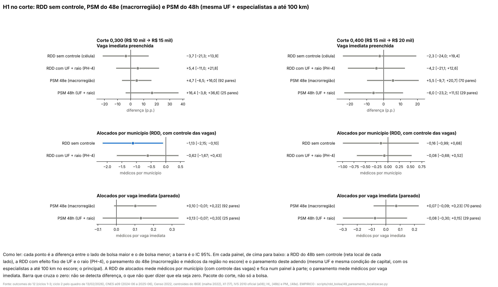
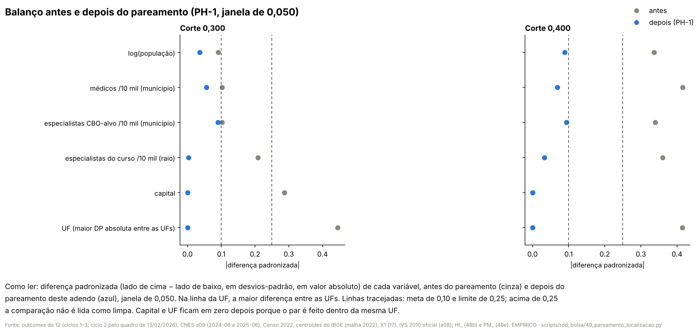
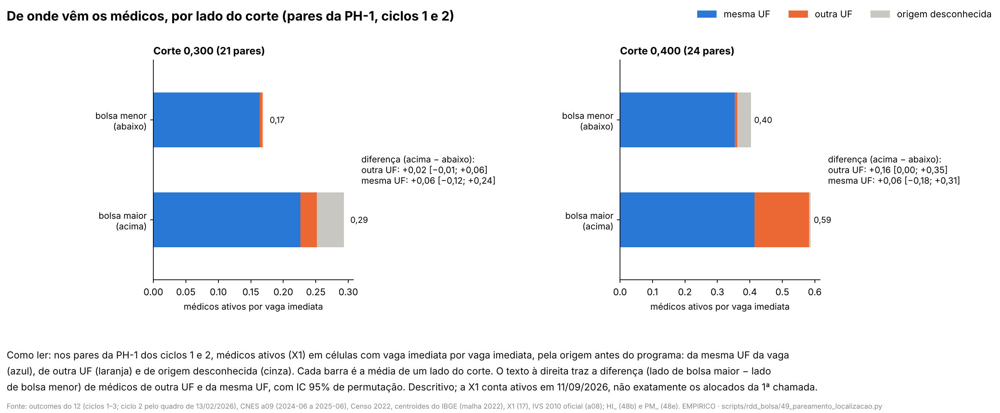

# 57w. H1 pareada pela localização da unidade (UF) e dos médicos (especialistas num raio de 100 km) (adendo 48h)

> **Data:** 27/10/2026. 
> **Adendo:** [`48h_adendo_pareamento_localizacao_unidade_e_medicos.md`](48h_adendo_pareamento_localizacao_unidade_e_medicos.md),
> congelado antes destas contas (commit `243160d`). SHA-256 do adendo em `adendo` de `PL_resumo.json`, conferido pelo
> script. 
> **Estatuto:** `ADENDO_48H_POS_RESULTADO`. A H1 (48b), os controles e pareamentos por macrorregião (48d, 48e), a UF
> (48c) e o porte (48g) já tinham sido vistos. Toda linha de `PL_estimativas.csv`, `PL_balanco.csv` e
> `PL_excluidos.csv` tem `natureza_dos_dados = EMPIRICO`. 
> **Auditoria:** [auditoria 47](../auditorias/47_auditoria_pareamento_localizacao.md), aprovado com correções de
> texto; nenhuma estimativa mudou. 
> **Script:** `scripts/rdd_bolsa/49_pareamento_localizacao.py` (importa o 44 e o 45; não os reescreve). **Saídas:**
> `output/rdd_bolsa/PL_estimativas.csv`, `PL_balanco.csv`, `PL_excluidos.csv`, `PL_resumo.json`, `PL_figuras/`.
> **Testes:** `tests/test_pareamento_localizacao.py`. 
> **Números:** nenhum é digitado. Os blocos entre marcadores `<!-- PL:... -->` são regravados das saídas por
> `49_pareamento_localizacao.py --atualizar-doc`; o teste confere que cada bloco é idêntico ao gerado.

**Contraste.** Em toda linha, o lado com bolsa maior (IVS acima do corte) é comparado com o lado com bolsa menor; o
próprio corte fica no lado de baixo. Em 0,300 a bolsa anunciada sobe de R$ 10 mil para R$ 15 mil e em 0,400 de
R$ 15 mil para R$ 20 mil, mas outras regras federais mudam nos mesmos cortes
([auditoria 18](../auditorias/18_politicas_nos_mesmos_cortes_ivs.md)). O que se mede é o **pacote do corte**, não o
incentivo de R$ 5 mil isolado, nem a participação no PMM-E, nem o Agora Tem Especialistas. Este adendo é robustez: o
principal da H1 continua o 48b.

## 0. Decisões de implementação (27/10/2026, registradas antes de qualquer estimativa deste adendo)

O adendo segue o 48d, o 48e e as decisões das seções 0 dos docs 57r e 57s, salvo onde o 48h muda. Nos pontos que o
48h deixa abertos, ficou a leitura mais próxima dos scripts 44 e 45. Estas decisões foram escritas antes de rodar
qualquer conta nova do adendo. Para escrevê-las, olhei só a estrutura das entradas (colunas, cobertura da X1 e dos
centroides); nenhum outcome por lado do corte foi olhado.

**Base**

1. **Unidade e outcomes.** Só a H1: unidades município × ciclo montadas por `bases_h1` do 44 (ciclos 1 a 3; ciclo 2
   pelo quadro de 13/02/2026). Y1 = fração das células com vaga imediata preenchidas na 1ª chamada; Y2 = alocados na
   1ª chamada em células com vaga imediata ÷ vagas imediatas (decisão 10 do 57r). Janela |IVS − corte| ≤ 0,050
   (`_janela` do 44), cada corte separado. O IVS é o oficial do a08.
2. **Escore.** Logit de P(acima do corte | X), com X = log(população 2022), médicos por 10 mil hab. no município,
   especialistas nas CBO-alvo por 10 mil hab. no município e o **raio** (decisões 3 a 6). As três primeiras são as
   do 44, na unidade município × ciclo como no 48d/48e: os especialistas do município são a soma das CBO-alvo de
   todos os cursos (o adendo diz que "o resto do escore segue o 48d/48e"). Capital e UF **não** entram no escore:
   entram como pareamento exato (decisão 10). A macrorregião e o resto da região de saúde saem do escore (o raio e a
   UF tomam o lugar deles). Os três ciclos juntos num só logit, como na decisão 13 do 57r.

**O raio de 100 km**

3. **Distância.** Círculo máximo entre os centroides do IBGE do arquivo do script 17
   (`ibge_api_v3_malhas_metadados_municipios.json`), lidos por `ler_coordenadas` e medidos por `haversine_km`, as duas
   funções do 17, importadas. Antes de qualquer conta, o SHA-256 do arquivo é conferido contra o manifesto do 17
   (`.manifesto.json`) e contra a entrada do arquivo em `X1_ligacao_resumo.json`. Todo município do a08 tem de ter
   centroide; se faltar algum, o script para.
4. **Taxa do raio de um curso.** Para o município m e o curso k: vizinhos de m são os municípios do universo do a08
   (o mesmo universo do 44) com distância ≤ 100 km, sem o próprio m. Estoque = soma, nos vizinhos, da média mensal
   de vínculos de 2024-06 a 2025-06 do a09 nas CBO-alvo do curso k (ponte do a09; a mesma média `_media_pre` do 44).
   População do raio = soma da população do Censo 2022 dos vizinhos. Taxa = estoque ÷ população × 10 mil. Fica
   ausente, como no `_resto_regiao` do 44, quando não há vizinho no raio ou quando algum vizinho não tem a média ou
   a população. Os municípios criados depois de 2010 não estão no a08 e não entram no raio, como não entram no resto
   da região de saúde do 44.
5. **Média das CBO-alvo dos cursos com vaga imediata do município × ciclo, ponderada pelas vagas imediatas.** As
   células com vaga imediata da unidade são as do 48b (`tipo_celula` só imediatas ou mista). Peso de cada célula =
   suas vagas imediatas (`vagas_imediatas`); valor = taxa do raio do curso da célula (decisão 4). O raio da unidade é
   Σ peso × taxa ÷ Σ peso. Confere-se que a soma dos pesos de todas as células com vaga imediata é igual a `vi_imed`
   do 40. Células de cursos fora da ponte do a09 (17 a 20, só no ciclo 3) não têm CBO-alvo e ficam fora da média;
   são contadas. Se nenhuma célula com vaga imediata da unidade tiver curso na ponte, o raio fica ausente e a unidade
   sai das linhas que o usam, contada (nada é imputado).
6. **Na célula** (só na PH-4, HI-1): o raio é a taxa do curso da célula (decisão 4); células de cursos 17 a 20 saem
   dessa linha, como saem das linhas com M no 44. **Raios de 50 e 200 km** (PH-2): a mesma construção, trocando só a
   distância máxima.

**Regra 2 na UF**

7. **Categorias.** Capital, não capital e cada UF presente na amostra; a UF toma o lugar da macrorregião do 45. Uma
   categoria é "de um lado só" quando tem pelo menos uma unidade e todas do mesmo lado do corte. A conferência é feita
   por corte, na janela de 0,050, com os três ciclos juntos (decisão 2 do 57s), depois da saída por covariável
   ausente, numa passada só (decisão 3 do 57s): saem de uma vez todas as unidades das categorias de um lado só; o
   que sobrar de um lado só depois é registrado. A função é a `amostra` do 45, com a lista de categorias trocada
   durante a chamada.
8. **Quem sai é listado** em `PL_excluidos.csv` (código IBGE, nome, UF, ciclo, lado, categorias que o tiraram, IVS),
   para a PH-1 e para cada raio da PH-2. **"Mais de 25% de um lado"** (§3): denominador = unidades daquele lado na
   janela depois da saída por covariável ausente (decisão 6 do 57s), na amostra da PH-1.
9. **PH-2:** a regra 2 é refeita na amostra de cada raio, porque quem não tem vizinho em 50 km sai por covariável
   ausente antes dela. **PH-3:** mesma amostra, mesmo escore e mesma regra 2 da PH-1; só o exato muda (decisão 11).

**Pareamento**

10. **Exato na UF e em capital, regra literal.** As candidatas a par são as do `parear_psm` do 44 (mesmo ciclo, as
    duas no suporte comum, |diferença no logit| ≤ *caliper*), filtradas para mesma UF e mesma condição de capital.
    Sobre elas roda a `regra_literal` do 45: em cada ciclo, o lado com menos unidades (contadas na amostra da regra 2)
    procura par; empate, o de cima; ordem decrescente do escore; cada uma fica com a candidata livre mais próxima no
    logit; sem reposição; sem candidata, fica sem par. *Caliper* = 0,2 × desvio-padrão do logit do escore na amostra
    da regra 2; suporte comum mínimo–máximo nessa amostra (decisões 11 do 57s e 13–14 do 57r).
11. **PH-3:** o mesmo, com exato na região de saúde (CIR oficial do TabNet, a do 44) no lugar da UF, mais capital e
    ciclo. Unidade sem CIR não tem par. "Onde houver pares" = forma par quem tiver candidata na mesma CIR.
12. **Implementação.** O script chama `pareamentos` do 44 e troca, só durante a chamada, três coisas, como o 45 troca
    o último passo: o conjunto de variáveis do escore (o L+M do 44 vira o X da decisão 2), as variáveis do balanço
    (decisão 18) e o último passo (`guloso_global`) pelo filtro exato + regra literal. Tudo é devolvido depois. A
    inferência, o balanço, o suporte e a montagem das linhas são os do 44.

**PH-4 (comparação com a reta)**

13. RDD do 48b pela `rd_h1` do 44: HI-1 (célula, EF de curso × ciclo) e HI-2 (município × ciclo, controle das vagas
    imediatas por ciclo), local linear, kernel triangular, h = 0,050, CR1 por município, cada corte separado, com
    **efeito fixo de UF** e a taxa do raio de 100 km como covariáveis lineares de coeficiente comum (CCFT). Ao lado,
    o salto sem controle na mesma amostra. Fica fora do Holm e do BKY.

**PH-5 (de onde vem o médico)**

14. **Fonte.** `X1_medicos.parquet` (saída versionada do 17; SHA-256 conferido contra `X1_ligacao_resumo.json`),
    regra de ligação D1 (a principal no script 28), lista de ativos de 11/09/2026 (como o painel municipal do 17),
    médicos ligados ao CNES. A célula de cada médico (CNES e curso) vem da função `ler_listas_pmme` do 17, que
    reconstrói o mesmo `id_medico`; nome, CRM e UF do CRM são descartados na hora, e a reconstrução é conferida
    contra a X1 (ciclo, município e lista), como no 28. Entram só médicos em células com vaga imediata do quadro do
    ciclo (decisão 5).
15. **Origem.** "Mesma UF da vaga" = `c_origem` mesmo município, mesma região de saúde ou mesma UF; "outra UF" =
    `outra_uf`. Sem vínculo médico anterior, origem ausente na X1 ou médico não ligado: "origem desconhecida",
    contada e mostrada na figura, sem linha estimada. A origem é **outcome**, nunca controle: não entra no escore,
    no exato nem na amostra.
16. **Outcomes.** Por município × ciclo: médicos com origem na mesma UF ÷ vagas imediatas, e médicos de outra UF ÷
    vagas imediatas. Só nos ciclos 1 e 2: a X1 não tem origem no ciclo 3 (lá o outcome fica ausente). Os pares são
    os da PH-1 (a mesma chamada de `pareamentos`); pares do ciclo 3 saem por outcome ausente e são contados. Não é a
    decomposição exata de Y2: Y2 conta os alocados da 1ª chamada; a X1, os ativos em 11/09/2026 (limitação).

**Inferência e testes múltiplos**

17. Inferência pareada do 44 (permutação de sinais, 9.999 sorteios, semente 20261026, IC por inversão; IC t
    pareado ao lado; o p do Holm e do BKY é o da permutação). Menos de 2 pares: sem estimativa. **Holm** nas quatro
    linhas da PH-1 (dois outcomes × dois cortes), família de tamanho fixo: linha sem estimativa entra com p = 1.
    **BKY** nas 16 linhas de PH-2 (oito), PH-3 (quatro) e PH-5 (quatro), do mesmo jeito.
18. **Balanço (PH-6).** Diferença padronizada do 44 (desvio-padrão combinado antes do pareamento), na amostra que
    entrou no pareamento, de log(população), médicos, especialistas, raio, capital e uma dummy por UF presente. Depois
    do exato, capital e UF têm diferença zero por construção. **Comparação limpa:** todas as |DP| depois ≤ 0,25.

**Leitura do §3, fixada no código**

19. **`NAO_SE_DETECTA_DIFERENCA`** (1ª linha): as quatro linhas da PH-1 com estimativa, IC de permutação contendo
    zero e comparação limpa.
20. **`REJEITA_ZERO_DEPOIS_DO_HOLM`** (2ª linha), por linha da PH-1 com p de Holm < 0,05: relatar sinal e tamanho, o
    pacote do corte e quem saiu pela regra 2 naquele corte.
21. **`VALE_SO_PARA_UFS_DOS_DOIS_LADOS`** (3ª linha), por corte: a regra 2 tira mais de 25% de um lado (decisão 8).
22. **`INDICIO_ATRAI_DE_LONGE`** (4ª linha), por corte: na PH-5, a linha "outra UF" tem diferença positiva e IC de
    permutação sem zero. Se não, `SEM_INDICIO_DE_ATRAIR_DE_LONGE`. O q de BKY vai ao lado.
23. Quando a 1ª linha não vale, o código diz por quê, linha a linha: `SEM_ESTIMATIVA`, `BALANCO_NAO_LIMPO` ou
    `IC_EXCLUI_ZERO_SEM_HOLM`.

**Portão e integridade**

24. **Portão.** Antes de qualquer conta nova, o script refaz o PM-1 do 48e em 0,300 com as funções do 45 sem troca
    nenhuma e compara com `PM_estimativas.csv` (estimativa, p, IC de permutação e IC t, diferença ≤ 1e−8; mesmo
    número de pares) e com os pares de `PM_resumo.json`. Confere também o SHA-256 dos centroides (decisão 3) e o da
    X1 (decisão 14). Se algo falhar, para sem gravar nada.
25. **Saídas de outros adendos.** O script guarda o SHA-256 de cada arquivo `HI_*`, `CL_*`, `PM_*`, `PO_*` e `X1_*`
    antes de começar e confere de novo antes de gravar; se algum mudar, para sem gravar. Estatuto
    `ADENDO_48H_POS_RESULTADO` e `natureza_dos_dados = EMPIRICO` em toda saída; SHA-256 do adendo 48h conferido; nada
    escrito em `data/`; o arquivo de IVS errado não é lido; nenhuma competência do CNES ≥ 202609.

## 1. Resposta curta

<!-- PL:resposta_curta:inicio -->
**Comparando municípios da mesma UF e com o mesmo estoque de especialistas no entorno, não se detecta diferença de preenchimento nos dois cortes.** As quatro linhas principais (PH-1) têm intervalo que contém zero e balanço limpo depois do pareamento.

- **Corte 0,300** (R$ 10 mil → R$ 15 mil), lado de bolsa maior − lado de bolsa menor: fração de células preenchidas +16,4 p.p. (IC [−3,8; +36,6]; p Holm 0,434; 25 pares; balanço limpo); alocados por vaga imediata +0,13 (IC [−0,07; +0,33]; p Holm 0,579; 25 pares; balanço limpo).

- **Corte 0,400** (R$ 15 mil → R$ 20 mil), lado de bolsa maior − lado de bolsa menor: fração de células preenchidas −6,0 p.p. (IC [−23,2; +11,5]; p Holm 0,988; 29 pares; balanço limpo); alocados por vaga imediata −0,08 (IC [−0,30; +0,15]; p Holm 0,988; 29 pares; balanço limpo).

**Em palavras simples:** em 0,300, entre municípios parecidos, o lado de bolsa maior preencheu 16,4 p.p. a mais das células com vaga imediata (intervalo de −3,8 a +36,6 p.p., que inclui o zero) e teve 0,13 médico por vaga imediata a mais (intervalo de −0,07 a +0,33, que inclui o zero); em 0,400, entre municípios parecidos, o lado de bolsa maior preencheu 6,0 p.p. a menos das células com vaga imediata (intervalo de −23,2 a +11,5 p.p., que inclui o zero) e teve 0,08 médico por vaga imediata a menos (intervalo de −0,30 a +0,15, que inclui o zero). Intervalo que inclui o zero quer dizer que os dados não distinguem a diferença de zero; não quer dizer que ela seja zero.

**Quem saiu pela regra 2 (UF ou capital que só aparece de um lado do corte):** Em 0,300, 19 do lado de bolsa menor (14% desse lado): DF (3), ES (1), MA (3), PR (6), RR (3), SE (3); 10 do lado de bolsa maior (9% desse lado): AC (2), AP (3), PA (2), PE (3). Em 0,400, 23 do lado de bolsa menor (19% desse lado): AL (3), AM (3), AP (2), BA (1), GO (2), MA (3), MS (3), MT (2), PR (1), RJ (2), SE (1). A lista com os nomes está na seção 2.

**Parte comparável:** em nenhum corte a regra 2 tirou mais de 25% de um lado; mesmo assim, a comparação vale só para as UFs (e a condição de capital) presentes dos dois lados do corte.

**Do 48e (macrorregião) para o 48h (UF + entorno):** fração de células preenchidas em 0,300: +4,7 p.p. no 48e → +16,4 p.p. aqui; alocados por vaga imediata em 0,300: +0,10 no 48e → +0,13 aqui; fração de células preenchidas em 0,400: +5,5 p.p. no 48e → −6,0 p.p. aqui; alocados por vaga imediata em 0,400: +0,07 no 48e → −0,08 aqui. A conclusão sobre o zero é a mesma nas quatro linhas: apertar a localização não muda a leitura. O sinal do ponto muda em fração de células preenchidas em 0,400, alocados por vaga imediata em 0,400; como os intervalos dos dois lados contêm zero, a troca de sinal não é informativa.

**Com a reta (RDD do 48b com efeito fixo de UF e o raio, PH-4):** HI-1 em 0,300: −0,4 p.p. sem controle → +5,4 p.p. [−11,0; +21,8] com UF e raio; HI-2 em 0,300: −1,15 sem controle → −0,62 [−1,67; +0,43] com UF e raio; HI-1 em 0,400: +1,8 p.p. sem controle → −4,2 p.p. [−21,1; +12,6] com UF e raio; HI-2 em 0,400: +0,02 sem controle → −0,08 [−0,68; +0,52] com UF e raio.

**De onde vem o médico (PH-5, descritiva):** em 0,300, médicos de outra UF por vaga imediata +0,02 (IC [−0,01; +0,06]; p 0,754; q BKY 1,000) e da mesma UF +0,06 (IC [−0,12; +0,24]), em 21 pares dos ciclos 1 e 2; só 3 pares têm alguma diferença de médicos de outra UF (2 com mais do lado de bolsa maior, 1 do lado de bolsa menor) (`SEM_INDICIO_DE_ATRAIR_DE_LONGE`); em 0,400, médicos de outra UF por vaga imediata +0,16 (IC [0,00; +0,35]; p 0,064; q BKY 1,000) e da mesma UF +0,06 (IC [−0,18; +0,31]), em 24 pares dos ciclos 1 e 2; só 5 pares têm alguma diferença de médicos de outra UF (5 com mais do lado de bolsa maior, 0 do lado de bolsa menor) (`SEM_INDICIO_DE_ATRAIR_DE_LONGE`). Pela regra do §3 não há indício de que o lado de bolsa maior receba mais médicos de outra UF: nenhum intervalo exclui o zero. Em 0,400, os 5 pares com alguma diferença têm todos mais médicos de outra UF do lado de bolsa maior; com 5 pares, o menor p possível é 0,0625, acima de 5%. O teste não consegue separar esse padrão do acaso, e o dado também não mostra que ele não exista. O limite do intervalo mostrado como 0,00 é o próprio zero: o teste não o rejeita. A origem vem da X1 (ativos em 11/09/2026), não exatamente dos alocados da 1ª chamada.

Tudo é robustez pós-resultado e se refere ao pacote do corte, não à bolsa isolada. O principal da H1 continua o 48b.
<!-- PL:resposta_curta:fim -->

### O que dá para dizer e o que não dá

<!-- PL:interpretacao:inicio -->
- **A pergunta.** A diferença de preenchimento no corte poderia vir de comparar municípios de lugares diferentes (outra UF, capital × interior) ou com mais ou menos especialistas por perto. Aqui cada município só é comparado com outro da mesma UF, na mesma condição de capital e parecido em população, médicos e especialistas a até 100 km.
- **O resultado.** Feita essa comparação, não aparece diferença que se distinga de zero em nenhum dos dois cortes, nem na fração de vagas preenchidas nem nos médicos por vaga (em 0,300 o ponto da fração preenchida é positivo, +16,4 p.p.; em 0,400 o ponto da fração preenchida é negativo, −6,0 p.p.).
- **O preço.** Comparar dentro da mesma UF, com o *caliper* do 48e (0,2 desvio-padrão do logit do escore), deixa poucos pares: 25 pares em 0,300 (no 48e, 92); 29 pares em 0,400 (no 48e, 70). Sem o *caliper*, a mesma UF, capital e ciclo permitiriam até 64 em 0,300; até 61 em 0,400: o que mais corta pares é o *caliper*, estreito porque o escore varia pouco. Os pares ficam sobretudo no ciclo 2 (ciclos 1 / 2 / 3: 6 / 15 / 4 em 0,300; 9 / 15 / 5 em 0,400). O intervalo da fração preenchida fica com 1,8 vezes a largura do 48e em 0,300; 1,1 vezes a largura do 48e em 0,400. Com esses pares, a menor diferença com 80% de chance de aparecer como diferente de zero (a 5%) fica assim: em 0,300, cerca de 29 p.p. na fração preenchida (o lado de baixo dos pares preencheu 36% das células) e 0,29 médico por vaga imediata; em 0,400, cerca de 24 p.p. na fração preenchida (o lado de baixo dos pares preencheu 69% das células) e 0,32 médico por vaga imediata. Não detectar diferença com tão poucos pares é um resultado fraco: diz que os dados não mostram diferença, não que ela não exista. O ponto da fração preenchida fica abaixo dessa diferença mínima e vem de outro conjunto de pares: +16,4 p.p. em 0,300, com 1 par em comum com os 92 do 48e; −6,0 p.p. em 0,400, com 1 par em comum com os 70 do 48e. Ele não deve ser lido como tamanho de efeito.
- **Outros raios e a região de saúde.** Com raio de 50 ou de 200 km (PH-2), todos os intervalos contêm zero. O balanço não fica limpo (alguma |DP| acima de 0,25 depois) com 200 km (0,300), 50 km (0,400), 200 km (0,400). Exigir a mesma região de saúde (PH-3) quase não forma par (2 em 0,300; 1 em 0,400): na mesma região de saúde e dentro do *caliper* quase não sobra par dos dois lados do corte, e a PH-3 não informa.
- **E a reta (RDD)?** HI-2 em 0,300 tinha intervalo sem zero no 48b (−1,13) e passa a conter zero com UF e raio (−0,62 [−1,67; +0,43]); na mesma amostra, sem controle, ainda é −1,15 [−2,21; −0,08], então o que muda é o controle, não a amostra. A RDD usa todos os municípios da janela, com peso maior perto do corte; o pareamento usa só os pares formados.
- **De onde vem o médico.** Não há indício firme de que o lado de bolsa maior receba mais médicos de outra UF. Médico de outra UF é raro nos pares: em 0,300, só 3 de 21 pares têm alguma diferença (2 com mais do lado de bolsa maior); em 0,400, só 5 de 24 pares têm alguma diferença (5 com mais do lado de bolsa maior). Com tão poucos pares informativos, o teste não tem como ser conclusivo. Em 0,400, os 5 pares com alguma diferença têm todos mais médicos de outra UF do lado de bolsa maior; com 5 pares, o menor p possível é 0,0625, acima de 5%. O teste não consegue separar esse padrão do acaso, e o dado também não mostra que ele não exista. O limite do intervalo mostrado como 0,00 é o próprio zero: o teste não o rejeita.
- **O que não dá para dizer.** Que a bolsa não tem efeito (não detectar não é zero); que o resultado isola os R$ 5 mil (em 0,300 e 0,400 muda um pacote de regras); que vale para as UFs que só aparecem de um lado do corte (saíram pela regra 2).
<!-- PL:interpretacao:fim -->

### 1.1 Portão de reprodução

Antes de qualquer conta nova, o script refaz o PM-1 do 48e em 0,300 com as funções do 45, sem trocar nada, e compara
com `PM_estimativas.csv` e com os pares de `PM_resumo.json` (decisão 24).

<!-- PL:portao:inicio -->
| Linha do 48e | Outcome | Corte | Diferença média em PM_estimativas.csv | Refeita aqui | máx. dif. absoluta (estimativa, p, IC) | Pares (48e / refeito) | Mesmos pares | Reproduz |
|---|---|---|---|---|---|---|---|---|
| PM-1 | fração de células preenchidas (município × ciclo) | 0,300 | +0,046977 | +0,046977 | 9.7e-17 | 92 / 92 | sim | sim |
| PM-1 | alocados por vaga imediata (município × ciclo) | 0,300 | +0,101888 | +0,101888 | 8.3e-17 | 92 / 92 | sim | sim |

Centroides (`data/raw/aquisicao/territorio/ibge_api_v3_malhas_metadados_municipios.json`, malha 2022): SHA-256 `2ce2914973e5b464…`, igual ao do manifesto do 17 e ao de `X1_ligacao_resumo.json`. `X1_medicos.parquet`: SHA-256 `b4d73a6ae6adce59…`, igual ao registrado pela X1.
<!-- PL:portao:fim -->

### 1.2 O raio

Quantos municípios têm vizinhos em cada raio e quantas unidades ficam sem a medida (decisões 3 a 6).

<!-- PL:raio:inicio -->
| Raio | Municípios do a08 sem vizinho no raio | Vizinhos (p10) | Vizinhos (mediana) | Vizinhos (p90) | Municípios com alguma taxa ausente |
|---|---|---|---|---|---|
| 50 km | 337 | 2 | 15 | 33 | 337 |
| 100 km | 49 | 11 | 58 | 113 | 49 |
| 200 km | 4 | 47 | 205 | 349 | 4 |

Na unidade município × ciclo (média ponderada pelas vagas imediatas; decisão 5):

| Ciclo | Municípios com vaga imediata | Com célula de curso fora da ponte (17 a 20) | Células com vaga imediata fora da ponte | Só com cursos fora da ponte | Raio ausente (50 / 100 / 200 km) |
|---|---|---|---|---|---|
| 1 | 215 | 0 | 0 | 0 | 33 / 2 / 0 |
| 2 | 328 | 0 | 0 | 0 | 55 / 9 / 0 |
| 3 | 307 | 106 | 192 | 61 | 93 / 69 / 62 |
<!-- PL:raio:fim -->

## 2. Quem saiu pela regra 2

Antes do logit, saem as unidades de UF (ou da condição de capital) que, na janela, só aparecem de um lado do corte
(decisões 7 a 9).

<!-- PL:regra2:inicio -->
| Linha | Raio | Corte | Unidades com todas as covariáveis (abaixo / acima) | Categorias de um lado só (unidades) | Saíram pela regra 2 (abaixo / acima) | Fração que saiu (abaixo / acima) | De um lado só depois da saída |
|---|---|---|---|---|---|---|---|
| PH-1 | 100 km | 0,300 | 136 / 106 | AC (2, todas acima), RR (3, todas abaixo), PA (2, todas acima), AP (3, todas acima), MA (3, todas abaixo), PE (3, todas acima), SE (3, todas abaixo), ES (1, todas abaixo), PR (6, todas abaixo), DF (3, todas abaixo) | 19 / 10 | 14% / 9% | nenhuma |
| PH-2 | 50 km | 0,300 | 119 / 98 | PA (2, todas acima), AP (3, todas acima), MA (3, todas abaixo), PE (3, todas acima), SE (3, todas abaixo), ES (1, todas abaixo), PR (6, todas abaixo), DF (3, todas abaixo) | 16 / 8 | 13% / 8% | nenhuma |
| PH-2 | 200 km | 0,300 | 136 / 109 | AC (2, todas acima), RR (3, todas abaixo), PA (2, todas acima), AP (3, todas acima), MA (3, todas abaixo), PE (3, todas acima), SE (3, todas abaixo), ES (1, todas abaixo), PR (6, todas abaixo), DF (3, todas abaixo) | 19 / 10 | 14% / 9% | nenhuma |
| PH-1 | 100 km | 0,400 | 124 / 84 | capitais (10, todas abaixo), AP (2, todas abaixo), SE (1, todas abaixo), RJ (2, todas abaixo), PR (1, todas abaixo), MS (3, todas abaixo), MT (2, todas abaixo), GO (2, todas abaixo) | 23 / 0 | 19% / 0% | AM |
| PH-2 | 50 km | 0,400 | 104 / 80 | capitais (7, todas abaixo), RO (3, todas abaixo), AM (1, todas acima), TO (1, todas acima), SE (1, todas abaixo), RJ (2, todas abaixo), PR (1, todas abaixo), MS (2, todas abaixo), MT (1, todas abaixo), GO (2, todas abaixo) | 19 / 2 | 18% / 2% | nenhuma |
| PH-2 | 200 km | 0,400 | 125 / 89 | capitais (10, todas abaixo), RR (2, todas acima), AP (2, todas abaixo), SE (1, todas abaixo), RJ (2, todas abaixo), PR (1, todas abaixo), MS (3, todas abaixo), MT (2, todas abaixo), GO (2, todas abaixo) | 23 / 2 | 18% / 2% | AM |

Quem saiu na PH-1, por UF (lista completa, com a PH-2, em `output/rdd_bolsa/PL_excluidos.csv`):

| Corte | UF | Lado | Linhas município × ciclo | Municípios (ciclos) | Por quê |
|---|---|---|---|---|---|
| 0,300 | AC | acima | 2 | Rio Branco (ciclos 1, 2) | UF de um lado só |
| 0,300 | AP | acima | 3 | Macapá (ciclos 1, 2, 3) | UF de um lado só |
| 0,300 | DF | abaixo | 3 | Brasília (ciclos 1, 2, 3) | UF de um lado só |
| 0,300 | ES | abaixo | 1 | Vila Velha (ciclo 3) | UF de um lado só |
| 0,300 | MA | abaixo | 3 | Imperatriz (ciclos 1, 2, 3) | UF de um lado só |
| 0,300 | PA | acima | 2 | Belém (ciclos 1, 2) | UF de um lado só |
| 0,300 | PE | acima | 3 | Caruaru (ciclo 3); Petrolina (ciclo 3); Recife (ciclo 3) | UF de um lado só |
| 0,300 | PR | abaixo | 6 | Curitiba (ciclos 1, 2, 3); Londrina (ciclo 2); Ponta Grossa (ciclo 2); Santo Antônio da Platina (ciclo 2) | UF de um lado só |
| 0,300 | RR | abaixo | 3 | Boa Vista (ciclos 1, 2, 3) | UF de um lado só |
| 0,300 | SE | abaixo | 3 | Aracaju (ciclos 1, 2, 3) | UF de um lado só |
| 0,400 | AL | abaixo | 3 | Maceió (ciclos 1, 2, 3) | capital de um lado só |
| 0,400 | AM | abaixo | 3 | Manaus (ciclos 1, 2, 3) | capital de um lado só |
| 0,400 | AP | abaixo | 2 | Santana (ciclos 1, 2) | UF de um lado só |
| 0,400 | BA | abaixo | 1 | Salvador (ciclo 3) | capital de um lado só |
| 0,400 | GO | abaixo | 2 | Luziânia (ciclo 1); Senador Canedo (ciclo 1) | UF de um lado só |
| 0,400 | MA | abaixo | 3 | São Luís (ciclos 1, 2, 3) | capital de um lado só |
| 0,400 | MS | abaixo | 3 | Amambai (ciclo 3); Itaquiraí (ciclo 3); Ribas do Rio Pardo (ciclo 3) | UF de um lado só |
| 0,400 | MT | abaixo | 2 | Novo São Joaquim (ciclo 3); Peixoto de Azevedo (ciclo 2) | UF de um lado só |
| 0,400 | PR | abaixo | 1 | Antonina (ciclo 2) | UF de um lado só |
| 0,400 | RJ | abaixo | 2 | Nova Iguaçu (ciclo 3); São Francisco de Itabapoana (ciclo 3) | UF de um lado só |
| 0,400 | SE | abaixo | 1 | Lagarto (ciclo 1) | UF de um lado só |
<!-- PL:regra2:fim -->

## 3. Amostra e lado que procura par

<!-- PL:amostra:inicio -->
| Linha | Raio | Exato | Corte | Na janela (abaixo / acima) | Sem alguma covariável (abaixo / acima) | No pareamento (abaixo / acima) | Lado que procura par, por ciclo (abaixo / acima) | Pares formados |
|---|---|---|---|---|---|---|---|---|
| PH-1 | 100 km | na UF | 0,300 | 141 / 118 | 5 / 12 | 117 / 96 | ciclo 1: abaixo (25 / 30); ciclo 2: acima (53 / 37); ciclo 3: acima (39 / 29) | 25 |
| PH-2 | 50 km | na UF | 0,300 | 141 / 118 | 22 / 20 | 103 / 90 | ciclo 1: abaixo (21 / 28); ciclo 2: acima (48 / 35); ciclo 3: acima (34 / 27) | 29 |
| PH-2 | 200 km | na UF | 0,300 | 141 / 118 | 5 / 9 | 117 / 99 | ciclo 1: abaixo (25 / 30); ciclo 2: acima (53 / 39); ciclo 3: acima (39 / 30) | 31 |
| PH-3 | 100 km | na região de saúde | 0,300 | 141 / 118 | 5 / 12 | 117 / 96 | ciclo 1: abaixo (25 / 30); ciclo 2: acima (53 / 37); ciclo 3: acima (39 / 29) | 2 |
| PH-1 | 100 km | na UF | 0,400 | 132 / 98 | 8 / 14 | 101 / 84 | ciclo 1: acima (33 / 23); ciclo 2: acima (38 / 36); ciclo 3: acima (30 / 25) | 29 |
| PH-2 | 50 km | na UF | 0,400 | 132 / 98 | 28 / 18 | 85 / 78 | ciclo 1: acima (27 / 22); ciclo 2: acima (33 / 31); ciclo 3: acima (25 / 25) | 21 |
| PH-2 | 200 km | na UF | 0,400 | 132 / 98 | 7 / 9 | 102 / 87 | ciclo 1: acima (33 / 24); ciclo 2: acima (38 / 37); ciclo 3: acima (31 / 26) | 26 |
| PH-3 | 100 km | na região de saúde | 0,400 | 132 / 98 | 8 / 14 | 101 / 84 | ciclo 1: acima (33 / 23); ciclo 2: acima (38 / 36); ciclo 3: acima (30 / 25) | 1 |
<!-- PL:amostra:fim -->

## 4. Principal: PH-1

Escore de propensão com o raio de 100 km, exato na UF e em capital, regra literal, sem as UFs de um lado só, janela
de 0,050. A estimativa é a média das diferenças nos pares; o IC principal vem do teste de permutação de sinais, e o t
pareado vai ao lado. Holm entre as quatro linhas.

<!-- PL:principais:inicio -->
| Linha | Outcome | Corte | Status | Pares | Sem par abaixo / acima | Diferença média (acima − abaixo) | IC 95% permutação | IC 95% t pareado | p | p Holm ou q BKY | Maior DP absoluta depois |
|---|---|---|---|---|---|---|---|---|---|---|---|
| PH-1 | fração de células preenchidas (município × ciclo) | 0,300 | EXECUTADO | 25 | 92 / 71 (fora do suporte: 0 / 6) | +16,4 p.p. | [−3,8; +36,6] | [−4,0; +36,8] | 0,108 | Holm 0,434 | 0,09 (limpa) |
| PH-1 | alocados por vaga imediata (município × ciclo) | 0,300 | EXECUTADO | 25 | 92 / 71 (fora do suporte: 0 / 6) | +0,13 | [−0,07; +0,33] | [−0,07; +0,34] | 0,193 | Holm 0,579 | 0,09 (limpa) |
| PH-1 | fração de células preenchidas (município × ciclo) | 0,400 | EXECUTADO | 29 | 72 / 55 (fora do suporte: 6 / 2) | −6,0 p.p. | [−23,2; +11,5] | [−23,1; +11,1] | 0,494 | Holm 0,988 | 0,09 (limpa) |
| PH-1 | alocados por vaga imediata (município × ciclo) | 0,400 | EXECUTADO | 29 | 72 / 55 (fora do suporte: 6 / 2) | −0,08 | [−0,30; +0,15] | [−0,30; +0,15] | 0,511 | Holm 0,988 | 0,09 (limpa) |
<!-- PL:principais:fim -->

### 4.1 O 48d, o 48e e o 48h lado a lado

<!-- PL:comparacao:inicio -->
| Outcome | Corte | 48d: macrorregião no escore, gulosa (PS-1) | 48e: macrorregião no escore, literal, regra 2 (PM-1) | 48h: exato na UF + raio de 100 km (PH-1, principal) | 48h: exato na região de saúde (PH-3) |
|---|---|---|---|---|---|
| fração de células preenchidas (município × ciclo) | 0,300 | −0,6 p.p. [−13,1; +11,8] (86 pares) | +4,7 p.p. [−6,5; +16,0] (92 pares) | +16,4 p.p. [−3,8; +36,6] (25 pares) | +25,0 p.p. não limitado (2 pares) |
| alocados por vaga imediata (município × ciclo) | 0,300 | +0,04 [−0,08; +0,17] (86 pares) | +0,10 [−0,01; +0,22] (92 pares) | +0,13 [−0,07; +0,33] (25 pares) | +0,12 não limitado (2 pares) |
| fração de células preenchidas (município × ciclo) | 0,400 | sem estimativa | +5,5 p.p. [−9,7; +20,7] (70 pares) | −6,0 p.p. [−23,2; +11,5] (29 pares) | sem estimativa |
| alocados por vaga imediata (município × ciclo) | 0,400 | sem estimativa | +0,07 [−0,09; +0,23] (70 pares) | −0,08 [−0,30; +0,15] (29 pares) | sem estimativa |
<!-- PL:comparacao:fim -->

## 5. Sensibilidades: PH-2 (raio de 50 e de 200 km) e PH-3 (exato na região de saúde)

BKY entre as 16 linhas de PH-2, PH-3 e PH-5.

<!-- PL:sensibilidades:inicio -->
| Linha | Outcome | Corte | Status | Pares | Sem par abaixo / acima | Diferença média (acima − abaixo) | IC 95% permutação | IC 95% t pareado | p | p Holm ou q BKY | Maior DP absoluta depois |
|---|---|---|---|---|---|---|---|---|---|---|---|
| PH-2 (50 km) | fração de células preenchidas (município × ciclo) | 0,300 | EXECUTADO | 29 | 74 / 61 (fora do suporte: 0 / 2) | +13,7 p.p. | [−8,3; +35,8] | [−8,4; +35,8] | 0,213 | BKY 1,000 | 0,05 (limpa) |
| PH-2 (50 km) | alocados por vaga imediata (município × ciclo) | 0,300 | EXECUTADO | 29 | 74 / 61 (fora do suporte: 0 / 2) | +0,19 | [−0,03; +0,41] | [−0,03; +0,41] | 0,084 | BKY 1,000 | 0,05 (limpa) |
| PH-2 (200 km) | fração de células preenchidas (município × ciclo) | 0,300 | EXECUTADO | 31 | 86 / 68 (fora do suporte: 0 / 2) | +7,8 p.p. | [−13,1; +28,6] | [−13,2; +28,8] | 0,452 | BKY 1,000 | 0,25 (não limpa) |
| PH-2 (200 km) | alocados por vaga imediata (município × ciclo) | 0,300 | EXECUTADO | 31 | 86 / 68 (fora do suporte: 0 / 2) | +0,16 | [−0,04; +0,36] | [−0,04; +0,36] | 0,114 | BKY 1,000 | 0,25 (não limpa) |
| PH-3 | fração de células preenchidas (município × ciclo) | 0,300 | EXECUTADO | 2 | 115 / 94 (fora do suporte: 0 / 6) | +25,0 p.p. | não limitado | [−292,7; +342,7] | 1,000 | BKY 1,000 | 0,66 (não limpa) |
| PH-3 | alocados por vaga imediata (município × ciclo) | 0,300 | EXECUTADO | 2 | 115 / 94 (fora do suporte: 0 / 6) | +0,12 | não limitado | [−1,46; +1,71] | 1,000 | BKY 1,000 | 0,66 (não limpa) |
| PH-2 (50 km) | fração de células preenchidas (município × ciclo) | 0,400 | EXECUTADO | 21 | 64 / 57 (fora do suporte: 5 / 4) | −6,7 p.p. | [−31,6; +18,5] | [−31,8; +18,5] | 0,589 | BKY 1,000 | 0,32 (não limpa) |
| PH-2 (50 km) | alocados por vaga imediata (município × ciclo) | 0,400 | EXECUTADO | 21 | 64 / 57 (fora do suporte: 5 / 4) | −0,04 | [−0,26; +0,19] | [−0,26; +0,19] | 0,747 | BKY 1,000 | 0,32 (não limpa) |
| PH-2 (200 km) | fração de células preenchidas (município × ciclo) | 0,400 | EXECUTADO | 26 | 76 / 61 (fora do suporte: 4 / 1) | −5,0 p.p. | [−27,2; +17,0] | [−27,0; +17,0] | 0,643 | BKY 1,000 | 0,46 (não limpa) |
| PH-2 (200 km) | alocados por vaga imediata (município × ciclo) | 0,400 | EXECUTADO | 26 | 76 / 61 (fora do suporte: 4 / 1) | −0,01 | [−0,26; +0,25] | [−0,26; +0,25] | 0,961 | BKY 1,000 | 0,46 (não limpa) |
| PH-3 | fração de células preenchidas (município × ciclo) | 0,400 | SEM_ESTIMATIVA (menos de 2 pares) | 1 | — | — | — | — | — | — | — |
| PH-3 | alocados por vaga imediata (município × ciclo) | 0,400 | SEM_ESTIMATIVA (menos de 2 pares) | 1 | — | — | — | — | — | — | — |
<!-- PL:sensibilidades:fim -->

## 6. Com a reta: PH-4

RDD do 48b com efeito fixo de UF e o raio de 100 km como covariáveis (decisão 13).

<!-- PL:rdd:inicio -->
| Linha do 48b | Corte | 48b (HI_estimativas.csv) | n abaixo / acima (com UF e raio) | Saíram por raio ausente (abaixo / acima; células na HI-1) | Sem controle, mesma amostra | Com EF de UF e raio (PH-4) | p | Variação vs. sem controle |
|---|---|---|---|---|---|---|---|---|
| HI-1 | 0,300 | −3,7 p.p. [−21,3; +13,9] | 90 / 64 | 50 / 53 | −0,4 p.p. [−20,4; +19,6] | +5,4 p.p. [−11,0; +21,8] | 0,515 | +5,8 p.p. |
| HI-2 | 0,300 | −1,13 [−2,15; −0,10] | 90 / 64 | 5 / 12 | −1,15 [−2,21; −0,08] | −0,62 [−1,67; +0,43] | 0,248 | +0,53 |
| HI-1 | 0,400 | −2,3 p.p. [−24,0; +19,4] | 77 / 59 | 29 / 23 | +1,8 p.p. [−21,9; +25,6] | −4,2 p.p. [−21,1; +12,6] | 0,622 | −6,1 p.p. |
| HI-2 | 0,400 | −0,16 [−0,99; +0,68] | 77 / 59 | 8 / 13 | +0,02 [−0,87; +0,92] | −0,08 [−0,68; +0,52] | 0,794 | −0,10 |
<!-- PL:rdd:fim -->

## 7. De onde vem o médico: PH-5

Os pares da PH-1, com os médicos da X1 divididos pela origem antes do programa (decisões 14 a 16). Descritiva.

<!-- PL:origem:inicio -->
Médicos ativos ligados da X1 (regra D1, lista de 11/09/2026, ciclos 1 e 2): 1460 registros; 637 em células com vaga imediata do quadro, dos quais 508 com origem na mesma UF, 78 de outra UF e 51 com origem desconhecida; 639 em células só de cadastro reserva e 184 sem célula no quadro (fora da PH-5).

Média nos pares da PH-1 (descritivo):

| Corte | Pares dos ciclos 1 e 2 | Mesma UF por vaga imediata (abaixo / acima) | Outra UF por vaga imediata (abaixo / acima) | Origem desconhecida por vaga imediata (abaixo / acima) | Y2: alocados da 1ª chamada por vaga imediata (abaixo / acima) |
|---|---|---|---|---|---|
| 0,300 | 21 | 0,16 / 0,23 | 0,00 / 0,03 | 0,00 / 0,04 | 0,34 / 0,47 |
| 0,400 | 24 | 0,35 / 0,41 | 0,01 / 0,17 | 0,04 / 0,00 | 0,72 / 0,65 |

Em quantos pares há diferença (o teste de permutação só usa esses pares; com poucos, o p não consegue ficar abaixo de certo valor):

| Corte | Origem | Pares com outcome | Pares com diferença | Lado de bolsa maior com mais | Lado de bolsa menor com mais | Menor p possível no teste de sinais |
|---|---|---|---|---|---|---|
| 0,300 | de origem na mesma UF | 21 | 13 | 9 | 4 | < 0,001 |
| 0,300 | de origem em outra UF | 21 | 3 | 2 | 1 | 0,250 |
| 0,400 | de origem na mesma UF | 24 | 19 | 8 | 11 | < 0,001 |
| 0,400 | de origem em outra UF | 24 | 5 | 5 | 0 | 0,062 |

| Linha | Outcome | Corte | Status | Pares | Sem par abaixo / acima | Diferença média (acima − abaixo) | IC 95% permutação | IC 95% t pareado | p | p Holm ou q BKY | Maior DP absoluta depois |
|---|---|---|---|---|---|---|---|---|---|---|---|
| PH-5 | alocados de origem na mesma UF por vaga imediata (X1) | 0,300 | EXECUTADO | 21 (+4 sem outcome) | 92 / 71 (fora do suporte: 0 / 6) | +0,06 | [−0,12; +0,24] | [−0,12; +0,25] | 0,505 | BKY 1,000 | 0,09 (limpa) |
| PH-5 | alocados de origem em outra UF por vaga imediata (X1) | 0,300 | EXECUTADO | 21 (+4 sem outcome) | 92 / 71 (fora do suporte: 0 / 6) | +0,02 | [−0,01; +0,06] | [−0,03; +0,07] | 0,754 | BKY 1,000 | 0,09 (limpa) |
| PH-5 | alocados de origem na mesma UF por vaga imediata (X1) | 0,400 | EXECUTADO | 24 (+5 sem outcome) | 72 / 55 (fora do suporte: 6 / 2) | +0,06 | [−0,18; +0,31] | [−0,18; +0,31] | 0,614 | BKY 1,000 | 0,09 (limpa) |
| PH-5 | alocados de origem em outra UF por vaga imediata (X1) | 0,400 | EXECUTADO | 24 (+5 sem outcome) | 72 / 55 (fora do suporte: 6 / 2) | +0,16 | [0,00; +0,35] | [−0,03; +0,35] | 0,064 | BKY 1,000 | 0,09 (limpa) |
<!-- PL:origem:fim -->

## 8. Balanço antes e depois do pareamento (PH-6)

Diferença padronizada (lado de cima − lado de baixo, em desvios-padrão, em valor absoluto), antes → depois, na
amostra que entrou no pareamento. Meta: até 0,10. Acima de 0,25 depois do pareamento, a linha não é lida como
comparação limpa. Tabela completa em `PL_balanco.csv`.

<!-- PL:balanco:inicio -->
| Linha | Raio | Exato | Corte | Pares | log(população) | médicos /10 mil (município) | especialistas CBO-alvo /10 mil (município) | especialistas do curso /10 mil (raio) | capital | UF (maior DP absoluta entre as UFs) | Maior DP absoluta depois |
|---|---|---|---|---|---|---|---|---|---|---|---|
| PH-1 | 100 km | na UF | 0,300 | 25 | 0,09 → 0,04 | 0,10 → 0,06 | 0,10 → 0,09 | 0,21 → 0,00 | 0,29 → 0,00 | 0,44 → 0,00 | 0,09 (limpa) |
| PH-2 | 50 km | na UF | 0,300 | 29 | 0,02 → 0,03 | 0,08 → 0,00 | 0,09 → 0,05 | 0,20 → 0,02 | 0,26 → 0,00 | 0,61 → 0,00 | 0,05 (limpa) |
| PH-2 | 200 km | na UF | 0,300 | 31 | 0,07 → 0,20 | 0,10 → 0,17 | 0,10 → 0,25 | 0,08 → 0,20 | 0,20 → 0,00 | 0,43 → 0,00 | 0,25 (não limpa) |
| PH-3 | 100 km | na região de saúde | 0,300 | 2 | 0,09 → 0,44 | 0,10 → 0,31 | 0,10 → 0,66 | 0,21 → 0,18 | 0,29 → 0,00 | 0,44 → 0,00 | 0,66 (não limpa) |
| PH-1 | 100 km | na UF | 0,400 | 29 | 0,34 → 0,09 | 0,42 → 0,07 | 0,34 → 0,09 | 0,36 → 0,03 | 0,00 → 0,00 | 0,42 → 0,00 | 0,09 (limpa) |
| PH-2 | 50 km | na UF | 0,400 | 21 | 0,43 → 0,32 | 0,52 → 0,30 | 0,43 → 0,30 | 0,32 → 0,09 | 0,00 → 0,00 | 0,40 → 0,00 | 0,32 (não limpa) |
| PH-2 | 200 km | na UF | 0,400 | 26 | 0,29 → 0,41 | 0,43 → 0,08 | 0,35 → 0,02 | 0,34 → 0,46 | 0,00 → 0,00 | 0,40 → 0,00 | 0,46 (não limpa) |
| PH-3 | 100 km | na região de saúde | 0,400 | 1 | 0,34 → 1,21 | 0,42 → 0,05 | 0,34 → 0,02 | 0,36 → 0,81 | 0,00 → 0,00 | 0,42 → 0,00 | 1,21 (não limpa) |
<!-- PL:balanco:fim -->

## 9. Leitura pelas regras fixadas (§3 do adendo)

As regras estão na seção 0 (decisões 19 a 23). O código as aplica; nada aqui é escolhido depois de ver o número.

<!-- PL:leitura:inicio -->
| Regra | Linha | Corte | Código |
|---|---|---|---|
| §3, 1ª e 2ª linhas | PH-1 fração de células preenchidas (município × ciclo) | 0,300 | `IC_CONTEM_ZERO_BALANCO_LIMPO` |
| §3, 1ª e 2ª linhas | PH-1 alocados por vaga imediata (município × ciclo) | 0,300 | `IC_CONTEM_ZERO_BALANCO_LIMPO` |
| §3, 1ª e 2ª linhas | PH-1 fração de células preenchidas (município × ciclo) | 0,400 | `IC_CONTEM_ZERO_BALANCO_LIMPO` |
| §3, 1ª e 2ª linhas | PH-1 alocados por vaga imediata (município × ciclo) | 0,400 | `IC_CONTEM_ZERO_BALANCO_LIMPO` |
| §3, 1ª linha (as quatro juntas) | PH-1 | 0,300 e 0,400 | `NAO_SE_DETECTA_DIFERENCA` |
| §3, 3ª linha | PH-1 | 0,300 e 0,400 | a regra 2 não tira mais de 25% de nenhum lado |
| §3, 4ª linha | PH-5 outra UF | 0,300 | `SEM_INDICIO_DE_ATRAIR_DE_LONGE` |
| §3, 4ª linha | PH-5 outra UF | 0,400 | `SEM_INDICIO_DE_ATRAIR_DE_LONGE` |
<!-- PL:leitura:fim -->

## 10. Figuras

<!-- PL:figuras:inicio -->

**Como ler: cada ponto é a diferença entre o lado de bolsa maior e o de bolsa menor; a barra é o IC 95%. Em cada painel, de cima para baixo: a RDD do 48b sem controle (reta local de cada lado), a RDD com efeito fixo de UF e o raio (PH-4), o pareamento do 48e (macrorregião e médicos da região no escore) e o pareamento deste adendo (mesma UF e mesma condição de capital, com os especialistas a até 100 km no escore; o principal). A RDD de alocados mede médicos por município (com controle das vagas) e fica num painel à parte; o pareamento mede médicos por vaga imediata. Barra que cruza o zero: não se detecta diferença, o que não quer dizer que ela seja zero. Pacote do corte, não só a bolsa.**

**Como ler: diferença padronizada (lado de cima − lado de baixo, em desvios-padrão, em valor absoluto) de cada variável, antes do pareamento (cinza) e depois do pareamento deste adendo (azul), janela de 0,050. Na linha da UF, a maior diferença entre as UFs. Linhas tracejadas: meta de 0,10 e limite de 0,25; acima de 0,25 a comparação não é lida como limpa. Capital e UF ficam em zero depois porque o par é feito dentro da mesma UF.**

**Como ler: nos pares da PH-1 dos ciclos 1 e 2, médicos ativos (X1) em células com vaga imediata por vaga imediata, pela origem antes do programa: da mesma UF da vaga (azul), de outra UF (laranja) e de origem desconhecida (cinza). Cada barra é a média de um lado do corte. O texto à direita traz a diferença (lado de bolsa maior − lado de bolsa menor) de médicos de outra UF e da mesma UF, com IC 95% de permutação. Descritivo; a X1 conta ativos em 11/09/2026, não exatamente os alocados da 1ª chamada.**
<!-- PL:figuras:fim -->

## 11. Limites

<!-- PL:limites:inicio -->
- **Pós-resultado.** A H1 e os pareamentos por macrorregião (48d, 48e) já tinham sido vistos quando o 48h foi congelado. As regras foram fixadas antes destas contas, mas a pergunta não é cega ao resultado.
- **Pacote do corte.** Em 0,300 e 0,400 mudam a bolsa e outras regras federais (auditoria 18). Nem a RDD nem o pareamento removem esse pacote nem isolam o incentivo de R$ 5 mil.
- **O que o pareamento supõe.** Que, perto do corte, na mesma UF e com população, médicos e entorno parecidos, estar de um lado ou do outro é como sorteado (randomização local condicional). O IVS não entra no escore; a suposição inclui que a diferença de IVS entre os lados, dentro da janela, não pesa no outcome.
- **Exato na UF reduz quem é comparado.** Só formam par municípios de UFs (e condição de capital) presentes dos dois lados. O estimando é a média nos pares formados, não a de toda a janela.
- **O raio é uma medida de oferta no entorno, não de mercado de trabalho.** Conta vínculos do CNES (um médico em dois estabelecimentos conta duas vezes), nos municípios cujo centroide está a até 100 km, sem olhar estradas ou tempo de viagem. Municípios criados depois de 2010 (fora do a08) não entram, como no 44.
- **Cursos fora da ponte.** Os cursos 17 a 20 do ciclo 3 não têm CBO-alvo na ponte do a09 e ficam fora da média do raio da unidade (seção 1.2). O município × ciclo que só tem vaga imediata nesses cursos fica sem o raio e sai do pareamento (entra em "sem alguma covariável", seção 3); a auditoria 47 conta essa perda por lado do corte. Ela ajuda a explicar por que quase não há par do ciclo 3.
- **PH-5 não é a divisão exata de Y2.** Y2 conta os alocados da 1ª chamada; a origem vem da X1, que liga os médicos ativos em 11/09/2026 ao CNES (regra D1). Só ciclos 1 e 2; parte dos médicos tem origem desconhecida. É descritiva.
- **IC de permutação com muitos pares iguais.** Na PH-5, a maioria dos pares não tem médico de outra UF nos dois lados (diferença zero). O teste de sinais só usa os pares com diferença, e com poucos deles o p não consegue ficar baixo (seção 7); já fora do zero todos os pares passam a contar, e o IC pode sair estreito mesmo com p alto. Ler o p e a contagem de pares com diferença junto com o IC.
- **Poucos municípios e o mesmo município em ciclos diferentes.** A permutação trata os pares como independentes, e um município pode estar em pares de ciclos diferentes.
<!-- PL:limites:fim -->
