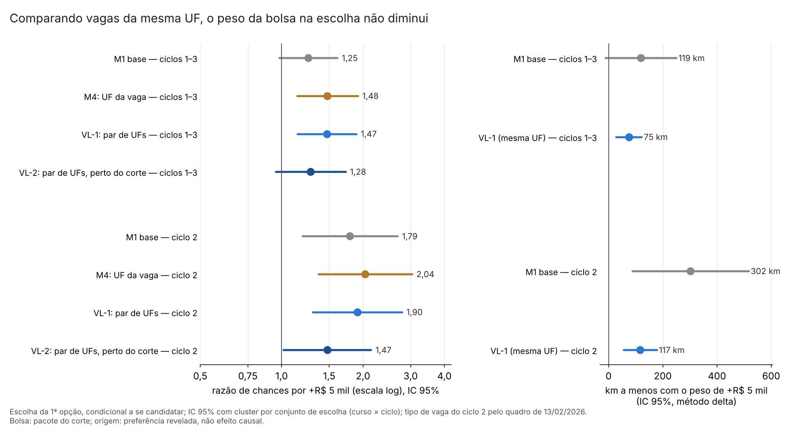

# 57x. H2 com a localização do médico e da vaga fixada: efeito fixo do par de UFs e comparação local no corte (adendo 52e)

> **Gerado por** `scripts/rdd_bolsa/50_escolha_localizacao_par.py` a partir de `output/rdd_bolsa/VL_*`; não editar à mão (o teste `tests/test_escolha_localizacao_par.py` confere que este arquivo é igual ao gerado; `--atualizar-doc` o regrava das saídas). 
> **Adendo:** [`52e_adendo_escolha_localizacao_par.md`](52e_adendo_escolha_localizacao_par.md), congelado em 27/10/2026 antes de rodar (commit `243160d`); SHA-256 em `adendo` de `VL_resumo.json`, conferido pelo teste. Protocolos de origem: [52](52_protocolo_P1_escolha_dap.md) (P1) e [52b](52b_protocolo_P1h_magnitudes.md) (P1h); adendos [52c](52c_adendo_vaga_imediata_ciclo2.md) (tipo de vaga do ciclo 2, doc [57p](57p_escolha_vaga_imediata_c2.md)) e [52d](52d_adendo_sensibilidades_ciclo2_quadro_1302.md) (doc [57v](57v_sensibilidades_ciclo2_quadro_1302.md)). 
> **Estatuto:** `ADENDO_52E_POS_RESULTADO`. O P1 (doc 57a), o P1h (57i), o 52c (57p) e o 52d (57v) já tinham sido vistos; isto não é teste confirmatório novo. Toda linha de `VL_estimativas.csv` e o resumo têm `natureza_dos_dados = EMPIRICO`. 
> **Pedido do autor (27/10/2026):** "rodar de novo a H1 fazendo pareamento pela localização da unidade e do médico, como se fosse um controle. O mesmo vale para a H2." Este doc é a parte da H2. 
> **Saídas:** `output/rdd_bolsa/VL_estimativas.csv`, `VL_resumo.json` e `VL_figuras/VL_razao_chances_e_km.png`. As saídas `E9_*`, `P1_*`, `P1h_*`, `VC_*` e `VD_*` não são regravadas, e os docs 57a, 57i, 57p e 57v não são editados. 
> **Auditoria:** [48](../auditorias/48_auditoria_escolha_localizacao_par.md), aprovada com correções de texto: o recálculo independente reproduz todas as linhas, e nenhuma estimativa mudou. A auditoria acrescentou à resposta curta a leitura da comparação pareada com o M1, a frase do M4 e a da distância em log. A redação da resposta curta e o título da figura foram escritos depois de ver as estimativas; as regras do §3 (`regra_linha`, `leitura`) são as do commit das decisões.

## 1. Resposta curta

<!-- VL:resposta:inicio -->
**O peso da bolsa na escolha não vem da localização.** Comparando só vagas da mesma UF, vistas por médicos da mesma UF de origem, a razão de chances da bolsa fica parecida com a do modelo base nas três principais, pela regra fixada (1ª linha do §3): entre vagas na mesma relação geográfica com o médico, a bolsa maior continua pesando. Mais que isso: em VL-1 (par de UFs), ciclos 1–3, a comparação pareada com o M1 mostra a bolsa pesando mais que no modelo base, não o mesmo; "parecida" é o rótulo da regra fixada, que compara os IC lado a lado.

- **VL-1 (par de UFs), ciclos 1–3:** razão de chances 1,47 [1,15; 1,89] contra 1,25 [0,98; 1,61] no M1 (base), ciclos 1–3; pela regra fixada, parecida com a do M1 (cada estimativa cai no IC da outra). p de Holm 0,005 (score bootstrap: 0,023). Diferença de log da razão de chances 0,16 [0,09; 0,23]. Essa diferença é medida nos mesmos candidatos, e os dois β andam juntos (correlação 0,96); por isso ela exclui zero mesmo com os IC lado a lado se sobrepondo. A leitura mais exata é que, comparando dentro da mesma UF, a bolsa pesa mais que no M1, não o mesmo (descritivo, fora do Holm).

- **VL-1 (par de UFs), ciclo 2:** razão de chances 1,90 [1,30; 2,78] contra 1,79 [1,19; 2,68] no M1 (base), ciclo 2; parecida com a do M1. p de Holm 0,003 (score bootstrap: 0,011). Diferença de log da razão de chances 0,06 [−0,06; 0,19]. A diferença contra o M1 contém zero.

- **VL-2 (local no corte, par de UFs), ciclos 1–3:** razão de chances 1,28 [0,95; 1,72] contra 1,25 [0,98; 1,61] no M1 (base), ciclos 1–3; parecida com a do M1. p de Holm 0,103 (score bootstrap: 0,183). Diferença de log da razão de chances 0,02 [−0,23; 0,27]. A diferença contra o M1 contém zero.

**De onde vem a diferença contra o M1.** O M4, que só troca a macrorregião por efeito fixo de UF da vaga, dá 1,48 [1,14; 1,91] nos ciclos 1–3 e 2,04 [1,37; 3,03] no ciclo 2: perto do VL-1. O que muda o peso da bolsa é comparar vagas dentro da mesma UF; fixar também a UF de origem do médico muda pouco (descritivo, sem teste).

**Com o log da distância.** O parêntese do VL-1 no §2 do adendo fala em log da distância; a decisão 4 manteve a distância linear do M1 e pôs o log como secundária. Com o log, o VL-1 dá 1,45 [1,15; 1,83] nos ciclos 1–3 e 1,75 [1,23; 2,49] no ciclo 2 (q BKY 0,004 e 0,004); pela mesma regra do §3, a leitura não muda.

**VL-4.** Comparando vagas da mesma UF, +R$ 5 mil pesam como 75 km a menos de distância nos ciclos 1–3 (IC delta [28; 122]; no M1, 119 km) e 117 km no ciclo 2 (IC [56; 178]; no M1, 302 km). Em VL-1 (par de UFs), ciclos 1–3, os km caem em relação ao M1 porque, dentro da mesma UF, a distância pesa mais (−0,51 por 100 km, contra −0,19 no M1), e não porque a bolsa pese menos. Em VL-1 (par de UFs), ciclo 2, os km caem em relação ao M1 porque, dentro da mesma UF, a distância pesa mais (−0,55 por 100 km, contra −0,19 no M1), e não porque a bolsa pese menos.

**Quem identifica.** Nos ciclos 1–3, 260 pares de UF (origem, vaga) têm vagas com bolsas diferentes, e 5345 candidatos veem essa variação dentro de alguma UF (seção 3).

**Em linguagem simples.** A pergunta era: a bolsa maior atrai porque paga mais, ou porque as vagas de bolsa maior ficam em lugares que os médicos já preferem (perto de casa, na própria UF)? Para separar, a conta compara só vagas da mesma UF, vistas por médicos que vêm da mesma UF, e depois só vagas parecidas, perto de um corte de IVS. A bolsa aqui é o pacote do corte de IVS (bolsa e outras regras federais que mudam nos mesmos cortes), não a participação no PMM-E; a origem do candidato é preferência revelada, não efeito causal; e tudo vale para quem se candidatou, dentro das vagas abertas.
<!-- VL:resposta:fim -->

## 2. Portão de reprodução (VL-5)

<!-- VL:portao:inicio -->
**Portão de reprodução (VL-5): PASSOU.** Antes de qualquer conta nova, as funções dos scripts 25 e 25c (importadas sem alteração pelo 42) reproduzem as linhas já gravadas. A diferença é absoluta quando o valor gravado tem módulo até 1 e relativa acima disso (decisão 12); a coluna mostra a maior diferença entre todas as quantidades comparadas da linha (a lista completa está em `portao` de `VL_resumo.json`).

| Linha | Contra | Dif. máx. | Portão |
|---|---|---|---|
| M1_antiga | P1_estimativas.csv (M1, ciclos 1–3, coeficientes) | 2,0e−10 | passou |
| P1h-1_antiga | P1h_magnitudes.csv (P1h-1) | 3,0e−10 | passou |
| M1_emp_corrigida | VC_estimativas.csv (corrigida, M1: coeficientes, razão de chances e D_UF) | 3,7e−10 | passou |
| M1_c2_corrigida | VC_estimativas.csv (corrigida, M5_2: coeficientes, razão de chances e D_UF) | 4,1e−10 | passou |
| M4_emp_corrigida | VD_estimativas.csv (corrigida, M4: coeficientes e razão de chances) | 3,5e−10 | passou |
| K5_M1_emp_corrigida | VD_estimativas.csv (corrigida, km equivalentes do M1) | 4,5e−10 | passou |
| K10_M1_emp_corrigida | VD_estimativas.csv (corrigida, km equivalentes do M1) | 2,7e−10 | passou |
<!-- VL:portao:fim -->

## 3. Quantos pares de UF e quantas escolhas identificam o peso da bolsa

<!-- VL:identificacao:inicio -->
**Quem identifica o peso da bolsa com o par de UFs.** Nos ciclos 1–3, o VL-1 fica com 281 pares (UF de origem, UF da vaga) com alguma escolha, de 729 no desenho; 260 deles têm vagas com bolsas diferentes para algum candidato e, por isso, informam o peso da bolsa, vindos de 27 das 27 UFs de origem. São 5345 dos 5417 candidatos do modelo que veem, dentro de alguma UF, vagas com bolsas diferentes; 3937 escolheram a 1ª opção numa UF assim. No ciclo 2: 151 pares com variação, 1956 de 2012 candidatos com variação.

Colunas: candidatos com a 1ª opção na janela (só no VL-2); pares no desenho → pares que ficam no modelo (os sem escolha saem, decisão 2); pares com variação de bolsa; alternativas (candidato × vaga) retiradas por estarem em par sem escolha + por separação do efeito fixo (decisão 2); candidatos retirados por ficarem com uma só alternativa; candidatos no modelo; candidatos com variação de bolsa dentro de algum par (são os que identificam o peso); candidatos com a 1ª opção num par com variação; colunas de efeito fixo (pares menos uma base por componente). Os pares sem variação de bolsa ficam no modelo (decisão 3).

| Linha | 1ª opção na janela | Pares (desenho → modelo) | Pares com variação de bolsa | Alternativas retiradas (sem escolha + separação) | Candidatos retirados | Candidatos no modelo | Candidatos com variação | 1ª opção em par com variação | Colunas de efeito fixo |
|---|---|---|---|---|---|---|---|---|---|
| VL-1 (par de UFs), ciclos 1–3 | — | 729 → 281 | 260 | 353575 + 0 de 932577 | 4 | 5417 | 5345 | 3937 | 254 |
| VL-1 (par de UFs), ciclo 2 | — | 729 → 169 | 151 | 206094 + 297 de 380022 | 20 | 2012 | 1956 | 1509 | 140 |
| VL-2 (local no corte, par de UFs), ciclos 1–3 | 4329 de 5421 | 718 → 240 | 215 | 187009 + 980 de 487530 | 41 | 4288 | 4143 | 2935 | 207 |
| VL-2 (local no corte, par de UFs), ciclo 2 | 1645 de 2032 | 675 → 143 | 121 | 103317 + 229 de 191709 | 49 | 1596 | 1543 | 1128 | 113 |
| VL-3: VL-1 com região de saúde de origem, ciclos 1–3 | — | 8037 → 787 | 692 | 566412 + 1619 de 932577 | 61 | 5360 | 5073 | 3937 | 444 |
| VL-3: VL-1 com região de saúde de origem, ciclo 2 | — | 5841 → 427 | 372 | 276054 + 914 de 380022 | 31 | 2001 | 1862 | 1509 | 196 |
| VL-3: VL-2 com região de saúde de origem, ciclos 1–3 | 4329 de 5421 | 6195 → 614 | 538 | 290450 + 1766 de 487530 | 113 | 4216 | 3933 | 2935 | 330 |
| VL-3: VL-2 com região de saúde de origem, ciclo 2 | 1645 de 2032 | 4256 → 329 | 276 | 136944 + 627 de 191709 | 70 | 1575 | 1451 | 1128 | 146 |
| VL-1 com log da distância, ciclos 1–3 | — | 729 → 281 | 260 | 353575 + 0 de 932577 | 4 | 5417 | 5345 | 3937 | 254 |
| VL-1 com log da distância, ciclo 2 | — | 729 → 169 | 151 | 206094 + 297 de 380022 | 20 | 2012 | 1956 | 1509 | 140 |
<!-- VL:identificacao:fim -->

## 4. Resultados

### 4.1 Principais (VL-1 e VL-2), com Holm

<!-- VL:principais:inicio -->
Razão de chances da 1ª opção por +R$ 5 mil de bolsa, IC 95% e p (H0: β = 0) com cluster por conjunto de escolha (curso × ciclo); p de Holm na família das três principais; p do score bootstrap (Kline–Santos, Rademacher) e o seu Holm, como robustez para poucos clusters; diferença do log da razão de chances contra a referência (M1), com IC pelo sanduíche conjunto (decisão 10). Tipo de vaga do ciclo 2 pelo quadro de 13/02/2026. O ponto de partida do Newton está na seção 7.1 (notas de execução).

| Linha | Candidatos | Conjuntos (G) | RC [IC 95%] | p | p Holm | p score | p Holm (score) | Referência: RC [IC 95%] | Diferença de log RC [IC 95%] |
|---|---|---|---|---|---|---|---|---|---|
| VL-1 (par de UFs), ciclos 1–3 | 5417 | 55 | 1,47 [1,15; 1,89] | 0,002 | 0,005 | 0,011 | 0,023 | M1 (base), ciclos 1–3: 1,25 [0,98; 1,61] | 0,159 [0,089; 0,229] |
| VL-1 (par de UFs), ciclo 2 | 2012 | 16 | 1,90 [1,30; 2,78] | < 0,001 | 0,003 | 0,004 | 0,011 | M1 (base), ciclo 2: 1,79 [1,19; 2,68] | 0,063 [−0,061; 0,187] |
| VL-2 (local no corte, par de UFs), ciclos 1–3 | 4288 | 55 | 1,28 [0,95; 1,72] | 0,103 | 0,103 | 0,183 | 0,183 | M1 (base), ciclos 1–3: 1,25 [0,98; 1,61] | 0,020 [−0,227; 0,267] |

Referências (VL-5, sem teste novo; os mesmos números do `VC_estimativas.csv`), com o score bootstrap calculado aqui (199999 sorteios, semente 20261018 nos ciclos 1–3; enumeração completa dos 2^G sinais no ciclo 2):

| Referência | Candidatos | Conjuntos (G) | RC [IC 95%] | p | p score (Rademacher) | p score (Webb) |
|---|---|---|---|---|---|---|
| M1 (base), ciclos 1–3 | 5421 | 56 | 1,25 [0,98; 1,61] | 0,072 | 0,122 | 0,121 |
| M1 (base), ciclo 2 | 2032 | 16 | 1,79 [1,19; 2,68] | 0,005 | 0,007 | 0,015 |
<!-- VL:principais:fim -->

### 4.2 Secundárias (VL-2 do ciclo 2, VL-3, distância em log) e M4

<!-- VL:secundarias:inicio -->
Mesma leitura da tabela anterior. q BKY na família das sete secundárias (decisão 9); o M4 é só referência da figura, sem teste.

| Linha | Id | Efeito fixo | Candidatos | Conjuntos (G) | RC [IC 95%] | p | q BKY |
|---|---|---|---|---|---|---|---|
| VL-2 (local no corte, par de UFs), ciclo 2 | VL-2 | UF de origem × UF da vaga | 1596 | 16 | 1,47 [1,01; 2,14] | 0,042 | 0,022 |
| VL-3: VL-1 com região de saúde de origem, ciclos 1–3 | VL-3 | região de saúde de origem × UF da vaga | 5360 | 55 | 1,49 [1,15; 1,92] | 0,002 | 0,004 |
| VL-3: VL-1 com região de saúde de origem, ciclo 2 | VL-3 | região de saúde de origem × UF da vaga | 2001 | 16 | 1,91 [1,33; 2,74] | < 0,001 | 0,004 |
| VL-3: VL-2 com região de saúde de origem, ciclos 1–3 | VL-3 | região de saúde de origem × UF da vaga | 4216 | 55 | 1,28 [0,95; 1,71] | 0,101 | 0,043 |
| VL-3: VL-2 com região de saúde de origem, ciclo 2 | VL-3 | região de saúde de origem × UF da vaga | 1575 | 16 | 1,49 [1,04; 2,13] | 0,029 | 0,018 |
| VL-1 com log da distância, ciclos 1–3 | VL-1 (log da distância) | UF de origem × UF da vaga | 5417 | 55 | 1,45 [1,15; 1,83] | 0,002 | 0,004 |
| VL-1 com log da distância, ciclo 2 | VL-1 (log da distância) | UF de origem × UF da vaga | 2012 | 16 | 1,75 [1,23; 2,49] | 0,002 | 0,004 |
| M4 (efeito fixo de UF da vaga), ciclos 1–3 | apoio | UF da vaga (M4) | 5421 | 56 | 1,48 [1,14; 1,91] | 0,003 | — |
| M4 (efeito fixo de UF da vaga), ciclo 2 | apoio | UF da vaga (M4) | 2032 | 16 | 2,04 [1,37; 3,03] | < 0,001 | — |
<!-- VL:secundarias:fim -->

### 4.3 km equivalentes (VL-4)

<!-- VL:km:inicio -->
VL-4: quantos km a menos de distância origem–vaga pesam na escolha como +R$ 5 mil (K5) ou +R$ 10 mil (K10) de bolsa: 100 · passo · β / (−γ), com γ o peso da distância por 100 km. No VL-1, comparando vagas da mesma UF vistas por médicos da mesma UF de origem. IC pelo método delta e por Fieller; descritivo, sem teste (como o P1h-2). Fieller com limite infinito quer dizer que o IC do β contém zero.

| Modelo | Passo | km equivalentes | IC 95% (delta) | IC 95% (Fieller) |
|---|---|---|---|---|
| M1 (base), ciclos 1–3 | K5 | 119 km | [−12; 250] | [−11; 254] |
| M1 (base), ciclos 1–3 | K10 | 238 km | [−25; 500] | [−21; 508] |
| M1 (base), ciclo 2 | K5 | 302 km | [88; 516] | [93; 529] |
| M1 (base), ciclo 2 | K10 | 605 km | [177; 1033] | [185; 1058] |
| VL-1 (par de UFs), ciclos 1–3 | K5 | 75 km | [28; 122] | [27; 122] |
| VL-1 (par de UFs), ciclos 1–3 | K10 | 150 km | [55; 244] | [54; 243] |
| VL-1 (par de UFs), ciclo 2 | K5 | 117 km | [56; 178] | [52; 176] |
| VL-1 (par de UFs), ciclo 2 | K10 | 233 km | [111; 355] | [104; 352] |
<!-- VL:km:fim -->

### 4.4 Os outros pesos do modelo

<!-- VL:controles:inicio -->
Todos os coeficientes que não são indicadores de par, nos ciclos 1–3 (log-chance; IC 95% com cluster por conjunto). `mesma_uf` e as macrorregiões não aparecem no VL-1 e no VL-2 porque o par de UFs os absorve (decisão 1). Todas as linhas estão em `VL_estimativas.csv`.

| Termo | M1 (base) | VL-1 | VL-2 |
|---|---|---|---|
| `bolsa_mil` | 0,045 [−0,004; 0,095] | 0,077 [0,027; 0,127] | 0,049 [−0,010; 0,109] |
| `ivs_inclinacao` | −0,015 [−0,251; 0,220] | −0,170 [−0,410; 0,071] | 0,161 [−0,593; 0,914] |
| `ivs_mudanca_inclinacao_0300` | 0,412 [0,060; 0,764] | 0,435 [0,085; 0,786] | 0,123 [−0,666; 0,912] |
| `ivs_mudanca_inclinacao_0400` | −0,550 [−0,852; −0,249] | −0,426 [−0,724; −0,128] | 0,299 [−0,359; 0,956] |
| `tem_vaga_imediata` | 0,088 [−0,132; 0,309] | 0,254 [0,043; 0,465] | 0,263 [−0,022; 0,548] |
| `log_vagas_imediatas_mais_1` | 0,569 [0,348; 0,791] | 0,491 [0,247; 0,734] | 0,471 [0,095; 0,847] |
| `log_populacao_2022` | 0,073 [0,001; 0,145] | 0,140 [0,081; 0,198] | 0,140 [0,057; 0,222] |
| `capital` | −0,115 [−0,437; 0,207] | −0,313 [−0,654; 0,028] | −0,287 [−0,747; 0,172] |
| `estrato_interior_remoto` | −0,242 [−0,448; −0,036] | −0,188 [−0,379; 0,003] | −0,127 [−0,314; 0,060] |
| `estrato_metropolitano` | 0,247 [0,098; 0,396] | 0,104 [−0,050; 0,258] | 0,093 [−0,100; 0,285] |
| `distancia_100km` | −0,191 [−0,215; −0,166] | −0,514 [−0,555; −0,474] | −0,500 [−0,542; −0,458] |
| `mesma_regiao_saude` | 1,706 [1,397; 2,015] | 1,103 [0,845; 1,361] | 1,110 [0,850; 1,370] |
| `mesmo_municipio` | 0,762 [0,510; 1,014] | 0,587 [0,314; 0,860] | 0,497 [0,224; 0,769] |
| `intercepto_corte_0400` | — | — | −0,031 [−0,306; 0,245] |
<!-- VL:controles:fim -->

## 5. Leitura do §3 por regra

<!-- VL:leitura:inicio -->
Regra fixada no código antes de rodar (decisão 11). Leitura geral: `LOCALIZACAO_NAO_EXPLICA`.

| Linha | Referência | Regra | IC contém 1 | IC da referência contém 1 | IC muito largo (VL-2) |
|---|---|---|---|---|---|
| VL-1 (par de UFs), ciclos 1–3 | M1 (base), ciclos 1–3 | `PARECIDA_COM_M1` | não | sim | — |
| VL-1 (par de UFs), ciclo 2 | M1 (base), ciclo 2 | `PARECIDA_COM_M1` | não | não | — |
| VL-2 (local no corte, par de UFs), ciclos 1–3 | M1 (base), ciclos 1–3 | `PARECIDA_COM_M1` | sim | sim | não |
<!-- VL:leitura:fim -->

## 6. Figura

<!-- VL:figura:inicio -->

Arquivo: `output/rdd_bolsa/VL_figuras/VL_razao_chances_e_km.png`. Título: "Comparando vagas da mesma UF, o peso da bolsa na escolha não diminui".

**Como ler.** Cada linha é um modelo da escolha da 1ª opção; o ponto é a estimativa e a barra, o IC 95% com cluster por conjunto de escolha (curso × ciclo). À esquerda, a razão de chances por +R$ 5 mil de bolsa anunciada, em escala log: acima de 1, a vaga com bolsa maior é mais escolhida; a linha vertical marca 1 (nenhum peso). Em cada bloco (ciclos 1–3 e ciclo 2): M1 é o modelo base (distância, mesma UF, mesma região e mesmo município de origem, macrorregião da vaga); M4 troca a macrorregião por efeito fixo de UF da vaga; VL-1 compara só vagas da mesma UF vistas por médicos da mesma UF de origem (efeito fixo do par de UFs); VL-2 faz o mesmo só com vagas a até 0,050 de um corte de IVS. À direita, quantos km a menos de distância pesam como +R$ 5 mil de bolsa, no M1 e no VL-1 (IC pelo método delta). Tudo é escolha condicional a se candidatar, dentro das vagas abertas; a bolsa mede o pacote do corte, e a origem é preferência revelada, não efeito causal.
<!-- VL:figura:fim -->

## 7. Decisões de implementação

<!-- VL:decisoes:inicio -->
Decisões de implementação onde o adendo não fixava o detalhe. Foram registradas e commitadas antes de qualquer estimativa deste adendo (o histórico do Git mostra o commit deste bloco antes do commit dos números). Em qualquer ambiguidade, vale a leitura mais próxima dos scripts 25 e 42.

1. **Como o efeito fixo do par de UFs entra no logit condicional** (27/10/2026). O §2 pede efeito fixo de UF de origem × UF da vaga; no logit condicional só entra o que varia entre as alternativas do mesmo candidato. *Resolução:* A UF de origem é constante dentro do conjunto de cada candidato. Por isso o efeito fixo do par vira, para cada UF de origem, um indicador de UF da vaga próprio daquela origem: uma coluna por par (UF de origem, UF da vaga) presente no desenho, menos uma base por componente de pares de cada origem (pares ligados por candidatos que veem os dois; em geral, uma componente por origem; depois da retirada da decisão 2 pode haver mais), porque dentro de cada candidato os indicadores da sua componente somam 1. A base é o par da própria UF (origem = vaga) quando ele está na componente e tem escolha; senão, o par mais escolhido da componente (empate: menor código). Saem os termos do M1 que o par absorve: `mesma_uf` (função do par) e as quatro macrorregiões da vaga (função da UF da vaga). Ficam todos os outros termos do M1: bolsa linear, spline do IVS, vaga imediata e log das vagas imediatas, log da população, capital, estratos, distância por 100 km, mesma região de saúde e mesmo município. Estima-se com a função `estimar` do script 25, sem alteração (Newton, sanduíche por conjunto e por candidato), com os indicadores como colunas; coluna sem variação dentro de nenhum candidato é omitida, como no 25, e, se a matriz não tiver posto completo, a linha fica NAO_CONVERGIU, sem forçar nada. Os coeficientes dos pares não são relatados um a um (só a contagem). O D_UF do P1h não é identificado e fica relatado da especificação base (VL-5), como diz o §2.
2. **Pares de UF sem nenhuma escolha e efeitos fixos separados** (27/10/2026). Num par (origem, UF da vaga) que nenhum candidato daquela origem escolheu, a máxima verossimilhança do efeito fixo vai a menos infinito e o Newton não converge. O mesmo acontece, para mais infinito, com um conjunto S de pares de uma origem em que todo candidato que vê algum par de S escolheu em S e algum deles também vê pares fora de S (conferido antes de estimar: acontece em algumas linhas, sobretudo no VL-3). *Resolução:* No limite, a verossimilhança dos demais parâmetros é a do conjunto sem as alternativas que ficam com probabilidade zero (é a mesma retirada de efeitos fixos separados que fixest e ppmlhdfe fazem). Então: (a) saem as alternativas dos pares sem escolha; (b) para cada par p, S é o fecho de p (junta-se o par escolhido por cada candidato que vê S até não mudar); se algum candidato que vê S também vê pares fora de S, esses candidatos perdem as alternativas fora de S e continuam escolhendo dentro de S; (c) candidato que fica com uma só alternativa sai (não contribui para nada). Repete-se até não mudar. A escolha observada nunca sai do conjunto. Alternativas e candidatos retirados são contados por linha no resumo e no doc; nenhuma escolha é imputada.
3. **Pares de UF sem variação de bolsa** (27/10/2026). Num par em que todas as vagas que um candidato vê têm a mesma bolsa, o par não informa o peso da bolsa. *Resolução:* Esses pares ficam no modelo: identificam os controles (distância, mesma região, mesmo município, spline, porte, tipo de vaga) e o próprio efeito fixo, e não enviesam o peso da bolsa. Mas não contribuem para ele. O doc relata, por linha: pares no desenho; pares com escolha (os que ficam); pares com variação de bolsa (há um candidato daquela origem que vê, dentro do par, vagas com bolsas diferentes); candidatos com variação de bolsa dentro de algum par do seu conjunto (são os que identificam o peso da bolsa); e candidatos cuja 1ª opção está num par com variação no seu conjunto.
4. **Distância no VL-1** (27/10/2026). O parêntese do VL-1 no §2 diz "log da distância", mas o M1 do doc 57a (script 25) usa a distância linear por 100 km, e o VL-4 pede os km equivalentes "como no P1h", que só existem com o termo linear. *Resolução:* Leitura mais próxima dos scripts 25 e 42: o VL-1 é o M1, com a distância linear por 100 km. Como sensibilidade (secundária, no BKY), o VL-1 com log(1 + km) no lugar da distância, como no M2 do P1, nos ciclos 1–3 e no ciclo 2.
5. **Ciclo 2 e referência de comparação** (27/10/2026). O §1 manda usar o tipo de vaga do ciclo 2 do quadro de 13/02/2026 (52c); o §3 compara com o M1. *Resolução:* Todas as linhas novas usam o conjunto do P1 com a correção do ciclo 2 (função `corrigir` do 42). O VL-1 do ciclo 2 é o M1 da amostra do ciclo 2 (como o M5 do P1) com o efeito fixo do par. A referência do VL-1 e do VL-2 dos ciclos 1–3 é o M1 corrigido dos ciclos 1–3; a do ciclo 2 é o M5 do ciclo 2 corrigido (o "M1 do ciclo 2"), ambos do `VC_estimativas.csv`.
6. **Janela e spline do IVS no VL-2** (27/10/2026). O §2 diz: vagas com |IVS − corte| ≤ 0,050, os dois cortes juntos, com intercepto por corte, mesmo efeito fixo. *Resolução:* Como na robustez de janelas do E9 (doc 42, script 16): ficam as células com |s − 300| ≤ 50 ou |s − 400| ≤ 50, em milésimos de IVS (s = IVS oficial × 1000 arredondado, como no E9), e os candidatos cuja 1ª opção está nessas células. O spline do IVS é o mesmo do M1 (inclinação, mudança de inclinação em 0,300 e em 0,400, contínuo), restrito à janela. O intercepto por corte é `intercepto_corte_0400` = 1 se s > 350 (a célula com IVS exatamente 0,350 fica na janela do corte 0,300); no logit condicional um intercepto comum não existe, então um indicador basta. A bolsa continua linear. Mesmo efeito fixo do par e mesma retirada de pares sem escolha (decisão 2). O VL-2 dos ciclos 1–3 é a principal; o do ciclo 2 é secundário (entra no BKY e na figura).
7. **VL-3** (27/10/2026). O §2 pede VL-1 e VL-2 com efeito fixo de região de saúde de origem × UF da vaga. *Resolução:* Região de saúde (CIR do TabNet, o mesmo mapa do script 25) do município de origem do candidato × UF da vaga, com a mesma construção da decisão 1 (base por região: o par da UF da própria região, se tiver escolha). `mesma_uf` e as macrorregiões saem; `mesma_regiao_saude` fica (varia dentro do par da UF da própria região). Quatro linhas: VL-1 e VL-2, ciclos 1–3 e ciclo 2.
8. **Inferência e score bootstrap** (27/10/2026). O §2 pede cluster por conjunto de escolha como no 52c e, com poucos clusters, score bootstrap de Rademacher como no doc 42. *Resolução:* Principal: sanduíche CR1 por conjunto de escolha (curso × ciclo), fator G/(G − 1), p bilateral de H0: β = 0 pela normal, como no 52c; Holm nas três principais com esse p (como no script 42). Score bootstrap de Kline–Santos como no doc 42 (funções do script 16): ajuste restrito sob H0: β = 0 (a coluna da bolsa sai; com β0 = 0 não há offset), scores e informação no ponto restrito com todos os efeitos fixos, score da bolsa projetado fora dos demais parâmetros, somado por conjunto; Rademacher por enumeração completa se G ≤ 24, senão 199.999 sorteios com a semente do script 16; Webb também. Calculado nas três principais e nas referências (M1 dos ciclos 1–3 e do ciclo 2). Holm também nos p do Rademacher, como coluna de robustez; se as duas leituras divergirem, o doc diz. O IC por inversão do score não é calculado (cada ponto exige reajustar centenas de efeitos fixos); o IC relatado é o CR1.
9. **Famílias de testes** (27/10/2026). O §2 pede Holm entre as principais e BKY nas secundárias. *Resolução:* Holm: VL-1 ciclos 1–3, VL-1 ciclo 2 e VL-2 ciclos 1–3 (p bilateral do β). BKY: VL-2 ciclo 2, as quatro linhas do VL-3 e as duas do VL-1 com log da distância (p bilateral do β). O VL-4 (km equivalentes) é descritivo, com IC pelo método delta e por Fieller e sem teste, como o P1h-2. As referências (VL-5) e o M4 não entram em família.
10. **Comparação com o M1** (27/10/2026). O §3 lê se a razão de chances do VL é "parecida" com a do M1; os dois modelos são estimados nos mesmos dados (o VL num subconjunto dos candidatos e das alternativas do M1), e os dois β são correlacionados. *Resolução:* Para cada principal, a diferença do log da razão de chances (VL − referência) tem IC pelo sanduíche conjunto: as funções de influência do β de cada modelo, somadas por conjunto de escolha (zero no conjunto que só um dos modelos tem), com o mesmo fator G/(G − 1). É descritiva, fora do Holm, e ajuda a ler o §3.
11. **Leitura do §3 por regra** (27/10/2026). O §3 não fixa o que é "parecida", "perto de 1" nem "IC muito largo". *Resolução:* Para cada principal, contra a sua referência: (1) se o IC 95% da razão de chances do VL contém 1 e |log RC do VL| ≤ metade do |log RC da referência|: CAI_PARA_PERTO_DE_1 (2ª linha do §3); (2) senão, se a RC do VL está dentro do IC da referência e a da referência dentro do IC do VL: PARECIDA_COM_M1 (1ª linha); (3) senão, fora do §3 e só relatado: MAIOR_QUE_M1, SINAL_OPOSTO (IC que exclui 1 do outro lado) ou MENOR_QUE_M1_SEM_CHEGAR_A_1. Para o VL-2, IC_MUITO_LARGO quando a largura do IC em log é pelo menos 2 vezes a da referência (3ª linha). VL-4: a frase "+R$ 5 mil pesa como X km a menos de distância, comparando vagas da mesma UF", e, se o IC do β contém 0, o doc diz que o IC dos km também contém. Leitura geral: todas as principais PARECIDA_COM_M1 → a localização não explica o peso da bolsa; algum VL-1 CAI_PARA_PERTO_DE_1 → explica em parte; outro caso → misto, linha a linha.
12. **Portão (VL-5) e tolerância** (27/10/2026). O §4 pede reproduzir VL-5 contra `VC_*`/`P1_*` (≤ 1e−8) antes de qualquer conta nova. *Resolução:* Antes de qualquer linha nova: M1 e P1h-1 com o tipo de vaga antigo contra `P1_estimativas.csv` e `P1h_magnitudes.csv`; M1 dos ciclos 1–3, M1 do ciclo 2 (M5) e D_UF corrigidos contra `VC_estimativas.csv`; M4 dos ciclos 1–3 e km do M1 corrigidos contra `VD_estimativas.csv` (são as referências da figura). Diferença absoluta ≤ 1e−8 se o valor gravado tem módulo até 1, relativa se maior (os CSV têm 10 algarismos significativos), como na decisão 6 do 52d. Falhou, para. O M4 do ciclo 2 não existe gravado: é estimado como apoio da figura, sem teste.
13. **Números do doc 57x** (27/10/2026). O pedido do autor exige números só em blocos gerados. *Resolução:* Todo número de resultado do 57x vem de `VL_*` por `--atualizar-doc`, entre marcadores `<!-- VL:... -->`; o teste confere o doc contra o gerado e que não há número de resultado fora dos blocos.
<!-- VL:decisoes:fim -->

### 7.1 Notas de execução

<!-- VL:notas:inicio -->
Mudanças de execução feitas depois do commit das decisões e antes de ler qualquer estimativa da bolsa. Não mudam amostra, especificação, inferência nem leitura.

1. **Ponto de partida do Newton nas linhas com efeito fixo de par** (27/10/2026). A decisão 1 dizia que as linhas com par seriam estimadas com a função `estimar` do script 25 sem alteração. Na 1ª execução, o Newton dela, que parte de zero, levou os indicadores de pares com pouquíssimas escolhas a valores muito negativos já no 1º passo; a informação ficou numericamente singular, e uma linha parou como NAO_CONVERGIU. Nenhuma estimativa da bolsa dessa execução foi lida ou gravada (o script parou antes de gravar qualquer saída). *O que mudou:* As linhas com par usam `estimar_ef`, que repete as etapas do `estimar` do 25 (colunas sem variação, posto, `ajustar_cl` com o mesmo critério de parada, covariâncias de MV e sanduíches) e só acrescenta o ponto de partida: os termos que não são de par, ajustados sem os indicadores, e as constantes de par que igualam escolhas previstas e observadas em cada par (contração de escala). A log-verossimilhança é côncava e a matriz tem posto completo, então o máximo é o mesmo; o resumo registra o gradiente máximo e o decremento de Newton finais de cada linha. As referências (M1, M4) continuam com o `estimar` do 25, sem mudança (portão).
2. **Ponto de partida do ajuste restrito do score bootstrap** (27/10/2026). Pelo mesmo motivo, o Newton do ajuste restrito (sem a bolsa) partindo de zero chegava a uma informação singular. *O que mudou:* O ajuste restrito parte da estimativa irrestrita sem a bolsa. O máximo restrito não muda.
<!-- VL:notas:fim -->

## 8. Limites

- **Pós-resultado.** O M1, o P1h, o 52c e o 52d já eram conhecidos. O adendo foi congelado antes de rodar, mas isto é robustez, não teste confirmatório novo.
- **O que o par de UFs controla.** Tudo o que é igual para vagas da mesma UF vistas por médicos da mesma UF de origem: distância média entre as UFs, registro no conselho regional, rede e família na UF, salário de mercado da UF, regras estaduais. Não controla diferenças dentro da UF que andem junto com a bolsa (capital contra interior além do que capital, estrato e porte já captam; acesso; serviço de saúde da vaga).
- **A identificação fica mais estreita.** Com o par de UFs, o peso da bolsa vem só de UFs que têm vagas de faixas diferentes; os pares sem variação de bolsa não informam o peso (seção 3). O resultado vale para essas UFs e para os candidatos que veem essa variação.
- **Pares sem escolha saem.** As vagas de pares que ninguém daquela origem escolheu saem do conjunto (decisão 2). Isso não muda o peso dos outros atributos no limite da verossimilhança, mas o conjunto de escolha do modelo fica menor que o do M1.
- **Comparação local.** O VL-2 usa só vagas perto de um corte de IVS; é a versão "RDD dentro da escolha", com menos vagas e menos candidatos, e o IC é mais largo.
- **Escolha condicional.** Tudo vale para quem se candidatou, dentro das vagas abertas do seu curso e ciclo; o conjunto de escolha supõe que o candidato viu todas as vagas do curso; IIA do logit condicional.
- **Pacote do corte.** O peso da bolsa é identificado pelos saltos nos cortes de IVS, com o IVS em spline contínua; nos mesmos cortes mudam outras regras federais (auditoria 18). Não é efeito da participação no PMM-E nem do Agora Tem Especialistas.
- **Origem não é causal.** A origem é o município do vínculo médico no CNES (G1), não a residência; o peso da origem é preferência revelada, não efeito causal.
- **Poucos conjuntos.** O cluster é o conjunto de escolha (curso × ciclo), e são poucos, sobretudo no ciclo 2; por isso o score bootstrap vai ao lado do p por cluster, e o número de cada linha está na coluna `g_conjuntos` de `VL_estimativas.csv`.
- **km são razões.** Com o peso da bolsa perto de zero, os km equivalentes ficam instáveis e não são preço.
