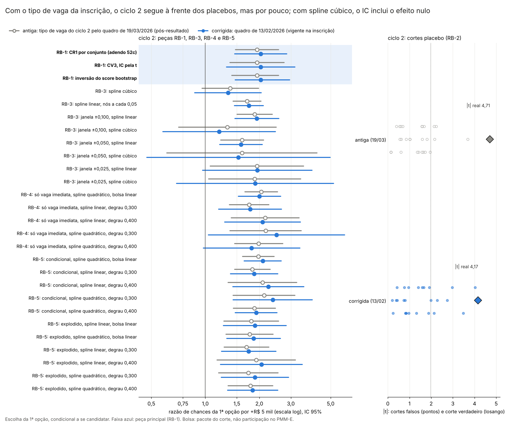

# 57y. Robustez do E9 no ciclo 2 com o tipo de vaga do quadro de 13/02/2026 (adendo 52f)

> **Gerado por** `scripts/rdd_bolsa/52_robustez_E9_ciclo2_quadro_1302.py` a partir de `output/rdd_bolsa/RB_*`; não editar à mão (o teste `tests/test_robustez_E9_ciclo2_quadro_1302.py` confere que este arquivo é igual ao gerado; `--atualizar-doc` o regrava das saídas). 
> **Adendo:** [`52f_adendo_robustez_E9_ciclo2_quadro_1302.md`](52f_adendo_robustez_E9_ciclo2_quadro_1302.md), congelado em 27/10/2026 antes de rodar (commit `9540a8a`); SHA-256 em `adendo` de `RB_resumo.json`, conferido pelo teste. Origem: [doc 42](42_resultados_E9_escolha.md) (E9 e robustez pós-auditoria, protocolo [40](40_protocolo_multioutcome_rdd_bolsa.md), §12); adendos [52c](52c_adendo_vaga_imediata_ciclo2.md) (doc [57p](57p_escolha_vaga_imediata_c2.md)) e [52d](52d_adendo_sensibilidades_ciclo2_quadro_1302.md) (doc [57v](57v_sensibilidades_ciclo2_quadro_1302.md)). 
> **Estatuto:** `ADENDO_52F_POS_RESULTADO`. As versões com o quadro de 19/03 (doc 42) e os adendos 52c, 52d e 52e já tinham sido vistos; isto não é teste confirmatório novo. Toda linha de `RB_estimativas.csv` e o resumo têm `natureza_dos_dados = EMPIRICO`. 
> **Motivo:** [auditoria 46](../auditorias/46_auditoria_sensibilidades_ciclo2.md), achados A1, A2 e A10: a frase do [doc 44](44_sintese_rdd_bolsa_multioutcome.md) de que o ciclo 2 é robusto a poucos clusters e a placebos se apoiava em robustezes ainda feitas com o quadro retificado de 19/03/2026, refeito depois do resultado preliminar ([auditoria 36](../auditorias/36_auditoria_dados_H1.md)). 
> **Saídas:** `output/rdd_bolsa/RB_estimativas.csv`, `RB_resumo.json` e `RB_figuras/RB_antigo_corrigido.png`. As saídas `E9_*`, `VC_*`, `VD_*` e `VL_*` não são regravadas, e os docs 42, 44, 57, 57p e 57v não são editados. 
> **Auditoria:** [auditoria 54](../auditorias/54_auditoria_robustez_E9_ciclo2.md), aprovada com correções de texto (folga dos placebos, spline cúbico e leitura do q do BKY); nenhum número mudou. 
> **Decisões de 27/10/2026** (do autor, delegadas ao agente; pendências 2 e 3 da auditoria 54; [doc 38](38_estado_e_pendencias_rdd_bolsa.md), D4): o título da figura passa a trazer a folga menor sobre os placebos e o IC do spline cúbico; a coluna `q_bky_um_por_hipotese` traz o BKY com um membro por hipótese, só como sensibilidade (bloco depois do BKY da decisão 9). Nenhuma estimativa mudou; as colunas antigas de `RB_estimativas.csv` ficaram iguais byte a byte.

## 1. Resposta curta

<!-- RB:resposta:inicio -->
**RB-1 e RB-2: a frase do doc 44 "o ciclo 2 é robusto a poucos *clusters* e a placebos" continua valendo com o tipo de vaga anterior à alocação.** No ciclo 2, com o quadro de 13/02, o score bootstrap dá p < 0,001 (Rademacher) e p = 0,002 (Webb), contra p < 0,001 e p = 0,002 com o quadro de 19/03; o CV3 dá p = 0,004 e IC [0,0542; 0,2305] (antes, p < 0,001, IC [0,0634; 0,2028]); o IC por inversão do score vai de [0,0682; 0,1882] para [0,0765; 0,2169]. O coeficiente da bolsa (CR1, adendo 52c) vai de 0,1331 para 0,1423 por R$ 1 mil/mês. Nos cortes placebo (RB-2), nenhum corte falso tem |t| maior ou igual ao do corte verdadeiro, e o p por posto é 0,036, o menor possível com essa grade (com o quadro de 19/03: nenhum; p por posto 0,036). O p por posto não mede a folga: o maior |t| entre os cortes falsos vai de 3,68 para 4,08, contra |t| real de 4,71 e 4,17, e os cortes falsos com |t| > 1,96 vão de 4 para 8 de 27. Com o quadro da inscrição, o corte verdadeiro ainda fica à frente de todos os falsos, mas por pouco. Pela leitura pré-registrada (§3), os três p abaixo de 0,05 e o corte verdadeiro fora da distribuição dos placebos, como no original, mantêm a frase.

**Como no original?** Com o quadro de 19/03 a mesma regra dá `MANTEM`; com o de 13/02, `MANTEM`.

**RB-3 a RB-5 (forma funcional, janelas, só vaga imediata, explodido, quadrática e degraus).** Das 65 linhas de peso da bolsa lidas (ciclo 2 e empilhado), 62 não mudam de sinal nem perdem o IC que exclui 1. Nenhuma muda de sinal. Perdem o IC que exclui 1: RB-4, ciclo 2, condicional, só vaga imediata, spline quadrático, degraus, degrau 0,400; RB-3, ciclo 2, condicional, conjunto principal, janela ±0,025, spline linear, bolsa; RB-3, ciclo 2, condicional, conjunto principal, janela ±0,025, spline cúbico, bolsa. Pela leitura pré-registrada, a leitura se apoia nas que não mudam. A ressalva do doc 44 sobre o spline cúbico no ciclo 2 continua de pé: o coeficiente vai de 0,0642 [−0,0084; 0,1369] (p = 0,083) para 0,0583 [−0,0272; 0,1438] (p = 0,181), e o IC contém zero na corrigida. Somando as janelas, há 4 especificações com spline cúbico no ciclo 2; o IC exclui zero em 1 delas com o quadro de 19/03 e em 0 com o de 13/02. A regra do §3 confere a robustez a poucos clusters e a placebos, com o spline linear; não confere a robustez a uma forma mais flexível do IVS, que o doc 44 já tratava como ressalva.

**Empilhado (secundário).** p do score bootstrap Rademacher com cluster por conjunto: 0,010 → 0,010; p por posto contra os placebos: 0,107 → 0,107. O empilhado continua sendo uma média de ciclos heterogêneos (doc 42).

**Em linguagem simples.** O doc 44 diz que o efeito da bolsa sobre a 1ª opção no ciclo 2 aguenta testes feitos para poucos grupos e para cortes falsos. Esses testes usavam um quadro de vagas arrumado depois do resultado. Aqui eles foram refeitos com o quadro que o candidato via na inscrição. Pela regra fixada antes das contas, a conclusão continua de pé: com o quadro da inscrição, os testes para poucos grupos e o de cortes falsos dão o mesmo recado. Mas a folga contra os cortes falsos ficou menor, e com uma curva mais flexível do IVS (spline cúbico) o efeito continua sem se separar do zero, como o doc 44 já dizia. A bolsa aqui é o pacote do corte de IVS (bolsa e outras regras federais que mudam nos mesmos cortes), não a participação no PMM-E; o E9 não usa a origem do candidato, e onde ela aparece (P1) é preferência revelada, não efeito causal; tudo vale para quem se candidatou, dentro das vagas abertas.
<!-- RB:resposta:fim -->

## 2. Portão de reprodução (RB-6)

<!-- RB:portao:inicio -->
**Portão de reprodução (RB-6): PASSOU.** Com o tipo de vaga antigo, as funções do script 16 (importadas sem alteração pelo 48 e pelo 42) reproduzem todas as linhas de `E9_estimativas.csv`, `E9_efeitos_marginais.csv` e `E9_robustez_pos_auditoria.csv`, inclusive os p do score bootstrap com a mesma semente. A diferença é absoluta quando o valor gravado tem módulo até 1 e relativa acima disso (decisão 6); a coluna mostra a maior diferença entre as quantidades comparadas do grupo (a lista completa está em `portao` de `RB_resumo.json`).

| Grupo de linhas | Linhas (reestimadas / gravadas) | Dif. máx. | Portão |
|---|---|---|---|
| `est:ciclos_1_e_3` | 14 / 14 | 4,8e−11 | passou |
| `est:forma_funcional_e_janelas` | 583 / 583 | 4,9e−10 | passou |
| `est:logit_condicional_1a_opcao:principal` | 264 / 264 | 4,7e−10 | passou |
| `est:logit_condicional_1a_opcao:sensibilidade` | 248 / 248 | 4,8e−10 | passou |
| `est:logit_explodido_1a_2a_opcao:principal` | 264 / 264 | 4,6e−10 | passou |
| `est:placebos` | 216 / 216 | 4,8e−10 | passou |
| `efe:logit_condicional_1a_opcao:principal` | 144 / 144 | 4,1e−10 | passou |
| `efe:logit_condicional_1a_opcao:sensibilidade` | 144 / 144 | 4,5e−10 | passou |
| `efe:logit_explodido_1a_2a_opcao:principal` | 144 / 144 | 4,1e−10 | passou |
| `rob:cluster_curso` | 18 / 18 | 4,3e−10 | passou |
| `rob:heterogeneidade_ciclos` | 2 / 2 | 7,0e−11 | passou |
| `rob:placebo_cortes` | 32 / 32 | 3,5e−10 | passou |
| `rob:poucos_clusters` | 18 / 18 | 5,0e−11 | passou |

Também conferido: o E9 principal (ciclo 2 e empilhado) sai igual ao `VC_estimativas.csv` do 52c e a especificação principal do conjunto só com vaga imediata sai igual ao `VD_estimativas.csv` do 52d, nas duas versões (dif. máx. 4,6e−10); os ciclos 1, 3 e 1+3 saem iguais nas duas versões (1039 linhas; dif. máx. 0,0e+00).
<!-- RB:portao:fim -->

## 3. Decisões de implementação

<!-- RB:decisoes:inicio -->
Registradas e commitadas antes de qualquer estimativa deste adendo (o histórico do Git mostra o commit deste bloco antes do commit dos números). Nenhuma muda a amostra, o conjunto de escolha principal ou a especificação dos modelos do doc 42. Onde o adendo era ambíguo, vale a leitura mais próxima dos scripts 16, 42 e 48.

**Inventário das peças.** Lido do código do script 16, sem estimar nada.

| Id | Peça | Função original (script 16) | Ciclos refeitos | Como o quadro de 13/02 entra |
|---|---|---|---|---|
| RB-1 | Inferência com poucos clusters da especificação principal (logit condicional da 1ª opção, conjunto principal, spline linear, bolsa linear): score bootstrap de Kline–Santos com pesos Rademacher e Webb, CV3 e IC por inversão do score, com cluster por conjunto de escolha | `robustez_pos_auditoria`, item 2: `score_efetivo_por_cluster`, `p_score_bootstrap` (com `p_rademacher_exato` e `matriz_pesos`), `ep_cv3`, `ic_inversao_score`; o ajuste é `estimar` do laço do `main` | ciclo 2 (principal) e empilhado (secundária) | as colunas `tem_vaga_imediata` e `log_vagas_imediatas_mais_1` do conjunto principal entram na matriz de atributos do modelo irrestrito e do restrito (β = 0) e de cada ajuste sem um cluster |
| RB-1 | Mesma inferência com cluster por curso (score bootstrap, CV3, inversão) e CR1 por curso | `robustez_pos_auditoria`, itens 1 e 2 (`covariancia_cluster` com `cluster_curso`) | empilhado (secundária; o cluster por curso só existe no empilhado) | idem |
| RB-2 | Cortes placebo: degrau falso e nó no corte falso, com a bolsa verdadeira no modelo; 27 cortes; t real = t da bolsa na especificação principal; p por posto | `robustez_pos_auditoria`, item 4: `estimar(..., placebo_mil=c)` e `linhas_estimativas` | ciclo 2 e empilhado | idem, em cada um dos 27 modelos e no t real |
| RB-3 | Forma funcional: spline cúbico; spline linear com nós a cada 0,05; janelas de ±0,10, ±0,05 e ±0,025 em torno dos cortes, com spline linear e cúbico | `robustez_pos_auditoria`, item 3: `estimar(..., grau=3)`, `estimar(..., nos_extras_mil=NOS_EXTRAS_MIL)` e conjuntos restritos às janelas | ciclo 2 e empilhado | idem; as janelas recortam células e candidatos pelo IVS, que não muda |
| RB-4 | Conjunto "só células com vaga imediata": spline quadrático com bolsa linear; degraus por corte com spline linear e quadrático (e o Wald da igualdade dos degraus); CR1 por curso no empilhado | laço do `main` (`estimar` com conjunto `sensibilidade`, `linhas_estimativas`, `linhas_efeitos`) e `robustez_pos_auditoria`, item 1 | ciclo 2 e empilhado | define o conjunto (células com vaga imediata > 0 no quadro de 13/02, `sensibilidade_pela_regra` do 48) e os candidatos (1ª opção em célula com vaga imediata, `corrigir_candidatos` do 48; `montar_grupos` do 16 filtra por essa marca); `log_vagas_imediatas_mais_1` é covariável e `tem_vaga_imediata` é constante e sai |
| RB-5 | Conjunto principal: logit explodido (1ª e 2ª opções) nas quatro especificações; logit condicional com spline quadrático e com degraus por corte; CR1 por curso no empilhado | laço do `main` (`estimar`, `montar_grupos` com o posto 2) e `robustez_pos_auditoria`, item 1 | ciclo 2 e empilhado | as duas colunas do tipo de vaga do conjunto principal, nos postos 1 e 2 |
| RB-6 | Todas as linhas acima, e as do protocolo e dos ciclos sem mudança, com o quadro de 19/03 | as mesmas funções | ciclos 1, 2, 3, empilhado e 1+3 | não entra: é a versão antiga, contra os CSV gravados |
| apoio | Especificação principal (CR1) no conjunto principal e no só com vaga imediata; heterogeneidade entre ciclos (Q de Cochran, z do ciclo 2 contra o 3) | laço do `main`; `robustez_pos_auditoria`, item 5 | ciclo 2 e empilhado; Q e z | como em RB-1 e RB-4; o Q e o z usam o coeficiente do ciclo 2 |

Não mudam e não são refeitos como resultado (só reproduzidos no portão e conferidos iguais nas duas versões): os ciclos 1 e 3 e os ciclos 1 e 3 empilhados, porque o quadro só muda no ciclo 2. O P1, a DAP e o P1h não entram: estão nos adendos 52c e 52d.

**Sementes.** Sementes e grades são as do script 16, sem número aleatório novo: `SEMENTE_BOOT` = 20261018 e `N_REAMOSTRAS` = 199999; os pesos de cada sorteio vêm de `numpy.random.default_rng([20261018, G, k])`, com k = 1 (Rademacher) ou 6 (Webb), e são os mesmos em todo β₀ da inversão. Com G ≤ 24 o Rademacher é enumerado por inteiro (2^G vetores de sinais; no ciclo 2, G = 16) e não sorteia nada; o Webb é sempre sorteado. Grade de placebos `PLACEBOS_MIL` (27 cortes), janelas `JANELAS_MIL` e nós `NOS_EXTRAS_MIL`, todos do script 16.

**Decisões.**

1. **Unidade de execução** (27/10/2026). O §2 pede "as mesmas especificações do doc 42 e do 52d"; no script 16 o cluster por curso percorre todos os modelos empilhados do laço do `main`, e as robustezes saem de uma única função. *Resolução:* Cada versão refaz o laço do `main` do 16 inteiro (ciclos 1, 2, 3 e empilhado × condicional no conjunto principal, condicional no só com vaga imediata e explodido no principal × quatro especificações) e chama `robustez_pos_auditoria` sem alteração. Assim o portão RB-6 cobre todas as linhas de `E9_estimativas.csv`, `E9_efeitos_marginais.csv` e `E9_robustez_pos_auditoria.csv`, e a versão corrigida usa exatamente o mesmo código. O laço é copiado do `main` (lá não é função), como o 48 fez com o M6.
2. **Como o quadro de 13/02 entra** (27/10/2026). O §2 manda tirar do quadro de 13/02 "toda variável ou definição que depende do tipo de vaga". *Resolução:* Três trocas, todas só no ciclo 2 e com funções já auditadas: (a) `vagas_imediatas`, `tem_vaga_imediata` e `log_vagas_imediatas_mais_1` do conjunto principal, por `corrigir` do 42 (mesmo leitor `ler_quadro` do 12, conferido contra a auditoria 36); (b) o conjunto "só células com vaga imediata" refeito por `sensibilidade_pela_regra` do 48 sobre o principal corrigido; (c) a marca `celula_com_vaga_imediata` da 1ª opção, por `corrigir_candidatos` do 48. IVS, faixa, bolsa, população, macrorregião, estrato, conjuntos de escolha e código do curso não mudam. Antes, o script confere que o conjunto antigo é o do quadro de 19/03 e que a regra reproduz o conjunto gravado. Célula sem linha ou sem número no quadro de 13/02 faz parar: nada é imputado.
3. **Ciclos e empilhado** (27/10/2026). A tabela do §2 nomeia o ciclo 2; o doc 42 relata cada robustez também no empilhado, e os scripts 42 e 48 refizeram o ciclo 2 e o empilhado. *Resolução:* Cada peça é refeita no ciclo 2 e no empilhado, com o mesmo id. Só as linhas do ciclo 2 de RB-1 (score bootstrap Rademacher e Webb, CV3 e inversão, cluster por conjunto) são a principal; as do empilhado são secundárias. Ciclos 1, 3 e 1+3 são reestimados nas duas versões e têm de sair iguais (diferença ≤ 1e−8; no conjunto só com vaga imediata a ordem das linhas pode mudar o último algarismo). O Q de Cochran e o z do ciclo 2 contra o 3 dependem do ciclo 2: são relatados como apoio, sem leitura e sem BKY, porque não estão na lista do §1.
4. **Cluster por curso** (27/10/2026). O cluster por curso aparece no §1 só no conjunto "só vaga imediata"; no 16 ele existe também no conjunto principal (auditoria 46, A1). *Resolução:* Refeito onde o 16 o calcula (empilhado): na especificação principal do conjunto principal, com o score bootstrap, o CV3 e a inversão, vai para RB-1; nas outras especificações do conjunto principal e no explodido, para RB-5; no conjunto só com vaga imediata, para RB-4.
5. **Sementes e grades** (27/10/2026). O §2 pede "mesmos tamanhos de bootstrap, mesmas sementes e mesmas grades de placebo". *Resolução:* As constantes e as funções do 16, importadas; nenhuma semente nova (ver o parágrafo das sementes acima). O portão exige que a versão antiga reproduza os p do bootstrap gravados.
6. **Tolerância do portão RB-6** (27/10/2026). O §4 pede diferença ≤ 1e−8; os CSV gravam 10 algarismos significativos. *Resolução:* Como na decisão 6 do 52d: diferença absoluta ≤ 1e−8 quando o valor gravado tem módulo ≤ 1, relativa ≤ 1e−8 quando maior; NaN só casa com NaN; cada linha nova tem de casar com uma gravada pelas chaves, e o número de linhas tem de ser igual. Também confere: o E9 principal (ciclo 2 e empilhado) igual ao `VC_estimativas.csv` e a especificação principal do conjunto só com vaga imediata igual ao `VD_estimativas.csv`, nas duas versões. Qualquer falha para a execução antes da versão corrigida, e as saídas calculadas são apagadas.
7. **Leitura do §3 por regra** (27/10/2026). O §3 fala em "p < 0,05 (score bootstrap e CV3)" e em "corte verdadeiro fora da distribuição dos placebos, como no original", sem fixar o detalhe; e não prevê RB-1 mantido com RB-2 caído. *Resolução:* Ciclo 2, versão corrigida. Score bootstrap: p < 0,05 nos dois pesos, Rademacher e Webb (o doc 44 cita os dois). CV3: p pela t com G − 1 gl < 0,05 (como no 16). RB-2: nenhum |t| placebo maior ou igual ao |t| real (p por posto no mínimo, 1/(N + 1)), como no original. Regra: se algum dos três p de RB-1 for ≥ 0,05, REBAIXAR (e relatar qual caiu); senão, se RB-2 valer, MANTEM; senão, PLACEBO_NAO_CONFIRMA, caso fora do §3: a parte "poucos clusters" da frase do doc 44 vale e a parte "a placebos" não, e isso é só relatado. A mesma regra é aplicada à versão antiga, para mostrar o "como no original".
8. **Mudança de sinal e de IC em RB-3 a RB-5** (27/10/2026). O §3 diz "muda de sinal ou perde o IC que exclui 1". *Resolução:* Linhas lidas: cada peso da bolsa (coeficiente da bolsa linear ou de um degrau) de RB-3, RB-4 e RB-5, no ciclo 2 e no empilhado, inclusive as do CR1 por curso. Muda de sinal: a estimativa pontual troca de sinal. Perde o IC: o IC 95% da razão de chances excluía 1 na antiga e contém 1 na corrigida (IC com cluster por conjunto; nas linhas por curso, o IC por curso). Ganhos de IC também são listados. Uma linha que não converge numa versão é listada como sem estimativa.
9. **BKY entre as secundárias** (27/10/2026). O §2 pede "BKY entre as secundárias"; o E9 é exploratório e não tinha família BKY. *Resolução:* Família nova, uma por versão: toda linha secundária (RB-1 do empilhado, RB-2 a RB-5) que testa H0: peso da bolsa = 0, com o p da própria linha: p normal com cluster por conjunto no coeficiente da bolsa ou de um degrau (RB-3 a RB-5); p normal com cluster por curso nas linhas por curso; p do score bootstrap; p do CV3 (t, G − 1); p por posto dos placebos. Ficam fora: a principal (RB-1 do ciclo 2), os Wald de igualdade dos degraus (outra hipótese), os coeficientes dentro de cada modelo placebo, as inversões (sem p) e o apoio. q pela função `qvalores_bky` da `rdd_lib` (Anderson, 2008).
10. **Razão de chances e figura** (27/10/2026). O 16 só grava razão de chances nas especificações do protocolo. *Resolução:* Em toda linha de peso da bolsa: exp(5·β) na bolsa linear e exp(δ) num degrau (um degrau = +R$ 5 mil), com o IC transformado do IC da linha, como em `linhas_efeitos` do 16 e no 42. A figura mostra o ciclo 2, antiga e corrigida, com a principal destacada.
11. **Números do doc 57y e entradas** (27/10/2026). O pedido do autor exige números só em blocos gerados; a auditoria 46 (A7) pediu hashes dos scripts da cadeia. *Resolução:* Todo número de resultado do 57y vem de `RB_*` por `--atualizar-doc`, entre marcadores `<!-- RB:... -->`, e o teste confere. `entradas` traz o SHA-256 dos scripts 12, 16, 17, 19, 25, 25c, 42 e 48 e da `rdd_lib`.
<!-- RB:decisoes:fim -->

## 4. A correção do tipo de vaga no ciclo 2

<!-- RB:correcao:inicio -->
| Item | Antiga (19/03/2026) | Corrigida (13/02/2026) |
|---|---|---|
| células do ciclo 2 no conjunto principal | 1547 | 1547 |
| células com vaga imediata (conjunto principal) | 1015 | 714 |
| vagas imediatas somadas | 1836 | 1206 |
| células do conjunto só com vaga imediata | 1015 | 714 |
| 1ªs opções do ciclo 2 em célula com vaga imediata | 1798 de 2140 | 1140 de 2140 |
| candidatos no conjunto principal, ciclo 2 (condicional) | 2140 | 2140 |
| grupos de escolha do explodido, ciclo 2 (postos 1 e 2) | 3607 | 3607 |
| candidatos no conjunto só com vaga imediata, ciclo 2 | 1798 | 1140 |
| candidatos no conjunto só com vaga imediata, ciclos 1–3 | 3365 | 2707 |

- No conjunto principal, só mudam as duas covariáveis do tipo de vaga do ciclo 2; células, candidatos e conjuntos são os mesmos nas duas versões. No conjunto só com vaga imediata mudam as células e os candidatos (as células de reserva que viraram imediatas depois do resultado saem, com quem as escolheu).
- Conferências: a regra do script 12 aplicada ao quadro de 19/03 reproduz o conjunto só com vaga imediata gravado em 2222 células e a marca de 3646 de 3646 linhas de escolha do ciclo 2; o quadro de 13/02 bate com a leitura independente da auditoria 36 em 1547 células (0 diferenças). Nada imputado.
<!-- RB:correcao:fim -->

## 5. Tabelas: antigo e corrigido lado a lado

### 5.1 RB-1: inferência com poucos clusters (principal)

<!-- RB:rb1:inicio -->
Especificação principal do E9 (logit condicional da 1ª opção, conjunto principal, spline linear, bolsa linear). Coeficiente por R$ 1 mil/mês. CR1 é o sanduíche com cluster (fator G/(G − 1)), a referência dos adendos 52c e 52d. p do score bootstrap de Kline–Santos sob H0: coef. = 0 (Rademacher enumerado quando G ≤ 24; Webb sorteado). CV3 com IC e p pela t com G − 1 gl. IC por inversão do score bootstrap Rademacher. Só o ciclo 2 com cluster por conjunto é a principal; o empilhado é secundário e entra no BKY (última coluna).

| Ciclo | Cluster | Quantidade | Antiga (19/03) | Corrigida (13/02) | q BKY (antiga → corrigida) |
|---|---|---|---|---|---|
| 2 | conjunto | CR1: coef. [IC]; p (G = 16) | 0,1331 [0,0778; 0,1884]; p < 0,001 | 0,1423 [0,0754; 0,2093]; p < 0,001 | — |
| 2 | conjunto | p do score bootstrap, Rademacher (principal) | < 0,001 | < 0,001 | — |
| 2 | conjunto | p do score bootstrap, Webb (principal) | 0,002 | 0,002 | — |
| 2 | conjunto | CV3: coef. [IC t]; p (principal) | 0,1331 [0,0634; 0,2028]; p < 0,001 | 0,1423 [0,0542; 0,2305]; p = 0,004 | — |
| 2 | conjunto | IC por inversão do score | [0,0682; 0,1882] | [0,0765; 0,2169] | — |
| empilhado | conjunto | CR1: coef. [IC]; p (G = 56) | 0,0662 [0,0227; 0,1096]; p = 0,003 | 0,0662 [0,0215; 0,1108]; p = 0,004 | — |
| empilhado | conjunto | p do score bootstrap, Rademacher (secundária) | 0,010 | 0,010 | 0,008 → 0,010 |
| empilhado | conjunto | p do score bootstrap, Webb (secundária) | 0,010 | 0,011 | 0,008 → 0,010 |
| empilhado | conjunto | CV3: coef. [IC t]; p (secundária) | 0,0662 [0,0189; 0,1134]; p = 0,007 | 0,0662 [0,0184; 0,1140]; p = 0,008 | 0,006 → 0,008 |
| empilhado | conjunto | IC por inversão do score | [0,0159; 0,1064] | [0,0155; 0,1079] | — |
| empilhado | curso | CR1: coef. [IC]; p (G = 24) | 0,0662 [0,0160; 0,1164]; p = 0,010 | 0,0662 [0,0154; 0,1169]; p = 0,011 | — |
| empilhado | curso | p do score bootstrap, Rademacher (secundária) | 0,042 | 0,035 | 0,018 → 0,020 |
| empilhado | curso | p do score bootstrap, Webb (secundária) | 0,047 | 0,041 | 0,019 → 0,021 |
| empilhado | curso | CV3: coef. [IC t]; p (secundária) | 0,0662 [0,0042; 0,1282]; p = 0,037 | 0,0662 [0,0032; 0,1292]; p = 0,040 | 0,017 → 0,021 |
| empilhado | curso | IC por inversão do score | [0,0023; 0,1089] | [0,0045; 0,1106] | — |
<!-- RB:rb1:fim -->

### 5.2 RB-2: cortes placebo

<!-- RB:rb2:inicio -->
Degrau falso e nó no corte falso, com a bolsa verdadeira no modelo; cortes de 0,190 a 0,510 a cada 0,010, sem 0,290–0,310 e 0,390–0,410 (grade do doc 42). t com EP cluster por conjunto; t real = t da bolsa na especificação principal. p por posto = (1 + nº de |t placebo| ≥ |t real|)/(1 + N); o menor possível com N placebos é 1/(1 + N). Os t de cada corte estão nas linhas `RB-2` de `RB_estimativas.csv`.

| Ciclo | Quadro do ciclo 2 | N | t real | média do t placebo | dp | fração |t| > 1,96 | máx. |t| placebo | nº |t placebo| ≥ |t real| | p por posto | q BKY |
|---|---|---|---|---|---|---|---|---|---|---|
| 2 | 19/03/2026 | 27 | 4,71 | −0,30 | 1,52 | 0,148 | 3,68 | 0 | 0,036 | 0,017 |
| 2 | 13/02/2026 | 27 | 4,17 | −0,81 | 1,75 | 0,296 | 4,08 | 0 | 0,036 | 0,020 |
| empilhado | 19/03/2026 | 27 | 2,98 | −0,50 | 1,41 | 0,148 | 3,65 | 2 | 0,107 | 0,036 |
| empilhado | 13/02/2026 | 27 | 2,90 | −0,56 | 1,51 | 0,148 | 4,03 | 2 | 0,107 | 0,041 |
<!-- RB:rb2:fim -->

### 5.3 RB-3: forma funcional e janelas

<!-- RB:rb3:inicio -->
Logit condicional da 1ª opção, conjunto principal, bolsa linear. Janela: só células com |IVS − corte| ≤ h e candidatos com a 1ª opção nelas. Coeficiente por R$ 1 mil/mês; IC 95% e p com cluster por conjunto.

| Ciclo | Especificação | Antiga: coef. [IC]; p | Corrigida: coef. [IC]; p | Razão de chances corrigida por +R$ 5 mil [IC] | q BKY (antiga → corrigida) |
|---|---|---|---|---|---|
| 2 | spline cúbico | 0,0642 [−0,0084; 0,1369]; p = 0,083 | 0,0583 [−0,0272; 0,1438]; p = 0,181 | 1,34 [0,87; 2,05] | 0,030 → 0,055 |
| 2 | spline linear, nós a cada 0,05 | 0,1071 [0,0711; 0,1431]; p < 0,001 | 0,1119 [0,0746; 0,1492]; p < 0,001 | 1,75 [1,45; 2,11] | 0,001 → 0,001 |
| 2 | janela ±0,100, spline linear | 0,1265 [0,0812; 0,1718]; p < 0,001 | 0,1323 [0,0758; 0,1887]; p < 0,001 | 1,94 [1,46; 2,57] | 0,001 → 0,001 |
| 2 | janela ±0,100, spline cúbico | 0,0567 [−0,0685; 0,1819]; p = 0,375 | 0,0354 [−0,1092; 0,1800]; p = 0,631 | 1,19 [0,58; 2,46] | 0,069 → 0,118 |
| 2 | janela ±0,050, spline linear | 0,0946 [0,0393; 0,1499]; p < 0,001 | 0,0916 [0,0370; 0,1461]; p = 0,001 | 1,58 [1,20; 2,08] | 0,002 → 0,003 |
| 2 | janela ±0,050, spline cúbico | 0,0943 [−0,0986; 0,2872]; p = 0,338 | 0,0850 [−0,1505; 0,3206]; p = 0,479 | 1,53 [0,47; 4,97] | 0,064 → 0,100 |
| 2 | janela ±0,025, spline linear | 0,1325 [0,0127; 0,2524]; p = 0,030 | 0,1338 [−0,0068; 0,2743]; p = 0,062 | 1,95 [0,97; 3,94] | 0,016 → 0,028 |
| 2 | janela ±0,025, spline cúbico | 0,1269 [0,0086; 0,2452]; p = 0,035 | 0,1279 [−0,0737; 0,3296]; p = 0,214 | 1,90 [0,69; 5,20] | 0,017 → 0,055 |
| empilhado | spline cúbico | 0,0326 [−0,0194; 0,0847]; p = 0,220 | 0,0325 [−0,0219; 0,0868]; p = 0,241 | 1,18 [0,90; 1,54] | 0,053 → 0,059 |
| empilhado | spline linear, nós a cada 0,05 | 0,0691 [0,0341; 0,1041]; p < 0,001 | 0,0690 [0,0330; 0,1050]; p < 0,001 | 1,41 [1,18; 1,69] | 0,001 → 0,001 |
| empilhado | janela ±0,100, spline linear | 0,0716 [0,0310; 0,1123]; p < 0,001 | 0,0712 [0,0293; 0,1132]; p < 0,001 | 1,43 [1,16; 1,76] | 0,002 → 0,002 |
| empilhado | janela ±0,100, spline cúbico | 0,0105 [−0,0497; 0,0708]; p = 0,732 | 0,0081 [−0,0568; 0,0729]; p = 0,807 | 1,04 [0,75; 1,44] | 0,110 → 0,144 |
| empilhado | janela ±0,050, spline linear | 0,0404 [0,0040; 0,0768]; p = 0,030 | 0,0385 [0,0021; 0,0750]; p = 0,038 | 1,21 [1,01; 1,45] | 0,016 → 0,021 |
| empilhado | janela ±0,050, spline cúbico | 0,0370 [−0,0637; 0,1378]; p = 0,471 | 0,0366 [−0,0715; 0,1446]; p = 0,507 | 1,20 [0,70; 2,06] | 0,087 → 0,105 |
| empilhado | janela ±0,025, spline linear | 0,0533 [−0,0062; 0,1128]; p = 0,079 | 0,0541 [−0,0076; 0,1157]; p = 0,086 | 1,31 [0,96; 1,78] | 0,029 → 0,033 |
| empilhado | janela ±0,025, spline cúbico | 0,1653 [0,0644; 0,2663]; p = 0,001 | 0,1672 [0,0631; 0,2714]; p = 0,002 | 2,31 [1,37; 3,88] | 0,002 → 0,003 |
<!-- RB:rb3:fim -->

### 5.4 RB-4: conjunto só com vaga imediata

<!-- RB:rb4:inicio -->
Logit condicional da 1ª opção no conjunto só com células de vaga imediata (o tipo de vaga define o conjunto e os candidatos; candidatos, antiga → corrigida: ciclo 2: 1798 → 1140; ciclos 1–3: 3365 → 2707). A especificação principal desse conjunto (VD-1 e VD-2) está no doc 57v e só é reproduzida aqui. Cada degrau vale +R$ 5 mil, e a razão de chances do degrau é exp(coef.). O Wald compara os dois degraus.

| Ciclo | Especificação | Antiga: coef. [IC]; p | Corrigida: coef. [IC]; p | Razão de chances corrigida por +R$ 5 mil [IC] | q BKY (antiga → corrigida) |
|---|---|---|---|---|---|
| 2 | condicional, spline quadrático, bolsa linear: bolsa | 0,1437 [0,1021; 0,1854]; p < 0,001 | 0,1392 [0,0847; 0,1937]; p < 0,001 | 2,01 [1,53; 2,63] | 0,001 → 0,001 |
| 2 | condicional, spline linear, degraus: degrau 0,300 | 0,5637 [0,3111; 0,8163]; p < 0,001 | 0,5761 [0,1721; 0,9802]; p = 0,005 | 1,78 [1,19; 2,66] | 0,001 → 0,006 |
| 2 | condicional, spline linear, degraus: degrau 0,400 | 0,7689 [0,3343; 1,2035]; p < 0,001 | 0,7344 [0,2487; 1,2201]; p = 0,003 | 2,08 [1,28; 3,39] | 0,002 → 0,005 |
| 2 | condicional, spline linear, degraus: Wald: degrau 0,300 = degrau 0,400 | dif. −0,205; p = 0,222 | dif. −0,158; p = 0,528 | — | — |
| 2 | condicional, spline quadrático, degraus: degrau 0,300 | 0,7744 [0,3158; 1,2330]; p < 0,001 | 0,9139 [0,0393; 1,7886]; p = 0,041 | 2,49 [1,04; 5,98] | 0,002 → 0,021 |
| 2 | condicional, spline quadrático, degraus: degrau 0,400 | 0,6852 [0,3754; 0,9949]; p < 0,001 | 0,5947 [−0,0255; 1,2149]; p = 0,060 | 1,81 [0,97; 3,37] | 0,001 → 0,027 |
| 2 | condicional, spline quadrático, degraus: Wald: degrau 0,300 = degrau 0,400 | dif. 0,089; p = 0,785 | dif. 0,319; p = 0,658 | — | — |
| empilhado | condicional, spline quadrático, bolsa linear: bolsa | 0,1302 [0,0959; 0,1645]; p < 0,001 | 0,1236 [0,0856; 0,1616]; p < 0,001 | 1,85 [1,53; 2,24] | 0,001 → 0,001 |
| empilhado | condicional, spline linear, degraus: degrau 0,300 | 0,3585 [0,1135; 0,6035]; p = 0,004 | 0,3218 [0,0591; 0,5844]; p = 0,016 | 1,38 [1,06; 1,79] | 0,004 → 0,013 |
| empilhado | condicional, spline linear, degraus: degrau 0,400 | 0,7688 [0,4626; 1,0751]; p < 0,001 | 0,7281 [0,4273; 1,0288]; p < 0,001 | 2,07 [1,53; 2,80] | 0,001 → 0,001 |
| empilhado | condicional, spline linear, degraus: Wald: degrau 0,300 = degrau 0,400 | dif. −0,410; p = 0,012 | dif. −0,406; p = 0,027 | — | — |
| empilhado | condicional, spline quadrático, degraus: degrau 0,300 | 0,7164 [0,4089; 1,0239]; p < 0,001 | 0,7816 [0,3876; 1,1757]; p < 0,001 | 2,19 [1,47; 3,24] | 0,001 → 0,001 |
| empilhado | condicional, spline quadrático, degraus: degrau 0,400 | 0,6036 [0,3309; 0,8763]; p < 0,001 | 0,5049 [0,0931; 0,9166]; p = 0,016 | 1,66 [1,10; 2,50] | 0,001 → 0,013 |
| empilhado | condicional, spline quadrático, degraus: Wald: degrau 0,300 = degrau 0,400 | dif. 0,113; p = 0,638 | dif. 0,277; p = 0,456 | — | — |

CR1 com cluster por curso (empilhado; mesmo código do curso nos três ciclos):

| Especificação (empilhado) | G (cursos) | Antiga: coef. [IC]; p | Corrigida: coef. [IC]; p | Razão de chances corrigida [IC] | q BKY (antiga → corrigida) |
|---|---|---|---|---|---|
| condicional, spline linear, bolsa linear: bolsa | 24 | 0,1101 [0,0617; 0,1585]; p < 0,001 | 0,1044 [0,0578; 0,1510]; p < 0,001 | 1,69 [1,33; 2,13] | 0,001 → 0,001 |
| condicional, spline quadrático, bolsa linear: bolsa | 24 | 0,1302 [0,0862; 0,1742]; p < 0,001 | 0,1236 [0,0769; 0,1702]; p < 0,001 | 1,85 [1,47; 2,34] | 0,001 → 0,001 |
| condicional, spline linear, degraus: degrau 0,300 | 24 | 0,3585 [0,1532; 0,5638]; p < 0,001 | 0,3218 [0,0957; 0,5478]; p = 0,005 | 1,38 [1,10; 1,73] | 0,002 → 0,006 |
| condicional, spline linear, degraus: degrau 0,400 | 24 | 0,7688 [0,3817; 1,1559]; p < 0,001 | 0,7281 [0,3891; 1,0670]; p < 0,001 | 2,07 [1,48; 2,91] | 0,001 → 0,001 |
| condicional, spline quadrático, degraus: degrau 0,300 | 24 | 0,7164 [0,4709; 0,9618]; p < 0,001 | 0,7816 [0,4324; 1,1309]; p < 0,001 | 2,19 [1,54; 3,10] | 0,001 → 0,001 |
| condicional, spline quadrático, degraus: degrau 0,400 | 24 | 0,6036 [0,2656; 0,9416]; p < 0,001 | 0,5049 [0,0802; 0,9295]; p = 0,020 | 1,66 [1,08; 2,53] | 0,001 → 0,015 |
<!-- RB:rb4:fim -->

### 5.5 RB-5: explodido, quadrática e degraus no conjunto principal

<!-- RB:rb5:inicio -->
Conjunto principal: logit condicional com spline quadrático e com degraus, e logit explodido (1ª > 2ª opção; o conjunto do posto 2 é o do curso da 2ª opção, sem a célula da 1ª quando os cursos coincidem) nas quatro especificações.

| Ciclo | Especificação | Antiga: coef. [IC]; p | Corrigida: coef. [IC]; p | Razão de chances corrigida por +R$ 5 mil [IC] | q BKY (antiga → corrigida) |
|---|---|---|---|---|---|
| 2 | condicional, spline quadrático, bolsa linear: bolsa | 0,1361 [0,0958; 0,1765]; p < 0,001 | 0,1475 [0,0998; 0,1953]; p < 0,001 | 2,09 [1,65; 2,66] | 0,001 → 0,001 |
| 2 | condicional, spline linear, degraus: degrau 0,300 | 0,6049 [0,3760; 0,8337]; p < 0,001 | 0,6275 [0,3223; 0,9327]; p < 0,001 | 1,87 [1,38; 2,54] | 0,001 → 0,001 |
| 2 | condicional, spline linear, degraus: degrau 0,400 | 0,7344 [0,2927; 1,1761]; p = 0,001 | 0,8086 [0,3523; 1,2650]; p < 0,001 | 2,24 [1,42; 3,54] | 0,002 → 0,002 |
| 2 | condicional, spline linear, degraus: Wald: degrau 0,300 = degrau 0,400 | dif. −0,130; p = 0,553 | dif. −0,181; p = 0,363 | — | — |
| 2 | condicional, spline quadrático, degraus: degrau 0,300 | 0,7543 [0,3579; 1,1508]; p < 0,001 | 0,8656 [0,3576; 1,3737]; p < 0,001 | 2,38 [1,43; 3,95] | 0,001 → 0,002 |
| 2 | condicional, spline quadrático, degraus: degrau 0,400 | 0,6310 [0,3614; 0,9007]; p < 0,001 | 0,6533 [0,3849; 0,9216]; p < 0,001 | 1,92 [1,47; 2,51] | 0,001 → 0,001 |
| 2 | condicional, spline quadrático, degraus: Wald: degrau 0,300 = degrau 0,400 | dif. 0,123; p = 0,644 | dif. 0,212; p = 0,498 | — | — |
| 2 | explodido, spline linear, bolsa linear: bolsa | 0,1179 [0,0477; 0,1881]; p < 0,001 | 0,1271 [0,0463; 0,2080]; p = 0,002 | 1,89 [1,26; 2,83] | 0,002 → 0,004 |
| 2 | explodido, spline quadrático, bolsa linear: bolsa | 0,1138 [0,0534; 0,1742]; p < 0,001 | 0,1239 [0,0550; 0,1929]; p < 0,001 | 1,86 [1,32; 2,62] | 0,001 → 0,002 |
| 2 | explodido, spline linear, degraus: degrau 0,300 | 0,5292 [0,2406; 0,8178]; p < 0,001 | 0,5570 [0,2069; 0,9071]; p = 0,002 | 1,75 [1,23; 2,48] | 0,001 → 0,003 |
| 2 | explodido, spline linear, degraus: degrau 0,400 | 0,6539 [0,1508; 1,1570]; p = 0,011 | 0,7208 [0,1953; 1,2463]; p = 0,007 | 2,06 [1,22; 3,48] | 0,008 → 0,008 |
| 2 | explodido, spline linear, degraus: Wald: degrau 0,300 = degrau 0,400 | dif. −0,125; p = 0,561 | dif. −0,164; p = 0,396 | — | — |
| 2 | explodido, spline quadrático, degraus: degrau 0,300 | 0,5521 [0,1695; 0,9347]; p = 0,005 | 0,6372 [0,2030; 1,0714]; p = 0,004 | 1,89 [1,23; 2,92] | 0,005 → 0,006 |
| 2 | explodido, spline quadrático, degraus: degrau 0,400 | 0,5800 [0,2918; 0,8682]; p < 0,001 | 0,6082 [0,2866; 0,9298]; p < 0,001 | 1,84 [1,33; 2,53] | 0,001 → 0,001 |
| 2 | explodido, spline quadrático, degraus: Wald: degrau 0,300 = degrau 0,400 | dif. −0,028; p = 0,836 | dif. 0,029; p = 0,839 | — | — |
| empilhado | condicional, spline quadrático, bolsa linear: bolsa | 0,0868 [0,0490; 0,1245]; p < 0,001 | 0,0873 [0,0489; 0,1257]; p < 0,001 | 1,55 [1,28; 1,88] | 0,001 → 0,001 |
| empilhado | condicional, spline linear, degraus: degrau 0,300 | 0,1149 [−0,1339; 0,3637]; p = 0,365 | 0,1147 [−0,1450; 0,3744]; p = 0,387 | 1,12 [0,87; 1,45] | 0,068 → 0,082 |
| empilhado | condicional, spline linear, degraus: degrau 0,400 | 0,6207 [0,3491; 0,8924]; p < 0,001 | 0,6221 [0,3590; 0,8852]; p < 0,001 | 1,86 [1,43; 2,42] | 0,001 → 0,001 |
| empilhado | condicional, spline linear, degraus: Wald: degrau 0,300 = degrau 0,400 | dif. −0,506; p = 0,002 | dif. −0,507; p = 0,001 | — | — |
| empilhado | condicional, spline quadrático, degraus: degrau 0,300 | 0,4360 [0,1726; 0,6995]; p = 0,001 | 0,4690 [0,1780; 0,7600]; p = 0,002 | 1,60 [1,19; 2,14] | 0,002 → 0,003 |
| empilhado | condicional, spline quadrático, degraus: degrau 0,400 | 0,4320 [0,1780; 0,6859]; p < 0,001 | 0,4100 [0,1613; 0,6588]; p = 0,001 | 1,51 [1,18; 1,93] | 0,002 → 0,003 |
| empilhado | condicional, spline quadrático, degraus: Wald: degrau 0,300 = degrau 0,400 | dif. 0,004; p = 0,982 | dif. 0,059; p = 0,759 | — | — |
| empilhado | explodido, spline linear, bolsa linear: bolsa | 0,0561 [0,0109; 0,1013]; p = 0,015 | 0,0562 [0,0095; 0,1029]; p = 0,018 | 1,32 [1,05; 1,67] | 0,010 → 0,014 |
| empilhado | explodido, spline quadrático, bolsa linear: bolsa | 0,0712 [0,0306; 0,1119]; p < 0,001 | 0,0717 [0,0306; 0,1129]; p < 0,001 | 1,43 [1,17; 1,76] | 0,002 → 0,002 |
| empilhado | explodido, spline linear, degraus: degrau 0,300 | 0,0627 [−0,1934; 0,3188]; p = 0,631 | 0,0628 [−0,2038; 0,3294]; p = 0,644 | 1,06 [0,82; 1,39] | 0,106 → 0,119 |
| empilhado | explodido, spline linear, degraus: degrau 0,400 | 0,5652 [0,2794; 0,8511]; p < 0,001 | 0,5676 [0,2881; 0,8471]; p < 0,001 | 1,76 [1,33; 2,33] | 0,001 → 0,001 |
| empilhado | explodido, spline linear, degraus: Wald: degrau 0,300 = degrau 0,400 | dif. −0,503; p = 0,002 | dif. −0,505; p = 0,002 | — | — |
| empilhado | explodido, spline quadrático, degraus: degrau 0,300 | 0,3179 [0,0688; 0,5670]; p = 0,012 | 0,3369 [0,0716; 0,6023]; p = 0,013 | 1,40 [1,07; 1,83] | 0,009 → 0,011 |
| empilhado | explodido, spline quadrático, degraus: degrau 0,400 | 0,3872 [0,1042; 0,6701]; p = 0,007 | 0,3763 [0,0997; 0,6529]; p = 0,008 | 1,46 [1,10; 1,92] | 0,006 → 0,008 |
| empilhado | explodido, spline quadrático, degraus: Wald: degrau 0,300 = degrau 0,400 | dif. −0,069; p = 0,699 | dif. −0,039; p = 0,829 | — | — |

CR1 com cluster por curso (empilhado; a especificação principal está em RB-1):

| Especificação (empilhado) | G (cursos) | Antiga: coef. [IC]; p | Corrigida: coef. [IC]; p | Razão de chances corrigida [IC] | q BKY (antiga → corrigida) |
|---|---|---|---|---|---|
| condicional, spline quadrático, bolsa linear: bolsa | 24 | 0,0868 [0,0341; 0,1395]; p = 0,001 | 0,0873 [0,0349; 0,1397]; p = 0,001 | 1,55 [1,19; 2,01] | 0,002 → 0,003 |
| condicional, spline linear, degraus: degrau 0,300 | 24 | 0,1149 [−0,1035; 0,3332]; p = 0,302 | 0,1147 [−0,1139; 0,3433]; p = 0,325 | 1,12 [0,89; 1,41] | 0,060 → 0,079 |
| condicional, spline linear, degraus: degrau 0,400 | 24 | 0,6207 [0,2509; 0,9906]; p = 0,001 | 0,6221 [0,2735; 0,9706]; p < 0,001 | 1,86 [1,31; 2,64] | 0,002 → 0,002 |
| condicional, spline quadrático, degraus: degrau 0,300 | 24 | 0,4360 [0,1374; 0,7347]; p = 0,004 | 0,4690 [0,1420; 0,7960]; p = 0,005 | 1,60 [1,15; 2,22] | 0,004 → 0,006 |
| condicional, spline quadrático, degraus: degrau 0,400 | 24 | 0,4320 [0,1369; 0,7270]; p = 0,004 | 0,4100 [0,1417; 0,6784]; p = 0,003 | 1,51 [1,15; 1,97] | 0,004 → 0,005 |
| explodido, spline linear, bolsa linear: bolsa | 24 | 0,0561 [0,0055; 0,1067]; p = 0,030 | 0,0562 [0,0048; 0,1076]; p = 0,032 | 1,32 [1,02; 1,71] | 0,016 → 0,019 |
| explodido, spline quadrático, bolsa linear: bolsa | 24 | 0,0712 [0,0167; 0,1257]; p = 0,010 | 0,0717 [0,0174; 0,1261]; p = 0,010 | 1,43 [1,09; 1,88] | 0,008 → 0,010 |
| explodido, spline linear, degraus: degrau 0,300 | 24 | 0,0627 [−0,1480; 0,2734]; p = 0,560 | 0,0628 [−0,1571; 0,2828]; p = 0,576 | 1,06 [0,85; 1,33] | 0,103 → 0,114 |
| explodido, spline linear, degraus: degrau 0,400 | 24 | 0,5652 [0,1620; 0,9684]; p = 0,006 | 0,5676 [0,1777; 0,9574]; p = 0,004 | 1,76 [1,19; 2,61] | 0,006 → 0,006 |
| explodido, spline quadrático, degraus: degrau 0,300 | 24 | 0,3179 [0,0446; 0,5912]; p = 0,023 | 0,3369 [0,0527; 0,6212]; p = 0,020 | 1,40 [1,05; 1,86] | 0,013 → 0,015 |
| explodido, spline quadrático, degraus: degrau 0,400 | 24 | 0,3872 [0,0115; 0,7628]; p = 0,043 | 0,3763 [0,0150; 0,7376]; p = 0,041 | 1,46 [1,02; 2,09] | 0,018 → 0,021 |
<!-- RB:rb5:fim -->

### 5.6 BKY entre as secundárias

<!-- RB:bky:inicio -->
Família BKY nova, uma por versão (decisão 9): toda linha secundária que testa H0: peso da bolsa = 0, com o p da própria linha. O q de cada linha está nas tabelas acima e em `q_bky` de `RB_estimativas.csv`; q = 0,001 é o piso da grade do algoritmo (Anderson, 2008). O q depende dos p de toda a família, e não só do p da linha.

| Quadro do ciclo 2 | Membros | q < 0,05 | RB-1 (empilhado) | RB-2 | RB-3 | RB-4 | RB-5 |
|---|---|---|---|---|---|---|---|
| 19/03/2026 | 74 | 65 | 7 de 7 | 2 de 2 | 11 de 16 | 16 de 16 | 29 de 33 |
| 13/02/2026 | 74 | 63 | 7 de 7 | 2 de 2 | 9 de 16 | 16 de 16 | 29 de 33 |

**Como ler o q (auditoria 54).** O BKY estima quantas hipóteses nulas são verdadeiras a partir da própria família. Quando quase todos os membros rejeitam, ele estima poucas nulas verdadeiras e afrouxa o limiar, e o q pode ficar abaixo do p. É o que acontece aqui: com o quadro de 19/03/2026, 35 dos 74 membros têm q menor que o p, e 3 têm p ≥ 0,05 e q < 0,05: RB-3, ciclo 2, condicional, conjunto principal, spline cúbico, bolsa (p = 0,083; q = 0,030); RB-3, empilhado, condicional, conjunto principal, janela ±0,025, spline linear, bolsa (p = 0,079; q = 0,029); RB-2, empilhado, cortes placebo: p por posto (p = 0,107; q = 0,036); com o quadro de 13/02/2026, 32 dos 74 membros têm q menor que o p, e 4 têm p ≥ 0,05 e q < 0,05: RB-4, ciclo 2, condicional, só vaga imediata, spline quadrático, degraus, degrau 0,400 (p = 0,060; q = 0,027); RB-3, ciclo 2, condicional, conjunto principal, janela ±0,025, spline linear, bolsa (p = 0,062; q = 0,028); RB-3, empilhado, condicional, conjunto principal, janela ±0,025, spline linear, bolsa (p = 0,086; q = 0,033); RB-2, empilhado, cortes placebo: p por posto (p = 0,107; q = 0,041). A família junta várias inferências sobre o mesmo coeficiente (score bootstrap, CV3, cluster por curso), que rejeitam juntas e empurram o limiar para cima. Por isso a contagem de q < 0,05 não é uma contagem de achados independentes, e uma linha com p ≥ 0,05 não passa a contar como significativa por causa do q. A leitura do §3 não usa o q.
<!-- RB:bky:fim -->

<!-- RB:bky_um:inicio -->
**Sensibilidade: um membro por hipótese.** Decisão do autor, delegada ao agente em 27/10/2026 ([doc 38](38_estado_e_pendencias_rdd_bolsa.md), D4), sobre a pendência 2 da auditoria 54. A coluna `q_bky_um_por_hipotese` de `RB_estimativas.csv` refaz o BKY com uma inferência por coeficiente e especificação (ciclo, modelo, conjunto, especificação e termo), escolhida entre os membros da família da decisão 9 por uma ordem fixada antes de rodar: CV3 por conjunto, depois CR1 por conjunto, depois CR1 por curso, e as demais. As outras inferências sobre o mesmo coeficiente ficam como apoio. A hipótese do coeficiente principal fica fora, com o p por posto dos placebos do ciclo 2, porque a principal é lida pela regra do §3. A coluna `q_bky` continua sendo a do adendo; esta é só sensibilidade.

| Quadro do ciclo 2 | Família | Membros | q < 0,05 | p ≥ 0,05 e q < 0,05 |
|---|---|---|---|---|
| 19/03/2026 | decisão 9 (a do adendo; coluna `q_bky`) | 74 | 65 | 3 |
| 19/03/2026 | um membro por hipótese (sensibilidade; coluna `q_bky_um_por_hipotese`) | 50 | 44 | 3 |
| 13/02/2026 | decisão 9 (a do adendo; coluna `q_bky`) | 74 | 63 | 4 |
| 13/02/2026 | um membro por hipótese (sensibilidade; coluna `q_bky_um_por_hipotese`) | 50 | 41 | 3 |

Na versão corrigida, a família de um membro por hipótese tem 50 hipóteses (CV3 por conjunto: 1; CR1 por conjunto: 48; CR1 por curso: 1). Linhas com p ≥ 0,05 e q < 0,05 nela: RB-4, ciclo 2, condicional, só vaga imediata, spline quadrático, degraus, degrau 0,400 (p = 0,060; q = 0,024); RB-3, ciclo 2, condicional, conjunto principal, janela ±0,025, spline linear, bolsa (p = 0,062; q = 0,024); RB-3, empilhado, condicional, conjunto principal, janela ±0,025, spline linear, bolsa (p = 0,086; q = 0,031). Mesmo assim, 23 dos 50 membros têm q menor que o p: a maioria das hipóteses da família rejeita, e o passo adaptativo do BKY continua a afrouxar o limiar. Das linhas com q < 0,05 na família da decisão 9, 22 ficam fora desta família (são inferências repetidas sobre um coeficiente que já tem membro, ou sobre o coeficiente principal) e 0 são membros com q ≥ 0,05 nesta. Como na família da decisão 9, a contagem de q < 0,05 não é contagem de achados independentes, e a leitura do §3 não usa o q.
<!-- RB:bky_um:fim -->

### 5.7 O que mudou de sinal ou de significância

<!-- RB:mudancas:inicio -->
Das 92 quantidades lidas (principal, membros do BKY, Wald dos degraus e inversões), só as abaixo mudam de sinal ou de significância pelo critério de cada linha (decisões 7 e 8); a lista completa, com o critério, está em `mudancas` de `RB_resumo.json`. A estimativa é o coeficiente (ou o p, nas linhas de p).

| Id | Ciclo | Linha | Estimativa (antiga → corrigida) | O que muda |
|---|---|---|---|---|
| RB-4 | 2 | condicional, só vaga imediata, spline quadrático, degraus, degrau 0,400 | 0,6852 → 0,5947 | IC 95% exclui 0 (cluster por conjunto): sim → não |
| RB-3 | 2 | condicional, conjunto principal, janela ±0,025, spline linear, bolsa | 0,1325 → 0,1338 | IC 95% exclui 0 (cluster por conjunto): sim → não |
| RB-3 | 2 | condicional, conjunto principal, janela ±0,025, spline cúbico, bolsa | 0,1269 → 0,1279 | IC 95% exclui 0 (cluster por conjunto): sim → não |

Como ler: a regra conta qualquer troca de sinal, mesmo de uma estimativa perto de zero, e qualquer passagem do IC por zero, mesmo na borda; o IC de cada linha está nas seções 5.1 a 5.5. O IC do coeficiente exclui 0 exatamente quando o IC da razão de chances exclui 1, que é como o §3 do adendo e a resposta curta falam.
<!-- RB:mudancas:fim -->

## 6. Figura

<!-- RB:figura:inicio -->

Arquivo: `output/rdd_bolsa/RB_figuras/RB_antigo_corrigido.png`. Título: "Com o tipo de vaga da inscrição, o ciclo 2 segue à frente dos placebos, mas por pouco; com spline cúbico, o IC inclui o efeito nulo".

**Como ler.** À esquerda, cada linha é uma peça do E9 no ciclo 2, e o eixo é a razão de chances por +R$ 5 mil de bolsa anunciada, em escala log (nos degraus, um degrau vale +R$ 5 mil). O círculo vazado cinza é a versão antiga (tipo de vaga do ciclo 2 pelo quadro de 19/03/2026, refeito depois do resultado preliminar) e o ponto azul é a corrigida (quadro de 13/02/2026, vigente na inscrição). A faixa sombreada no alto marca a peça principal (RB-1): a barra é o IC 95% com cluster por conjunto (CR1, referência do adendo 52c), pelo CV3 e pela inversão do score bootstrap. Nas demais linhas, a barra é o IC 95% com cluster por conjunto de escolha. A linha vertical marca 1: acima de 1, a célula com bolsa maior é mais escolhida como 1ª opção. À direita, os cortes placebo do ciclo 2 (RB-2): cada ponto pequeno é o |t| de um corte falso; o losango é o |t| da bolsa no corte verdadeiro. Se o losango fica à direita de todos os pontos, o corte verdadeiro está fora da distribuição dos placebos. Tudo é escolha condicional a se candidatar, dentro das vagas abertas; a bolsa mede o pacote do corte, não a participação no PMM-E.
<!-- RB:figura:fim -->

## 7. Limites

- **Pós-resultado.** As versões com o quadro de 19/03 e as principais corrigidas dos adendos 52c e 52d já eram conhecidas. O adendo foi congelado antes de rodar, mas as robustezes corrigidas não são teste confirmatório novo.
- **O quadro de 13/02 também é anúncio.** Ele mede o que estava publicado na inscrição, não a vaga que de fato seria preenchida; o remanejamento posterior fica fora do atributo, como deve ficar num controle pré-tratamento.
- **O conjunto só com vaga imediata muda de tamanho.** Com o quadro de 13/02 ele perde as células de reserva que viraram imediatas depois do resultado e os candidatos que as escolheram; em RB-4 a comparação antiga × corrigida mistura a troca do atributo com a troca da amostra.
- **Placebos têm piso.** Com a grade do doc 42, o menor p por posto possível é o de nenhum corte falso com |t| maior que o real; o teste não distingue efeitos maiores que isso. A fração de placebos com |t| alto mostra que o t com cluster por conjunto, com spline linear, superestima a precisão (doc 42).
- **BKY novo.** O E9 é exploratório e não tinha família de correção múltipla; a família BKY deste adendo foi fixada na decisão 9, antes das estimativas, e junta inferências diferentes sobre o mesmo peso da bolsa. A coluna `q_bky_um_por_hipotese` refaz a conta com um membro por hipótese, regra que o autor adotou para os próximos adendos (doc 38, D4); aqui ela é só sensibilidade.
- **Escolha condicional.** Tudo vale para quem se candidatou, dentro das vagas abertas do seu curso e ciclo; o conjunto de escolha supõe que o candidato viu todas as células do curso; IIA do logit condicional; o explodido supõe ainda que a 2ª opção é a melhor do que sobra.
- **Pacote do corte.** O peso da bolsa é identificado pelos saltos nos cortes de IVS, com o IVS em spline contínua; nos mesmos cortes mudam outras regras federais (auditoria 18). Não é efeito da participação no PMM-E nem do Agora Tem Especialistas.
- **Origem não entra.** O E9 não usa a origem do candidato. Onde ela aparece (P1, adendos 52c e 52d), é preferência revelada, não efeito causal.
- **Poucos conjuntos.** O cluster é o conjunto de escolha (curso × ciclo), e são poucos por ciclo; o número de cada linha está na coluna `g` de `RB_estimativas.csv`.
