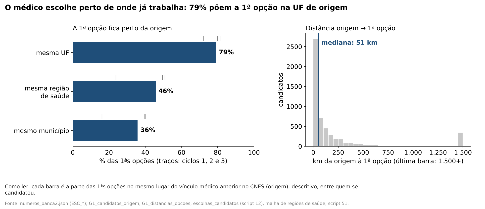
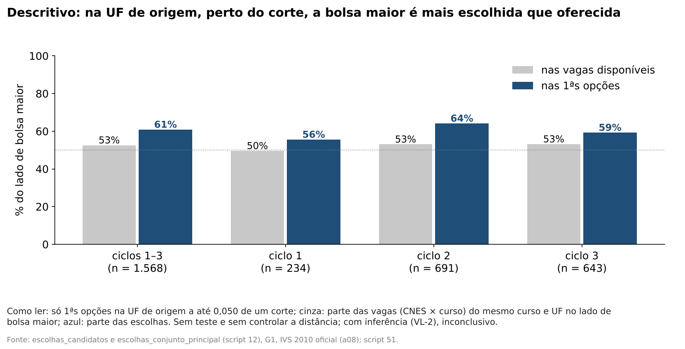
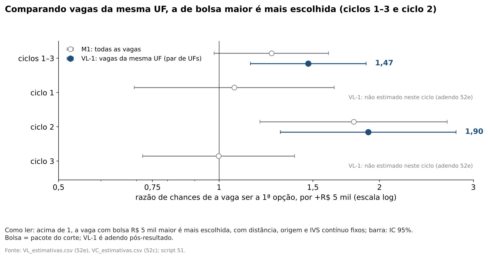
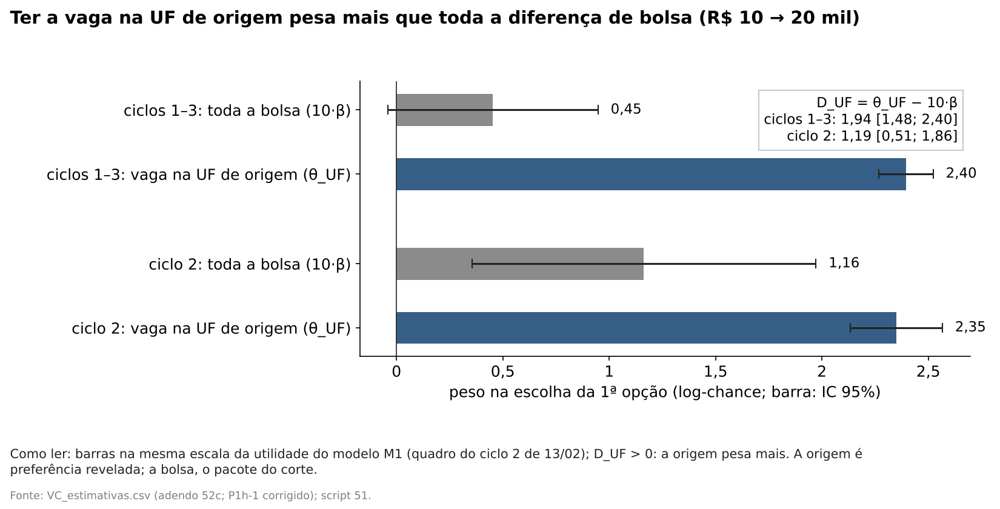
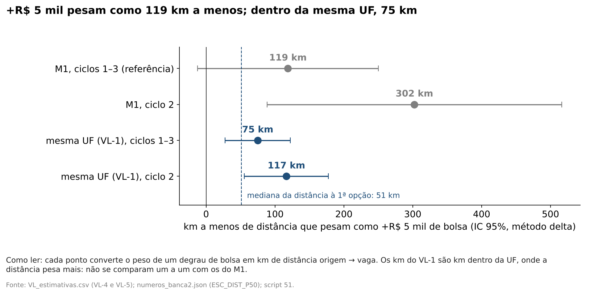
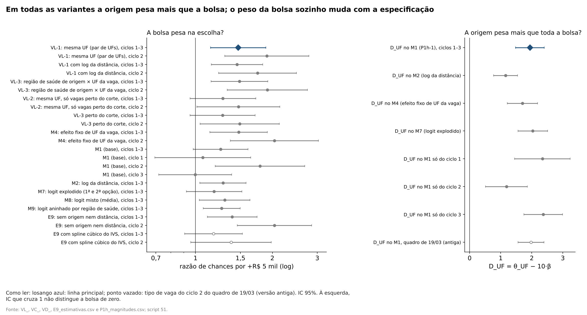

# 66. Análise completa da H2: o médico escolhe perto da origem; a bolsa muda qual vaga ele escolhe, mas pesa menos que a origem

> **Data:** 27/10/2026.<br>
> **Pedido do autor:** "uma análise clara e completa da hipótese 2", hipótese única da banca 2
> ([doc 07 da banca 2](../07_apresentacoes/banca2/07_nova_hipotese.md)).<br>
> **Estatuto:** síntese **pós-resultado** (`SINTESE_H2_POS_RESULTADO`). A hipótese foi formulada depois de ver os
> resultados da antiga H1 e os coeficientes do modelo de escolha. **Nada foi reestimado.** Os números de estimação
> são copiados de saídas já auditadas (`G1_*`, `E9_*`, `P1_*`, `P1h_*`, `VC_*`, `VD_*`, `VL_*`); os números
> descritivos novos são calculados das bases de escolha versionadas e rotulados como descritivos.<br>
> **Gerado por:** `scripts/rdd_bolsa/51_sintese_H2.py`. Todo número deste documento está num bloco
> `<!-- H2:... -->`, regravado pelo script com `--atualizar-doc` a partir de `output/rdd_bolsa/H2_sintese.csv` e
> `H2_resumo.json`. O teste `tests/test_sintese_H2.py` confere que os blocos são iguais aos gerados, que cada número
> volta à saída de origem e que não há número de resultado fora dos blocos. O texto fora dos blocos é escrito à mão.<br>
> **Revisão de redação:** segue a [auditoria 50](../auditorias/50_auditoria_avaliacao_hipoteses.md): "não
> detectamos aumento" do preenchimento, nunca a ausência como fato; o teste central da H2 é origem × toda a bolsa (D_UF).<br>
> **Auditoria:** [52](../auditorias/52_auditoria_analise_H2.md), aprovada com correções de redação e de rótulo: os
> números copiados conferem com as saídas auditadas, os descritivos novos foram refeitos de forma independente e batem,
> e nenhuma estimativa mudou. As correções estão no script 51 (texto gerado) e no texto à mão, com nota "auditoria 52".<br>
> **Natureza dos dados:** `EMPIRICO` em todas as linhas. Nenhum cenário, nada sintético, nada imputado. Os cenários do
> [doc 57b](57b_cenarios_P1_bolsa.md) são **simulação** e só aparecem citados em palavras, rotulados como tal.

## 0. Resposta curta

<!-- H2:resposta:inicio -->
- **Perto de casa (descritivo).** Entre os 5.425 candidatos com origem conhecida, 79% põem a 1ª opção na UF onde já tinham vínculo médico, 46% na mesma região de saúde e 36% no mesmo município; a distância mediana é 51 km (`ESC_*` de `numeros_banca2.json`, reproduzidos pelo script 51).
- **Teste central: a origem pesa mais que toda a bolsa.** No modelo de escolha pré-registrado (M1, quadro do ciclo 2 de 13/02), D_UF = θ_UF − 10·β = 1,94 [1,48; 2,40], p unilateral < 0,001 (Holm = p). Ter a vaga na UF de origem pesa 2,40; toda a amplitude da bolsa, 0,45 [−0,04; 0,95].
- **O peso da bolsa sozinho, na especificação pré-registrada, não passa no Holm:** β = 0,0453 por R$ 1 mil [−0,0041; 0,0947], p de Holm 0,072 (família de um teste: Holm = p).
- **Comparando vagas da mesma UF, a bolsa maior é mais escolhida (adendo pós-resultado 52e).** Cada vaga é comparada só com vagas da mesma UF (a da origem ou outra), vistas por médicos da mesma UF de origem (VL-1). A razão de chances por +R$ 5 mil é 1,47 [1,15; 1,89] nos ciclos 1–3 (p de Holm 0,005) e 1,90 [1,30; 2,78] no ciclo 2 (p de Holm 0,003); nos ciclos 1 e 3 o VL-1 não foi estimado. Só com vagas perto do corte (VL-2): 1,28 [0,95; 1,72], inconclusivo.
- **Na UF de origem, perto do corte (descritivo, sem teste e sem controlar a distância).** O lado de bolsa maior é 52,5% das vagas disponíveis e 60,8% das 1ªs opções (1.568 candidatos que veem os dois lados do corte na sua UF). Não é evidência à parte: a versão com inferência e distância (VL-2) é inconclusiva.
- **Em km.** Comparando vagas da mesma UF, um degrau de R$ 5 mil pesa como 75 km [28; 122] a menos de distância; no M1, 119 km [−12; 250], com IC que contém zero.
<!-- H2:resposta:fim -->

Três ressalvas acompanham toda frase acima:

1. **Condicional a se candidatar.** Tudo descreve como quem já se candidatou ordena as vagas abertas do seu curso e
   ciclo. Nada diz quantos médicos se candidatariam com outra bolsa.
2. **A origem é o vínculo anterior no CNES**, não a residência nem a cidade da família. O peso da origem é
   **preferência revelada**, não efeito causal.
3. **A bolsa é o pacote do corte**: a bolsa de R$ 5 mil a mais e as outras regras federais que mudam nos mesmos cortes
   de IVS ([auditoria 18](../auditorias/18_politicas_nos_mesmos_cortes_ivs.md)). Não é participação no PMM-E nem o
   efeito do Agora Tem Especialistas.

## 1. A hipótese e por que ela importa para a política

**A hipótese.** O médico especialista escolhe vagas perto de onde já trabalha. A bolsa maior muda qual vaga ele
escolhe dentro da sua região, mas pesa menos que a própria origem.

Nos dados, "dentro da sua região" é medido no nível da **UF**: o VL-1 compara vagas da mesma UF, e o D_UF compara a
origem na UF com toda a bolsa. A região de saúde não é testada como margem da bolsa (auditoria 50, A4; auditoria 52).

**O fato que motiva a pergunta (antiga H1).** Nos cortes de IVS em 0,300 e 0,400, onde a bolsa sobe R$ 5 mil por mês,
**não detectamos aumento** do preenchimento das vagas. Esse resultado não é um nulo bem estimado: o desenho por corte
só detectaria saltos grandes, e o sinal negativo em 0,300 nunca passou no Holm e anda junto com a localização
([57n](57n_resultados_H1_vagas_imediatas.md), [57w](57w_resultados_pareamento_localizacao.md); auditorias 38, 47 e
50). Os números desse fato ficam nesses docs e não são repetidos aqui.

**A pergunta.** Por que um incentivo de R$ 5 mil por mês não produz aumento detectável do preenchimento?

**A resposta proposta.** Porque, na escolha, a origem pesa muito mais que a bolsa. O pacote do corte desloca a
escolha entre vagas parecidas da mesma UF, mas toda a diferença de bolsa pesa menos que ter a vaga na UF de origem. A ligação entre isso e o preenchimento é
**interpretação**, não teste: a H2 mede pesos na escolha de quem já se candidatou; não mede o preenchimento.

**Por que importa.** A política paga mais onde o IVS é maior para atrair especialistas a lugares que eles evitam. Se
o que segura o médico é a sua própria região, um degrau de bolsa reordena candidatos que já estavam por perto, e o
dinheiro a mais compra pouco deslocamento. A H2 diz quanto pesa a bolsa diante da origem e, com isso, onde está o
limite do instrumento. Ela não diz se outro desenho do incentivo (valor maior, regra por distância, recrutamento na
própria região) funcionaria.

## 2. Dados e amostra

**Quem são os candidatos.** Os especialistas classificados com opção de vaga na 1ª chamada dos ciclos 1, 2 e 3 do
PMM-E, a partir das planilhas públicas de classificação e alocação (portão
[G1](../auditorias/G1_viabilidade_candidatos.md)). Cada candidato lista vagas (célula = estabelecimento CNES × curso)
em ordem de preferência; aqui só a 1ª opção conta, salvo no logit explodido.

**Como se chega à origem.** As planilhas trazem nome e CPF mascarado. O G1 liga cada candidato ao cadastro de
profissionais do CNES pelos dígitos visíveis do CPF e pelo nome, com regra fixada antes de ligar e validada contra a
rota pelo CRM. A **origem** é o município em que o candidato tinha vínculo médico na competência do CNES anterior à
abertura das inscrições do seu ciclo (o de mais vínculos, se houver vários). Só informação anterior ao programa
define a origem.

**Quantas escolhas.**

<!-- H2:amostra:inicio -->
| Etapa | Ciclo 1 | Ciclo 2 | Ciclo 3 | Total | Fonte |
|---|---|---|---|---|---|
| candidatos classificados com opção na 1ª chamada (portão G1) | 993 | 2.179 | 2.604 | 5.776 | G1 §4 |
| ligados ao CNES (CPF mascarado + nome) | 938 | 2.102 | 2.533 | 5.573 | G1 §4 |
| com município de origem (vínculo médico na competência anterior à inscrição) | 918 | 2.071 | 2.495 | 5.484 | G1 §4 |
| com linha de 1ª opção publicada | 993 | 2.140 | 2.581 | 5.714 | 57a §2 |
| descritiva desta análise (1ª opção com origem e distância) | 918 | 2.033 | 2.474 | 5.425 | script 51 |
| **modelo de escolha (M1)** | 915 | 2.032 | 2.474 | 5.421 | 57a §2 |

O M1 compara cada candidato consigo mesmo: são 56 conjuntos de escolha (curso × ciclo), 5.125 vagas (CNES × curso) e 932.577 pares candidato × vaga. A descritiva tem 4 candidatos a mais que o M1, que retira quem tem a origem ou a 1ª opção num município sem região de saúde na tabela do TabNet (57a §2).
<!-- H2:amostra:fim -->

**O que fica de fora.** Quem não foi ligado ao CNES ou não tinha vínculo médico na competência de referência não tem
origem e sai. A taxa de ligação é parecida entre alocados e não alocados (G1 §4), e o E9, que não precisa da origem,
dá o mesmo sinal na amostra completa (seção 7).

## 3. Descritiva

Os números `ESC_*` (parte das 1ªs opções na mesma UF, região e município; distância mediana) vêm de
`output/apresentacao_banca2/numeros_banca2.json`, gerado por `scripts/apresentacao/gerar_figuras_banca2.py`, e são os
mesmos da banca 2. O script 51 os **reproduz** a partir das bases do G1 e para se não baterem. As demais linhas são
descritivas novas, calculadas pelo script 51. Nenhuma tem teste.

<!-- H2:descritiva:inicio -->
| | Ciclos 1–3 | Ciclo 1 | Ciclo 2 | Ciclo 3 |
|---|---|---|---|---|
| 1ª opção na UF de origem | 79% | 72% | 81% | 80% |
| 1ª opção na região de saúde de origem | 46% | 24% | 49% | 51% |
| 1ª opção no município de origem | 36% | 16% | 40% | 40% |
| distância origem → 1ª opção: mediana (km) | 51 | 126 | 37 | 34 |
| distância: 3º quartil (km) | 189 | 271 | 153 | 164 |
| candidatos | 5.425 | 918 | 2.033 | 2.474 |

Por bolsa da vaga escolhida (ciclos 1–3): parte das 1ªs opções que fica na UF de origem.

| Vaga escolhida | Na UF de origem | Candidatos |
|---|---|---|
| R$ 10 mil | 77% | 2.017 |
| R$ 15 mil | 82% | 2.231 |
| R$ 20 mil | 77% | 1.177 |

Dentro da UF de origem: o que estava disponível e o que foi escolhido.

| | Ciclos 1–3 | Ciclo 1 | Ciclo 2 | Ciclo 3 |
|---|---|---|---|---|
| todas as vagas da UF: bolsa média disponível (R$ mil) | 14,14 | 14,31 | 13,89 | 14,29 |
| todas as vagas da UF: bolsa média escolhida (R$ mil) | 14,23 | 14,28 | 14,20 | 14,24 |
| candidatos | 4.295 | 664 | 1.654 | 1.977 |
| perto do corte: lado de bolsa maior nas vagas disponíveis | 52,5% | 49,6% | 53,0% | 53,1% |
| perto do corte: lado de bolsa maior nas 1ªs opções | 60,8% | 55,6% | 64,1% | 59,3% |
| candidatos perto do corte que veem os dois lados na sua UF | 1.568 | 234 | 691 | 643 |

Por corte (ciclos 1–3): em 0,300, 52,3% das vagas disponíveis e 60,6% das escolhas ficam do lado de bolsa maior (791 candidatos); em 0,400, 52,8% e 61,1% (777).



**Como ler.** Cada barra é a parte das 1ªs opções no mesmo lugar do vínculo médico anterior no CNES (origem); descritivo, entre quem se candidatou. *Fonte: numeros_banca2.json (ESC_*); G1_candidatos_origem, G1_distancias_opcoes, escolhas_candidatos (script 12), malha de regiões de saúde; script 51.*



**Como ler.** Só 1ªs opções na UF de origem a até 0,050 de um corte; cinza: parte das vagas (CNES × curso) do mesmo curso e UF no lado de bolsa maior; azul: parte das escolhas. Sem teste e sem controlar a distância; com inferência (VL-2), inconclusivo. *Fonte: escolhas_candidatos e escolhas_conjunto_principal (script 12), G1, IVS 2010 oficial (a08); script 51.*
<!-- H2:descritiva:fim -->

**Leitura.**

- **Perto de casa.** A grande maioria põe a 1ª opção na UF de origem, perto de metade na própria região de saúde e
  uma parte grande no próprio município. O ciclo 1 é o mais disperso; ele também tinha menos vagas por candidato
  (57a §7), mas isso não foi testado como causa.
- **A comparação crua não isola a bolsa.** "Disponível" é a média da bolsa das vagas (CNES × curso) do mesmo curso
  e ciclo na UF de origem, cada vaga com o mesmo peso; "escolhida" é a bolsa da 1ª opção; só entram os candidatos
  cuja 1ª opção está na UF de origem. As duas médias são quase iguais, e a parte das escolhas na UF quase não muda
  com a faixa da vaga. Isso não contradiz a H2 nem a confirma: a comparação crua mistura a bolsa com tudo o que anda
  com ela, como o IVS, a distância e, sobretudo, a própria origem. Muitos ficam no próprio município de origem, e a
  bolsa que "escolhem" é a do município onde já trabalham. Que as vagas mais vulneráveis atraiam menos por outros
  motivos é uma leitura possível, não testada aqui. O modelo de escolha (seção 6) é quem separa esses pesos
  (auditoria 52).
- **Perto do corte (descritivo).** Restringindo às vagas da UF de origem a até 0,050 de um corte, onde o IVS é
  parecido dos dois lados, o lado de bolsa maior é mais escolhido do que a sua parte nas vagas, nos dois cortes e
  nos três ciclos, com a maior diferença no ciclo 2. É descritivo, sem teste, sem controlar a distância nem a
  origem, e só conta quem tem a 1ª opção perto do corte na UF de origem. Não é evidência à parte: a versão com
  inferência e distância, o VL-2 (seção 6), é inconclusiva. O VL-2 também usa vagas de outras UFs, comparadas
  dentro do par de UFs.

## 4. Método em palavras

1. **Cada médico é comparado consigo mesmo.** O modelo pergunta: entre todas as vagas abertas do seu curso naquele
   ciclo, qual ele pôs em 1º lugar? Isso é um **logit condicional**: cada vaga tem uma "atratividade" para aquele
   médico, e a chance de ela ser a escolhida cresce com essa atratividade.
2. **A atratividade soma pesos.** Peso da bolsa da vaga, da distância entre a origem e a vaga, de a vaga estar na UF,
   na região de saúde ou no município de origem, do IVS (em curva contínua), do porte, de ser capital, de ter vaga
   imediata e da macrorregião.
3. **Como se separa a bolsa do IVS.** O IVS entra como uma curva contínua, com dobras nos cortes e **sem salto**. A
   bolsa salta R$ 5 mil em 0,300 e em 0,400. O peso da bolsa, portanto, sai só dos saltos nos cortes: é o **pacote do
   corte**.
4. **O teste central (D_UF).** Comparamos dois pesos na mesma escala: o de a vaga estar na UF de origem (θ_UF) e o de
   **toda** a diferença de bolsa que o programa oferece, de R$ 10 mil a R$ 20 mil (10 vezes o peso de R$ 1 mil). Se a
   diferença D_UF é positiva, a origem pesa mais. É teste unilateral, de uma só hipótese, na especificação
   pré-registrada (M1 do protocolo [52b](52b_protocolo_P1h_magnitudes.md)), com o tipo de vaga do ciclo 2 lido do
   quadro da inscrição ([52c](52c_adendo_vaga_imediata_ciclo2.md)).
5. **A bolsa pesa dentro da região? (adendo 52e).** Para afastar a dúvida de que a bolsa só "pesa" porque as vagas de
   bolsa maior ficam em UFs que os médicos já preferem, o adendo [52e](52e_adendo_escolha_localizacao_par.md) põe um
   efeito fixo para cada par (UF de origem, UF da vaga). O peso da bolsa passa a vir de vagas **da mesma UF**
   (a UF de origem ou qualquer outra), vistas por médicos **da mesma UF de origem** (VL-1). O VL-2 faz o mesmo só
   com vagas perto de um corte. O VL-1 foi estimado nos ciclos 1–3 juntos e no ciclo 2, não nos ciclos 1 e 3
   separados.
6. **Tradução em km.** O peso de um degrau de bolsa dividido pelo peso da distância diz quantos km a menos de
   distância "valem" R$ 5 mil na escolha.
7. **Inferência.** Erro-padrão agrupado por conjunto de escolha (curso × ciclo), Holm nas famílias principais, BKY nas
   secundárias e *score bootstrap* para poucos grupos.

**A equação.** Para o médico i e a vaga j do seu conjunto de escolha C(i):

```math
U_{ij} = \beta\, B_j + f(IVS_j) + \gamma\, d_{ij} + \theta_{UF}\, \mathbb{1}[UF_j = UF_{o(i)}]
       + \theta_{reg}\, \mathbb{1}[R_j = R_{o(i)}] + \theta_{mun}\, \mathbb{1}[m_j = o(i)] + x_j'\delta + \varepsilon_{ij},
\qquad
\Pr(j \mid i) = \frac{e^{U_{ij} - \varepsilon_{ij}}}{\sum_{k \in C(i)} e^{U_{ik} - \varepsilon_{ik}}}
```

com B_j a bolsa em R$ mil por mês, f contínua com dobras em 0,300 e 0,400, d_ij a distância em centenas de km, o(i) o
município de origem e ε com distribuição de valor extremo. O teste central é

```math
D_{UF} = \theta_{UF} - 10\,\beta, \qquad H_0: D_{UF} \le 0 .
```

No VL-1, os indicadores de UF são trocados por um efeito fixo de cada par (UF de origem, UF da vaga), que absorve
θ_UF; por isso o VL-1 informa β, mas não D_UF.

## 5. Identificação: premissas, aderência e o que não pode ser testado

| Premissa | O que foi feito | Situação |
|---|---|---|
| A bolsa segue a regra do IVS 2010 oficial | a faixa impressa de cada vaga é conferida contra a regra de dois cortes do IVS oficial (E9; script 51) | cumprida, sem discordância |
| Nenhum outro atributo da vaga que pese na escolha salta no corte, dado o IVS contínuo | levantamento das normas (auditorias 18 e 35); controles de capital, estrato, macrorregião; efeito fixo de UF (M4) e do par de UFs (VL-1) | **parcial**: outras regras federais mudam nos mesmos cortes; por isso o contraste é o pacote do corte |
| Forma da curva do IVS | spline linear, quadrático, cúbico, nós extras, janelas (E9, doc 42) | **frágil para o peso da bolsa**: com spline cúbico o IC inclui zero (seção 7) |
| Independência de alternativas irrelevantes | logit aninhado por região de saúde (M9) | violada em parte; o peso da bolsa quase não muda |
| Poucos grupos | *score bootstrap* | o VL-1 e o ciclo 2 se mantêm |
| Precisão calibrada | cortes placebo do E9 (doc 42 §5.2) | **frágil no empilhado**: com cluster por conjunto e spline linear, o t superestima a precisão; o ciclo 2 resiste. O VL-1 usa o mesmo spline e a mesma inferência (auditoria 50, A4) |
| Tipo de vaga do ciclo 2 medido antes da alocação | adendos 52c e 52d | resolvido; D_UF quase não muda |
| Seleção pela ligação ao CNES | E9 na amostra completa, sem origem | mesmo sinal |
| Quem identifica o peso da bolsa no VL-1 | contagem de pares e candidatos com variação de bolsa dentro da UF | ver abaixo |

<!-- H2:identificacao:inicio -->
No VL-1 (ciclos 1–3), 260 dos 281 pares (UF de origem, UF da vaga) com alguma escolha têm vagas de bolsas diferentes, vindos de 27 UFs de origem. São 5.345 dos 5.417 candidatos que veem, dentro de uma UF, vagas de bolsas diferentes; 3.937 escolheram a 1ª opção numa UF assim (57x §3).
<!-- H2:identificacao:fim -->

**O que não pode ser testado com estes dados:**

- **O que a origem carrega.** θ_UF junta família, rede, registro no conselho regional, conhecer o sistema local e,
  sobretudo, **manter o emprego atual**: as horas da bolsa são cumuláveis, e ficar perto da origem pode ser renda
  alternativa, não só custo do lugar. Nada aqui separa esses canais.
- **A bolsa isolada.** O pacote do corte não se separa nos dados.
- **O conjunto de escolha.** Supõe-se que o candidato viu todas as vagas abertas do seu curso e que listou sem
  estratégia (a alocação é por nota).
- **Quem não se candidatou.** O universo de especialistas que poderiam se inscrever não está nos dados.
- **A ponte para o preenchimento.** A H2 não mede preenchimento. Dizer que ela "explica" a ausência de aumento
  detectado é interpretação.

## 6. Resultados principais

<!-- H2:resultados:inicio -->
| Linha | Candidatos | Razão de chances [IC 95%] | p | p ajustado | Ajuste | Fonte |
|---|---|---|---|---|---|---|
| VL-1: mesma UF (par de UFs), ciclos 1–3 | 5.417 | 1,47 [1,15; 1,89] | 0,002 | 0,005 | Holm (3 principais do 52e) | 57x §4.1 |
| VL-1: mesma UF (par de UFs), ciclo 2 | 2.012 | 1,90 [1,30; 2,78] | < 0,001 | 0,003 | Holm (3 principais do 52e) | 57x §4.1 |
| VL-2: mesma UF, só vagas perto do corte, ciclos 1–3 | 4.288 | 1,28 [0,95; 1,72] | 0,103 | 0,103 | Holm (3 principais do 52e) | 57x §4.1 |
| M1 (base, pré-registrado), ciclos 1–3 | 5.421 | 1,25 [0,98; 1,61] | 0,072 | — | — | 57x §4.1 |
| M1 (base), ciclo 2 | 2.032 | 1,79 [1,19; 2,68] | 0,005 | — | — | 57x §4.1 |
| M1 (base), ciclo 1 | 915 | 1,07 [0,69; 1,65] | 0,764 | — | — | 57p §4.1 |
| M1 (base), ciclo 3 | 2.474 | 1,00 [0,72; 1,39] | 0,990 | — | — | 57p §4.1 |

Diferença pareada contra o M1, em log da razão de chances (52e, decisão 10): VL-1 ciclos 1–3 0,159 [0,089; 0,229]; VL-1 ciclo 2 0,063 [−0,061; 0,187]; VL-2 0,020 [−0,227; 0,267]. p do score bootstrap (poucos *clusters*): VL-1 ciclos 1–3 0,011, ciclo 2 0,004, VL-2 0,183.

| Peso no M1 (log-chance) | Ciclos 1–3 | Ciclo 2 | Fonte |
|---|---|---|---|
| vaga na UF de origem (θ_UF) | 2,40 [2,27; 2,52] | 2,35 [2,13; 2,57] | 57p §4.3 |
| toda a bolsa, R$ 10 → 20 mil (10·β) | 0,45 [−0,04; 0,95] | 1,16 [0,35; 1,97] | 57p §4.1 |
| **D_UF = θ_UF − 10·β** | **1,94 [1,48; 2,40]**, p unilateral < 0,001 | 1,19 [0,51; 1,86], p unilateral < 0,001 | 57p §4.2 |

| Um degrau de +R$ 5 mil, em km a menos (IC 95% delta) | Ciclos 1–3 | Ciclo 2 | Fonte |
|---|---|---|---|
| M1: todas as vagas (quadro corrigido) | 119 [−12; 250] | 302 [88; 516] | 57x §4.3; 57v §5.6 |
| VL-1: vagas da mesma UF (par de UFs) | 75 [28; 122] | 117 [56; 178] | 57x §4.3 |

Dentro da UF, a distância pesa mais (−0,51 por 100 km, contra −0,19 no M1) e a bolsa também (β de 0,077 contra 0,045 por R$ 1 mil). Por isso os km do VL-1 caem: são km dentro da UF.



**Como ler.** Acima de 1, a vaga com bolsa R$ 5 mil maior é mais escolhida, com distância, origem e IVS contínuo fixos; barra: IC 95%. Bolsa = pacote do corte; VL-1 é adendo pós-resultado. *Fonte: VL_estimativas.csv (52e), VC_estimativas.csv (52c); script 51.*



**Como ler.** Barras na mesma escala da utilidade do modelo M1 (quadro do ciclo 2 de 13/02); D_UF > 0: a origem pesa mais. A origem é preferência revelada; a bolsa, o pacote do corte. *Fonte: VC_estimativas.csv (adendo 52c; P1h-1 corrigido); script 51.*



**Como ler.** Cada ponto converte o peso de um degrau de bolsa em km de distância origem → vaga. Os km do VL-1 são km dentro da UF, onde a distância pesa mais: não se comparam um a um com os do M1. *Fonte: VL_estimativas.csv (VL-4 e VL-5); numeros_banca2.json (ESC_DIST_P50); script 51.*
<!-- H2:resultados:fim -->

**Leitura.**

1. **Teste central: a origem pesa mais que toda a bolsa.** D_UF é positivo, com IC longe de zero, nos ciclos 1–3 e
   também no ciclo 2, o ciclo em que a bolsa mais pesa. A conclusão resiste à imprecisão do peso da bolsa: mesmo o
   limite de cima de 10·β fica abaixo do limite de baixo de θ_UF.
2. **O peso da bolsa sozinho, na especificação pré-registrada, não passa no Holm.** Nos ciclos 1–3 o IC do M1 contém
   1; o peso vem do ciclo 2. Isso é dito sempre que o VL-1 é mostrado.
3. **Comparando vagas da mesma UF, a escolha responde à bolsa (adendo pós-resultado).** Comparando só vagas da
   mesma UF (a de origem ou outra), vistas por médicos da mesma UF de origem, a vaga de bolsa maior é mais escolhida,
   nos ciclos 1–3 e no ciclo 2, e passa no Holm do adendo. A diferença pareada (descritiva, fora do Holm) mostra
   que, nos ciclos 1–3, o peso fica **maior** que no M1, não menor; no ciclo 2, a diferença não se distingue de
   zero. A localização no nível da UF não explica o peso da bolsa; diferenças dentro da UF não são controladas. O
   VL-1 não foi estimado nos ciclos 1 e 3, e o resultado dos ciclos 1–3 juntos não vale para cada ciclo. O VL-1
   reforça que a escolha responde à bolsa (pacote do corte); não testa a comparação com a origem.
4. **Perto do corte, inconclusivo.** Só com vagas a até 0,050 de um corte (VL-2), o ponto é parecido, mas o IC contém
   1.
5. **Em km.** No M1, um degrau de R$ 5 mil vale cerca de duas vezes a distância mediana entre a origem e a 1ª opção,
   com IC que contém zero. Dentro da UF, onde a distância pesa mais, vale menos km, com IC acima de zero. Os dois
   números não se comparam um a um.

## 7. Robustez

<!-- H2:robustez:inicio -->
Bolsa: razão de chances da 1ª opção por +R$ 5 mil. Em negrito, a especificação pré-registrada (M1, P1a); o VL-1 é a principal do adendo pós-resultado 52e, não da H2.

| Variante | Candidatos | Razão de chances [IC 95%] | p | p ajustado | Ajuste | Quadro do ciclo 2 | Fonte |
|---|---|---|---|---|---|---|---|
| **M1 (base, pré-registrado), ciclos 1–3** | 5.421 | 1,25 [0,98; 1,61] | 0,072 | — | — | 13/02/2026 | 57x §4.1 |
| M1 (base), ciclo 1 | 915 | 1,07 [0,69; 1,65] | 0,764 | — | — | 13/02/2026 | 57p §4.1 |
| M1 (base), ciclo 2 | 2.032 | 1,79 [1,19; 2,68] | 0,005 | — | — | 13/02/2026 | 57x §4.1 |
| M1 (base), ciclo 3 | 2.474 | 1,00 [0,72; 1,39] | 0,990 | — | — | 13/02/2026 | 57p §4.1 |
| VL-1: mesma UF (par de UFs), ciclos 1–3 | 5.417 | 1,47 [1,15; 1,89] | 0,002 | 0,005 | Holm (3 principais do 52e) | 13/02/2026 | 57x §4.1 |
| VL-1: mesma UF (par de UFs), ciclo 2 | 2.012 | 1,90 [1,30; 2,78] | < 0,001 | 0,003 | Holm (3 principais do 52e) | 13/02/2026 | 57x §4.1 |
| VL-1 com log da distância, ciclos 1–3 | 5.417 | 1,45 [1,15; 1,83] | 0,002 | 0,004 | BKY (7 secundárias do 52e) | 13/02/2026 | 57x §4.2 |
| VL-1 com log da distância, ciclo 2 | 2.012 | 1,75 [1,23; 2,49] | 0,002 | 0,004 | BKY (7 secundárias do 52e) | 13/02/2026 | 57x §4.2 |
| VL-3: região de saúde de origem × UF da vaga, ciclos 1–3 | 5.360 | 1,49 [1,15; 1,92] | 0,002 | 0,004 | BKY (7 secundárias do 52e) | 13/02/2026 | 57x §4.2 |
| VL-3: região de saúde de origem × UF da vaga, ciclo 2 | 2.001 | 1,91 [1,33; 2,74] | < 0,001 | 0,004 | BKY (7 secundárias do 52e) | 13/02/2026 | 57x §4.2 |
| VL-2: mesma UF, só vagas perto do corte, ciclos 1–3 | 4.288 | 1,28 [0,95; 1,72] | 0,103 | 0,103 | Holm (3 principais do 52e) | 13/02/2026 | 57x §4.1 |
| VL-2: mesma UF, só vagas perto do corte, ciclo 2 | 1.596 | 1,47 [1,01; 2,14] | 0,042 | 0,022 | BKY (7 secundárias do 52e) | 13/02/2026 | 57x §4.2 |
| VL-3 perto do corte, ciclos 1–3 | 4.216 | 1,28 [0,95; 1,71] | 0,101 | 0,043 | BKY (7 secundárias do 52e) | 13/02/2026 | 57x §4.2 |
| VL-3 perto do corte, ciclo 2 | 1.575 | 1,49 [1,04; 2,13] | 0,029 | 0,018 | BKY (7 secundárias do 52e) | 13/02/2026 | 57x §4.2 |
| M4: efeito fixo de UF da vaga, ciclos 1–3 | 5.421 | 1,48 [1,14; 1,91] | 0,003 | — | — | 13/02/2026 | 57x §4.2 |
| M4: efeito fixo de UF da vaga, ciclo 2 | 2.032 | 2,04 [1,37; 3,03] | < 0,001 | — | — | 13/02/2026 | 57x §4.2 |
| M2: log da distância, ciclos 1–3 | 5.421 | 1,28 [1,04; 1,58] | 0,020 | — | — | 13/02/2026 | 57v §5 |
| M7: logit explodido (1ª e 2ª opção), ciclos 1–3 | 5.421 | 1,18 [0,92; 1,52] | 0,190 | — | — | 13/02/2026 | 57v §5 |
| M8: logit misto (média), ciclos 1–3 | 5.421 | 1,30 [1,04; 1,64] | 0,024 | — | — | 13/02/2026 | 57v §5 |
| M9: logit aninhado por região de saúde, ciclos 1–3 | 5.421 | 1,27 [1,07; 1,50] | 0,006 | — | — | 13/02/2026 | 57v §5 |
| E9: sem origem nem distância, ciclos 1–3 | 5.714 | 1,39 [1,11; 1,74] | 0,004 | — | — | 13/02/2026 | 57p §4.1 |
| E9: sem origem nem distância, ciclo 2 | 2.140 | 2,04 [1,46; 2,85] | < 0,001 | — | — | 13/02/2026 | 57p §4.1 |
| E9 com spline cúbico do IVS, ciclos 1–3 | 5.714 | 1,18 [0,91; 1,53] | 0,220 | — | — | 19/03/2026 | 42 §5.2 |
| E9 com spline cúbico do IVS, ciclo 2 | 2.140 | 1,38 [0,96; 1,98] | 0,083 | — | — | 19/03/2026 | 42 §5.2 |

Origem contra toda a bolsa: D_UF = θ_UF − 10·β (log-chance). Linha principal em negrito.

| Variante | D_UF [IC 95%] | p unilateral | p ajustado | Quadro do ciclo 2 | Fonte |
|---|---|---|---|---|---|
| **D_UF no M1 (P1h-1), ciclos 1–3** | 1,94 [1,48; 2,40] | < 0,001 | < 0,001 | 13/02/2026 | 57p §4.2 |
| D_UF no M2 (log da distância) | 1,16 [0,77; 1,54] | < 0,001 | 0,001 | 13/02/2026 | 57v §5.6 |
| D_UF no M4 (efeito fixo de UF da vaga) | 1,70 [1,21; 2,19] | < 0,001 | 0,001 | 13/02/2026 | 57v §5.6 |
| D_UF no M7 (logit explodido) | 2,03 [1,56; 2,51] | < 0,001 | 0,001 | 13/02/2026 | 57v §5.6 |
| D_UF no M1 só do ciclo 1 | 2,34 [1,45; 3,24] | < 0,001 | — | 13/02/2026 | 57p §4.2 |
| D_UF no M1 só do ciclo 2 | 1,19 [0,51; 1,86] | < 0,001 | — | 13/02/2026 | 57p §4.2 |
| D_UF no M1 só do ciclo 3 | 2,37 [1,75; 3,00] | < 0,001 | — | 13/02/2026 | 57p §4.2 |
| D_UF no M1, quadro de 19/03 (antiga) | 1,98 [1,56; 2,40] | < 0,001 | < 0,001 | 19/03/2026 | 57i §4 |

Contagem: D_UF tem IC acima de zero em 8 de 8 variantes; a razão de chances da bolsa tem IC acima de 1 em 16 de 24. O 10·β do VL-1, que é o maior peso da bolsa entre as principais, é 0,77 [0,27; 1,27]: o limite de cima fica abaixo do limite de baixo do θ_UF do M1 (2,27). É comparação entre modelos, sem teste: no VL-1 o efeito fixo do par absorve a mesma UF, e o D_UF não é identificado.

Na família BKY, o q pode ficar abaixo do p, porque o método estima quantas nulas são verdadeiras e aqui quase todas as secundárias rejeitam. Por isso o VL-3 perto do corte, ciclos 1–3, tem q 0,043 com p 0,101 e IC 95% que contém 1. Lemos pelo IC: inconclusivo, como o VL-2.



**Como ler.** Losango azul: especificação pré-registrada (M1; D_UF do P1h-1); VL, M4 e outras são variantes, o VL-1 é adendo pós-resultado; vazado: quadro do ciclo 2 de 19/03. IC 95%; à esquerda, IC que cruza 1 não distingue de zero. *Fonte: VL_, VC_, VD_, E9_estimativas.csv e P1h_magnitudes.csv; script 51.*
<!-- H2:robustez:fim -->

**O que se mantém:** D_UF positivo em todas as variantes, ciclos e versões do quadro do ciclo 2. A razão de chances
da bolsa fica acima de 1, com IC que exclui 1, em todas as variantes com efeito fixo do par (VL-1, VL-1 com log da
distância e VL-3) sem restrição ao corte, e em todas as linhas do ciclo 2, salvo o E9 com spline cúbico.

**O que muda:** o peso da bolsa sozinho depende da especificação. Ele não se distingue de zero no M1 dos ciclos 1–3,
no logit explodido (M7), nos ciclos 1 e 3, perto do corte nos ciclos 1–3 (VL-2 e VL-3) e no E9 com spline cúbico do
IVS, nos ciclos 1–3 e no ciclo 2. A leitura
honesta é: a bolsa desloca a escolha com força no ciclo 2 e quando se compara dentro da mesma UF; fora disso, o peso
é impreciso.

## 8. Ameaças e respostas às perguntas prováveis da banca

- **"Vocês formularam a hipótese depois de ver os resultados?"** Sim. É pós-resultado, e isso está dito. O teste de
  D_UF formaliza uma diferença já visível nos IC (protocolo 52b; auditoria 31). O VL-1 também é adendo
  pós-resultado, congelado antes de rodar (52e; auditoria 48).
- **"A origem é causal?"** Não. É preferência revelada: diz quanto pesa, na escolha, a vaga estar na UF de origem;
  não diz o que aconteceria se o médico mudasse de origem.
- **"Origem é onde ele mora?"** Não. É o município do vínculo médico no CNES antes da inscrição. Quem trabalha longe
  de casa aparece com a origem do trabalho.
- **"Isso é a bolsa ou o pacote?"** O pacote do corte. Nos mesmos cortes mudam outras regras federais (auditoria 18).
  Em 0,300 nenhum outro incentivo individual ao especialista do PMM-E muda (auditoria 35); em 0,400 fica aberta a
  ajuda de custo do PMMB (doc 42 §1). Nos dois cortes, o serviço do município pode mudar.
- **"Se a bolsa não passa no Holm no M1, como ela 'muda qual vaga'?"** Pelo VL-1, que compara vagas da mesma UF e
  passa no Holm do adendo pós-resultado, e pelo ciclo 2. Na especificação pré-registrada, o peso sozinho não passa.
  Os dois fatos vão juntos na fala, e o teste central da H2 continua sendo o D_UF.
- **"Por que só o ciclo 2?"** Não sabemos. Há leituras candidatas, sem teste: informação sobre a grade de bolsas, o
  número de vagas por curso e a parte de vagas imediatas (57a §7). Nos ciclos 1 e 3, os IC são largos.
- **"A bolsa traz médico de longe?"** Não detectamos. Em 0,300 não se detecta mais médico de outra UF do lado de
  bolsa maior; em 0,400 o resultado é **inconclusivo**, com poucos pares ([57w](57w_resultados_pareamento_localizacao.md),
  PH-5; auditoria 47): os poucos pares com diferença apontam todos para mais médicos de fora do lado de bolsa
  maior, mas são poucos para concluir. A ausência não é fato.
- **"Escolha não é preenchimento."** Correto. A ponte do modelo para o número de candidatos por vaga (P1g) não se
  distingue de zero, e o salto observado também não (57a §3). A simulação do [doc 57b](57b_cenarios_P1_bolsa.md)
  (**cenário contrafactual, não observação**) aponta no mesmo sentido: com os candidatos fixos, subir a bolsa
  sobretudo redistribui médicos entre vagas. É modelo, não dado.
- **"A IIA vale?"** Não por inteiro: o logit aninhado rejeita. O peso da bolsa quase não muda (seção 7).
- **"Poucos grupos de escolha?"** São poucos por ciclo. O *score bootstrap* mantém o VL-1 (seção 6) e o M1 do
  ciclo 2 (57x §4.1).

## 9. O que dá e o que não dá para afirmar

| Dá para afirmar | Não dá para afirmar |
|---|---|
| A maioria dos candidatos põe a 1ª opção na UF onde já trabalhava (descritivo) | que a origem **causa** a escolha |
| Na escolha, ter a vaga na UF de origem pesa mais que toda a diferença de bolsa (D_UF > 0, em todas as variantes) | que a bolsa não tem efeito |
| Comparando vagas da mesma UF, a de bolsa maior é mais escolhida (adendo pós-resultado, ciclos 1–3 e ciclo 2) | que o peso da bolsa sozinho passa no Holm na especificação pré-registrada |
| Perto do corte, a comparação é inconclusiva | que a bolsa traz médicos de outras UFs |
| No corte, não detectamos aumento do preenchimento (antiga H1) | que o efeito no preenchimento é zero, ou que a H2 o explica: a ligação é interpretação |
| Tudo vale para o pacote do corte, entre quem se candidatou | que vale para a bolsa isolada, para a participação no PMM-E ou para quem não se candidatou |

**Frase de 10 segundos.** "Entre quem se candidatou, o médico escolhe perto de onde já trabalha. Comparando vagas da
mesma UF, a bolsa maior é preferida, mas ter a vaga na própria UF pesa muito mais que toda a diferença de bolsa. Isso
é coerente com não termos detectado aumento do preenchimento no corte."

## 10. Leitura pela teoria (modelo da banca 1)

No [modelo micro](../02_teoria/modelo_micro.md) (§3 e §4), o médico aceita a vaga quando a bolsa, deflacionada pelo
custo de vida, compensa o custo do lugar e supera a sua melhor alternativa. O custo do lugar tem uma parte que
depende do território (do IVS) e uma parte individual. No corte, a vaga mais vulnerável é preenchida se o degrau de
bolsa supera o degrau de custo.

- **O que a H2 acrescenta.** Os pesos estimados **sugerem** que o termo que domina a escolha não é o custo ligado ao
  IVS, que a bolsa foi desenhada para compensar, e sim o componente individual ligado à origem, junto com a renda
  alternativa perto dela (hipótese H3 do modelo micro: a bolsa concorre com a renda alternativa). A origem é
  preferência revelada: os dados não dizem qual desses canais pesa.
- **Como o degrau age.** Com custos individuais grandes e diferentes entre médicos, poucos estão na margem de
  aceitar uma vaga longe da origem. O degrau de R$ 5 mil (pacote do corte) desloca a escolha entre vagas parecidas
  da mesma UF, onde o custo ligado à origem é parecido. No logit condicional, o que uma vaga ganha outra do mesmo
  curso perde.
- **O resultado é um incentivo limitado.** Na escolha, toda a diferença de bolsa pesa menos que ter a vaga na UF
  de origem. Isso não quer dizer que o degrau não mova ninguém para fora da UF: no modelo, a bolsa aumenta a chance
  de qualquer vaga, perto ou longe; quer dizer que ela compensa só uma parte do peso da origem. Isso é coerente com
  não detectarmos aumento do preenchimento no corte. A teoria não exigia efeito positivo: exigia que o degrau
  superasse o custo relevante, e a resposta sugerida, não testada, é "não com este degrau".
- **Duas ressalvas.** O contraste é o pacote do corte. E o canal da renda alternativa não foi separado do custo do
  lugar.

## Fontes e saídas

<!-- H2:fontes:inicio -->
| Entrada | Papel | Referência | Unidade | SHA-256 (12) |
|---|---|---|---|---|
| `output/rdd_bolsa/G1_resumo.json` | portão G1: candidatos, ligados e com município de origem | 2026-10-19 | ciclo | `c8a88d469f81` |
| `output/rdd_bolsa/G1_candidatos_origem.parquet` | município de origem do candidato no CNES (vínculo médico na competência anterior à inscrição) | 2026-10-19 | candidato | `6be4393a9ec3` |
| `output/rdd_bolsa/G1_distancias_opcoes.parquet` | distância (km) da origem principal a cada opção ranqueada | 2026-10-19 | candidato × opção | `8faf60ed277b` |
| `output/rdd_bolsa/outcomes/escolhas_candidatos.parquet` | opções publicadas de cada candidato (script 12) | 2026-10-18 | candidato × opção | `ce5ab8a73a55` |
| `output/rdd_bolsa/outcomes/escolhas_conjunto_principal.parquet` | conjunto de escolha principal: vagas (CNES × curso) abertas por curso e ciclo (script 12) | 2026-10-18 | célula CNES × curso × ciclo | `ad655dbce177` |
| `output/aquisicao/malha_municipios_regioes_saude.parquet` | UF e região de saúde do município (só as colunas co_ibge_6d, sg_uf, no_regiao_saude) | 2026-09 | município | `beed0d11a1d3` |
| `output/aquisicao/a08_ivs_2010_oficial_municipio.csv` | IVS 2010 oficial do IPEA (running variable canônica) | 2010 | município | `0632a7a313e1` |
| `output/rdd_bolsa/E9_estimativas.csv` | E9: logit condicional sem distância; robustez com spline cúbico (quadro do ciclo 2 de 19/03) | 2026-10-18 | termo × especificação | `517e88d14885` |
| `output/rdd_bolsa/E9_resumo.json` | E9: mapa faixa → bolsa (R$ mil/mês) | 2026-10-18 | faixa | `fff0ca8da645` |
| `output/rdd_bolsa/P1_resumo.json` | P1: amostra do modelo de escolha com origem (M1) | 2026-10-19 | ciclo | `bddaf9ef03a4` |
| `output/rdd_bolsa/P1h_magnitudes.csv` | P1h: D_UF com o quadro do ciclo 2 de 19/03 (versão antiga, referência) | 2026-10-26 | linha × modelo | `934d3931a7ad` |
| `output/rdd_bolsa/VC_estimativas.csv` | adendo 52c: M1 e M5 com o tipo de vaga do ciclo 2 de 13/02 (versão de referência) | 2026-10-26 | termo × modelo × versão | `c32e5ef3ed61` |
| `output/rdd_bolsa/VD_estimativas.csv` | adendo 52d: M2, M4, M7, M8, M9 e D_UF com o quadro de 13/02 | 2026-10-26 | termo × modelo × versão | `3b512c0849ed` |
| `output/rdd_bolsa/VL_estimativas.csv` | adendo 52e: efeito fixo do par de UFs (VL-1), comparação local (VL-2), VL-3, km (VL-4), M1 e M4 | 2026-10-27 | termo × modelo | `9c99bdd080db` |
| `output/rdd_bolsa/VL_resumo.json` | adendo 52e: contagens de identificação do VL-1 | 2026-10-27 | modelo | `eb4f4881420f` |
| `output/apresentacao_banca2/numeros_banca2.json` | descritivos ESC_* da banca 2 (fonte dos 79%; gerado fora do run_all por scripts/apresentacao/gerar_figuras_banca2.py) | 2026-10-27 | número | `cc25e8bedc9e` |

Saídas: `output/rdd_bolsa/H2_sintese.csv` (137 linhas: 81 copiadas de saídas auditadas e 56 descritivas novas), `output/rdd_bolsa/H2_resumo.json` e 6 figuras em `output/rdd_bolsa/H2_figuras/`. Todas com `natureza_dos_dados = EMPIRICO`.
<!-- H2:fontes:fim -->

Docs de origem: [42](42_resultados_E9_escolha.md) (E9), [44](44_sintese_rdd_bolsa_multioutcome.md),
[52](52_protocolo_P1_escolha_dap.md) e [57a](57a_resultados_P1_escolha.md) (P1; auditoria 26),
[52b](52b_protocolo_P1h_magnitudes.md) e [57i](57i_resultados_P1h_magnitudes.md) (P1h; auditoria 31),
[52c](52c_adendo_vaga_imediata_ciclo2.md) e [57p](57p_escolha_vaga_imediata_c2.md) (auditoria 41),
[52d](52d_adendo_sensibilidades_ciclo2_quadro_1302.md) e [57v](57v_sensibilidades_ciclo2_quadro_1302.md) (auditoria
46), [52e](52e_adendo_escolha_localizacao_par.md) e [57x](57x_resultados_escolha_localizacao_par.md) (auditoria 48),
[G1](../auditorias/G1_viabilidade_candidatos.md), [57b](57b_cenarios_P1_bolsa.md) (cenários, simulação),
[65](65_avaliacao_forca_hipoteses.md) e [auditoria 50](../auditorias/50_auditoria_avaliacao_hipoteses.md).
