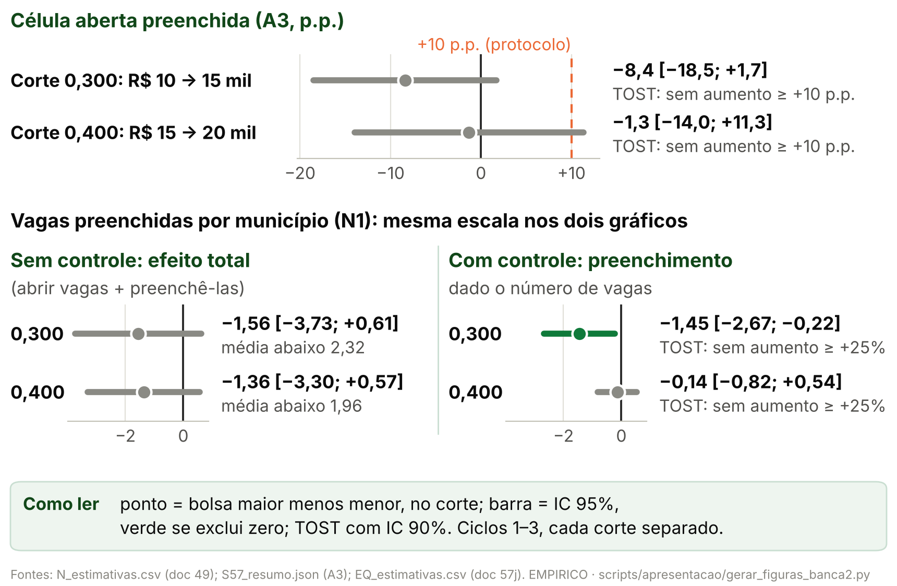
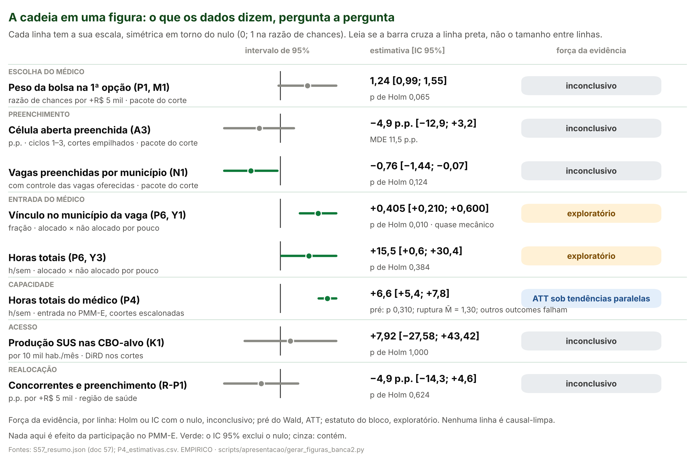

> [!IMPORTANT]
> **Como ler este arquivo.** O deck do grupo (template Insper, Montserrat)
> continua sendo o deck; este arquivo traz só os slides novos e o quadro de
> correções. O corpo novo fica entre `deck:inicio` e `deck:fim`; o apêndice,
> entre `apendice:inicio` e `apendice:fim`. **Cada cabeçalho `##` é um slide**;
> `#` marca a seção do deck em que ele entra. Abaixo do título, a linha em
> `código` é o rastreio do rodapé (seção · rótulo) e o comentário `layout`
> diz ao gerador do deck como compor o slide.
>
> **O que vai à tela:** título, figura, tabela, marcadores, a frase de cautela
> (citação em negrito) e a linha `**Fontes:**`, em letra pequena. **Não vai à
> tela:** a linha `**Números:**`, os blocos `**Nota de produção.**` e as
> `**Notas do apresentador.**` (que vão para as notas do slide).
>
> **Regra dos números.** Todo número de um slide — título, corpo e notas — é
> o valor de um código listado na sua linha `**Números:**` ou um parâmetro do
> protocolo ([03, §3](03_proveniencia_figuras_e_numeros.md#3-parâmetros-que-podem-aparecer-sem-código)).
> `tests/test_conteudo_banca2.py` confere isso, confere cada valor contra o
> arquivo de `output/` de onde ele vem e confere que o deck gerado traz o mesmo
> texto deste arquivo.
>
> **Deck derivado.** `scripts/apresentacao/gerar_deck_banca2.py` lê este
> arquivo e o deck do grupo e grava `output/apresentacao_banca2/deck_banca2_proposta.pptx`
> (deck inteiro, corrigido) e `slides_empiricos_banca2.pptx` (só os slides
> novos). Divergência entre o deck e este arquivo é erro do deck.

## Mapa da apresentação

O deck do grupo tem 36 slides; os slides 25, 27 e 29 eram marcadores "X". A
tabela diz onde cada slide novo entra. "Depois do 23" quer dizer: logo depois
do slide 23 do deck do grupo ("Da condição de aceitação, sai nossa hipótese
econômica").

| Onde entra no deck do grupo | Seção (rodapé) | Slide novo | Layout |
|---|---|---|---|
| depois do 23 | Hipótese | Testamos cada seta do modelo: quatro hipóteses | cadeia |
| depois do 23 | Hipótese | Do modelo às equações estimadas | equações |
| no lugar do 25 | Base de Dados | Oito bases oficiais, ligadas por município, célula e médico | tabela |
| no lugar do 25 | Base de Dados | Os três ciclos em números | tabela |
| no lugar do 27 | Metodologia | Um estimador por hipótese | tabela |
| no lugar do 27 | Metodologia | Hipóteses de identificação e como foram testadas | tabela |
| no lugar do 29 | Resultados | A bolsa é função exata do IVS: a regra é sharp | figura e tabela |
| no lugar do 29 | Resultados | H1: o preenchimento não aumenta de forma detectável no corte | figura e texto |
| no lugar do 29 | Resultados | H2: a bolsa pesa na escolha da vaga só no ciclo 2 | figura e texto |
| no lugar do 29 | Resultados | H3: incentivo limitado — PENDENTE | pendente |
| no lugar do 29 | Resultados | H4: o médico soma horas, mas metade já estava no município | figura e texto |
| no lugar do 29 | Resultados | Na cadeia, só a escolha e o registro do médico se movem | figura |
| no lugar do 29 | Resultados | Robustez: as leituras resistem, com duas ressalvas declaradas | tabela |
| no lugar do 29 | Resultados | Limites: pacote do corte, só candidatos, vínculo cadastrado | cartões |
| no lugar do 29 | Resultados | Um efeito do tamanho da literatura não cabe no IC empilhado | cartões |
| depois do 31 (Apêndice) | Resultados | seis slides de apêndice | tabela ou figura |

## Correções no deck do grupo

Aplicadas por `scripts/apresentacao/gerar_deck_banca2.py` no deck proposto
(o original não é alterado). Plano da banca 2, §2.

| Slides | O que estava | O que ficou | Por quê |
|---|---|---|---|
| 5, 6, 7 (e 8, oculto) | título "a vulnerabilidade social define o **piso** da bolsa"; faixas por classe do Ipea ("Muito alta" → R$ 20 mil; "Alta" → R$ 15 mil; "Média, baixa e muito baixa" → R$ 10 mil), que é a grade do FAQ | título "O IVS 2010 define a bolsa do PMM-E por regra"; faixas pela grade aplicada: IVS até 0,300 → R$ 10 mil; de 0,301 a 0,400 → R$ 15 mil; acima de 0,400 → R$ 20 mil; nota "reproduz a faixa publicada em 368 de 368 municípios do ciclo 1"; "renumeração" → "remuneração" | a grade do FAQ não é a aplicada (auditoria 16, §2) |
| 8 (oculto) | "O IVS é o piso, não o critério", com a contagem de municípios "acima da categoria" | frase retirada; no lugar, a regra aplicada e a reprodução no ciclo 1 | a contagem era artefato do arquivo de IVS errado (auditorias 16 e 19) |
| 9 e 13 | gráfico "Maior presença nas regiões com maiores bolsas" (crescimento por faixa, 9 meses antes × 9 meses depois) | gráfico retirado; no lugar, uma caixa que diz por quê e remete à seção de resultados | não sai de `output/` por script e usa a faixa do FAQ; antes × depois sem comparação não é efeito |
| 11 e 14 (ocultos) | "há indícios de efetividade"; "presença cresceu em todos os níveis sociais" | títulos rebaixados para "Descritivo: antes × depois por faixa, sem comparação"; gráficos e tabela retirados pelo mesmo motivo | doc 44, §5.3; plano, §2 |
| 10 (oculto) | categorias do gráfico "Vulnerabilidade baixa, intermediária, alta" | "IVS até 0,300", "IVS de 0,301 a 0,400", "IVS acima de 0,400" | grade aplicada |
| 34 e 35 | "proporção de **vagas** preenchidas"; "35,6%" num slide e "30%" no outro; "SGETS"; "Especialidade" | "proporção de **células** (estabelecimento × curso) com alguma confirmação ou homologação: 30,3% na 1ª chamada; 35,6% somando a 2ª"; "SGTES"; "curso"; faixa pela regra aplicada | célula não é vaga física; os dois números são de chamadas diferentes |
| 35 | IVS como "custo territorial agregado" (proxy de desvantagens) | IVS como running variable: entra contínuo e controla o custo do lugar; só a bolsa salta nos cortes | é a hipótese de identificação (doc 44, §2) |
| 31 (notas) | notas com uma conversa colada, que repetia a contagem do arquivo errado | notas trocadas por uma linha neutra | a contagem é artefato |
| 32 e 33 | slides "EXEMPLO" de outro trabalho (Dinamarca, aplicativo de vinhos) | ocultos (`show="0"`), não apagados | **decisão do agente que montou o deck, não do grupo nem do autor; aguarda confirmação do grupo**: não são deste trabalho e estavam visíveis no apêndice |
| 25, 27 e 29 | marcadores "X" | substituídos pelos slides novos | — |

**Números:** `R_C1_REPR`, `R_C1_MUN`, `D_C1_PRE1_PCT`, `D_C1_PRE2_PCT`

---

<!-- deck:inicio -->

# Hipótese

## Testamos cada seta do modelo: quatro hipóteses

`Hipótese · Cadeia`

<!-- layout: cadeia -->

**Cadeia:** B ↑ (bolsa maior) → V ↑ (a vaga vale mais) → π ↑ (mais médicos a escolhem) → Pr(Y = 1) ↑ (a vaga é preenchida) → capacidade ↑ (horas de especialista no SUS)

| Hipótese | Seta do modelo | O que testa | Estimador |
|---|---|---|---|
| **H1** preenchimento | B → Pr(Y = 1) | a célula aberta do lado de bolsa maior preenche mais | RDD nos cortes do IVS |
| **H2** escolha | B → V → π | a vaga de bolsa maior é mais escolhida como 1ª opção | logit condicional |
| **H3** incentivo limitado | B contra o custo do lugar, dentro de V | o peso da bolsa é pequeno perto da distância e da origem | coeficientes do mesmo logit |
| **H4** capacidade líquida | chegada → capacidade | o médico que chega soma horas ou só muda o registro | estudo de evento; comparação na nota de corte |

> **H3 é a hipótese central (proposta do plano, delegada pelo autor e revisável por ele); H1 é o teste de consistência da cadeia.**

**Fontes:** plano da banca 2, §3; modelo da banca 1 (Moehling et al.; Redding e Rossi-Hansberg; Choné e Ma; Burdett, Shi e Wright).

**Números:** nenhum

> **Notas do apresentador.** A banca 1 testava só a última seta. Testar cada
> seta explica um resultado nulo no fim da cadeia: se a bolsa pesa pouco perto
> do custo do lugar (H3), ela reordena candidatos entre vagas (H2) sem mudar
> quantas vagas preenchem (H1). A H4 pergunta se o médico que chega aumenta a
> capacidade ou só passa a ser registrado onde já estava.

---

## Do modelo às equações estimadas

`Hipótese · Ponte`

<!-- layout: equacoes -->

```
Modelo (Moehling):   V_rm = Σ_t δ^t [ E(w_m | B_m) / p_m − c_rm ]
Escolha (H2, H3):    U_rm = β·B_m + f(IVS_m) − γ·dist_rm + θ·mesmaUF_rm + λ·X_m + ε_rm
Preenchimento (H1):  Y_c = α + τ·D_m + f_±(IVS_m − corte) + μ_curso×ciclo + ε_c
```

- **β:** utilidade marginal da bolsa, o 1/p do modelo.
- **γ e θ:** custo geográfico (Redding e Rossi-Hansberg): distância e mesma UF da origem.
- **f(IVS):** contínua nos cortes; absorve o que varia suave com a vulnerabilidade (custo laboral de Choné e Ma, amenidades, preços).
- **ε** tipo valor extremo dá o logit condicional; a agregação de Burdett, Shi e Wright leva de π a Pr(Y = 1).
- **τ:** o salto no corte, com D = lado de bolsa maior; mede o pacote do corte, não a bolsa isolada.

> **Hipótese de identificação comum: dado o IVS contínuo, só a bolsa (com as regras do mesmo corte) salta em 0,300 e 0,400.**

**Fontes:** plano da banca 2, §4.3; protocolos 48 e 52.

**Números:** nenhum

> **Notas do apresentador.** A primeira linha é o modelo da banca 1. A segunda
> é a equação que estimamos para a escolha: a bolsa entra linear, o IVS em
> spline com nós nos cortes, e a distância e a origem entram como custo. A
> terceira é a descontinuidade do preenchimento. As equações completas do
> modelo ficam no apêndice da banca final.

---

# Base de Dados

## Oito bases oficiais, ligadas por município, célula e médico

`Base de Dados · Fontes`

<!-- layout: tabela -->

| Base | Fonte oficial | Período | Unidade e chaves | Cobertura | Uso |
|---|---|---|---|---|---|
| Quadros de vagas e resultados | SGTES/MS: chamamentos dos ciclos 1, 2 e 3 | 2025–2026 | célula = estabelecimento × curso | 1.295 · 1.547 · 2.293 células | H1, descritivas |
| Candidatos e opções | SGTES/MS: classificação, alocação e homologação | 2025–2026 | candidato × opção; CPF mascarado só em memória | 993 · 2.179 · 2.604 candidatos | H2, H3, P6 |
| IVS 2010 oficial | Ipea, Plataforma IVS (Censo 2010) | 2010 | município (IBGE) | 5.565 municípios | running variable |
| CNES: vínculos e horas | DATASUS/MS, base completa mensal | 2022-01 a 2026-08 | profissional × estabelecimento × mês; pseudônimo | ligados: 938 · 2.102 · 2.533 | H2 (origem), H4 |
| Especialistas ativos do PMM-E | MS, relação nominal | 2026-09 | médico × posto; CRM só em memória | 1.957 registros | H4 (chegada) |
| Produção ambulatorial e hospitalar | DATASUS/MS: SIA e SIH | mensal, pré e pós | município × mês × grupo | nacional | K (acesso) |
| População | IBGE, Censo 2022 (SIDRA) | 2022 | município (IBGE) | 5.570 municípios | denominadores |
| Atos com corte no IVS | portarias do MS (auditoria 18) | 2023–2026 | ato × corte | nos dois cortes | ameaça: pacote do corte |

> **Nome, CPF e CRM só ficam em memória ou em cache fora do Git; nenhuma saída os traz.**

**Fontes:** `output/apresentacao_banca2/tabela_fontes.csv` (gerada por `scripts/apresentacao/gerar_figuras_banca2.py`); manifestos de aquisição em `output/aquisicao/`.

**Números:** `D_C1_CEL`, `D_C2_CEL`, `D_C3_CEL`, `D_C1_CANDG1`, `D_C2_CANDG1`, `D_C3_CANDG1`, `D_IVS_MUN`, `D_C1_LIG`, `D_C2_LIG`, `D_C3_LIG`, `D_ATIVOS`, `D_POP_MUN`

> **Notas do apresentador.** A célula (estabelecimento × curso) é a unidade
> do quadro de vagas. O IVS é o oficial do Ipea, que coincide com o escore do
> Ministério. O CNES liga o candidato ao seu município de origem e acompanha
> as horas do médico mês a mês. A ligação usa CPF mascarado e nome só em
> memória.

---

## Os três ciclos em números

`Base de Dados · Descritivas`

<!-- layout: tabela -->

| Item | Ciclo 1 | Ciclo 2 | Ciclo 3 |
|---|---|---|---|
| Municípios com célula no quadro | 368 | 454 | 748 |
| Células (estabelecimento × curso) | 1.295 | 1.547 | 2.293 |
| Vagas imediatas · cadastro reserva | 678 · 1.145 | 1.836 · 1.053 | 1.132 · 3.999 |
| Candidatos nos resultados (universo G1) | 993 | 2.179 | 2.604 |
| … ligados ao CNES | 938 | 2.102 | 2.533 |
| … com 1ª opção numa célula do quadro | 993 | 2.140 | 2.581 |
| Amostra da escolha (P1) | 915 | 2.032 | 2.474 |
| Células preenchidas na 1ª chamada | 393 (30,3%) | 728 (47,1%) | 497 (21,7%) |
| Células preenchidas até a 2ª chamada | 461 (35,6%) | 867 (56,0%) | não observado |
| Municípios por faixa: R$ 10 · 15 · 20 mil | 159 · 107 · 102 | 210 · 115 · 129 | 276 · 180 · 291 (e 1 sem IVS) |

- **Célula:** estabelecimento × curso no quadro da 1ª chamada; uma célula pode ter várias vagas.
- **Preenchida:** alguma confirmação ou homologação; não é taxa de ocupação de vagas.
- **Candidatos:** as linhas com "…" são partes do universo G1 (todos os candidatos nos resultados); a amostra do P1 exige 1ª opção numa célula do quadro, ligação ao CNES e município de origem.
- **Faixa pela grade aplicada:** até 0,300 → R$ 10 mil; de 0,301 a 0,400 → R$ 15 mil; acima de 0,400 → R$ 20 mil.

> **Descritivo: as diferenças entre ciclos não são efeito da bolsa.**

**Fontes:** `output/apresentacao_banca2/tabela_descritiva_ciclos.csv`, contada de `output/rdd_bolsa/outcomes/outcomes_V_celula.parquet` e de `output/rdd_bolsa/G1_resumo.json`.

**Números:** `D_C1_MUN`, `D_C2_MUN`, `D_C3_MUN`, `D_C1_CEL`, `D_C2_CEL`, `D_C3_CEL`, `D_C1_VI`, `D_C1_CR`, `D_C2_VI`, `D_C2_CR`, `D_C3_VI`, `D_C3_CR`, `D_C1_CAND1`, `D_C2_CAND1`, `D_C3_CAND1`, `D_C1_LIG`, `D_C1_CANDG1`, `D_C2_LIG`, `D_C2_CANDG1`, `D_C3_LIG`, `D_C3_CANDG1`, `D_C1_P1`, `D_C2_P1`, `D_C3_P1`, `M1_N`, `D_C1_PRE1`, `D_C1_PRE1_PCT`, `D_C2_PRE1`, `D_C2_PRE1_PCT`, `D_C3_PRE1`, `D_C3_PRE1_PCT`, `D_C1_PRE2`, `D_C1_PRE2_PCT`, `D_C2_PRE2`, `D_C2_PRE2_PCT`, `D_C1_F3`, `D_C1_F2`, `D_C1_F1`, `D_C2_F3`, `D_C2_F2`, `D_C2_F1`, `D_C3_F3`, `D_C3_F2`, `D_C3_F1`, `D_C3_SEM_IVS`

> [!NOTE]
> **Nota de produção.** A faixa é contada pela regra no IVS 2010 oficial; o
> script para se ela divergir da faixa publicada em alguma célula com IVS. O
> município sem IVS do ciclo 3 foi criado depois de 2010.

> **Notas do apresentador.** O ciclo 2 abriu mais vagas imediatas e preencheu
> uma fração maior das células; o ciclo 3 tem muito cadastro reserva. A
> ligação ao CNES passa de nove em cada dez candidatos em todos os ciclos. Se
> perguntarem pelos universos: o G1 conta todos os candidatos dos resultados;
> nos ciclos 2 e 3 alguns não têm a 1ª opção numa célula do quadro da 1ª
> chamada e ficam fora da escolha. A amostra do P1 soma 5.421 candidatos.
> Ciclo 3: só a 1ª chamada; o seguimento pós-início segue congelado.

---

# Metodologia

## Um estimador por hipótese

`Metodologia · Estimadores`

<!-- layout: tabela -->

| Hipótese | Estimador | Unidade e amostra | Especificação principal | Inferência |
|---|---|---|---|---|
| **H1** preenchimento | RDD sharp local linear nos cortes 0,300 e 0,400 do IVS 2010 oficial | célula aberta (A3) e município (N); ciclos 1–3 | kernel triangular, h = 0,050; uma reta de cada lado por ciclo × corte; salto comum; efeitos fixos de curso × ciclo e de tipo de vaga | CR1 por município; IC honesto como sensibilidade; Holm nas primárias |
| **H2 e H3** escolha e incentivo limitado | logit condicional (McFadden) da 1ª opção entre as células do conjunto de escolha | candidato × célula do mesmo curso e ciclo; ciclos 1–3; origem ligada ao CNES | bolsa linear em R$ mil; IVS em spline com nós nos cortes; distância, mesma UF, mesma região, mesmo município, porte, capital, vaga imediata | cluster por conjunto de escolha; H3 como combinação linear com a covariância conjunta |
| **H4** capacidade líquida | estudo de evento escalonado (Callaway–Sant'Anna); comparação local na nota de corte | médico × mês, ciclos 1 e 2; candidato perto da nota de corte | controles ainda não tratados, base g − 1; efeito fixo de célula na comparação local | bootstrap multiplicador por médico; permutação na célula; Rambachan–Roth |

> **Nos cortes, o contraste é sempre o pacote do corte; nenhum estimador mede a participação no PMM-E.**

**Fontes:** plano da banca 2, §4.1; protocolos 40, 48, 52, 52b, 54, 56 e 59.

**Números:** nenhum

> **Notas do apresentador.** Todos os protocolos foram congelados antes de
> estimar. O IC honesto (Armstrong e Kolesár) protege contra curvatura no
> corte; com o M do protocolo, ele sai largo demais para informar. Holm
> controla o erro nas primárias de cada família.

---

## Hipóteses de identificação e como foram testadas

`Metodologia · Identificação`

<!-- layout: tabela -->

| Hipótese de identificação | Vale para | Teste ou argumento | Situação |
|---|---|---|---|
| a faixa é função determinística do IVS (regra sharp) | H1, H2, H3 | IVS oficial reproduz a faixa nos três ciclos | passa |
| sem manipulação do IVS | H1, H2, H3 | IVS medido em 2010, antes do programa; teste de densidade | passa |
| continuidade dos potenciais no corte | H1 | balanço de covariáveis; placebos de outcome e de corte | passa, com seleção suspeita no ciclo 1 em 0,400 |
| dado o IVS contínuo, só a bolsa salta | H2, H3 | spline com nós nos cortes; placebos de corte; spline cúbico | o pacote do corte não se separa (co-políticas) |
| independência de alternativas irrelevantes | H2, H3 | logit aninhado por região e logit misto | violada em parte; o coeficiente da bolsa muda pouco |
| tendências paralelas entre coortes de entrada | H4 | teste conjunto do pré; Rambachan–Roth | falha em parte dos outcomes |
| alocação quase aleatória perto da nota de corte | H4 (P6) | balanço; desempate por regra fixa | balanço passa; desempate não é sorteio |

> **A ameaça comum aos cortes são as outras regras federais que mudam em 0,300 e 0,400: por isso "pacote do corte".**

**Fontes:** plano da banca 2, §4.2; auditorias 16 e 18; docs 37, 41, 49, 57a, 57d, 57f e 57h.

**Números:** nenhum

> **Notas do apresentador.** A regra sharp é o que torna a descontinuidade
> possível. A ameaça que não se testa por inteiro é a das co-políticas: emendas,
> custeio de MAC, o IED da APS e a coparticipação do PMMB mudam nos mesmos
> cortes. Na DiRD, só a parte fixa no tempo delas sai.

---

# Resultados

## A bolsa é função exata do IVS: a regra é sharp

`Resultados · Regra`

<!-- layout: figura_topo -->


| Conferência (portão R1) | Resultado |
|---|---|
| escore da relação nominal do MS = IVS 2010 oficial, a 3 casas | 404/404 |
| ciclo 1 · ciclo 2: faixa reproduzida pela regra | 368 de 368 · 454 de 454 |
| ciclo 3 (congelado): o que falta foi criado depois de 2010 | 747 de 748 |

> **Primeiro estágio sharp: dois cortes, +R$ 5 mil em cada, 0 municípios do lado errado no ciclo 1.**

**Fontes:** `output/rdd_bolsa/portao_r1_ivs_oficial.json`; `output/aquisicao/a08_ivs_2010_oficial_municipio.csv`; auditoria 16; figura por `scripts/apresentacao/gerar_figuras_banca2.py`.

**Números:** `R_ESCORE_IGUAIS`, `R_C1_REPR`, `R_C1_MUN`, `R_C2_REPR`, `R_C2_MUN`, `R_C3_REPR`, `R_C3_MUN`, `R_LADO_ERRADO_OFICIAL`

> **Notas do apresentador.** Cada ponto é um município do ciclo 1, na altura
> da bolsa anunciada. Até 0,300, R$ 10 mil; até 0,400, R$ 15 mil; acima,
> R$ 20 mil. O FAQ do edital descreve outra grade; a aplicada é esta.

---

## H1: o preenchimento não aumenta de forma detectável no corte

`Resultados · H1`

<!-- layout: figura_faixa -->



- **A3:** o maior aumento compatível, +3,2 p.p., fica abaixo da referência de +10 p.p.; por corte, +1,7 em 0,300 e +11,3 em 0,400.
- **N1:** o sinal negativo não passa no Holm (0,124); em 0,400 vem do porte; em 0,300, da taxa por vaga, que depende da medida (doc 49b).

> **Inconclusivo: IC que contém zero não é efeito zero. O descarte de ganhos grandes vale com o IC convencional e para o pacote do corte.**

**Fontes:** `output/rdd_bolsa/N_estimativas.csv` (doc 49, §3); `output/rdd_bolsa/S57_resumo.json` (A3; doc 49, §15; doc 57, §4.2).

**Números:** `N1_SA_TAU`, `N1_SA_INF`, `N1_SA_SUP`, `N1_MEDIA`, `N1_SA_HOLM`, `A3_EMP_TAU`, `A3_EMP_INF`, `A3_EMP_SUP`, `A3_EMP_MDE`, `A3_300_SUP`, `A3_400_SUP`, `N1_SB_TAU`, `N1_SB_INF`, `N1_SB_SUP`

> **Notas do apresentador.** Esta é a variável que o grupo pediu: o número de
> vagas preenchidas controlando o número de vagas oferecidas (N1): −0,76
> [−1,44; −0,07] por município, sobre uma média de 2,16 do lado de bolsa
> menor. Ao lado, a probabilidade de a célula aberta ser preenchida (A3), que
> não depende do porte: −4,9 p.p. [−12,9; +3,2], MDE de 11,5 p.p. Nenhuma das
> duas mostra aumento. O sinal de N1 é negativo, mas não sobrevive ao Holm e,
> com um só coeficiente do controle, mudaria (ver Robustez); por isso a
> leitura é "não detectamos aumento", não "a bolsa reduz". Sem controle,
> −1,45 [−2,90; −0,01]: inclui a resposta da oferta de vagas.

---

## H2: a bolsa pesa na escolha da vaga só no ciclo 2

`Resultados · H2`

<!-- layout: figura_faixa -->


- **Primária (M1):** 1,24 [0,99; 1,55] por +R$ 5 mil, p 0,065; a igualdade entre ciclos tem p 0,058.
- **Só o ciclo 2 exclui 1**, e resiste a poucos clusters e a placebos de corte (E9); os ciclos 1 e 3 não o replicam.

> **Inconclusivo na primária. Escolha não é expansão: o que uma vaga ganha, outra do mesmo curso perde.**

**Fontes:** `output/rdd_bolsa/P1_estimativas.csv` (doc 57a); `output/rdd_bolsa/E8_resumo.json` (E9, doc 44, §5.2).

**Números:** `M1_RC`, `M1_RC_INF`, `M1_RC_SUP`, `M1_P`, `M5_C2_RC`, `M5_C2_RCI`, `M5_C2_RCS`, `M5_WALD_P`, `E9_C2_RC`, `E9_C2_RCI`, `E9_C2_RCS`, `M1_N`

> **Notas do apresentador.** Logit condicional da 1ª opção de 5.421 candidatos
> entre as vagas abertas do seu curso e ciclo. A razão de chances compara duas
> vagas que diferem só no degrau de R$ 5 mil, com o IVS contínuo controlado.
> No ciclo 2: 1,70 [1,22; 2,37]; sem distância (E9), 1,95 [1,48; 2,57]. O que
> não mede: quem deixou de se candidatar e quantos médicos o programa atrai.

---

## H3: incentivo limitado — PENDENTE

`Resultados · H3`

<!-- layout: pendente -->

- **Teste congelado** no protocolo 52b em 26/10/2026, antes de calcular: o efeito de toda a amplitude da bolsa (R$ 10 mil → R$ 20 mil) é menor que o de a vaga ficar na UF de origem?
- **Também:** a amplitude da bolsa expressa em km equivalentes de distância, com IC.
- **Estado:** o script 25c (doc 57i) está sendo rodado por outra sessão e passa por auditoria independente antes de entrar aqui.

> **PENDENTE: nenhum número da H3 neste slide até a auditoria.**

**Fontes:** `docs/06_execucao/52b_protocolo_P1h_magnitudes.md`.

**Números:** nenhum

> [!NOTE]
> **Nota de produção.** Slide reservado. Depois da auditoria, entra a figura
> dos coeficientes do M1 na mesma escala de utilidade (plano, §5, item 3) e a
> marca PENDENTE sai.

> **Notas do apresentador.** Se perguntarem: a comparação usa os mesmos
> coeficientes do M1. Uma comparação de magnitude com limite não depende de o
> coeficiente da bolsa ser significativo, ao contrário da disposição a pagar,
> que é uma razão e explode quando o denominador fica perto de zero.

---

## H4: o médico soma horas, mas metade já estava no município

`Resultados · H4`

<!-- layout: figura_faixa -->


- **Origem (descritivo):** 51,0% [48,4; 53,7] dos médicos já tinham vínculo no município do posto antes de entrar.
- **Rambachan–Roth:** as horas totais aguentam violações de tendência até 1,30 vez a maior vista no pré.

> **Associação sob tendências paralelas, não efeito da bolsa nem da participação no PMM-E: horas cadastradas não são presença.**

**Fontes:** `output/rdd_bolsa/S57_resumo.json` (P4, doc 57d); `output/rdd_bolsa/H_estimativas.csv` e `CA_estimativas.csv` (doc 57h).

**Números:** `P4_HT_ATT`, `P4_HT_INF`, `P4_HT_SUP`, `P4_HT_PRE`, `RR_HT`, `P4_HM_ATT`, `P4_HM_PRE`, `P4_HF_ATT`, `P4_ORIGEM`, `P4_ORIGEM_INF`, `P4_ORIGEM_SUP`, `CA_HT_EST`, `CA_HT_INF`, `CA_HT_SUP`, `CA_HT_HOLM`, `CA_HM_EST`

> **Notas do apresentador.** A pergunta é se o programa cria oferta ou paga
> quem já estava. O médico soma +6,6 h/sem [+5,4; +7,8] de horas totais
> cadastradas (pré com p 0,310), sobretudo no município do posto (+8,7, com o
> pré falhando, p 0,001), e perde −2,1 fora dele. Metade já trabalhava no
> município. Na nota de corte (P4-CA), horas totais +7,91 [−0,63; +16,45], p
> de Holm 0,162; no município da 1ª opção, +10,92. Na comparação
> com quem ficou um ou dois pontos abaixo da nota de corte, o pré passa e a
> direção é a mesma, mas o IC das horas totais contém zero. As horas no
> município da 1ª opção são em parte mecânicas: ser alocado cria o vínculo.

---

## Na cadeia, só a escolha e o registro do médico se movem

`Resultados · Cadeia`

<!-- layout: figura_cheia -->



> **Nenhuma pergunta tem hoje evidência causal limpa de mudança no resultado medido.**

**Fontes:** `output/rdd_bolsa/S57_resumo.json` (doc 57, §2 e §4); figura por `scripts/apresentacao/gerar_figuras_banca2.py`.

**Números:** nenhum

> **Notas do apresentador.** Ler de cima para baixo, na ordem da cadeia.
> Cinza: o IC contém o nulo. Verde em N1 é negativo e não passa no Holm. Verde
> em P6 Y1 é quase mecânico. Verde em P4 é associação: nas horas totais o pré
> passa e a conclusão aguenta violações de tendência do tamanho das do pré,
> mas outros outcomes do P4 falham no pré. A força de cada linha sai de uma
> regra fixa do gerador sobre os valores de `output/`. A escolha no ciclo 2
> aparece no slide da H2.

---

## Robustez: as leituras resistem, com duas ressalvas declaradas

`Resultados · Robustez`

<!-- layout: tabela -->

| Hipótese | Teste | Resultado | Leitura |
|---|---|---|---|
| H1 | N1 com outras janelas (h = 0,030 e 0,080) | −0,78 e −0,47 | mesmo sinal |
| H1 | N1 sem os municípios colados ao corte (donut) | −0,65 [−1,43; +0,14] | mesmo sinal; o IC contém zero |
| H1 | N1 com um só coeficiente do controle (fora do protocolo) | −1,03 [−1,79; −0,28] | **ressalva:** o "nenhuma rejeita zero depois do Holm" depende dessa escolha |
| H1 | IC honesto de N1 (M do protocolo) | [−79,58; +78,07] | **ressalva:** não informa |
| H2 | outras especificações do logit (M0, M2, M4, M7, M8, M9) | de +0,0304 a +0,0759 por R$ 1 mil | positivo em todas; o IC contém zero só no M1 e no M7 |
| H2 | E9 no ciclo 2: cortes placebo e spline cúbico | p por posto 0,036; spline cúbico p 0,083 | robusto a placebos; sensível à forma do IVS |
| H4 | Rambachan–Roth (Δ^RM, média do pós) | ruptura de M̄: 1,30 (totais), 1,90 (posto), 0,78 (fora) | totais e posto aguentam violações do tamanho das do pré |
| H4 | comparação na nota de corte (P4-CA) | totais +7,91 [−0,63; +16,45]; pré p 0,837 | mesma direção; o IC contém zero |
| todas | Holm nas primárias; BKY nas secundárias | nenhuma primária rejeita zero, salvo o Y1 do P6 | o Y1 é quase mecânico |

> **As ressalvas estão na tela: nenhuma especificação foi escolhida depois de ver o resultado.**

**Fontes:** `output/rdd_bolsa/N_estimativas.csv` (doc 49, §3 e §7); `P1_estimativas.csv` (doc 57a); `E8_resumo.json` (E9); `H_estimativas.csv` e `CA_estimativas.csv` (doc 57h); doc 57, §3.

**Números:** `N1_H030_TAU`, `N1_H080_TAU`, `N1_DONUT_TAU`, `N1_DONUT_INF`, `N1_DONUT_SUP`, `N1_UNICO_TAU`, `N1_UNICO_INF`, `N1_UNICO_SUP`, `N1_HON_INF`, `N1_HON_SUP`, `M7_COEF`, `M4_COEF`, `E9_C2_PPOSTO`, `E9_C2_CUB_P`, `RR_HT`, `RR_HM`, `RR_HF`, `CA_HT_EST`, `CA_HT_INF`, `CA_HT_SUP`, `CA_HT_PRE`

> **Notas do apresentador.** Duas ressalvas: com um só coeficiente do controle,
> N1 rejeitaria zero depois do Holm, mas o Wald rejeita essa restrição; e o IC
> honesto, com o M da regra de bolso, sai largo demais para informar. Ruptura
> de M̄ igual a 1 quer dizer que a conclusão aguenta violações de tendência do
> mesmo tamanho das vistas no pré.

---

## Limites: pacote do corte, só candidatos, vínculo cadastrado

`Resultados · Limites`

<!-- layout: cartoes -->

- **Pacote do corte.** Nos mesmos cortes mudam o teto de emendas e de custeio de MAC (+20% para IVS maior que 0,3), o estrato do IED da APS e o teto de coparticipação do PMMB (10% → 40% em 0,3; 40% → 100% em 0,4). A DiRD tira só a parte fixa no tempo.
- **Sem margem extensiva.** A escolha é de quem já se candidatou: o logit não vê quem deixou de se inscrever, e um aumento igual da bolsa em todas as vagas não muda nenhuma escolha no modelo.
- **Vínculo não é presença.** Horas e vínculos são cadastros do CNES; não são horas trabalhadas nem retenção individual.
- **Não é a participação no PMM-E.** O efeito candidato é o incentivo marginal de R$ 5 mil anunciado, como pacote do corte; nem o Agora Tem Especialistas.

> **Inconclusivo não quer dizer que a bolsa não funciona: é ausência de efeito detectável, nos limites acima.**

**Fontes:** auditoria 18, §2 e §3; doc 57, §4.2 e §7; `CLAUDE.md`.

**Números:** `CP_EMENDAS`, `CP_752_300`, `CP_752_400`

> **Notas do apresentador.** Cada cartão é uma pergunta que a banca pode
> fazer. O universo de inscritos responderia à margem extensiva; o pedido está
> pronto, mas depende do Ministério.

---

## Um efeito do tamanho da literatura não cabe no IC empilhado

`Resultados · Discussão`

<!-- layout: cartoes -->

- **Dal Bó, Finan e Rossi (2013).** Salário anunciado sorteado, +33%: aceitação +15,1 p.p. e candidaturas +26%.
- **Bobba et al.** Adicional de +13% por regra, numa RDD: o preenchimento não mudou; o professor que chegou era melhor.
- **Aqui.** Degrau de +50% em 0,300 e +33% em 0,400; o IC da célula aberta admite no máximo +3,2 p.p., com os cortes empilhados.
- **Próximos passos.** Ciclo 3 com a competência 202703 publicada, completa e madura; pedidos do universo de inscritos e da folha de pagamento; H3 depois da auditoria.

> **Contextos e outcomes diferentes: lá, servidores e aceitação da oferta; aqui, especialistas e célula com confirmação ou homologação.**

**Fontes:** doc 44, §6 (trechos do doc 20 da seção 03 copiados em `output/rdd_bolsa/E8_resumo.json`); doc 57, §6.

**Números:** `LIT_DALBO_SAL`, `LIT_DALBO_ACEIT`, `LIT_DALBO_CAND`, `LIT_BOBBA`, `MAG_DEG300`, `MAG_DEG400`, `A3_EMP_SUP`

> **Notas do apresentador.** Em 0,400 o degrau relativo é do tamanho do
> sorteio de Dal Bó et al.; em 0,300 é maior. Se a resposta aqui fosse da
> mesma ordem, o salto passaria da referência de +10 p.p., e o IC empilhado
> não admite isso, com o IC convencional. O ciclo 3 maduro é a replicação
> fora da amostra do sinal do ciclo 2.

<!-- deck:fim -->

---

<!-- apendice:inicio -->

# Apêndice

## Apêndice: N1 a N4, com controle das vagas oferecidas

`Apêndice · Família N`

<!-- layout: tabela -->

| Outcome (ciclos e cortes empilhados) | Salto | IC 95% | p de Holm |
|---|---|---|---|
| N1 vagas preenchidas na 1ª chamada | −0,76 | [−1,44; −0,07] | 0,124 |
| N2 células com alocado | −0,31 | [−0,66; +0,04] | 0,235 |
| N3 células com alocado até a 2ª chamada | −0,35 | [−0,87; +0,17] | 0,376 |
| N4 especialistas ativos | −0,21 | [−1,34; +0,92] | 0,717 |
| N1 sem controle (efeito total da faixa) | −1,45 | [−2,90; −0,01] | fora do Holm |

> **Nenhuma linha rejeita zero depois do Holm; o sinal é negativo em todas.**

**Fontes:** `output/rdd_bolsa/N_estimativas.csv` e `S57_resumo.json` (doc 49, §3).

**Números:** `N1_SA_TAU`, `N1_SA_INF`, `N1_SA_SUP`, `N1_SA_HOLM`, `N2_SA_TAU`, `N2_SA_INF`, `N2_SA_SUP`, `N2_SA_HOLM`, `N3_SA_TAU`, `N3_SA_INF`, `N3_SA_SUP`, `N3_SA_HOLM`, `N4_SA_TAU`, `N4_SA_INF`, `N4_SA_SUP`, `N4_SA_HOLM`, `N1_SB_TAU`, `N1_SB_INF`, `N1_SB_SUP`

---

## Apêndice: A3 por corte e no ciclo 1

`Apêndice · A3`

<!-- layout: tabela -->

| Amostra (célula aberta) | Média abaixo do corte | Salto [IC 95%], p.p. | Maior aumento compatível | MDE de 80% |
|---|---|---|---|---|
| ciclos 1–3, cortes empilhados | 34,7% | −4,9 [−12,9; +3,2] | +3,2 | 11,5 |
| ciclos 1–3, corte 0,300 | 33,3% | −8,4 [−18,5; +1,7] | +1,7 | 14,5 |
| ciclos 1–3, corte 0,400 | 36,8% | −1,3 [−14,0; +11,3] | +11,3 | 18,1 |
| ciclo 1, cortes empilhados | 31,2% | −3,3 [−20,9; +14,2] | +14,2 | 25,1 |
| célula com candidato de 1ª opção, empilhado | — | −7,1 [−19,6; +5,4] | +5,4 | — |

> **No ciclo 1, a faixa saiu depois do pedido dos gestores; ali a amostra não descarta efeitos moderados.**

**Fontes:** `output/rdd_bolsa/S57_resumo.json` (doc 57, §4.2; doc 49, §15).

**Números:** `A3_EMP_MEDIA`, `A3_EMP_TAU`, `A3_EMP_INF`, `A3_EMP_SUP`, `A3_EMP_MDE`, `A3_300_MEDIA`, `A3_300_TAU`, `A3_300_INF`, `A3_300_SUP`, `A3_300_MDE`, `A3_400_MEDIA`, `A3_400_TAU`, `A3_400_INF`, `A3_400_SUP`, `A3_400_MDE`, `A3_C1_MEDIA`, `A3_C1_TAU`, `A3_C1_INF`, `A3_C1_SUP`, `A3_C1_MDE`, `A3C_EMP_TAU`, `A3C_EMP_INF`, `A3C_EMP_SUP`

---

## Apêndice: a bolsa em todas as especificações do logit

`Apêndice · P1`

<!-- layout: tabela -->

| Modelo | Especificação | Coeficiente por R$ 1 mil |
|---|---|---|
| M1 (primária) | ciclos 1–3, com distância e origem | +0,0424 [−0,0027; +0,0874] |
| M0 | sem distância | +0,0690 |
| M2 | log da distância | +0,0492 |
| M4 | efeito fixo de UF da vaga | +0,0759 |
| M7 | logit explodido (1ª e 2ª opção) | +0,0304 [−0,0150; +0,0758] |
| M8 | logit misto (média) | +0,0499 |
| M9 | logit aninhado por região de saúde | +0,0434 |
| M5 | por ciclo: 1 · 2 · 3 | +0,0132 · +0,1064 · −0,0004 |

> **A leitura da H2 é sensível à especificação; só o M1 é a principal, e as demais são relatadas, não escolhidas.**

**Fontes:** `output/rdd_bolsa/P1_estimativas.csv` (doc 57a, §4).

**Números:** `M1_COEF`, `M1_INF`, `M1_SUP`, `M0_COEF`, `M2_COEF`, `M4_COEF`, `M7_COEF`, `M7_INF`, `M7_SUP`, `M8_COEF`, `M9_COEF`, `M5_C1_COEF`, `M5_C2_COEF`, `M5_C3_COEF`

---

## Apêndice: o E9 resiste no ciclo 2; o empilhado é frágil

`Apêndice · E9`

<!-- layout: tabela -->

| Teste (pós-auditoria, fora do protocolo) | Ciclo 2 | Empilhado |
|---|---|---|
| p do score bootstrap (Webb), cluster por conjunto | 0,002 | — |
| cortes placebo: nº com abs(t) ≥ t real, de 27 | 0 | 2 |
| p por posto contra os placebos | 0,036 | 0,107 |
| spline cúbico: p | 0,083 | 0,220 |
| ciclos 1 e 3 empilhados, sem o 2: p | — | 0,267 |
| Q de Cochran (ciclos 1, 2, 3): p | — | 0,014 |

> **O sinal da escolha vem do ciclo 2; o ciclo 3 maduro é a replicação fora da amostra.**

**Fontes:** `output/rdd_bolsa/E8_resumo.json` (`e9`); doc 44, §5.2.

**Números:** `E9_C2_WEBB`, `E9_C2_NPLAC`, `E9_C2_PLAC_GE`, `E9_EMP_PLAC_GE`, `E9_C2_PPOSTO`, `E9_EMP_PPOSTO`, `E9_C2_CUB_P`, `E9_EMP_CUB_P`, `E9_EMP_SEM2_P`, `E9_EMP_Q_P`

---

## Apêndice: nos mesmos cortes mudam outras regras federais

`Apêndice · Co-políticas`

<!-- layout: tabela -->

| Corte | Muda além da bolsa (verificado no ato ou nos dados) | Não verificado ou inferido |
|---|---|---|
| 0,300 | teto de emendas e de parcelas de custeio de MAC e APS +20% para "IVS maior que 0,3"; estrato do IED da APS nos portes 2 e 3; Portaria 752/2023: teto de coparticipação do PMMB de 10% → 40% | como a Portaria 752/2023 foi aplicada no corte; priorização de eMulti |
| 0,400 | estrato do IED nos portes 1, 2 e 4; Portaria 752/2023: 40% → 100% | ajuda de custo e perfis de escolha do PMMB; Eixo Vínculo |

> **A RDD em nível mede um pacote; a DiRD tira só a parte constante dessas regras.**

**Fontes:** auditoria 18, §2 e §3; `output/aquisicao/a10_manifesto_normas_ivs.json`.

**Números:** `CP_EMENDAS`, `CP_IED_300`, `CP_752_300`, `CP_IED_400`, `CP_752_400`

---

## Apêndice: o "IVS como piso" da banca 1 era um arquivo errado

`Apêndice · Failure mode`

<!-- layout: cartoes -->

- **O que era o arquivo.** Em cada município, a última linha de subgrupo da base do Ipea com IVS preenchido; *Negro / Mulher / Urbano* em 4.362 de 5.565 municípios (78%).
- **Quanto acerta.** O IVS oficial a 3 casas em 38 municípios; correlação 0,85.
- **O que mudou.** Malha, tipologia, A4, A5 e a Tabela 1 do ciclo 1 foram refeitos; a RDD já usava o IVS oficial.

> **FAILURE MODE: o arquivo não é inventado; é a linha errada da base certa.**

**Fontes:** `output/rdd_bolsa/identificacao_arquivo_local_ivs.json`; `output/tema_trabalho/failure_mode_ivs_resumo.json`; auditorias 16 e 19.

**Números:** `FM_NMU`, `FM_MUN`, `FM_NMU_PCT`, `FM_IGUAIS`, `FM_CORR`

> [!NOTE]
> **Nota de produção.** Sem figura: a figura do failure mode é a de
> 19/10/2026, traz uma contagem que só se refaz lendo o arquivo errado e por
> isso não entra no deck. Fica em `failure_mode/`, com natureza FAILURE_MODE.

<!-- apendice:fim -->
