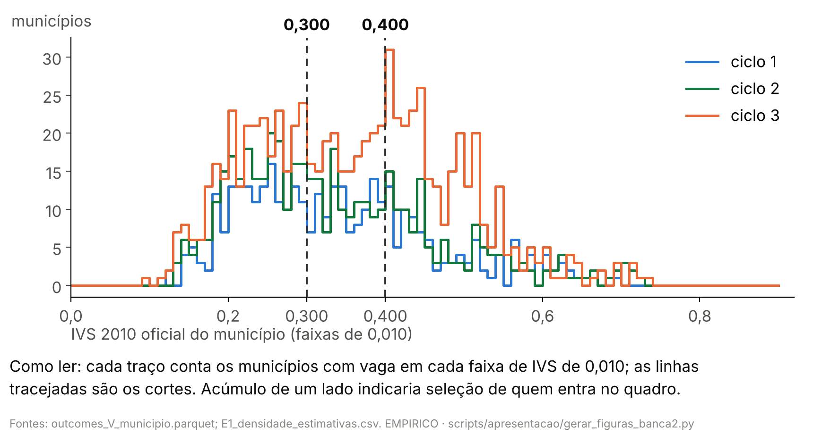
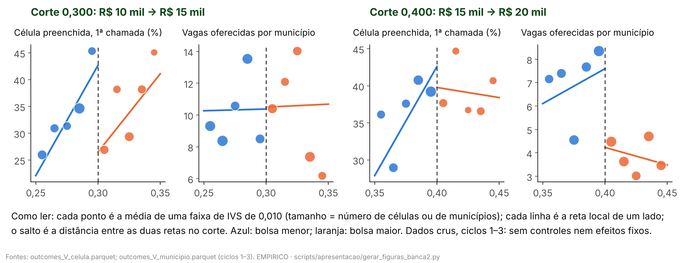

> [!NOTE]
> **Numeração da apresentação a partir de 26/10/2026:** H1 preenchimento; H2
> bolsa × origem (antes H3); H3 oferta (antes H4). Os nomes dos documentos de
> análise (P1h, P4, protocolos) não mudam. Este arquivo é o do deck completo, que fica como registro e
> não é mais atualizado (só com `--completo`); o deck usado é o curto
> ([04](04_conteudo_deck_curto.md)), na estrutura do
> [06](06_estrutura_obrigatoria_versao_final.md).

> [!IMPORTANT]
> **Como ler este arquivo.** O deck do grupo (template Insper, Montserrat)
> é a base do deck; este arquivo traz os slides novos, a **ordem do deck
> inteiro** e a classificação de cada slide do grupo. O corpo fica entre
> `deck:inicio` e `deck:fim`; o apêndice, entre `apendice:inicio` e
> `apendice:fim`. **Cada cabeçalho `##` é um slide novo**; cada marcador
> `<!-- grupo: N -->` põe ali o slide N do deck do grupo (com `| título`, o
> título muda); `#` marca a seção. Abaixo do título, a linha em `código` é o
> rastreio do rodapé (seção · rótulo) e o comentário `layout` diz ao gerador
> do deck como compor o slide. Num layout de duas colunas, `###` abre a coluna.
>
> **Escopo da organização (pedido do autor, 26/10/2026).** "Focar em fazer a
> parte empírica e ajustar o que precisa nos prévios; reutilizar tudo o que
> der." Os slides prévios do grupo (capa até a hipótese, com sumários, teoria e
> ocultos) ficam na ordem e com a visibilidade do grupo, só com as correções.
> Na parte empírica (hipóteses H1–H4 → base → metodologia econométrica →
> resultados → robustez e discussão), cada slide tem título-afirmação curto,
> no máximo três marcadores e uma frase de cautela; o detalhe vai para as
> notas do apresentador, e o que é importante mas não central vai inteiro
> para o apêndice.
>
> **O que vai à tela:** título, figura, tabela, marcadores, a frase de cautela
> (citação em negrito) e a linha `**Fontes:**`, em letra pequena. **Não vai à
> tela:** a linha `**Números:**`, os blocos `**Nota de produção.**` e as
> `**Notas do apresentador.**` (que vão para as notas do slide).
>
> **Regra dos números.** Todo número de um slide — título, corpo e notas — é
> o valor de um código listado na sua linha `**Números:**` ou um parâmetro do
> protocolo ([03, §3](03_proveniencia_figuras_e_numeros.md#3-parâmetros-que-podem-aparecer-sem-código)).
> `tests/test_conteudo_banca2.py` confere isso, confere cada valor contra o
> arquivo de `output/` de onde ele vem e confere que o deck gerado traz o mesmo
> texto deste arquivo.
>
> **Deck derivado, um arquivo só.** `scripts/apresentacao/gerar_deck_banca2.py`
> lê este arquivo e o deck do grupo e grava o entregável,
> `output/apresentacao_banca2/deck_banca2.pptx`: os slides do grupo, a parte
> empírica e o apêndice, na ordem deste arquivo. Divergência entre o deck e
> este arquivo é erro do deck.
>
> **H1 por corte (decisão do autor, 26/10/2026).** "Não mostre o empilhado;
> mostre os efeitos separados para cada corte." Na H1, todo slide do corpo
> mostra 0,300 e 0,400 separados; o empilhado (média dos dois cortes) só
> aparece no apêndice, rotulado como referência.
>
> **Leitura em linguagem simples.** O parágrafo `**O que isso quer dizer.**`
> vai à tela num bloco próprio: uma ou duas frases sobre o que o número
> significa para a pergunta. Os números dele seguem a regra dos números.
>
> **Layout.** O conteúdo ocupa a área útil: corpo de texto com 16 pt ou mais,
> tabelas do corpo com 14 pt ou mais (as linhas crescem até preencher a
> área), figuras H1, H2, H4 e cadeia desenhadas no tamanho em que entram no
> slide. `figura_painel L` põe a figura à esquerda, com até L polegadas de
> largura, e à direita os marcadores e o bloco "O que isso quer dizer"; o
> gerador para se um bloco não couber.

## Mapa do deck proposto

O deck proposto tem 64 slides: 23 prévios do grupo, a parte empírica (com as
três divisórias de sumário do grupo), o Q&A e 15 slides de apêndice. "Grupo N"
é o slide N do deck do grupo (36 slides); "novo" é um slide deste arquivo. O
teste confere este quadro contra o manifesto do deck.

| Nº | Origem | Título | Parte |
|---|---|---|---|
| 1 | grupo 1 | capa | prévios |
| 2 | grupo 2 | Sumário | prévios |
| 3 | grupo 3 | A escassez de especialistas já é tratada como urgência sanitária | prévios |
| 4 | grupo 4 | A escassez de especialistas já é tratada como urgência sanitária (oculto) | prévios |
| 5 | grupo 5 | O IVS 2010 define a bolsa do PMM-E por regra | prévios |
| 6 | grupo 6 | O IVS 2010 define a bolsa do PMM-E por regra | prévios |
| 7 | grupo 7 | O IVS 2010 define a bolsa do PMM-E por regra | prévios |
| 8 | grupo 8 | O IVS 2010 define a bolsa do PMM-E por regra (oculto) | prévios |
| 9 | grupo 9 | Política direciona incentivos aos territórios mais vulneráveis | prévios |
| 10 | grupo 10 | Política direciona incentivos aos territórios mais vulneráveis (oculto) | prévios |
| 11 | grupo 11 | Descritivo: antes × depois por faixa, sem comparação (oculto) | prévios |
| 12 | grupo 12 | Sumário | prévios |
| 13 | grupo 13 | Política direciona incentivos aos territórios mais vulneráveis (com a pergunta) | prévios |
| 14 | grupo 14 | Descritivo: antes × depois por faixa, sem comparação (oculto) | prévios |
| 15 | grupo 15 | Sumário | prévios |
| 16 | grupo 16 | O modelo combina três elementos da teoria | prévios |
| 17 | grupo 17 | A escolha locacional maximiza a utilidade | prévios |
| 18 | grupo 18 | Da escolha individual ao preenchimento agregado | prévios |
| 19 | grupo 19 | A escolha locacional maximiza a renda real líquida (oculto) | prévios |
| 20 | grupo 20 | Literatura divide o custo em dois tipos: geográfico e laboral (oculto) | prévios |
| 21 | grupo 21 | Da escolha individual ao preenchimento agregado (oculto) | prévios |
| 22 | grupo 22 | Sumário | prévios |
| 23 | grupo 23 | Da condição de aceitação, sai nossa hipótese econômica | prévios |
| 24 | novo | Testamos cada seta do modelo: quatro hipóteses | empírica: hipótese |
| 25 | grupo 24 | Sumário (Base de Dados) | empírica: divisória |
| 26 | novo | O PMM-E já teve três chamamentos: os três ciclos | empírica: base |
| 27 | novo | Os três ciclos em números | empírica: base |
| 28 | novo | A bolsa é função exata do IVS: a regra é sharp | empírica: exploratória |
| 29 | novo | Ciclo 1: os municípios com vaga não se acumulam nos cortes | empírica: exploratória |
| 30 | novo | Nos dados crus, o lado de bolsa maior não preenche mais | empírica: exploratória |
| 31 | novo | A 1ª opção fica perto de onde o médico já trabalhava | empírica: exploratória |
| 32 | grupo 26 | Sumário (Metodologia) | empírica: divisória |
| 33 | novo | Um estimador por hipótese | empírica: metodologia |
| 34 | novo | Especificação da H1: o salto no corte, com e sem as vagas | empírica: metodologia |
| 35 | novo | Especificação da H2 e da H3: o logit da 1ª opção | empírica: metodologia |
| 36 | novo | Especificação da H4: horas antes e depois de entrar | empírica: metodologia |
| 37 | novo | Especificação do TOST: o IC de 90% cabe na margem? | empírica: metodologia |
| 38 | novo | Hipóteses de identificação e como foram testadas | empírica: metodologia |
| 39 | grupo 28 | Sumário (Resultados) | empírica: divisória |
| 40 | novo | Na cadeia, só a escolha e o registro do médico se movem | empírica: resultados |
| 41 | novo | H1: o preenchimento não aumenta em nenhum dos dois cortes | empírica: resultados |
| 42 | novo | O controle muda a leitura: em 0,400 a queda passa pelas vagas | empírica: resultados |
| 43 | novo | Por que o preenchimento cai em 0,300 | empírica: resultados |
| 44 | novo | H2: a bolsa pesa na escolha da vaga só no ciclo 2 | empírica: resultados |
| 45 | novo | H3: no modelo de escolha, a UF de origem pesa mais que a bolsa | empírica: resultados |
| 46 | novo | H4: o médico soma horas, mas metade já estava no município | empírica: resultados |
| 47 | novo | Robustez: as leituras resistem, com ressalvas declaradas | empírica: robustez e discussão |
| 48 | novo | Discussão: o que não afirmamos e o que vem depois | empírica: robustez e discussão |
| 49 | grupo 30 | Q&A | encerramento |
| 50 | grupo 31 | Apêndice (divisor) | apêndice |
| 51 | novo | Apêndice: do modelo às equações estimadas | apêndice |
| 52 | novo | Apêndice: especificações formais de cada estimador | apêndice |
| 53 | novo | Apêndice: oito bases oficiais, ligadas por município e médico | apêndice |
| 54 | grupo 36 | Apêndice: o IVS mede a vulnerabilidade social | apêndice: dados |
| 55 | grupo 34 | Apêndice: plano de dados da banca 1, vagas e bolsa | apêndice: dados |
| 56 | grupo 35 | Apêndice: plano de dados da banca 1, lugar e custo | apêndice: dados |
| 57 | novo | Apêndice: o "IVS como piso" da banca 1 era um arquivo errado | apêndice |
| 58 | novo | Apêndice: nos mesmos cortes mudam outras regras federais | apêndice |
| 59 | novo | Apêndice: N1 a N4 por corte, com controle das vagas | apêndice |
| 60 | novo | Apêndice: A3 por corte e no ciclo 1 | apêndice |
| 61 | novo | Apêndice: a bolsa em todas as especificações do logit | apêndice |
| 62 | novo | Apêndice: robustez, teste a teste | apêndice |
| 63 | novo | Apêndice: o E9 resiste no ciclo 2; o empilhado é frágil | apêndice |
| 64 | novo | Apêndice: a magnitude da literatura e o IC por corte | apêndice |

Na parte empírica, os slides novos mudaram assim: os resultados abrem pela
cadeia-síntese, que é o mapa ("o que encontramos, pergunta a pergunta"), e H1
a H4 aprofundam cada linha dela; a regra sharp (IVS × faixa) abre o bloco de
análise exploratória, entre a Base de Dados e a Metodologia, com a
distribuição do IVS dos municípios com vaga, o gráfico cru da RDD por corte e
a escolha em relação à origem (pedido do autor de 26/10/2026); as fichas de
especificação têm os mesmos campos em todos os estimadores, e as do deck curto
são recortes delas, com o mesmo texto; depois de "antes e depois do controle"
vem o slide "Por que o preenchimento cai em 0,300", em duas ideias, com o
diagnóstico do protocolo 61 auditado (auditoria 33); a tabela de
fontes e as equações foram para o apêndice; a robustez teste a teste foi para
o apêndice, e no corpo ficou uma síntese por hipótese; os slides "Limites" e
"Um efeito do tamanho da literatura" foram fundidos no slide de discussão em
duas colunas, e o segundo também fica, inteiro, no apêndice. O detalhe de
"Limites" está nas notas da discussão e no apêndice das co-políticas.

## Classificação dos slides do deck do grupo

Cada um dos 36 slides do deck do grupo tem um destino: **corpo** (até o Q&A),
**apêndice** ou **removido**. O gerador do deck lê este quadro e para se ele
divergir dos marcadores `<!-- grupo: N -->`. Saem só os três marcadores "X" e
os dois slides "EXEMPLO" de outro trabalho; nenhum conteúdo do grupo saiu. Os
slides do grupo mantêm a visibilidade que o grupo deu a eles (oculto continua
oculto), e em todos o número de página digitado à mão vira o campo de número
do slide.

| Slide do grupo | Título no deck do grupo | Destino | Nº no deck proposto | Correção ou motivo |
|---|---|---|---|---|
| 1 | capa | corpo | 1 | — |
| 2 | Sumário | corpo | 2 | — |
| 3 | A escassez de especialistas já é tratada como urgência sanitária | corpo | 3 | — |
| 4 | A escassez de especialistas já é tratada como urgência sanitária (oculto) | corpo | 4 | oculto, como o grupo deixou |
| 5 | A vulnerabilidade social define o **piso** da bolsa do PMM-E | corpo | 5 | etapa de animação do 7, com as mesmas correções: título "O IVS 2010 define a bolsa do PMM-E por regra"; faixas pela grade aplicada (IVS até 0,300 → R$ 10 mil; de 0,301 a 0,400 → R$ 15 mil; acima de 0,400 → R$ 20 mil) no lugar da grade do FAQ, por classe do Ipea; nota "reproduz a faixa publicada em 368 de 368 municípios do ciclo 1"; "renumeração" → "remuneração" (auditoria 16, §2) |
| 6 | A vulnerabilidade social define o **piso** da bolsa do PMM-E | corpo | 6 | etapa de animação do 7; as mesmas correções do 5 |
| 7 | A vulnerabilidade social define o **piso** da bolsa do PMM-E | corpo | 7 | as mesmas correções do 5 |
| 8 | A vulnerabilidade social define o **piso** da bolsa do PMM-E (oculto) | corpo | 8 | oculto; frase "O IVS é o piso, não o critério" retirada (a contagem era artefato do arquivo de IVS errado, auditorias 16 e 19); no lugar, a regra aplicada e a reprodução no ciclo 1 |
| 9 | Política direciona incentivos aos territórios mais vulneráveis | corpo | 9 | gráfico "Maior presença nas regiões com maiores bolsas" retirado (não saía de `output/` por script e usava a grade do FAQ; antes × depois sem comparação não é efeito); no lugar, uma caixa que diz por quê |
| 10 | Política direciona incentivos aos territórios mais vulneráveis (oculto) | corpo | 10 | oculto; categorias do gráfico pela grade aplicada ("IVS até 0,300", "IVS de 0,301 a 0,400", "IVS acima de 0,400") |
| 11 | O programa é importante, e há indícios de efetividade (oculto) | corpo | 11 | oculto; título rebaixado para "Descritivo: antes × depois por faixa, sem comparação"; gráfico e tabela retirados (doc 44, §5.3) |
| 12 | Sumário | corpo | 12 | — |
| 13 | Política direciona incentivos aos territórios mais vulneráveis | corpo | 13 | a pergunta; o mesmo gráfico do 9 retirado, pelo mesmo motivo |
| 14 | Presença de especialistas cresceu em todos os níveis sociais (oculto) | corpo | 14 | oculto; rebaixado para descritivo, como o 11 |
| 15 | Sumário | corpo | 15 | — |
| 16 | O modelo combina três elementos da teoria | corpo | 16 | — |
| 17 | A escolha locacional maximiza a utilidade | corpo | 17 | — |
| 18 | Da escolha individual ao preenchimento agregado | corpo | 18 | — |
| 19 | A escolha locacional maximiza a renda real líquida (oculto) | corpo | 19 | oculto, como o grupo deixou |
| 20 | Literatura divide o custo em dois tipos: geográfico e laboral (oculto) | corpo | 20 | oculto; a referência "do slide 11" (o 19, que trazia o número 11 digitado) passa a "do slide 19" |
| 21 | Da escolha individual ao preenchimento agregado (oculto) | corpo | 21 | oculto, como o grupo deixou |
| 22 | Sumário | corpo | 22 | — |
| 23 | Da condição de aceitação, sai nossa hipótese econômica | corpo | 23 | — |
| 24 | Sumário | corpo | 25 | divisória da Base de Dados, padrão do deck do grupo |
| 25 | X | removido | — | marcador "X" da Base de Dados, substituído pelos slides novos |
| 26 | Sumário | corpo | 32 | divisória da Metodologia |
| 27 | X | removido | — | marcador "X" da Metodologia, substituído pelos slides novos |
| 28 | Sumário | corpo | 39 | divisória dos Resultados |
| 29 | X | removido | — | marcador "X" dos Resultados, substituído pelos slides novos |
| 30 | Q&A | corpo | 49 | fecha a apresentação |
| 31 | Apêndice | apêndice | 50 | divisor; as notas, que traziam uma conversa colada com a contagem do arquivo errado, viraram uma linha neutra |
| 32 | EXEMPLO (aplicativo de vinhos) | removido | — | modelo de outro trabalho, marcado "EXEMPLO" (critério do autor: sai se for claramente de outro trabalho) |
| 33 | EXEMPLO (aplicativo de vinhos) | removido | — | modelo de outro trabalho, como o 32 |
| 34 | O desafio é separar o efeito da bolsa do efeito da vulnerabilidade | apêndice | 55 | plano de dados da banca 1, com título "Apêndice: plano de dados da banca 1, vagas e bolsa"; "proporção de vagas" → "proporção de células (estabelecimento × curso) com alguma confirmação ou homologação: 30,3% na 1ª chamada; 35,6% somando a 2ª" (eram "35,6%" num slide e "30%" no outro, de chamadas diferentes); "SGETS" → "SGTES"; "Especialidade" → "curso"; faixa pela regra aplicada |
| 35 | O desafio é separar o efeito da bolsa do efeito da vulnerabilidade | apêndice | 56 | plano de dados da banca 1, com título "Apêndice: plano de dados da banca 1, lugar e custo"; as mesmas correções do 34; o IVS como running variable (entra contínuo e controla o custo do lugar; só a bolsa salta nos cortes), não como "custo territorial agregado" (doc 44, §2) |
| 36 | O IVS mede a vulnerabilidade social dos territórios brasileiros | apêndice | 54 | componentes do IVS; título "Apêndice: o IVS mede a vulnerabilidade social" |

O plano de dados da banca 1 (34 e 35) fica no apêndice como registro do que
foi proposto; o que entrou em cada estimador está nos slides de metodologia.

**Números:** `R_C1_REPR`, `R_C1_MUN`, `D_C1_PRE1_PCT`, `D_C1_PRE2_PCT`

---

<!-- deck:inicio -->

# Prévios do grupo

<!-- grupo: 1 -->

<!-- grupo: 2 -->

<!-- grupo: 3 -->

<!-- grupo: 4 -->

<!-- grupo: 5 -->

<!-- grupo: 6 -->

<!-- grupo: 7 -->

<!-- grupo: 8 -->

<!-- grupo: 9 -->

<!-- grupo: 10 -->

<!-- grupo: 11 -->

<!-- grupo: 12 -->

<!-- grupo: 13 -->

<!-- grupo: 14 -->

<!-- grupo: 15 -->

<!-- grupo: 16 -->

<!-- grupo: 17 -->

<!-- grupo: 18 -->

<!-- grupo: 19 -->

<!-- grupo: 20 -->

<!-- grupo: 21 -->

<!-- grupo: 22 -->

<!-- grupo: 23 -->

# Hipótese

## Testamos cada seta do modelo: quatro hipóteses

`Hipótese · Cadeia`

<!-- layout: cadeia -->

**Cadeia:** B ↑ (bolsa maior) → V ↑ (a vaga vale mais) → π ↑ (mais médicos a escolhem) → Pr(Y = 1) ↑ (a vaga é preenchida) → capacidade ↑ (horas de especialista no SUS)

| Hipótese | A pergunta, em linguagem simples | Seta do modelo |
|---|---|---|
| **H1** preenchimento | Onde a bolsa é maior, mais vagas são preenchidas? | B → Pr(Y = 1) |
| **H2** escolha | Os médicos escolhem mais as vagas de bolsa maior? | B → V → π |
| **H3** incentivo limitado | A bolsa pesa pouco comparada a trabalhar na UF de origem? | B contra o custo do lugar |
| **H4** capacidade líquida | O médico que chega soma horas ou só muda o registro? | chegada → capacidade |

**O que isso quer dizer.** Se a bolsa pesa pouco perto do custo do lugar (H3), ela muda quem escolhe qual vaga (H2) sem mudar quantas vagas preenchem (H1).

> **H3 é a hipótese central; H1 testa a consistência da cadeia.**

**Fontes:** plano da banca 2, §3; modelo da banca 1 (Moehling et al.; Redding e Rossi-Hansberg; Choné e Ma; Burdett, Shi e Wright).

**Números:** nenhum

> **Notas do apresentador.** A banca 1 testava só a última seta. Testar cada
> seta explica um resultado nulo no fim da cadeia: se a bolsa pesa pouco perto
> do custo do lugar (H3), ela reordena candidatos entre vagas (H2) sem mudar
> quantas vagas preenchem (H1). A H4 pergunta se o médico que chega aumenta a
> capacidade ou só passa a ser registrado onde já estava.

---

# Base de Dados

<!-- grupo: 24 -->

## O PMM-E já teve três chamamentos: os três ciclos

`Base de Dados · Ciclos`

<!-- layout: tabela -->

| Ciclo | Chamamento | Quadro de vagas (1ª chamada) | Resultado (1ª chamada) | 2ª chamada |
|---|---|---|---|---|
| 1 | Edital nº 3/2025 | 24/07/2025 | 10/09/2025 (alocação retificada) | 29/09/2025, só cadastro reserva |
| 2 | Edital nº 1/2026 | 03/02/2026 (retificado em 19/03/2026) | 05/05/2026 (remanescentes) | 16/04/2026, só cadastro reserva |
| 3 | Chamamento nº 28/2026, após adesão dos gestores (15/07/2026) | 16/07/2026 (retificado em 24/07/2026) | 25/08/2026, sub judice | não houve |

- **Quadro, candidatos, escolhas e 1ª chamada:** temos dos ciclos 1, 2 e 3.
- **2ª chamada e CNES depois do início:** só dos ciclos 1 e 2.

**O que isso quer dizer.** Sim, o programa já rodou três vezes: cada ciclo é uma rodada nova de vagas e candidatos. O ciclo 3 entra no preenchimento e na escolha; o seguimento dele no CNES espera a competência 202703 madura.

> **Cada ciclo é analisado dentro dele mesmo; o ciclo 3 pós-início segue congelado.**

**Fontes:** `output/apresentacao_banca2/cronologia_ciclos.csv`, gerada por `scripts/apresentacao/gerar_figuras_banca2.py` a partir de `docs/auditorias/aquisicao/A01_vagas_e_versionamento.md` (datas de publicação), do protocolo 48, §8 (editais), e de `output/rdd_bolsa/K_D2_resumo.json` (coortes de chegada).

**Números:** `CR_C1_EDITAL`, `CR_C2_EDITAL`, `CR_C3_EDITAL`, `CR_C1_QUADRO`, `CR_C1_RES`, `CR_C1_CH2`, `CR_C2_QUADRO`, `CR_C2_RETIF`, `CR_C2_RES`, `CR_C2_CH2`, `CR_C3_GEST`, `CR_C3_QUADRO`, `CR_C3_RETIF`, `CR_C3_RES`, `CR_D2_INI`, `CR_D2_FIM`

> **Notas do apresentador.** Resposta à pergunta "já rolou em três
> edições?": sim. Cada ciclo tem edital, quadro de vagas, escolha dos
> candidatos e resultado próprios. O ciclo 1 abriu com o Edital nº 3/2025 e o
> quadro de 24/07/2025; a 2ª chamada, em 29/09/2025, só teve vagas de cadastro
> reserva. O ciclo 2 abriu em 03/02/2026, com o quadro retificado em
> 19/03/2026. No ciclo 3, os gestores aderiram primeiro (resultado de
> 15/07/2026) e o quadro dos médicos saiu em 16/07/2026; o resultado de
> 25/08/2026 está sub judice. Os médicos dos ciclos 1 e 2 chegaram, na lista
> de ativos, entre as coortes trimestrais de 202507 e 202604. O CNES depois do
> início só existe para os ciclos 1 e 2.

---

## Os três ciclos em números

`Base de Dados · Descritivas`

<!-- layout: tabela_lateral -->

| Item | Ciclo 1 | Ciclo 2 | Ciclo 3 |
|---|---|---|---|
| Municípios com célula | 368 | 454 | 748 |
| Células (estab. × curso) | 1.295 | 1.547 | 2.293 |
| Vagas imediatas · cadastro reserva | 678 · 1.145 | 1.836 · 1.053 | 1.132 · 3.999 |
| Candidatos (universo G1) | 993 | 2.179 | 2.604 |
| … ligados ao CNES | 938 | 2.102 | 2.533 |
| … com 1ª opção numa célula | 993 | 2.140 | 2.581 |
| Amostra da escolha (P1) | 915 | 2.032 | 2.474 |
| Preenchidas na 1ª chamada | 393 (30,3%) | 728 (47,1%) | 497 (21,7%) |
| Preenchidas até a 2ª chamada | 461 (35,6%) | 867 (56,0%) | não observado |
| Municípios por faixa: R$ 10 · 15 · 20 mil | 159 · 107 · 102 | 210 · 115 · 129 | 276 · 180 · 291 (e 1 sem IVS) |

- **Célula:** estabelecimento × curso.
- **Preenchida:** alguma confirmação ou homologação.
- **"…":** partes do universo G1.

**O que isso quer dizer.** Os ciclos diferem em tamanho e em preenchimento: por isso comparamos sempre dentro do ciclo, perto dos cortes.

> **Descritivo: as diferenças entre ciclos não são efeito da bolsa.**

**Fontes:** `output/apresentacao_banca2/tabela_descritiva_ciclos.csv`, contada de `output/rdd_bolsa/outcomes/outcomes_V_celula.parquet` e de `output/rdd_bolsa/G1_resumo.json`.

**Números:** `D_C1_MUN`, `D_C2_MUN`, `D_C3_MUN`, `D_C1_CEL`, `D_C2_CEL`, `D_C3_CEL`, `D_C1_VI`, `D_C1_CR`, `D_C2_VI`, `D_C2_CR`, `D_C3_VI`, `D_C3_CR`, `D_C1_CAND1`, `D_C2_CAND1`, `D_C3_CAND1`, `D_C1_LIG`, `D_C1_CANDG1`, `D_C2_LIG`, `D_C2_CANDG1`, `D_C3_LIG`, `D_C3_CANDG1`, `D_C1_P1`, `D_C2_P1`, `D_C3_P1`, `M1_N`, `D_C1_PRE1`, `D_C1_PRE1_PCT`, `D_C2_PRE1`, `D_C2_PRE1_PCT`, `D_C3_PRE1`, `D_C3_PRE1_PCT`, `D_C1_PRE2`, `D_C1_PRE2_PCT`, `D_C2_PRE2`, `D_C2_PRE2_PCT`, `D_C1_F3`, `D_C1_F2`, `D_C1_F1`, `D_C2_F3`, `D_C2_F2`, `D_C2_F1`, `D_C3_F3`, `D_C3_F2`, `D_C3_F1`, `D_C3_SEM_IVS`

> [!NOTE]
> **Nota de produção.** A faixa é contada pela regra no IVS 2010 oficial; o
> script para se ela divergir da faixa publicada em alguma célula com IVS. O
> município sem IVS do ciclo 3 foi criado depois de 2010.

> **Notas do apresentador.** O ciclo 2 abriu mais vagas imediatas e preencheu
> uma fração maior das células; o ciclo 3 tem muito cadastro reserva. A
> ligação ao CNES passa de nove em cada dez candidatos em todos os ciclos. Se
> perguntarem pelos universos: o G1 conta todos os candidatos dos resultados;
> nos ciclos 2 e 3 alguns não têm a 1ª opção numa célula do quadro da 1ª
> chamada e ficam fora da escolha. A amostra do P1 exige 1ª opção numa célula
> do quadro, ligação ao CNES e município de origem, e soma 5.421 candidatos.
> Ciclo 3: só a 1ª chamada; o seguimento pós-início segue congelado. Uma
> célula pode ter várias vagas. A faixa é a da grade aplicada: até 0,300 →
> R$ 10 mil; de 0,301 a 0,400 → R$ 15 mil; acima de 0,400 → R$ 20 mil. As oito
> bases, com período, unidade e cobertura, estão no apêndice.

---

# Análise exploratória

## A bolsa é função exata do IVS: a regra é sharp

`Exploratória · IVS × faixa`

<!-- layout: figura_painel 8.0 -->


| Conferência (portão R1) | Resultado |
|---|---|
| escore da relação nominal do MS = IVS 2010 oficial, a 3 casas | 404/404 |
| ciclo 1 · ciclo 2: faixa reproduzida pela regra | 368 de 368 · 454 de 454 |
| ciclo 3 (congelado): o que falta foi criado depois de 2010 | 747 de 748 |

**O que isso quer dizer.** A bolsa é fixada pelo IVS de 2010, medido antes do programa: perto de cada corte, só ela (e as regras do mesmo corte) muda.

> **Primeiro estágio sharp: dois cortes, +R$ 5 mil em cada, 0 municípios do lado errado no ciclo 1.**

**Fontes:** `output/rdd_bolsa/portao_r1_ivs_oficial.json`; `output/aquisicao/a08_ivs_2010_oficial_municipio.csv`; auditoria 16; figura por `scripts/apresentacao/gerar_figuras_banca2.py`.

**Números:** `R_ESCORE_IGUAIS`, `R_C1_REPR`, `R_C1_MUN`, `R_C2_REPR`, `R_C2_MUN`, `R_C3_REPR`, `R_C3_MUN`, `R_LADO_ERRADO_OFICIAL`

> **Notas do apresentador.** É a evidência de que o desenho existe: o
> primeiro estágio é a própria regra. Cada ponto é um município do ciclo 1, na altura
> da bolsa anunciada. Até 0,300, R$ 10 mil; até 0,400, R$ 15 mil; acima,
> R$ 20 mil. O FAQ do edital descreve outra grade; a aplicada é esta.

---

## Ciclo 1: os municípios com vaga não se acumulam nos cortes

`Exploratória · Distribuição do IVS`

<!-- layout: figura_painel 8.0 -->



- **Teste de densidade E1 (ciclo 1):** sem acúmulo nos cortes; p de Holm 0,707 em 0,300 e 0,658 em 0,400.
- **Ciclo 3:** mais municípios logo acima de 0,400; descritivo, sem teste.

**O que isso quer dizer.** O IVS é de 2010 e ninguém muda de faixa; o que poderia mudar é quem entra no quadro de vagas. No ciclo 1, o teste não vê seleção nos cortes.

> **Descritivo; o teste de densidade é o do ciclo 1.**

**Fontes:** `output/rdd_bolsa/outcomes/outcomes_V_municipio.parquet`; `output/rdd_bolsa/E1_densidade_estimativas.csv` (doc 37); figura por `scripts/apresentacao/gerar_figuras_banca2.py`.

**Números:** `E1_300_HOLM`, `E1_400_HOLM`

> **Notas do apresentador.** Cada traço conta os municípios com vaga em cada
> faixa de IVS de 0,010, um por ciclo. Se o Ministério ou os gestores
> escolhessem pôr vagas de um lado do corte, haveria mais municípios logo
> acima ou logo abaixo dele. O teste de densidade (Poisson local) do ciclo 1
> não vê isso: p de Holm 0,707 em 0,300 e 0,658 em 0,400. No ciclo 3, há
> mais municípios logo acima de 0,400; é descritivo, sem teste, e a hipótese
> de que o quadro responda ao corte está na fila, com protocolo próprio.

---

## Nos dados crus, o lado de bolsa maior não preenche mais

`Exploratória · RDD crua`

<!-- layout: figura_larga -->



**O que isso quer dizer.** **0,400:** do lado de bolsa maior há menos vagas oferecidas (7,05 → 3,93 por município). **0,300:** a oferta não muda (10,08 e 9,82), e a célula preenchida só cai quando a reta é levada até o corte.

> **Descritivo: médias por faixa, sem controles; o teste é a RDD da H1.**

**Fontes:** `output/rdd_bolsa/outcomes/outcomes_V_celula.parquet` e `outcomes_V_municipio.parquet`; `output/rdd_bolsa/ND_estimativas.csv` (doc 49b); figura por `scripts/apresentacao/gerar_figuras_banca2.py`.

**Números:** `VIC_400_MABX`, `VIC_400_MACI`, `VIC_300_MABX`, `VIC_300_MACI`

> **Notas do apresentador.** É o gráfico clássico da RDD sem nenhum
> controle; o salto é a distância entre as duas retas no corte. Cada elemento está explicado na figura: o ponto
> é a média de uma faixa de IVS de 0,010 (o tamanho é o número de células ou
> de municípios), azul do lado de bolsa menor e laranja do lado de bolsa
> maior; a linha é a reta local de cada lado, com kernel triangular e
> h = 0,050; a tracejada é o corte. Em 0,400, as vagas oferecidas caem de
> 7,05 para 3,93 por município na janela. Em 0,300, ficam em 10,08 e 9,82;
> os pontos da célula preenchida estão no mesmo nível dos dois lados, e a
> reta do lado de bolsa menor sobe até o corte por causa de poucos
> municípios. É o que o slide da queda em 0,300 retoma.

---

## A 1ª opção fica perto de onde o médico já trabalhava

`Exploratória · Escolha e origem`

<!-- layout: figura_painel 8.6 -->


- **1ª opção:** 79% na UF de origem, 46% na região de saúde e 36% no próprio município.
- **Distância:** mediana de 51 km entre a origem e a 1ª opção.

**O que isso quer dizer.** Antes de qualquer modelo, a escolha já se concentra perto de onde o médico trabalhava; a H3 mede esse peso na mesma escala da bolsa.

> **Descritivo: origem é o vínculo no CNES antes das inscrições, não residência; o peso da origem não é causal.**

**Fontes:** `output/rdd_bolsa/G1_distancias_opcoes.parquet` e `G1_candidatos_origem.parquet` (portão G1); `output/aquisicao/malha_municipios_regioes_saude.parquet`; figura por `scripts/apresentacao/gerar_figuras_banca2.py`.

**Números:** `ESC_UF`, `ESC_REG`, `ESC_MUN`, `ESC_DIST_P50`, `ESC_N`

> **Notas do apresentador.** São 5.425 candidatos com 1ª opção e município
> de origem, ligados ao CNES por CPF mascarado e nome (portão G1). A origem é
> o município do estabelecimento em que o candidato tinha vínculo médico na
> competência anterior às inscrições; não é residência nem naturalidade.
> Mesmo município está dentro da mesma região, que está dentro da mesma UF.
> É preferência revelada: mistura família, rede, registro no conselho e
> clientela.

---

# Metodologia

<!-- grupo: 26 -->

## Um estimador por hipótese

`Metodologia · Estimadores`

<!-- layout: tabela -->

| Hipótese | Estimador | Unidade e amostra | Inferência |
|---|---|---|---|
| **H1** preenchimento | RDD sharp local linear em cada corte do IVS 2010 oficial, 0,300 e 0,400 separados | célula aberta (A3) e município (N); ciclos 1–3 | CR1 por município; TOST com IC 90% |
| **H2 e H3** escolha e incentivo limitado | logit condicional (McFadden) da 1ª opção | candidato × célula do mesmo curso e ciclo; ciclos 1–3 | cluster por conjunto de escolha; H3 com a covariância conjunta |
| **H4** capacidade líquida | estudo de evento escalonado (Callaway–Sant'Anna); comparação na nota de corte | médico × mês, ciclos 1 e 2 | bootstrap por médico; Rambachan–Roth |

**O que isso quer dizer.** Cada pergunta tem o desenho que ela pede: um salto no corte para o preenchimento, uma escolha entre vagas para a bolsa e o lugar, e a trajetória do médico antes e depois de entrar para a capacidade.

> **Nos cortes, o contraste é sempre o pacote do corte; nenhum estimador mede a participação no PMM-E.**

**Fontes:** plano da banca 2, §4.1; protocolos 40, 48, 52, 52b, 54, 56 e 59.

**Números:** nenhum

> **Notas do apresentador.** Todos os protocolos foram congelados antes de
> estimar; o da H3 (52b) é pós-resultado. Especificações principais: na H1,
> kernel triangular com h = 0,050, uma reta de cada lado por ciclo, um salto
> por corte e efeitos fixos de curso × ciclo e de tipo de vaga; na H2 e na
> H3, bolsa linear em R$ mil, IVS em spline com nós nos cortes, distância,
> mesma UF, mesma região, mesmo município, porte, capital e vaga imediata; na
> H4, controles ainda não tratados com base g − 1, efeito fixo de célula na
> comparação local e permutação na célula. O IC honesto (Armstrong e Kolesár) protege contra curvatura no
> corte; com o M do protocolo, ele sai largo demais para informar. Holm
> controla o erro nas primárias de cada família.

---

## Especificação da H1: o salto no corte, com e sem as vagas

`Metodologia · H1`

<!-- layout: tabela -->

| Campo | Como é feito |
|---|---|
| Outcome | vagas preenchidas na 1ª chamada, por município e ciclo (N1); a célula aberta preenchida (A3) usa a mesma RDD, com efeitos fixos de curso × ciclo e de tipo de vaga |
| Amostra | só municípios com vaga no quadro, ciclos 1–3; kernel triangular, h = 0,050; cada corte separado |
| Equação em palavras | vagas preenchidas = intercepto do ciclo + salto × (lado de bolsa maior) + reta de cada lado do corte, por ciclo + coeficiente do ciclo × vagas oferecidas; sem controle, sai o último termo |
| Comum e por ciclo | salto comum aos ciclos; intercepto, retas e coeficiente das vagas oferecidas, por ciclo |
| Erro-padrão | agrupado por município (CR1) |
| Leitura | sem controle = efeito total (abrir vagas + preenchê-las); com controle = preenchimento dado o número de vagas; total = via oferta + com controle |
| Cuidado | as vagas oferecidas podem responder ao corte: aí o controle compara municípios diferentes; pacote do corte |
| Sensibilidades | coeficiente único das vagas; inclinação por lado; IC honesto; h = 0,030 e 0,080; donut |

> **Em 0,400 quase todo o salto passa pela oferta de vagas; em 0,300, pelo preenchimento.**

**Fontes:** protocolo 48, §1, §3 e §7; doc 49, §2, §3 e §5; `output/rdd_bolsa/N_estimativas.csv`; equação formal no apêndice.

**Números:** `N1_300_UNICO`, `N1_400_UNICO`, `N1_300_SF`, `N1_400_SF`

> **Notas do apresentador.** O controle é o número de vagas oferecidas no
> quadro da 1ª chamada, imediatas mais cadastro reserva; a regra foi
> verificada nos quadros antes de estimar (doc 49, §2), porque um alocado da
> 1ª chamada pode ocupar vaga de reserva. A decomposição é exata
> (Frisch–Waugh–Lovell): o salto sem controle é igual ao salto com controle
> mais a soma, por ciclo, do coeficiente das vagas vezes o salto nas vagas. As
> vagas são definidas pelo gestor antes da escolha dos candidatos, mas podem
> responder ao corte; por isso relatamos as duas leituras. Sensibilidades em
> cada corte: com um só coeficiente das vagas, −1,64 em 0,300 e −0,11 em
> 0,400; com inclinação do controle diferente de cada lado, −1,38 e −0,04. O
> IC honesto contém zero nos dois cortes.

---

## Especificação da H2 e da H3: o logit da 1ª opção

`Metodologia · H2 e H3`

<!-- layout: tabela -->

| Campo | Como é feito |
|---|---|
| Outcome | a 1ª opção de cada candidato, entre todas as vagas (células) do mesmo curso e ciclo |
| Amostra | candidatos de 1ª opção ligados ao CNES e com município de origem, ciclos 1–3 |
| Equação em palavras | utilidade da vaga = peso da bolsa × bolsa + curva suave do IVS (nós nos cortes) + peso da distância × distância até a origem + pesos de mesma UF, mesma região e mesmo município + porte, capital e vaga imediata |
| Comum e por ciclo | pesos comuns aos ciclos na principal (M1); um peso da bolsa por ciclo no M5, o da H2 |
| Erro-padrão | agrupado por conjunto de escolha (curso × ciclo) |
| Leitura | H2: razão de chances de a vaga ser a 1ª opção por +R$ 5 mil. H3: toda a bolsa (10 × peso por R$ 1 mil) contra a mesma UF de origem, com a covariância conjunta; unilateral, pós-resultado |
| É causal? | bolsa: quase-experimental, pelo salto nos cortes (pacote do corte); origem: preferência revelada, não efeito causal |
| Cuidado | só quem se candidatou; independência de alternativas irrelevantes |
| Sensibilidades | log da distância, efeito fixo de UF, por ciclo, explodido (1ª e 2ª opção), misto, aninhado, placebos de corte |

> **Escolha entre vagas abertas, não entrada no programa; o peso da bolsa é o do pacote do corte.**

**Fontes:** protocolos 52 e 52b; docs 57a e 57i; equação formal no apêndice.

**Números:** `M1_N`

> **Notas do apresentador.** Logit condicional de McFadden: cada candidato
> escolhe a vaga de maior utilidade entre as do seu curso e ciclo. A amostra
> tem 5.421 candidatos. O peso da bolsa é por R$ 1 mil por mês; um degrau é
> R$ 5 mil. A curva do IVS absorve tudo o que muda suave com a
> vulnerabilidade, e só o salto da bolsa nos cortes identifica o peso dela. A
> H3 usa o mesmo modelo e soma dois coeficientes com a covariância conjunta;
> é pós-resultado porque os coeficientes já eram conhecidos.

---

## Especificação da H4: horas antes e depois de entrar

`Metodologia · H4`

<!-- layout: tabela -->

| Campo | Como é feito |
|---|---|
| Outcome | horas semanais cadastradas do médico no CNES: totais, no município do posto e fora dele |
| Amostra | médico × mês; médicos dos ciclos 1 e 2 na lista de ativos, ligados ao CNES |
| Equação em palavras | efeito k meses depois de entrar = mudança das horas desde o mês anterior à entrada, nos que entraram, menos a mesma mudança nos que ainda não entraram (Callaway–Sant'Anna) |
| Comum e por ciclo | um efeito por coorte de entrada (mês de início) e por mês; o resultado é a média do pós |
| Erro-padrão | bootstrap multiplicador agrupado por médico |
| Leitura | associação da entrada com as horas cadastradas, sob tendências paralelas; não é efeito da bolsa nem da participação no PMM-E |
| Cuidado | o pré falha em parte dos outcomes; horas cadastradas não são presença |
| Sensibilidades | Rambachan–Roth (violações de tendência); comparação com quem ficou logo abaixo da nota de corte (P4-CA) |

> **Associação sob tendências paralelas: vínculo cadastrado não é presença.**

**Fontes:** protocolos 54 e 59; docs 57d e 57h; equação formal no apêndice.

**Números:** nenhum

> **Notas do apresentador.** Os ciclos 1 e 2 entram no programa em meses
> diferentes, então a coorte de entrada faz o papel do ciclo. O estudo de evento escalonado compara cada
> médico, depois de entrar, com os que ainda não entraram no mesmo mês,
> usando como base o mês anterior à entrada. O pré testa se os grupos já se
> afastavam antes. Rambachan–Roth diz até que tamanho de violação da
> tendência paralela a conclusão continua de pé. A comparação na nota de
> corte usa quem ficou um ou dois pontos abaixo da nota como controle.

---

## Especificação do TOST: o IC de 90% cabe na margem?

`Metodologia · Equivalência`

<!-- layout: tabela -->

| Campo | Como é feito |
|---|---|
| Outcome | o salto no corte de A3 e de N1 com controle, cada corte separado |
| Amostra | a da RDD da H1: ciclos 1–3, kernel triangular, h = 0,050 |
| Equação em palavras | dois testes unilaterais a 5%: o salto é menor que +margem? é maior que −margem? Equivale a ver se o IC de 90% cabe em ±10 p.p. (A3) ou em ±25% da média abaixo do corte (N1) |
| Comum e por ciclo | o da RDD: salto comum aos ciclos; retas por ciclo |
| Erro-padrão | o da RDD, agrupado por município (IC convencional) |
| Leitura | os dois rejeitam: equivalência; só o do aumento: não houve aumento do tamanho da margem ou mais; nenhum: inconclusivo |
| Cuidado | vale sob a aproximação local linear; margens fixadas depois de ver os IC; barra que sai pela esquerda não é queda |
| Sensibilidades | IC honesto de N1 (nem o descarte do aumento se sustenta); A3 só no ciclo 1 |

> **"Não houve aumento de X ou mais" só onde o teste do aumento rejeita; equivalência só onde os dois rejeitam.**

**Fontes:** protocolo 60, parte A; doc 57j; auditoria 32.

**Números:** nenhum

> **Notas do apresentador.** O teste de zero pergunta se o salto é
> diferente de zero; o TOST pergunta se ele é pequeno. Com IC que contém zero,
> não dá para dizer "não mudou nada": só o TOST permite dizer que um aumento
> de certo tamanho fica descartado. As margens são as do protocolo 60; a de
> N1 foi transplantada da referência de candidaturas.

---

## Hipóteses de identificação e como foram testadas

`Metodologia · Identificação`

<!-- layout: tabela -->

| Hipótese de identificação (para quais H) | Situação |
|---|---|
| a faixa é função determinística do IVS, regra sharp (H1, H2, H3) | passa |
| sem manipulação do IVS (H1, H2, H3) | passa |
| continuidade dos potenciais no corte (H1) | passa, com seleção suspeita no ciclo 1 em 0,400 |
| dado o IVS contínuo, só a bolsa salta (H2, H3) | o pacote do corte não se separa (co-políticas) |
| independência de alternativas irrelevantes (H2, H3) | violada em parte; o coeficiente da bolsa muda pouco |
| tendências paralelas entre coortes de entrada (H4) | falha em parte dos outcomes |
| alocação quase aleatória perto da nota de corte (H4, P6) | balanço passa; desempate não é sorteio |

**O que isso quer dizer.** As hipóteses que sustentam o desenho passam; as que falham estão rotuladas e mudam a leitura: por causa delas falamos em pacote do corte e em associação na H4.

> **Outras regras federais mudam em 0,300 e 0,400: por isso "pacote do corte".**

**Fontes:** plano da banca 2, §4.2; auditorias 16 e 18; docs 37, 41, 49, 57a, 57d, 57f e 57h.

**Números:** nenhum

> **Notas do apresentador.** Como cada hipótese foi testada: regra sharp, o
> IVS oficial reproduz a faixa nos três ciclos; manipulação, o IVS foi medido
> em 2010, antes do programa, e há teste de densidade; continuidade, balanço de
> covariáveis e placebos de outcome e de corte; só a bolsa salta, spline com
> nós nos cortes, placebos de corte e spline cúbico; independência de
> alternativas, logit aninhado por região e logit misto; tendências paralelas,
> teste conjunto do pré e Rambachan–Roth; alocação perto da nota de corte,
> balanço e desempate por regra fixa. A regra sharp é o que torna a descontinuidade
> possível. A ameaça que não se testa por inteiro é a das co-políticas: emendas,
> custeio de MAC, o IED da APS e a coparticipação do PMMB mudam nos mesmos
> cortes. Na DiRD, só a parte fixa no tempo delas sai.

---

# Resultados

<!-- grupo: 28 -->

## Na cadeia, só a escolha e o registro do médico se movem

`Resultados · Cadeia`

<!-- layout: figura_painel 8.0 -->


- **Escolha:** a bolsa reordena a 1ª opção só no ciclo 2.
- **Preenchimento:** nenhum aumento detectável em nenhum dos dois cortes.
- **Capacidade:** o médico soma horas, mas metade já estava lá.

**O que isso quer dizer.** A bolsa muda quem escolhe qual vaga, não quantas vagas preenchem; metade de quem chega já trabalhava no município.

> **Nenhuma pergunta tem hoje evidência causal limpa de mudança no resultado medido.**

**Fontes:** `output/rdd_bolsa/S57_resumo.json` (doc 57, §2 e §4); `output/rdd_bolsa/P1h_magnitudes.csv` (doc 57i); figura por `scripts/apresentacao/gerar_figuras_banca2.py`.

**Números:** nenhum

> **Notas do apresentador.** É o mapa dos resultados: uma linha por
> pergunta, na ordem da cadeia, e os próximos slides aprofundam cada uma.
> Cinza: o IC contém o nulo. O preenchimento aparece por corte, 0,300 e
> 0,400 separados; ali a força sai do TOST do protocolo 60: nos quatro casos,
> não houve aumento do tamanho da margem ou mais. Verde em N1 a 0,300 é
> negativo, mas não é queda: linha por corte, sem correção múltipla, com IC
> honesto que contém zero e pacote do corte. Verde
> em P6 Y1 é quase mecânico. Verde em P4 é associação: nas horas totais o pré
> passa e a conclusão aguenta violações de tendência do tamanho das do pré,
> mas outros outcomes do P4 falham no pré. A linha da H3 rejeita zero, mas é
> pós-resultado e compara dois pesos do mesmo modelo de escolha: não é efeito
> da bolsa nem da geografia. A força de cada linha sai de uma regra fixa do
> gerador sobre os valores de `output/`: TOST por corte, "sem aumento ≥
> margem"; Holm ou IC com o nulo, inconclusivo;
> pré do Wald, ATT; estatuto do bloco, exploratório; Holm abaixo de 0,05 num
> bloco pós-resultado, "rejeita zero, pós-resultado". As linhas nos cortes de
> IVS medem o pacote do corte.

---

## H1: o preenchimento não aumenta em nenhum dos dois cortes

`Resultados · H1`

<!-- layout: figura_painel 7.8 -->


- **TOST:** em cada corte, sem aumento de +10 p.p. (A3) nem de +25% da média (N1).
- **N1 em 0,300 não é queda:** sem correção múltipla; IC honesto contém zero.

**O que isso quer dizer.** Em 0,400, do lado de bolsa maior há menos vagas oferecidas (−3,59); com o controle, o salto quase some. Em 0,300, cai a taxa por vaga oferecida (−16,0 p.p.), 51% dela no ciclo 2; depende da medida.

> **Pacote do corte, com o IC convencional; uma queda do mesmo tamanho não fica descartada.**

**Fontes:** `output/rdd_bolsa/N_estimativas.csv` (doc 49, §3); `S57_resumo.json` (A3; doc 57, §4.2); `EQ_estimativas.csv` (TOST; doc 57j; auditoria 32); `ND_estimativas.csv` (doc 49b, §3).

**Números:** `A3_300_TAU`, `A3_300_INF`, `A3_300_SUP`, `A3_300_MDE`, `A3_400_TAU`, `A3_400_INF`, `A3_400_SUP`, `A3_400_MDE`, `N1_300_TAU`, `N1_300_INF`, `N1_300_SUP`, `N1_300_P`, `N1_300_MEDIA`, `N1_400_TAU`, `N1_400_INF`, `N1_400_SUP`, `N1_400_P`, `N1_400_MEDIA`, `N1_300_SB_TAU`, `N1_300_SB_INF`, `N1_300_SB_SUP`, `N1_400_SB_TAU`, `N1_400_SB_INF`, `N1_400_SB_SUP`, `N1_300_HON_INF`, `N1_300_HON_SUP`, `N1_400_HON_INF`, `N1_400_HON_SUP`, `EQ_A3_300_I90I`, `EQ_A3_300_I90S`, `EQ_A3_400_I90I`, `EQ_A3_400_I90S`, `EQ_N1_300_I90I`, `EQ_N1_300_I90S`, `EQ_N1_400_I90I`, `EQ_N1_400_I90S`, `EQ_N1_300_MARG`, `EQ_N1_400_MARG`, `ND_VIC400`, `ND_TX400`, `ND_TX300`, `ND_TX300_INF`, `ND_TX300_SUP`, `ND_TX300_C2`, `ND_TX300_C2_PCT`, `ND_TXVI300`, `ND_TXVI300_INF`, `ND_TXVI300_SUP`

> [!NOTE]
> **Nota de produção.** Decisão do autor de 26/10/2026: só os cortes
> separados; o empilhado fica no apêndice como referência. O TOST é o do
> protocolo 60, parte A (doc 57j), com as correções da auditoria 32: o IC de
> N1 abaixo de zero não é lido como queda.

> **Notas do apresentador.** IC que contém zero não é efeito zero. Cada
> corte separado, ciclos 1 a 3. A célula
> aberta preenchida (A3): em 0,300, −8,4 p.p. [−18,5; +1,7], MDE 14,5; em
> 0,400, −1,3 p.p. [−14,0; +11,3], MDE 18,1. As vagas preenchidas por
> município com controle das vagas oferecidas (N1): em 0,300, −1,45
> [−2,67; −0,22], p 0,021, sobre uma média de 2,32 do lado de bolsa menor; em
> 0,400, −0,14 [−0,82; +0,54], p 0,682, sobre 1,96. Sem controle, −1,56
> [−3,73; +0,61] e −1,36 [−3,30; +0,57]. No TOST, com IC 90%: A3 em 0,300,
> [−16,9; +0,1]; em 0,400, [−11,9; +9,3]; N1 em 0,300, [−2,48; −0,42], margem
> de 0,58 vaga; em 0,400, [−0,71; +0,43], margem de 0,49. Nos quatro, só o
> teste do aumento rejeita: não houve aumento de +10 p.p. ou de +25% da média
> ou mais, no IC convencional e para o pacote do corte; uma queda desse
> tamanho não fica descartada. N1 em 0,300 não é queda: é linha por corte,
> sem correção múltipla; o IC honesto vai de −90,23 a +87,34 (em 0,400, de
> −47,07 a +46,79); e é o pacote do corte. Por que o sinal sai negativo
> (doc 49b): em 0,400, do lado de bolsa maior há municípios menores e menos
> vagas oferecidas (−3,59 por município); a taxa por vaga não salta (+2,5
> p.p.), e com o controle o salto quase some. Em 0,300, o porte não explica:
> cai a taxa de preenchimento por vaga oferecida, −16,0 p.p. [−27,9; −4,1];
> −8,1 p.p. disso, 51%, vêm do ciclo 2, onde sobe a parte das vagas que é
> cadastro reserva. O resultado depende da medida: com só as vagas imediatas
> no denominador, −19,2 p.p. [−43,1; +4,7].

---

## O controle muda a leitura: em 0,400 a queda passa pelas vagas

`Resultados · H1 · Controle`

<!-- layout: figura_larga -->


**O que isso quer dizer.** **0,400:** −1,36 = −1,22 via vagas + −0,14: do lado de bolsa maior há menos vagas oferecidas (−3,59), e com o controle a diferença quase some. **0,300:** −1,56 = −0,11 + −1,45: a oferta não muda (+0,39); cai o preenchimento dado as vagas.

> **Se as vagas respondem ao corte, o controle compara municípios diferentes: por isso as duas versões. Pacote do corte; nenhuma linha passa no Holm.**

**Fontes:** `output/rdd_bolsa/N_estimativas.csv` (decomposição e S-c; doc 49, §3 a §5); `output/rdd_bolsa/ND_estimativas.csv` (médias na janela; doc 49b, §3); figura por `scripts/apresentacao/gerar_figuras_banca2.py`.

**Números:** `N1_300_DTOT`, `N1_300_VIA`, `N1_300_DSA`, `N1_400_DTOT`, `N1_400_VIA`, `N1_400_DSA`, `VIC_300_TAU`, `VIC_300_INF`, `VIC_300_SUP`, `VIC_400_TAU`, `VIC_300_MABX`, `VIC_300_MACI`, `VIC_400_MABX`, `VIC_400_MACI`

> **Notas do apresentador.** É a mesma regressão com e sem as vagas
> oferecidas do quadro da 1ª chamada. A decomposição é exata
> (Frisch–Waugh–Lovell): o salto sem controle é igual ao com controle mais a
> parte que passa pelas vagas, que é a soma, por ciclo, do coeficiente das
> vagas vezes o salto nas vagas; essa parte é uma soma algébrica, sem IC
> próprio. Em 0,400, do lado de bolsa maior as vagas oferecidas caem de 7,05
> para 3,93 por município na janela, e o lado de baixo tem alguns municípios
> grandes; dado o número de vagas, a diferença quase some (−0,14). Em 0,300,
> as médias de vagas oferecidas ficam em 10,08 e 9,82, e o salto nelas é
> +0,39 [−6,69; +7,46]: a oferta não muda, e o que cai é o preenchimento dado
> as vagas, que o slide seguinte tenta explicar. Nenhuma linha por corte tem
> correção múltipla; no Holm pré-registrado da família N (empilhado, no
> apêndice), N1 não rejeita zero.
> É o pacote do corte.

---

## Por que o preenchimento cai em 0,300

`Resultados · H1 · Queda em 0,300`

<!-- layout: figura_painel 7.8 -->


- **É a estimativa no corte, não os dados:** nas médias da janela, 33,3% das células são preenchidas abaixo e 33,5% acima; a queda vem da reta levada até o corte, com poucos municípios. O acaso não está descartado.
- **As vagas do lado de cima eram diferentes:** cursos que preenchem pouco em qualquer lugar, mais células do mesmo curso na mesma UF disputando candidatos e, no ciclo 2, mais células só de reserva. Igualando esses fatores, a queda diminui pela metade ou mais em parte das medidas, mas nenhum fator faz isso nas três.

> **Nada disso mostra que a bolsa reduz o preenchimento: o corte junta a bolsa com outras regras.**

**Fontes:** `output/rdd_bolsa/DQ_estimativas.csv`, `DQ_resumo.json` e `DQ_figuras/DQ_quanto_da_queda.png` (protocolo 61; doc 57l; auditoria 33, §8); figura usada sem redesenho, conferida pelo hash.

**Números:** `DQ_FUN_PRE_ABX`, `DQ_FUN_PRE_ACI`, `DQ_CURSO_TAU`, `DQ_CURSO_INF`, `DQ_CURSO_SUP`, `DQ_CONCUF_TAU`, `DQ_CONCUF_INF`, `DQ_CONCUF_SUP`, `DQ_SOCR_C2_TAU`, `DQ_SOCR_C2_INF`, `DQ_SOCR_C2_SUP`, `DQ_CAND1_TAU`, `DQ_CAND1_INF`, `DQ_CAND1_SUP`, `DQ_FIX_COMP_Q2`, `DQ_FIX_COMP_Q2_PCT`, `DQ_FIX_CONC_Q2`, `DQ_FIX_CONC_Q2_PCT`, `DQ_FIX_FUNIL_Q1`, `DQ_FIX_FUNIL_Q1_PCT`, `DQ_PPOSTO_Q1`, `DQ_PCOMP_Q1`

> **Notas do apresentador.** Diagnóstico do protocolo 61 (doc 57l),
> auditado (auditoria 33, aprovado com correções de texto): descritivo e
> pós-resultado. Q1 é N1 com controle; Q2, a taxa por vaga oferecida; Q3, a
> célula aberta preenchida. Nas médias da janela, sem reta nem efeitos fixos,
> 33,3% das células são preenchidas abaixo de 0,300 e 33,5% acima. Do lado de
> cima: índice de curso −4,5 p.p. [−7,1; −2,0] (cursos que preenchem pouco em
> qualquer lugar); +10,6 [+3,5; +17,8] células do mesmo curso na mesma UF; no
> ciclo 2, +28,4 p.p. [+8,3; +48,4] de células só de reserva. Que menos
> células tiveram candidato de 1ª opção é estimativa imprecisa: −10,8 p.p.
> [−28,2; +6,7]. Igualando a composição, Q2 vai a −5,1 p.p., 32% do
> original; a concorrência, Q2 a −4,3 p.p., 27%; quem teve candidato de 1ª
> opção, Q1 a −0,49, 34%; nenhum fator reduz a queda à metade nas três
> medidas. Acaso: com os 3 cortes falsos do protocolo, o p por posto é 0,250,
> o menor possível; numa grade maior, fora do protocolo, 0,031. Esses
> fatores se formam depois do anúncio da faixa: descrevem o que acompanha a
> queda, não a causa.

---

## H2: a bolsa pesa na escolha da vaga só no ciclo 2

`Resultados · H2`

<!-- layout: figura_painel 8.2 -->


- **Ciclo 2:** 1,70 [1,22; 2,37] por +R$ 5 mil, p 0,002.
- **Ciclos 1 e 3:** 1,07 [0,69; 1,65] e 1,00 [0,72; 1,39]; o IC contém 1.

**O que isso quer dizer.** Só no ciclo 2 a vaga de bolsa maior é mais escolhida como 1ª opção; nos ciclos 1 e 3, não. A igualdade entre ciclos tem p 0,058.

> **Escolha não é expansão: o que uma vaga ganha, outra do mesmo curso perde.**

**Fontes:** `output/rdd_bolsa/P1_estimativas.csv` (M5; doc 57a); `output/rdd_bolsa/E8_resumo.json` (E9, doc 44, §5.2), nas notas.

**Números:** `M5_C1_RC`, `M5_C1_RCI`, `M5_C1_RCS`, `M5_C2_RC`, `M5_C2_RCI`, `M5_C2_RCS`, `M5_C2_P`, `M5_C3_RC`, `M5_C3_RCI`, `M5_C3_RCS`, `M5_WALD_P`, `M1_RC`, `M1_RC_INF`, `M1_RC_SUP`, `M1_P`, `E9_C2_RC`, `E9_C2_RCI`, `E9_C2_RCS`, `M1_N`

> **Notas do apresentador.** Um resultado por ciclo, do logit condicional
> com distância (M5): a razão de chances compara duas vagas abertas do mesmo
> curso e ciclo que diferem só no degrau de R$ 5 mil, com o IVS contínuo
> controlado. O modelo com os três ciclos juntos (M1), que é a primária do
> protocolo, dá 1,24 [0,99; 1,55], p 0,065: inconclusivo; ele está no
> apêndice com as outras especificações. No ciclo 2 sem a distância (E9,
> exploratório), 1,95 [1,48; 2,57]; o sinal do ciclo 2 resiste a placebos de
> corte e a poucos clusters. São 5.421 candidatos de 1ª opção. O que não
> mede: quem deixou de se candidatar e quantos médicos o programa atrai.

---

## H3: no modelo de escolha, a UF de origem pesa mais que a bolsa

`Resultados · H3`

<!-- layout: figura_blocos 5.3 -->


- **Log-chance:** 0,21 ≈ chance cerca de 24% maior de a vaga ser a 1ª opção, sem distinção de zero; não é efeito no preenchimento.

**Como foi medido.** Logit da H2 (ciclos 1–3): cada candidato escolhe a 1ª opção entre as vagas do seu curso e ciclo; pesos de bolsa, distância, origem, porte, capital, vaga imediata e IVS em curva suave. ‖ A H3 compara dois pesos, toda a bolsa (R$ 10 → 20 mil) e a UF de origem: **D_UF = θ_UF − 10·β = 1,98 [1,56; 2,40]**, p unilateral < 0,001 (Holm), pós-resultado.

**É causal?** **Bolsa, quase-experimental:** salta nos cortes e o resto varia suave; vale o pacote do corte, para quem se candidatou. ‖ **Origem, não:** preferência revelada (família, rede, registro, clientela), não sorteada.

> **Pós-resultado: θ é preferência revelada, não efeito da geografia; β é o pacote do corte.**

**Fontes:** `output/rdd_bolsa/P1h_magnitudes.csv`, `P1h_resumo.json` e `P1h_figuras/P1h_magnitudes.png` (script 25c; doc 57i; protocolo 52b; auditoria 31).

**Números:** `H3_DUF`, `H3_DUF_INF`, `H3_DUF_SUP`, `H3_DUF_P`, `H3_K10`, `H3_K10_INF`, `H3_K10_SUP`, `H3_S_M2`, `H3_S_M4`, `H3_S_M5C1`, `H3_S_M5C2`, `H3_S_M5C3`, `H3_S_M7`, `H3_10B`, `H3_10B_INF`, `H3_10B_SUP`, `H3_THETA`, `H3_THETA_INF`, `H3_THETA_SUP`, `H3_K5`, `H3_K5_P`, `M1_P`, `H3_5B`, `M1_RC_PCT`

> [!NOTE]
> **Nota de produção.** A figura é a do P1h, sem redesenho; o gerador de
> figuras confere o SHA-256 dela contra `P1h_resumo.json` antes de registrar
> os números. O teste formal é pós-resultado: os coeficientes do M1 já eram
> conhecidos quando o protocolo 52b foi congelado.

> **Notas do apresentador.** É a hipótese central: incentivo limitado.
> Escolha de quem se candidatou, entre vagas abertas. As seis
> sensibilidades: M2 1,18; M4 1,73; M5 por ciclo 2,34, 1,31 e 2,37; M7 2,07. θ_UF
> é mesma UF, outra região de saúde, contra uma vaga em outra UF à mesma
> distância. No modelo de escolha, toda a amplitude da bolsa pesa 0,42
> [−0,03; 0,87] na utilidade, e a vaga na mesma UF de origem, fora da região
> de saúde, pesa 2,40 [2,28; 2,53]. A bolsa pesa pouco perto do custo do
> lugar. Em km, toda a bolsa vale 224 km [−18; 466]; o IC contém zero. Isso é coerente com a H1 não detectar aumento de preenchimento: a
> bolsa reordena os candidatos entre as vagas abertas (H2), e o que uma vaga
> ganha outra do mesmo curso perde; ela não traz mais candidatos, e o logit
> não vê quem não se inscreveu. Um degrau de R$ 5 mil vale 112 km, também com
> IC que contém zero. Se perguntarem pelo p de 0,035 do km: é unilateral e
> descritivo; o teste pré-registrado da bolsa é o bilateral do P1a, com p
> 0,065, que não rejeita. Não usamos o km como prova de que a bolsa importa.
> θ é preferência revelada condicional ao modelo, não efeito da geografia.
> É causal? O peso da bolsa tem identificação quase-experimental pelos saltos
> nos cortes; o da origem é preferência revelada, porque a origem é onde o
> médico já trabalhava, não uma condição sorteada.

---

## H4: o médico soma horas, mas metade já estava no município

`Resultados · H4`

<!-- layout: figura_painel -->


- **Origem (descritivo):** 51,0% [48,4; 53,7] já tinham vínculo no município do posto.
- **Rambachan–Roth:** as horas totais aguentam violações até 1,30 vez a maior do pré.

**O que isso quer dizer.** Quem entra passa a ter mais horas cadastradas, sobretudo no posto. Mas metade já trabalhava ali: parte do ganho é registro novo, não médico novo.

> **Associação sob tendências paralelas, não efeito da bolsa nem da participação no PMM-E: horas cadastradas não são presença.**

**Fontes:** `output/rdd_bolsa/S57_resumo.json` (P4, doc 57d); `output/rdd_bolsa/H_estimativas.csv` e `CA_estimativas.csv` (doc 57h).

**Números:** `P4_HT_ATT`, `P4_HT_INF`, `P4_HT_SUP`, `P4_HT_PRE`, `RR_HT`, `P4_HM_ATT`, `P4_HM_PRE`, `P4_HF_ATT`, `P4_ORIGEM`, `P4_ORIGEM_INF`, `P4_ORIGEM_SUP`, `CA_HT_EST`, `CA_HT_INF`, `CA_HT_SUP`, `CA_HT_HOLM`, `CA_HM_EST`

> **Notas do apresentador.** A pergunta é se o programa cria oferta ou paga
> quem já estava. O médico soma +6,6 h/sem [+5,4; +7,8] de horas totais
> cadastradas (pré com p 0,310), sobretudo no município do posto (+8,7, com o
> pré falhando, p 0,001), e perde −2,1 fora dele. Metade já trabalhava no
> município. Na nota de corte (P4-CA), horas totais +7,91 [−0,63; +16,45], p
> de Holm 0,162; no município da 1ª opção, +10,92. Na comparação
> com quem ficou um ou dois pontos abaixo da nota de corte, o pré passa e a
> direção é a mesma, mas o IC das horas totais contém zero. As horas no
> município da 1ª opção são em parte mecânicas: ser alocado cria o vínculo.

---

# Robustez e discussão

## Robustez: as leituras resistem, com ressalvas declaradas

`Robustez · Síntese`

<!-- layout: tabela -->

| Hipótese | O que resiste | Ressalva |
|---|---|---|
| H1 | 0,300: negativo com h = 0,030 e 0,080 (−1,50 e −1,00), no donut (−1,53) e com um só coeficiente (−1,64); 0,400: perto de zero (−0,23, +0,03, +0,36, −0,11) | o IC honesto contém zero nos dois cortes; em 0,300 a leitura depende da medida da taxa |
| H2 | coeficiente positivo em todas as especificações (de +0,0304 a +0,0759 por R$ 1 mil); o ciclo 2 resiste a placebos (p por posto 0,036) | o IC contém zero no M1 e no M7; ciclo 2 com spline cúbico: p 0,083 |
| H3 | D_UF positivo nas seis especificações, de 1,18 a 2,37, com q de BKY < 0,05 | pós-resultado: os coeficientes do M1 já eram conhecidos |
| H4 | horas totais aguentam violações até 1,30 vez a maior do pré; no posto, até 1,90 | fora do posto, só até 0,78; na nota de corte, +7,91 [−0,63; +16,45] |

**O que isso quer dizer.** Nenhuma conclusão muda com outras janelas, especificações ou violações moderadas de tendência; as ressalvas dizem onde a leitura depende de uma escolha.

> **Especificações fixadas em protocolo antes de estimar; a H3 é pós-resultado e está rotulada assim.**

**Fontes:** `output/rdd_bolsa/N_estimativas.csv` (doc 49); `P1_estimativas.csv` (doc 57a); `E8_resumo.json` (E9); `P1h_magnitudes.csv` (doc 57i); `H_estimativas.csv` e `CA_estimativas.csv` (doc 57h). Teste a teste, com os números: apêndice.

**Números:** `N1_300_H030`, `N1_300_H080`, `N1_300_DONUT`, `N1_300_UNICO`, `N1_400_H030`, `N1_400_H080`, `N1_400_DONUT`, `N1_400_UNICO`, `M7_COEF`, `M4_COEF`, `E9_C2_PPOSTO`, `E9_C2_CUB_P`, `H3_S_M2`, `H3_S_M5C3`, `RR_HT`, `RR_HM`, `RR_HF`, `CA_HT_EST`, `CA_HT_INF`, `CA_HT_SUP`

> **Notas do apresentador.** Na H1, cada corte separado: em 0,300, N1 fica
> negativo em todas as variantes; em 0,400, fica perto de zero em todas. O IC
> honesto, com o M da regra de bolso, sai largo demais para
> informar. Ruptura de M̄ igual a 1 quer dizer que a conclusão aguenta
> violações de tendência do mesmo tamanho das vistas no pré. O apêndice traz
> cada teste com o número. A H3 é pós-resultado porque os coeficientes do M1
> já eram conhecidos quando o protocolo 52b foi congelado.

---

## Discussão: o que não afirmamos e o que vem depois

`Discussão · Limites e literatura`

<!-- layout: duas_colunas -->

### O que não podemos afirmar

- **Pacote do corte.** Em 0,300 e 0,400 mudam também emendas, custeio de MAC, o IED da APS e a coparticipação do PMMB; o salto mede tudo junto.
- **Sem margem extensiva.** A escolha é só de quem já se candidatou; o logit não vê quem deixou de se inscrever.
- **Vínculo não é presença.** Horas e vínculos são cadastros do CNES. Não é a participação no PMM-E, nem o Agora Tem Especialistas.

### Literatura e próximos passos

- **Dal Bó, Finan e Rossi (2013):** +33% no salário anunciado deu +15,1 p.p. na aceitação. Aqui, com degraus de +50% e +33%, o IC admite no máximo +1,7 p.p. em 0,300 e +11,3 em 0,400.
- **Escolha não é expansão.** A bolsa reordena candidatos entre vagas sem mudar quantas vagas preenchem.
- **Próximos passos:** repetir o ciclo 2 no ciclo 3, com a competência 202703 madura; pedir o universo de inscritos e a folha de pagamento.

> **Inconclusivo não quer dizer que a bolsa não funciona: é ausência de efeito detectável, nos limites acima.**

**Fontes:** auditoria 18, §2 e §3; doc 44, §6 (trechos do doc 20 da seção 03 copiados em `output/rdd_bolsa/E8_resumo.json`); doc 57, §4.2, §6 e §7.

**Números:** `LIT_DALBO_SAL`, `LIT_DALBO_ACEIT`, `MAG_DEG300`, `MAG_DEG400`, `A3_300_SUP`, `A3_400_SUP`, `LIT_DALBO_CAND`, `LIT_BOBBA`, `CP_EMENDAS`, `CP_752_300`, `CP_752_400`

> **Notas do apresentador.** À esquerda, o que o contraste não mede. Nos
> mesmos cortes mudam o teto de emendas e de custeio de MAC (+20% para IVS
> maior que 0,3), o estrato do IED da APS e o teto de coparticipação do PMMB
> (10% → 40% em 0,3; 40% → 100% em 0,4); a DiRD tira só a parte fixa no
> tempo. O logit não vê quem deixou de se inscrever, e um aumento igual da
> bolsa em todas as vagas não muda nenhuma escolha no modelo. Horas e
> vínculos são cadastros do CNES, não horas trabalhadas nem retenção
> individual. O efeito candidato é o incentivo marginal de R$ 5 mil
> anunciado, como pacote do corte. À direita: em Dal Bó et al., candidaturas
> +26%; em Bobba et al., um adicional de +13% por regra não mudou o
> preenchimento. Aqui o degrau é de +50% em 0,300 e +33% em 0,400; se a
> resposta fosse da mesma ordem, nenhum dos dois IC por corte a admitiria. Contextos e
> outcomes diferentes: lá, servidores e aceitação da oferta; aqui,
> especialistas e célula com confirmação ou homologação. O detalhe da
> literatura e das co-políticas está no apêndice.

<!-- grupo: 30 -->

<!-- deck:fim -->

---

<!-- apendice:inicio -->

# Apêndice

<!-- grupo: 31 -->

<!-- apêndice: equações -->

## Apêndice: do modelo às equações estimadas

`Apêndice · Equações`

<!-- layout: equacoes -->

```
Modelo (Moehling):   V_rm = Σ_t δ^t [ E(w_m | B_m) / p_m − c_rm ]
Escolha (H2, H3):    U_rm = β·B_m + f(IVS_m) − γ·dist_rm + θ·mesmaUF_rm + λ·X_m + ε_rm
Preenchimento (H1):  Y_c = α + τ·D_m + f_±(IVS_m − corte) + μ_curso×ciclo + ε_c
```

- **β:** utilidade marginal da bolsa, o 1/p do modelo.
- **γ e θ:** custo geográfico (Redding e Rossi-Hansberg): distância e mesma UF da origem.
- **f(IVS):** contínua nos cortes; absorve o que varia suave com a vulnerabilidade (custo laboral de Choné e Ma, amenidades, preços).
- **ε** tipo valor extremo dá o logit condicional; a agregação de Burdett, Shi e Wright leva de π a Pr(Y = 1).
- **τ:** o salto no corte, com D = lado de bolsa maior; mede o pacote do corte, não a bolsa isolada.

> **Hipótese de identificação comum: dado o IVS contínuo, só a bolsa (com as regras do mesmo corte) salta em 0,300 e 0,400.**

**Fontes:** plano da banca 2, §4.3; protocolos 48 e 52.

**Números:** nenhum

> **Notas do apresentador.** A primeira linha é o modelo da banca 1. A segunda
> é a equação que estimamos para a escolha: a bolsa entra linear, o IVS em
> spline com nós nos cortes, e a distância e a origem entram como custo. A
> terceira é a descontinuidade do preenchimento. As equações completas do
> modelo ficam no apêndice da banca final.

---

## Apêndice: especificações formais de cada estimador

`Apêndice · Especificações`

<!-- layout: equacoes -->

```
H1 com controle: N1_m = α_g + τ·D_m + β_g·(IVS_m − c) + δ_g·D_m·(IVS_m − c) + γ_g·V_m + ε_m
H2 e H3: U_ij = β·B_j + f(IVS_j) − γ·dist_ij + θ·mesmaUF_ij + λ·X_j + ε_ij;  H3: θ_UF − 10·β > 0
H4: ATT(g, t) = E[Y_t − Y_b | G = g] − E[Y_t − Y_b | G > t],  b = g − 1
TOST: IC 90%(τ) ⊂ (−margem; +margem)
```

- **H1:** D_m = 1 se o IVS do município passa do corte c; g = ciclo; V_m = vagas oferecidas (imediatas + cadastro reserva); kernel triangular, h = 0,050; CR1 por município. Sem controle, tira-se γ_g·V_m.
- **H2 e H3:** B_j = bolsa da vaga em R$ mil; f = spline do IVS com nós nos cortes; X_j = porte, capital, vaga imediata; erro agrupado por conjunto de escolha.
- **H4:** g = mês de entrada; Y = horas do médico no CNES; controles ainda não tratados; bootstrap por médico.

> **Em todas as RDD e no logit, o contraste nos cortes é o pacote do corte.**

**Fontes:** protocolos 48, 52, 52b, 54, 59 e 60.

**Números:** nenhum

---

<!-- apêndice: dados -->

## Apêndice: oito bases oficiais, ligadas por município e médico

`Apêndice · Fontes`

<!-- layout: tabela -->

| Base | Fonte oficial | Período | Unidade e chaves | Cobertura | Uso |
|---|---|---|---|---|---|
| Quadros de vagas e resultados | SGTES/MS: chamamentos dos ciclos 1, 2 e 3 | 2025–2026 | célula = estabelecimento × curso | 1.295 · 1.547 · 2.293 células | H1, descritivas |
| Candidatos e opções | SGTES/MS: classificação, alocação e homologação | 2025–2026 | candidato × opção; CPF mascarado só em memória | 993 · 2.179 · 2.604 candidatos | H2, H3, P6 |
| IVS 2010 oficial | Ipea, Plataforma IVS (Censo 2010) | 2010 | município (IBGE) | 5.565 municípios | running variable |
| CNES: vínculos e horas | DATASUS/MS, base completa mensal | 2022-01 a 2026-08 | profissional × estabelecimento × mês; pseudônimo | ligados: 938 · 2.102 · 2.533 | H2 (origem), H4 |
| Especialistas ativos do PMM-E | MS, relação nominal | 2026-09 | médico × posto; CRM só em memória | 1.957 registros | H4 (chegada) |
| Produção ambulatorial e hospitalar | DATASUS/MS: SIA e SIH | mensal, pré e pós | município × mês × grupo | nacional | K (acesso) |
| População | IBGE, Censo 2022 (SIDRA) | 2022 | município (IBGE) | 5.570 municípios | denominadores |
| Atos com corte no IVS | portarias do MS (auditoria 18) | 2023–2026 | ato × corte | nos dois cortes | ameaça: pacote do corte |

> **Nome, CPF e CRM só ficam em memória ou em cache fora do Git; nenhuma saída os traz.**

**Fontes:** `output/apresentacao_banca2/tabela_fontes.csv` (gerada por `scripts/apresentacao/gerar_figuras_banca2.py`); manifestos de aquisição em `output/aquisicao/`.

**Números:** `D_C1_CEL`, `D_C2_CEL`, `D_C3_CEL`, `D_C1_CANDG1`, `D_C2_CANDG1`, `D_C3_CANDG1`, `D_IVS_MUN`, `D_C1_LIG`, `D_C2_LIG`, `D_C3_LIG`, `D_ATIVOS`, `D_POP_MUN`

> **Notas do apresentador.** A célula (estabelecimento × curso) é a unidade
> do quadro de vagas. O IVS é o oficial do Ipea, que coincide com o escore do
> Ministério. O CNES liga o candidato ao seu município de origem e acompanha
> as horas do médico mês a mês. A ligação usa CPF mascarado e nome só em
> memória.

---

<!-- grupo: 36 | Apêndice: o IVS mede a vulnerabilidade social -->

<!-- grupo: 34 | Apêndice: plano de dados da banca 1, vagas e bolsa -->

<!-- grupo: 35 | Apêndice: plano de dados da banca 1, lugar e custo -->

## Apêndice: o "IVS como piso" da banca 1 era um arquivo errado

`Apêndice · Failure mode`

<!-- layout: cartoes -->

- **O que era o arquivo.** Em cada município, a última linha de subgrupo da base do Ipea com IVS preenchido; *Negro / Mulher / Urbano* em 4.362 de 5.565 municípios (78%).
- **Quanto acerta.** O IVS oficial a 3 casas em 38 municípios; correlação 0,85.
- **O que mudou.** Malha, tipologia, A4, A5 e a Tabela 1 do ciclo 1 foram refeitos; a RDD já usava o IVS oficial.

> **FAILURE MODE: o arquivo não é inventado; é a linha errada da base certa.**

**Fontes:** `output/rdd_bolsa/identificacao_arquivo_local_ivs.json`; `output/tema_trabalho/failure_mode_ivs_resumo.json`; auditorias 16 e 19.

**Números:** `FM_NMU`, `FM_MUN`, `FM_NMU_PCT`, `FM_IGUAIS`, `FM_CORR`

> [!NOTE]
> **Nota de produção.** Sem figura: a figura do failure mode é a de
> 19/10/2026, traz uma contagem que só se refaz lendo o arquivo errado e por
> isso não entra no deck. Fica em `failure_mode/`, com natureza FAILURE_MODE.

---

<!-- apêndice: metodologia -->

## Apêndice: nos mesmos cortes mudam outras regras federais

`Apêndice · Co-políticas`

<!-- layout: tabela -->

| Corte | Muda além da bolsa (verificado no ato ou nos dados) | Não verificado ou inferido |
|---|---|---|
| 0,300 | teto de emendas e de parcelas de custeio de MAC e APS +20% para "IVS maior que 0,3"; estrato do IED da APS nos portes 2 e 3; Portaria 752/2023: teto de coparticipação do PMMB de 10% → 40% | como a Portaria 752/2023 foi aplicada no corte; priorização de eMulti |
| 0,400 | estrato do IED nos portes 1, 2 e 4; Portaria 752/2023: 40% → 100% | ajuda de custo e perfis de escolha do PMMB; Eixo Vínculo |

> **A RDD em nível mede um pacote; a DiRD tira só a parte constante dessas regras.**

**Fontes:** auditoria 18, §2 e §3; `output/aquisicao/a10_manifesto_normas_ivs.json`.

**Números:** `CP_EMENDAS`, `CP_IED_300`, `CP_752_300`, `CP_IED_400`, `CP_752_400`

---

<!-- apêndice: resultados detalhados -->

## Apêndice: N1 a N4 por corte, com controle das vagas

`Apêndice · Família N`

<!-- layout: tabela -->

| Outcome, ciclos 1–3 | Corte | Salto | IC 95% | p |
|---|---|---|---|---|
| N1 vagas preenchidas na 1ª chamada | 0,300 | −1,45 | [−2,67; −0,22] | 0,021 |
| N1 vagas preenchidas na 1ª chamada | 0,400 | −0,14 | [−0,82; +0,54] | 0,682 |
| N2 células com alocado | 0,300 | −0,64 | [−1,23; −0,05] | 0,034 |
| N2 células com alocado | 0,400 | −0,02 | [−0,40; +0,36] | 0,908 |
| N1 sem controle (efeito total da faixa) | 0,300 | −1,56 | [−3,73; +0,61] | — |
| N1 sem controle (efeito total da faixa) | 0,400 | −1,36 | [−3,30; +0,57] | — |
| N1, empilhado (média dos dois cortes, só referência) | ambos | −0,76 | [−1,44; −0,07] | Holm 0,124 |
| N3 células com alocado até a 2ª chamada, empilhado (só referência; sem estimativa por corte) | ambos | −0,35 | [−0,87; +0,17] | Holm 0,376 |
| N4 especialistas ativos, empilhado (só referência; sem estimativa por corte) | ambos | −0,21 | [−1,34; +0,92] | Holm 0,717 |

> **Por corte: negativo em 0,300, perto de zero em 0,400; p por corte sem correção múltipla.**

**Fontes:** `output/rdd_bolsa/N_estimativas.csv` e `S57_resumo.json` (doc 49, §3).

**Números:** `N1_300_TAU`, `N1_300_INF`, `N1_300_SUP`, `N1_300_P`, `N1_400_TAU`, `N1_400_INF`, `N1_400_SUP`, `N1_400_P`, `N2_300_TAU`, `N2_300_INF`, `N2_300_SUP`, `N2_300_P`, `N2_400_TAU`, `N2_400_INF`, `N2_400_SUP`, `N2_400_P`, `N1_300_SB_TAU`, `N1_300_SB_INF`, `N1_300_SB_SUP`, `N1_400_SB_TAU`, `N1_400_SB_INF`, `N1_400_SB_SUP`, `N1_SA_TAU`, `N1_SA_INF`, `N1_SA_SUP`, `N1_SA_HOLM`, `N3_SA_TAU`, `N3_SA_INF`, `N3_SA_SUP`, `N3_SA_HOLM`, `N4_SA_TAU`, `N4_SA_INF`, `N4_SA_SUP`, `N4_SA_HOLM`

> **Notas do apresentador.** O Holm pré-registrado é o da família N1–N4
> empilhada; por corte, os p são sem correção. N3 e N4 só têm a estimativa
> empilhada.

---

## Apêndice: A3 por corte e no ciclo 1

`Apêndice · A3`

<!-- layout: tabela -->

| Amostra (célula aberta) | Média abaixo do corte | Salto [IC 95%], p.p. | Maior aumento compatível | MDE de 80% |
|---|---|---|---|---|
| ciclos 1–3, corte 0,300 | 33,3% | −8,4 [−18,5; +1,7] | +1,7 | 14,5 |
| ciclos 1–3, corte 0,400 | 36,8% | −1,3 [−14,0; +11,3] | +11,3 | 18,1 |
| ciclo 1, corte 0,300 | 26,0% | +0,9 [−23,5; +25,3] | +25,3 | 34,9 |
| ciclo 1, corte 0,400 | 37,2% | −12,4 [−37,5; +12,6] | +12,6 | 35,8 |
| célula com candidato de 1ª opção, corte 0,300 | 48,3% | −10,8 [−28,2; +6,7] | +6,7 | 24,9 |
| célula com candidato de 1ª opção, corte 0,400 | 49,6% | −2,7 [−19,7; +14,3] | +14,3 | 24,2 |
| ciclos 1–3, empilhado (média dos dois cortes, só referência) | 34,7% | −4,9 [−12,9; +3,2] | +3,2 | 11,5 |
| ciclo 1, empilhado (média dos dois cortes, só referência) | 31,2% | −3,3 [−20,9; +14,2] | +14,2 | 25,1 |

> **No ciclo 1, a faixa saiu depois do pedido dos gestores; ali a amostra não descarta efeitos moderados.**

**Fontes:** `output/rdd_bolsa/S57_resumo.json` (doc 57, §4.2; doc 49, §15).

**Números:** `A3_300_MEDIA`, `A3_300_TAU`, `A3_300_INF`, `A3_300_SUP`, `A3_300_MDE`, `A3_400_MEDIA`, `A3_400_TAU`, `A3_400_INF`, `A3_400_SUP`, `A3_400_MDE`, `A3_C1_300_MEDIA`, `A3_C1_300_TAU`, `A3_C1_300_INF`, `A3_C1_300_SUP`, `A3_C1_300_MDE`, `A3_C1_400_MEDIA`, `A3_C1_400_TAU`, `A3_C1_400_INF`, `A3_C1_400_SUP`, `A3_C1_400_MDE`, `A3C_300_MEDIA`, `A3C_300_TAU`, `A3C_300_INF`, `A3C_300_SUP`, `A3C_300_MDE`, `A3C_400_MEDIA`, `A3C_400_TAU`, `A3C_400_INF`, `A3C_400_SUP`, `A3C_400_MDE`, `A3_EMP_MEDIA`, `A3_EMP_TAU`, `A3_EMP_INF`, `A3_EMP_SUP`, `A3_EMP_MDE`, `A3_C1_MEDIA`, `A3_C1_TAU`, `A3_C1_INF`, `A3_C1_SUP`, `A3_C1_MDE`

---

## Apêndice: a bolsa em todas as especificações do logit

`Apêndice · P1`

<!-- layout: tabela -->

| Modelo | Especificação | Coeficiente por R$ 1 mil |
|---|---|---|
| M1 (primária) | ciclos 1–3, com distância e origem | +0,0424 [−0,0027; +0,0874] |
| M0 | sem distância | +0,0690 |
| M2 | log da distância | +0,0492 |
| M4 | efeito fixo de UF da vaga | +0,0759 |
| M7 | logit explodido (1ª e 2ª opção) | +0,0304 [−0,0150; +0,0758] |
| M8 | logit misto (média) | +0,0499 |
| M9 | logit aninhado por região de saúde | +0,0434 |
| M5 | por ciclo: 1 · 2 · 3 | +0,0132 · +0,1064 · −0,0004 |
| E9 | ciclo 2, sem distância (exploratório) | razão de chances por +R$ 5 mil: 1,95 [1,48; 2,57] |

> **A leitura da H2 é sensível à especificação; só o M1 é a principal, e as demais são relatadas, não escolhidas.**

**Fontes:** `output/rdd_bolsa/P1_estimativas.csv` (doc 57a, §4).

**Números:** `E9_C2_RC`, `E9_C2_RCI`, `E9_C2_RCS`, `M1_COEF`, `M1_INF`, `M1_SUP`, `M0_COEF`, `M2_COEF`, `M4_COEF`, `M7_COEF`, `M7_INF`, `M7_SUP`, `M8_COEF`, `M9_COEF`, `M5_C1_COEF`, `M5_C2_COEF`, `M5_C3_COEF`

---

<!-- apêndice: robustez e discussão -->

## Apêndice: robustez, teste a teste

`Apêndice · Robustez`

<!-- layout: tabela -->

| Hipótese | Teste | Resultado | Leitura |
|---|---|---|---|
| H1 | N1 com outras janelas (h = 0,030 e 0,080) | 0,300: −1,50 e −1,00; 0,400: −0,23 e +0,03 | mesmo sinal em cada corte |
| H1 | N1 sem os municípios colados ao corte (donut) | 0,300: −1,53 [−2,85; −0,20]; 0,400: +0,36 [−0,23; +0,94] | em 0,300, mesmo sinal; em 0,400, perto de zero |
| H1 | N1 com um só coeficiente do controle (fora do protocolo) | 0,300: −1,64 [−3,00; −0,27]; 0,400: −0,11 [−0,88; +0,67] | mesma leitura nas duas formas do controle |
| H1 | IC honesto de N1 (M do protocolo) | 0,300: [−90,23; +87,34]; 0,400: [−47,07; +46,79] | **ressalva:** não informa |
| H2 | outras especificações do logit (M0, M2, M4, M7, M8, M9) | de +0,0304 a +0,0759 por R$ 1 mil | positivo em todas; o IC contém zero só no M1 e no M7 |
| H2 | E9 no ciclo 2: cortes placebo e spline cúbico | p por posto 0,036; spline cúbico p 0,083 | robusto a placebos; sensível à forma do IVS |
| H3 | D_UF em M2, M4, M5 por ciclo e M7 (BKY entre as seis) | de 1,18 a 2,37 | positivo em todas, com q de BKY < 0,05; pós-resultado |
| H4 | Rambachan–Roth (Δ^RM, média do pós) | ruptura de M̄: 1,30 (totais), 1,90 (posto), 0,78 (fora) | totais e posto aguentam violações do tamanho das do pré |
| H4 | comparação na nota de corte (P4-CA) | totais +7,91 [−0,63; +16,45]; pré p 0,837 | mesma direção; o IC contém zero |
| todas | Holm nas primárias; BKY nas secundárias | nenhuma primária rejeita zero, salvo o Y1 do P6 | o Y1 é quase mecânico |

> **Nenhuma especificação foi escolhida depois de ver o resultado; a comparação da H3 é pós-resultado e está rotulada.**

**Fontes:** `output/rdd_bolsa/N_estimativas.csv` (doc 49, §3 e §7); `P1_estimativas.csv` (doc 57a); `E8_resumo.json` (E9); `P1h_magnitudes.csv` (doc 57i); `H_estimativas.csv` e `CA_estimativas.csv` (doc 57h); doc 57, §3.

**Números:** `N1_300_H030`, `N1_300_H080`, `N1_400_H030`, `N1_400_H080`, `N1_300_DONUT`, `N1_300_DONUT_INF`, `N1_300_DONUT_SUP`, `N1_400_DONUT`, `N1_400_DONUT_INF`, `N1_400_DONUT_SUP`, `N1_300_UNICO`, `N1_300_UNICO_INF`, `N1_300_UNICO_SUP`, `N1_400_UNICO`, `N1_400_UNICO_INF`, `N1_400_UNICO_SUP`, `N1_300_HON_INF`, `N1_300_HON_SUP`, `N1_400_HON_INF`, `N1_400_HON_SUP`, `M7_COEF`, `M4_COEF`, `E9_C2_PPOSTO`, `E9_C2_CUB_P`, `H3_S_M2`, `H3_S_M5C3`, `RR_HT`, `RR_HM`, `RR_HF`, `CA_HT_EST`, `CA_HT_INF`, `CA_HT_SUP`, `CA_HT_PRE`

> **Notas do apresentador.** Duas ressalvas: com um só coeficiente do controle,
> N1 rejeitaria zero depois do Holm, mas o Wald rejeita essa restrição; e o IC
> honesto, com o M da regra de bolso, sai largo demais para informar. Ruptura
> de M̄ igual a 1 quer dizer que a conclusão aguenta violações de tendência do
> mesmo tamanho das vistas no pré. Na H3, a faixa de 1,18 a 2,37 vai do M2
> (distância em log) ao ciclo 3; o q de BKY é o piso da grade do algoritmo, e
> o P1h é pós-resultado, porque os coeficientes do M1 já eram conhecidos.

---

## Apêndice: o E9 resiste no ciclo 2; o empilhado é frágil

`Apêndice · E9`

<!-- layout: tabela -->

| Teste (pós-auditoria, fora do protocolo) | Ciclo 2 | Empilhado |
|---|---|---|
| p do score bootstrap (Webb), cluster por conjunto | 0,002 | — |
| cortes placebo: nº com abs(t) ≥ t real, de 27 | 0 | 2 |
| p por posto contra os placebos | 0,036 | 0,107 |
| spline cúbico: p | 0,083 | 0,220 |
| ciclos 1 e 3 empilhados, sem o 2: p | — | 0,267 |
| Q de Cochran (ciclos 1, 2, 3): p | — | 0,014 |

> **O sinal da escolha vem do ciclo 2; o ciclo 3 maduro é a replicação fora da amostra.**

**Fontes:** `output/rdd_bolsa/E8_resumo.json` (`e9`); doc 44, §5.2.

**Números:** `E9_C2_WEBB`, `E9_C2_NPLAC`, `E9_C2_PLAC_GE`, `E9_EMP_PLAC_GE`, `E9_C2_PPOSTO`, `E9_EMP_PPOSTO`, `E9_C2_CUB_P`, `E9_EMP_CUB_P`, `E9_EMP_SEM2_P`, `E9_EMP_Q_P`

---

## Apêndice: a magnitude da literatura e o IC por corte

`Apêndice · Literatura`

<!-- layout: cartoes -->

- **Dal Bó, Finan e Rossi (2013).** Salário anunciado sorteado, +33%: aceitação +15,1 p.p. e candidaturas +26%.
- **Bobba et al.** Adicional de +13% por regra, numa RDD: o preenchimento não mudou; o professor que chegou era melhor.
- **Aqui.** Degrau de +50% em 0,300 e +33% em 0,400; o IC da célula aberta admite no máximo +1,7 p.p. em 0,300 e +11,3 p.p. em 0,400.
- **Próximos passos.** Ciclo 3 com a competência 202703 publicada, completa e madura; pedidos do universo de inscritos e da folha de pagamento.

> **Contextos e outcomes diferentes: lá, servidores e aceitação da oferta; aqui, especialistas e célula com confirmação ou homologação.**

**Fontes:** doc 44, §6 (trechos do doc 20 da seção 03 copiados em `output/rdd_bolsa/E8_resumo.json`); doc 57, §6.

**Números:** `LIT_DALBO_SAL`, `LIT_DALBO_ACEIT`, `LIT_DALBO_CAND`, `LIT_BOBBA`, `MAG_DEG300`, `MAG_DEG400`, `A3_300_SUP`, `A3_400_SUP`

> **Notas do apresentador.** Em 0,400 o degrau relativo é do tamanho do
> sorteio de Dal Bó et al.; em 0,300 é maior. Se a resposta aqui fosse da
> ordem de Dal Bó et al. (+15,1 p.p.), nenhum dos dois IC por corte a
> admitiria, com o IC convencional; um aumento de +10 p.p. fica fora do IC em
> 0,300, mas não em 0,400. O ciclo 3 maduro é a replicação
> fora da amostra do sinal do ciclo 2.

<!-- apendice:fim -->
