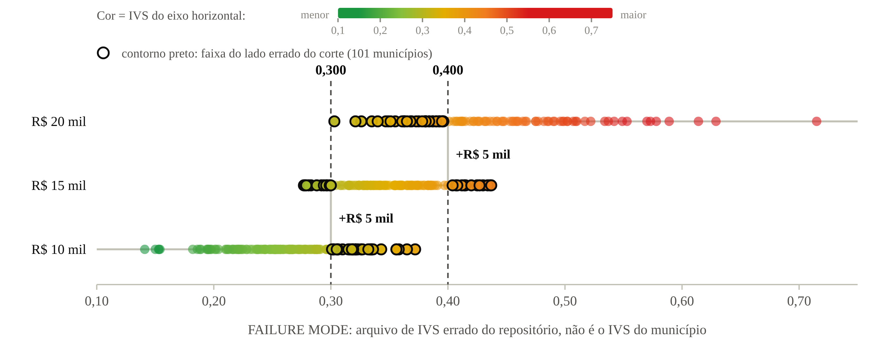
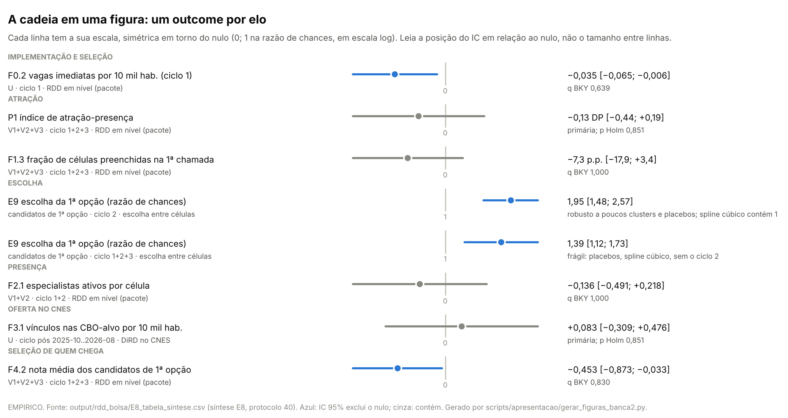
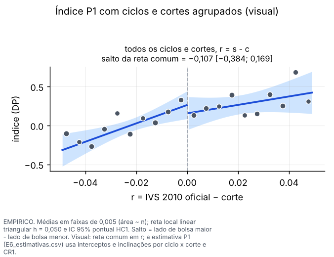
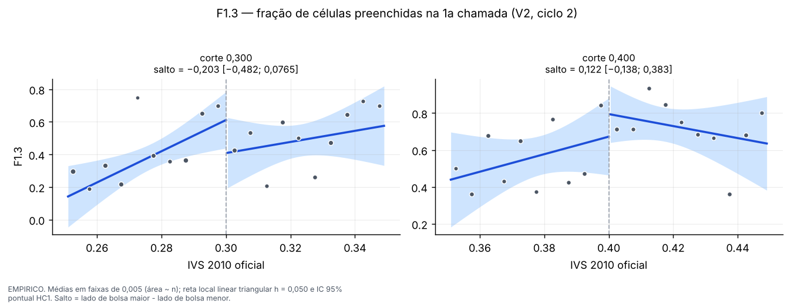
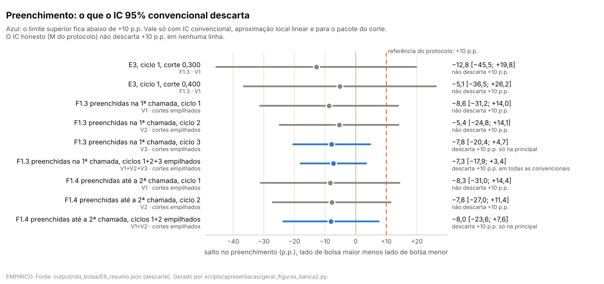
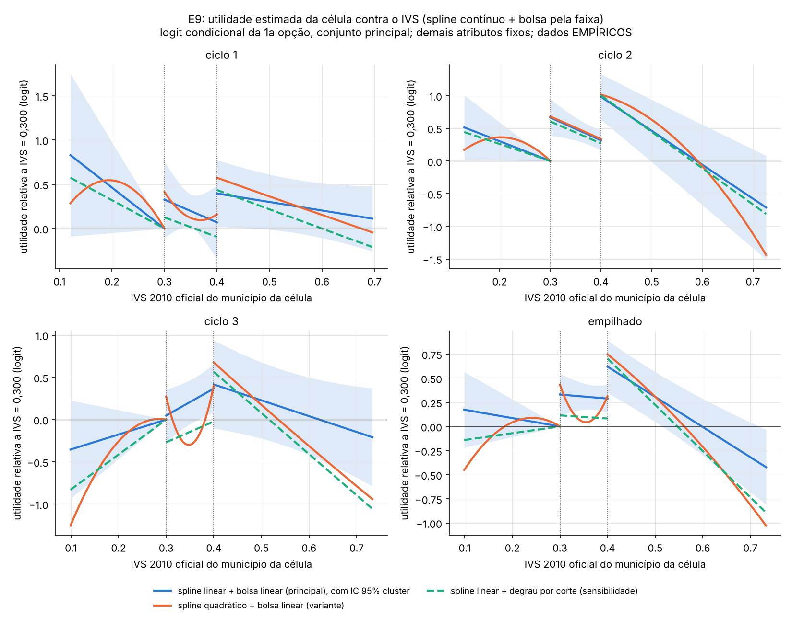
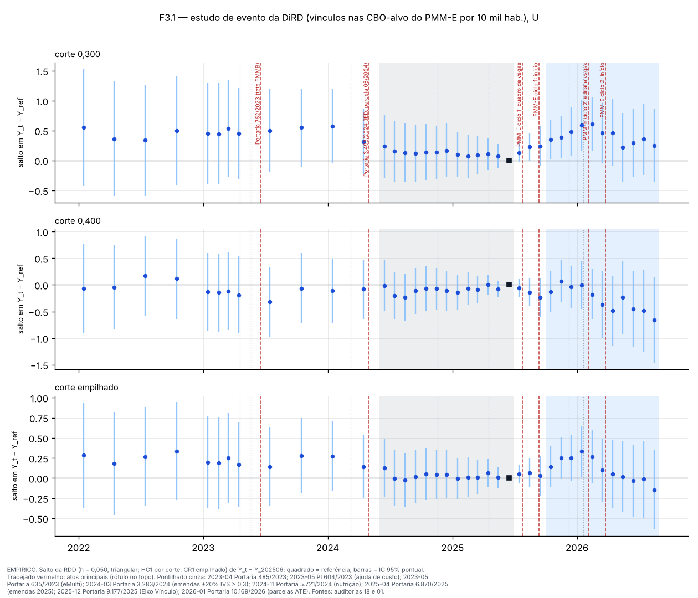
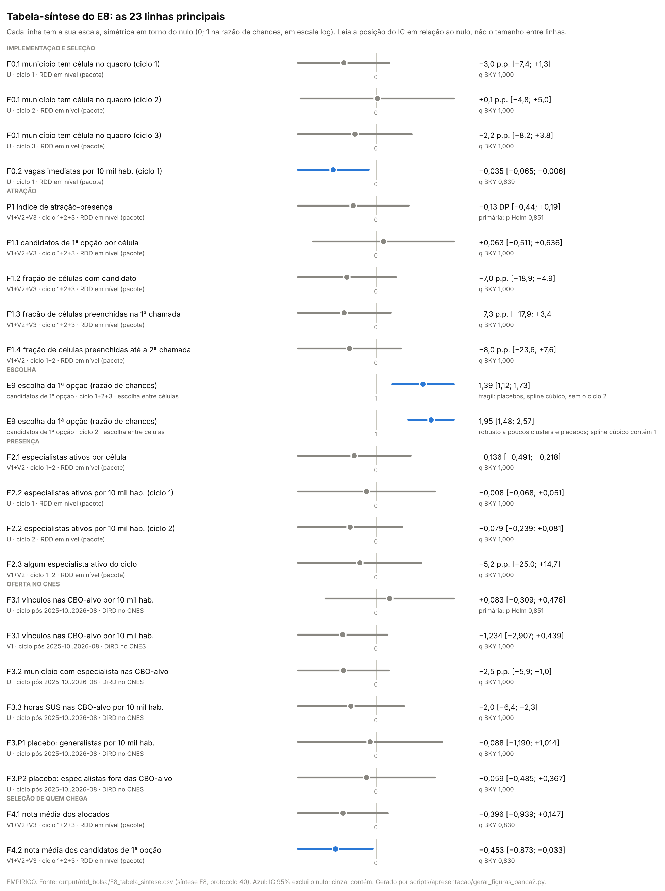
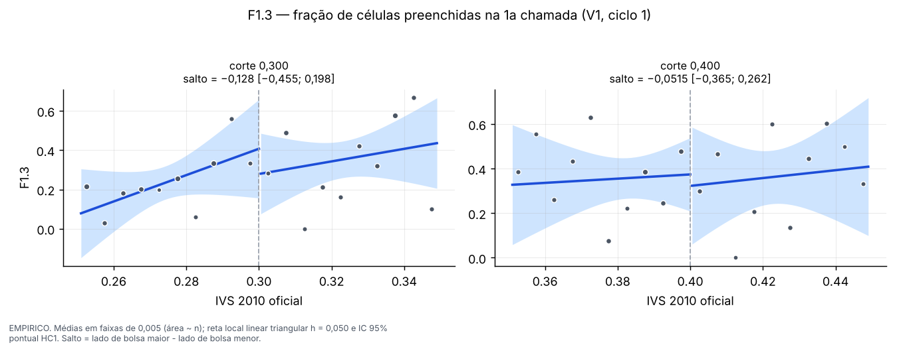
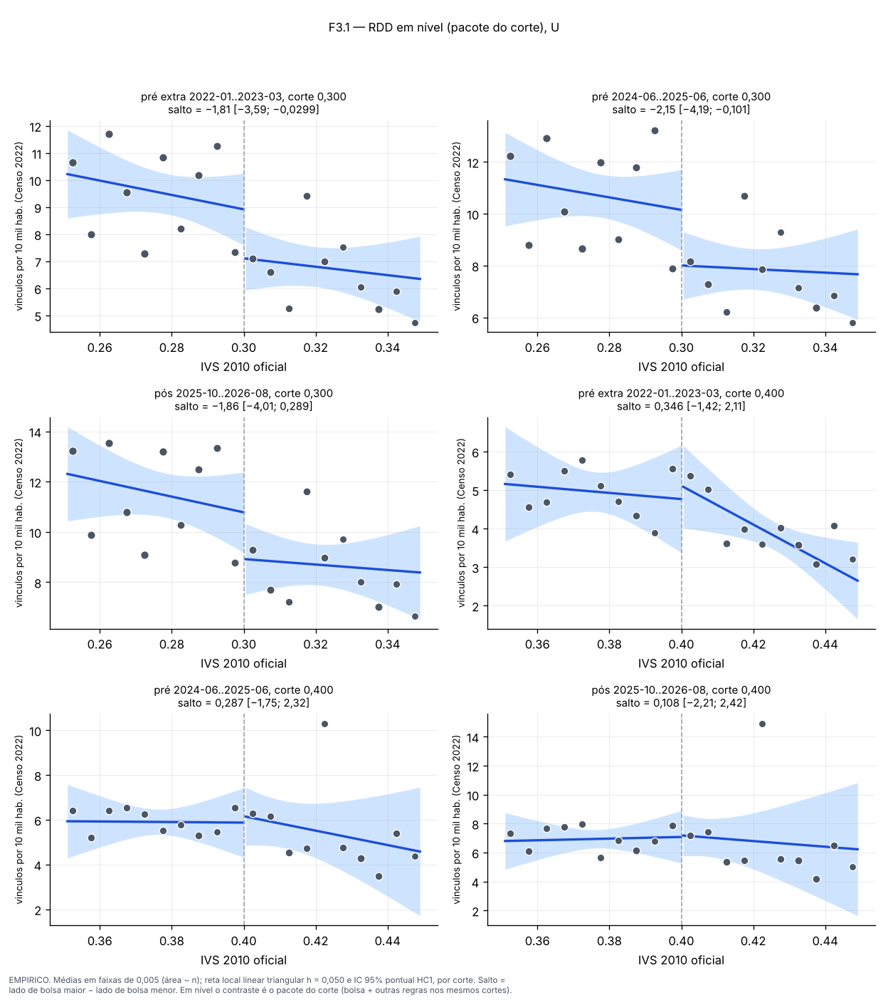

> [!IMPORTANT]
> **Como ler este arquivo.** A convenção é a da banca 1. O deck começa e
> termina nos comentários `deck:inicio` e `deck:fim`; o apêndice fica entre
> `apendice:inicio` e `apendice:fim`. **Cada cabeçalho `#` ou `##` é um
> slide** (`#` = capa ou divisória; `##` = conteúdo); `###` é um **build**
> dentro do slide. Abaixo do título, a linha em `código` é o rastreio do
> rodapé.
>
> **O que não vai à tela:** a linha `**Fontes:**` (nota de rodapé pequena), a
> linha `**Números:**` (códigos do bloco gerado de
> [03](03_proveniencia_figuras_e_numeros.md)), os blocos `**Nota de
> produção.**` e as `**Notas do apresentador.**`. Tudo o mais é tela.
>
> **Regra dos números.** Todo número de um slide — título, corpo e notas — é
> o valor de um código listado na sua linha `**Números:**` ou um parâmetro do
> protocolo (cortes 0,300 e 0,400, h = 0,050 e as sensibilidades 0,030 e
> 0,080, bolsas de R$ 10, 15 e 20 mil, o degrau de R$ 5 mil, IC 95%, MDE de
> 80%, as referências +10 p.p. e +25%, ciclos, datas e competências).
> `tests/test_conteudo_banca2.py` confere isso e confere cada valor contra o
> arquivo de `output/` de onde ele vem.
>
> **Figuras.** Todas têm caminho em `output/` e script gerador
> ([03, §1](03_proveniencia_figuras_e_numeros.md#1-figuras)). Número **dentro**
> de uma figura é tela e vem do mesmo arquivo que a figura lê.

## Mapa da apresentação

| # | Layout | Builds | Seção | Rótulo do roteiro | Título na tela |
|:---:|:---:|:---:|:---:|---|---|
| 1 | capa | 1 | — | — | Capa |
| 2 | conteúdo | 1 | — | Sumário | Sumário |
| 3 | capa | 1 | 1 | — | **Da hipótese à regra** |
| 4 | conteúdo | 1 | 1 | Hipótese | Na banca 1, a hipótese era: mais bolsa, mais vagas preenchidas |
| 5 | conteúdo | 1 | 1 | Regra | A bolsa segue o IVS 2010 oficial, sem exceção |
| 6 | conteúdo | 2 | 1 | Failure mode | O "IVS como piso" da banca 1 era um arquivo errado |
| 7 | capa | 1 | 2 | — | **Desenho** |
| 8 | conteúdo | 1 | 2 | Contrastes | Três contrastes, e nenhum é "o efeito do PMM-E" |
| 9 | capa | 1 | 3 | — | **Resultados, elo a elo** |
| 10 | conteúdo | 1 | 3 | Cadeia | A cadeia em uma figura: o provimento não se move; a escolha se move no ciclo 2 |
| 11 | conteúdo | 1 | 3 | Primárias | As duas primárias não rejeitam zero depois do Holm |
| 12 | conteúdo | 1 | 3 | Atração | Candidaturas e preenchimento não se movem no corte |
| 13 | conteúdo | 1 | 3 | Descarte | O IC convencional descarta +10 p.p. no preenchimento empilhado; o honesto, não |
| 14 | conteúdo | 2 | 3 | Escolha | No ciclo 2, a 1ª opção vai para a célula de bolsa maior |
| 15 | conteúdo | 2 | 3 | Presença e oferta | Presença e oferta no CNES: nada detectado, nem nos placebos |
| 16 | conteúdo | 1 | 3 | Multiplicidade | Os p < 0,05 isolados não sobrevivem à família |
| 17 | capa | 1 | 4 | — | **Leitura e revisão** |
| 18 | conteúdo | 1 | 4 | Afirmações | O que podemos e o que não podemos afirmar |
| 19 | conteúdo | 1 | 4 | Co-políticas | Nos mesmos cortes mudam outras regras federais |
| 20 | conteúdo | 1 | 4 | Revisão da hipótese | Três formas de rever a hipótese — para discussão |
| 21 | conteúdo | 1 | 4 | Próximos passos | O que vem depois |

### Depois do deck, fora da contagem

| # | Título na tela | Para que serve |
|:---:|---|---|
| — | **Perguntas** | abre o Q&A |
| B1 | A tabela-síntese inteira | as 23 linhas principais do E8 |
| B2 | A âncora do E3: ciclo 1, por corte | o resultado do E3 e o efeito mínimo detectável |
| B3 | Robustez do E9 | a tabela de robustez pós-auditoria |
| B4 | Por que a sequência do E7 em 0,300 não vira efeito | descontinuidade pré-existente, generalistas, pré-tendência em V1 |
| B5 | Magnitude: o degrau daqui e a literatura | Dal Bó et al. e Bobba et al. |
| B6 | O que o arquivo errado contaminou, e o que foi refeito | auditoria 19 |
| B7 | Limitações | doc 44, §8 |

---

<!-- deck:inicio -->

# O degrau de R$ 5 mil da bolsa do PMM-E

### O que a descontinuidade no IVS 2010 mostra, elo a elo

**Grupo 2** · Bernardo Gomes · Bruno Manta · Felipe Barros · Felipe Marques ·
Gabriel Benegra · Kauã Santos · Vinicius Sbruzzi

`sem rastreio`

**Números:** nenhum

> [!NOTE]
> **Nota de produção.** Título **provisório**, neutro em relação às três
> mensagens candidatas ([01, §3](01_roteiro_narrativo.md#3-a-mensagem-principal-decisão-do-autor)).
> Se o autor escolher M2, alternativa: *"A bolsa muda a escolha, não o
> provimento"*. Decisão do autor.

---

## Sumário

`sem rastreio`

1. **Da hipótese à regra**
2. **Desenho**
3. **Resultados, elo a elo**
4. **Leitura e revisão**

**Números:** nenhum

---

# 1. Da hipótese à regra

### A hipótese da banca 1, a regra com o IVS oficial e o que deu errado antes

`sem rastreio`

**Números:** nenhum

---

## Na banca 1, a hipótese era: mais bolsa, mais vagas preenchidas

`1. Da hipótese à regra · Hipótese`

> **H1.** No corte de IVS, +R$ 5 mil na bolsa anunciada aumentam o
> preenchimento das vagas e o provimento local de especialistas.

- **No modelo:** o lado de bolsa maior preenche quando o degrau monetário
  supera o degrau de custo latente, **ΔB/p > Δc₀**, com c₀ contínuo no corte.
- **Na banca 1, apresentada assim:** *"municípios com maior remuneração
  oferecida pelo PMM-E têm maior preenchimento de vagas"*.
- **O que faltava para testar:** mostrar a regra efetiva, o corte, o primeiro
  estágio e a ausência de manipulação.

**Fontes:** `docs/02_teoria/modelo_micro.md`, §4.1 e §4.2; banca 1, versão
apresentada (`docs/07_apresentacoes/banca1/04_versao_apresentada.md`).

**Números:** nenhum

> **Notas do apresentador.** Começar pelo que a banca já viu. A pergunta de
> hoje é se a hipótese sobrevive ao teste que ela pedia. Lembrar que a
> desigualdade do modelo não pergunta se o PMM-E funciona; pergunta se o preço
> posto sobre a vulnerabilidade é suficiente.

---

## A bolsa segue o IVS 2010 oficial, sem exceção

`1. Da hipótese à regra · Regra`

| Conferência (portão R1) | Resultado |
|---|---|
| escore da relação nominal do MS = IVS 2010 oficial, a 3 casas | 404/404 |
| categoria de IVS do consolidado PMMB = classe do IVS oficial | 5.565/5.565 |
| ciclo 1: faixa reproduzida pela regra | 368 de 368 |
| ciclo 2 | 454 de 454 |
| ciclo 3 (congelado) | 747 de 748; o que falta foi criado depois de 2010 |

Até 0,300 → R$ 10 mil; acima de 0,300 até 0,400 → R$ 15 mil; acima de 0,400
→ R$ 20 mil. No ciclo 1, 0 municípios do lado errado de um corte.

> **Regra sharp: dois cortes, +R$ 5 mil em cada.**

**Fontes:** `output/rdd_bolsa/portao_r1_ivs_oficial.json`;
`output/aquisicao/a08_ivs_2010_oficial_municipio.csv` (base completa da
Plataforma IVS do Ipea); NT 122/2024 CGFAP/SAPS; auditoria 16; figura por
`scripts/apresentacao/gerar_figuras_banca2.py` (variante A colorida, doc 38,
D1).

**Números:** `R_ESCORE_IGUAIS`, `R_CATEG_IGUAIS`, `R_C1_REPR`, `R_C1_MUN`,
`R_C2_REPR`, `R_C2_MUN`, `R_C3_REPR`, `R_C3_MUN`, `R_LADO_ERRADO_OFICIAL`

> [!NOTE]
> **Nota de produção.** A figura é a variante A colorida (pontos no valor
> exato da bolsa, sem deslocamento; cor = IVS do eixo, de verde a vermelho).
> O SVG em `output/apresentacao_banca2/regra_bolsa_ivs_oficial.svg` é a
> mesma figura em vetor, para o Slidev.

> **Notas do apresentador.** O MS usa o IVS 2010 do Ipea com o limite na
> classe de baixo: 0,300 fica com R$ 10 mil. O FAQ e a cláusula 11.1.4 do
> edital descrevem uma grade um degrau menos generosa; a aplicada é esta.
> Primeiro estágio sharp: a bolsa anunciada é função determinística do IVS.

---

## O "IVS como piso" da banca 1 era um arquivo errado

`1. Da hipótese à regra · Failure mode`

### O que era o arquivo

`data/ivs_ipea_2010_municipios.csv` vem da base oficial do Ipea, mas é **a
linha errada**: em cada município, a última linha de subgrupo com IVS
preenchido — *Negro / Mulher / Urbano* em 4.362 de 5.565 municípios (78%).
Acerta o IVS oficial a 3 casas em 38 municípios; correlação 0,85.

> **O arquivo não é inventado: é a linha errada da base certa.**

### O que ele fez com a regra

Com ele no eixo, 101 dos 368 municípios do ciclo 1 caem do lado errado de um
corte. O "IVS como piso" que a banca 1 viu (errata E10) somava o arquivo
errado à grade do FAQ do edital. Refeito com a base oficial: malha, tipologia, A4, A5 e
a Tabela 1 do ciclo 1. A RDD (E3 em diante) já usava o IVS oficial: nenhuma
estimativa dela muda.

**Fontes:** `output/rdd_bolsa/identificacao_arquivo_local_ivs.json`;
`output/tema_trabalho/failure_mode_ivs_resumo.json`;
`output/rdd_bolsa/portao_r1_ivs_oficial.json`; auditorias 16 e 19; errata E10
da banca 1.

**Números:** `FM_NMU`, `FM_MUN`, `FM_NMU_PCT`, `FM_IGUAIS`, `FM_CORR`,
`FM_LADO_ERRADO`, `R_C1_MUN`

> [!NOTE]
> **Nota de produção.** A figura deste slide é **FAILURE_MODE** e vem de
> `output/apresentacao_banca2/failure_mode/`. O título na tela deve dizer
> "arquivo errado"; nunca rotular o eixo como IVS do município. Um slide só,
> sem demorar.

> **Notas do apresentador.** Dizer de uma vez: o diagnóstico que mostramos em
> 05/10/2026 estava errado, e a causa foi um arquivo sem fonte registrada que
> entrou no primeiro commit. A extração esqueceu o filtro da linha total
> (cor, sexo e situação de domicílio "Total"). Os números antigos só existem
> como registro do erro (auditoria 19); as estimativas da RDD são idênticas
> byte a byte antes e depois da correção.

---

# 2. Desenho

### O que cada estimativa identifica

`sem rastreio`

**Números:** nenhum

---

## Três contrastes, e nenhum é "o efeito do PMM-E"

`2. Desenho · Contrastes`

| Contraste | Etapa | O que identifica | População |
|---|---|---|---|
| **RDD em nível** | E3, E6 | o **pacote do corte**: +R$ 5 mil na bolsa anunciada e as outras regras federais que mudam no mesmo corte | U (todos os municípios com IVS oficial); V1–V3 (municípios com célula no quadro do ciclo) |
| **DiRD no CNES** | E7 | a bolsa e a **variação**, entre pré (2024-06 a 2025-06) e pós (2025-10 a 2026-08), das descontinuidades das co-políticas | U; V1 |
| **Escolha** | E9 | o degrau da bolsa na escolha da 1ª opção **entre células** do mesmo curso e ciclo: **realocação**, condicional a candidatar-se | candidatos de 1ª opção |

Protocolo congelado em 18/10/2026, antes de abrir os outcomes novos: local
linear, kernel triangular, h = 0,050, cortes 0,300 e 0,400 empilhados; **duas
primárias com Holm** (P1, índice de atração-presença; P2, oferta no CNES por
DiRD); secundárias com q BKY por família; referências de magnitude de +10 p.p.
no preenchimento e +25% nas candidaturas.

> **O efeito candidato é o incentivo marginal anunciado — não a participação
> no PMM-E nem o Agora Tem Especialistas.**

**Fontes:** `docs/06_execucao/40_protocolo_multioutcome_rdd_bolsa.md`, §3, §6
e §7; doc 44, §2.

**Números:** nenhum

> **Notas do apresentador.** Salto = lado de bolsa maior menos lado de bolsa
> menor. Em U a amostra não é condicionada a ter vaga; em V_k é, e por isso a
> família F0 testa se ter vaga salta no corte. Parte do ciclo 1 já tinha sido
> vista antes do congelamento (protocolo, §10); o resto foi aberto depois.

---

# 3. Resultados, elo a elo

### Implementação → atração → escolha → presença → oferta → seleção

`sem rastreio`

**Números:** nenhum

---

## A cadeia em uma figura: o provimento não se move; a escolha se move no ciclo 2

`3. Resultados · Cadeia`

Azul: o IC 95% exclui o nulo. Os dois azuis das pontas — vagas imediatas e
nota dos candidatos — não sobrevivem ao controle por família (slide 16).

**Fontes:** `output/rdd_bolsa/E8_tabela_sintese.csv`; figura por
`scripts/apresentacao/gerar_figuras_banca2.py`.

**Números:** `E8_LINHAS`

> [!NOTE]
> **Nota de produção.** Cada linha da figura tem a sua escala, simétrica em
> torno do nulo; a figura diz isso no subtítulo. Não comparar comprimentos de
> IC entre linhas. A versão com as 23 linhas está no apêndice B1.

> **Notas do apresentador.** Ler de cima para baixo, na ordem da cadeia.
> Cinza no preenchimento, na presença e na oferta; azul na escolha. Esse é o
> padrão que o resto da seção detalha.

---

## As duas primárias não rejeitam zero depois do Holm

`3. Resultados · Primárias`

| Primária | Contraste | Salto | IC 95% | p | p Holm |
|---|---|---|---|---|---|
| **P1** índice de atração-presença (F1.1, F1.2, F1.3, F2.1), ciclos e cortes empilhados | pacote do corte | −0,13 DP | [−0,44; +0,19] | 0,426 | 0,851 |
| **P2** vínculos nas CBO-alvo por 10 mil hab. (U), cortes empilhados | DiRD | +0,083 | [−0,309; +0,476] | 0,677 | 0,851 |

> **Nenhuma primária rejeita zero, e os dois IC contêm zero. Não é prova de
> efeito zero.**

**Fontes:** `output/rdd_bolsa/E8_resumo.json` (`holm`); E6 e E7; doc 44, §4.

**Números:** `P1_TAU`, `P1_INF`, `P1_SUP`, `P1_P`, `P1_HOLM`, `P2_TAU`,
`P2_INF`, `P2_SUP`, `P2_P`, `P2_HOLM`

> [!NOTE]
> **Nota de produção.** O número no título da figura é o salto da **reta
> comum** do visual, não a estimativa P1 (que tem interceptos e inclinações
> por ciclo e corte). A estimativa é a da tabela. Se a banca perguntar,
> dizer isso; não trocar o número da tabela pelo da figura.

> **Notas do apresentador.** P1 é pacote; P2 é DiRD e tira só a parte
> constante das co-políticas. O Holm controla a taxa de erro das duas.

---

## Candidaturas e preenchimento não se movem no corte

`3. Resultados · Atração`

| Outcome (ciclos e cortes empilhados) | Salto | IC 95% | q BKY |
|---|---|---|---|
| F1.1 candidatos de 1ª opção por célula | +0,063 | [−0,511; +0,636] | 1,000 |
| F1.2 fração de células com candidato | −7,0 p.p. | [−18,9; +4,9] | 1,000 |
| F1.3 fração de células preenchidas na 1ª chamada | −7,3 p.p. | [−17,9; +3,4] | 1,000 |
| F1.4 preenchidas até a 2ª chamada (ciclos 1 e 2) | −8,0 p.p. | [−23,6; +7,6] | 1,000 |

> **Estimativas pontuais negativas, IC que contêm zero: nenhum efeito
> detectável do pacote sobre candidaturas e preenchimento.**

**Fontes:** `output/rdd_bolsa/E8_tabela_sintese.csv`; E6 (doc 41).

**Números:** `F11_EST`, `F11_INF`, `F11_SUP`, `F11_Q`, `F12_EST`, `F12_INF`,
`F12_SUP`, `F12_Q`, `F13_EST`, `F13_INF`, `F13_SUP`, `F13_Q`, `F14_EST`,
`F14_INF`, `F14_SUP`, `F14_Q`

> [!NOTE]
> **Nota de produção.** A figura é do ciclo 2, a replicação que o autor pediu
> (doc 38, D2), por corte; a tabela é empilhada. Os números no título da
> figura são os do ciclo 2 por corte.

> **Notas do apresentador.** Por que o salto sai negativo se a média bruta
> do lado de cima é maior: o preenchimento sobe com o IVS dentro da janela, e
> o salto compara as duas retas no próprio corte. "IC contém zero" quer dizer
> que a amostra não distingue o efeito de zero, não que ele é zero.

---

## O IC convencional descarta +10 p.p. no preenchimento empilhado; o honesto, não

`3. Resultados · Descarte`

- **Empilhado:** o limite superior do F1.3 é +3,4 p.p.; entre as 6
  especificações convencionais do protocolo, o maior é +7,8 p.p.
- **Por ciclo e na âncora do E3:** o IC ainda admite +10 p.p. (até +14,0 e
  +14,1 nos ciclos 1 e 2; +19,8 e +26,2 no E3, cortes 0,300 e 0,400).
- **F1.4:** o descarte depende da janela (até +12,0 p.p. com h = 0,030).
- **Três condições:** IC convencional (HC1/CR1); aproximação local linear boa
  no corte; contraste = pacote. **O IC honesto com o M do protocolo não
  descarta nada.**

> **O ganho de precisão veio de empilhar, e o descarte só vale com o IC
> convencional.**

**Fontes:** `output/rdd_bolsa/E8_resumo.json` (`descarte`); doc 44, §5.1;
figura por `scripts/apresentacao/gerar_figuras_banca2.py`.

**Números:** `F13_SUP`, `D_F13_NCONV`, `D_F13_MAXCONV`, `D_F13_V1_SUP`,
`D_F13_V2_SUP`, `E3_300_SUP`, `E3_400_SUP`, `D_F14_MAXCONV`

> **Notas do apresentador.** Descartar quer dizer: o limite superior do IC
> 95% fica abaixo da referência. O IC honesto (Armstrong e Kolesár) protege
> contra o viés de suavização com o M da regra de bolso; com ele, os limites
> ficam fora de qualquer escala útil. Por isso a frase do slide tem a
> condição embutida. Nunca dizer "descartamos +10 p.p." sem "com o IC
> convencional".

---

## No ciclo 2, a 1ª opção vai para a célula de bolsa maior

`3. Resultados · Escolha`

| Ciclo | Razão de chances por +R$ 5 mil | IC 95% | p |
|---|---|---|---|
| 1 | 1,39 | [0,90; 2,13] | 0,137 |
| **2** | **1,95** | **[1,48; 2,57]** | **< 0,001** |
| 3 | 1,05 | [0,77; 1,43] | 0,761 |
| empilhado | 1,39 | [1,12; 1,73] | 0,003 |

### O ciclo 2 é robusto

Score bootstrap (Webb) p = 0,002; CV3 p < 0,001; 0 de 27 cortes placebo com
|t| maior ou igual ao real (p por posto 0,036). Ressalva: com spline cúbico, o
IC inclui 1 (p = 0,083).

### O empilhado é frágil

Sem o ciclo 2, p = 0,267; Q de Cochran rejeita ciclos iguais (p = 0,014);
cortes placebo com |t| > 1,96 em 14,8% (p por posto 0,107); spline cúbico,
p = 0,220.

> **Escolha não é expansão: o que uma célula ganha, as outras do mesmo curso
> perdem.**

**Fontes:** `output/rdd_bolsa/E8_resumo.json` (`e9`); E9 (doc 42); doc 44,
§5.2.

**Números:** `E9_C1_RC`, `E9_C1_RCI`, `E9_C1_RCS`, `E9_C1_P`, `E9_C2_RC`,
`E9_C2_RCI`, `E9_C2_RCS`, `E9_C2_P`, `E9_C3_RC`, `E9_C3_RCI`, `E9_C3_RCS`,
`E9_C3_P`, `E9_EMP_RC`, `E9_EMP_RCI`, `E9_EMP_RCS`, `E9_EMP_P`, `E9_C2_WEBB`,
`E9_C2_CV3`, `E9_C2_PLAC_GE`, `E9_C2_NPLAC`, `E9_C2_PPOSTO`, `E9_C2_CUB_P`,
`E9_EMP_SEM2_P`, `E9_EMP_Q_P`, `E9_PLAC_FRAC`, `E9_EMP_PPOSTO`,
`E9_EMP_CUB_P`, `E9_EMP_N`, `LIT_DALBO_CAND`

> [!NOTE]
> **Nota de produção.** Os dois builds têm o mesmo peso visual. Não mostrar o
> empilhado sem o build "frágil".

> **Notas do apresentador.** O E9 é secundário e exploratório; a robustez é
> pós-auditoria, fora do protocolo. Logit condicional da 1ª opção, 5.714
> candidatos empilhados, IVS em spline contínuo com nós nos cortes. Supõe IIA
> e não tem distância. A variação relativa da probabilidade de escolha **não**
> é comparável aos "+26% de candidaturas" de Dal Bó et al.: lá é o tamanho do
> pool; aqui, a repartição de um pool dado.

---

## Presença e oferta no CNES: nada detectado, nem nos placebos

`3. Resultados · Presença e oferta`

| Outcome | Contraste | Salto | IC 95% |
|---|---|---|---|
| F2.1 especialistas ativos por célula (V1+V2) | pacote | −0,136 | [−0,491; +0,218] |
| F2.3 algum especialista ativo do ciclo (V1+V2) | pacote | −5,2 p.p. | [−25,0; +14,7] |
| **P2** F3.1 vínculos nas CBO-alvo por 10 mil hab. (U) | DiRD | +0,083 | [−0,309; +0,476] |
| F3.2 município com especialista nas CBO-alvo | DiRD | −2,5 p.p. | [−5,9; +1,0] |
| F3.3 horas SUS nas CBO-alvo por 10 mil hab. | DiRD | −2,0 | [−6,4; +2,3] |
| placebo: generalistas por 10 mil hab. | DiRD | −0,088 | [−1,190; +1,014] |
| placebo: especialistas fora das CBO-alvo | DiRD | −0,059 | [−0,485; +0,367] |

### Uma sequência que não vira efeito

Em 0,300, 5 meses seguidos com p < 0,05 no início do pós (2025-10 a 2026-02);
nos 6 meses seguintes, 0. A oferta já era menor do lado de cima antes de todas
as regras com corte em 0,3 ou 0,4: pré extra −1,811 [−3,591; −0,030]. DiRD
principal em 0,300: +0,287 [−0,235; +0,810].

> **Vínculo no CNES não é médico do PMM-E; presença no retrato não é
> retenção.**

**Fontes:** `output/rdd_bolsa/E8_tabela_sintese.csv`;
`output/rdd_bolsa/E8_resumo.json` (`e7`); E6 e E7 (docs 41 e 43).

**Números:** `F21_EST`, `F21_INF`, `F21_SUP`, `F23_EST`, `F23_INF`,
`F23_SUP`, `P2_TAU`, `P2_INF`, `P2_SUP`, `F32_EST`, `F32_INF`, `F32_SUP`,
`F33_EST`, `F33_INF`, `F33_SUP`, `FP1_EST`, `FP1_INF`, `FP1_SUP`, `FP2_EST`,
`FP2_INF`, `FP2_SUP`, `E7_SEQ_N`, `E7_DEPOIS_N`, `E7_DEPOIS_SIG`,
`E7_PREEXT_TAU`, `E7_PREEXT_INF`, `E7_PREEXT_SUP`, `E7_DIRD300_TAU`,
`E7_DIRD300_INF`, `E7_DIRD300_SUP`

> **Notas do apresentador.** A referência do estudo de evento (2025-06) está
> num vale: o salto do pós tem tamanho parecido com o do pré extra. Emendas e
> parcelas de MAC com "IVS maior que 0,3" mudam a cada ano e podem mirar
> especialistas; a DiRD só tira a parte constante. Detalhe no apêndice B4.

---

## Os p < 0,05 isolados não sobrevivem à família

`3. Resultados · Multiplicidade`

| Família | Linhas no BKY | p < 0,05 | q BKY < 0,05 | Menor q |
|---|---|---|---|---|
| F0 implementação e seleção | 42 | 2 | 0 | 0,639 |
| F1 atração | 45 | 0 | 0 | 1,000 |
| F2 presença | 24 | 1 | 0 | 0,828 |
| F3 oferta no CNES | 18 | 0 | 0 | 1,000 |
| F4 seleção de quem chega | 24 | 2 | 0 | 0,830 |

- **Vagas imediatas por 10 mil hab. (ciclo 1, U):** −0,035 [−0,065; −0,006],
  q BKY 0,639. Em V1 no corte 0,400, razão de densidades 0,61 [0,29; 1,30] e 3
  de 13 covariáveis desbalanceadas: V1 em 0,400 pode ser amostra selecionada
  (peso de 12,3% no P1).
- **Nota dos candidatos de 1ª opção:** −0,453 [−0,873; −0,033], p = 0,035,
  q BKY 0,830. Não há seleção positiva.

> **Um p < 0,05 isolado, com q BKY alto, é da ordem do esperado por acaso
> numa família com dezenas de testes.**

**Fontes:** `output/rdd_bolsa/E8_resumo.json` (`familias`, `selecao_v1_0400`);
`output/rdd_bolsa/E8_tabela_sintese.csv`; doc 44, §3 e §5.4.

**Números:** `FAM_F0_N`, `FAM_F0_P`, `FAM_F0_Q`, `FAM_F0_MINQ`, `FAM_F1_N`,
`FAM_F1_P`, `FAM_F1_Q`, `FAM_F1_MINQ`, `FAM_F2_N`, `FAM_F2_P`, `FAM_F2_Q`,
`FAM_F2_MINQ`, `FAM_F3_N`, `FAM_F3_P`, `FAM_F3_Q`, `FAM_F3_MINQ`, `FAM_F4_N`,
`FAM_F4_P`, `FAM_F4_Q`, `FAM_F4_MINQ`, `F02_EST`, `F02_INF`, `F02_SUP`,
`F02_Q`, `SEL_DENS`, `SEL_DENS_INF`, `SEL_DENS_SUP`, `SEL_BAL_P`,
`SEL_BAL_N`, `SEL_PESO`, `F42_EST`, `F42_INF`, `F42_SUP`, `F42_P`, `F42_Q`

> **Notas do apresentador.** O BKY supõe dependência positiva entre as linhas
> por corte e empilhadas, o que não foi verificado. Os p < 0,05 isolados são
> as vagas imediatas, a presença do ciclo 2 em 0,300 e a nota dos candidatos;
> nenhum deles é efeito.

---

# 4. Leitura e revisão

### O que a evidência permite dizer, e que pergunta fazer agora

`sem rastreio`

**Números:** nenhum

---

## O que podemos e o que não podemos afirmar

`4. Leitura · Afirmações`

| Podemos afirmar | Não podemos afirmar |
|---|---|
| Sob o protocolo, nenhum teste primário rejeita zero depois do Holm | Que a bolsa "não funciona" ou que o efeito é zero |
| Com ciclos e cortes empilhados, IC convencional e linearidade local, saltos de +10 p.p. ou mais no preenchimento ficam fora do intervalo | Que esse descarte vale com o IC honesto, por ciclo isolado ou para a bolsa sem as co-políticas |
| Nenhuma família do protocolo tem q BKY < 0,05 | Que os p < 0,05 isolados são efeitos |
| No ciclo 2, a bolsa anunciada desloca a 1ª opção para células de bolsa maior, com inferência robusta a poucos clusters e a placebos | Que esse deslocamento aumenta candidatos, preenchimento ou oferta local; que vale nos ciclos 1 e 3 |
| A DiRD no CNES não detecta mudança de oferta nas CBO-alvo nem nos placebos | Que a sequência de meses em 0,300 é efeito da bolsa |
| O contraste é o incentivo marginal anunciado, como pacote do corte | Efeito da participação no PMM-E, do Agora Tem Especialistas ou do IVS |

> **Perto dos cortes de IVS, não encontramos evidência de que o degrau de
> R$ 5 mil, junto com as regras que mudam nos mesmos cortes, aumente o
> preenchimento, a presença ou a oferta local de especialistas. IC que contém
> zero não é efeito zero: por ciclo, a amostra não descarta efeitos moderados.
> É ausência de efeito detectável, não prova de ineficácia.**

**Fontes:** doc 44, §5.5 e §1.

**Números:** nenhum

> **Notas do apresentador.** A frase em destaque é a frase segura dos nulos;
> ler sem parafrasear. Se perguntarem "então a bolsa não funciona?", a
> resposta é a coluna da direita, primeira linha.

---

## Nos mesmos cortes mudam outras regras federais

`4. Leitura · Co-políticas`

| Corte | Muda além da bolsa — verificado no texto do ato ou nos dados | Não verificado ou inferido |
|---|---|---|
| 0,300 | teto de emendas e de parcelas de custeio de MAC e APS +20% para "IVS maior que 0,3" (2024 em diante; em 2026 alcança o Agora Tem Especialistas); estrato do IED da APS nos portes 2 e 3; texto da Portaria 752/2023: teto de coparticipação do PMMB de 10% → 40% | como a Portaria 752/2023 foi aplicada no corte; priorização de eMulti |
| 0,400 | estrato do IED nos portes 1, 2 e 4; texto da Portaria 752/2023: 40% → 100% | ajuda de custo e perfis de escolha do PMMB; Eixo Vínculo |

- A RDD em nível mede um **pacote**. Em 0,300, o teto da MAC mira o mesmo
  outcome do F3.
- A DiRD tira só a parte **constante**; emendas, IED e ajuda de custo mudam no
  tempo. Ela também não isola a bolsa.
- O placebo de generalistas é o outcome que essas regras movem: a ausência de
  salto não exclui o canal da MAC, que mira especialistas.

**Fontes:** auditoria 18, §2 e §3; manifesto
`output/aquisicao/a10_manifesto_normas_ivs.json`.

**Números:** `CP_EMENDAS`, `CP_IED_300`, `CP_752_300`, `CP_IED_400`,
`CP_752_400`

> **Notas do apresentador.** "Verificado" quer dizer: o trecho está no texto
> preservado do ato, ou o cálculo foi feito sobre a lista administrativa.
> Onde há lista publicada, o MS aplica o limite como a bolsa, mesmo quando o
> texto da portaria diz "maior ou igual".

---

## Três formas de rever a hipótese — para discussão

`4. Leitura · Revisão da hipótese`

| | Formulação | O que testaria |
|---|---|---|
| **H1** (original) | +R$ 5 mil aumentam preenchimento e provimento local | — relatar o nulo, com as condições do slide 18 |
| **A** realocação | a bolsa reordena a escolha entre vagas sem expansão líquida detectável: **atrai** ou **redistribui**? | universo de inscrições (margem extensiva); deslocamento entre células próximas; E9 replicado no ciclo 3 maduro |
| **B** elasticidade relativa | quanto pesa a remuneração na escolha, comparada a c₀(IVS), distância e amenidades | distância candidato–vaga; razões de coeficientes pré-registradas; heterogeneidade por mercado privado local; remuneração paga |
| **C** quanto e em que margem | de que tamanho é Δc₀ em reais, e que margem se move com o incentivo atual | contrafactual de grade de bolsa rotulado como cenário; a cadeia completa com o ciclo 3 e a ponte PMM-E–CNES |

> **Proposta, não decisão.** Nenhuma muda o que foi estimado; o protocolo e os
> resultados do E3 ao E9 não são reescritos.

**Fontes:** doc 44, §7; protocolo 40, §9.

**Números:** nenhum

> [!NOTE]
> **Nota de produção.** Slide **pendente da decisão do autor**. Se o autor
> decidir antes da apresentação, o slide passa a mostrar a escolhida e as outras
> vão ao apêndice.

> **Notas do apresentador.** O protocolo permite rever a pergunta econômica
> depois dos resultados, desde que a revisão seja registrada como tal. Em
> todas as opções, o contraste continua sendo o incentivo marginal anunciado.

---

## O que vem depois

`4. Leitura · Próximos passos`

1. **Decisão do autor:** H1, A, B ou C, e a mensagem principal.
2. **Ciclo 3:** congelado até a maturidade. Seis meses de seguimento só com a
   competência 202703 publicada, completa e madura; ali o E9 se replica fora da
   amostra que o gerou.
3. **Pedidos de dados** (universo de inscrições, distância, folha paga):
   preparados, não enviados; decisão externa do autor.
4. **Artigos:** atualizar a RDD da bolsa com a síntese E8.

**Fontes:** doc 38, §4 e §5; doc 44, §9; `docs/pedidos_dados/`.

**Números:** nenhum

<!-- deck:fim -->

---

# Perguntas

`sem rastreio`

**Números:** nenhum

<!-- apendice:inicio -->

---

## A tabela-síntese inteira

`Apêndice · B1`

**Fontes:** `output/rdd_bolsa/E8_tabela_sintese.csv`; doc 44, §3.

**Números:** `E8_LINHAS`

---

## A âncora do E3: ciclo 1, por corte

`Apêndice · B2`

| Corte | Bolsa | Salto no preenchimento | IC 95% | Municípios (abaixo · acima) | MDE de 80% |
|---|---|---|---|---|---|
| 0,300 | R$ 10 mil → R$ 15 mil | −12,8 p.p. | [−45,5; +19,8] | 61 · 53 | 46,6 p.p. |
| 0,400 | R$ 15 mil → R$ 20 mil | −5,1 p.p. | [−36,5; +26,2] | 53 · 41 | 44,8 p.p. |

> **Não encontramos evidência estatística de que +R$ 5 mil aumente o
> preenchimento perto dos cortes; a amostra do ciclo 1 também não descarta
> efeitos moderados.**

**Fontes:** `output/rdd_bolsa/E8_resumo.json` (`descarte.ancora_E3_ciclo1`);
`output/rdd_bolsa/E3_estimativas.csv`; docs 37 e 39.

**Números:** `E3_300_TAU`, `E3_300_INF`, `E3_300_SUP`, `E3_300_NABX`,
`E3_300_NACI`, `E3_300_MDE`, `E3_400_TAU`, `E3_400_INF`, `E3_400_SUP`,
`E3_400_NABX`, `E3_400_NACI`, `E3_400_MDE`

> **Notas do apresentador.** O MDE vem do E5, exploratório e pós-resultado.
> Foi o resultado do E3 que levou à rodada multi-outcome.

---

## Robustez do E9

`Apêndice · B3`

| Teste (pós-auditoria, fora do protocolo) | Ciclo 2 | Empilhado |
|---|---|---|
| p do score bootstrap (Webb), cluster por conjunto | 0,002 | — |
| p do CV3 | < 0,001 | — |
| cortes placebo: fração com abs(t) > 1,96 | 14,8% | 14,8% |
| cortes placebo: nº com abs(t) ≥ t real, de 27 | 0 | 2 |
| p por posto contra os placebos | 0,036 | 0,107 |
| spline cúbico: p | 0,083 | 0,220 |
| ciclos 1 e 3 empilhados, sem o 2: p | — | 0,267 |
| Q de Cochran (ciclos 1, 2, 3): p | — | 0,014 |
| cluster por curso: p do score (Webb) | — | 0,047 |

**Fontes:** `output/rdd_bolsa/E8_resumo.json` (`e9`); doc 44, §5.2; doc 42.

**Números:** `E9_C2_WEBB`, `E9_C2_CV3`, `E9_C2_PLAC_FRAC`, `E9_PLAC_FRAC`, `E9_C2_NPLAC`,
`E9_C2_PLAC_GE`, `E9_EMP_PLAC_GE`, `E9_C2_PPOSTO`, `E9_EMP_PPOSTO`,
`E9_C2_CUB_P`, `E9_EMP_CUB_P`, `E9_EMP_SEM2_P`, `E9_EMP_Q_P`,
`E9_CURSO_WEBB`

---

## Por que a sequência do E7 em 0,300 não vira efeito

`Apêndice · B4`

- **Descontinuidade pré-existente:** em 0,300, a oferta já era menor do lado de
  cima no pré extra, antes de todas as regras com corte em 0,3 ou 0,4:
  −1,811 [−3,591; −0,030]. Antes da referência, 0 de 24 meses têm p < 0,05.
- **Generalistas em 0,400:** 2 de 7 meses do pré extra com p < 0,05; o placebo
  deriva antes do pré principal.
- **Pré-tendência em V1, 0,300:** 12 de 12 meses do pré extra e do trecho até o
  pré principal com p < 0,05. A DiRD em V1 nesse corte não é crível.

**Fontes:** `output/rdd_bolsa/E8_resumo.json` (`e7`); doc 43; doc 44, §5.3.

**Números:** `E7_PREEXT_TAU`, `E7_PREEXT_INF`, `E7_PREEXT_SUP`,
`E7_ANTES_SIG`, `E7_ANTES_N`, `E7_GEN_SIG`, `E7_GEN_N`, `E7_V1_SIG`,
`E7_V1_N`

---

## Magnitude: o degrau daqui e a literatura

`Apêndice · B5`

- **O degrau daqui:** +50% da bolsa em 0,300 (R$ 10 mil → R$ 15 mil); +33% em
  0,400 (R$ 15 mil → R$ 20 mil).
- **Dal Bó, Finan e Rossi (2013):** salário anunciado sorteado, +33%;
  aceitação +15,1 p.p. e candidaturas +26%.
- **Bobba et al.:** adicional de +13% por regra, numa RDD; o preenchimento não
  mudou, e o professor que chegou era melhor.
- **Aqui:** com ciclos e cortes empilhados, o limite superior do preenchimento
  na 1ª chamada é +3,4 p.p., sob as condições do slide 13.

> **Contextos e outcomes diferentes: lá, servidores e aceitação da oferta;
> aqui, especialistas e célula com confirmação ou homologação.**

**Fontes:** doc 44, §6; `docs/03_literatura_empirica/20_evidencia_empirica_hipotese_remuneracao_preenchimento.md`
(trechos copiados em `output/rdd_bolsa/E8_resumo.json`, `literatura`).

**Números:** `MAG_DEG300`, `MAG_DEG400`, `LIT_DALBO_SAL`, `LIT_DALBO_ACEIT`,
`LIT_DALBO_CAND`, `LIT_BOBBA`, `F13_SUP`

---

## O que o arquivo errado contaminou, e o que foi refeito

`Apêndice · B6`

| Etapa | O que herdou | Situação |
|---|---|---|
| malha municipal e painel | IVS, subíndices, IDHM, população 2010 | corrigida com a base oficial (a08) e o Censo 2022 |
| tipologia territorial (A2) | IVS e estoque por habitante | corrigida; o estrato não dependia do arquivo |
| atração (A4) e provimento (A5) | gradiente de IVS e covariáveis | reestimados; o ajuste completo antigo só existe como failure mode |
| Tabela 1 do ciclo 1 | IVS e população | regenerada |
| RDD da bolsa (E3 em diante) | nada | já usava o IVS oficial; estimativas idênticas byte a byte |

**Fontes:** auditoria 19; `output/tema_trabalho/failure_mode_ivs_resumo.json`.

**Números:** nenhum

---

## Limitações

`Apêndice · B7`

1. **Pacote, não bolsa:** nenhum resultado em nível isola a bolsa; a DiRD só
   tira a parte constante das co-políticas.
2. **Potência:** por corte e ciclo, poucas dezenas de municípios com vaga de
   cada lado; só o empilhamento estreitou o IC.
3. **IC honesto sem informação** com o M da regra de bolso.
4. **Seleção em V_k:** V1 em 0,400 é suspeita.
5. **Presença é retrato;** vínculo no CNES não é médico do PMM-E nem retenção.
6. **E9:** IIA, sem distância, escolha possivelmente estratégica, robustez fora
   do protocolo.
7. **Exposição prévia:** parte do ciclo 1 já tinha sido vista antes do
   congelamento.
8. **Muitos testes:** o BKY supõe dependência positiva, não verificada.

**Fontes:** doc 44, §8.

**Números:** nenhum

<!-- apendice:fim -->
