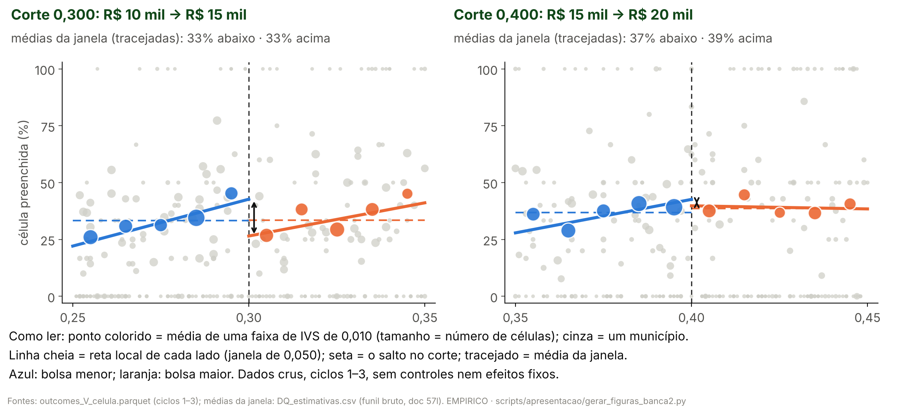

> [!IMPORTANT]
> **Pedidos do autor (26/10/2026), nesta versão.**
> - **Estrutura obrigatória** ([06](06_estrutura_obrigatoria_versao_final.md)):
>   Hipótese, Dados, Análise descritiva, Metodologia, Identificação,
>   Resultados, Robustez, Discussão. Só este deck é gerado; o completo
>   ([02](02_conteudo_slides.md)) fica como registro.
> - **Numeração da apresentação a partir de 26/10/2026:** H1 preenchimento;
>   H2 bolsa × origem (antes H3); H3 oferta (antes H4). A H2 antiga (escolha
>   por ciclo) saiu como hipótese própria e virou robustez da H2. Os nomes dos
>   documentos de análise (P1h, P4, protocolos) e dos códigos de número
>   (`H3_*` é o P1h) não mudam.
> - **H2 é a candidata central**, em destaque; H1 e H3 aparecem em cinza, como
>   plano B, até a validação dos professores.
> - **H1 principal = adendo 48b** (só vagas imediatas: HI-1 e HI-2 por corte,
>   com Holm). Enquanto as saídas `HI_*` não chegam, o slide principal da H1
>   fica marcado "aguardando 48b". As medidas antigas (A3, N1 com e sem
>   controle, taxa por vaga oferecida) passam a especificações secundárias, em
>   Robustez, com o passo a passo da queda em 0,300 e a H1 por ciclo.
> - **"Texto demais":** no máximo **30 palavras visíveis por slide**, fora o
>   título, a figura e a linha de fontes. Especificação em até 4 linhas
>   curtas, com a equação em palavras grande no centro. O resto vai para as
>   notas do apresentador.
>
> **Formato.** Cada `#` é uma seção da estrutura obrigatória; cada `##` é um
> slide: título-afirmação (no máximo 58 caracteres), a figura (ou a tabela)
> grande e poucas linhas curtas. As linhas são os marcadores `- `; a cautela é
> a citação em negrito. Layouts: `curto_figura`, `curto_tabela`, `curto_texto`,
> `curto_capa` (frase grande, com cautela opcional), `curto_hipotese` (a
> central em destaque, os planos B em cinza) e `curto_espec` (a 1ª linha, sem
> rótulo, é a equação em palavras). O gerador
> (`scripts/apresentacao/gerar_deck_banca2.py`, modo padrão) para se as seções
> fugirem da estrutura, se um slide passar de 30 palavras ou se uma linha não
> couber.
>
> **Regra dos números.** Todo número de um slide, notas incluídas, é o valor de
> um código listado na linha `**Números:**` ou um parâmetro do protocolo
> ([03, §3](03_proveniencia_figuras_e_numeros.md#3-parâmetros-que-podem-aparecer-sem-código)).
> As linhas que vêm do doc 57m (protocolo 62) estão **em auditoria** e levam
> "(em auditoria)". `tests/test_deck_curto_banca2.py` confere a estrutura, a
> contagem de palavras, os números, as cautelas e o pacote gerado.

<!-- deck:inicio -->

# Hipótese

## O que a bolsa de R$ 5 mil faz

`Hipótese · Capa`

<!-- layout: curto_capa -->

- R$ 5 mil a mais nos cortes do IVS: escolha, preenchimento e oferta de especialistas

**Fontes:** plano da banca 2, §3; doc 57.

**Números:** nenhum

> **Notas do apresentador.** O efeito candidato é o incentivo marginal de
> R$ 5 mil anunciado, como pacote do corte: em 0,300 e 0,400 mudam também
> outras regras federais. Não é a participação no PMM-E nem o efeito do Agora
> Tem Especialistas. A ordem segue a estrutura da versão final: hipótese,
> dados, análise descritiva, metodologia, identificação, resultados, robustez e
> discussão.

---

## Hipóteses: a H2 é a candidata central

`Hipótese`

<!-- layout: curto_hipotese -->

- **H2 · central** a bolsa pesa pouco perto da origem
- **H1 · plano B** bolsa maior, mais vagas preenchidas
- **H3 · plano B** a chegada soma oferta ou remaneja?

> **H2 é pós-resultado.**

**Fontes:** doc 57i (P1h, protocolo 52b, auditoria 31); doc 06 da banca 2.

**Números:** nenhum

> **Notas do apresentador.** Numeração desta apresentação a partir de
> 26/10/2026: H1 preenchimento; H2 bolsa × origem (antes H3);
> H3 oferta (antes H4). A H2 é o "incentivo limitado" do modelo da banca 1: toda a bolsa pesa
> menos que trabalhar na UF de origem do médico. Ela foi formulada depois de
> ver os coeficientes do modelo de escolha, e por isso é pós-resultado. H1 e
> H3 ficam em cinza, como plano B, até a validação dos professores; a escolha
> final da hipótese é do autor.

---

# Dados

## Dados: as variáveis principais e de onde vêm

`Dados · Principais`

<!-- layout: curto_tabela -->

| Variável | Fonte | Unidade |
|---|---|---|
| Bolsa | editais SGTES/MS | município |
| IVS 2010 | Ipea | município |
| Preenchimento | quadros, ciclos 1–3 | célula |
| 1ª opção e origem | editais + CNES | candidato |
| Horas | CNES, mensal | médico × mês |

**Fontes:** `output/apresentacao_banca2/tabela_fontes.csv`; auditoria 16; portão G1.

**Números:** nenhum

> **Notas do apresentador.** Bolsa: a faixa anunciada nos quadros dos
> editais do PMM-E (SGTES/MS), por município, ciclos 1–3. IVS 2010 oficial:
> Plataforma IVS do Ipea, Censo 2010, por município; é a variável de corte.
> Preenchimento: quadros de vagas e resultados da 1ª e da 2ª chamada, por
> célula (estabelecimento × curso), 2025–2026. 1ª opção e origem: listas de
> classificação dos editais, ligadas ao cadastro de profissionais do CNES pelo
> portão G1; a origem é onde o médico tinha vínculo no CNES antes das
> inscrições, não residência. Horas: CNES mensal do DATASUS, por médico e mês,
> de 2022-01 a 2026-08. Dados pessoais só em memória ou em cache fora do Git.

---

## Dados: as variáveis secundárias

`Dados · Secundárias`

<!-- layout: curto_tabela -->

| Variável | Fonte | Uso |
|---|---|---|
| Composição das vagas | quadros | diagnóstico |
| Concorrência | quadros | diagnóstico |
| Região e porte | IBGE, Censo 2022 | controles |
| Regras no mesmo corte | portarias do MS | pacote do corte |

**Fontes:** `output/apresentacao_banca2/tabela_fontes.csv`; auditorias 18 e 35; docs 57l e 57m.

**Números:** nenhum

> **Notas do apresentador.** Composição das vagas: curso, vaga imediata ou
> de cadastro reserva, tipo de estabelecimento, lidos dos quadros. Concorrência:
> células do mesmo curso e ciclo na mesma UF ou região de saúde. Região: UF,
> macrorregião e região de saúde (malha do IBGE); porte: população do Censo
> 2022. Regras no mesmo corte: portarias do MS com corte no IVS (auditoria 18)
> e incentivos ligados à vulnerabilidade (auditoria 35). Servem para o
> diagnóstico da queda e para a leitura do pacote do corte; não entram na
> especificação principal.

---

# Análise descritiva

## Os três ciclos em números

`Análise descritiva · Ciclos`

<!-- layout: curto_tabela -->

| | Ciclo 1 | Ciclo 2 | Ciclo 3 |
|---|---|---|---|
| Municípios com vaga | 368 | 454 | 748 |
| Células | 1.295 | 1.547 | 2.293 |
| Preenchidas na 1ª chamada | 30,3% | 47,1% | 21,7% |
| Amostra da escolha | 915 | 2.032 | 2.474 |

**Fontes:** `output/apresentacao_banca2/tabela_descritiva_ciclos.csv`.

**Números:** `D_C1_MUN`, `D_C2_MUN`, `D_C3_MUN`, `D_C1_CEL`, `D_C2_CEL`, `D_C3_CEL`, `D_C1_PRE1_PCT`, `D_C2_PRE1_PCT`, `D_C3_PRE1_PCT`, `D_C1_P1`, `D_C2_P1`, `D_C3_P1`

> **Notas do apresentador.** Célula = estabelecimento × curso no quadro da
> 1ª chamada. "Preenchida" muda de definição entre ciclos: no ciclo 1,
> alguma confirmação ou homologação; nos ciclos 2 e 3, alocado (a
> auditoria 36, em curso, refaz a conta com uma definição única). Amostra da escolha:
> candidatos com 1ª opção numa célula do quadro, ligados ao CNES e com
> município de origem.

---

## A bolsa é função exata do IVS: a regra é sharp

`Análise descritiva · IVS × faixa`

<!-- layout: curto_figura -->

- **Ciclos 1 e 2:** a regra reproduz a faixa de 368 de 368 e de 454 de 454 municípios.

**Fontes:** `output/rdd_bolsa/portao_r1_ivs_oficial.json`; `output/aquisicao/a08_ivs_2010_oficial_municipio.csv`; auditoria 16.

**Números:** `R_C1_REPR`, `R_C1_MUN`, `R_C2_REPR`, `R_C2_MUN`, `R_ESCORE_IGUAIS`, `R_C3_REPR`, `R_C3_MUN`

> **Notas do apresentador.** Até 0,300, R$ 10 mil; até 0,400, R$ 15 mil;
> acima, R$ 20 mil. O escore da relação nominal do MS é o IVS 2010 oficial em
> 404/404 municípios. No ciclo 3, congelado, 747 de 748: o que falta foi
> criado depois de 2010. Em 0,300 e 0,400 mudam também outras regras
> federais: pacote do corte.

---

## A 1ª opção fica perto de onde o médico já trabalhava

`Análise descritiva · Origem`

<!-- layout: curto_figura -->

- **79%** das 1ª opções ficam na UF de origem; mediana de 51 km.

> **Descritivo; origem é onde trabalhava no CNES.**

**Fontes:** `output/rdd_bolsa/G1_distancias_opcoes.parquet` e `G1_candidatos_origem.parquet` (portão G1).

**Números:** `ESC_UF`, `ESC_DIST_P50`, `ESC_N`, `ESC_REG`, `ESC_MUN`

> **Notas do apresentador.** 5.425 candidatos com 1ª opção e município de
> origem. 79% escolhem em 1º lugar uma vaga na UF de origem, 46% na região de
> saúde de origem e 36% no próprio município; a distância mediana é 51 km. A
> origem é o município do estabelecimento em que o candidato tinha vínculo
> médico no CNES antes das inscrições; não é residência nem naturalidade. É a
> base descritiva da H2.

---

## Nos dados crus, os dois lados preenchem igual

`Análise descritiva · Dados crus`

<!-- layout: curto_figura -->

- **Em 0,300:** nos dados crus os dois lados preenchem igual (33% e 33%).
- **O negativo** vem da reta levada até o corte.

**Fontes:** `output/rdd_bolsa/outcomes/outcomes_V_celula.parquet`; `output/rdd_bolsa/DQ_estimativas.csv` (funil bruto; doc 57l; auditoria 33).

**Números:** `DQ_FUN_PRE_ABX0`, `DQ_FUN_PRE_ACI0`, `DQ_FUN_PRE_ABX`, `DQ_FUN_PRE_ACI`, `DQ_FUN400_PRE_ABX0`, `DQ_FUN400_PRE_ACI0`

> **Notas do apresentador.** Todas as células abertas dos ciclos 1–3, sem
> controles. Nas médias simples da janela de 0,050, 33,3% das células são
> preenchidas abaixo de 0,300 e 33,5% acima; em 0,400, 37% e 39%. A reta de
> cada lado é a local, com kernel triangular; o salto é a distância entre as
> retas no corte. Quando as saídas do adendo 48b chegarem, este gráfico passa
> a usar só as células com vaga imediata (figura do script do adendo).

---

## Dentro da faixa de R$ 10 mil, o preenchimento sobe

`Análise descritiva · Subida dentro das faixas`

<!-- layout: curto_figura -->

- **Faixa de R$ 10 mil:** a subida anda junto com a região (Nordeste); dentro da mesma UF, quase some (em auditoria).

> **Descritivo: dentro da faixa, a bolsa é a mesma.**

**Fontes:** `output/rdd_bolsa/GF_estimativas.csv`, `GF_resumo.json` e `GF_figuras/GF_medias_por_ivs.png` (protocolo 62; doc 57m; em auditoria); figura usada sem redesenho.

**Números:** `GF_10_ORIG`, `GF_10_ORIG_INF`, `GF_10_ORIG_SUP`, `GF_10_UF`, `GF_10_NE_PRE`, `GF_10_TODOS`

> **Notas do apresentador.** Em auditoria (protocolo 62, doc 57m),
> descritivo e pós-resultado. Na faixa de R$ 10 mil, a fração de células
> preenchidas sobe +11,9 p.p. a cada 0,100 de IVS [+6,0; +17,7]. Comparando
> só células da mesma UF, sobram +1,3 p.p. O Nordeste é a região que mais
> preenche nessa faixa (43% das células) e a de IVS mais alto. Com todos os
> fatores juntos, sobram +0,5 p.p. Diz com o que a subida anda junto, não
> por quê.

---

## Perto de 0,300 sobra uma subida forte, sem explicação

`Análise descritiva · Últimos 0,050`

<!-- layout: curto_figura -->

- **Últimos 0,050 antes de 0,300:** sobra uma subida forte, sem fator que a acompanhe (em auditoria).
- É o trecho que a RDD usa do lado de baixo do corte.

**Fontes:** `output/rdd_bolsa/GF_estimativas.csv` e `GF_figuras/GF_inclinacao_fatores_janela.png` (protocolo 62; doc 57m; em auditoria); figura usada sem redesenho.

**Números:** `GF_10J_ORIG`, `GF_10J_ORIG_INF`, `GF_10J_ORIG_SUP`, `GF_10J_TODOS`

> **Notas do apresentador.** Em auditoria (protocolo 62, doc 57m). Nos
> últimos 0,050 antes de 0,300, o preenchimento sobe +36,1 p.p. por 0,100 [+7,4;
> +64,7]. Nenhum fator a reduz à metade; com todos juntos ainda sobram +26,1
> p.p. Quanto mais íngreme esse trecho, mais alto fica o ponto de partida do
> lado de R$ 10 mil no corte. Isso volta na Robustez, no passo a passo da
> queda.

---

# Metodologia

## H1: o salto no corte, só com vagas imediatas

`Metodologia · H1 · adendo 48b`

<!-- layout: curto_espec -->

- preenchida = salto + reta de cada lado
- **Outcome** vaga imediata preenchida, por célula e município
- **Razão** comparamos vagas do mesmo tipo: a de reserva não estava em jogo na 1ª chamada

**Fontes:** adendo 48b ao protocolo 48 (`docs/06_execucao/48b_adendo_H1_vagas_imediatas.md`).

**Números:** nenhum

> **Notas do apresentador.** Especificação principal da H1 desde 26/10/2026
> (adendo 48b, pós-resultado). HI-1: célula com vaga imediata preenchida na
> 1ª chamada, com efeitos fixos de curso × ciclo. HI-2: alocados em vagas
> imediatas por município, com controle das vagas imediatas e coeficiente por
> ciclo. Amostra: só células com pelo menos uma vaga imediata, ciclos 1–3; as
> só de reserva ficam fora e são contadas. RDD sharp local linear, kernel
> triangular, h = 0,050, cada corte separado, intercepto e retas por ciclo,
> erro-padrão agrupado por município; Holm entre as quatro linhas primárias.
> Cuidado: pacote do corte; "preenchida" muda de definição entre ciclos.

---

## H2: o logit condicional da 1ª opção

`Metodologia · H2`

<!-- layout: curto_espec -->

- utilidade = bolsa + curva do IVS + distância + origem
- **Outcome** 1ª opção de cada candidato
- **Comparação** vagas do mesmo curso e ciclo
- **Cuidado** só quem se candidatou; origem não é causal

**Fontes:** protocolos 52 e 52b; docs 57a e 57i.

**Números:** `M1_N`

> **Notas do apresentador.** Logit condicional (McFadden): cada um dos 5.421
> candidatos escolhe a vaga de maior utilidade entre as do seu curso e ciclo.
> A curva do IVS é um spline com nós nos cortes: só o salto da bolsa nos
> cortes identifica o peso dela. Origem: pesos de mesma UF, mesma região e
> mesmo município. Pesos comuns aos ciclos na principal (M1); erro-padrão
> agrupado por conjunto de escolha. A H2 é a diferença entre o peso da UF de
> origem e o de toda a bolsa, teste unilateral e pós-resultado. Cuidado:
> independência de alternativas irrelevantes.

---

## H3: horas antes e depois de entrar

`Metodologia · H3`

<!-- layout: curto_espec -->

- variação das horas = quem entrou − quem ainda não entrou
- **Outcome** horas do médico no CNES
- **Amostra** médicos dos ciclos 1 e 2
- **Cuidado** horas cadastradas não são presença

**Fontes:** protocolos 54 e 59; docs 57d e 57h.

**Números:** nenhum

> **Notas do apresentador.** Estudo de evento escalonado (Callaway e
> Sant'Anna): o efeito k meses depois de entrar é a mudança das horas desde o
> mês anterior à entrada, nos que entraram, menos a mesma mudança nos que
> ainda não entraram. Horas totais, no município do posto e fora dele. Um
> efeito por coorte de entrada e por mês; o resultado é a média do pós.
> Erro-padrão por bootstrap multiplicador agrupado por médico. Sensibilidades:
> Rambachan–Roth e a comparação na nota de corte.

---

# Identificação

## RDD: as premissas do desenho valem

`Identificação · RDD`

<!-- layout: curto_tabela -->

| Premissa | Aderência |
|---|---|
| Regra sharp | faixa reproduzida: 368/368 e 454/454 |
| Sem manipulação | IVS de 2010; densidade sem acúmulo |
| Continuidade | balanço e placebos passam |

- **Ressalva:** seleção suspeita no ciclo 1 em 0,400.

**Fontes:** auditoria 16; docs 37, 41 e 49; `output/rdd_bolsa/E1_densidade_estimativas.csv`.

**Números:** `R_C1_REPR`, `R_C1_MUN`, `R_C2_REPR`, `R_C2_MUN`, `E1_300_HOLM`, `E1_400_HOLM`

> **Notas do apresentador.** Regra sharp: o IVS 2010 oficial reproduz a
> faixa de todos os municípios dos ciclos 1 e 2. Sem manipulação: o IVS foi
> medido em 2010, antes do programa, e o teste de densidade não acusa acúmulo
> no ciclo 1 (p de Holm 0,707 em 0,300 e 0,658 em 0,400). Continuidade:
> balanço de covariáveis pré e placebos de outcome e de corte. Para a H2, a
> curva do IVS com nós nos cortes e o spline cúbico.

---

## O corte é um pacote; a H3 pede tendências paralelas

`Identificação · Pacote e tendências`

<!-- layout: curto_tabela -->

| Premissa | Aderência |
|---|---|
| Só a bolsa salta | não: em 0,300, teto de emendas |
| Outro incentivo individual | nenhum em 0,300 |
| Tendências paralelas (H3) | falham nas horas no posto |

**Fontes:** auditorias 18 e 35; docs 57d e 57h.

**Números:** nenhum

> **Notas do apresentador.** Pacote do corte: a única regra federal que muda
> em 0,300 e não em 0,400 é o acréscimo no teto de emendas e nas parcelas de
> custeio da APS e da MAC do município (auditoria 18; doc 57l). Nenhum
> incentivo individual ao especialista além da bolsa muda em 0,300; em 0,400
> mudam incentivos de médicos da APS (AgSUS e PMMB) (auditoria 35). Por isso
> o contraste é o pacote do corte, não a bolsa sozinha. Na H3, o teste
> conjunto do pré falha nas horas no município do posto; Rambachan–Roth mede
> quanto a conclusão aguenta. Na H2, a independência de alternativas
> irrelevantes é violada em parte, e o peso da bolsa muda pouco.

---

# Resultados

## H1: vagas imediatas, por corte (aguardando 48b)

`Resultados · H1`

<!-- layout: curto_capa -->

- Aguardando 48b: HI-1 e HI-2 por corte, com Holm

> **Pacote do corte; especificação pós-resultado.**

**Fontes:** adendo 48b; saídas `output/rdd_bolsa/HI_*` e doc 57n, ainda não gravados.

**Números:** nenhum

> **Notas do apresentador.** A especificação principal da H1 passou a ser a
> do adendo 48b: compara só vagas do mesmo tipo, as imediatas. O gráfico
> principal (HI-1 e HI-2 por corte, com Holm) entra aqui quando as saídas
> estiverem gravadas. Leitura pré-registrada: se as linhas primárias tiverem
> IC que contém zero nos dois cortes, "comparando vagas do mesmo tipo, não se
> detecta diferença de preenchimento no corte". As medidas antigas estão na
> Robustez.

---

## H2: a UF de origem pesa mais que toda a bolsa

`Resultados · H2`

<!-- layout: curto_figura -->

- **Toda a bolsa:** 0,42; a mesma UF de origem: 2,40; diferença 1,98 [1,56; 2,40].

> **Pós-resultado; origem é preferência revelada, não efeito causal.**

**Fontes:** `output/rdd_bolsa/P1h_magnitudes.csv`, `P1h_resumo.json` e `P1h_figuras/P1h_magnitudes.png` (doc 57i; protocolo 52b; auditoria 31); figura usada sem redesenho.

**Números:** `H3_10B`, `H3_THETA`, `H3_DUF`, `H3_DUF_INF`, `H3_DUF_SUP`, `H3_5B`, `H3_5B_INF`, `H3_5B_SUP`, `M1_RC`, `M1_RC_PCT`, `H3_10B_INF`, `H3_10B_SUP`, `H3_THETA_INF`, `H3_THETA_SUP`, `H3_DUF_P`

> **Notas do apresentador.** Pesos na escolha da vaga, em log-chance, não
> efeitos no preenchimento. Um degrau da bolsa pesa 0,21 [−0,01; 0,44]: a
> vaga com +R$ 5 mil tem chance 24% maior de ser a 1ª opção (razão de chances
> 1,24), sem distinção de zero. Toda a bolsa pesa 0,42 [−0,03; 0,87]; a vaga
> na mesma UF de origem, fora da região de saúde, 2,40 [2,28; 2,53]. A
> diferença, 1,98, p unilateral < 0,001, é o teste da H2, pós-resultado. O
> peso da bolsa tem identificação nos cortes (pacote do corte); o da origem é
> preferência revelada.

---

## H3: o médico soma horas, mas metade já estava lá

`Resultados · H3`

<!-- layout: curto_figura -->

- **+6,6 h/sem** depois da entrada; 51,0% já tinham vínculo no município do posto.

> **Associação; horas cadastradas não são presença.**

**Fontes:** `output/rdd_bolsa/S57_resumo.json` (P4, doc 57d).

**Números:** `P4_HT_ATT`, `P4_ORIGEM`, `P4_HT_INF`, `P4_HT_SUP`, `P4_HM_ATT`, `P4_HF_ATT`, `P4_ORIGEM_INF`, `P4_ORIGEM_SUP`

> **Notas do apresentador.** Horas totais cadastradas: +6,6 h/sem [+5,4;
> +7,8] depois da entrada, sobretudo no município do posto (+8,7, com o pré
> falhando), e −2,1 fora dele. 51,0% [48,4; 53,7] dos médicos já tinham
> vínculo no município do posto: parte do ganho é registro novo, não médico
> novo. Associação sob tendências paralelas; não é a participação no PMM-E nem
> o efeito da bolsa.

---

# Robustez

## H1, medidas antigas: nenhum corte mostra aumento

`Robustez · H1 · secundárias`

<!-- layout: curto_figura -->

- **Com a reserva** (A3, N1): sem aumento em nenhum corte; em 0,300, sinal negativo.

> **IC que contém zero não é efeito zero.**

**Fontes:** `output/rdd_bolsa/N_estimativas.csv` (doc 49); `S57_resumo.json` (A3); `EQ_estimativas.csv` (doc 57j).

**Números:** `A3_300_TAU`, `A3_300_INF`, `A3_300_SUP`, `N1_300_TAU`, `N1_300_INF`, `N1_300_SUP`, `N1_400_TAU`

> **Notas do apresentador.** Especificações secundárias da H1 desde o adendo
> 48b: medidas que misturam vaga imediata e cadastro reserva. A3 em 0,300:
> −8,4 p.p. [−18,5; +1,7]. N1 com controle em 0,300: −1,45 [−2,67; −0,22];
> em 0,400, −0,14. Linhas por corte, sem correção múltipla; com IC honesto, o
> intervalo contém zero.

---

## Antes e depois do controle: em 0,400, passa pelas vagas

`Robustez · H1 · controle`

<!-- layout: curto_figura -->

- **0,400:** a queda passa pelas vagas: cidades grandes logo abaixo; com o controle, some.
- **0,300:** a oferta não muda; cai o preenchimento por vaga.

**Fontes:** `output/rdd_bolsa/N_estimativas.csv` (decomposição e S-c; doc 49, §3 a §5); `ND_estimativas.csv` (doc 49b, §3).

**Números:** `VIC_400_TAU`, `N1_400_DTOT`, `N1_400_VIA`, `N1_400_DSA`, `N1_300_DTOT`, `N1_300_VIA`, `N1_300_DSA`, `VIC_300_TAU`

> **Notas do apresentador.** Sem controle, o efeito total de abrir vagas e
> preenchê-las; com controle, o preenchimento dado o número de vagas. A
> decomposição é exata: sem controle = via vagas + com controle. Em 0,400:
> −1,36 = −1,22 + −0,14; do lado de bolsa maior há menos vagas oferecidas
> (−3,59), sobretudo por alguns municípios grandes logo abaixo do corte. Em
> 0,300: −1,56 = −0,11 + −1,45; a oferta não muda (+0,39).

---

## H1 por ciclo: a queda em 0,300 vem do ciclo 2

`Robustez · H1 · por ciclo`

<!-- layout: curto_figura -->

- A queda em 0,300 vem sobretudo do ciclo 2 (vagas de reserva); por ciclo, os intervalos são largos.

> **Preenchida: confirmada no ciclo 1; alocada nos ciclos 2 e 3.**

**Fontes:** `output/rdd_bolsa/NA_estimativas.csv` (A3 por ciclo); `ND_estimativas.csv` (taxa por vaga, adendo AD2; doc 49b, §14).

**Números:** `HC_TX_2_300_TAU`, `HC_TX_2_300_INF`, `HC_TX_2_300_SUP`, `HC_TX_J_300_TAU`, `ND_TX300_C2_PCT`, `HC_A3_2_300_TAU`

> **Notas do apresentador.** Todas as combinações de ciclo, corte e medida
> estão gravadas; nada foi estimado para este slide. Na taxa por vaga
> oferecida, o ciclo 2 dá −27,8 p.p. [−49,0; −6,7] em 0,300, contra −16,0
> com os ciclos juntos, e responde por 51% do salto conjunto. Na A3, o ciclo 2
> dá −10,2 p.p., com IC que contém zero. No ciclo 2, nenhuma célula só de
> reserva foi preenchida na 1ª chamada. "Preenchida" muda de definição: no
> ciclo 1, confirmação ou homologação; nos ciclos 2 e 3, alocado. A
> auditoria 36, em curso, refaz a conta com uma definição única.

---

## Em 0,300 é a estimativa no corte

`Robustez · Queda em 0,300 · passo 1`

<!-- layout: curto_figura -->

<!-- linhas: 3 -->

- A reta de baixo leva até o corte a subida dos últimos 0,050: a ponta fica alta.
- Médias iguais, salto negativo: poucos municípios.

> **O acaso não está descartado.**

**Fontes:** `output/rdd_bolsa/outcomes/outcomes_V_celula.parquet`; `DQ_estimativas.csv` (protocolo 61; doc 57l; auditoria 33).

**Números:** `DQ_FUN_PRE_ABX`, `DQ_FUN_PRE_ACI`, `DQ_FUN_PRE_ABX0`, `DQ_FUN_PRE_ACI0`, `DQ_PPOSTO_Q1`, `DQ_PCOMP_Q1`

> **Notas do apresentador.** Nas médias da janela, 33,3% das células são
> preenchidas abaixo de 0,300 e 33,5% acima. A RDD compara as duas retas no
> ponto do corte: a de baixo segue a subida forte dos últimos 0,050 (doc 57m)
> e chega alta; a de cima começa baixa. O salto sai negativo mesmo com as
> médias iguais, e depende de poucos municípios perto do corte. Acaso: com os
> 3 cortes falsos do protocolo, o p por posto é 0,250, o menor possível; numa
> grade maior, fora do protocolo, 0,031. Acaso não fica descartado nem
> confirmado.

---

## As vagas do lado de cima eram diferentes

`Robustez · Queda em 0,300 · passo 2`

<!-- layout: curto_figura -->

<!-- linhas: 4 -->

- Cursos que preenchem pouco
- Mais células do curso na UF
- Ciclo 2: mais células só de reserva

> **Igualando: queda pela metade ou mais em algumas medidas; nenhum fator nas três.**

**Fontes:** `output/rdd_bolsa/DQ_estimativas.csv`, `DQ_resumo.json` e `DQ_figuras/DQ_quanto_da_queda.png` (protocolo 61; doc 57l; auditoria 33, §8); figura usada sem redesenho, conferida pelo hash.

**Números:** `DQ_CURSO_TAU`, `DQ_CURSO_INF`, `DQ_CURSO_SUP`, `DQ_CONCUF_TAU`, `DQ_CONCUF_INF`, `DQ_CONCUF_SUP`, `DQ_SOCR_C2_TAU`, `DQ_SOCR_C2_INF`, `DQ_SOCR_C2_SUP`, `DQ_CAND1_TAU`, `DQ_CAND1_INF`, `DQ_CAND1_SUP`, `DQ_FIX_COMP_Q2`, `DQ_FIX_COMP_Q2_PCT`, `DQ_FIX_CONC_Q2`, `DQ_FIX_CONC_Q2_PCT`, `DQ_FIX_FUNIL_Q1`, `DQ_FIX_FUNIL_Q1_PCT`

> **Notas do apresentador.** Diagnóstico do protocolo 61 (doc 57l),
> auditado (auditoria 33): descritivo e pós-resultado. No corte, do lado de
> cima: células de cursos que preenchem pouco em qualquer lugar (índice de
> curso −4,5 p.p. [−7,1; −2,0]); mais células do mesmo curso na mesma UF
> disputando candidatos (+10,6 [+3,5; +17,8]); no ciclo 2, mais células só de
> reserva (+28,4 p.p. [+8,3; +48,4]). Que menos células tiveram candidato de
> 1ª opção é estimativa imprecisa: −10,8 p.p. [−28,2; +6,7]. Igualando a
> composição, Q2 vai a −5,1 p.p., 32% do original; a concorrência, Q2 a −4,3
> p.p., 27%; quem teve candidato de 1ª opção, Q1 a −0,49, 34%. Esses fatores
> se formam depois do anúncio da faixa: descrevem o que acompanha a queda, não
> a causa.

---

## O que dá para afirmar sobre a queda

`Robustez · Queda em 0,300 · passo 3`

<!-- layout: curto_figura -->

- **TOST:** sem aumento de 10 p.p. ou mais; "nada mudou" não se sustenta.
- **Em 0,300:** nenhum incentivo individual muda; muda o teto de emendas do município.

**Fontes:** `output/rdd_bolsa/EQ_estimativas.csv` (TOST; protocolo 60; doc 57j; auditoria 32); auditorias 18 e 35; doc 57l.

**Números:** `EQ_A3_300_I90S`, `EQ_A3_400_I90S`, `EQ_N1_300_I90S`, `EQ_N1_400_I90S`

> **Notas do apresentador.** TOST com IC de 90%: o limite de cima é +0,1 p.p.
> e +9,3 p.p. na célula aberta (margem de 10 p.p.) e −0,42 e +0,43 nas vagas
> por município (margem de 25% da média); só o teste do aumento rejeita. Uma
> queda desse tamanho não fica descartada: não dá para dizer que nada mudou.
> Nos atos lidos, nenhum incentivo individual além da bolsa muda em 0,300
> (auditoria 35); a única regra federal que muda em 0,300 e não em 0,400 é o
> teto de emendas e de parcelas de custeio do município (auditoria 18). Nada
> disso mostra que a bolsa reduz o preenchimento: o corte junta a bolsa com
> outras regras.

---

## H2: por ciclo, a bolsa pesa só no ciclo 2

`Robustez · H2`

<!-- layout: curto_figura -->

- **A origem** pesa mais que a bolsa nas seis variantes: diferença de 1,18 a 2,37.

> **Pós-resultado; escolha não é expansão.**

**Fontes:** `output/rdd_bolsa/P1_estimativas.csv` (M5; doc 57a, §4); `P1h_magnitudes.csv` (sensibilidades; doc 57i).

**Números:** `H3_S_M2`, `H3_S_M5C3`, `M5_C2_RC`, `M5_C2_RCI`, `M5_C2_RCS`, `M5_C1_RC`, `M5_C3_RC`, `M5_WALD_P`

> **Notas do apresentador.** Antes era a H2 da escolha; agora é a
> especificação secundária da H2. Por ciclo (M5), só o ciclo 2 mostra efeito
> da bolsa: 1,70 [1,22; 2,37] por +R$ 5 mil; nos ciclos 1 e 3, 1,07 e 1,00; a
> igualdade entre ciclos tem p 0,058. A vantagem da UF de origem sobre toda a
> bolsa fica entre 1,18 (distância em log) e 2,37 (só o ciclo 3) nas seis
> variantes. Escolha não é expansão: o que uma vaga ganha, outra do mesmo
> curso perde.

---

## H3: na nota de corte, a mesma direção

`Robustez · H3`

<!-- layout: curto_figura -->

- **Nota de corte:** +7,91 h/sem [−0,63; +16,45], mesma direção; IC contém zero.
- **Rambachan–Roth:** horas totais aguentam a violação do pré (1,30).

**Fontes:** `output/rdd_bolsa/CA_estimativas.csv` e `H_estimativas.csv` (protocolo 59; doc 57h).

**Números:** `CA_HT_EST`, `CA_HT_INF`, `CA_HT_SUP`, `RR_HT`, `RR_HM`, `CA_HT_PRE`

> **Notas do apresentador.** Comparação dos aprovados com quem ficou logo
> abaixo da nota de corte: +7,91 h/sem nas horas totais, IC que contém zero,
> pré com p 0,837. Rambachan–Roth: a ruptura de M̄ é 1,30 nas horas totais e
> 1,90 no município do posto; acima de 1, a conclusão aguenta violações de
> tendência do tamanho das vistas no pré. Horas cadastradas não são presença.

---

# Discussão

## Discussão: o sinal negativo da H1

`Discussão · Queda`

<!-- layout: curto_capa -->

- O sinal negativo não é a bolsa afastando médicos: é a estimativa no corte, com poucos municípios e vagas diferentes.

> **Nada disso mostra que a bolsa reduz o preenchimento.**

**Fontes:** síntese da Robustez; docs 57l e 57m; auditoria 33.

**Números:** nenhum

> **Notas do apresentador.** Em linguagem simples: nos dados crus os dois
> lados preenchem igual; a reta de baixo carrega até o corte uma subida que
> só existe nos últimos municípios antes de 0,300; e do lado de cima as vagas
> eram de outro tipo (mais reserva, cursos que preenchem pouco, mais
> concorrência). O corte junta a bolsa com outras regras: pacote do corte.

---

## Discussão: um incentivo limitado

`Discussão · Teoria`

<!-- layout: curto_texto -->

- **Limitado** a origem pesa mais que toda a bolsa
- **Escolha** reordena candidatos, não enche vagas
- **Substituição** metade já estava no município

> **Pacote do corte; vínculo não é presença.**

**Fontes:** síntese dos slides anteriores; doc 57.

**Números:** nenhum

> **Notas do apresentador.** No modelo da banca 1, o médico aceita a vaga se
> a bolsa compensa o custo do lugar. Incentivo limitado: a política mexe numa
> variável, e o custo do lugar (longe da origem, da família e da rede)
> continua contra. Escolha não é expansão: a bolsa reordena os candidatos
> entre as vagas abertas, e o que uma vaga ganha outra do mesmo curso perde;
> por isso não aparece no preenchimento. Substituição: o médico soma horas
> cadastradas, mas metade já trabalhava no município do posto. Associação não
> é efeito; inconclusivo não é efeito zero. Próximos passos: as saídas do
> adendo 48b, o ciclo 3 com a competência 202703 madura e o universo de
> inscritos.

<!-- deck:fim -->

<!-- apendice:fim -->
