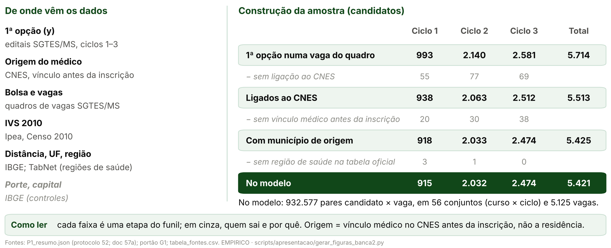

> [!IMPORTANT]
> **Revisão pela rubrica da banca (27/10/2026, véspera).** A banca dá nota a nove critérios (slides e narrativa,
> apresentador, base de dados, descritiva, modelo, interpretação, robustez, conclusões e limitações). Nesta versão:
> os antigos slides "Dados" e "Os três ciclos em números" viraram um só, com as fontes, a **unidade de observação**
> (candidato × vaga do seu curso e ciclo; y = 1 na 1ª opção) e o **funil da amostra por ciclo** (figura
> `curto_dados_amostra.png`, lida do `P1_resumo.json`); o slide do modelo diz **por que** o logit condicional e qual é
> o **teste** (D_UF, unilateral, erro-padrão agrupado por conjunto de escolha); os resultados ganharam a **leitura do
> coeficiente** em linguagem simples; a robustez diz o que se mantém e o que não; a Discussão tem agora dois slides,
> **Conclusão** (retoma a pergunta e sintetiza em três pontos) e **Limitações** (cada uma com a sua implicação). Cada
> slide do corpo tem um **roteiro de fala** com tempo-alvo (`> **Roteiro (N s).**`), que vai para as notas: soma de
> 7:00, cerca de 140 palavras por minuto. O roteiro inteiro está em
> [09_roteiro_fala_7min.md](09_roteiro_fala_7min.md); o mapa do deck anterior para este, em
> [10_mapa_deck_anterior_para_rubrica.md](10_mapa_deck_anterior_para_rubrica.md).
>
> **Correções da [auditoria 55](../../auditorias/55_auditoria_deck_rubrica.md) (27/10/2026), só de redação.** A
> leitura do coeficiente diz contra o quê se compara ("UF de origem vs. outra UF: chance ×11,0"; na fala, "entre duas
> vagas iguais no resto, inclusive na distância"); "toda a bolsa" no título da Conclusão e na robustez, como no teste
> D_UF; o conjunto de escolha é "suposto"; a limitação "só ciclo 2" implica "não generalizar"; o roteiro dos slides
> 2, 3, 7 e 11 fala menos números (eles ficam na tela) para caber nos 7 minutos com folga; "família" saiu da lista do
> que "sai da conta" no logit condicional. Nenhum número mudou.
>
> **Pedidos do autor (27/10/2026), nesta versão.**
> - **Hipótese única** ([07](07_nova_hipotese.md)): "o médico escolhe vagas perto de onde já trabalha; a bolsa maior
>   muda qual vaga ele escolhe dentro da sua região, mas pesa menos que a própria origem". Foi formulada **depois**
>   de ver os dados, e o slide de Hipótese diz isso.
> - **O corpo tem só a H2** ("pode tirar todas as hipóteses além da H2, que agora é nosso foco. Deixa no apêndice,
>   se quiser, mas bem rápido"). O fato da antiga H1 é uma linha de motivação, sem gráfico, no slide de Hipótese; o
>   gráfico dele (G-A) e a antiga H3, numa frase, vão para um **apêndice de no máximo 2 slides** depois da Discussão.
> - **Gráficos simples** (G-A a G-D do doc 07), gerados por `scripts/apresentacao/gerar_figuras_banca2.py` a partir
>   de `output/`, cada um com "Como ler".
> - **Redação da auditoria 50:** "não detectamos aumento do preenchimento", nunca "não encheu mais vagas"; o sinal
>   negativo em 0,300 nunca passou no Holm e "anda junto com a localização" (encolhe com a UF; não "some"); o
>   **teste central** é origem × toda a bolsa (D_UF); o peso da bolsa dentro da mesma UF é adendo pós-resultado, e a
>   especificação pré-registrada sem fixar a UF não passa no Holm; km de referência com o quadro corrigido; médico
>   de outra UF em 0,400 é inconclusivo.
> - Continuam as regras de 26/10/2026: no máximo 14 slides no corpo, até 30 palavras visíveis por slide (fora
>   título, figura e fontes), figura grande com "Como ler", efeitos por corte quando o gráfico é de corte, detalhe
>   nas notas do apresentador.
>
> **Formato.** Cada `#` é uma seção da estrutura obrigatória (e, no fim, o `# Apêndice`); cada `##` é um slide:
> título-afirmação (no máximo 58 caracteres), a figura (ou a tabela) grande e poucas linhas curtas. As linhas são os
> marcadores `- `; a cautela é a citação em negrito. Layouts: `curto_figura`, `curto_tabela`, `curto_texto`,
> `curto_capa` (frase grande, com cautela opcional), `curto_hipotese` (a hipótese em destaque; a motivação em cinza)
> e `curto_espec` (a 1ª linha, sem rótulo, é a equação em palavras). O bloco `> **Roteiro (N s).**` é a fala do
> slide, com o tempo-alvo em segundos; vai para as notas antes do detalhe, só no corpo. Numa tabela, a linha toda em itálico (`*…*`)
> sai em cinza (variável secundária). O gerador (`scripts/apresentacao/gerar_deck_banca2.py`, modo padrão) para se
> as seções fugirem da estrutura, se o corpo passar de 14 slides ou o apêndice de 2, se um slide passar de 30
> palavras ou se uma linha não couber.
>
> **Regra dos números.** Todo número de um slide, notas incluídas, é o valor de um código listado na linha
> `**Números:**` ou um parâmetro do protocolo
> ([03, §3](03_proveniencia_figuras_e_numeros.md#3-parâmetros-que-podem-aparecer-sem-código)).
> `tests/test_deck_curto_banca2.py` confere a estrutura, a contagem de palavras, os números, as cautelas e o pacote
> gerado.

<!-- deck:inicio -->

# Hipótese

## Pergunta e hipótese: origem ou bolsa na escolha?

`Hipótese`

<!-- layout: curto_hipotese -->

- **Hipótese** médico escolhe perto de onde trabalha; bolsa muda qual vaga, mas pesa menos que a origem
- **Motivação** no corte, preenchimento sem aumento detectado

> **Formulada após ver os dados.**

**Fontes:** doc 07 da banca 2 (decisão do autor de 27/10/2026); doc 65, §4.6 a §4.8 (auditoria 50); docs 57n e 57w.

**Números:** nenhum

> **Roteiro (35 s).** Nossa pergunta é simples: quando o médico especialista escolhe uma vaga do PMM-E, o que pesa
> mais, a bolsa ou a origem dele? A hipótese: ele escolhe perto de onde já trabalha; a bolsa maior muda qual vaga ele
> escolhe, mas pesa menos que a própria origem. A motivação vem do corte de IVS: onde a bolsa é R$ 5 mil maior, não
> detectamos aumento do preenchimento. Um aviso honesto, que está na tela: formulamos esta hipótese depois de ver os
> dados.

> **Notas do apresentador.** Hipótese única desta versão (decisão do autor de 27/10/2026; doc 07 da banca 2): a
> antiga H2, bolsa × origem. O médico especialista escolhe vagas perto de onde já trabalha; a bolsa maior muda
> qual vaga ele escolhe entre vagas da mesma UF, mas pesa menos que a própria origem. Foi formulada depois de ver os
> resultados do preenchimento no corte e os coeficientes do modelo de escolha: é pós-resultado, e isso é dito
> aqui. Motivação: onde a bolsa é R$ 5 mil maior, não detectamos aumento do preenchimento, e o desenho só pegaria
> saltos grandes (apêndice). Ligar a hipótese a esse fato é interpretação, não teste (auditoria 50). O que se
> testa: se, na escolha da 1ª opção, a vaga ficar na UF de origem pesa mais que toda a diferença de bolsa. O
> contraste da bolsa é o pacote do corte (a bolsa e as outras regras federais que mudam nos mesmos cortes de IVS,
> auditoria 18), não a participação no PMM-E nem o Agora Tem Especialistas. Tudo é condicional a se candidatar.

---

# Dados

## Dados e amostra: de onde vêm e quem entra no modelo

`Dados · fontes, unidade e funil`

<!-- layout: curto_figura -->

- **Unidade:** candidato × vaga do seu curso e ciclo; y = 1 na 1ª opção.
- **No modelo:** 5.421 candidatos e 932.577 pares candidato × vaga.

**Fontes:** `output/rdd_bolsa/P1_resumo.json` (protocolo 52; doc 57a); portão G1; `output/apresentacao_banca2/tabela_fontes.csv`; `curto_dados_amostra.png`; auditorias 16, 36 e 41.

**Números:** `M1_N`, `AM_PARES`, `AM_CONJ`, `AM_VAGAS`, `AM_TOT_R1`, `AM_TOT_LIG`, `AM_TOT_ORI`

> **Roteiro (50 s).** A 1ª opção de cada candidato vem dos editais do Ministério da Saúde, ciclos 1 a 3; a origem
> vem do CNES: o município onde ele tinha vínculo médico antes da inscrição; bolsa e vagas, dos quadros de vagas; o
> IVS, do Ipea; distância e UF, do IBGE. A unidade de observação é o par candidato × vaga: cada candidato aparece
> uma vez para cada vaga aberta do seu curso e ciclo, e a variável dependente vale 1 na sua 1ª opção. O funil, à
> direita, mostra quem sai em cada etapa: dos 5.714 candidatos com 1ª opção, 5.421 entram no modelo.

> **Notas do apresentador.** 1ª opção: listas de classificação dos editais do PMM-E (SGTES/MS), ciclos 1–3, uma
> linha por candidato e opção. Cada ciclo é um chamamento com quadro de vagas próprio: o ciclo 1 com quadro de
> 24/07/2025; o ciclo 2 com quadro de 03/02/2026, retificado em 13/02/2026 (o vigente na inscrição, de onde vem o
> tipo de vaga usado aqui; auditoria 36) e de novo em 19/03/2026; o ciclo 3 com quadro de 16/07/2026. Origem: o
> município do estabelecimento onde o candidato tinha vínculo médico no CNES antes das inscrições, ligado pelo
> portão G1 (CPF e nome); não é a residência. Vagas e bolsa: quadros de vagas da 1ª chamada, por célula
> (estabelecimento × curso), com a faixa da bolsa anunciada (adendo 52c, auditoria 41). IVS 2010 oficial: Plataforma
> IVS do Ipea; é a variável dos cortes. Distância entre os centroides dos municípios (malha do IBGE); UF e região de
> saúde (tabela oficial do TabNet). Secundárias, em cinza: porte e capital, controles do modelo. Funil (P1_resumo.json,
> sem recálculo): 5.714 candidatos com 1ª opção numa vaga do quadro; 5.513 ligados ao CNES; 5.425 com município de
> origem (vínculo médico na competência anterior à inscrição); 5.421 no modelo, depois de tirar quem tem a origem ou
> a 1ª opção num município sem região de saúde na tabela oficial. Unidade do modelo: 932.577 pares candidato × vaga,
> em 56 conjuntos de escolha (curso × ciclo), com 5.125 vagas (estabelecimento × curso). A taxa de ligação é
> parecida entre alocados e não alocados (G1). Dados pessoais só em memória ou em cache fora do Git.

---

# Análise descritiva

## A bolsa é função exata do IVS: a regra é sharp

`Análise descritiva · IVS × faixa`

<!-- layout: curto_figura -->

- **Como ler:** um ponto por município do ciclo 1; a bolsa salta nos cortes.
- **Ciclos 1 e 2:** reproduz 368/368 e 454/454 municípios.

**Fontes:** `output/rdd_bolsa/portao_r1_ivs_oficial.json`; `output/aquisicao/a08_ivs_2010_oficial_municipio.csv`; auditoria 16.

**Números:** `R_C1_REPR`, `R_C1_MUN`, `R_C2_REPR`, `R_C2_MUN`, `R_ESCORE_IGUAIS`, `R_C3_REPR`, `R_C3_MUN`

> **Roteiro (25 s).** De onde vem a variação da bolsa? De uma regra. Até IVS 0,300, R$ 10 mil; até 0,400, R$ 15 mil;
> acima, R$ 20 mil. Cada ponto é um município, e a regra reproduz a faixa de todos os municípios dos ciclos 1 e 2.
> O município não escolhe a bolsa: é a regra que dá.

> **Notas do apresentador.** Como ler: cada ponto é um município com vaga no quadro da 1ª chamada do ciclo 1; o
> eixo horizontal é o IVS 2010 oficial, a cor também; o vertical, a bolsa anunciada. Até 0,300, R$ 10 mil; até
> 0,400, R$ 15 mil; acima, R$ 20 mil. O escore da relação nominal do MS é o IVS 2010 oficial em 404/404 municípios.
> No ciclo 3, 747 de 748: o que falta foi criado depois de 2010. É daqui que vem a variação da bolsa no modelo de
> escolha: vagas parecidas, de lados diferentes de um corte, pagam bolsas diferentes. Em 0,300 e 0,400 mudam também
> outras regras federais: pacote do corte.

---

## Onde escolhem: perto de onde já trabalham

`Análise descritiva · Origem`

<!-- layout: curto_figura -->

- **79%** põem a 1ª opção na UF de origem; mediana: 51 km (descritivo).
- **Para a pergunta:** a maioria fica perto; quanto pesa a bolsa?

**Fontes:** `output/rdd_bolsa/G1_distancias_opcoes.parquet` e `G1_candidatos_origem.parquet` (portão G1); `output/apresentacao_banca2/exp_escolha_origem.png`.

**Números:** `ESC_N`, `ESC_UF`, `ESC_REG`, `ESC_MUN`, `ESC_DIST_P50`, `ESC_DIST_P75`

> **Roteiro (35 s).** Antes do modelo, os dados crus. Dos 5.425 candidatos com origem, 79% põem a 1ª opção na
> própria UF, 46% na mesma região de saúde e 36% no próprio município; a distância mediana é de 51 km. Isso é
> descritivo: mostra onde escolhem, não por quê. Para a pergunta: a origem é uma força grande; falta saber quanto a
> bolsa pesa diante dela, e é isso que o modelo mede.

> **Notas do apresentador.** Descritivo. Dos 5.425 candidatos com 1ª opção e município de origem, 79% põem a 1ª
> opção na UF onde já trabalhavam, 46% na mesma região de saúde e 36% no próprio município; a distância mediana até
> a 1ª opção é 51 km, e três em cada quatro ficam a até 189 km. A origem é o município do vínculo médico anterior
> no CNES, não a residência. É preferência revelada: diz onde escolhem, não por quê. A comparação crua não isola a
> bolsa, porque mistura a bolsa com o IVS, a distância e a própria origem (doc 66, §3); quem separa esses pesos é o
> modelo de escolha.

---

# Metodologia

## Modelo: logit condicional da 1ª opção

`Metodologia · escolha`

<!-- layout: curto_espec -->

- U = β·bolsa + γ·distância + θ·origem; P(j) = e^Uj/Σe^U
- **Por quê** escolha entre vagas; candidato comparado consigo mesmo
- **Bolsa** muda pela regra do IVS
- **Teste** D_UF = θ − 10β > zero; cluster por conjunto

**Fontes:** protocolos 52 e 52b; adendos 52c e 52e (`docs/06_execucao/`); docs 57a, 57i, 57p, 57x e 66 (§4).

**Números:** `M1_N`

> **Roteiro (45 s).** Usamos um logit condicional, por três razões. Primeiro, a escolha é discreta: o candidato
> escolhe uma entre as vagas abertas do seu curso. Segundo, cada candidato é comparado consigo mesmo: tudo o que
> é dele, como idade ou nota, é igual entre as vagas e sai da conta. Terceiro, a bolsa varia entre vagas por
> uma regra do IVS, e o IVS entra como curva contínua; então o peso da bolsa vem só dos saltos nos cortes. O teste
> central é o D_UF: o peso de a vaga estar na UF de origem menos o peso de toda a diferença de bolsa. É unilateral,
> com erro-padrão agrupado por conjunto de escolha.

> **Notas do apresentador.** Logit condicional (McFadden): cada um dos 5.421 candidatos escolhe, entre as vagas
> abertas do seu curso e ciclo, a de maior utilidade; o candidato é comparado consigo mesmo entre as vagas que
> podia escolher, e o que não varia entre vagas (dele) sai da verossimilhança. Utilidade = bolsa (linear, por R$ 1
> mil) + curva contínua do IVS (spline com dobras nos cortes, sem salto) + distância em km + mesma UF, mesma região de
> saúde e mesmo município da origem + porte, capital, estrato, macrorregião e vagas imediatas da vaga. Só o salto da
> bolsa nos cortes de IVS identifica o peso dela. Teste central (P1h-1, protocolo 52b, pós-resultado): D_UF = peso
> da vaga na UF de origem − peso de toda a bolsa (10 × β), H0: D_UF ≤ zero, unilateral, com o tipo de vaga do ciclo
> 2 do quadro de 13/02/2026 (adendo 52c). Erro-padrão agrupado por conjunto de escolha (curso × ciclo). Adendo 52e
> (pós-resultado): efeito fixo do par (UF de origem, UF da vaga), comparando só vagas da mesma UF (a de origem ou
> outra) vistas por médicos da mesma UF de origem. Por ciclo: o mesmo modelo em cada ciclo. Por que não um
> logit multinomial com efeitos de vaga? Porque a pergunta é o peso de atributos da vaga que variam por candidato
> (distância, origem) contra a bolsa; o condicional é o modelo de escolha discreta feito para isso.

---

# Identificação

## Identificação: as premissas e o nosso caso

`Identificação · escolha`

<!-- layout: curto_tabela -->

| Premissa | Aderência |
|---|---|
| Bolsa por regra | sharp: 368/368, 454/454 |
| Só a bolsa? | não: pacote do corte |
| IIA | em parte; bolsa estável |
| Localização | par de UFs fixado |
| Conjunto | suposto: todas vistas |

**Fontes:** auditorias 16, 18, 41 e 48; docs 57a (M9), 57i, 57p e 57x; `output/rdd_bolsa/portao_r1_ivs_oficial.json`; `VC_estimativas.csv`.

**Números:** `R_C1_REPR`, `R_C1_MUN`, `R_C2_REPR`, `R_C2_MUN`, `VC_B_HOLM`

> **Roteiro (30 s).** Cinco premissas. A bolsa segue a regra do IVS, sem exceção nos ciclos 1 e 2. Mas nos mesmos
> cortes mudam outras regras federais: medimos o pacote do corte. A independência de alternativas irrelevantes vale
> só em parte, mas no logit aninhado o peso da bolsa fica perto do mesmo valor. Com o par de UFs fixado, ele não
> diminui. E supomos que o candidato viu todas as vagas do seu curso.

> **Notas do apresentador.** Bolsa por regra: o IVS 2010 oficial reproduz a faixa de todos os municípios dos
> ciclos 1 e 2 (368/368 e 454/454); o município não escolhe a bolsa. Pacote do corte: em 0,300 e 0,400 mudam
> também outras regras federais (auditoria 18); o peso da bolsa é o do pacote, não o da bolsa sozinha nem o da
> participação no PMM-E. IIA (independência de alternativas irrelevantes): o logit aninhado por região de saúde a
> rejeita em parte, e o ponto do peso da bolsa fica perto do mesmo valor (doc 57a; com o quadro de 13/02/2026, doc
> 57v). Localização: com o par de UFs fixado, o peso da bolsa não diminui (adendo 52e, auditoria 48); a comparação
> só com vagas perto do corte é inconclusiva. Conjunto de escolha: supõe que o candidato viu todas as vagas do seu
> curso e listou sem estratégia (a alocação é por nota). Origem: preferência revelada, medida pelo vínculo anterior
> no CNES; mistura família, rede e registro; não é efeito causal de mudar alguém de lugar. Pós-resultado: a
> hipótese e o teste D_UF foram formulados depois de ver os coeficientes; o peso da bolsa pré-registrado (P1a, sem
> fixar a UF) não rejeita zero (p 0,072; família de um teste, Holm = p). Tudo é condicional a se candidatar.

---

# Resultados

## Teste central: a origem pesa mais que toda a bolsa

`Resultados · origem × bolsa`

<!-- layout: curto_figura -->
<!-- linhas: 3 -->

- **Origem − bolsa:** 1,94 [1,48; 2,40] em log-chance; p < 0,001.
- UF de origem vs. outra UF: chance ×11,0; toda a bolsa: ×1,57 (IC contém 1).

> **Origem é preferência revelada, não causa.**

**Fontes:** `output/rdd_bolsa/VC_estimativas.csv` (adendo 52c; doc 57p; auditoria 41); P1h (protocolo 52b; doc 57i; auditoria 31); `output/apresentacao_banca2/curto_origem_bolsa.png`.

**Números:** `M1_N`, `VC_DUF_EST`, `VC_DUF_INF`, `VC_DUF_SUP`, `VC_DUF_P`, `VC_DUF_HOLM`, `VC_THETA_EST`, `VC_THETA_INF`, `VC_THETA_SUP`, `VC_THETAX_EST`, `VC_THETAX_INF`, `VC_THETAX_SUP`, `VC_B10_EST`, `VC_B10_INF`, `VC_B10_SUP`, `VC_B10X_EST`, `VC_B10X_INF`, `VC_B10X_SUP`

> **Roteiro (50 s).** Este é o teste central. No mesmo modelo, entre duas vagas iguais no resto, inclusive na
> distância, a da UF de origem tem 11,0 vezes a chance de ser a 1ª opção. Toda a diferença de bolsa, de R$ 10 mil
> para R$ 20 mil, multiplica a chance por 1,57, e esse intervalo contém 1: sozinho, o peso da bolsa não se distingue
> de zero. A diferença entre os dois pesos, em log-chance, é 1,94, com p unilateral menor que 0,001. Em palavras: a
> origem pesa muito mais que toda a bolsa. Um cuidado: a origem é preferência revelada, não causa.

> **Notas do apresentador.** Teste central da hipótese (P1h-1, com o tipo de vaga do ciclo 2 do quadro de
> 13/02/2026; adendo 52c, auditoria 41). No mesmo modelo e com os mesmos 5.421 candidatos (ciclos 1–3), a vaga ficar na UF
> de origem pesa 2,40 [2,27; 2,52] em log-chance: multiplica a chance de ser a 1ª opção por 11,0 [9,7; 12,5]. Toda
> a diferença de bolsa, de R$ 10 mil para R$ 20 mil, pesa 0,45 [−0,04; 0,95]: multiplica a chance por 1,57 [0,96;
> 2,58], intervalo que contém 1. A diferença é 1,94 [1,48; 2,40], p unilateral < 0,001 e p de Holm < 0,001
> (família de um teste). Como ler o coeficiente: em log-chance, exp(coeficiente) é a razão de chances; 11,0 quer
> dizer que, entre duas vagas iguais no resto (inclusive a distância), a da UF de origem tem 11,0 vezes a chance
> de ser a 1ª opção que a de outra UF; no logit condicional, é a razão entre as probabilidades de escolher uma e a
> outra. A conclusão resiste à imprecisão da bolsa: o limite de cima de toda a bolsa fica abaixo do limite de baixo da origem.
> Por ciclo, a origem pesa mais nos três (Robustez). Escolha condicional a se candidatar; a bolsa é o pacote do
> corte; a origem é preferência revelada, medida pelo vínculo anterior no CNES, e não causa da escolha.

---

## Dentro da mesma UF, a vaga de bolsa maior é preferida

`Resultados · bolsa na mesma UF`

<!-- layout: curto_figura -->

- Na mesma UF, +R$ 5 mil: chance ×1,47; vale 75 km a menos.

> **Adendo pós-resultado; pré-registrado, sem fixar a UF: p 0,072.**

**Fontes:** `output/rdd_bolsa/VL_estimativas.csv` (adendo 52e; doc 57x; auditoria 48); `output/apresentacao_banca2/curto_bolsa_mesma_uf.png`.

**Números:** `VL1_EMP_RC`, `VL1_EMP_RCI`, `VL1_EMP_RCS`, `VL1_EMP_HOLM`, `VL1_C2_RC`, `VL1_C2_RCI`, `VL1_C2_RCS`, `VL1_C2_HOLM`, `VLB_EMP_RC`, `VLB_EMP_RCI`, `VLB_EMP_RCS`, `VLB_C2_RC`, `VLB_C2_RCI`, `VLB_C2_RCS`, `VC_B_HOLM`, `VL1_EMP_K5`, `VL1_EMP_K5I`, `VL1_EMP_K5S`, `VL1_C2_K5`, `VL1_C2_K5I`, `VL1_C2_K5S`, `VLB_EMP_K5`, `VLB_EMP_K5I`, `VLB_EMP_K5S`, `VLB_C2_K5`, `VLB_C2_K5I`, `VLB_C2_K5S`

> **Roteiro (40 s).** Então a bolsa não pesa? Pesa, quando comparamos vagas parecidas. Fixando o par de UFs,
> comparamos só vagas da mesma UF, a de origem ou outra, vistas por médicos da mesma UF de origem. Aí, R$ 5 mil a
> mais multiplicam a chance por 1,47 nos ciclos 1 a 3 juntos e por 1,90 no ciclo 2. Na escolha, isso vale o mesmo
> que 75 km a menos de distância. Duas ressalvas: é um adendo feito depois do resultado; e, na especificação
> pré-registrada, sem fixar a UF, o p é 0,072.

> **Notas do apresentador.** Adendo 52e (doc 57x; auditoria 48; pós-resultado): comparando só vagas da mesma UF
> (a de origem ou outra), vistas por médicos da mesma UF de origem (efeito fixo do par de UFs), a razão de chances da
> 1ª opção por +R$ 5 mil é 1,47 [1,15; 1,89] nos ciclos 1–3 (p de Holm 0,005) e 1,90 [1,30; 2,78] no ciclo 2 (p de
> Holm 0,003). Como ler: entre duas vagas parecidas da mesma UF, a de bolsa R$ 5 mil maior tem 1,47 vez a chance
> de ser a 1ª opção. No modelo base, sem fixar a UF: 1,25 [0,98; 1,61] e 1,79 [1,19; 2,68]; a especificação
> pré-registrada (P1a) não rejeita zero (p 0,072; família de um teste, Holm = p). Em km: dentro da mesma UF, +R$ 5
> mil pesam como 75 km [28; 122] a menos de distância nos ciclos 1–3 e 117 km [56; 178] no ciclo 2; no modelo base,
> com o quadro corrigido, 119 km [−12; 250] e 302 km [88; 516]. Os km caem dentro da UF porque a distância pesa mais
> ali, não porque a bolsa pese menos. Mostra que a escolha responde à bolsa; não testa a comparação com a origem.
> Escolha não é expansão: o que uma vaga ganha, outra do mesmo curso perde. Com o *score bootstrap* para poucos
> grupos, o VL-1 se mantém (doc 57x). Pacote do corte.

---

# Robustez

## Robustez: o que se mantém e o que não se mantém

`Robustez · escolha`

<!-- layout: curto_figura -->
<!-- linhas: 3 -->

- **Mantém:** origem pesa mais que toda a bolsa nos três ciclos.
- **Não se mantém:** peso da bolsa, forte só no ciclo 2; perto do corte, inconclusivo.

> **Pré-registrado: IC contém 1.**

**Fontes:** `output/rdd_bolsa/VC_estimativas.csv` (adendo 52c; doc 57p; auditoria 41); `VL_estimativas.csv` (adendo 52e; doc 57x; auditoria 48); doc 57v (adendo 52d; auditoria 46).

**Números:** `VLB_EMP_RC`, `VLB_EMP_RCI`, `VLB_EMP_RCS`, `VC_M5C1_RC`, `VC_M5C1_RCI`, `VC_M5C1_RCS`, `VC_M5C2_RC`, `VC_M5C2_RCI`, `VC_M5C2_RCS`, `VC_M5C3_RC`, `VC_M5C3_RCI`, `VC_M5C3_RCS`, `VC_M5C2A_RC`, `VC_M5C2A_RCI`, `VC_M5C2A_RCS`, `VLLOG_EMP_RC`, `VLLOG_EMP_RCI`, `VLLOG_EMP_RCS`, `VLLOG_C2_RC`, `VLLOG_C2_RCI`, `VLLOG_C2_RCS`, `VL3_EMP_RC`, `VL3_EMP_RCI`, `VL3_EMP_RCS`, `VL3_C2_RC`, `VL3_C2_RCI`, `VL3_C2_RCS`, `VL2_EMP_RC`, `VL2_EMP_RCI`, `VL2_EMP_RCS`, `VL2_EMP_HOLM`, `VC_DUF_C1_EST`, `VC_DUF_C1_INF`, `VC_DUF_C1_SUP`, `VC_DUF_C2_EST`, `VC_DUF_C2_INF`, `VC_DUF_C2_SUP`, `VC_DUF_C3_EST`, `VC_DUF_C3_INF`, `VC_DUF_C3_SUP`

> **Roteiro (40 s).** Se mantém, à direita: a origem pesa mais que toda a bolsa em cada ciclo separado; a
> diferença fica acima de zero nos três, de 1,19 no ciclo 2 a 2,37 no ciclo 3. E, entre vagas da mesma UF, a bolsa
> continua pesando com a distância em log e com a região de saúde fixada. Não se mantém o peso da bolsa sozinho: no
> pré-registrado o intervalo contém 1; ele é forte só no ciclo 2, e perto do corte é inconclusivo. Por que o ciclo
> 2? Não sabemos.

> **Notas do apresentador.** Especificação pré-registrada (M1, ciclos 1–3, quadro corrigido): 1,25 [0,98; 1,61], IC
> que contém 1; é a principal do peso da bolsa, e o VL-1 é adendo. Por ciclo (o mesmo modelo): razão de chances 1,07
> [0,69; 1,65] no ciclo 1, 1,79 [1,19; 2,68] no ciclo 2 e 1,00 [0,72; 1,39] no ciclo 3. A bolsa desloca a escolha
> com força só no ciclo 2; nos ciclos 1 e 3, os intervalos são largos, e não sabemos por quê (leituras candidatas,
> sem teste: informação sobre a grade, vagas por curso, parte de vagas imediatas; doc 57a). Quadro do ciclo 2: com o
> quadro refeito depois do resultado (19/03/2026), 1,70 [1,22; 2,37]; com o de 13/02/2026, vigente na inscrição,
> 1,79 (adendo 52c, auditoria 41; as demais variantes no adendo 52d, auditoria 46). Comparando vagas da mesma UF: com
> a distância em log, 1,45 [1,15; 1,83] (ciclo 2: 1,75 [1,23; 2,49]); com a região de saúde de origem no lugar da UF
> de origem, 1,49 [1,15; 1,92] (ciclo 2: 1,91 [1,33; 2,74]); só com vagas a até 0,050 de um corte, 1,28 [0,95;
> 1,72], p de Holm 0,103: inconclusivo. À direita, origem − toda a bolsa por ciclo: 2,34 [1,45; 3,24], 1,19 [0,51;
> 1,86] e 2,37 [1,75; 3,00]: a origem pesa mais nos três ciclos. O peso da bolsa sozinho depende da especificação:
> com o logit explodido (doc 57v) e com o spline cúbico do IVS (doc 42), o IC contém 1; origem − bolsa fica acima de
> zero em todas as variantes (doc 66, §7). Tudo pós-resultado e condicional a se candidatar.

---

# Discussão

## Conclusão: a origem pesa mais que toda a bolsa? Sim

`Discussão · Conclusão`

<!-- layout: curto_texto -->

- **Origem** pesa mais que toda a bolsa, nos três ciclos
- **Bolsa** muda qual vaga, na mesma UF (adendo)
- **Teoria** os dados sugerem incentivo limitado (pacote do corte)

**Fontes:** modelo da banca 1; doc 07 da banca 2; docs 57i, 57p, 57x e 66 (§9 e §10); auditorias 18, 50 e 53.

**Números:** nenhum

> **Roteiro (30 s).** Voltando à pergunta: na escolha da vaga, a origem pesa mais que toda a bolsa? Sim, e em todos
> os ciclos. Segundo, entre vagas da mesma UF, a bolsa maior é preferida: ela muda qual vaga o médico escolhe. Terceiro,
> pela teoria da banca 1, o médico aceita a vaga se a bolsa compensa o custo do lugar; os dados sugerem que um degrau
> de R$ 5 mil não compensa sair da própria UF: incentivo limitado.

> **Notas do apresentador.** No modelo da banca 1, o médico aceita a vaga se a bolsa compensa o custo do lugar. O
> dado: a vaga na UF de origem pesa mais que toda a diferença de bolsa (o pacote do corte); o D_UF positivo diz só
> isso. A leitura que os dados sugerem, sem teste direto: o custo que pesa não é o do município, que a bolsa
> compensa, e sim o de sair da própria UF; a origem é preferência revelada e pode carregar também família, rede e o
> emprego atual. Um degrau de R$ 5 mil desloca a escolha entre vagas da mesma UF, e os dados sugerem que não
> compensa esse custo: incentivo limitado. É coerente com não termos detectado aumento do preenchimento no corte
> (apêndice), mas essa ligação é interpretação, não teste (auditoria 50). Dá para afirmar: entre quem se candidatou,
> a vaga de bolsa maior é preferida a uma vaga parecida da mesma UF; a origem pesa mais que toda a diferença de
> bolsa. Não dá para afirmar: que a bolsa causa mais médicos no município; que a origem causa a escolha; que o efeito
> no preenchimento é zero; que a bolsa reduz o preenchimento. O contraste é o pacote do corte, não a participação no
> PMM-E. Próximos passos: as decisões do autor que seguem abertas (doc 05, §4.1), o ciclo 3 com a competência
> 202703 madura e o universo de inscritos.

---

## Limitações e o que cada uma implica

`Discussão · Limitações`

<!-- layout: curto_tabela -->

| Limitação | Implicação |
|---|---|
| Pós-resultado | exploratório |
| Preferência revelada | não é causa |
| Só candidatos | sem margem extensiva |
| Pacote do corte | bolsa não isolada |
| Só ciclo 2 | não generalizar |
| Origem = CNES | não é residência |

**Fontes:** doc 66 (§0, §5 e §8); doc 07 da banca 2 (§3 e §4); auditorias 18, 50, 52 e 53.

**Números:** `VL1_EMP_RC`, `VL1_EMP_RCI`, `VL1_EMP_RCS`, `VL1_EMP_HOLM`, `VC_B_HOLM`

> **Roteiro (40 s).** Seis limitações e o que cada uma implica. A hipótese é pós-resultado: o resultado é
> exploratório e pede dados novos. A origem é preferência revelada: não é causa da escolha. Só vemos quem se
> candidatou: nada diz quantos médicos a bolsa atrairia. O contraste é o pacote do corte: vale para o pacote, não
> para os R$ 5 mil sozinhos. A bolsa pesa forte só no ciclo 2: não dá para generalizar. E a origem é o vínculo no
> CNES, não a residência: para quem trabalha longe de casa, é a do trabalho. Obrigado.

> **Notas do apresentador.** Implicações, com mais detalhe. Pós-resultado: a hipótese e o teste D_UF vieram
> depois dos coeficientes; o resultado é exploratório e só vira confirmatório com um protocolo congelado aplicado a
> dados novos (o universo de inscritos, novos ciclos). Preferência revelada: θ_UF junta família, rede, registro
> no conselho regional e, sobretudo, manter o emprego atual (as horas da bolsa são cumuláveis); não mede o efeito
> causal de mudar a origem de alguém, e a política não pode "mover a origem". Condicional a se candidatar: sem
> a margem extensiva, nada aqui diz quantos especialistas a mais se inscreveriam com bolsa maior; escolha não é
> preenchimento. Pacote do corte: nos mesmos cortes mudam outras regras federais (auditoria 18); a implicação de
> política vale para o pacote, não para os R$ 5 mil sozinhos. Só no ciclo 2: o peso forte da bolsa vem de um
> ciclo; nos ciclos 1 e 3 os IC são largos; não generalizar para o programa. Origem = vínculo no CNES: quem
> trabalha longe de casa aparece com a origem do trabalho; a distância "de casa" pode estar subestimada. Perguntas
> prováveis da banca (doc 66, §8). P1, "Vocês formularam a hipótese depois de ver os resultados?" Sim, e está na
> tela do slide 1; o D_UF formaliza uma diferença já visível nos IC (protocolo 52b; auditoria 31), e o VL-1 foi
> congelado antes de rodar (52e; auditoria 48). P2, "Se a bolsa não passa no Holm no pré-registrado, como ela muda
> qual vaga?" Pelo VL-1, que compara vagas da mesma UF e passa no Holm do adendo: 1,47 [1,15; 1,89], p de Holm
> 0,005; e pelo ciclo 2. No pré-registrado, p 0,072. O teste central da hipótese continua sendo o D_UF. P3, "Isso é
> a bolsa ou o pacote?" O pacote do corte: nos mesmos cortes mudam outras regras federais (auditoria 18); em 0,300
> nenhum outro incentivo individual ao especialista do PMM-E muda (auditoria 35); em 0,400 fica aberta a ajuda de
> custo do PMMB; nos dois cortes, o serviço do município pode mudar.

---

# Apêndice

## Apêndice · O fato: sem aumento detectado no corte

`Apêndice · antiga H1`

<!-- layout: curto_figura -->

- O negativo em 0,300 nunca passou no Holm; anda junto com a UF.

> **Pacote do corte; só detectaria saltos grandes.**

**Fontes:** `output/rdd_bolsa/HI_estimativas.csv` (adendo 48b; doc 57n; auditoria 38); `PL_estimativas.csv` (adendo 48h; doc 57w; auditoria 47); `output/apresentacao_banca2/curto_fato.png`.

**Números:** `HI1_300_TAU`, `HI1_300_INF`, `HI1_300_SUP`, `HI1_300_HOLM`, `HI1_400_TAU`, `HI1_400_INF`, `HI1_400_SUP`, `HI1_300_MDE`, `HI1_400_MDE`, `PL_H41_300_TAU`, `PL_H41_300_INF`, `PL_H41_300_SUP`, `PL_H41_400_TAU`, `PL_H41_400_INF`, `PL_H41_400_SUP`, `PL_H41_300_SC`, `PL_H41_400_SC`, `PL_FRAC_300_TAU`, `PL_FRAC_300_INF`, `PL_FRAC_300_SUP`, `PL_FRAC_300_NPAR`, `PL_FRAC_400_TAU`, `PL_FRAC_400_INF`, `PL_FRAC_400_SUP`, `PL_FRAC_400_NPAR`, `HI2_300_TAU`, `HI2_300_INF`, `HI2_300_SUP`, `HI2_300_HOLM`, `PL_H42_300_SC`, `PL_H42_300_TAU`, `PL_H42_300_INF`, `PL_H42_300_SUP`, `PL_OUT_300_TAU`, `PL_OUT_300_INF`, `PL_OUT_300_SUP`, `PL_OUT_400_TAU`, `PL_OUT_400_INF`, `PL_OUT_400_SUP`, `HI2_C1_300_TAU`, `HI2_C1_300_INF`, `HI2_C1_300_SUP`, `HI2_C2_300_TAU`, `HI2_C2_300_INF`, `HI2_C2_300_SUP`, `HI2_C3_300_TAU`, `HI2_C3_300_INF`, `HI2_C3_300_SUP`, `CL_BAL_CAP_300`, `CL_BAL_NE_300`, `CL_BAL_ESP_300`

> **Notas do apresentador.** Antiga H1, só como motivação (adendo 48b, doc 57n, auditoria 38; adendo 48h, doc 57w,
> auditoria 47). Chance de a célula com vaga imediata ser preenchida na 1ª chamada (HI-1): −3,7 p.p. [−21,3; +13,9]
> em 0,300 e −2,3 [−24,0; +19,4] em 0,400, p de Holm 1,000; o desenho só detectaria saltos de 25,1 e 31,0 p.p. Com
> efeito fixo de UF e os especialistas no entorno, só nos municípios com essa medida (nessa amostra, sem controle, −0,4
> e +1,8): +5,4 [−11,0; +21,8] e −4,2 [−21,1; +12,6]. Pareando
> municípios da mesma UF e condição de capital: +16,4 [−3,8; +36,6] com 25 pares e −6,0 [−23,2; +11,5] com 29
> pares; o ponto não deve ser lido como tamanho de efeito. O sinal negativo era mais forte nos médicos alocados por
> município em 0,300 (HI-2): −1,13 [−2,15; −0,10], p de Holm 0,126, nunca passou no Holm; na mesma amostra, sem
> controle, −1,15; com efeito fixo de UF e os especialistas no entorno, −0,62 [−1,67; +0,43]: encolhe e deixa de se
> distinguir de zero; o que move o ponto é a UF, não o raio (auditoria 47). A HI-2 cai em tamanho parecido nos três ciclos: −1,07 [−2,88; +0,74], −0,97 [−2,48;
> +0,55] e −1,33 [−3,59; +0,93]. Em 0,300, o balanço falha: do lado de bolsa maior, a parte de capitais muda −29,9
> p.p., a do Nordeste −47,7 p.p., e há +10,54 especialistas por 10 mil hab. no resto da região de saúde. O sinal anda
> junto com a UF e a localização; é limite da RDD nesse corte, não prova de mecanismo, e não mostra que a bolsa
> reduz o preenchimento. Médico de outra UF por vaga imediata: +0,02 [−0,01; +0,06] em 0,300 e +0,16 [+0,00;
> +0,35] em 0,400, inconclusivo, com poucos pares. Pacote do corte.

---

## Apêndice · H3: oferta, numa frase

`Apêndice · antiga H3`

<!-- layout: curto_capa -->

- O médico que chega cadastra +6,6 h/sem; metade já estava lá

> **Associação; vínculo cadastrado não é presença.**

**Fontes:** `S57_resumo.json` (doc 57d); `OC_estimativas.csv` (protocolo 64; doc 57q; auditoria 39).

**Números:** `P4_HT_ATT`, `P4_HT_INF`, `P4_HT_SUP`, `P4_ORIGEM`, `P4_ORIGEM_INF`, `P4_ORIGEM_SUP`, `OC_B1_300_HOLM`, `OC_B1_400_HOLM`

> **Notas do apresentador.** Antiga H3, fora do corpo (decisão do autor de 27/10/2026). As horas cadastradas do
> médico do PMM-E sobem +6,6 h/sem [+5,4; +7,8] depois da entrada, e 51,0% [48,4; 53,7] já tinham vínculo no
> município do posto. No município, comparando os lados do corte (protocolo 64), não se detecta diferença na oferta
> de especialistas (p de Holm 1,000 nos dois cortes), o que não quer dizer que ela seja igual. Associação; não é efeito da bolsa nem da participação no
> PMM-E. Horas cadastradas não são presença.

<!-- deck:fim -->

<!-- apendice:fim -->
