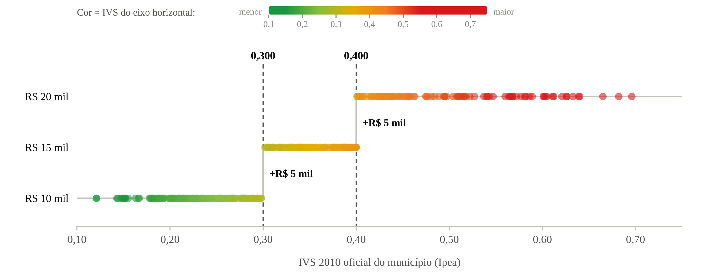
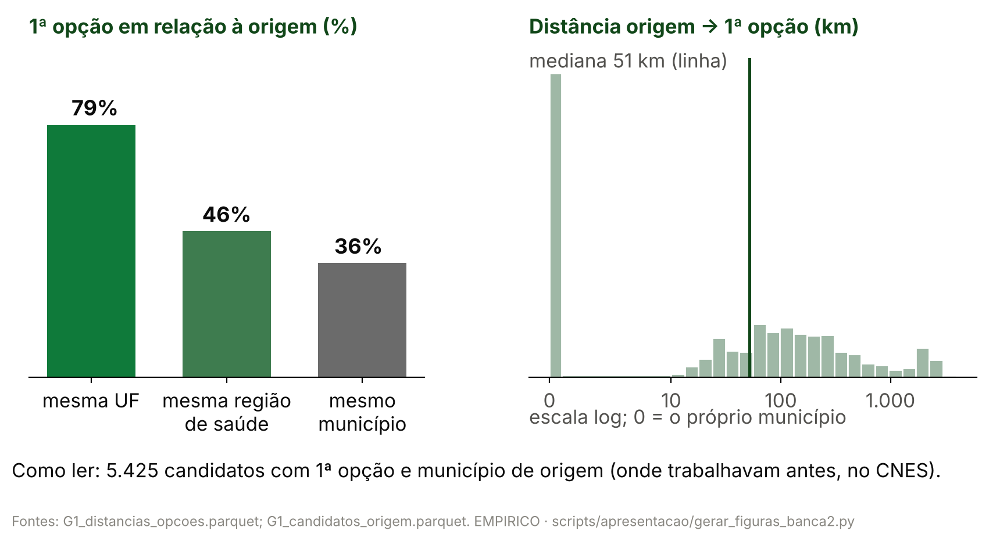
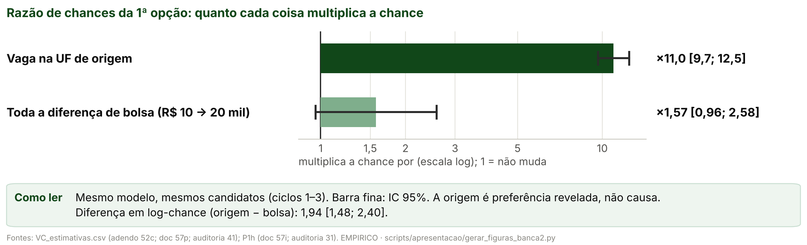
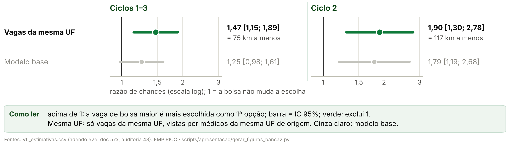
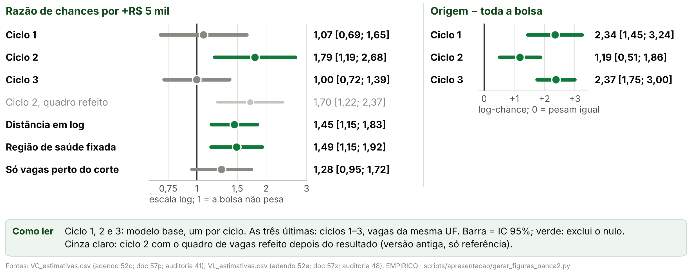
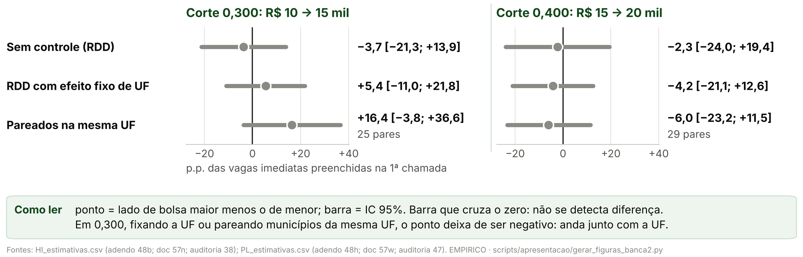

> [!IMPORTANT]
> **Pedidos do autor (27/10/2026), nesta versão.**
> - **Hipótese única** ([07](07_nova_hipotese.md)): "o médico escolhe vagas perto de onde já trabalha; a bolsa maior
>   muda qual vaga ele escolhe dentro da sua região, mas pesa menos que a própria origem". Foi formulada **depois**
>   de ver os dados, e o slide de Hipótese diz isso.
> - **O corpo tem só a H2** ("pode tirar todas as hipóteses além da H2, que agora é nosso foco. Deixa no apêndice,
>   se quiser, mas bem rápido"). O fato da antiga H1 é uma linha de motivação, sem gráfico, no slide de Hipótese; o
>   gráfico dele (G-A) e a antiga H3, numa frase, vão para um **apêndice de no máximo 2 slides** depois da Discussão.
> - **Gráficos simples** (G-A a G-D do doc 07), gerados por `scripts/apresentacao/gerar_figuras_banca2.py` a partir
>   de `output/`, cada um com "Como ler".
> - **Redação da auditoria 50:** "não detectamos aumento do preenchimento", nunca "não encheu mais vagas"; o sinal
>   negativo em 0,300 nunca passou no Holm e "anda junto com a localização" (encolhe com a UF; não "some"); o
>   **teste central** é origem × toda a bolsa (D_UF); o peso da bolsa dentro da mesma UF é adendo pós-resultado, e a
>   especificação pré-registrada sem fixar a UF não passa no Holm; km de referência com o quadro corrigido; médico
>   de outra UF em 0,400 é inconclusivo.
> - Continuam as regras de 26/10/2026: no máximo 14 slides no corpo, até 30 palavras visíveis por slide (fora
>   título, figura e fontes), figura grande com "Como ler", efeitos por corte quando o gráfico é de corte, detalhe
>   nas notas do apresentador.
>
> **Formato.** Cada `#` é uma seção da estrutura obrigatória (e, no fim, o `# Apêndice`); cada `##` é um slide:
> título-afirmação (no máximo 58 caracteres), a figura (ou a tabela) grande e poucas linhas curtas. As linhas são os
> marcadores `- `; a cautela é a citação em negrito. Layouts: `curto_figura`, `curto_tabela`, `curto_texto`,
> `curto_capa` (frase grande, com cautela opcional), `curto_hipotese` (a hipótese em destaque; a motivação em cinza)
> e `curto_espec` (a 1ª linha, sem rótulo, é a equação em palavras). Numa tabela, a linha toda em itálico (`*…*`)
> sai em cinza (variável secundária). O gerador (`scripts/apresentacao/gerar_deck_banca2.py`, modo padrão) para se
> as seções fugirem da estrutura, se o corpo passar de 14 slides ou o apêndice de 2, se um slide passar de 30
> palavras ou se uma linha não couber.
>
> **Regra dos números.** Todo número de um slide, notas incluídas, é o valor de um código listado na linha
> `**Números:**` ou um parâmetro do protocolo
> ([03, §3](03_proveniencia_figuras_e_numeros.md#3-parâmetros-que-podem-aparecer-sem-código)).
> `tests/test_deck_curto_banca2.py` confere a estrutura, a contagem de palavras, os números, as cautelas e o pacote
> gerado.

<!-- deck:inicio -->

# Hipótese

## Hipótese: a origem pesa mais que a bolsa na escolha

`Hipótese`

<!-- layout: curto_hipotese -->

- **Hipótese** médico escolhe perto de onde trabalha; bolsa muda qual vaga, mas pesa menos que a origem
- **Motivação** no corte, preenchimento sem aumento detectado

> **Formulada após ver os dados.**

**Fontes:** doc 07 da banca 2 (decisão do autor de 27/10/2026); doc 65, §4.6 a §4.8 (auditoria 50); docs 57n e 57w.

**Números:** nenhum

> **Notas do apresentador.** Hipótese única desta versão (decisão do autor de 27/10/2026; doc 07 da banca 2): a
> antiga H2, bolsa × origem. O médico especialista escolhe vagas perto de onde já trabalha; a bolsa maior muda
> qual vaga ele escolhe dentro da sua região, mas pesa menos que a própria origem. Foi formulada depois de ver os
> resultados do preenchimento no corte e os coeficientes do modelo de escolha: é pós-resultado, e isso é dito
> aqui. Motivação: onde a bolsa é R$ 5 mil maior, não detectamos aumento do preenchimento, e o desenho só pegaria
> saltos grandes (apêndice). Ligar a hipótese a esse fato é interpretação, não teste (auditoria 50). O que se
> testa: se, na escolha da 1ª opção, a vaga ficar na UF de origem pesa mais que toda a diferença de bolsa. O
> contraste da bolsa é o pacote do corte (a bolsa e as outras regras federais que mudam nos mesmos cortes de IVS,
> auditoria 18), não a participação no PMM-E nem o Agora Tem Especialistas. Tudo é condicional a se candidatar.

---

# Dados

## Dados: as variáveis e de onde vêm

`Dados`

<!-- layout: curto_tabela -->

| Variável: principal · *secundária* | Fonte |
|---|---|
| 1ª opção | editais SGTES/MS |
| Origem do médico | CNES |
| Vagas, bolsa | quadros SGTES/MS |
| IVS 2010 | Ipea |
| Distância, UF | IBGE |
| *Porte, capital* | *IBGE* |

**Fontes:** `output/apresentacao_banca2/tabela_fontes.csv`; portão G1; auditorias 16, 36 e 41.

**Números:** nenhum

> **Notas do apresentador.** 1ª opção: listas de classificação dos editais do PMM-E (SGTES/MS), ciclos 1–3, uma
> linha por candidato e opção. Origem: o município do estabelecimento onde o candidato tinha vínculo médico no CNES
> antes das inscrições, ligado pelo portão G1 (CPF e nome); não é a residência. Vagas e bolsa: quadros de vagas da
> 1ª chamada, por célula (estabelecimento × curso), com o tipo de vaga e a faixa da bolsa anunciada; no ciclo 2, o
> tipo de vaga vem do quadro de 13/02/2026, vigente na inscrição (adendo 52c, auditoria 41). IVS 2010 oficial:
> Plataforma IVS do Ipea, Censo 2010, por município; é a variável dos cortes. Distância entre os centroides dos
> municípios (malha do IBGE); UF e região de saúde (tabela oficial do TabNet). Secundárias, em cinza: porte
> (população do Censo 2022) e capital (código IBGE), controles do modelo. Dados pessoais só em memória ou em cache
> fora do Git.

---

# Análise descritiva

## Os três ciclos em números

`Análise descritiva · Ciclos`

<!-- layout: curto_tabela -->

| | Ciclo 1 | Ciclo 2 | Ciclo 3 |
|---|---|---|---|
| Células | 1.295 | 1.547 | 2.293 |
| Candidatos, 1ª opção | 993 | 2.140 | 2.581 |
| Com origem | 915 | 2.032 | 2.474 |

- **Ciclo** = edital: 2025, início e meio de 2026

**Fontes:** `output/apresentacao_banca2/tabela_descritiva_ciclos.csv`; `cronologia_ciclos.csv`; `numeros_banca2.json` (amostra P1).

**Números:** `D_C1_CEL`, `D_C2_CEL`, `D_C3_CEL`, `D_C1_CAND1`, `D_C2_CAND1`, `D_C3_CAND1`, `D_C1_P1`, `D_C2_P1`, `D_C3_P1`, `M1_N`

> **Notas do apresentador.** Cada ciclo é um chamamento do PMM-E com quadro de vagas próprio: o ciclo 1 com
> quadro de 24/07/2025; o ciclo 2 com quadro de 03/02/2026, retificado em 13/02/2026 (o vigente na inscrição, de
> onde vem o tipo de vaga usado aqui; auditoria 36) e de novo em 19/03/2026; o ciclo 3 com quadro de 16/07/2026. Célula =
> estabelecimento × curso no quadro da 1ª chamada; é entre as células do seu curso e ciclo que o candidato escolhe.
> Candidatos, 1ª opção: os que puseram a 1ª opção numa célula do quadro. Com origem: os que também foram ligados
> ao CNES e têm município de origem; é a amostra do modelo de escolha, 5.421 candidatos nos três ciclos.

---

## A bolsa é função exata do IVS: a regra é sharp

`Análise descritiva · IVS × faixa`

<!-- layout: curto_figura -->

- **Como ler:** um ponto por município do ciclo 1; a bolsa salta nos cortes.
- **Ciclos 1 e 2:** reproduz 368/368 e 454/454 municípios.

**Fontes:** `output/rdd_bolsa/portao_r1_ivs_oficial.json`; `output/aquisicao/a08_ivs_2010_oficial_municipio.csv`; auditoria 16.

**Números:** `R_C1_REPR`, `R_C1_MUN`, `R_C2_REPR`, `R_C2_MUN`, `R_ESCORE_IGUAIS`, `R_C3_REPR`, `R_C3_MUN`

> **Notas do apresentador.** Como ler: cada ponto é um município com vaga no quadro da 1ª chamada do ciclo 1; o
> eixo horizontal é o IVS 2010 oficial, a cor também; o vertical, a bolsa anunciada. Até 0,300, R$ 10 mil; até 0,400, R$ 15 mil; acima, R$ 20 mil. O escore da relação
> nominal do MS é o IVS 2010 oficial em 404/404 municípios. No ciclo 3, 747 de 748: o que falta foi criado depois
> de 2010. É daqui que vem a variação da bolsa no modelo de escolha: vagas parecidas, de lados diferentes de um
> corte, pagam bolsas diferentes. Em 0,300 e 0,400 mudam também outras regras federais: pacote do corte.

---

## Onde escolhem: perto de onde já trabalham

`Análise descritiva · Origem`

<!-- layout: curto_figura -->

- **79%** põem a 1ª opção na UF de origem; mediana: 51 km (descritivo).

**Fontes:** `output/rdd_bolsa/G1_distancias_opcoes.parquet` e `G1_candidatos_origem.parquet` (portão G1); `output/apresentacao_banca2/exp_escolha_origem.png`.

**Números:** `ESC_N`, `ESC_UF`, `ESC_REG`, `ESC_MUN`, `ESC_DIST_P50`, `ESC_DIST_P75`

> **Notas do apresentador.** Descritivo. Dos 5.425 candidatos com 1ª opção e município de origem, 79% põem a 1ª
> opção na UF onde já trabalhavam, 46% na mesma região de saúde e 36% no próprio município; a distância mediana até
> a 1ª opção é 51 km, e três em cada quatro ficam a até 189 km. A origem é o município do vínculo médico anterior
> no CNES, não a residência. É preferência revelada: diz onde escolhem, não por quê. O próximo passo é perguntar
> quanto a bolsa pesa nessa escolha, comparado com a origem.

---

# Metodologia

## Metodologia: logit condicional da 1ª opção

`Metodologia · escolha`

<!-- layout: curto_espec -->

- chance da 1ª opção = bolsa + distância + origem (UF, região, município)
- **Comparação** o candidato consigo mesmo, entre vagas do seu curso
- **Teste** origem pesa mais que toda a bolsa

**Fontes:** protocolos 52 e 52b; adendos 52c e 52e (`docs/06_execucao/`); docs 57a, 57i, 57p e 57x.

**Números:** `M1_N`

> **Notas do apresentador.** Logit condicional (McFadden): cada um dos 5.421 candidatos escolhe, entre as vagas
> abertas do seu curso e ciclo, a de maior utilidade; o candidato é comparado consigo mesmo entre as vagas que
> podia escolher. Utilidade = bolsa (linear, por R$ 1 mil) + curva contínua do IVS (spline com dobras nos cortes,
> sem salto) + distância em km + mesma UF, mesma região de saúde e mesmo município da origem + porte, capital,
> estrato, macrorregião e vagas imediatas da vaga. Só o salto da bolsa nos cortes de IVS identifica o peso dela.
> Teste central (P1h-1, protocolo 52b, pós-resultado): D_UF = peso da vaga na UF de origem − peso de toda a bolsa
> (10 × β), unilateral, com o tipo de vaga do ciclo 2 do quadro de 13/02/2026 (adendo 52c). Erro-padrão agrupado
> por conjunto de escolha (curso × ciclo). Adendo 52e (pós-resultado): efeito fixo do par (UF de origem, UF da
> vaga), comparando só vagas da mesma UF vistas por médicos da mesma UF de origem. Por ciclo: o mesmo modelo em
> cada ciclo.

---

# Identificação

## Identificação: as premissas e o nosso caso

`Identificação · escolha`

<!-- layout: curto_tabela -->

| Premissa | Aderência |
|---|---|
| Bolsa por regra | sharp: 368/368, 454/454 |
| Só a bolsa? | não: pacote |
| IIA | em parte; bolsa estável |
| Localização | par de UFs fixado |
| Origem | preferência revelada |
| Hipótese | pós-resultado |

**Fontes:** auditorias 16, 18, 41 e 48; docs 57a (M9), 57i, 57p e 57x; `output/rdd_bolsa/portao_r1_ivs_oficial.json`; `VC_estimativas.csv`.

**Números:** `R_C1_REPR`, `R_C1_MUN`, `R_C2_REPR`, `R_C2_MUN`, `VC_B_HOLM`

> **Notas do apresentador.** Bolsa por regra: o IVS 2010 oficial reproduz a faixa de todos os municípios dos
> ciclos 1 e 2 (368/368 e 454/454); o município não escolhe a bolsa. Pacote do corte: em 0,300 e 0,400 mudam
> também outras regras federais (auditoria 18); o peso da bolsa é o do pacote, não o da bolsa sozinha nem o da
> participação no PMM-E. IIA (independência de alternativas irrelevantes): o logit aninhado por região de saúde a
> rejeita em parte, e o ponto do peso da bolsa fica perto do mesmo valor (doc 57a). Localização: com o par de UFs fixado, o peso da
> bolsa não diminui (adendo 52e, auditoria 48); a comparação só com vagas perto do corte é inconclusiva. Conjunto
> de escolha: supõe que o candidato viu todas as vagas do seu curso. Origem: preferência revelada, medida pelo
> vínculo anterior no CNES; mistura família, rede e registro; não é efeito causal de mudar alguém de lugar.
> Pós-resultado: a hipótese e o teste D_UF foram formulados depois de ver os coeficientes; o peso da bolsa
> pré-registrado (P1a, sem fixar a UF) não passa no Holm (p de Holm 0,072). Tudo é condicional a se candidatar.

---

# Resultados

## Teste central: a origem pesa mais que toda a bolsa

`Resultados · origem × bolsa`

<!-- layout: curto_figura -->

- **Origem − bolsa:** 1,94 [1,48; 2,40] em log-chance; p < 0,001.

> **Origem é preferência revelada, não causa.**

**Fontes:** `output/rdd_bolsa/VC_estimativas.csv` (adendo 52c; doc 57p; auditoria 41); P1h (protocolo 52b; doc 57i; auditoria 31); `output/apresentacao_banca2/curto_origem_bolsa.png`.

**Números:** `VC_DUF_EST`, `VC_DUF_INF`, `VC_DUF_SUP`, `VC_DUF_P`, `VC_DUF_HOLM`, `VC_THETA_EST`, `VC_THETA_INF`, `VC_THETA_SUP`, `VC_THETAX_EST`, `VC_THETAX_INF`, `VC_THETAX_SUP`, `VC_B10_EST`, `VC_B10_INF`, `VC_B10_SUP`, `VC_B10X_EST`, `VC_B10X_INF`, `VC_B10X_SUP`

> **Notas do apresentador.** Teste central da hipótese (P1h-1, com o tipo de vaga do ciclo 2 do quadro de
> 13/02/2026; adendo 52c, auditoria 41). No mesmo modelo e com os mesmos candidatos (ciclos 1–3), a vaga ficar na UF
> de origem pesa 2,40 [2,27; 2,52] em log-chance: multiplica a chance de ser a 1ª opção por 11,0 [9,7; 12,5]. Toda
> a diferença de bolsa, de R$ 10 mil para R$ 20 mil, pesa 0,45 [−0,04; 0,95]: multiplica a chance por 1,57 [0,96;
> 2,58], intervalo que contém 1. A diferença é 1,94 [1,48; 2,40], p unilateral < 0,001 e p de Holm < 0,001
> (família de um teste). Por ciclo, a origem pesa mais nos três (Robustez). Escolha condicional a se candidatar; a bolsa é o pacote do corte; a origem é preferência
> revelada, medida pelo vínculo anterior no CNES, e não causa da escolha.

---

## Dentro da mesma UF, a vaga de bolsa maior atrai

`Resultados · bolsa na mesma UF`

<!-- layout: curto_figura -->

- **+R$ 5 mil** pesam como 75 km a menos de distância.

> **Adendo pós-resultado; sem fixar a UF, Holm 0,072.**

**Fontes:** `output/rdd_bolsa/VL_estimativas.csv` (adendo 52e; doc 57x; auditoria 48); `output/apresentacao_banca2/curto_bolsa_mesma_uf.png`.

**Números:** `VL1_EMP_RC`, `VL1_EMP_RCI`, `VL1_EMP_RCS`, `VL1_EMP_HOLM`, `VL1_C2_RC`, `VL1_C2_RCI`, `VL1_C2_RCS`, `VL1_C2_HOLM`, `VLB_EMP_RC`, `VLB_EMP_RCI`, `VLB_EMP_RCS`, `VLB_C2_RC`, `VLB_C2_RCI`, `VLB_C2_RCS`, `VC_B_HOLM`, `VL1_EMP_K5`, `VL1_EMP_K5I`, `VL1_EMP_K5S`, `VL1_C2_K5`, `VL1_C2_K5I`, `VL1_C2_K5S`, `VLB_EMP_K5`, `VLB_EMP_K5I`, `VLB_EMP_K5S`, `VLB_C2_K5`, `VLB_C2_K5I`, `VLB_C2_K5S`

> **Notas do apresentador.** Adendo 52e (doc 57x; auditoria 48; pós-resultado): comparando só vagas da mesma UF,
> vistas por médicos da mesma UF de origem (efeito fixo do par de UFs), a razão de chances da 1ª opção por +R$ 5
> mil é 1,47 [1,15; 1,89] nos ciclos 1–3 (p de Holm 0,005) e 1,90 [1,30; 2,78] no ciclo 2 (p de Holm 0,003). No
> modelo base, sem fixar a UF: 1,25 [0,98; 1,61] e 1,79 [1,19; 2,68]; a especificação pré-registrada (P1a) não
> passa no Holm (p de Holm 0,072). Em km: dentro da mesma UF, +R$ 5 mil pesam como 75 km [28; 122] a menos de
> distância nos ciclos 1–3 e 117 km [56; 178] no ciclo 2; no modelo base, com o quadro corrigido, 119 km [−12; 250]
> e 302 km [88; 516]. Os km caem dentro da UF porque a distância pesa mais ali, não porque a bolsa pese menos. Mostra
> que a escolha responde à bolsa; não testa a comparação com a origem. Escolha não é expansão: o que uma vaga
> ganha, outra do mesmo curso perde. Pacote do corte.

---

# Robustez

## Robustez: a origem pesa mais em todos os ciclos

`Robustez · escolha`

<!-- layout: curto_figura -->

- **Bolsa:** forte só no ciclo 2; perto do corte, inconclusivo.

> **Quadro da inscrição, log e região: mesma leitura.**

**Fontes:** `output/rdd_bolsa/VC_estimativas.csv` (adendo 52c; doc 57p; auditoria 41); `VL_estimativas.csv` (adendo 52e; doc 57x; auditoria 48); doc 57v (adendo 52d; auditoria 46).

**Números:** `VC_M5C1_RC`, `VC_M5C1_RCI`, `VC_M5C1_RCS`, `VC_M5C2_RC`, `VC_M5C2_RCI`, `VC_M5C2_RCS`, `VC_M5C3_RC`, `VC_M5C3_RCI`, `VC_M5C3_RCS`, `VC_M5C2A_RC`, `VC_M5C2A_RCI`, `VC_M5C2A_RCS`, `VLLOG_EMP_RC`, `VLLOG_EMP_RCI`, `VLLOG_EMP_RCS`, `VLLOG_C2_RC`, `VLLOG_C2_RCI`, `VLLOG_C2_RCS`, `VL3_EMP_RC`, `VL3_EMP_RCI`, `VL3_EMP_RCS`, `VL3_C2_RC`, `VL3_C2_RCI`, `VL3_C2_RCS`, `VL2_EMP_RC`, `VL2_EMP_RCI`, `VL2_EMP_RCS`, `VL2_EMP_HOLM`, `VC_DUF_C1_EST`, `VC_DUF_C1_INF`, `VC_DUF_C1_SUP`, `VC_DUF_C2_EST`, `VC_DUF_C2_INF`, `VC_DUF_C2_SUP`, `VC_DUF_C3_EST`, `VC_DUF_C3_INF`, `VC_DUF_C3_SUP`

> **Notas do apresentador.** Por ciclo (modelo base, quadro corrigido): razão de chances 1,07 [0,69; 1,65] no ciclo
> 1, 1,79 [1,19; 2,68] no ciclo 2 e 1,00 [0,72; 1,39] no ciclo 3. A bolsa desloca a escolha com força só no ciclo
> 2; nos ciclos 1 e 3, os intervalos são largos, e não sabemos por quê. Quadro do ciclo 2: com o quadro refeito
> depois do resultado (19/03/2026), 1,70 [1,22; 2,37]; com o de 13/02/2026, vigente na inscrição, 1,79 (adendo 52c,
> auditoria 41; as demais variantes no adendo 52d, auditoria 46). Comparando vagas da mesma UF: com a distância em
> log, 1,45 [1,15; 1,83] (ciclo 2: 1,75 [1,23; 2,49]); com a região de saúde de origem no lugar da UF de origem,
> 1,49 [1,15; 1,92] (ciclo 2: 1,91 [1,33; 2,74]); só com vagas a até 0,050 de um corte, 1,28 [0,95; 1,72], p de
> Holm 0,103: inconclusivo. À direita, origem − toda a bolsa por ciclo: 2,34 [1,45; 3,24], 1,19 [0,51; 1,86] e 2,37
> [1,75; 3,00]: a origem pesa mais nos três ciclos. Tudo pós-resultado e condicional a se candidatar.

---

# Discussão

## Discussão: um incentivo limitado

`Discussão · Teoria`

<!-- layout: curto_texto -->

- **Teoria** aceita a vaga se a bolsa compensa o custo do lugar
- **Dados** o custo que domina é sair da própria região
- **Leitura** a bolsa reordena vagas próximas: incentivo limitado

**Fontes:** modelo da banca 1; doc 07 da banca 2; docs 57i, 57p e 57x; auditorias 18 e 50.

**Números:** nenhum

> **Notas do apresentador.** No modelo da banca 1, o médico aceita a vaga se a bolsa compensa o custo do lugar. Na
> escolha, o custo que domina não é o do município, que a bolsa compensa, e sim o de sair da própria região: a vaga
> na UF de origem pesa mais que toda a diferença de bolsa. Um degrau de R$ 5 mil desloca a escolha entre vagas
> próximas, mas não alcança esse custo: incentivo limitado. É coerente com não termos detectado aumento do
> preenchimento no corte (apêndice), mas essa ligação é interpretação, não teste (auditoria 50). Dá para afirmar:
> entre quem se candidatou, a vaga de bolsa maior é preferida a uma vaga parecida da mesma UF; a origem pesa mais
> que toda a diferença de bolsa. Não dá para afirmar: que a bolsa causa mais médicos no município; que a origem
> causa a escolha; que o efeito no preenchimento é zero; que a bolsa reduz o preenchimento. O contraste é o pacote
> do corte, não a participação no PMM-E. Próximos passos: as decisões do autor que seguem abertas (doc 05, §4.1), o
> ciclo 3 com a competência 202703 madura e o universo de inscritos.

---

# Apêndice

## Apêndice · O fato: sem aumento detectado no corte

`Apêndice · antiga H1`

<!-- layout: curto_figura -->

- O negativo em 0,300 nunca passou no Holm; anda junto com a UF.

> **Pacote do corte; só detectaria saltos grandes.**

**Fontes:** `output/rdd_bolsa/HI_estimativas.csv` (adendo 48b; doc 57n; auditoria 38); `PL_estimativas.csv` (adendo 48h; doc 57w; auditoria 47); `output/apresentacao_banca2/curto_fato.png`.

**Números:** `HI1_300_TAU`, `HI1_300_INF`, `HI1_300_SUP`, `HI1_300_HOLM`, `HI1_400_TAU`, `HI1_400_INF`, `HI1_400_SUP`, `HI1_300_MDE`, `HI1_400_MDE`, `PL_H41_300_TAU`, `PL_H41_300_INF`, `PL_H41_300_SUP`, `PL_H41_400_TAU`, `PL_H41_400_INF`, `PL_H41_400_SUP`, `PL_FRAC_300_TAU`, `PL_FRAC_300_INF`, `PL_FRAC_300_SUP`, `PL_FRAC_300_NPAR`, `PL_FRAC_400_TAU`, `PL_FRAC_400_INF`, `PL_FRAC_400_SUP`, `PL_FRAC_400_NPAR`, `HI2_300_TAU`, `HI2_300_INF`, `HI2_300_SUP`, `HI2_300_HOLM`, `PL_H42_300_TAU`, `PL_H42_300_INF`, `PL_H42_300_SUP`, `PL_OUT_300_TAU`, `PL_OUT_300_INF`, `PL_OUT_300_SUP`, `PL_OUT_400_TAU`, `PL_OUT_400_INF`, `PL_OUT_400_SUP`, `HI2_C1_300_TAU`, `HI2_C1_300_INF`, `HI2_C1_300_SUP`, `HI2_C2_300_TAU`, `HI2_C2_300_INF`, `HI2_C2_300_SUP`, `HI2_C3_300_TAU`, `HI2_C3_300_INF`, `HI2_C3_300_SUP`, `CL_BAL_CAP_300`, `CL_BAL_NE_300`, `CL_BAL_ESP_300`

> **Notas do apresentador.** Antiga H1, só como motivação (adendo 48b, doc 57n, auditoria 38; adendo 48h, doc 57w,
> auditoria 47). Chance de a célula com vaga imediata ser preenchida na 1ª chamada (HI-1): −3,7 p.p. [−21,3; +13,9]
> em 0,300 e −2,3 [−24,0; +19,4] em 0,400, p de Holm 1,000; o desenho só detectaria saltos de 25,1 e 31,0 p.p. Com
> efeito fixo de UF (e os especialistas no entorno): +5,4 [−11,0; +21,8] e −4,2 [−21,1; +12,6]. Pareando
> municípios da mesma UF e condição de capital: +16,4 [−3,8; +36,6] com 25 pares e −6,0 [−23,2; +11,5] com 29
> pares; o ponto não deve ser lido como tamanho de efeito. O sinal negativo era mais forte nos médicos alocados por
> município em 0,300 (HI-2): −1,13 [−2,15; −0,10], p de Holm 0,126, nunca passou no Holm; com efeito fixo de UF e os
> especialistas no entorno, −0,62 [−1,67; +0,43]: encolhe e deixa de se distinguir de zero (só com a UF, o ponto cai
> à metade, auditoria 47). A HI-2 cai em tamanho parecido nos três ciclos: −1,07 [−2,88; +0,74], −0,97 [−2,48;
> +0,55] e −1,33 [−3,59; +0,93]. Em 0,300, o balanço falha: do lado de bolsa maior, a parte de capitais muda −29,9
> p.p., a do Nordeste −47,7 p.p., e há +10,54 especialistas por 10 mil hab. no resto da região de saúde. O sinal anda
> junto com a UF e a localização; é limite da RDD nesse corte, não prova de mecanismo, e não mostra que a bolsa
> reduz o preenchimento. Médico de outra UF por vaga imediata: +0,02 [−0,01; +0,06] em 0,300 e +0,16 [+0,00;
> +0,35] em 0,400, inconclusivo, com poucos pares. Pacote do corte.

---

## Apêndice · H3: oferta, numa frase

`Apêndice · antiga H3`

<!-- layout: curto_capa -->

- O médico que chega cadastra +6,6 h/sem; metade já estava lá

> **Associação; vínculo cadastrado não é presença.**

**Fontes:** `S57_resumo.json` (doc 57d); `OC_estimativas.csv` (protocolo 64; doc 57q; auditoria 39).

**Números:** `P4_HT_ATT`, `P4_HT_INF`, `P4_HT_SUP`, `P4_ORIGEM`, `P4_ORIGEM_INF`, `P4_ORIGEM_SUP`, `OC_B1_300_HOLM`, `OC_B1_400_HOLM`

> **Notas do apresentador.** Antiga H3, fora do corpo (decisão do autor de 27/10/2026). As horas cadastradas do
> médico do PMM-E sobem +6,6 h/sem [+5,4; +7,8] depois da entrada, e 51,0% [48,4; 53,7] já tinham vínculo no
> município do posto. No município, comparando os lados do corte (protocolo 64), não se detecta diferença na oferta
> de especialistas (p de Holm 1,000 nos dois cortes), o que não quer dizer que ela seja igual. Associação; não é efeito da bolsa nem da participação no
> PMM-E. Horas cadastradas não são presença.

<!-- deck:fim -->

<!-- apendice:fim -->
