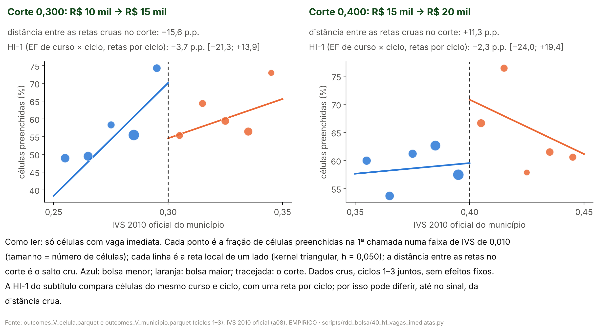
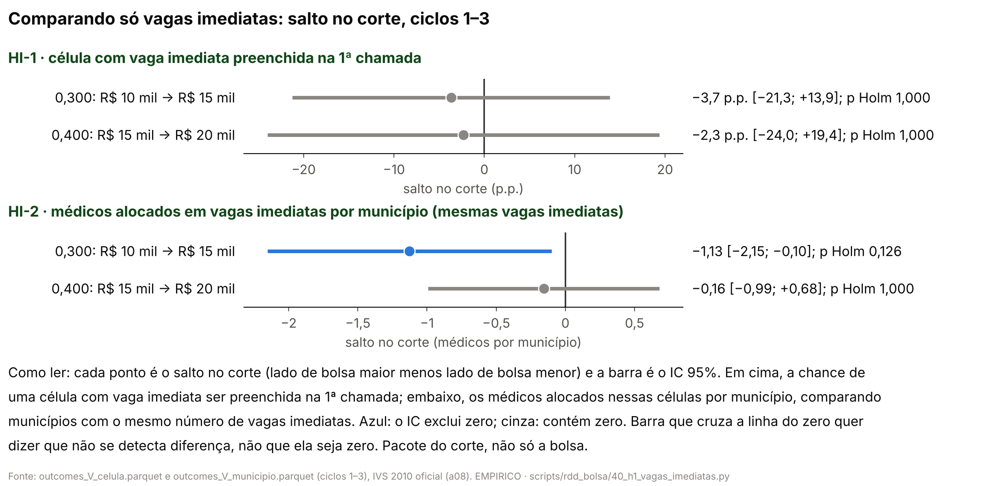
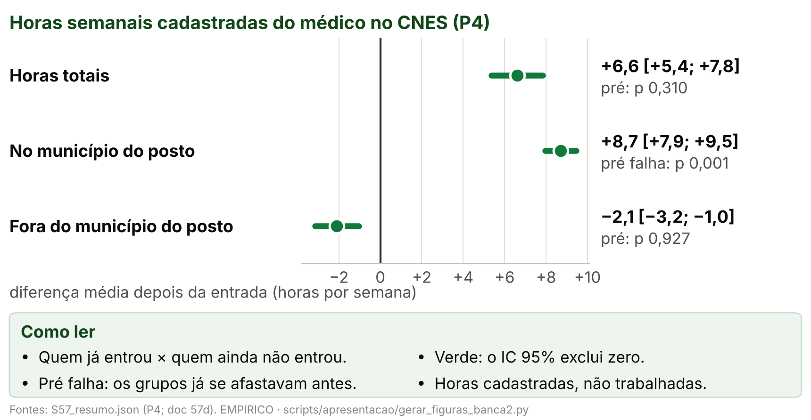
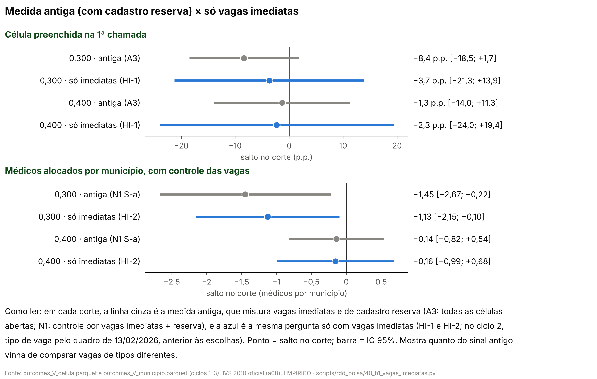
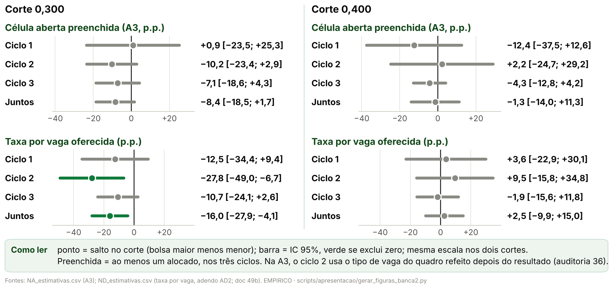
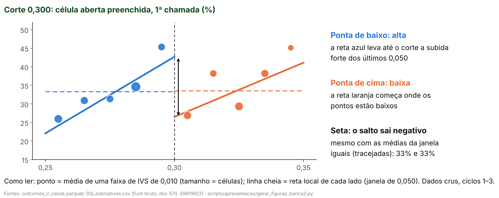
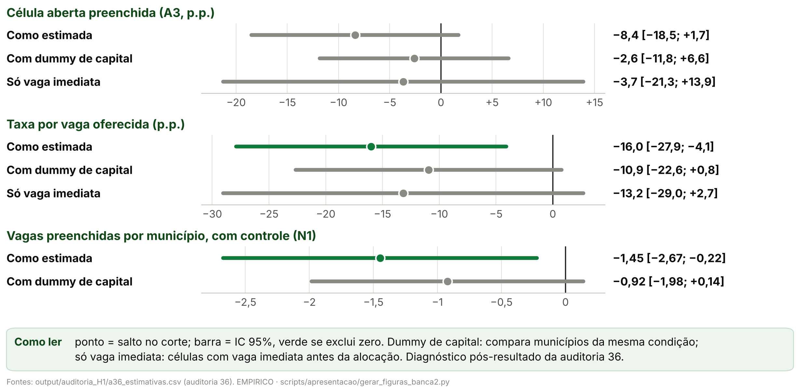
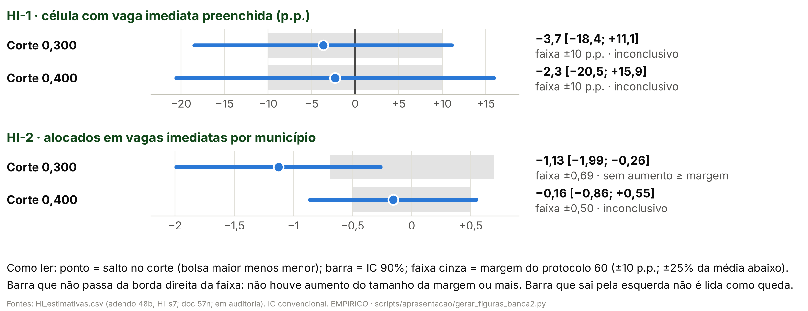
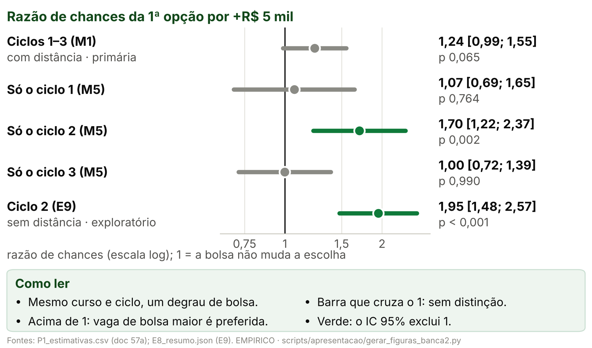
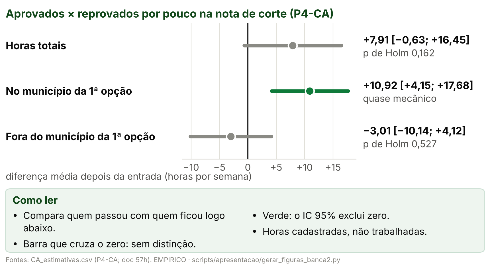

> [!IMPORTANT]
> **Pedidos do autor (26/10/2026), nesta versão.**
> - **Estrutura obrigatória** ([06](06_estrutura_obrigatoria_versao_final.md)):
>   Hipótese, Dados, Análise descritiva, Metodologia, Identificação,
>   Resultados, Robustez, Discussão. Só este deck é gerado; o completo
>   ([02](02_conteudo_slides.md)) fica como registro.
> - **Numeração da apresentação a partir de 26/10/2026:** H1 preenchimento;
>   H2 bolsa × origem (antes H3); H3 oferta (antes H4). A H2 antiga (escolha
>   por ciclo) saiu como hipótese própria e virou robustez da H2. Os nomes dos
>   documentos de análise (P1h, P4, protocolos) e dos códigos de número
>   (`H3_*` é o P1h) não mudam.
> - **H1 é a candidata central** (correção do autor de 26/10/2026), em
>   destaque; H2 e H3 aparecem em cinza, como plano B, até a validação dos
>   professores. Cada seção começa pela H1 e dá a ela o maior espaço; os slides
>   da mesma hipótese ficam juntos, em sequência (H1, depois H2, depois H3); os
>   de H2 e H3 levam "plano B" no título, em cinza, e foram cortados ao mínimo
>   (o resto foi para as notas).
> - **Auditoria 36:** sai do deck a explicação de que, no ciclo 2, a vaga de
>   reserva não podia ser preenchida na 1ª chamada (está errada: o quadro do
>   ciclo 2 foi refeito depois do resultado). A queda em 0,300 é explicada em
>   três ideias: (a) nos dados crus, os dois lados preenchem igual; (b) o
>   negativo vem da reta levada até o corte, puxada por poucos municípios
>   (capitais e Nordeste logo abaixo); (c) controlando a capital, ou só com
>   vagas imediatas, a queda encolhe e o IC contém zero. Diagnóstico
>   pós-resultado; o adendo 48c fará a versão padronizada.
> - **H2:** os números atuais valem até a reestimação do ciclo 2 (adendo 52c);
>   a nota fica só nas notas do apresentador.
> - **H1 principal = adendo 48b** (só vagas imediatas: HI-1 e HI-2 por corte,
>   com Holm), com as saídas `HI_*` e o doc 57n, ainda em auditoria: as linhas
>   de fontes dizem "em auditoria". O scatter da análise descritiva e o TOST
>   da H1 passam a ser os do 48b. As medidas antigas (A3, N1 com e sem
>   controle, taxa por vaga oferecida) passam a especificações secundárias, em
>   Robustez, com o passo a passo da queda em 0,300 e a H1 por ciclo.
> - **"Texto demais":** no máximo **30 palavras visíveis por slide**, fora o
>   título, a figura e a linha de fontes. Especificação em até 4 linhas
>   curtas, com a equação em palavras grande no centro. O resto vai para as
>   notas do apresentador.
>
> **Formato.** Cada `#` é uma seção da estrutura obrigatória; cada `##` é um
> slide: título-afirmação (no máximo 58 caracteres), a figura (ou a tabela)
> grande e poucas linhas curtas. As linhas são os marcadores `- `; a cautela é
> a citação em negrito. Layouts: `curto_figura`, `curto_tabela`, `curto_texto`,
> `curto_capa` (frase grande, com cautela opcional), `curto_hipotese` (a
> central em destaque, os planos B em cinza) e `curto_espec` (a 1ª linha, sem
> rótulo, é a equação em palavras). O gerador
> (`scripts/apresentacao/gerar_deck_banca2.py`, modo padrão) para se as seções
> fugirem da estrutura, se um slide passar de 30 palavras ou se uma linha não
> couber.
>
> **Regra dos números.** Todo número de um slide, notas incluídas, é o valor de
> um código listado na linha `**Números:**` ou um parâmetro do protocolo
> ([03, §3](03_proveniencia_figuras_e_numeros.md#3-parâmetros-que-podem-aparecer-sem-código)).
> As linhas do doc 57m (protocolo 62) vêm da versão auditada (auditoria 37).
> `tests/test_deck_curto_banca2.py` confere a estrutura, a
> contagem de palavras, os números, as cautelas e o pacote gerado.

<!-- deck:inicio -->

# Hipótese

## O que a bolsa de R$ 5 mil faz

`Hipótese · Capa`

<!-- layout: curto_capa -->

- R$ 5 mil a mais nos cortes do IVS: escolha, preenchimento e oferta de especialistas

**Fontes:** plano da banca 2, §3; doc 57.

**Números:** nenhum

> **Notas do apresentador.** O efeito candidato é o incentivo marginal de
> R$ 5 mil anunciado, como pacote do corte: em 0,300 e 0,400 mudam também
> outras regras federais. Não é a participação no PMM-E nem o efeito do Agora
> Tem Especialistas. A H1 (preenchimento) é a hipótese central; H2 e H3
> são plano B. A ordem segue a estrutura da versão final: hipótese,
> dados, análise descritiva, metodologia, identificação, resultados, robustez e
> discussão.

---

## Hipóteses: a H1 é a candidata central

`Hipótese`

<!-- layout: curto_hipotese -->

- **H1 · central** bolsa maior, mais vagas preenchidas
- **H2 · plano B** a bolsa pesa pouco perto da origem
- **H3 · plano B** a chegada soma oferta ou remaneja?

> **H2 é pós-resultado.**

**Fontes:** plano da banca 2, §3; doc 06 da banca 2; doc 57i (P1h, protocolo 52b, auditoria 31).

**Números:** nenhum

> **Notas do apresentador.** Numeração desta apresentação a partir de
> 26/10/2026: H1 preenchimento; H2 bolsa × origem (antes H3);
> H3 oferta (antes H4). A H1 é a hipótese central (decisão do autor de
> 26/10/2026): onde a bolsa é maior, mais vagas são preenchidas. H2 e H3 ficam
> em cinza, como plano B, até a validação dos professores. A H2 é o "incentivo
> limitado" do modelo da banca 1: toda a bolsa pesa menos que trabalhar na UF
> de origem do médico; foi formulada depois de ver os coeficientes do modelo
> de escolha, e por isso é pós-resultado. A H3 pergunta se a chegada do
> médico soma oferta ou só remaneja.

---

# Dados

## Dados: as variáveis principais e de onde vêm

`Dados · Principais`

<!-- layout: curto_tabela -->

| Variável | Fonte | Unidade |
|---|---|---|
| Bolsa | editais SGTES/MS | município |
| IVS 2010 | Ipea | município |
| Preenchimento | quadros, ciclos 1–3 | célula |
| 1ª opção e origem | editais + CNES | candidato |
| Horas | CNES, mensal | médico × mês |

**Fontes:** `output/apresentacao_banca2/tabela_fontes.csv`; auditoria 16; portão G1.

**Números:** nenhum

> **Notas do apresentador.** Bolsa: a faixa anunciada nos quadros dos
> editais do PMM-E (SGTES/MS), por município, ciclos 1–3. IVS 2010 oficial:
> Plataforma IVS do Ipea, Censo 2010, por município; é a variável de corte.
> Preenchimento: quadros de vagas e resultados da 1ª e da 2ª chamada, por
> célula (estabelecimento × curso), 2025–2026. 1ª opção e origem: listas de
> classificação dos editais, ligadas ao cadastro de profissionais do CNES pelo
> portão G1; a origem é onde o médico tinha vínculo no CNES antes das
> inscrições, não residência. Horas: CNES mensal do DATASUS, por médico e mês,
> de 2022-01 a 2026-08. Dados pessoais só em memória ou em cache fora do Git.

---

## Dados: as variáveis secundárias

`Dados · Secundárias`

<!-- layout: curto_tabela -->

| Variável | Fonte | Uso |
|---|---|---|
| Composição das vagas | quadros | diagnóstico |
| Capital | IBGE | diagnóstico |
| Região e porte | IBGE, Censo 2022 | controles |
| Regras no mesmo corte | portarias do MS | pacote do corte |

**Fontes:** `output/apresentacao_banca2/tabela_fontes.csv`; auditorias 18 e 35; docs 57l e 57m.

**Números:** nenhum

> **Notas do apresentador.** Composição das vagas: curso, vaga imediata ou
> de cadastro reserva, tipo de estabelecimento, lidos dos quadros; no ciclo 2,
> o tipo de vaga vem do quadro de 13/02/2026, anterior à alocação (auditoria 36). Capital: as capitais, pelo código IBGE (auditoria 36). Região: UF,
> macrorregião e região de saúde (malha do IBGE); porte: população do Censo
> 2022. Regras no mesmo corte: portarias do MS com corte no IVS (auditoria 18)
> e incentivos ligados à vulnerabilidade (auditoria 35). Servem para o
> diagnóstico da queda e para a leitura do pacote do corte; não entram na
> especificação principal.

---

# Análise descritiva

## Os três ciclos em números

`Análise descritiva · Ciclos`

<!-- layout: curto_tabela -->

| | Ciclo 1 | Ciclo 2 | Ciclo 3 |
|---|---|---|---|
| Municípios com vaga | 368 | 454 | 748 |
| Células | 1.295 | 1.547 | 2.293 |
| Preenchidas na 1ª chamada | 30,3% | 47,1% | 21,7% |
| Amostra da escolha | 915 | 2.032 | 2.474 |

**Fontes:** `output/apresentacao_banca2/tabela_descritiva_ciclos.csv`.

**Números:** `D_C1_MUN`, `D_C2_MUN`, `D_C3_MUN`, `D_C1_CEL`, `D_C2_CEL`, `D_C3_CEL`, `D_C1_PRE1_PCT`, `D_C2_PRE1_PCT`, `D_C3_PRE1_PCT`, `D_C1_P1`, `D_C2_P1`, `D_C3_P1`

> **Notas do apresentador.** Célula = estabelecimento × curso no quadro da
> 1ª chamada. Nesta tabela, no ciclo 1, "preenchida" é alguma confirmação ou
> homologação; nos ciclos 2 e 3, alocado. As estimativas da H1 usam ao menos
> um alocado nos três ciclos (no ciclo 1, o confirmado), como conferiu a
> auditoria 36. Amostra da escolha:
> candidatos com 1ª opção numa célula do quadro, ligados ao CNES e com
> município de origem.

---

## A bolsa é função exata do IVS: a regra é sharp

`Análise descritiva · IVS × faixa`

<!-- layout: curto_figura -->

- **Ciclos 1 e 2:** a regra reproduz a faixa de 368 de 368 e de 454 de 454 municípios.

**Fontes:** `output/rdd_bolsa/portao_r1_ivs_oficial.json`; `output/aquisicao/a08_ivs_2010_oficial_municipio.csv`; auditoria 16.

**Números:** `R_C1_REPR`, `R_C1_MUN`, `R_C2_REPR`, `R_C2_MUN`, `R_ESCORE_IGUAIS`, `R_C3_REPR`, `R_C3_MUN`

> **Notas do apresentador.** Até 0,300, R$ 10 mil; até 0,400, R$ 15 mil;
> acima, R$ 20 mil. O escore da relação nominal do MS é o IVS 2010 oficial em
> 404/404 municípios. No ciclo 3, congelado, 747 de 748: o que falta foi
> criado depois de 2010. Em 0,300 e 0,400 mudam também outras regras
> federais: pacote do corte.

---

## H1 · Dados crus, só vagas imediatas

`Análise descritiva · H1 · Dados crus`

<!-- layout: curto_figura -->

- **Em 0,300**, a reta de baixo sobe forte até o corte e chega alta.
- Dados crus; com curso e ciclo, a HI-1 fica bem menor.

**Fontes:** `output/rdd_bolsa/HI_figuras/HI_scatter_imediatas.png`, `HI_resumo.json` e `HI_estimativas.csv` (adendo 48b; doc 57n; em auditoria); figura usada sem redesenho.

**Números:** `HI1_300_TAU`, `HI1_300_INF`, `HI1_300_SUP`, `HI1_400_TAU`, `HI1_300_MEDIA`

> **Notas do apresentador.** Só células com pelo menos uma vaga imediata
> (no ciclo 2, pelo quadro de 13/02/2026, anterior à alocação). Cada ponto é
> a fração de células preenchidas numa faixa de 0,010 de IVS; cada linha, a
> reta local de um lado. Abaixo de 0,300, 56,1% dessas células são
> preenchidas. A distância crua entre as retas não é a estimativa: a HI-1
> compara células do mesmo curso e ciclo, com uma reta por ciclo, e dá −3,7
> p.p. [−21,3; +13,9] em 0,300 e −2,3 em 0,400. Saídas do adendo 48b, em
> auditoria.

---

## H1 · Dentro da faixa de R$ 10 mil, o preenchimento sobe

`Análise descritiva · Subida dentro das faixas`

<!-- layout: curto_figura -->

- **Faixa de R$ 10 mil:** a subida anda junto com a região (Nordeste); dentro da mesma UF, quase some.

> **Descritivo: dentro da faixa, a bolsa é a mesma.**

**Fontes:** `output/rdd_bolsa/GF_estimativas.csv`, `GF_resumo.json` e `GF_figuras/GF_medias_por_ivs.png` (protocolo 62; doc 57m; auditoria 37); figura usada sem redesenho.

**Números:** `GF_10_ORIG`, `GF_10_ORIG_INF`, `GF_10_ORIG_SUP`, `GF_10_UF`, `GF_10_NE_PRE`, `GF_10_TODOS`

> **Notas do apresentador.** Protocolo 62 (doc 57m), auditado (auditoria 37,
> aprovado com correções de texto); descritivo e pós-resultado. Na faixa de R$ 10 mil, a fração de células
> preenchidas sobe +11,9 p.p. a cada 0,100 de IVS [+6,0; +17,7]. Comparando
> só células da mesma UF, sobram +1,3 p.p. O Nordeste é a região que mais
> preenche nessa faixa (43% das células) e a de IVS mais alto. Com todos os
> fatores juntos, sobram +0,5 p.p. Diz com o que a subida anda junto, não
> por quê.

---

## H1 · Perto de 0,300 sobra uma subida forte

`Análise descritiva · Últimos 0,050`

<!-- layout: curto_figura -->

- **Últimos 0,050 antes de 0,300:** sobra uma subida forte e imprecisa, que nenhum fator sozinho reduz à metade.
- São as células que a RDD usa abaixo do corte.

**Fontes:** `output/rdd_bolsa/GF_estimativas.csv` e `GF_figuras/GF_inclinacao_fatores_janela.png` (protocolo 62; doc 57m; auditoria 37); figura usada sem redesenho.

**Números:** `GF_10J_ORIG`, `GF_10J_ORIG_INF`, `GF_10J_ORIG_SUP`, `GF_10J_TODOS`, `GF_10J_UF`

> **Notas do apresentador.** Protocolo 62 (doc 57m; auditoria 37). Nos
> últimos 0,050 antes de 0,300, o preenchimento sobe +36,1 p.p. por 0,100 [+7,4;
> +64,7]. Nenhum fator sozinho a reduz à metade: comparando dentro da mesma
> UF, sobram +21,6 p.p.; com todos juntos ainda sobram +26,1 p.p. As células
> do Norte e do Nordeste da faixa estão quase todas nesse trecho. São as
> mesmas células que a RDD usa do lado de baixo, mas não a mesma reta: a RDD
> pondera pelo kernel e tem retas por ciclo. Quanto mais íngreme esse trecho,
> mais alto fica o ponto de partida do lado de R$ 10 mil no corte. Isso volta
> na Robustez, no passo a passo da queda.

---

# Metodologia

## H1 · O salto no corte, só com vagas imediatas

`Metodologia · H1 · adendo 48b`

<!-- layout: curto_espec -->

- preenchida = salto + reta de cada lado
- **Outcome** vaga imediata preenchida, por célula e município
- **Razão** comparamos vagas do mesmo tipo; a reserva se preenche por outro caminho

**Fontes:** adendo 48b ao protocolo 48 (`docs/06_execucao/48b_adendo_H1_vagas_imediatas.md`).

**Números:** nenhum

> **Notas do apresentador.** Especificação principal da H1 desde 26/10/2026
> (adendo 48b, pós-resultado). HI-1: célula com vaga imediata preenchida na
> 1ª chamada, com efeitos fixos de curso × ciclo. HI-2: alocados em vagas
> imediatas por município, com controle das vagas imediatas e coeficiente por
> ciclo. Amostra: só células com pelo menos uma vaga imediata, ciclos 1–3; as
> demais ficam fora e são contadas. RDD sharp local linear, kernel
> triangular, h = 0,050, cada corte separado, intercepto e retas por ciclo,
> erro-padrão agrupado por município; Holm entre as quatro linhas primárias.
> As células de cadastro reserva se preenchem por remanejamento e pela priorização
> da SGTES, outro mecanismo (doc 57n). No ciclo 2, o tipo de vaga é o do quadro de 13/02/2026, anterior à alocação
> (auditoria 36). Cuidado: pacote do corte.

---

## H2 e H3 · plano B: como estimamos

`Metodologia · H2 e H3 · plano B`

<!-- layout: curto_texto -->

- **H2 · plano B** logit da 1ª opção: utilidade = bolsa + IVS + distância + origem
- **H3 · plano B** estudo de evento das horas

> **Origem não é causal; horas cadastradas não são presença.**

**Fontes:** protocolos 52, 52b, 54 e 59; docs 57a, 57i, 57d e 57h.

**Números:** `M1_N`

> **Notas do apresentador.** H2: logit condicional (McFadden). Cada um dos
> 5.421 candidatos escolhe a vaga de maior utilidade entre as do seu curso e
> ciclo; a curva do IVS é um spline com nós nos cortes, e só o salto da bolsa
> nos cortes identifica o peso dela. Origem: pesos de mesma UF, mesma região e
> mesmo município. Pesos comuns aos ciclos na principal (M1); erro-padrão
> agrupado por conjunto de escolha. Teste da H2: o peso da UF de origem menos o
> de toda a bolsa, unilateral e pós-resultado. Cuidado: só quem se candidatou;
> independência de alternativas irrelevantes. H3: estudo de evento escalonado
> (Callaway e Sant'Anna), médicos dos ciclos 1 e 2: a mudança das horas desde o
> mês anterior à entrada, nos que entraram, menos a mesma mudança nos que ainda
> não entraram; erro-padrão por bootstrap multiplicador agrupado por médico;
> sensibilidades: Rambachan–Roth e a comparação na nota de corte.

---

# Identificação

## H1 · RDD: as premissas do desenho valem

`Identificação · RDD`

<!-- layout: curto_tabela -->

| Premissa | Aderência |
|---|---|
| Regra sharp | 368/368 e 454/454 |
| Sem manipulação | densidade sem acúmulo |
| Continuidade | balanço e placebos passam |

- **Ressalva:** em 0,300, menos capitais acima do corte (auditoria 36).

**Fontes:** auditorias 16 e 36; docs 37, 41 e 49; `output/rdd_bolsa/E1_densidade_estimativas.csv`; `output/auditoria_H1/a36_estimativas.csv`.

**Números:** `R_C1_REPR`, `R_C1_MUN`, `R_C2_REPR`, `R_C2_MUN`, `E1_300_HOLM`, `E1_400_HOLM`, `A36_CAPMUN_TAU`, `A36_CAPMUN_INF`, `A36_CAPMUN_SUP`

> **Notas do apresentador.** Regra sharp: o IVS 2010 oficial reproduz a
> faixa de todos os municípios dos ciclos 1 e 2. Sem manipulação: o IVS foi
> medido em 2010, antes do programa, e o teste de densidade não acusa acúmulo
> no ciclo 1 (p de Holm 0,707 em 0,300 e 0,658 em 0,400). Continuidade:
> balanço de covariáveis pré e placebos de outcome e de corte. Ressalvas: em
> 0,400, seleção suspeita no ciclo 1; em 0,300, a parte dos municípios que são
> capitais cai −17,8 p.p. [−34,1; −1,5] no corte (auditoria 36, diagnóstico).
> Para a H2, a curva do IVS com nós nos cortes e o spline cúbico.

---

## H1 · O corte é um pacote

`Identificação · Pacote e tendências`

<!-- layout: curto_tabela -->

| Premissa | Aderência |
|---|---|
| Só a bolsa salta | não: em 0,300, teto de emendas |
| Outro incentivo individual | nenhum em 0,300 |
| Tendências (H3 · plano B) | falham nas horas no posto |

**Fontes:** auditorias 18 e 35; docs 57d e 57h.

**Números:** nenhum

> **Notas do apresentador.** Pacote do corte: a única regra federal que muda
> em 0,300 e não em 0,400 é o acréscimo no teto de emendas e nas parcelas de
> custeio da APS e da MAC do município (auditoria 18; doc 57l). Nenhum
> incentivo individual ao especialista além da bolsa muda em 0,300; em 0,400
> mudam incentivos de médicos da APS (AgSUS e PMMB) (auditoria 35). Por isso
> o contraste é o pacote do corte, não a bolsa sozinha. Na H3, o teste
> conjunto do pré falha nas horas no município do posto; Rambachan–Roth mede
> quanto a conclusão aguenta. Na H2, a independência de alternativas
> irrelevantes é violada em parte, e o peso da bolsa muda pouco.

---

# Resultados

## H1 · Só vagas imediatas: nada passa no Holm

`Resultados · H1 · adendo 48b`

<!-- layout: curto_figura -->

- Comparando só vagas imediatas, nenhuma linha passa no Holm; a célula não se distingue de zero nos dois cortes.
- HI-2 em 0,300: IC exclui zero; não sobrevive ao Holm.

**Fontes:** `output/rdd_bolsa/HI_estimativas.csv`, `HI_resumo.json` e `HI_figuras/HI_principal.png` (adendo 48b; doc 57n; em auditoria); figura usada sem redesenho.

**Números:** `HI1_300_TAU`, `HI1_300_INF`, `HI1_300_SUP`, `HI1_300_HOLM`, `HI1_400_TAU`, `HI1_400_INF`, `HI1_400_SUP`, `HI1_400_HOLM`, `HI2_300_TAU`, `HI2_300_INF`, `HI2_300_SUP`, `HI2_300_HOLM`, `HI2_400_TAU`, `HI2_400_INF`, `HI2_400_SUP`, `HI2_400_HOLM`, `HI2_300_MEDIA`

> **Notas do apresentador.** Especificação principal da H1 (adendo 48b, em
> auditoria; pós-resultado). HI-1, a chance de uma célula com vaga imediata
> ser preenchida na 1ª chamada: −3,7 p.p. [−21,3; +13,9] em 0,300 e −2,3 p.p.
> [−24,0; +19,4] em 0,400, p de Holm 1,000 nos dois. HI-2, médicos alocados
> nessas vagas por município, comparando municípios com as mesmas vagas
> imediatas: −1,13 [−2,15; −0,10] em 0,300, p de Holm 0,126 (média abaixo
> 2,77); −0,16 [−0,99; +0,68] em 0,400, p de Holm 1,000. O IC convencional
> exclui zero só em HI-2 em 0,300, mas o sinal não sobrevive à correção para
> quatro testes. IC que contém zero não é efeito zero. Tudo se refere ao
> pacote do corte, não à bolsa isolada.

---

## H2 · plano B: a origem pesa mais que a bolsa

`Resultados · H2`

<!-- layout: curto_figura -->

- **Toda a bolsa:** 0,42; a mesma UF de origem: 2,40; diferença 1,98 [1,56; 2,40].

> **Pós-resultado; origem é preferência revelada, não efeito causal.**

**Fontes:** `output/rdd_bolsa/P1h_magnitudes.csv`, `P1h_resumo.json` e `P1h_figuras/P1h_magnitudes.png` (doc 57i; protocolo 52b; auditoria 31); figura usada sem redesenho.

**Números:** `ESC_UF`, `ESC_REG`, `ESC_MUN`, `ESC_DIST_P50`, `ESC_N`, `H3_10B`, `H3_THETA`, `H3_DUF`, `H3_DUF_INF`, `H3_DUF_SUP`, `H3_5B`, `H3_5B_INF`, `H3_5B_SUP`, `M1_RC`, `M1_RC_PCT`, `H3_10B_INF`, `H3_10B_SUP`, `H3_THETA_INF`, `H3_THETA_SUP`, `H3_DUF_P`

> **Notas do apresentador.** Pesos na escolha da vaga, em log-chance, não
> efeitos no preenchimento. Um degrau da bolsa pesa 0,21 [−0,01; 0,44]: a
> vaga com +R$ 5 mil tem chance 24% maior de ser a 1ª opção (razão de chances
> 1,24), sem distinção de zero. Toda a bolsa pesa 0,42 [−0,03; 0,87]; a vaga
> na mesma UF de origem, fora da região de saúde, 2,40 [2,28; 2,53]. A
> diferença, 1,98, p unilateral < 0,001, é o teste da H2, pós-resultado. O
> peso da bolsa tem identificação nos cortes (pacote do corte); o da origem é
> preferência revelada. Descritivo da origem: 79% das 1ª opções ficam na UF
> de origem, 46% na região de saúde e 36% no próprio município; mediana de 51
> km, entre 5.425 candidatos. Reestimação em curso (52c): o tipo de vaga imediata do
> ciclo 2 entra no logit com o quadro de 13/02/2026; até lá, valem estes
> números.

---

## H3 · plano B: soma horas, mas metade já estava lá

`Resultados · H3`

<!-- layout: curto_figura -->

- **+6,6 h/sem** depois da entrada; 51,0% já tinham vínculo no município do posto.

> **Associação; horas cadastradas não são presença.**

**Fontes:** `output/rdd_bolsa/S57_resumo.json` (P4, doc 57d).

**Números:** `P4_HT_ATT`, `P4_ORIGEM`, `P4_HT_INF`, `P4_HT_SUP`, `P4_HM_ATT`, `P4_HF_ATT`, `P4_ORIGEM_INF`, `P4_ORIGEM_SUP`

> **Notas do apresentador.** Horas totais cadastradas: +6,6 h/sem [+5,4;
> +7,8] depois da entrada, sobretudo no município do posto (+8,7, com o pré
> falhando), e −2,1 fora dele. 51,0% [48,4; 53,7] dos médicos já tinham
> vínculo no município do posto: parte do ganho é registro novo, não médico
> novo. Associação sob tendências paralelas; não é a participação no PMM-E nem
> o efeito da bolsa.

---

# Robustez

## H1 · Medida antiga × só vagas imediatas

`Robustez · H1 · medidas antigas`

<!-- layout: curto_figura -->

- **Só vagas imediatas,** os saltos em 0,300 encolhem: −8,4 → −3,7 p.p. e −1,45 → −1,13.

> **IC que contém zero não é efeito zero.**

**Fontes:** `output/rdd_bolsa/HI_figuras/HI_antiga_vs_imediatas.png` e `HI_estimativas.csv` (adendo 48b; doc 57n; em auditoria); `NA_estimativas.csv` e `N_estimativas.csv` (doc 49).

**Números:** `A3_300_TAU`, `A3_300_INF`, `A3_300_SUP`, `HI1_300_TAU`, `N1_300_TAU`, `N1_300_INF`, `N1_300_SUP`, `HI2_300_TAU`, `N1_400_TAU`

> **Notas do apresentador.** Especificações secundárias da H1: as medidas
> antigas misturam vaga imediata e cadastro reserva. Em 0,300, a célula
> aberta preenchida (A3) dá −8,4 p.p. [−18,5; +1,7] e, só com vagas imediatas
> (HI-1), −3,7 p.p.; os alocados por município com controle (N1) dão −1,45
> [−2,67; −0,22] e, só com vagas imediatas (HI-2), −1,13. Em 0,400, N1 dá
> −0,14. Linhas por corte, sem correção múltipla.

---

## H1 · Antes e depois do controle das vagas

`Robustez · H1 · controle`

<!-- layout: curto_figura -->

- **0,400:** a queda passa pelas vagas: cidades grandes logo abaixo; com o controle, some.
- **0,300:** a oferta não muda; cai o preenchimento por vaga.

**Fontes:** `output/rdd_bolsa/N_estimativas.csv` (decomposição e S-c; doc 49, §3 a §5); `ND_estimativas.csv` (doc 49b, §3).

**Números:** `VIC_400_TAU`, `N1_400_DTOT`, `N1_400_VIA`, `N1_400_DSA`, `N1_300_DTOT`, `N1_300_VIA`, `N1_300_DSA`, `VIC_300_TAU`

> **Notas do apresentador.** Sem controle, o efeito total de abrir vagas e
> preenchê-las; com controle, o preenchimento dado o número de vagas. A
> decomposição é exata: sem controle = via vagas + com controle. Em 0,400:
> −1,36 = −1,22 + −0,14; do lado de bolsa maior há menos vagas oferecidas
> (−3,59), sobretudo por alguns municípios grandes logo abaixo do corte. Em
> 0,300: −1,56 = −0,11 + −1,45; a oferta não muda (+0,39).

---

## H1 · Por ciclo: a queda em 0,300 vem do ciclo 2

`Robustez · H1 · por ciclo`

<!-- layout: curto_figura -->

- A queda em 0,300 vem sobretudo do ciclo 2; por ciclo, os intervalos são largos.

> **Tipo de vaga do ciclo 2: quadro refeito depois do resultado (auditoria 36).**

**Fontes:** `output/rdd_bolsa/NA_estimativas.csv` (A3 por ciclo); `ND_estimativas.csv` (taxa por vaga, adendo AD2; doc 49b); auditoria 36.

**Números:** `PC_TX_2_300_TAU`, `PC_TX_2_300_INF`, `PC_TX_2_300_SUP`, `PC_TX_J_300_TAU`, `ND_TX300_C2_PCT`, `PC_A3_2_300_TAU`

> **Notas do apresentador.** Todas as combinações de ciclo, corte e medida
> estão gravadas; nada foi estimado para este slide. Na taxa por vaga
> oferecida, o ciclo 2 dá −27,8 p.p. [−49,0; −6,7] em 0,300, contra −16,0
> com os ciclos juntos, e responde por 51% do salto conjunto. Na A3, o ciclo 2
> dá −10,2 p.p., com IC que contém zero. "Preenchida" é ao menos um alocado
> nos três ciclos (no ciclo 1, o confirmado), conferido pela auditoria 36. A
> A3 usa o tipo de vaga do ciclo 2 do quadro retificado de 19/03/2026, refeito
> depois do resultado preliminar; com o tipo de vaga de antes da alocação, a
> queda aumenta. A H1 principal (adendo 48b) usa o quadro de 13/02/2026.

---

## H1 · Em 0,300, o negativo vem da reta

`Robustez · Queda em 0,300 · (a) e (b)`

<!-- layout: curto_figura -->

- **(a)** Nos dados crus, os dois lados preenchem igual (33% e 33%).
- **(b)** A reta leva até o corte uma subida puxada por poucos municípios: capitais e Nordeste logo abaixo.

**Fontes:** `output/rdd_bolsa/outcomes/outcomes_V_celula.parquet`; `DQ_estimativas.csv` (doc 57l; auditoria 33); `output/auditoria_H1/a36_estimativas.csv` (auditoria 36); doc 57m (auditoria 37).

**Números:** `DQ_FUN_PRE_ABX0`, `DQ_FUN_PRE_ACI0`, `DQ_FUN_PRE_ABX`, `DQ_FUN_PRE_ACI`, `A36_CAP_ABX`, `A36_CAP_ACI`, `DQ_PPOSTO_Q1`, `DQ_PCOMP_Q1`

> **Notas do apresentador.** (a) Nas médias simples da janela, 33,3% das
> células são preenchidas abaixo de 0,300 e 33,5% acima. (b) A RDD compara as
> duas retas no ponto do corte: a de baixo segue a subida forte dos últimos
> 0,050 e chega alta; a de cima começa baixa. Essa subida é puxada por poucos
> municípios: na janela há 13 capitais abaixo de 0,300 e 6 acima, e as
> capitais têm muitas células e preenchem mais (auditoria 36); as células do
> Norte e do Nordeste da faixa de R$ 10 mil estão quase todas nos últimos
> 0,050 antes do corte (doc 57m; auditoria 37). Acaso: com os 3 cortes falsos
> do protocolo, o p por posto é 0,250, o menor possível; numa grade maior,
> fora do protocolo, 0,031. Acaso não fica descartado nem confirmado.

---

## H1 · Controlando a capital, a queda encolhe

`Robustez · Queda em 0,300 · (c)`

<!-- layout: curto_figura -->

<!-- linhas: 3 -->

- **(c)** Controlando a capital, a queda encolhe e o IC contém zero; só com vagas imediatas, encolhe.
- 13 capitais abaixo de 0,300 e 6 acima.

> **Auditoria 36, diagnóstico pós-resultado.**

**Fontes:** `output/auditoria_H1/a36_estimativas.csv` e `a36_resumo.json` (auditoria 36); o adendo 48c fará a versão padronizada.

**Números:** `HI2_300_TAU`, `A36_CAP_ABX`, `A36_CAP_ACI`, `A36_A3_PIPE_TAU`, `A36_A3_CAP_TAU`, `A36_A3_CAP_INF`, `A36_A3_CAP_SUP`, `A36_A3_VI_TAU`, `A36_TX_PIPE_TAU`, `A36_TX_CAP_TAU`, `A36_TX_CAP_INF`, `A36_TX_CAP_SUP`, `A36_TX_VI_TAU`, `A36_N1_PIPE_TAU`, `A36_N1_CAP_TAU`, `A36_N1_CAP_INF`, `A36_N1_CAP_SUP`, `A36_CAPMUN_TAU`, `A36_CAPMUN_INF`, `A36_CAPMUN_SUP`

> **Notas do apresentador.** Diagnóstico da auditoria 36, descritivo e
> pós-resultado, sem estatuto causal. Na janela de 0,050 há 13 capitais abaixo
> de 0,300 e 6 acima; a menos de 0,010 do corte, São Paulo, Goiânia, Natal e
> Brasília ficam abaixo e nenhuma capital acima. No corte, a parte dos
> municípios que são capitais cai −17,8 p.p. [−34,1; −1,5]. Com uma dummy de
> capital: A3 de −8,4 para −2,6 p.p. [−11,8; +6,6]; taxa por vaga de −16,0
> para −10,9 p.p. [−22,6; +0,8]; N1 de −1,45 para −0,92 [−1,98; +0,14]. Só
> com células de vaga imediata (tipo de vaga de antes da alocação): A3 −3,7
> p.p. e taxa −13,2 p.p., com IC que contém zero; nos alocados por município
> (HI-2, adendo 48b), −1,13, com IC que exclui zero, que não passa no Holm. O adendo 48c vai estimar
> capitais e UF de forma padronizada; quando sair, a fonte deste slide muda.

---

## H1 · O que dá para afirmar sobre a queda

`Robustez · H1 · TOST`

<!-- layout: curto_figura -->

- **TOST:** HI-1 inconclusivo; HI-2 em 0,300 descarta aumento ≥ 25% da média, não descarta queda.
- **Em 0,300:** nenhum incentivo individual muda; muda o teto de emendas do município.

**Fontes:** `output/rdd_bolsa/HI_estimativas.csv` (HI-s7; adendo 48b; doc 57n; em auditoria); auditorias 18 e 35; doc 57l.

**Números:** `HI_EQ1_300_I90I`, `HI_EQ1_300_I90S`, `HI_EQ1_400_I90I`, `HI_EQ1_400_I90S`, `HI_EQ2_300_I90I`, `HI_EQ2_300_I90S`, `HI_EQ2_300_MARG`, `HI_EQ2_400_MARG`, `HI2_300_MEDIA`

> **Notas do apresentador.** TOST da H1 principal (HI-s7), com IC de 90% e
> as margens do protocolo 60. HI-1: [−18,4; +11,1] em 0,300 e [−20,5;
> +15,9] em 0,400, contra ±10 p.p.: inconclusivo, nenhum dos dois testes
> rejeita. HI-2 em 0,300: [−1,99; −0,26] contra ±0,69 médico por município
> (25% da média abaixo, 2,77): não houve aumento igual ou maior que a margem,
> mas uma queda desse tamanho não fica descartada. HI-2 em 0,400, contra
> ±0,50: inconclusivo. No IC convencional, sob a aproximação local linear e
> para o pacote do corte. Não dá para dizer que nada mudou. Nos atos lidos,
> nenhum incentivo individual além da bolsa muda em 0,300 (auditoria 35); a
> única regra federal que muda em 0,300 e não em 0,400 é o teto de emendas e
> de parcelas de custeio do município (auditoria 18). Nada disso mostra que a
> bolsa reduz o preenchimento: o corte junta a bolsa com outras regras.

---

## H2 · plano B: por ciclo, só o ciclo 2

`Robustez · H2`

<!-- layout: curto_figura -->

- **A origem** pesa mais que a bolsa nas seis variantes: diferença de 1,18 a 2,37.

> **Pós-resultado; escolha não é expansão.**

**Fontes:** `output/rdd_bolsa/P1_estimativas.csv` (M5; doc 57a, §4); `P1h_magnitudes.csv` (sensibilidades; doc 57i).

**Números:** `H3_S_M2`, `H3_S_M5C3`, `M5_C2_RC`, `M5_C2_RCI`, `M5_C2_RCS`, `M5_C1_RC`, `M5_C3_RC`, `M5_WALD_P`

> **Notas do apresentador.** Antes era a H2 da escolha; agora é a
> especificação secundária da H2. Por ciclo (M5), só o ciclo 2 mostra efeito
> da bolsa: 1,70 [1,22; 2,37] por +R$ 5 mil; nos ciclos 1 e 3, 1,07 e 1,00; a
> igualdade entre ciclos tem p 0,058. A vantagem da UF de origem sobre toda a
> bolsa fica entre 1,18 (distância em log) e 2,37 (só o ciclo 3) nas seis
> variantes. Escolha não é expansão: o que uma vaga ganha, outra do mesmo
> curso perde. Reestimação em curso (52c): o ciclo 2 será refeito com o tipo de
> vaga do quadro de 13/02/2026.

---

## H3 · plano B: na nota de corte, mesma direção

`Robustez · H3`

<!-- layout: curto_figura -->

- **Nota de corte:** +7,91 h/sem [−0,63; +16,45], mesma direção; IC contém zero.
- **Rambachan–Roth:** horas totais aguentam a violação do pré (1,30).

**Fontes:** `output/rdd_bolsa/CA_estimativas.csv` e `H_estimativas.csv` (protocolo 59; doc 57h).

**Números:** `CA_HT_EST`, `CA_HT_INF`, `CA_HT_SUP`, `RR_HT`, `RR_HM`, `CA_HT_PRE`

> **Notas do apresentador.** Comparação dos aprovados com quem ficou logo
> abaixo da nota de corte: +7,91 h/sem nas horas totais, IC que contém zero,
> pré com p 0,837. Rambachan–Roth: a ruptura de M̄ é 1,30 nas horas totais e
> 1,90 no município do posto; acima de 1, a conclusão aguenta violações de
> tendência do tamanho das vistas no pré. Horas cadastradas não são presença.

---

# Discussão

## H1 · Discussão: o sinal negativo

`Discussão · Queda`

<!-- layout: curto_capa -->

- O sinal negativo não é a bolsa afastando médicos: é a estimativa no corte, puxada por poucos municípios, capitais logo abaixo.

> **Nada disso mostra que a bolsa reduz o preenchimento.**

**Fontes:** síntese da Robustez; doc 57m; auditorias 36 e 37.

**Números:** nenhum

> **Notas do apresentador.** Em linguagem simples: nos dados crus os dois
> lados preenchem igual; a reta de baixo carrega até o corte uma subida que
> só existe nos últimos municípios antes de 0,300, com capitais e Nordeste
> logo abaixo do corte; controlando a condição de capital, ou comparando
> vagas do mesmo tipo, a queda encolhe e o intervalo passa a conter zero. O
> corte junta a bolsa com outras regras: pacote do corte.

---

## Discussão: por que não sobe? Um incentivo limitado

`Discussão · Teoria`

<!-- layout: curto_texto -->

- **H1** o preenchimento não sobe no corte
- **Por quê** a origem pesa mais que toda a bolsa
- **Oferta** metade já estava no município

> **Pacote do corte; vínculo não é presença.**

**Fontes:** síntese dos slides anteriores; docs 57, 57d e 57i.

**Números:** nenhum

> **Notas do apresentador.** A história parte da H1. No modelo da banca 1, o
> médico aceita a vaga se a bolsa compensa o custo do lugar. O preenchimento
> não sobe no corte; o sinal negativo é a estimativa no corte, puxada por
> poucos municípios. A escolha explica por quê (H2, plano B): a política mexe
> numa variável, e o custo do lugar (longe da origem, da família e da rede)
> continua contra; a bolsa reordena os candidatos entre as vagas abertas, e o
> que uma vaga ganha outra do mesmo curso perde. Na oferta (H3, plano B), o
> médico soma horas cadastradas, mas metade já trabalhava no município do
> posto. Associação não é efeito; inconclusivo não é efeito zero. Próximos
> passos: as saídas do adendo 48b, o ciclo 3 com a competência 202703 madura e
> o universo de inscritos.

<!-- deck:fim -->

<!-- apendice:fim -->
