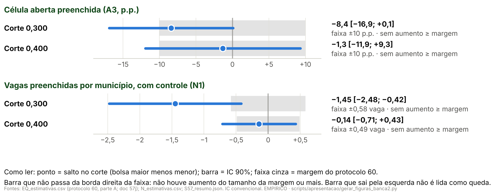

> [!IMPORTANT]
> **Pedido do autor (26/10/2026).** "Só do 14 em diante, e MUITO menor,
> focado nas discussões que tivemos aqui, sem colocar um monte de texto, sem
> colocar o diagrama causal da teoria no meio." Este arquivo é o conteúdo do
> deck curto; o deck completo continua em
> [02_conteudo_slides.md](02_conteudo_slides.md).
>
> **Formato.** Cada `##` é um slide: título-afirmação, a figura (ou tabela)
> grande e **no máximo duas linhas curtas, contando a cautela** (os slides só
> de texto, hipóteses e conclusão, têm até quatro itens). As linhas são os
> marcadores `- `; a cautela é a citação em negrito. O resto vai para as
> notas do apresentador. O gerador
> (`scripts/apresentacao/gerar_deck_banca2.py --curto`) para se uma linha não
> couber numa linha só ou se um slide passar do limite.
>
> **Ajustes do autor que valem aqui.** A H1 mostra cada corte separado
> (nenhuma linha empilhada); N1 sem e com controle das vagas oferecidas são
> dois gráficos separados, na mesma escala; a H3 diz em uma linha que os
> pesos estão em log-chance e não são efeito no preenchimento.
>
> **Regra dos números.** A mesma do doc 02: todo número de um slide, notas
> incluídas, é o valor de um código listado na linha `**Números:**` ou um
> parâmetro do protocolo ([03, §3](03_proveniencia_figuras_e_numeros.md#3-parâmetros-que-podem-aparecer-sem-código)).
> `tests/test_deck_curto_banca2.py` confere isso, a ordem, a ausência dos
> slides do grupo, do diagrama e do apêndice, e o limite de linhas.

<!-- deck:inicio -->

# Hipótese

## Quatro hipóteses: da bolsa anunciada à oferta de especialistas

`Hipótese`

<!-- layout: curto_texto -->

- **H1** Bolsa maior → mais vagas preenchidas
- **H2** Bolsa maior → vaga mais escolhida pelos médicos
- **H3** A bolsa pesa pouco perto da origem do médico
- **H4** A chegada aumenta a oferta ou só remaneja?

**Fontes:** plano da banca 2, §3; modelo da banca 1.

**Números:** nenhum

> **Notas do apresentador.** A H3 é a hipótese central: se a bolsa pesa pouco
> perto do custo do lugar, ela muda quem escolhe qual vaga (H2) sem mudar
> quantas vagas preenchem (H1). A H4 pergunta se o médico que chega aumenta a
> capacidade ou só passa a ser registrado onde já estava. O efeito candidato é
> o incentivo marginal de R$ 5 mil anunciado, como pacote do corte: em 0,300 e
> 0,400 mudam também outras regras federais. Não é a participação no PMM-E nem
> o efeito do Agora Tem Especialistas.

---

# Base de Dados

## O PMM-E já rodou três ciclos, e usamos os três

`Base de Dados · Ciclos`

<!-- layout: curto_tabela -->

| Ciclo | Edital | Quadro de vagas | Resultado (1ª chamada) | Municípios · células | O que temos |
|---|---|---|---|---|---|
| 1 | nº 3/2025 | 24/07/2025 | 10/09/2025 | 368 · 1.295 | quadro, escolhas, 1ª e 2ª chamada, CNES depois do início |
| 2 | nº 1/2026 | 19/03/2026 (retificado) | 05/05/2026 | 454 · 1.547 | quadro, escolhas, 1ª e 2ª chamada, CNES depois do início |
| 3 | nº 28/2026 | 24/07/2026 (retificado) | 25/08/2026, sub judice | 748 · 2.293 | quadro, escolhas e 1ª chamada |

> **Ciclo 3: só até a 1ª chamada; o CNES depois do início segue congelado.**

**Fontes:** `output/apresentacao_banca2/cronologia_ciclos.csv` e `tabela_descritiva_ciclos.csv` (doc 02).

**Números:** `CR_C1_EDITAL`, `CR_C2_EDITAL`, `CR_C3_EDITAL`, `CR_C1_QUADRO`, `CR_C1_RES`, `CR_C2_RETIF`, `CR_C2_RES`, `CR_C3_RETIF`, `CR_C3_RES`, `D_C1_MUN`, `D_C1_CEL`, `D_C2_MUN`, `D_C2_CEL`, `D_C3_MUN`, `D_C3_CEL`, `D_C1_PRE1_PCT`, `D_C2_PRE1_PCT`, `D_C3_PRE1_PCT`, `M1_N`

> **Notas do apresentador.** Cada ciclo tem edital, quadro de vagas, escolha
> dos candidatos e resultado próprios; comparamos sempre dentro do ciclo,
> perto dos cortes. Célula é estabelecimento × curso. Preenchidas na 1ª
> chamada: 30,3% das células no ciclo 1, 47,1% no ciclo 2 e 21,7% no ciclo 3
> (descritivo). A escolha usa 5.421 candidatos de 1ª opção ligados ao CNES.

---

# Análise exploratória

## A bolsa é função exata do IVS: a regra é sharp

`Exploratória · Regra`

<!-- layout: curto_figura -->

- **Ciclos 1 e 2:** a regra reproduz a faixa de 368 de 368 e de 454 de 454 municípios.

> **Descritivo; outras regras federais mudam nos mesmos cortes: pacote do corte.**

**Fontes:** `output/rdd_bolsa/portao_r1_ivs_oficial.json`; `output/aquisicao/a08_ivs_2010_oficial_municipio.csv`; auditoria 16.

**Números:** `R_C1_REPR`, `R_C1_MUN`, `R_C2_REPR`, `R_C2_MUN`, `R_ESCORE_IGUAIS`, `R_C3_REPR`, `R_C3_MUN`

> **Notas do apresentador.** É a evidência de que o desenho existe: o primeiro
> estágio é a própria regra. Até 0,300, R$ 10 mil; até 0,400, R$ 15 mil;
> acima, R$ 20 mil. O escore da relação nominal do MS é o IVS 2010 oficial em
> 404/404 municípios. No ciclo 3, congelado, 747 de 748: o que falta foi
> criado depois de 2010. O IVS foi medido em 2010, antes do programa.

---

## Nos dados crus, o lado de bolsa maior não preenche mais

`Exploratória · RDD crua`

<!-- layout: curto_figura -->

- **0,400:** menos vagas oferecidas do lado de bolsa maior; **0,300:** a oferta não muda.

> **Descritivo: médias por faixa, sem controles; o teste é a RDD que vem a seguir.**

**Fontes:** `output/rdd_bolsa/outcomes/outcomes_V_celula.parquet` e `outcomes_V_municipio.parquet`; `output/rdd_bolsa/ND_estimativas.csv` (doc 49b); `E1_densidade_estimativas.csv`.

**Números:** `VIC_400_MABX`, `VIC_400_MACI`, `VIC_300_MABX`, `VIC_300_MACI`, `E1_300_HOLM`, `E1_400_HOLM`

> **Notas do apresentador.** É o gráfico clássico da RDD, sem nenhum
> controle: cada ponto é a média de uma faixa estreita de IVS, e cada linha é
> a reta local de um lado. Em 0,400, as vagas oferecidas caem de 7,05 para
> 3,93 por município na janela; em 0,300, ficam em 10,08 e 9,82. A célula
> preenchida não sobe em nenhum dos dois cortes. Não há acúmulo de municípios
> logo abaixo dos cortes: o teste de densidade do ciclo 1 tem p de Holm 0,707
> em 0,300 e 0,658 em 0,400.

---

# Metodologia

## Um estimador por hipótese

`Metodologia · Estimadores`

<!-- layout: curto_tabela -->

| Hipótese | Estimador | Comparação |
|---|---|---|
| **H1** preenchimento | RDD sharp em cada corte, 0,300 e 0,400 | municípios logo acima × logo abaixo do corte |
| **H2** escolha | logit condicional da 1ª opção | vagas do mesmo curso e ciclo, com bolsa diferente |
| **H3** bolsa × origem | o mesmo logit, dois pesos na mesma escala | toda a bolsa contra a vaga na UF de origem |
| **H4** oferta | estudo de evento escalonado (Callaway–Sant'Anna) | o médico antes × depois, contra quem ainda não entrou |

- **H1 com controle:** preenchidas = salto no corte + reta de cada lado + vagas oferecidas.

> **Nos cortes, o contraste é o pacote do corte, não a participação no PMM-E.**

**Fontes:** plano da banca 2, §4.1; protocolos 40, 48, 52, 52b, 54, 56 e 59.

**Números:** nenhum

> **Notas do apresentador.** H1: kernel triangular, h = 0,050, uma reta de
> cada lado por ciclo e um salto por corte; erro-padrão agrupado por
> município. Sem o controle, o salto é o efeito total (abrir vagas e
> preenchê-las); com o controle das vagas oferecidas, é o preenchimento dado o
> número de vagas. H2 e H3: a curva do IVS absorve o que muda suave com a
> vulnerabilidade, e só o salto da bolsa nos cortes identifica o peso dela.
> H4: compara o médico depois de entrar com os que ainda não entraram, a partir
> do mês anterior à entrada; horas cadastradas, não presença.

---

# Resultados

## H1: o preenchimento não aumenta em nenhum dos dois cortes

`Resultados · H1`

<!-- layout: curto_figura -->

- Não aumenta em nenhum corte; uma queda do mesmo tamanho não fica descartada.

> **Pacote do corte, IC convencional; N1 em 0,300 não é queda: IC honesto contém zero.**

**Fontes:** `output/rdd_bolsa/N_estimativas.csv` (doc 49); `S57_resumo.json` (A3); `EQ_estimativas.csv` (doc 57j; auditoria 32).

**Números:** `A3_300_TAU`, `A3_300_INF`, `A3_300_SUP`, `A3_400_TAU`, `A3_400_INF`, `A3_400_SUP`, `N1_300_TAU`, `N1_300_INF`, `N1_300_SUP`, `N1_400_TAU`, `N1_400_INF`, `N1_400_SUP`, `N1_300_SB_TAU`, `N1_400_SB_TAU`, `N1_300_MEDIA`, `N1_400_MEDIA`, `N1_300_HON_INF`, `N1_300_HON_SUP`

> **Notas do apresentador.** Cada corte separado, ciclos 1 a 3. Célula
> aberta preenchida (A3): −8,4 p.p. [−18,5; +1,7] em 0,300 e −1,3 p.p.
> [−14,0; +11,3] em 0,400. Vagas preenchidas por município (N1), dois gráficos
> na mesma escala: sem controle, o efeito total de abrir vagas e preenchê-las,
> −1,56 e −1,36; com controle, o preenchimento dado o número de vagas, −1,45
> [−2,67; −0,22] em 0,300 e −0,14 [−0,82; +0,54] em 0,400, sobre médias de
> 2,32 e 1,96 do lado de bolsa menor. N1 em 0,300 não é lido como queda: é uma
> linha por corte, sem correção múltipla, e o IC honesto vai de −90,23 a
> +87,34. IC que contém zero não é efeito zero.

---

## Antes e depois do controle: em 0,400 a queda passa pelas vagas

`Resultados · H1 · Controle`

<!-- layout: curto_figura -->

- **0,400:** passa pelas vagas: o lado de bolsa maior oferece menos vagas (−3,59).
- **0,300:** a oferta não muda; cai o preenchimento por vaga (pacote do corte).

**Fontes:** `output/rdd_bolsa/N_estimativas.csv` (decomposição e S-c; doc 49, §3 a §5); `ND_estimativas.csv` (doc 49b, §3).

**Números:** `VIC_400_TAU`, `N1_400_DTOT`, `N1_400_VIA`, `N1_400_DSA`, `N1_300_DTOT`, `N1_300_VIA`, `N1_300_DSA`, `VIC_300_TAU`, `ND_TX300`, `ND_TX300_INF`, `ND_TX300_SUP`, `ND_TX300_C2_PCT`, `ND_TXVI300`

> **Notas do apresentador.** A decomposição é exata (Frisch–Waugh–Lovell): sem
> controle = via vagas + com controle. Em 0,400: −1,36 = −1,22 + −0,14; do
> lado de bolsa maior há menos vagas oferecidas, e dado o número de vagas a
> diferença quase some. Em 0,300: −1,56 = −0,11 + −1,45; a oferta não muda
> (+0,39) e cai a taxa de preenchimento por vaga oferecida, −16,0 p.p.
> [−27,9; −4,1], 51% dela no ciclo 2. Depende da medida: com só as vagas
> imediatas no denominador, −19,2 p.p. Se as vagas respondem ao corte, o
> controle compara municípios diferentes; por isso as duas versões. Nenhuma
> linha por corte tem correção múltipla. Cautela: pacote do corte.

---

## O que dá para afirmar: não houve aumento do tamanho da margem

`Resultados · H1 · Equivalência`

<!-- layout: curto_figura -->

- Sem aumento de 10 p.p. ou de 25% da média; não dá para dizer que nada mudou.

> **IC convencional; com o IC honesto, nem o descarte do aumento se sustenta.**

**Fontes:** `output/rdd_bolsa/EQ_estimativas.csv` e `EQ_resumo.json` (protocolo 60, parte A; doc 57j; auditoria 32).

**Números:** `EQ_A3_300_I90I`, `EQ_A3_300_I90S`, `EQ_A3_400_I90I`, `EQ_A3_400_I90S`, `EQ_N1_300_I90I`, `EQ_N1_300_I90S`, `EQ_N1_400_I90I`, `EQ_N1_400_I90S`, `EQ_N1_300_MARG`, `EQ_N1_400_MARG`

> **Notas do apresentador.** O teste de zero pergunta se o salto é diferente
> de zero; o TOST pergunta se ele é pequeno. Com IC de 90%: A3 em 0,300,
> [−16,9; +0,1]; em 0,400, [−11,9; +9,3]; N1 em 0,300, [−2,48; −0,42], com
> margem de 0,58 vaga; em 0,400, [−0,71; +0,43], com margem de 0,49. Nos
> quatro, só o teste do aumento rejeita: não houve aumento do tamanho da
> margem ou mais. Uma queda desse tamanho não fica descartada, então não dá
> para dizer que nada mudou. A barra que sai pela esquerda não é lida como
> queda. As margens foram fixadas depois de ver os IC (protocolo 60).

---

## H2: a bolsa pesa na escolha da vaga só no ciclo 2

`Resultados · H2`

<!-- layout: curto_figura -->

- Só no ciclo 2 a vaga de bolsa maior é mais escolhida: 1,70 por +R$ 5 mil.

> **Escolha não é expansão: o que uma vaga ganha, outra do mesmo curso perde.**

**Fontes:** `output/rdd_bolsa/P1_estimativas.csv` (M5; doc 57a).

**Números:** `M5_C2_RC`, `M5_C2_RCI`, `M5_C2_RCS`, `M5_C2_P`, `M5_C1_RC`, `M5_C3_RC`, `M5_WALD_P`, `M1_RC`, `M1_RC_INF`, `M1_RC_SUP`, `M1_P`

> **Notas do apresentador.** Logit condicional com distância (M5), um
> resultado por ciclo: compara duas vagas abertas do mesmo curso e ciclo que
> diferem só no degrau de R$ 5 mil, com o IVS contínuo controlado. Ciclo 2:
> 1,70 [1,22; 2,37], p 0,002; ciclos 1 e 3: 1,07 e 1,00, com IC que contém 1.
> A igualdade entre ciclos tem p 0,058. Com os três ciclos juntos (M1, a
> primária), 1,24 [0,99; 1,55], p 0,065: inconclusivo. O logit não vê quem
> deixou de se candidatar.

---

## H3: no mesmo logit da H2, a UF de origem pesa mais que toda a bolsa

`Resultados · H3`

<!-- layout: curto_figura -->

- **Log-chance:** um degrau, 0,21 ≈ chance 24% maior de ser a 1ª opção; IC contém zero.
- Não é efeito no preenchimento; a origem é preferência revelada, não efeito causal.

**Fontes:** `output/rdd_bolsa/P1h_magnitudes.csv`, `P1h_resumo.json` e `P1h_figuras/P1h_magnitudes.png` (doc 57i; protocolo 52b; auditoria 31); `P1_estimativas.csv` (M1).

**Números:** `H3_5B`, `M1_RC_PCT`, `H3_5B_INF`, `H3_5B_SUP`, `M1_RC`, `H3_10B`, `H3_10B_INF`, `H3_10B_SUP`, `H3_THETA`, `H3_THETA_INF`, `H3_THETA_SUP`, `H3_DUF`, `H3_DUF_INF`, `H3_DUF_SUP`

> **Notas do apresentador.** Os números da figura são pesos na escolha da
> vaga, em log-chance, não efeitos no preenchimento. Um degrau da bolsa pesa
> 0,21 [−0,01; 0,44]: a vaga com +R$ 5 mil tem chance 24% maior de ser a 1ª
> opção (razão de chances 1,24), sem distinção de zero. Toda a bolsa pesa 0,42
> [−0,03; 0,87]; a vaga na mesma UF de origem, fora da região de saúde, pesa
> 2,40 [2,28; 2,53]. A diferença, 1,98 [1,56; 2,40], é o teste da H3, unilateral
> e pós-resultado. É causal? O peso da bolsa tem identificação nos cortes (com
> as regras do mesmo corte); o da origem é preferência revelada, porque a
> origem não é sorteada.

---

## H4: o médico soma horas, mas metade já estava no município

`Resultados · H4`

<!-- layout: curto_figura -->

- Soma horas cadastradas, mas metade já estava lá: parte é registro, não médico novo.

> **Associação, não efeito da bolsa; horas cadastradas não são presença.**

**Fontes:** `output/rdd_bolsa/S57_resumo.json` (P4, doc 57d); `H_estimativas.csv` e `CA_estimativas.csv` (doc 57h).

**Números:** `P4_HT_ATT`, `P4_HT_INF`, `P4_HT_SUP`, `P4_HM_ATT`, `P4_HF_ATT`, `P4_ORIGEM`, `CA_HT_EST`, `CA_HT_INF`, `CA_HT_SUP`

> **Notas do apresentador.** O médico soma +6,6 h/sem [+5,4; +7,8] de horas
> totais cadastradas, sobretudo no município do posto (+8,7, com o pré
> falhando), e perde −2,1 fora dele. 51,0% já tinham vínculo no município do
> posto. Na comparação com quem ficou logo abaixo da nota de corte, +7,91
> [−0,63; +16,45]: mesma direção, IC que contém zero. Não é a participação no
> PMM-E nem o efeito da bolsa.

---

# Conclusão

## A bolsa muda a escolha, não o preenchimento

`Conclusão`

<!-- layout: curto_texto -->

- **Escolha** reordena candidatos entre vagas, só no ciclo 2
- **Preenchimento** não aumenta em nenhum dos dois cortes
- **Oferta** soma horas, mas metade dos médicos já estava lá

> **Pacote do corte; inconclusivo não é efeito zero; vínculo não é presença.**

**Fontes:** síntese dos slides anteriores; doc 57.

**Números:** nenhum

> **Notas do apresentador.** Escolha não é expansão: a bolsa reordena os
> candidatos entre as vagas abertas, e o que uma vaga ganha outra do mesmo
> curso perde. O preenchimento não aumenta em nenhum dos dois cortes; uma
> queda do mesmo tamanho não fica descartada. Na oferta, o médico soma horas
> cadastradas, mas metade já trabalhava no município do posto. Próximos
> passos: repetir o ciclo 2 no ciclo 3, com a competência 202703 madura, e
> pedir o universo de inscritos.

<!-- deck:fim -->

<!-- apendice:fim -->
