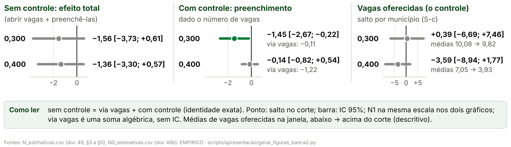
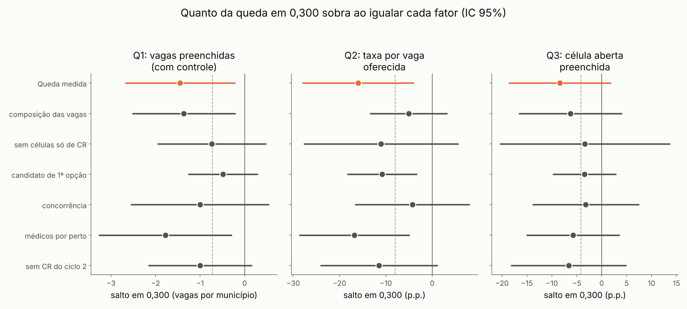
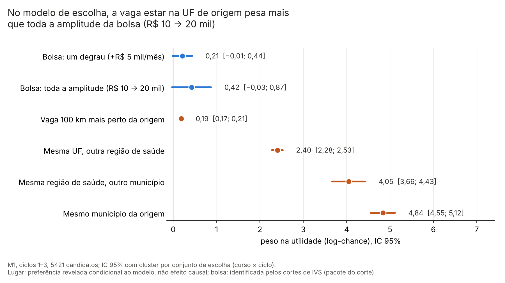
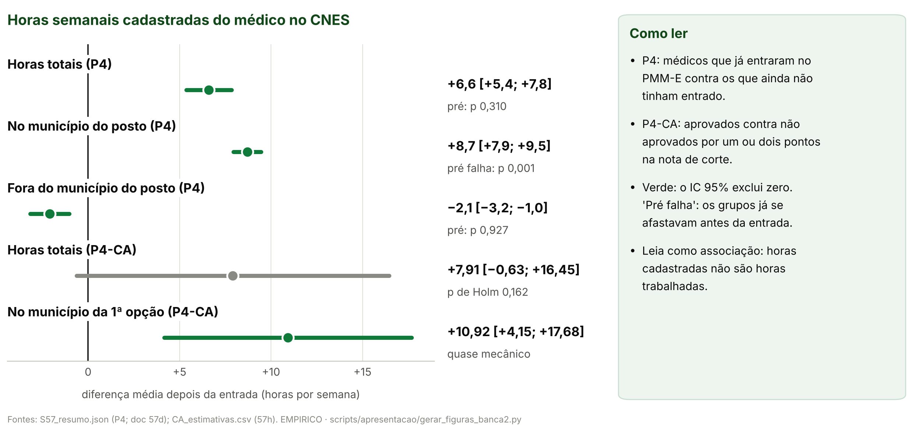

> [!IMPORTANT]
> **Pedidos do autor (26/10/2026).** Primeiro: "só do 14 em diante, e MUITO
> menor, focado nas discussões que tivemos aqui, sem colocar um monte de
> texto, sem colocar o diagrama causal da teoria no meio". Depois, a
> sequência: o autor viu valor em quatro resultados (a regra sharp, o "antes
> e depois do controle", a H3 e a H4) e nos comentários antes (para
> contextualizar) e depois (para explicar). A hipótese de cada resultado vem
> logo antes do gráfico dela, com a especificação numa tabela compacta. A H2
> sai como slide próprio, porque a H3 já a contém: o resultado dela vira uma
> frase no "depois" da H3. Saem também a tabela geral "Um estimador por
> hipótese", o slide "Quatro hipóteses" e os dados crus. O deck completo
> continua em [02_conteudo_slides.md](02_conteudo_slides.md).
>
> **Formato.** Cada `##` é um slide: título-afirmação (no máximo 58
> caracteres, para não encostar no logotipo), a figura (ou a tabela) grande e
> **no máximo duas linhas curtas, contando a cautela**; os slides só de texto
> (antes e depois de um resultado) têm até quatro itens, e `<!-- linhas: N -->`
> muda o limite de um slide quando o autor pediu mais uma linha. As linhas são
> os marcadores `- `; a cautela é a citação em negrito. O resto vai para as
> notas do apresentador. Com a figura alta, as linhas vão para uma coluna ao
> lado dela, para não sobrar faixa vazia. As fichas de especificação
> (`curto_ficha`) não têm limite de linhas e usam letra de 14 pt ou mais; cada
> linha delas é, com o mesmo texto, uma linha da ficha do deck completo
> (doc 02). O gerador (`scripts/apresentacao/gerar_deck_banca2.py --curto`)
> para se uma linha passar do limite ou se um slide não couber.
>
> **Regra dos números.** A mesma do doc 02: todo número de um slide, notas
> incluídas, é o valor de um código listado na linha `**Números:**` ou um
> parâmetro do protocolo ([03, §3](03_proveniencia_figuras_e_numeros.md#3-parâmetros-que-podem-aparecer-sem-código)).
> `tests/test_deck_curto_banca2.py` confere isso, a ordem, a ausência dos
> slides do grupo, do diagrama e do apêndice, o limite de linhas, as fichas
> contra o doc 02 e o slide da queda em 0,300 (duas ideias, sem selo, fiel à
> frase validada da auditoria 33, §8).

<!-- deck:inicio -->

# Hipótese

## O que a bolsa de R$ 5 mil faz

`Banca 2 · Parte empírica`

<!-- layout: curto_capa -->

- R$ 5 mil a mais nos cortes do IVS: preenchimento, escolha e oferta de especialistas

**Fontes:** plano da banca 2, §3; doc 57.

**Números:** nenhum

> **Notas do apresentador.** O efeito candidato é o incentivo marginal de
> R$ 5 mil anunciado, como pacote do corte: em 0,300 e 0,400 mudam também
> outras regras federais. Não é a participação no PMM-E nem o efeito do Agora
> Tem Especialistas. Seguimos a cadeia: a regra que permite comparar; o
> preenchimento (H1); a escolha e o peso da origem (H3, que contém a H2); a
> oferta (H4).

---

# Metodologia

## A bolsa sai do IVS de 2010: dá para comparar no corte

`Identificação · Antes`

<!-- layout: curto_texto -->

- **Regra** o IVS 2010 do município define a faixa: até 0,300, R$ 10 mil; até 0,400, R$ 15 mil; acima, R$ 20 mil
- **RDD** perto de cada corte os municípios são parecidos; de um lado para o outro, só a bolsa (e as regras do mesmo corte) muda
- **Ciclos** usamos os três: 368, 454 e 748 municípios com vaga; comparamos sempre dentro do ciclo

> **Pacote do corte: em 0,300 e 0,400 mudam também outras regras federais.**

**Fontes:** auditoria 16; protocolo 48; `output/apresentacao_banca2/tabela_descritiva_ciclos.csv`.

**Números:** `D_C1_MUN`, `D_C2_MUN`, `D_C3_MUN`, `CR_C1_QUADRO`, `CR_C2_RETIF`, `CR_C3_RETIF`

> **Notas do apresentador.** A ideia da descontinuidade: municípios logo
> abaixo e logo acima de um corte têm vulnerabilidade quase igual, mas bolsas
> diferentes; a diferença no corte mede o degrau. O IVS foi medido em 2010,
> antes do programa, e ninguém muda de faixa. Ciclos: o 1 abriu com o quadro
> de 24/07/2025, o 2 com o quadro retificado em 19/03/2026 e o 3 com o quadro
> retificado em 24/07/2026; o seguimento do ciclo 3 no CNES segue congelado.

---

## A bolsa é função exata do IVS: a regra é sharp

`Identificação · Resultado`

<!-- layout: curto_figura -->

- **Ciclos 1 e 2:** a regra reproduz a faixa de 368 de 368 e de 454 de 454 municípios.

> **Outras regras federais mudam nos mesmos cortes: pacote do corte.**

**Fontes:** `output/rdd_bolsa/portao_r1_ivs_oficial.json`; `output/aquisicao/a08_ivs_2010_oficial_municipio.csv`; auditoria 16.

**Números:** `R_C1_REPR`, `R_C1_MUN`, `R_C2_REPR`, `R_C2_MUN`, `R_ESCORE_IGUAIS`, `R_C3_REPR`, `R_C3_MUN`

> **Notas do apresentador.** É a evidência de que o desenho existe: o primeiro
> estágio é a própria regra. Até 0,300, R$ 10 mil; até 0,400, R$ 15 mil;
> acima, R$ 20 mil. O escore da relação nominal do MS é o IVS 2010 oficial em
> 404/404 municípios. No ciclo 3, congelado, 747 de 748: o que falta foi
> criado depois de 2010.

---

## H1: bolsa maior → mais vagas preenchidas?

`H1 · Antes · Especificação`

<!-- layout: curto_ficha -->

| Campo | Como é feito |
|---|---|
| Outcome | vagas preenchidas na 1ª chamada, por município e ciclo (N1); a célula aberta preenchida (A3) usa a mesma RDD, com efeitos fixos de curso × ciclo e de tipo de vaga |
| Amostra | só municípios com vaga no quadro, ciclos 1–3; kernel triangular, h = 0,050; cada corte separado |
| Equação em palavras | vagas preenchidas = intercepto do ciclo + salto × (lado de bolsa maior) + reta de cada lado do corte, por ciclo + coeficiente do ciclo × vagas oferecidas; sem controle, sai o último termo |
| Comum e por ciclo | salto comum aos ciclos; intercepto, retas e coeficiente das vagas oferecidas, por ciclo |
| Erro-padrão | agrupado por município (CR1) |
| Cuidado | as vagas oferecidas podem responder ao corte: aí o controle compara municípios diferentes; pacote do corte |

**Fontes:** protocolo 48, §1, §3 e §7; doc 49, §2 e §3; ficha completa no deck completo (doc 02).

**Números:** nenhum

> **Notas do apresentador.** Hipótese H1: onde a bolsa é maior, mais vagas
> são preenchidas. Sem controle, o salto é o efeito total: abrir vagas e
> preenchê-las. Com o controle das vagas oferecidas, é o preenchimento dado o
> número de vagas. A decomposição é exata: total = via oferta + com controle.
> Sensibilidades: coeficiente único das vagas, inclinação por lado e IC
> honesto.

---

# Resultados

## Antes e depois do controle: em 0,400, passa pelas vagas

`H1 · Resultado`

<!-- layout: curto_figura -->

<!-- linhas: 3 -->

- **0,400:** passa pelas vagas: o lado de bolsa maior oferece menos vagas (−3,59).
- **0,300:** a oferta não muda; cai o preenchimento por vaga (pacote do corte).

> **TOST: sem aumento de 10 p.p. ou de 25% da média; não dá para dizer que nada mudou.**

**Fontes:** `output/rdd_bolsa/N_estimativas.csv` (decomposição e S-c; doc 49, §3 a §5); `ND_estimativas.csv` (doc 49b, §3); `EQ_estimativas.csv` (TOST; doc 57j; auditoria 32).

**Números:** `VIC_400_TAU`, `N1_400_DTOT`, `N1_400_VIA`, `N1_400_DSA`, `N1_300_DTOT`, `N1_300_VIA`, `N1_300_DSA`, `VIC_300_TAU`, `ND_TX300`, `ND_TX300_INF`, `ND_TX300_SUP`, `ND_TX300_C2_PCT`, `EQ_A3_300_I90S`, `EQ_A3_400_I90S`, `EQ_N1_300_I90S`, `EQ_N1_400_I90S`

> **Notas do apresentador.** Sem controle, o efeito total de abrir vagas e
> preenchê-las; com controle, o preenchimento dado o número de vagas. A
> decomposição é exata (Frisch–Waugh–Lovell): sem controle = via vagas + com
> controle. Em 0,400: −1,36 = −1,22 + −0,14; do lado de bolsa maior há menos
> vagas oferecidas, e dado o número de vagas a diferença quase some. Em
> 0,300: −1,56 = −0,11 + −1,45; a oferta não muda (+0,39) e cai a taxa de
> preenchimento por vaga oferecida, −16,0 p.p. [−27,9; −4,1], 51% dela no
> ciclo 2. N1 em 0,300 não é lido como queda: linha por corte, sem correção
> múltipla, com IC honesto que contém zero. TOST com IC de 90%: o limite de
> cima é +0,1 p.p. e +9,3 p.p. na célula aberta (margem de 10 p.p.) e −0,42 e
> +0,43 nas vagas por município (margem de 25% da média); só o teste do
> aumento rejeita. Uma queda desse tamanho não fica descartada.

---

## Por que o preenchimento cai em 0,300

`H1 · Depois · Queda em 0,300`

<!-- layout: curto_figura -->

<!-- linhas: 3 -->

- **É a estimativa no corte, não os dados:** nas médias da janela, 33,3% das células são preenchidas abaixo e 33,5% acima; a queda vem da reta levada até o corte, com poucos municípios. O acaso não está descartado.
- **As vagas do lado de cima eram diferentes:** cursos que preenchem pouco em qualquer lugar, mais células do mesmo curso na mesma UF disputando candidatos e, no ciclo 2, mais células só de reserva. Igualando esses fatores, a queda diminui pela metade ou mais em parte das medidas, mas nenhum fator faz isso nas três.

> **Nada disso mostra que a bolsa reduz o preenchimento: o corte junta a bolsa com outras regras.**

**Fontes:** `output/rdd_bolsa/DQ_estimativas.csv`, `DQ_resumo.json` e `DQ_figuras/DQ_quanto_da_queda.png` (protocolo 61; doc 57l; auditoria 33, §8); figura usada sem redesenho, conferida pelo hash.

**Números:** `DQ_FUN_PRE_ABX`, `DQ_FUN_PRE_ACI`, `DQ_CURSO_TAU`, `DQ_CURSO_INF`, `DQ_CURSO_SUP`, `DQ_CONCUF_TAU`, `DQ_CONCUF_INF`, `DQ_CONCUF_SUP`, `DQ_SOCR_C2_TAU`, `DQ_SOCR_C2_INF`, `DQ_SOCR_C2_SUP`, `DQ_CAND1_TAU`, `DQ_CAND1_INF`, `DQ_CAND1_SUP`, `DQ_FIX_COMP_Q2`, `DQ_FIX_COMP_Q2_PCT`, `DQ_FIX_CONC_Q2`, `DQ_FIX_CONC_Q2_PCT`, `DQ_FIX_FUNIL_Q1`, `DQ_FIX_FUNIL_Q1_PCT`, `DQ_PPOSTO_Q1`, `DQ_PCOMP_Q1`

> **Notas do apresentador.** Diagnóstico do protocolo 61 (doc 57l),
> auditado (auditoria 33, aprovado com correções de texto): descritivo e
> pós-resultado. Q1 é N1 com controle; Q2, a taxa por vaga oferecida; Q3, a
> célula aberta preenchida. Nas médias da janela, sem reta nem efeitos fixos,
> 33,3% das células são preenchidas abaixo de 0,300 e 33,5% acima. Do lado de
> cima: índice de curso −4,5 p.p. [−7,1; −2,0] (cursos que preenchem pouco em
> qualquer lugar); +10,6 [+3,5; +17,8] células do mesmo curso na mesma UF; no
> ciclo 2, +28,4 p.p. [+8,3; +48,4] de células só de reserva. Que menos
> células tiveram candidato de 1ª opção é estimativa imprecisa: −10,8 p.p.
> [−28,2; +6,7]. Igualando a composição, Q2 vai a −5,1 p.p., 32% do
> original; a concorrência, Q2 a −4,3 p.p., 27%; quem teve candidato de 1ª
> opção, Q1 a −0,49, 34%; nenhum fator reduz a queda à metade nas três
> medidas. Acaso: com os 3 cortes falsos do protocolo, o p por posto é 0,250,
> o menor possível; numa grade maior, fora do protocolo, 0,031. Esses
> fatores se formam depois do anúncio da faixa: descrevem o que acompanha a
> queda, não a causa.

---

# Metodologia

## H3: a bolsa pesa pouco perto da origem do médico?

`H3 · Antes · Especificação`

<!-- layout: curto_ficha -->

| Campo | Como é feito |
|---|---|
| Outcome | a 1ª opção de cada candidato, entre todas as vagas (células) do mesmo curso e ciclo |
| Amostra | candidatos de 1ª opção ligados ao CNES e com município de origem, ciclos 1–3 |
| Equação em palavras | utilidade da vaga = peso da bolsa × bolsa + curva suave do IVS (nós nos cortes) + peso da distância × distância até a origem + pesos de mesma UF, mesma região e mesmo município + porte, capital e vaga imediata |
| Comum e por ciclo | pesos comuns aos ciclos na principal (M1); um peso da bolsa por ciclo no M5, o da H2 |
| Erro-padrão | agrupado por conjunto de escolha (curso × ciclo) |
| É causal? | bolsa: quase-experimental, pelo salto nos cortes (pacote do corte); origem: preferência revelada, não efeito causal |
| Cuidado | só quem se candidatou; independência de alternativas irrelevantes |

**Fontes:** protocolos 52 e 52b; docs 57a e 57i; ficha completa no deck completo (doc 02).

**Números:** `M1_N`

> **Notas do apresentador.** Hipótese H3, a central: a bolsa pesa pouco
> perto de trabalhar na UF de origem. É o logit condicional da H2 (McFadden):
> cada um dos 5.421 candidatos escolhe a vaga de maior utilidade entre as do
> seu curso e ciclo. A curva do IVS absorve o que muda suave com a
> vulnerabilidade; só o salto da bolsa nos cortes identifica o peso dela. A
> origem é onde o médico já trabalhava, não uma condição sorteada.

---

# Resultados

## H3: a UF de origem pesa mais que toda a bolsa

`H3 · Resultado`

<!-- layout: curto_figura -->

<!-- linhas: 3 -->

- **Log-chance:** 0,21 ≈ chance cerca de 24% maior de a vaga ser a 1ª opção, sem distinção de zero; não é efeito no preenchimento.
- **Toda a bolsa:** 0,42 [−0,03; 0,87]; a mesma UF de origem, 2,40 [2,28; 2,53]; a diferença, 1,98 [1,56; 2,40].

> **Pós-resultado; o peso da origem é preferência revelada, não efeito causal.**

**Fontes:** `output/rdd_bolsa/P1h_magnitudes.csv`, `P1h_resumo.json` e `P1h_figuras/P1h_magnitudes.png` (doc 57i; protocolo 52b; auditoria 31); `P1_estimativas.csv` (M1).

**Números:** `H3_5B`, `M1_RC_PCT`, `H3_5B_INF`, `H3_5B_SUP`, `M1_RC`, `H3_10B`, `H3_10B_INF`, `H3_10B_SUP`, `H3_THETA`, `H3_THETA_INF`, `H3_THETA_SUP`, `H3_DUF`, `H3_DUF_INF`, `H3_DUF_SUP`, `H3_DUF_P`

> **Notas do apresentador.** Os números da figura são pesos na escolha da
> vaga, em log-chance, não efeitos no preenchimento. Um degrau da bolsa pesa
> 0,21 [−0,01; 0,44]: a vaga com +R$ 5 mil tem chance 24% maior de ser a 1ª
> opção (razão de chances 1,24), sem distinção de zero. Toda a bolsa pesa
> 0,42; a vaga na mesma UF de origem, fora da região de saúde, pesa 2,40. A
> diferença, 1,98 [1,56; 2,40], p unilateral < 0,001, é o teste da H3,
> unilateral e pós-resultado: os coeficientes já eram conhecidos. O peso da
> bolsa tem identificação nos cortes (com as regras do mesmo corte); o da
> origem é preferência revelada.

---

## O que isso quer dizer: incentivo limitado

`H3 · Depois`

<!-- layout: curto_texto -->

- **Limitado** toda a bolsa pesa menos que trabalhar na UF de origem
- **Escolha** a bolsa empurra pouco a escolha: por ciclo, só o ciclo 2 mostra efeito, 1,70 [1,22; 2,37] por +R$ 5 mil; nos ciclos 1 e 3, 1,07 e 1,00
- **Preenchimento** por isso não aparece nas vagas preenchidas: o modelo prevê só +0,20 e +0,24 candidato de 1ª opção por célula em 0,300 e 0,400

> **Escolha não é expansão: o que uma vaga ganha, outra do mesmo curso perde.**

**Fontes:** `output/rdd_bolsa/P1h_magnitudes.csv` (doc 57i); `P1_estimativas.csv` (M5 por ciclo e ponte P1g; doc 57a, §4 e §9).

**Números:** `M5_C2_RC`, `M5_C2_RCI`, `M5_C2_RCS`, `M5_C2_P`, `M5_C1_RC`, `M5_C1_RCI`, `M5_C1_RCS`, `M5_C3_RC`, `M5_C3_RCI`, `M5_C3_RCS`, `M5_WALD_P`, `P1G_300_PREV`, `P1G_300_PREV_INF`, `P1G_300_PREV_SUP`, `P1G_400_PREV`, `P1G_400_PREV_INF`, `P1G_400_PREV_SUP`, `P1G_300_OBS`, `P1G_300_OBS_INF`, `P1G_300_OBS_SUP`, `P1G_400_OBS`, `P1G_400_OBS_INF`, `P1G_400_OBS_SUP`

> **Notas do apresentador.** Incentivo limitado: a política mexe numa
> variável, e o custo do lugar continua contra. A H2 vira uma frase: logit
> com distância, um resultado por ciclo, 1,70 [1,22; 2,37] no ciclo 2, p
> 0,002; 1,07 [0,69; 1,65] no ciclo 1 e 1,00 [0,72; 1,39] no ciclo 3; a
> igualdade entre ciclos tem p 0,058. Ponte com a H1 (P1g, leitura de
> consistência, não teste): se só a bolsa subisse um degrau, o modelo prevê
> +0,20 [−0,01; +0,41] candidato de 1ª opção por célula (estabelecimento × curso) em 0,300 e +0,24
> [−0,03; +0,52] em 0,400; a RDD por célula observa −0,66 [−1,36; +0,05] e
> −0,19 [−1,09; +0,70]. Os intervalos contêm zero e se sobrepõem: o efeito
> que a escolha implica é pequeno demais para aparecer no preenchimento. O
> logit não vê quem deixou de se candidatar.

---

# Metodologia

## H4: a chegada aumenta a oferta ou só remaneja?

`H4 · Antes · Especificação`

<!-- layout: curto_ficha -->

| Campo | Como é feito |
|---|---|
| Outcome | horas semanais cadastradas do médico no CNES: totais, no município do posto e fora dele |
| Amostra | médico × mês; médicos dos ciclos 1 e 2 na lista de ativos, ligados ao CNES |
| Equação em palavras | efeito k meses depois de entrar = mudança das horas desde o mês anterior à entrada, nos que entraram, menos a mesma mudança nos que ainda não entraram (Callaway–Sant'Anna) |
| Comum e por ciclo | um efeito por coorte de entrada (mês de início) e por mês; o resultado é a média do pós |
| Erro-padrão | bootstrap multiplicador agrupado por médico |
| Cuidado | o pré falha em parte dos outcomes; horas cadastradas não são presença |

**Fontes:** protocolos 54 e 59; docs 57d e 57h; ficha completa no deck completo (doc 02).

**Números:** nenhum

> **Notas do apresentador.** Hipótese H4: o médico que chega aumenta a
> oferta de especialistas ou só passa a ser registrado onde já estava? O
> estudo de evento escalonado compara cada médico, depois de entrar, com os
> que ainda não entraram. Sensibilidades: Rambachan–Roth e a comparação com
> quem ficou logo abaixo da nota de corte.

---

# Resultados

## H4: o médico soma horas, mas metade já estava lá

`H4 · Resultado`

<!-- layout: curto_figura -->

- **Horas totais:** +6,6 h/sem [+5,4; +7,8] depois da entrada, sobretudo no município do posto.

> **Associação, não efeito da bolsa; horas cadastradas não são presença.**

**Fontes:** `output/rdd_bolsa/S57_resumo.json` (P4, doc 57d); `H_estimativas.csv` e `CA_estimativas.csv` (doc 57h).

**Números:** `P4_HT_ATT`, `P4_HT_INF`, `P4_HT_SUP`, `P4_HM_ATT`, `P4_HF_ATT`, `CA_HT_EST`, `CA_HT_INF`, `CA_HT_SUP`

> **Notas do apresentador.** O médico soma +6,6 h/sem [+5,4; +7,8] de horas
> totais cadastradas, sobretudo no município do posto (+8,7, com o pré
> falhando), e perde −2,1 fora dele. Na comparação com quem ficou logo abaixo
> da nota de corte, +7,91 [−0,63; +16,45]: mesma direção, IC que contém zero.
> Não é a participação no PMM-E nem o efeito da bolsa.

---

## O que isso quer dizer: soma horas, mas em parte remaneja

`H4 · Depois`

<!-- layout: curto_texto -->

- **Substituição** metade já estava lá: 51,0% tinham vínculo no município do posto antes de entrar
- **Cadastro** horas cadastradas no CNES não são presença nem horas trabalhadas
- **Município** o efeito sobre os especialistas do município ainda está em análise

> **Associação sob tendências paralelas; não é a participação no PMM-E.**

**Fontes:** `output/rdd_bolsa/S57_resumo.json` (P4, doc 57d).

**Números:** `P4_ORIGEM`, `P4_ORIGEM_INF`, `P4_ORIGEM_SUP`

> **Notas do apresentador.** 51,0% [48,4; 53,7] dos médicos já tinham vínculo
> no município do posto: parte do ganho é registro novo, não médico novo. O
> efeito da chegada sobre a oferta de especialistas do município e o
> deslocamento dos outros médicos estão em análise (protocolo 60, parte B),
> ainda sem resultado para mostrar.

---

# Conclusão

## A bolsa muda a escolha, não o preenchimento

`Conclusão`

<!-- layout: curto_texto -->

- **Escolha** reordena candidatos entre vagas, só no ciclo 2
- **Preenchimento** não aumenta em nenhum dos dois cortes
- **Oferta** soma horas, mas metade dos médicos já estava lá

> **Pacote do corte; inconclusivo não é efeito zero; vínculo não é presença.**

**Fontes:** síntese dos slides anteriores; doc 57.

**Números:** nenhum

> **Notas do apresentador.** Escolha não é expansão: a bolsa reordena os
> candidatos entre as vagas abertas, e o que uma vaga ganha outra do mesmo
> curso perde. O preenchimento não aumenta em nenhum dos dois cortes; uma
> queda do mesmo tamanho não fica descartada. Na oferta, o médico soma horas
> cadastradas, mas metade já trabalhava no município do posto. Próximos
> passos: repetir o ciclo 2 no ciclo 3, com a competência 202703 madura, e
> pedir o universo de inscritos.

<!-- deck:fim -->

<!-- apendice:fim -->
